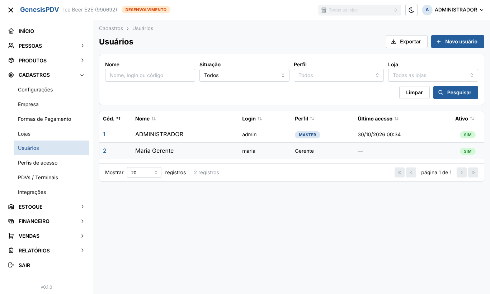
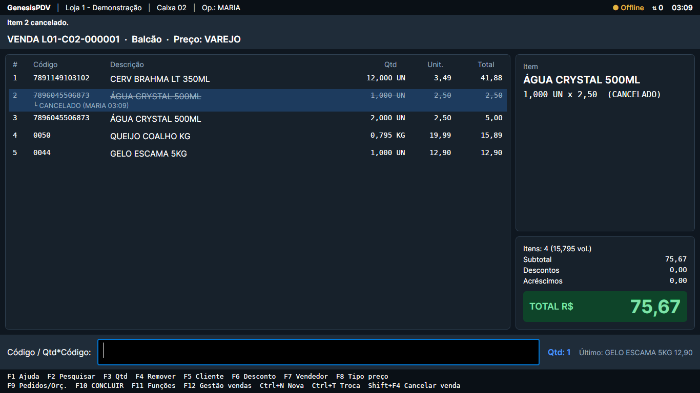
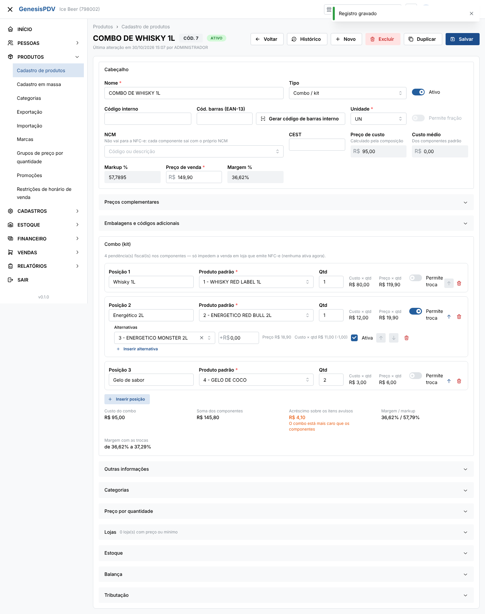
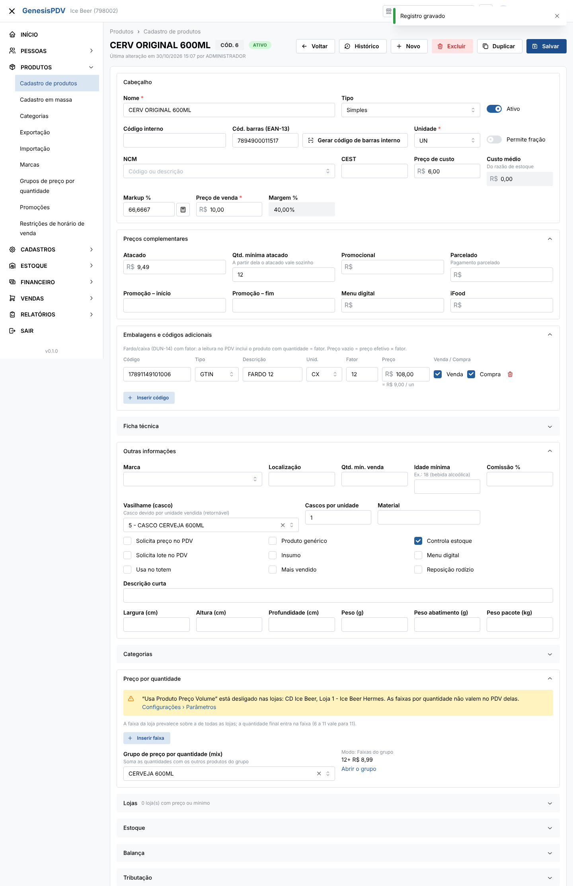
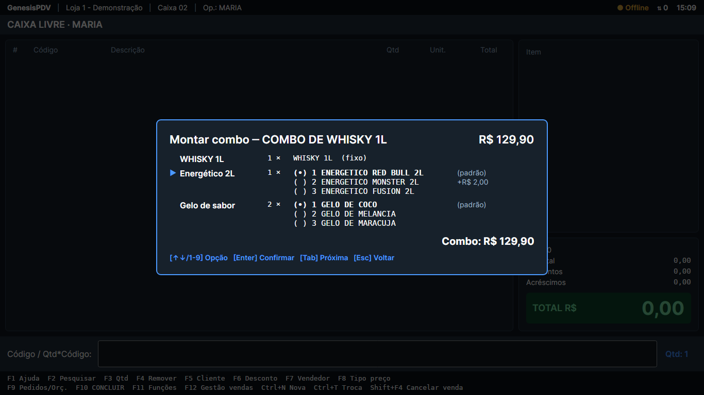
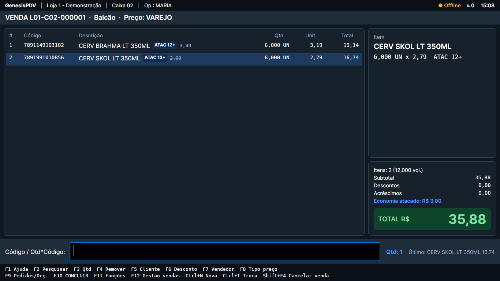

# GenesisPDV & ERP

Sistema de gestão para varejo, **multiempresa e multiloja**, inspirado no Nuvem3:

- **ERP web**: retaguarda no navegador (cadastros, estoque, financeiro, vendas, relatórios, configurações).
- **PDV**: frente de caixa instalada nos computadores das lojas. **Funciona sem internet**: grava tudo num banco
  local (SQLite) e sincroniza com a nuvem quando a conexão volta.
- **API na nuvem**: atende o ERP e a sincronização dos PDVs. Cada empresa tem um **código** (ex.: `100001`) e um
  **banco de dados próprio e completo**.

> Status: **Fase 0 (Fundação) concluída** e **Fase 1A (cadastros do ERP, estoque e motor de preços/combos do PDV)
> pronta**. Próximo passo: **Fase 1B, sincronização real ERP ↔ PDV**.
> Veja o [roadmap](docs/roadmap.md).

## Estrutura

```
apps/
  api/        API na nuvem — Node.js 22 + TypeScript + NestJS + Drizzle + PostgreSQL
  erp-web/    ERP web — React + Vite + TypeScript + Mantine
  pdv/        PDV desktop — C# .NET 10 + Avalonia UI + SQLite (Windows; o código também compila no Linux)
packages/
  shared/     Tipos, validações (zod) e catálogo de permissões compartilhados entre API e ERP
infra/        docker-compose para desenvolvimento (PostgreSQL, Mailpit, S3 local); infra/producao: VPS + Cloud SQL, backup diário
docs/         Arquitetura, especificações do PDV e do ERP, roadmap, referências e capturas de tela
```

## Documentação

| Documento | Conteúdo |
|---|---|
| [Decisões de arquitetura (ADRs)](docs/arquitetura/decisoes.md) | As regras que todo o resto segue |
| [Visão geral](docs/arquitetura/visao-geral.md) | Como as partes se conectam, escolhas de tecnologia, hospedagem, segurança, glossário |
| [Modelo de dados](docs/arquitetura/modelo-de-dados.md) | Todas as tabelas: banco de controle, banco de cada empresa e banco local do PDV |
| [Sincronização offline](docs/arquitetura/sincronizacao.md) | Protocolo PDV ↔ nuvem, eventos, idempotência, cenários de falha |
| [Especificação do PDV](docs/pdv/especificacao-pdv.md) | Frente de caixa completa: telas, atalhos, pagamentos, caixa, fiscal |
| [Especificação do ERP](docs/erp/especificacao-erp.md) | Todos os módulos, tela a tela |
| [Roadmap](docs/roadmap.md) | Fases do zero até ficar completo |
| [Roteiro do piloto](docs/implantacao/roteiro-piloto.md) | Passo a passo do dono para pôr o caixa na loja: cadastros, Prontidão da loja, instalação, dia D e contingências |

## Rodar localmente (resumo)

Pré-requisitos: Node 22.13+, pnpm 10, PostgreSQL 16 e .NET 10 SDK (para o PDV).
O passo a passo completo está no README de cada app: [API](apps/api/README.md), [ERP web](apps/erp-web/README.md) e
[PDV](apps/pdv/README.md).

```bash
pnpm install
pnpm --filter api db:migrate:controle
pnpm --filter api admin:criar --email voce@genesis.dev --nome "Seu Nome" --papel superadmin
pnpm --filter api empresa:criar --razao-social "Ice Beer Comércio de Bebidas Ltda" --cnpj 11222333000181
pnpm --filter api dev        # API em http://localhost:3000
pnpm --filter erp-web dev    # ERP em http://localhost:5173
```

```bash
cd apps/pdv
dotnet test --solution GenesisPDV.slnx
dotnet run --project src/GenesisPDV.App
```

## Capturas de tela (Fase 0)

| ERP: listagem de usuários | PDV: venda em andamento |
|---|---|
|  |  |

## Capturas de tela (Fase 1A)

| ERP: combo com troca de componente | ERP: fardo, atacado, mix e casco |
|---|---|
|  |  |

| PDV: montar combo pelo teclado | PDV: mix 6 Brahma + 6 Skol no atacado |
|---|---|
|  |  |

Mais telas em [`docs/telas/`](docs/telas/).

## Contribuindo

Veja [CONTRIBUTING.md](CONTRIBUTING.md). Documentação, commits e textos de interface em português do Brasil.

---

Software proprietário. Todos os direitos reservados.
