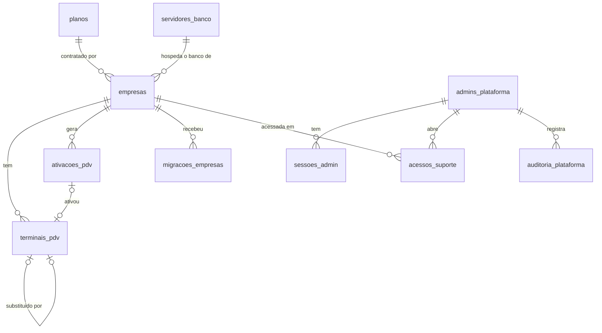
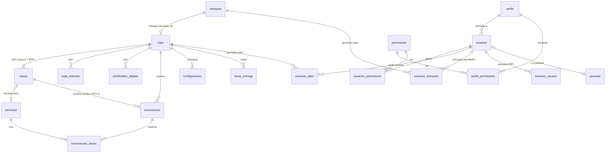
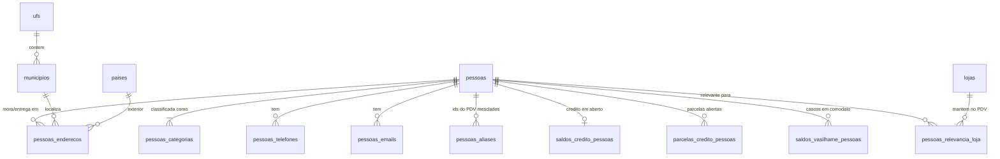
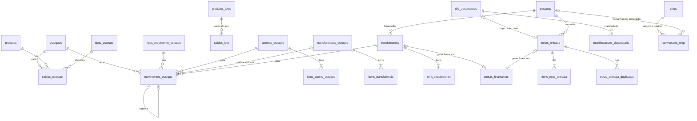
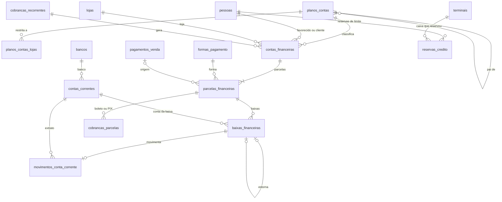
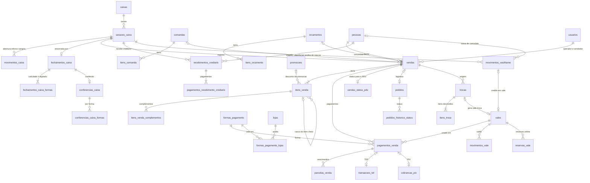
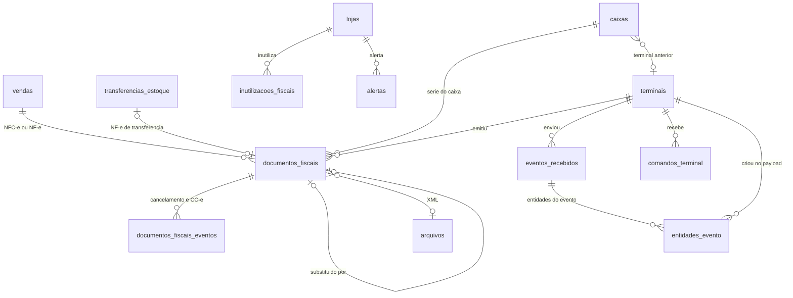
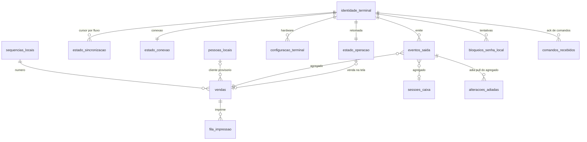
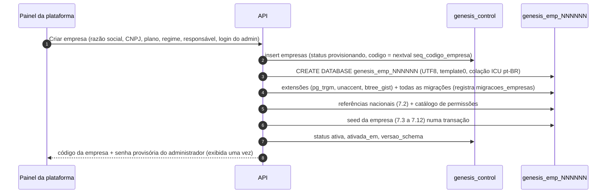

# Modelo de Dados – GenesisPDV & ERP

> **Fonte da verdade** dos nomes de tabelas e colunas. A especificação do ERP (`docs/erp/especificacao-erp.md`), a do
> PDV (`docs/pdv/especificacao-pdv.md`) e o código (schema Drizzle em `apps/api`, entidades EF Core em `apps/pdv`)
> devem usar exatamente os nomes daqui. Divergências encontradas nos outros documentos estão na seção
> [8. Mapa de nomes](#8-mapa-de-nomes-outros-documentos--nome-oficial).
>
> Segue as decisões de `docs/arquitetura/decisoes.md` (ADR-02 a ADR-11). Se uma decisão mudar, atualize o ADR primeiro.

## Sumário

1. [Convenções](#1-convenções)
2. [Banco de controle `genesis_control`](#2-banco-de-controle-genesis_control)
3. [Banco da empresa `genesis_emp_<codigo>`](#3-banco-da-empresa-genesis_emp_codigo)
   - 3.1 [Sistema e infraestrutura](#31-sistema-e-infraestrutura)
   - 3.2 [Empresa, lojas, estoques e caixas](#32-empresa-lojas-estoques-e-caixas)
   - 3.3 [Usuários e permissões](#33-usuários-e-permissões)
   - 3.4 [Tabelas de referência (nacionais)](#34-tabelas-de-referência-nacionais)
   - 3.5 [Pessoas](#35-pessoas)
   - 3.6 [Produtos](#36-produtos)
   - 3.7 [Estoque](#37-estoque)
   - 3.8 [Compras e entradas (recebimentos e NF-e)](#38-compras-e-entradas-recebimentos-e-nf-e)
   - 3.9 [Financeiro](#39-financeiro)
   - 3.10 [Formas de pagamento e configuração do PDV](#310-formas-de-pagamento-e-configuração-do-pdv)
   - 3.11 [Vendas, orçamentos, comandas e pedidos](#311-vendas-orçamentos-comandas-e-pedidos)
   - 3.12 [Caixa (sessões, movimentos, fechamentos)](#312-caixa-sessões-movimentos-fechamentos)
   - 3.13 [Trocas e vales](#313-trocas-e-vales)
   - 3.14 [Fiscal (documentos, eventos, inutilizações)](#314-fiscal-documentos-eventos-inutilizações)
   - 3.15 [Sincronização e terminais (lado da empresa)](#315-sincronização-e-terminais-lado-da-empresa)
4. [Banco local do PDV (SQLite)](#4-banco-local-do-pdv-sqlite)
5. [Diagramas ER por módulo](#5-diagramas-er-por-módulo)
6. [Sincronização: o que desce e o que sobe](#6-sincronização-o-que-desce-e-o-que-sobe)
7. [Dados iniciais (seed) de uma empresa nova](#7-dados-iniciais-seed-de-uma-empresa-nova)
8. [Mapa de nomes (outros documentos → nome oficial)](#8-mapa-de-nomes-outros-documentos--nome-oficial)

---

## 1. Convenções

### 1.1 Identificadores (ADR-04)

| Regra | Detalhe |
|---|---|
| Chave primária | `id uuid` **UUID v7** em toda tabela de negócio. Gerado pela aplicação (API: biblioteca `uuidv7`; PDV: `Guid.CreateVersion7()` do .NET 9+). O PDV gera os ids de tudo o que nasce nele (vendas, itens, pagamentos, sessões, movimentos, eventos) — offline, sem colisão |
| Default no banco | `default fn_uuid_v7()` (função abaixo) apenas como rede de segurança para seeds e SQL manual. No PostgreSQL 18+ pode ser trocada pela nativa `uuidv7()` |
| Código legível | Coluna `codigo` (`integer`), sequencial **por entidade**, gerada por sequência PostgreSQL própria (`seq_codigo_<tabela>`), exibida como "Cód."/"Id" no ERP. Lacunas são aceitas. Registros criados no PDV chegam com `codigo` nulo e a nuvem atribui ao incorporar |
| Numeração de documentos | Número de venda, NF-e, NFC-e e comanda **não** usam sequência PostgreSQL: usam a tabela `numeracoes` (sem lacunas, por escopo loja/caixa/série) — seção 3.1 |
| Tabelas de referência nacionais | Usam **chave natural** (`ncms.codigo`, `cfops.codigo`, `municipios.codigo_ibge`, `permissoes.chave`, `tipos_movimento_estoque.codigo`…). São iguais em toda empresa e o código é o que circula nos documentos fiscais; um UUID diferente por empresa só atrapalharia seeds, sincronização e migração do Nuvem3 |
| URLs | Sempre o UUID (`/produtos/0192…`); nunca `codigo` |

```sql
-- Rede de segurança para seeds/SQL manual (a aplicação gera o UUID v7 normalmente).
create or replace function fn_uuid_v7() returns uuid
language sql volatile as $$
  select encode(
    set_bit(set_bit(
      overlay(uuid_send(gen_random_uuid())
              placing substring(int8send(floor(extract(epoch from clock_timestamp()) * 1000)::bigint) from 3)
              from 1 for 6),
      52, 1), 53, 1), 'hex')::uuid;
$$;
```

### 1.2 Tipos (ADR-05)

| Domínio | Tipo PostgreSQL | C# | TypeScript (API/ERP) | Observação |
|---|---|---|---|---|
| Dinheiro (totais, valores, saldos) | `numeric(15,2)` | `decimal` | `string` na API; `Decimal` (`decimal.js`) no cálculo | Nunca `number` em cálculo |
| Preço unitário, custo unitário, custo médio | `numeric(15,4)` | `decimal` | `string` | 4 casas (Configurações › Vendas › "4 casas decimais" só muda a exibição) |
| Quantidade | `numeric(15,3)` | `decimal` | `string` | Sempre na **unidade base** do produto no estoque |
| Percentual (desconto, comissão, taxa, alíquota) | `numeric(7,4)` | `decimal` | `string` | 0,0000–999,9999; CHECK de faixa por coluna |
| Markup | `numeric(9,4)` | `decimal` | `string` | Pode passar de 1.000 % |
| Medidas (cm) | `numeric(10,2)` | `decimal` | `string` | |
| Pesos (g, kg) | `numeric(12,3)` | `decimal` | `string` | |
| Data e hora | `timestamptz` (UTC) | `DateTimeOffset` (UTC) | `string` ISO-8601 | Exibição no fuso da loja (`lojas.fuso_horario`) |
| Data (sem hora) | `date` | `DateOnly` | `string` `AAAA-MM-DD` | Vencimentos, nascimento, validade de lote, competência (1º dia do mês) |
| Texto limitado | `varchar(n)` | `string` | `string` | `n` = limite de negócio (o mesmo do `zod`) |
| Texto livre | `text` | `string` | `string` | |
| Códigos de formato fixo | `varchar(n)` + `CHECK` com regex | `string` | `string` | Ex.: `ck_documentos_fiscais_chave` `chave ~ '^[0-9]{6}[0-9A-Z]{12}[0-9]{26}$'` (chave de acesso com CNPJ alfanumérico, abaixo) |
| CPF / CNPJ | `varchar(11)` / `varchar(14)`, sem máscara | `string` | `string` | CPF `^[0-9]{11}$`; CNPJ `^[0-9A-Z]{12}[0-9]{2}$` (**CNPJ alfanumérico** emitido pela Receita desde jul/2026; maiúsculas automáticas na digitação) |
| Booleano | `boolean not null default …` | `bool` | `boolean` | Toda flag tem default explícito |
| JSON | `jsonb` | `JsonDocument`/DTO | objeto | Só para snapshots, payloads e valores de configuração |
| Binário cifrado | `bytea` | `byte[]` | — | Segredos (AES-256-GCM, chave fora do banco) |
| IP | `inet` | `string` | `string` | |

**CNPJ alfanumérico e chave de acesso.** O CNPJ tem 12 posições alfanuméricas (`0-9A-Z`) + 2 DVs numéricos; os DVs
são calculados por módulo 11 sobre o valor de cada caractere = **código ASCII − 48** (dígitos continuam valendo 0–9;
`A` = 17, `B` = 18…). A chave de acesso de NF-e/NFC-e (44 posições) é `cUF(2) AAMM(4) CNPJ(14) mod(2) serie(3)
nNF(9) tpEmis(1) cNF(8) cDV(1)`: só as 14 posições do CNPJ podem ter letras, e o DV da chave usa o mesmo módulo 11
sobre (ASCII − 48). Há **um validador único** de cada regra, com os mesmos casos de teste nos dois lados:
`CnpjValidador` e `ChaveAcessoValidador` em C# (`GenesisPDV.Fiscal`) e em `packages/shared` (`validarCnpj`,
`validarChaveAcesso`), usados pelo PDV (CPF/CNPJ na nota, cadastro rápido), pelo ERP, pela API (inclusive a
validação `CHAVE_INVALIDA` do push) e pela importação de NF-e. Critério de aceite: um CNPJ alfanumérico válido de
teste é aceito no `dest` da NFC-e e uma chave com CNPJ alfanumérico passa nas CHECKs abaixo.

**Dia operacional.** Toda coluna `dia_operacional` (`vendas`, `sessoes_caixa`, `fechamentos_caixa`) e todo relatório
"por dia" (Dashboard, Resumo diário, ERP 1.5, 6 e 16) usam a mesma regra: `dia_operacional` = data de
`(ocorrido_em no fuso lojas.fuso_horario) − geral.dia_operacional_hora_corte` (chave 3.1.2, `hh:mm`, padrão `05:00`
pela D7, sobreposição por loja). Ex.: com corte `05:00`, uma venda às 02:30 de 30/10 pertence ao dia 29/10. O PDV calcula com a
chave sincronizada; a nuvem recalcula com a mesma função (`fn_dia_operacional(loja_id, ocorrido_em)` na API e
`DiaOperacional.Calcular` no PDV) quando o relógio do terminal é suspeito. Mudar o corte não recalcula registros
antigos.

### 1.3 Colunas padrão (ADR-06) e categorias de tabela

Para não repetir em cada tabela, as colunas abaixo são indicadas por siglas.

**CP – colunas padrão** (toda tabela de negócio):

| Coluna | Tipo | Nulo | Padrão | Descrição |
|---|---|---|---|---|
| `id` | `uuid` | não | `fn_uuid_v7()` | PK, UUID v7 |
| `criado_em` | `timestamptz` | não | `now()` | Quando a linha foi criada **na nuvem** (para dados vindos do PDV, a hora do fato fica em colunas próprias: `ocorrido_em`, `finalizada_em`…) |
| `atualizado_em` | `timestamptz` | não | `now()` | Mantida pelo trigger `fn_versao` |
| `excluido_em` | `timestamptz` | sim | — | Exclusão lógica. Nada que sincroniza é apagado fisicamente |
| `versao` | `bigint` | não | — | Cursor de sincronização e controle de concorrência otimista. Preenchida pelo trigger com `nextval('seq_versao')` em todo INSERT/UPDATE |

**AU – autoria** (tabelas editadas pelo ERP): `criado_por_id uuid null → usuarios`, `atualizado_por_id uuid null → usuarios`
(nulo quando a origem é o sistema, uma importação ou um evento do PDV — nesse caso a autoria fica em `auditoria`).

| Categoria | Sigla | Colunas | Regras |
|---|---|---|---|
| Cadastro | **C** | CP + AU | Editável; exclusão lógica; auditada |
| Documento/movimento | **D** | CP (+ AU se nasce no ERP) | Imutável depois de efetivado/finalizado (trigger `fn_protege_imutavel`); correção = novo registro (estorno, cancelamento, ajuste) |
| Projeção | **P** | CP | Mantida só pelo sistema na mesma transação do fato (ex.: `saldos_estoque`); recalculável a partir do razão |
| Referência nacional | **R** | chave natural + `criado_em`, `atualizado_em`, `excluido_em`, `versao` | Carga por comando de plataforma em todos os bancos; não editável pelo usuário (exceto onde indicado) |
| Log técnico | **L** | `id`, `criado_em` (+ `atualizado_em` se mutável) | Sem `versao`, sem exclusão lógica, não sincroniza; política de retenção própria |

Marcador de sincronização em cada tabela: **↓** desce para o PDV · **↑** nasce no PDV e sobe por evento · **↕** ambos ·
**—** só nuvem.

### 1.4 Exclusão lógica

- `DELETE` físico é proibido em tabelas C/D/P/R (a role da aplicação não tem privilégio `DELETE` nelas). Exceções:
  tabelas L (purga por retenção).
- "Excluir" = `update … set excluido_em = now()`. Restaurar = `excluido_em = null`.
- Unicidade de negócio usa **índice único parcial** `where excluido_em is null` (ex.: CPF único entre pessoas não
  excluídas).
- Toda FK é `on delete restrict` (padrão `no action`), já que não há exclusão física. Nenhuma FK em cascata.
- Linhas excluídas continuam nas consultas de relatório e são enviadas ao PDV (com `excluido_em`) para que ele também as
  esconda.

### 1.5 `versao`, `seq_versao` e trigger

Cada banco (de empresa e de controle) tem **uma única sequência** `seq_versao` compartilhada por todas as tabelas.

```sql
-- CACHE 1 é obrigatório (ver "Regras da sequência" abaixo).
create sequence seq_versao as bigint start 1 cache 1 no cycle;

-- Tabelas lidas por qualquer fluxo do /sync/pull (↓/↕, inclusive projeções parciais): versão + trava de ordenação.
-- Argumentos opcionais do trigger: colunas isentas de versão (ver "Colunas isentas" abaixo).
create or replace function fn_versao() returns trigger language plpgsql as $$
declare
  isentas text[] := coalesce(tg_argv, '{}'::text[]);  -- tg_argv é nulo sem argumentos
begin
  if tg_op = 'UPDATE' then
    -- UPDATE sem mudança real (fora as isentas) não gera versão nova (evita tráfego inútil para os PDVs), salvo no
    -- toque (`genesis.forcar_versao`, 3.5.4)
    if (to_jsonb(new) - 'versao' - 'atualizado_em' - isentas) = (to_jsonb(old) - 'versao' - 'atualizado_em' - isentas)
       and coalesce(current_setting('genesis.forcar_versao', true), '') <> 'on' then
      new.versao := old.versao;
      new.atualizado_em := old.atualizado_em;
      return new;
    end if;
    new.criado_em := old.criado_em;           -- imutável
    new.atualizado_em := now();
  end if;
  perform pg_advisory_xact_lock(7300001);     -- ver "Trava de ordenação" abaixo
  new.versao := nextval('seq_versao');
  return new;
end $$;

-- Tabelas que nenhum fluxo do pull lê (—/↑): versão sem trava (só concorrência otimista e exportação incremental).
-- Mesmos argumentos opcionais (colunas isentas, migração 0012: as colunas geradas).
create or replace function fn_versao_local() returns trigger language plpgsql as $$
declare
  isentas text[] := coalesce(tg_argv, '{}'::text[]);
begin
  if tg_op = 'UPDATE' then
    if (to_jsonb(new) - 'versao' - 'atualizado_em' - isentas) = (to_jsonb(old) - 'versao' - 'atualizado_em' - isentas) then
      new.versao := old.versao; new.atualizado_em := old.atualizado_em; return new;
    end if;
    new.criado_em := old.criado_em;
    new.atualizado_em := now();
  end if;
  new.versao := nextval('seq_versao');
  return new;
end $$;

-- Chamada no início da transação dos serviços do ERP que gravam tabelas sincronizáveis (ver "Trava no início da
-- transação" abaixo): pega a mesma trava antes de qualquer select … for update.
create or replace function fn_trava_versao() returns void language sql as $$
  select pg_advisory_xact_lock(7300001);
$$;

-- Em cada tabela (nome do trigger: tg_<tabela>_versao):
create trigger tg_categorias_versao before insert or update on categorias
  for each row execute function fn_versao();
create index ix_categorias_versao on categorias (versao);
-- Com coluna isenta (só `produtos.custo_medio` hoje):
create trigger tg_produtos_versao before insert or update on produtos
  for each row execute function fn_versao('custo_medio');
create index ix_produtos_versao on produtos (versao);
```

**Trava de ordenação (por que o `pg_advisory_xact_lock`).** O PDV lê `where versao > :cursor order by versao` e guarda
o maior `versao` recebido. Sem a trava, uma transação longa A pode pegar `versao = 100`, outra B pegar `101` e
confirmar antes; um pull nesse intervalo devolve 101, o cursor avança para 101 e a linha 100 (confirmada depois)
**nunca desce**. Com a trava, quem pega uma versão segura a trava até o COMMIT; a próxima transação só obtém versão
depois que a anterior ficou visível — a ordem de `versao` passa a ser a ordem de commit, e o cursor nunca pula linhas
(lacunas de transações abortadas são inofensivas). Consequências e regras:

- Escritas em tabelas sincronizáveis de uma mesma empresa ficam serializadas do primeiro `nextval` até o commit.
  Transações que tocam essas tabelas devem ser **curtas**; lotes (importação, cadastro em massa, recálculos) gravam
  em blocos de até 500 linhas por transação.
- Deadlock entre a trava e locks de linha é detectado pelo PostgreSQL; a API repete a transação até 3 vezes
  (erro `40P01`), assim como em `40001`.
- O pull não pega a trava (só lê).
- **Trava no início da transação.** Os serviços do ERP (e jobs) que gravam tabelas sincronizáveis chamam
  `select fn_trava_versao()` como **primeira** instrução da transação, antes de qualquer `select … for update`, na
  mesma ordem usada pela aplicação de eventos do push (3.15.2; sincronizacao.md 8.3). Sem isso, o ERP poderia segurar
  um lock de linha e esperar a trava no trigger enquanto o handler de um evento segura a trava e espera aquela linha
  (deadlock e repetição desnecessária). A trava é reentrante na mesma transação: o `pg_advisory_xact_lock` do trigger
  `fn_versao` passa direto.
- **Espera limitada no ERP (Fase 1C, C13).** Nas transações do ERP, só a espera pela trava tem `lock_timeout`
  (`ERP_ESPERA_TRAVA_MS`, padrão 5 s; o limite volta ao padrão logo depois de pegá-la). Estourou: a transação volta
  inteira e a tela recebe `503 SISTEMA_OCUPADO` ("tente salvar de novo em alguns segundos"), em vez de ficar presa
  atrás dos caixas que reconectam com o turno no outbox. Jobs em segundo plano e as rotas do PDV (a aplicação de
  eventos do push, a ativação e a confirmação da desativação no heartbeat) esperam sem limite. Medido no teste de carga (4 terminais reconectando juntos com o ERP gravando): a trava fica presa por
  evento de venda de 10 itens com p95 abaixo da meta de 50 ms (sincronizacao.md 8.3).
- **Nenhuma E/S externa sob a trava 7300001.** Dentro de transação que segure (ou vá segurar) a trava não se faz chamada
  de rede, armazenamento de objetos, PSP (PIX), SEFAZ, e-mail nem outro serviço externo: a trava serializa **todas** as
  escritas sincronizáveis da empresa (todos os caixas e o ERP). O que precisa de E/S é feito **antes** de abrir a
  transação (ex.: upload do XML fiscal) ou vira linha em `tarefas` (3.1.8) gravada na mesma transação e executada
  **depois do commit** (sincronizacao.md 8.3).
- Se a contenção virar problema, a evolução é alocar a versão num *constraint trigger* `deferrable initially
  deferred` (trava só no commit). O contrato com o PDV não muda.

**Colunas isentas de versão (Fase 1C, T3/T10).** Os argumentos do trigger `fn_versao` são colunas que não contam na
comparação do UPDATE: se **só** elas mudam, a linha grava o valor novo e fica com a mesma `versao` e o mesmo
`atualizado_em`, sem pegar a trava; junto de qualquer outra coluna, ou no toque, a versão é nova como sempre. Só
entra coluna que (a) é projeção mantida pelo banco, nunca editada no ERP — a concorrência otimista (ERP 1.4) lê a
versão, e coluna editável isenta deixaria o segundo usuário apagar o primeiro sem 409 —, e (b) não desce ao PDV
(está no `omitir` do fluxo, 6.2): isenta e lida pelo caixa ficaria velha lá para sempre. Hoje a lista é só
`produtos.custo_medio` (3.6.3), que muda a cada venda quando o CD e as lojas têm custos diferentes e, versionando,
fazia o produto e cada combo que o tem como componente descerem de novo no fluxo `catalogo` a cada venda, alongava a
trava 7300001 na aplicação da venda e dava 409 falso a quem editava o produto no ERP. `preco_custo` e `markup_pct`
(inclusive os do combo, recalculados pelo banco) continuam versionando: só mudam quando muda o cadastro de algum
produto. A lista fica em `COLUNAS_ISENTAS_VERSAO` (`apps/api/src/database/empresa/versionamento.ts`) e o teste
`versionamento` confere os argumentos dos triggers e o `omitir` contra ela. O `saldos_estoque` não é isento: o saldo
desce no fluxo `estoque` a cada venda (sincronizacao.md 15.5). **Colunas geradas** (`generated always as (...)
stored`) também entram, em `fn_versao` ou `fn_versao_local` (que aceita os mesmos argumentos desde a migração
`0012_vendas_caixa`): no trigger BEFORE o NEW delas chega nulo e o OLD traz o valor, então sem a isenção nenhum UPDATE
seria "sem mudança real". Elas só mudam junto das colunas de que derivam, que versionam, e por isso podem descer (a
regra (b) não se aplica). Hoje: `fechamentos_caixa.diferenca` e `fechamentos_caixa_formas.diferenca` (3.12.3); o
teste `versionamento` falha se alguma coluna gerada de tabela com trigger de versão ficar fora da lista.

**Qual trigger cada tabela usa (regra explícita).** Toda tabela lida por **qualquer** fluxo do `/sync/pull` (6.1),
mesmo de forma parcial, filtrada ou projetada, usa `fn_versao`. `fn_versao_local` só é permitido em tabela que nenhum
fluxo lê. Uma tabela ↑ cujo estado precisa voltar ao PDV não passa a descer diretamente: ganha uma projeção P ↓
mantida na mesma transação (ex.: `vendas_status_pdv`, 3.11.9). Teste de CI (`pnpm --filter api test:sync-triggers`):
lê o registro de fluxos (`apps/api/src/sync/fluxos.ts`) e falha se alguma tabela registrada tiver o trigger
`fn_versao_local` (ou nenhum trigger `tg_<tabela>_versao`).

**Regras da sequência e de migrações/cargas.** A garantia de prefixo do cursor depende de:

- `seq_versao` com **`cache 1`**. Com cache > 1 cada backend reserva um bloco de valores e uma transação posterior pode
  gravar `versao` menor que outra já lida, mesmo com a trava. Proibido alterar o cache; teste de CI confere
  `select cache_size from pg_sequences where sequencename = 'seq_versao'` = 1 em todo banco (controle e empresas).
- **Nunca gravar sem o trigger** em tabelas ↓/↕: proibido `alter table … disable trigger`, `set session_replication_role
  = replica` ou `COPY`/carga que contorne `tg_*_versao`. A linha gravada assim não ganha `versao` nova e nenhum PDV a
  recebe.
- Backfill de coluna que desce (migração que preenche coluna nova ou corrige dados) roda em lotes de até 500 linhas por
  transação **com o trigger ativo** (cada linha ganha `versao` nova e desce normalmente); quando o volume tornar isso
  inviável, a migração termina gerando `comandos_terminal` `ressincronizar_fluxo` para o fluxo afetado em todos os
  terminais.

**Concorrência otimista (ERP 1.4)**: `update … where id = $1 and versao = $2`; 0 linhas afetadas → 409
`CONFLITO_VERSAO`.

### 1.6 Imutabilidade de documentos

```sql
-- Argumentos: coluna de estado, estados "abertos" (editáveis livremente, separados por vírgula),
-- colunas sempre liberadas (separadas por vírgula).
create or replace function fn_protege_imutavel() returns trigger language plpgsql as $$
declare
  col_estado text   := tg_argv[0];
  abertos    text[] := string_to_array(tg_argv[1], ',');
  livres     text[] := string_to_array(tg_argv[2], ',');
  a jsonb := to_jsonb(old);
  b jsonb := to_jsonb(new);
  c text;
begin
  if col_estado <> '' and (a ->> col_estado) = any(abertos) then
    return new;                                   -- documento ainda em rascunho
  end if;
  foreach c in array livres loop a := a - c; b := b - c; end loop;
  if a <> b then
    raise exception using errcode = 'P0001', message = 'DOCUMENTO_IMUTAVEL';
  end if;
  return new;
end $$;

-- Bloqueia UPDATE de colunas fora da lista permitida depois que o documento está efetivado.
-- Parâmetros do trigger: coluna de estado, estados "abertos" (editáveis) e colunas sempre permitidas.
create trigger tg_movimentos_estoque_imutavel before update on movimentos_estoque
  for each row execute function fn_protege_imutavel('', '', 'versao,atualizado_em');
create trigger tg_movimentos_caixa_imutavel before update on movimentos_caixa
  for each row execute function fn_protege_imutavel('', '',
    'cancelado,cancelado_em,cancelado_por_id,autorizado_cancelamento_por_id,motivo_cancelamento,versao,atualizado_em');
create trigger tg_acertos_estoque_imutavel before update on acertos_estoque
  for each row execute function fn_protege_imutavel('status', 'rascunho',
    'status,estornado_em,estornado_por_id,motivo_estorno,versao,atualizado_em,atualizado_por_id');
```

A API traduz `DOCUMENTO_IMUTAVEL` para `REGRA_NEGOCIO` (422). Tabelas e colunas liberadas estão indicadas em cada
tabela ("Imutável …").

### 1.7 Estratégia para enumerações

**Decisão: `text`/`varchar` + `CHECK (col in (…))` para enumerações fechadas; tabela de referência quando o domínio
tem atributos próprios, é editável ou é grande. Nunca o tipo `ENUM` nativo do PostgreSQL.**

| Opção | Por que sim / por que não |
|---|---|
| `CREATE TYPE … AS ENUM` | **Não.** `ALTER TYPE … ADD VALUE` não remove nem renomeia valores, tem restrições em transação e teria de ser aplicado em centenas de bancos de empresa; o SQLite do PDV não tem equivalente |
| `varchar` + `CHECK` | **Sim**, para estados e tipos fechados (status, tipo, origem). Legível no banco e nos payloads, igual no SQLite (o mesmo `CHECK`), mapeado por `text({ enum: [...] })` no Drizzle e por `enum` C# com conversor para string. Adicionar valor = migração que troca o CHECK (`alter table … drop constraint …, add constraint …`), barata |
| Tabela de referência | **Sim**, quando o valor tem atributos (`tipos_movimento_estoque.sinal`), é editável pela empresa (`tipos_estoque`, `unidades_medida`) ou é catálogo externo grande (`cfops`, `ncms`, `municipios`, `bancos`, `meios_pagamento_fiscais`) |

Valores de enumeração: `snake_case` minúsculo sem acento (`em_aberto`, `troca_turno`). Códigos oficiais da SEFAZ
(CST, CSOSN, tPag, modalidades) são guardados como o próprio código (`'102'`, `'01'`) com `CHECK` de formato.

### 1.8 Nomes de objetos

| Objeto | Padrão | Exemplo |
|---|---|---|
| Tabela | plural, `snake_case` pt-BR; filhas com o prefixo do pai quando a filha só existe com ele | `produtos`, `produtos_lojas`, `itens_venda` |
| Coluna FK | `<entidade_singular>_id` | `loja_id`, `forma_pagamento_id`, `estoque_origem_id` |
| Flags | adjetivo/verbo sem `is_`/`flg_` | `ativo`, `permite_troco`, `lanca_quitada` |
| Campos de tributo com sigla oficial | sigla do tributo/grupo do XML em minúsculas | `ibs_cbs_cst`, `is_cst` (**`is_` = Imposto Seletivo**, nunca booleano), `v_icms`, `v_cbs` (totais `v*` do XML) |
| Datas de evento | `<particípio>_em` (timestamptz) / substantivo (date) | `finalizada_em`, `cancelado_em`; `vencimento`, `data_pagamento` |
| Chave primária | `pk_<tabela>` | `pk_vendas` |
| Chave estrangeira | `fk_<tabela>_<coluna>` | `fk_itens_venda_venda_id` |
| Único | `uq_<tabela>_<colunas>` | `uq_produtos_codigo_interno` |
| Índice | `ix_<tabela>_<colunas>` | `ix_movimentos_estoque_produto_id_data_movimento` |
| Check | `ck_<tabela>_<regra>` | `ck_vendas_status` |
| Trigger | `tg_<tabela>_<finalidade>` | `tg_vendas_versao` |
| Sequência | `seq_<finalidade>` | `seq_versao`, `seq_codigo_produtos` |
| Função | `fn_<finalidade>` | `fn_versao`, `fn_unaccent` |

Unicidade com `WHERE` (parcial) ou com expressão (`lower(nome)`) é sempre um **índice único** (a constraint `UNIQUE`
não aceita `WHERE`), mantendo o prefixo `uq_`. Quando colunas anuláveis fazem parte da chave, usa-se
`nulls not distinct` (PostgreSQL 15+). Forma canônica:
`create unique index uq_saldos_estoque_chave on saldos_estoque (estoque_id, produto_id, variacao_id, tipo_estoque_id) nulls not distinct;`
Nas tabelas deste documento isso é escrito de forma resumida como
`uq_<nome> unique nulls not distinct (colunas) where …`.

Nomes acima de 63 caracteres são abreviados removendo vogais do meio das palavras da coluna (raro). Todos os
índices em colunas FK são criados (o PostgreSQL não cria sozinho), salvo quando um índice composto já começa pela FK.

### 1.9 Extensões e funções auxiliares

| Extensão | Uso |
|---|---|
| `pg_trgm` | Busca "contém" em nomes (`gin (busca gin_trgm_ops)`) |
| `unaccent` | Busca sem acento, via wrapper imutável `fn_unaccent(text)` (necessário para índice) |
| `btree_gist` | Restrições `exclude` com igualdade + intervalo (faixas de preço por quantidade sem sobreposição) |
| `pgcrypto` | Não obrigatório (PostgreSQL 13+ já tem `gen_random_uuid()`); segredos são cifrados na aplicação |

```sql
create or replace function fn_unaccent(text) returns text
language sql immutable parallel safe strict as
$$ select public.unaccent('public.unaccent'::regdictionary, $1) $$;
```

Colunas `busca text` (pessoas, produtos…) guardam `lower(fn_unaccent(nome || ' ' || …))`, mantidas pela
aplicação no mesmo UPDATE (não descem ao PDV).

### 1.10 Segredos

Colunas com sufixo `_cifrado` (`bytea`) guardam segredos cifrados pela API (AES-256-GCM, chave mestra fora do banco,
rotacionável; formato `versao_chave(1 byte) | nonce(12) | ciphertext | tag(16)`). Nunca voltam ao navegador.

Quando um segredo precisa descer ao PDV (CSC, token TEF, certificado A1 e sua senha, `lojas.*_cifrado`), ele **nunca
desce em claro, nem dentro do TLS** (sincronizacao.md 3.6, 20.2):

- só para terminais da loja dona, **cifrado para a chave pública do terminal** (`terminais_pdv.chave_publica_terminal`,
  2.4) num envelope ECIES (X25519 ou P-256 conforme `chave_publica_algoritmo` + HKDF-SHA256 + AES-256-GCM); a coluna
  desce como `{"cifrado_para_terminal": "<base64>", "versao_segredo": n}`;
- **no máximo uma vez por `versao_segredo`** para cada (terminal, tabela, registro, coluna): a entrega grava `auditoria`
  `segredo_entregue`; nos pulls seguintes da mesma linha a coluna desce `null` com `"ja_entregue": true`; nova entrega da
  mesma versão só depois de ressincronização autorizada pelo ERP/suporte ou de aprovação de troca de hardware; trocar
  o segredo no ERP gera `versao_segredo` nova;
- **nada desce** enquanto o terminal tiver `HARDWARE_ALTERADO` pendente (`terminais_pdv.id_hardware_pendente`): as
  colunas de segredo vão `null`.

No PDV, a proteção local (do segredo recebido, do token do terminal, da chave do SQLCipher e da chave de backup) é uma
**chave CNG não exportável** (`Microsoft Platform Crypto Provider`/TPM 2.0 quando houver, senão `Microsoft Software Key
Storage Provider`) no Windows, e libsecret ou arquivo de chave `0600` no Linux — **não** DPAPI LocalMachine (seção 4).

---

## 2. Banco de controle `genesis_control`

Guarda **só o que é da plataforma** (ADR-02). Usa as mesmas convenções (CP, `seq_versao`, `fn_versao_local` — nada
desce para PDVs a partir daqui). Nenhuma FK cruza bancos: colunas que apontam para o banco da empresa (`loja_id`,
`caixa_id`, `usuario_id`) são `uuid` sem FK, validadas pela API.

### 2.1 `planos`

Planos comerciais e seus limites. Categoria C (autoria por `admins_plataforma`).

| Coluna | Tipo | Nulo | Padrão | Descrição |
|---|---|---|---|---|
| CP | | | | |
| `codigo` | `varchar(30)` | não | — | Ex.: `basico`, `profissional`, `rede` |
| `nome` | `varchar(60)` | não | — | Nome comercial |
| `descricao` | `text` | sim | — | |
| `limite_lojas` | `integer` | não | `1` | Lojas ativas (tipo ponto de venda ou depósito) |
| `limite_terminais` | `integer` | não | `1` | Terminais provisionando + ativos + desativando + códigos de ativação pendentes |
| `limite_usuarios` | `integer` | sim | — | Nulo = ilimitado |
| `recursos` | `jsonb` | não | `'{}'` | Módulos liberados: `{"fiscal":true,"tef":true,"integracoes":["ifood"],"menu_digital":false}` |
| `preco_mensal` | `numeric(15,2)` | não | `0` | |
| `ativo` | `boolean` | não | `true` | Plano disponível para novas empresas |
| `criado_por_admin_id`, `atualizado_por_admin_id` | `uuid` | sim | — | → `admins_plataforma` |

- `pk_planos (id)`; `uq_planos_codigo (codigo) where excluido_em is null`;
  `ck_planos_limites` (`limite_lojas >= 1 and limite_terminais >= 0 and (limite_usuarios is null or limite_usuarios >= 1)`).

### 2.2 `servidores_banco`

Servidores PostgreSQL onde ficam os bancos das empresas (permite mover uma empresa grande para outro servidor).

| Coluna | Tipo | Nulo | Padrão | Descrição |
|---|---|---|---|---|
| CP | | | | |
| `nome` | `varchar(60)` | não | — | Ex.: `pg-sp-01` |
| `host` | `varchar(255)` | não | — | |
| `porta` | `integer` | não | `5432` | |
| `usuario` | `varchar(63)` | não | — | Role usada pela API |
| `senha_cifrada` | `bytea` | não | — | |
| `capacidade_empresas` | `integer` | sim | — | Limite sugerido de bancos |
| `aceita_novas_empresas` | `boolean` | não | `true` | |
| `ativo` | `boolean` | não | `true` | |
| `observacoes` | `text` | sim | — | |

- `pk_servidores_banco (id)`; `uq_servidores_banco_nome (nome) where excluido_em is null`.

### 2.3 `empresas`

Uma linha por empresa cliente.

| Coluna | Tipo | Nulo | Padrão | Descrição |
|---|---|---|---|---|
| CP | | | | |
| `codigo` | `integer` | não | `nextval('seq_codigo_empresa')` | **Código da empresa** digitado no login (ex.: `100001`). Sequência começa em 100001 |
| `razao_social` | `varchar(150)` | não | — | |
| `nome_fantasia` | `varchar(150)` | sim | — | |
| `cnpj` | `varchar(14)` | não | — | CNPJ principal (aceita alfanumérico, ERP 1.6) |
| `nome_banco` | `varchar(63)` | não | — | `genesis_emp_<codigo>` |
| `servidor_banco_id` | `uuid` | não | — | → `servidores_banco` |
| `geracao_banco` | `integer` | não | `1` | Incrementada a cada mudança de servidor ou restauração que troque o banco; faz parte da chave do cache de pools (`empresa_id`, `servidor_banco_id`, `nome_banco`, `geracao_banco`) e é publicada em `tenancy.empresa_alterada` para as instâncias fecharem os pools de geração menor (visao-geral.md 4.3.1) |
| `status` | `varchar(20)` | não | `'provisionando'` | `provisionando`, `ativa`, `migrando` (banco sendo copiado para outro servidor), `suspensa`, `cancelada` |
| `motivo_status` | `varchar(255)` | sim | — | Ex.: "inadimplência" |
| `plano_id` | `uuid` | não | — | → `planos` |
| `limite_lojas` | `integer` | sim | — | Sobrepõe o do plano (nulo = do plano) |
| `limite_terminais` | `integer` | sim | — | idem |
| `limite_usuarios` | `integer` | sim | — | idem |
| `versao_schema` | `varchar(40)` | sim | — | Última migração aplicada (espelho de `migracoes_empresas`) |
| `canal_pdv` | `varchar(7)` | não | `'estavel'` | `estavel`, `beta`: canal de atualização do app PDV da empresa (ERP 19.3, 19.5); `ck_empresas_canal_pdv` |
| `ativacoes_liberadas_em` | `timestamptz` | sim | — | "Liberar ativações" (ERP 12.2; sync 3.1): falhas em `tentativas_ativacao` anteriores a este instante não contam para o bloqueio por força bruta do código da empresa |
| `nome_responsavel` | `varchar(100)` | sim | — | Contato comercial |
| `email_responsavel` | `varchar(254)` | sim | — | |
| `telefone_responsavel` | `varchar(20)` | sim | — | |
| `ativada_em` | `timestamptz` | sim | — | Fim do provisionamento |
| `suspensa_em` | `timestamptz` | sim | — | |
| `cancelada_em` | `timestamptz` | sim | — | |
| `dados_retidos_ate` | `date` | sim | — | Após cancelamento: até quando o banco é mantido |
| `observacoes` | `text` | sim | — | |
| `criado_por_admin_id`, `atualizado_por_admin_id` | `uuid` | sim | — | → `admins_plataforma` |

- `pk_empresas (id)`; `uq_empresas_codigo (codigo)` (nunca reutilizado, mesmo excluída);
  `uq_empresas_nome_banco (nome_banco)`; `ix_empresas_cnpj (cnpj)` (não único: o mesmo grupo pode ter 2 contratos);
  `fk_empresas_servidor_banco_id`, `fk_empresas_plano_id`;
  `ck_empresas_status` (`status in ('provisionando','ativa','migrando','suspensa','cancelada')`),
  `ck_empresas_geracao_banco` (`geracao_banco >= 1`), `ck_empresas_canal_pdv` (`canal_pdv in ('estavel','beta')`); `ck_empresas_nome_banco` (`nome_banco = 'genesis_emp_' || codigo`).
- Login: a API busca `empresas` por `codigo`. Por status:

  | `status` | ERP (login e API) | `/sync/pull`, `/sync/estado`, `/sync/heartbeat` | `/sync/push` |
  |---|---|---|---|
  | `ativa` | aceito | aceito | aceito |
  | `provisionando` | `EMPRESA_SUSPENSA` | `EMPRESA_SUSPENSA` | `EMPRESA_SUSPENSA` (não há terminal) |
  | `migrando` | 503 `MANUTENCAO` (`Retry-After`) | 503 `MANUTENCAO` | 503 `MANUTENCAO` (o PDV continua vendendo offline e guarda no outbox; o banco antigo fica somente leitura e o status volta a `ativa` depois da troca de `servidor_banco_id`/`geracao_banco`, visao-geral.md 4.3.1) |
  | `suspensa` | `EMPRESA_SUSPENSA` | `EMPRESA_SUSPENSA` (403; o PDV termina a venda atual e bloqueia novas) | **aceito** (os dados são do cliente; recusar criaria perda) |
  | `cancelada` | `EMPRESA_CANCELADA` | `EMPRESA_CANCELADA` | `EMPRESA_CANCELADA` |

  `POST /sync/ativar` fica fora desta tabela: ativação com empresa não `ativa` (qualquer outro status) → 422
  `CODIGO_INVALIDO` genérico, com `tentativas_ativacao.motivo_falha = 'empresa_inativa'`, para não revelar a
  existência nem o estado da empresa (sincronizacao.md 3.3 #2).

### 2.4 `terminais_pdv`

Registro de cada PDV instalado. É aqui que a API autentica o token do terminal em **toda** chamada `/sync/*` (antes de
saber o banco da empresa). O detalhe operacional (heartbeat completo) fica no espelho `terminais` do banco da empresa
(3.15).

| Coluna | Tipo | Nulo | Padrão | Descrição |
|---|---|---|---|---|
| CP | | | | `id` = **id do terminal** (o mesmo em `terminais.id` no banco da empresa e no PDV) |
| `empresa_id` | `uuid` | não | — | → `empresas` |
| `loja_id` | `uuid` | não | — | Loja (banco da empresa) |
| `caixa_id` | `uuid` | não | — | Caixa (banco da empresa) |
| `numero_caixa` | `smallint` | não | — | 1–99 (denormalizado para o painel) |
| `descricao` | `varchar(40)` | sim | — | Ex.: "PC do balcão" |
| `token_hash` | `varchar(64)` | não | — | SHA-256 (hex) do segredo do token. O token entregue ao PDV é `<id do terminal>.<segredo base64url de 32 bytes>`; a API separa o id, busca a linha e compara o hash em tempo constante (alta entropia dispensa argon2) |
| `token_emitido_em` | `timestamptz` | não | `now()` | Rotação de token gera novo hash |
| `token_hash_anterior` | `varchar(64)` | sim | — | Hash do token anterior durante a rotação (sincronizacao.md 3.7) |
| `token_anterior_valido_ate` | `timestamptz` | sim | — | Até quando o token anterior ainda é aceito (renovação + 7 dias) |
| `token_atual_usado_em` | `timestamptz` | sim | — | Primeiro uso com sucesso do token atual; chamada autenticada pelo anterior depois dele → `auditoria` `token_anterior_reutilizado` + `alertas` (indício de cópia) |
| `token_renovacao_requisicao_id` | `uuid` | sim | — | `requisicao_id` da última `POST /sync/token/renovar` aplicada: repetir com o mesmo id não tem efeito e devolve `200` (rotação idempotente, sincronizacao.md 3.7) |
| `chave_backup_cifrada` | `bytea` | sim | — | Chave do backup local do PDV sob custódia da nuvem (cifrada com a chave mestra, 1.10), usada na recuperação em outra máquina (sincronizacao.md 22.3) |
| `chave_publica_terminal` | `bytea` | não | — | Chave pública **permanente** do terminal (SPKI DER), recebida em `POST /sync/ativar`; o par nasce no provedor de chaves do SO com a privada não exportável. Todo segredo que desce ao PDV vem cifrado para ela (ECIES, 1.10; sincronizacao.md 3.2, 20.2) |
| `chave_publica_algoritmo` | `varchar(10)` | não | — | `x25519` ou `p256` (TPM 2.0 não implementa X25519); `ck_terminais_pdv_chave_publica_algoritmo` |
| `id_hardware_pendente` | `varchar(128)` | sim | — | `X-Genesis-Id-Hardware` divergente recebido (troca de placa-mãe ou token usado de outra máquina): **não** substitui `id_hardware`; até "Confirmar troca de hardware" no ERP (que grava `id_hardware = id_hardware_pendente` e limpa esta coluna) o terminal recebe `409 HARDWARE_ALTERADO` e nenhum segredo desce (sincronizacao.md 20.5) |
| `hardware_pendente_desde` | `timestamptz` | sim | — | Primeira chamada com o `id_hardware_pendente` atual (regravado quando o pendente muda; limpo na confirmação). Mostrado no ERP ao confirmar a troca |
| `hardware_pendente_ip` | `inet` | sim | — | IP dessa primeira chamada (o `ultimo_ip` fica com a máquina registrada) |
| `hardware_pendente_so` | `varchar(60)` | sim | — | SO informado no primeiro heartbeat com o hardware pendente (o `sistema_operacional` fica com a máquina registrada) |
| `status` | `varchar(20)` | não | `'provisionando'` | `provisionando` (1º commit da ativação, antes da etapa no banco da empresa — sincronizacao.md 3.4), `ativo`, `desativando`, `revogado` (ERP 12.1) |
| `carencia_ate` | `timestamptz` | sim | — | Prazo máximo do estado `desativando` (padrão: entrada em `desativando` + 7 dias; `now() + 7 dias` gravado na substituição ou na revogação com aceite de pendências — ADR-08, sincronizacao.md 3.4) |
| `ativado_em` | `timestamptz` | não | `now()` | |
| `ativado_por_usuario_id` | `uuid` | sim | — | Usuário da empresa que gerou o código |
| `ativacao_id` | `uuid` | não | — | → `ativacoes_pdv` |
| `revogado_em` | `timestamptz` | sim | — | |
| `revogado_por_usuario_id` | `uuid` | sim | — | |
| `motivo_revogacao` | `varchar(255)` | sim | — | |
| `substituido_por_terminal_id` | `uuid` | sim | — | → `terminais_pdv` (substituição de máquina) |
| `nome_maquina` | `varchar(100)` | sim | — | |
| `sistema_operacional` | `varchar(60)` | sim | — | |
| `id_hardware` | `varchar(128)` | sim | — | Hash do id da máquina |
| `versao_app` | `varchar(20)` | sim | — | Última informada |
| `ultimo_contato_em` | `timestamptz` | sim | — | Atualizado no máximo 1×/min (o detalhe fica na empresa) |
| `ultimo_ip` | `inet` | sim | — | |

- `pk_terminais_pdv (id)`; `fk_terminais_pdv_empresa_id`, `fk_terminais_pdv_ativacao_id`,
  `fk_terminais_pdv_substituido_por_terminal_id`; `ck_terminais_pdv_status`
  (`status in ('provisionando','ativo','desativando','revogado')`); `ck_terminais_pdv_chave_publica_algoritmo`
  (`chave_publica_algoritmo in ('x25519','p256')`);
  `uq_terminais_pdv_caixa_ativo (empresa_id, caixa_id) where status in ('provisionando','ativo') and excluido_em is null`
  (um terminal em provisionamento já ocupa o caixa; durante a substituição o antigo fica `desativando`);
  `ix_terminais_pdv_empresa_id_status (empresa_id, status)`.
- Chamada com token: terminal `provisionando` → 503 `MANUTENCAO` (`Retry-After: 30`); `revogado` → 401
  `TERMINAL_REVOGADO`; `desativando` → aceita push, responde comando `revogar`; `id_hardware` divergente → 409
  `HARDWARE_ALTERADO` em push, endpoints online e renovação de token (grava `id_hardware_pendente`, **não** atualiza
  `id_hardware`; heartbeat, `GET /sync/estado` e pull continuam, sem segredos — sincronizacao.md 20.5).
- Um terminal que fica `provisionando` por mais de 20 min (API caiu entre os commits da ativação; 15 min de janela de
  repetição mais a margem da etapa da empresa) é concluído ou compensado (`revogado`, motivo `falha_ativacao`) pelo
  reconciliador da plataforma (sincronizacao.md 3.4).

### 2.5 `ativacoes_pdv`

Códigos de ativação de uso único (ERP 12.3).

| Coluna | Tipo | Nulo | Padrão | Descrição |
|---|---|---|---|---|
| CP | | | | |
| `empresa_id` | `uuid` | não | — | → `empresas` |
| `loja_id` | `uuid` | não | — | |
| `caixa_id` | `uuid` | não | — | |
| `numero_caixa` | `smallint` | não | — | |
| `descricao` | `varchar(40)` | sim | — | Vai para `terminais_pdv.descricao` |
| `codigo_hash` | `varchar(64)` | não | — | SHA-256 de `codigo_empresa \|\| ':' \|\| codigo` (8 caracteres base32 sem ambíguos) |
| `codigo_final` | `varchar(2)` | não | — | 2 últimos caracteres, para exibir mascarado (`••••-••RD`) |
| `validade_horas` | `smallint` | não | `24` | 1, 24 ou 72 |
| `expira_em` | `timestamptz` | não | — | |
| `status` | `varchar(20)` | não | `'pendente'` | `pendente`, `usado`, `expirado`, `cancelado` (`expirado` é gravado por tarefa; a API também considera `expira_em`) |
| `substitui_terminal_id` | `uuid` | sim | — | → `terminais_pdv` (ação "Substituir terminal") |
| `criado_por_usuario_id` | `uuid` | não | — | Usuário da empresa |
| `criado_por_nome` | `varchar(100)` | não | — | Snapshot para o painel da plataforma |
| `usado_em` | `timestamptz` | sim | — | |
| `usado_ip` | `inet` | sim | — | |
| `terminal_id` | `uuid` | sim | — | → `terminais_pdv` criado |
| `cancelado_em` | `timestamptz` | sim | — | |
| `cancelado_por_usuario_id` | `uuid` | sim | — | |

- `pk_ativacoes_pdv (id)`; `uq_ativacoes_pdv_codigo_hash (codigo_hash) where status = 'pendente'`;
  `ix_ativacoes_pdv_empresa_id_status`; `ck_ativacoes_pdv_status`; `ck_ativacoes_pdv_validade_horas` (`in (1,24,72)`).

### 2.6 `tentativas_ativacao` (L)

Limite de 5 tentativas erradas por IP em 10 minutos (bloqueio de 30 min).

| Coluna | Tipo | Nulo | Padrão | Descrição |
|---|---|---|---|---|
| `id` | `uuid` | não | `fn_uuid_v7()` | PK |
| `criado_em` | `timestamptz` | não | `now()` | |
| `ip` | `inet` | não | — | |
| `codigo_empresa` | `integer` | sim | — | Informado |
| `sucesso` | `boolean` | não | — | |
| `motivo_falha` | `varchar(40)` | sim | — | `codigo_invalido`, `expirado`, `empresa_inativa`, `limite_plano`, `ip_bloqueado` |

- `ix_tentativas_ativacao_ip_criado_em (ip, criado_em)`. Retenção: 30 dias.

### 2.7 `versoes_app_pdv`

Versões publicadas do aplicativo do PDV (atualização automática e versão mínima, PDV 32.6).

| Coluna | Tipo | Nulo | Padrão | Descrição |
|---|---|---|---|---|
| CP | | | | |
| `versao` | `varchar(20)` | não | — | SemVer `1.4.2` |
| `canal` | `varchar(10)` | não | `'estavel'` | `estavel`, `beta` |
| `plataforma` | `varchar(20)` | não | — | `windows_x64`, `linux_x64` |
| `url_pacote` | `text` | não | — | |
| `sha256` | `varchar(64)` | não | — | |
| `tamanho_bytes` | `bigint` | não | — | |
| `versao_minima` | `boolean` | não | `false` | Marca a versão mínima aceita: abaixo dela o sync responde `atualizar_app` e bloqueia vendas após o prazo |
| `publicada_em` | `timestamptz` | sim | — | Nula = rascunho |
| `notas` | `text` | sim | — | |

- `pk_versoes_app_pdv (id)`; `uq_versoes_app_pdv_versao (versao, canal, plataforma)`.

### 2.8 `admins_plataforma`

Equipe Genesis (suporte), separada dos usuários das empresas.

| Coluna | Tipo | Nulo | Padrão | Descrição |
|---|---|---|---|---|
| CP | | | | |
| `nome` | `varchar(100)` | não | — | |
| `email` | `varchar(254)` | não | — | Login (minúsculo) |
| `senha_hash` | `varchar(255)` | não | — | argon2id |
| `papel` | `varchar(20)` | não | `'suporte'` | `superadmin`, `suporte`, `financeiro`, `somente_leitura` |
| `totp_segredo_cifrado` | `bytea` | sim | — | 2FA obrigatório |
| `totp_ativo` | `boolean` | não | `false` | Login só completa com 2FA ativo |
| `ativo` | `boolean` | não | `true` | |
| `tentativas_falhas` | `smallint` | não | `0` | |
| `bloqueado_ate` | `timestamptz` | sim | — | |
| `ultimo_login_em` | `timestamptz` | sim | — | |

- `pk_admins_plataforma (id)`; `uq_admins_plataforma_email (lower(email)) where excluido_em is null`; `ck_admins_plataforma_papel`.

### 2.9 `sessoes_admin` (L)

Refresh tokens dos admins.

| Coluna | Tipo | Nulo | Padrão | Descrição |
|---|---|---|---|---|
| `id`, `criado_em`, `atualizado_em` | | | | L mutável |
| `admin_id` | `uuid` | não | — | → `admins_plataforma` |
| `refresh_token_hash` | `varchar(64)` | não | — | SHA-256 |
| `expira_em` | `timestamptz` | não | — | |
| `ultimo_uso_em` | `timestamptz` | sim | — | |
| `ip` | `inet` | sim | — | |
| `user_agent` | `varchar(255)` | sim | — | |
| `encerrada_em` | `timestamptz` | sim | — | |

- `uq_sessoes_admin_refresh_token_hash`; `ix_sessoes_admin_admin_id`.

### 2.10 `acessos_suporte`

Registro de quando um admin acessa os dados de uma empresa ("entrar como suporte"), com motivo. Toda ação feita
nesse acesso também vai para `auditoria` do banco da empresa com `origem = 'suporte'`.

| Coluna | Tipo | Nulo | Padrão | Descrição |
|---|---|---|---|---|
| CP | | | | |
| `admin_id` | `uuid` | não | — | → `admins_plataforma` |
| `empresa_id` | `uuid` | não | — | → `empresas` |
| `motivo` | `varchar(255)` | não | — | Ex.: chamado nº |
| `somente_leitura` | `boolean` | não | `true` | |
| `iniciado_em` | `timestamptz` | não | `now()` | |
| `expira_em` | `timestamptz` | não | — | Máx. 4 h |
| `encerrado_em` | `timestamptz` | sim | — | |

- `ix_acessos_suporte_empresa_id_iniciado_em`; `fk_acessos_suporte_admin_id`, `fk_acessos_suporte_empresa_id`.

### 2.11 `auditoria_plataforma` (L)

| Coluna | Tipo | Nulo | Padrão | Descrição |
|---|---|---|---|---|
| `id`, `criado_em` | | | | |
| `admin_id` | `uuid` | sim | — | Nulo = sistema |
| `empresa_id` | `uuid` | sim | — | |
| `acao` | `varchar(60)` | não | — | `empresa_criada`, `empresa_suspensa`, `plano_alterado`, `migracao_executada`, `migracao_preparada` (relato de uma preparação de dados da migração, por empresa), `terminal_revogado`… |
| `entidade` | `varchar(60)` | não | — | |
| `registro_id` | `uuid` | sim | — | |
| `antes`, `depois` | `jsonb` | sim | — | |
| `ip` | `inet` | sim | — | |

- `ix_auditoria_plataforma_empresa_id_criado_em`. Retenção: 5 anos.

### 2.12 `migracoes_empresas`

Qual migração de schema cada banco de empresa já recebeu (comando `pnpm --filter api db:migrate:empresas`).

| Coluna | Tipo | Nulo | Padrão | Descrição |
|---|---|---|---|---|
| CP | | | | |
| `empresa_id` | `uuid` | não | — | → `empresas` |
| `migracao` | `varchar(120)` | não | — | Tag do drizzle-kit (`0007_vendas_frete`) |
| `ordem` | `integer` | não | — | Ordem no journal |
| `hash` | `varchar(64)` | não | — | SHA-256 do SQL aplicado (detecta migração alterada depois de aplicada) |
| `status` | `varchar(20)` | não | `'pendente'` | `pendente`, `aplicando`, `aplicada`, `falhou` |
| `iniciada_em` | `timestamptz` | sim | — | |
| `concluida_em` | `timestamptz` | sim | — | |
| `duracao_ms` | `integer` | sim | — | |
| `erro` | `text` | sim | — | |
| `executado_por` | `varchar(100)` | não | — | Host/CI/admin |

- `pk_migracoes_empresas (id)`; `uq_migracoes_empresas_empresa_id_migracao (empresa_id, migracao)`;
  `ix_migracoes_empresas_status (status) where status in ('pendente','aplicando','falhou')`.
- Regras: aplica em ordem; uma empresa por vez por servidor com `lock_timeout`; falha numa empresa não impede as demais,
  mas a empresa com falha fica com a API em modo "manutenção" (503) até corrigir. O banco da empresa também mantém a
  tabela interna do drizzle (`__drizzle_migrations`), que é a fonte para o próprio banco.

### 2.13 Sequências do controle

`seq_versao` (bigint), `seq_codigo_empresa` (`start 100001`).

### 2.14 `backups_empresas`

Registro dos backups lógicos de cada banco de empresa (ERP 19.10; Fase 0): diário, retenção de 30 dias, mais o backup
final no cancelamento.

| Coluna | Tipo | Nulo | Padrão | Descrição |
|---|---|---|---|---|
| CP | | | | |
| `empresa_id` | `uuid` | não | — | → `empresas` |
| `tipo` | `varchar(12)` | não | `'diario'` | `diario`, `manual`, `cancelamento` |
| `chave_armazenamento` | `varchar(500)` | sim | — | Arquivo do dump no armazenamento de objetos (preenchido ao concluir) |
| `tamanho_bytes` | `bigint` | sim | — | |
| `sha256` | `varchar(64)` | sim | — | Hash do arquivo |
| `status` | `varchar(12)` | não | `'executando'` | `executando`, `concluido`, `falhou`, `expirado` |
| `iniciado_em` | `timestamptz` | não | `now()` | |
| `concluido_em` | `timestamptz` | sim | — | |
| `retencao_ate` | `date` | sim | — | Depois disso o arquivo é apagado e o status vira `expirado` (backup de cancelamento: até `empresas.dados_retidos_ate`) |
| `erro` | `text` | sim | — | |

- `fk_backups_empresas_empresa_id`; `ix_backups_empresas_empresa_id_iniciado (empresa_id, iniciado_em desc)`;
  `ck_backups_empresas_tipo`, `ck_backups_empresas_status`,
  `ck_backups_empresas_concluido (status <> 'concluido' or (chave_armazenamento is not null and sha256 is not null and concluido_em is not null))`.
- Download (`superadmin`) e "Restaurar em novo banco" (`genesis_emp_<codigo>_restauro_<data>`, sem substituir o ativo)
  são auditados em `auditoria_plataforma`.

---

## 3. Banco da empresa `genesis_emp_<codigo>`

Um banco completo por empresa (ADR-02). Sequências: `seq_versao` e uma `seq_codigo_<tabela>` para cada tabela com
`codigo` inteiro gerado (lista em 3.1.9). Todas as tabelas abaixo têm as colunas da sua categoria (1.3) — nas tabelas
de colunas, "CP"/"AU" indicam esse bloco. Para tabelas ↓/↕ (toda tabela lida por algum fluxo do pull, 1.5) o trigger
é `fn_versao` (com trava); para —/↑, `fn_versao_local`.

### 3.1 Sistema e infraestrutura

#### 3.1.1 `configuracoes` (C, ↓ parcial)

Parâmetros da empresa e sobreposições por loja, em **chave/valor tipado** em vez de uma linha gigante de flags: cada
aba de Configurações do Nuvem3 vira um prefixo de chave; listas (atalhos, impressoras, CFOPs, templates) têm tabela
própria. O catálogo de chaves (tipo `zod`, padrão, se aceita loja, se desce ao PDV, se é segredo) fica em
`packages/shared/configuracoes.ts`; só existem linhas para valores **diferentes do padrão**.

| Coluna | Tipo | Nulo | Padrão | Descrição |
|---|---|---|---|---|
| CP, AU | | | | |
| `escopo` | `varchar(10)` | não | `'empresa'` | `empresa`, `loja` |
| `loja_id` | `uuid` | sim | — | → `lojas`; obrigatório se `escopo = 'loja'` |
| `chave` | `varchar(100)` | não | — | `<grupo>.<nome>` (tabela 3.1.2) |
| `valor` | `jsonb` | sim | — | Valor já validado pelo catálogo (nulo quando segredo) |
| `valor_cifrado` | `bytea` | sim | — | Valor de chave do tipo segredo |
| `segredo_definido_em` | `timestamptz` | sim | — | Exibido como "•••••• definido em …" |

- `pk_configuracoes (id)`; `uq_configuracoes_escopo_loja_id_chave unique nulls not distinct (escopo, loja_id, chave) where excluido_em is null`;
  `fk_configuracoes_loja_id`; `ck_configuracoes_escopo` (`(escopo = 'empresa' and loja_id is null) or (escopo = 'loja' and loja_id is not null)`);
  `ck_configuracoes_valor` (`(valor is null) <> (valor_cifrado is null)`).
- Valor efetivo = loja ?? empresa ?? padrão do catálogo. Desce ao PDV: linhas cujas chaves estão marcadas PDV no
  catálogo, de escopo empresa ou da loja do terminal. Se o catálogo passar a marcar uma chave nova como PDV, o deploy
  "toca" (`update … set valor = valor`) as linhas dessa chave para que desçam.

#### 3.1.2 Catálogo de chaves de configuração

Loja = aceita sobreposição por loja; PDV = desce para o PDV. Valores monetários em string decimal.

| Chave | Tipo | Padrão | Loja | PDV | Origem (Nuvem3 5.1) |
|---|---|---|---|---|---|
| `geral.ativa` | bool | `true` | — | S | Geral › Ativa |
| `geral.logotipo_arquivo_id`, `geral.banner_arquivo_id` | uuid→`arquivos` | — | — | S | Geral › Logotipo e Banner |
| `geral.altera_preco_produto_erp` | bool | `true` | — | — | Geral › Altera Preço do Produto no ERP |
| `geral.produto_usa_fornecedores` | bool | `false` | — | — | Geral › Produto Usa Fornecedores |
| `produtos.variacoes_habilitadas` | bool | `false` | — | — | Novo (Fase 2, F2-B1; roadmap D43): criar ou trocar o produto para `com_variacoes` exige a chave; o já gravado segue (ERP 8.2.1). Ligar avisa dos terminais ativos com o PDV anterior à guarda das variações (F2-B34) |
| `produtos.complementos_habilitados` | bool | `false` | — | — | Novo (Fase 2, F2-B1; roadmap D43): idem para `com_complementos` |
| `produtos.custo_base_margem` | `preco_custo`/`custo_medio`/`ultimo_custo` | `preco_custo` | — | — | Novo (Fase 2, F2-B16; roadmap D49, decidida pelo dono): a base do markup ⇄ preço de venda da compra (ERP 13.3) — o preço de custo que o produto terá depois da compra, o custo médio do estoque depois da entrada ou o último custo (o da compra); sem `produtos.ver_custo`, sempre o custo da compra |
| `geral.utiliza_servico_avulso` | bool | `false` | S | S | Geral › Utiliza Serviço Avulso |
| `geral.margem_lucro_pct` | percentual | `0` | — | — | Geral › Margem de Lucro (%) (markup padrão de produto novo) |
| `geral.tipo_balanca` | `peso`/`valor` | `valor` | S | S | Geral › Tipo de Balança (o valor embutido na etiqueta é preço em R$ ou peso em kg; padrão alinhado ao PDV 10.6) |
| `geral.balanca_prefixo` | texto(1) | `'2'` | S | S | Novo: prefixo do EAN de balança |
| `geral.balanca_tamanho_codigo` | inteiro 4–6 | `5` | S | S | Novo: dígitos do PLU no EAN |
| `geral.balanca_tamanho_valor` | inteiro 5–6 | `6` | S | S | Novo: dígitos do valor (preço ou peso) no EAN de balança |
| `geral.ean_duplicado` | `bloquear`/`avisar` | `bloquear` | — | — | Novo (levantamento 12: "Validar EAN único"). `avisar` só para o período de migração do Nuvem3 (3.6.5) |
| `geral.sessao_inatividade_min` | inteiro 15–480 | `60` | — | — | Novo (ERP 4.1, 9.1): minutos sem requisição que encerram a sessão do ERP |
| `geral.permite_acesso_suporte` | bool | `true` | — | — | Novo (ERP 9.1, 19.6): habilita "Acessar como suporte" no painel da plataforma |
| `geral.dia_operacional_hora_corte` | hora `hh:mm` | `'05:00'` | S | S | Novo: hora de virada do dia operacional (regra em 1.2; padrão `05:00` decidido pelo dono, roadmap D7). **Não** é o "Resumo Diário por" do Nuvem3 (`pdv.resumo_diario_modo`) |
| `estoque.permite_negativo_erp` | bool | `false` | — | — | Novo |
| `estoque.transferencia_recebimento_automatico` | bool | `false` | — | — | Novo |
| `estoque.reposicao_arredonda_embalagem` | bool | `true` | — | — | Novo (Fase 2, F2-B25; roadmap D52, decidida pelo dono em 06/11/2026): a sugestão de reposição da transferência (ERP 13.7) sobe ao múltiplo da embalagem de compra de maior fator do produto (3.6.5, `usa_compra`, fator > 1), sem passar do saldo da origem; desligada, sai em unidades |
| `estoque.transferencia_alerta_dias` | inteiro 1–365 | `3` | — | — | Novo (Fase 2, F2-B26; padrão aplicado sem pergunta no plano da Fase 2): a transferência em trânsito há mais destes dias desde o envio, ou recebida com divergência e com item sem tratamento há mais destes dias desde o recebimento, abre o alerta `TRANSFERENCIA_PARADA` (3.1.8) |
| `estoque.custo_inclui_st`, `estoque.custo_inclui_ipi`, `estoque.custo_inclui_frete` | bool | `true` | — | — | Novo (custo da NF-e) |
| `estoque.custo_abate_creditos` | bool | `false` | — | — | Novo (ERP 9.1, 13.4.1): abate créditos de ICMS/PIS/COFINS do custo; só para regime normal |
| `estoque.compra_atualiza_preco_custo` | `sempre`/`perguntar`/`nunca` | `perguntar` | — | — | Novo (Fase 2, F2-B15; roadmap D49, decidida pelo dono): a compra (recebimento e NF-e) leva o custo ao `produtos.preco_custo` sempre, com a confirmação de quem movimenta, ou nunca; o custo médio, a última compra e o último custo do fornecedor mudam sempre (3.8.1) |
| `estoque.lote_baixa_sem_informar` | `fefo`/`nao_baixar` | `fefo` | — | — | Novo (Fase 2, F2-B6; roadmap D48, decidida pelo dono em 05/11/2026): a saída sem lote de produto com lote de saldo positivo é dividida por lote em FEFO (`fefo`) ou não mexe no saldo por lote (`nao_baixar`) (3.7.4) |
| `estoque.tolerancia_conferencia_total_pct`, `estoque.tolerancia_conferencia_item_pct` | percentual | `'1'`, `'5'` | S | — | Novo (Fase 2, F2-B11; roadmap D47, decidida pelo dono em 05/11/2026, ajustável): limites do relatório de conferência do "Definir" (ERP 13.1.5 regra 8) — a soma dos módulos das diferenças a custo sobre o valor contado e a diferença de cada item sobre o próprio saldo no sistema |
| `notas_entrada.assinatura_invalida` | `avisar`/`recusar`/`nao_conferir` | `avisar` | — | — | Novo (Fase 2, F2-B18; roadmap D50, decidida pelo dono em 05/11/2026): a assinatura XMLDSig da NF-e de fornecedor que não confere (ou falta) só avisa e quem importa confirma, recusa a nota, ou nem é conferida; as demais recusas da importação valem sempre (3.8.2). O grupo `notas_entrada` aceita `_` no nome (`REGEX_CHAVE_CONFIGURACAO`) |
| `os.tipo`, `os.template_arquivo_id` | `loja_celulares`/`oficina_mecanica`; uuid | — | — | — | Ordem de Serviço (futuro) |
| `pdv.exibe_cardapio_interno` | bool | `false` | S | S | Parâmetros › Exibe cardápio interno |
| `pdv.exibe_estoque_busca` | bool | `true` | S | S | Parâmetros › Exibe estoque na busca |
| `pdv.dias_validade_cupom_troca` | inteiro | `30` | S | S | Parâmetros › Dias de validade do cupom de troca |
| `pdv.fonte_lista`, `pdv.fonte_total`, `pdv.fonte_codigo` | inteiro (pt) | `14`, `36`, `20` | S | S | Parâmetros › tamanhos de fonte |
| `pdv.usa_pinpad_virtual` | bool | `false` | S | S | Parâmetros › Usa pinpad virtual |
| `pdv.desmembra_produto_kit` | bool | `false` | S | S | Parâmetros › Desmembra Produto Kit. Só muda a **tela de venda** do PDV (ligado: as linhas dos componentes ficam visíveis sob a linha do combo; desligado: só a linha do combo, expansível); `itens_venda`, comprovante e NFC-e têm sempre os componentes (PDV 10.9.1) |
| `pdv.solicita_abertura_caixa` | bool | `true` | S | S | Parâmetros › SolicitaAberturaCaixaPDV |
| `pdv.resumo_diario_modo` | `intervalo_dias`/`horario` | `intervalo_dias` | S | S | Parâmetros › Resumo Diário por intervalo de dias ou horário: só o **filtro** do relatório Resumo diário do PDV (por dias operacionais ou por faixa de horário); não muda o dia operacional |
| `pdv.comandas_numeracao_automatica` | bool | `false` | S | S | Parâmetros › Comandas com numeração automática |
| `pdv.usa_preco_volume` | bool | `false` | S | S | Parâmetros › Usa Produto Preço Volume |
| `pdv.vale_compra_validade_dias` | inteiro | `90` | — | S | Parâmetros › Data de Expiração do Vale Compra |
| `pdv.imprime_cupom_troca` | bool | `false` | S | S | Parâmetros › Imprime cupom de troca |
| `pdv.bloqueia_venda_sem_estoque` | bool | `false` | S | S | Parâmetros › Bloqueia venda sem estoque |
| `pdv.recusa_produto_com_variacoes` | bool | `true` | S | S | Novo (Fase 2, F2-B34; roadmap D44, decidida pelo dono em 05/11/2026): o caixa recusa o código de uma variação e o pai `com_variacoes` com variação ativa ("Produto com variações: venda disponível na próxima versão"); desligada, vende o pai como antes (PDV 10.2) |
| `pdv.consulta_outras_lojas` | bool | `true` | S | S | Novo (Fase 2, F2-B35; roadmap D53, vale a recomendação sem resposta explícita do dono): o `F4` da pesquisa do caixa consulta online o saldo vendável das lojas reais e do CD (sem a loja de treino, só quantidades), para qualquer operador; desligada, o caixa não consulta e a API recusa (PDV 10.3; SYNC 1.4) |
| `pdv.limite_valor_venda` | dinheiro | nulo | S | S | Parâmetros › Limite de Valor de Vendas PDV |
| `pdv.aviso_vencimento`, `pdv.aviso_vencimento_dias` | bool, inteiro | `false`, `30` | S | S | Parâmetros › Aviso de vencimento + dias |
| `pdv.limite_venda_em_aberto` | inteiro | nulo | S | S | Parâmetros › Limite Venda em Aberto (semântica em aberto — ver 8) |
| `pdv.imprime_sangria_automaticamente` | bool | `true` | S | S | Parâmetros › Imprime sangria automaticamente |
| `pdv.valor_limite_sangria` | dinheiro | nulo | S | S | Parâmetros › Valor limite para bloquear PDV e fazer sangria |
| `pdv.exibe_foto_produto` | bool | `false` | S | S | Parâmetros › Exibe foto do produto no PDV |
| `pdv.usa_pdv` | bool | `true` | S | S | PDV › Usa PDV |
| `pdv.orcamento_pdv` | bool | `false` | S | S | PDV › Orçamento PDV |
| `pdv.altera_preco_pdv` | bool | `false` | S | S | PDV › Altera Preço no PDV |
| `pdv.pedido_pdv` | bool | `false` | S | S | PDV › Pedido PDV |
| `pdv.agrupa_produtos` | bool | `false` | S | S | PDV › Agrupa produtos |
| `pdv.solicita_vendedor_comanda` | bool | `false` | S | S | PDV › Solicita Vendedor na Comanda |
| `pdv.forca_escolha_vendedor` | bool | `false` | S | S | PDV › Força Escolha do Vendedor |
| `pdv.solicita_vendedor_finalizacao` | bool | `false` | S | S | PDV › Solicita Vendedor na Finalização |
| `pdv.atendente_ao_inves_vendedor` | bool | `false` | S | S | PDV › Atendente ao invés de Vendedor |
| `pdv.taxa_servico_pct` | percentual | `0` | S | S | PDV › Taxa de Serviço (%) |
| `pdv.taxa_servico_no_balcao` | bool | `false` | S | S | Novo |
| `pdv.taxa_servico_no_documento_fiscal` | bool | `false` | S | S | Novo (PDV 25.3): `false` = a taxa de serviço (gorjeta, Lei 13.419/2017) fica fora do rateio/`vOutro` e do `vNF`; a parte dos pagamentos que a cobre vai em `pagamentos_venda.valor_taxa_servico` e a nuvem a lança como passivo `gorjetas_a_repassar` (7.5). `true` = rateada em `acrescimo_rateado` e incluída no `vNF` |
| `pdv.confirmacao_idade` | `por_venda`/`por_item`/`desligado` | `desligado` (O20 do dono, roadmap D36) | S | S | Novo (PDV 10.11): frequência do modal de confirmação de idade para produtos com `idade_minima` |
| `pdv.vasilhame_comodato` | bool | `false` | S | S | Novo (PDV 10.12): permite "Emprestar cascos" (comodato) a cliente identificado em vez de cobrar o casco faltante |
| `pdv.cancelamento_devolve_vazios` | bool | `true` | S | S | Novo (PDV 13.3; sincronizacao.md 10.4; decisão do dono, D29): no cancelamento da venda finalizada o caixa devolve ao cliente os vazios que ele trouxe e a nuvem estorna a entrada deles (`ESTORNO_VASILHAME_DEVOLVIDO`); `false` = os vazios ficam na loja |
| `pdv.pix_manual_exige_supervisor` | bool | `true` | S | S | Novo (PDV 16.7): a confirmação manual de PIX sempre pede liberação de supervisor |
| `pdv.desconto_cascos_max_sem_supervisor` | dinheiro | `50.00` | S | S | Novo (PDV 10.12; Fase 1C, C11c; roadmap D38, decidida pelo dono): crédito dos cascos descontados na venda (F11 › V) que o operador dá sem o supervisor; acima, a liberação vira `desconto_cascos` em `liberacoes`; `0` = sem teto (só a permissão `pdv.venda.desconto_total`) |
| `pdv.fechamento_cego` | bool | `true` | S | S | Novo |
| `pdv.tolerancia_diferenca_caixa` | dinheiro | `0.00` | S | S | Novo |
| `pdv.permite_recontagem` | bool | `false` | S | S | Novo (PDV 21.2; dono, O3: sem recontagem); só vale com a conferência visível |
| `pdv.fechamento_mostra_conferencia` | bool | `false` | S | S | Novo (PDV 21.2; dono, O3): `false` = ninguém vê Calculado × Digitado × Diferença no PDV (só o gerente, no ERP), sem recontagem e com a justificativa opcional; `true` = conferência depois da contagem, como na especificação |
| `pdv.fechamento_eletronico_automatico` | bool | `true` | S | S | Novo |
| `pdv.imprime_calculado_no_fechamento` | bool | `false` | S | S | Novo |
| `pdv.sangria_limitada_ao_saldo` | bool | `true` | S | S | Novo |
| `pdv.sangria_exige_senha_quem_retira` | bool | `false` | S | S | Novo |
| `pdv.dias_max_offline` | inteiro | nulo = sem limite (O18 do dono, roadmap D35) | S | S | Novo |
| `pdv.bloqueio_estoque_offline` | bool | `false` | S | S | Novo |
| `pdv.crediario_exige_online` | bool | `false` | S | S | Novo |
| `pdv.crediario_exige_senha_cliente` | bool | `false` | S | S | Novo |
| `pdv.vale_exige_online` | bool | `false` | S | S | Novo |
| `pdv.vale_exige_cliente_acima` | dinheiro | `0.00` | S | S | Novo (0 = nunca) |
| `pdv.troca_kit_parcial` | bool | `false` | S | S | Novo |
| `pdv.devolucao_emite_nfe_entrada` | bool | `false` | S | S | Novo |
| `pdv.delivery_emite_nota_na_saida` | bool | `true` | S | S | Novo |
| `pdv.pix_validade_s` | inteiro | `300` | S | S | Novo |
| `pdv.primeiro_vencimento_dias` | inteiro | `30` | S | S | Novo (crediário) |
| `pdv.pergunta_cpf_na_finalizacao` | bool | `false` (O8 do dono, roadmap D26) | S | S | Novo |
| `pdv.horas_alerta_sessao` | inteiro | `24` | S | S | Novo: alerta de sessão de caixa aberta há mais de N horas (chave única da nuvem; não há valor local) |
| `pdv.bloqueia_sessao_dia_anterior` | bool | `false` | S | S | Novo: impede vender numa sessão aberta em dia operacional anterior (exige fechar e abrir) |
| `pdv.cancelar_item_exige_supervisor` | bool | `false` | S | S | Novo: cancelamento de item sempre pede liberação de supervisor, mesmo com a permissão |
| `pdv.limite_preco_digitado` | dinheiro | `9999.99` | S | S | Novo: preço unitário digitado (`solicita_preco_pdv`, genérico, serviço avulso) acima deste valor pede confirmação |
| `pdv.troco_maximo` | dinheiro | `500.00` | S | S | Novo: troco acima do valor exige confirmação/liberação |
| `pdv.exige_impressao_danfe` | bool | `true` | S | S | Novo: o DANFE NFC-e é sempre impresso (o consumidor tem direito ao documento); `false` permite "não imprimir" quando a UF admite DANFE só por e-mail/QR |
| `pdv.imprime_qr_pix` | bool | `false` | S | S | Novo: imprime o QR do PIX estático além de mostrá-lo na tela |
| `pdv.limite_padrao_cliente_pdv` | dinheiro | `0.00` | S | S | Novo: limite de crediário de cliente criado no cadastro rápido do caixa enquanto o ERP não definir `pessoas.limite_compras` (0 = sem crediário) |
| `pdv.imprime_itens_cancelados` | bool | `false` | S | S | Novo: lista os itens cancelados no comprovante de venda não fiscal |
| `pdv.permite_pin_curto` | bool | `false` | S | S | Novo: aceita PIN do PDV (`usuarios.senha_pdv_hash`) de 4–5 dígitos; sem ela o mínimo é 6 (sincronizacao.md 4.3) |
| `pdv.login_aceita_senha_erp` | bool | `false` | S | S | Novo: a tela de login do PDV aceita também a senha do ERP, **só online** (`POST /operadores/autenticar`); offline vale só o PIN (sincronizacao.md 4.1) |
| `pdv.pessoas_meses_relevancia` | inteiro | `12` | S | S | Novo: meses sem compra na loja após os quais o cliente deixa de ser mantido no PDV (LGPD, 3.5.4) |
| `pdv.mobile.usa_comanda`, `.usa_pedido`, `.imprime_pelo_mobile`, `.abertura`, `.reforco`, `.sangria` | bool | `false` | S | S | Parâmetros › PDV Mobile (futuro) |
| `pdv.pesquisa_satisfacao_url_imagem` | URL | — | S | S | Parâmetros › Pesquisa de satisfação |
| `integracoes.pesquisa_satisfacao.exibir_em` | lista de `tela_pdv`/`cupom`/`whatsapp` | `['tela_pdv']` | S | S | Novo (ERP 9.3.4): onde a imagem da pesquisa aparece |
| `erp.email_produtos_vencendo`, `erp.dias_produtos_vencendo`, `erp.email_destino_vencendo` | bool, inteiro, e-mail | `false`, `30`, — | S | — | Parâmetros › ERP |
| `integracoes.ifood_mercado.client_id` / `.secret` | texto / segredo | — | S | — | Parâmetros › iFood Mercado |
| `integracoes.woocommerce.client_id` / `.secret` / `.url` / `.webhook_secret` | texto/segredo/URL/segredo | — | — | — | Parâmetros › WooCommerce |
| `integracoes.woocommerce.loja_id` | uuid→`lojas` | — | — | — | Novo (ERP 9.3): loja/estoque de referência da integração WooCommerce |
| `integracoes.99food.secret_key` / `.app_shop_id` / `.app_id` / `.nome_loja` / `.entrega_pela_99` | segredo/texto/texto/texto/bool | — | S | — | Parâmetros › 99Food |
| `integracoes.nuvemshop.access_token` / `.user_id` / `.app_id` / `.store_id` / `.app_name` / `.admin_email` | segredo/texto… | — | — | — | Parâmetros › NuvemShop |
| `integracoes.ifood.ativo`, `.merchant_id`, `.aceite_automatico`, `.sincroniza_cardapio`, `.sincroniza_estoque`, `.tempo_preparo_min`, `.caixa_destino_id` | vários | — | S (só loja) | — | Lojas › iFood |
| `integracoes.whatsapp.ativo`, `.evolution_url`, `.evolution_instancia`, `.evolution_apikey`(segredo), `.numero`, `.eventos` | vários | — | S (só loja) | — | Lojas › WhatsApp |
| `integracoes.pix.psp`, `.client_id`, `.client_secret`(segredo), `.certificado_arquivo_id` | vários | — | S | — | Novo (PIX dinâmico) |
| `fiscal.regime` | `simples_nacional`/`simples_excesso_sublimite`/`regime_normal`/`mei` | `simples_nacional` | (em `lojas.regime`) | S | Fiscal › Regime |
| `fiscal.nfe_serie` | inteiro | `1` | (em `lojas.nfe_serie`) | — | Fiscal › Série (o "Numeração da Próxima" fica em `numeracoes`) |
| `fiscal.inf_adic_contribuinte`, `fiscal.inf_adic_fisco` | texto(2000) | — | S | S | Fiscal › Inf. Adic. |
| `fiscal.ambiente` | `producao`/`homologacao` | `homologacao` | (em `lojas.nfce_ambiente`) | S | Fiscal › Ambiente |
| `fiscal.prazo_transmissao_contingencia_h` | inteiro | UF (`24`) | S | S | Novo: prazo para transmitir NFC-e emitida em contingência; padrão = `parametros_fiscais_uf.prazo_transmissao_contingencia_h` da UF da loja (3.4.3); alerta a 75 % do prazo (PDV 18.4) |
| `fiscal.inutilizacao_prazo_dia` | inteiro 1–28 | UF (`10`) | S | S | Novo: dia do mês seguinte até o qual os números não usados do mês devem estar inutilizados (alerta no PDV e no ERP); padrão = `parametros_fiscais_uf.inutilizacao_prazo_dia` |
| `fiscal.exige_st_retido_nfce` | bool | UF (`false`) | S | S | Novo (padrão = `parametros_fiscais_uf.exige_st_retido_nfce`): a UF da loja exige na NFC-e o grupo de ICMS-ST retido anteriormente (e, onde houver, o de ICMS efetivo) para CST 60/CSOSN 500, incluindo o FCP-ST retido (valores em `produtos_lojas`, 3.6.9) |
| `fiscal.st_retido_criterio` | `ultima_entrada`/`media_ponderada` | `ultima_entrada` | S | — | Novo: como o recebimento de NF-e atualiza os valores de ST retido do produto na loja (conforme a UF) |
| `fiscal.taxa_entrega_como` | `vfrete`/`outro` | `vfrete` | S | S | Novo (PDV 18.2): taxa de entrega do delivery rateada em `vFrete` (`itens_venda.frete_rateado`, `modFrete = 0`) ou em `vOutro` (`acrescimo_rateado`, `modFrete = 9`) |
| `fiscal.danfe_modo` | `completo`/`resumido`/`eletronico_se_solicitado` | `completo` | S | S | Novo (PDV 18.5): modo de entrega do DANFE NFC-e; a API recusa valor fora de `parametros_fiscais_uf.danfe_modos_permitidos` da UF da loja. Em contingência o DANFE é sempre completo |
| `fiscal.intervalo_status_sefaz_s` | inteiro 60–3600 | `300` | S | S | Novo (PDV 18.2): intervalo da consulta de status do serviço em segundo plano; nunca abaixo de `parametros_fiscais_uf.intervalo_minimo_status_s` (consumo indevido do autorizador pode gerar bloqueio) |
| `fiscal.atacado_como` | `preco_unitario`/`desconto_item` | `preco_unitario` | S | S | Novo (PDV 18.2): como o preço de atacado/faixa/mix (PDV 11.3.1) vai para a NFC-e: `vUnCom` já no preço aplicado, ou `vUnCom` no preço de varejo com a diferença em `vDesc` do item. A confirmar com o contador (`docs/fiscal/nfce-parana.md`, seção 13) |
| `fiscal.servico_no_pdv` | `bloquear`/`documento_separado` | `bloquear` | S | S | Novo (PDV 10.2): produto `tipo = 'servico'` em loja NFC-e é bloqueado no caixa ou registrado fora do documento fiscal para NFS-e pela nuvem (futuro) |
| `fiscal.exige_vinculacao_pagamento` | bool | UF (`false`) | S | S | Novo (padrão = `parametros_fiscais_uf.exige_vinculacao_pagamento`): a UF exige a vinculação do pagamento eletrônico ao documento fiscal; em loja NFC-e torna obrigatórios bandeira, NSU, `cAut` e `idTermPag` (`pagamentos_venda`, 3.11.4) |
| `tributacao.ncm_padrao` | texto(8) | — | — | — | Tributação › NCM padrão: **só pré-preenche** o NCM de produto novo no ERP; nunca é aplicado na emissão (produto sem NCM válido não é vendável em loja NFC-e, 3.6.3) |
| `tributacao.lei_transparencia_pct` | percentual | — | — | S | Tributação › % Lei da Transparência (fallback quando o NCM não tem IBPT) |
| `tributacao.icms_situacao` | CST/CSOSN | `'102'` | — | S | Tributação › ICMS Situação |
| `tributacao.icms_origem` | `'0'`–`'8'` | `'0'` | — | S | Tributação › Origem |
| `tributacao.icms_modalidade_bc` | `'0'`–`'3'` | `'3'` | — | S | Tributação › Modalidade BC |
| `tributacao.icms_modalidade_bcst` | `'0'`–`'6'` | — | — | S | Tributação › Modalidade BCST |
| `tributacao.icms_aliquota`, `tributacao.icms_credito_pct` | percentual | `0` | — | S | Tributação › Alíquota, Crédito |
| `tributacao.pis_situacao`, `tributacao.pis_aliquota` | CST PIS, percentual | `'49'`, `0` | — | S | Tributação › PIS |
| `tributacao.cofins_situacao`, `tributacao.cofins_aliquota` | CST COFINS, percentual | `'49'`, `0` | — | S | Tributação › COFINS |
| `financeiro.gera_boleto_automaticamente` | bool | `false` | — | S | Financeiro › Gera Boleto Automaticamente |
| `financeiro.consolidar_vendas_quitadas` | `por_sessao`/`por_venda` | `por_sessao` | — | — | Novo (ERP 14.10) |
| `financeiro.lanca_quebra_automatica` | bool | `false` | — | — | Novo |
| `financeiro.juros_mes_pct`, `financeiro.multa_pct` | percentual | `0` | — | S | Novo. Descem ao PDV porque o recebimento de crediário no caixa (PDV 16.13, aceito offline) calcula juros e multa localmente (3.12.5; sincronizacao.md 9.25). `multa_pct` aceita 0–2 (zod): o CDC (art. 52 §1º) limita a multa de mora a 2 % em contas de consumidor (`pessoas.tipo = 'PF'`), e a API aplica `least(multa_pct, 2)` ao calcular para PF mesmo que um valor antigo seja maior; o ERP exibe o aviso "limite do CDC". Juros de mora são **pro rata die**: `valor × juros_mes_pct / 100 / 30 × dias de atraso` |
| `financeiro.conta_destino_sangria` | uuid→`contas_correntes` | — | S | — | Novo |
| `financeiro.limite_credito_padrao` | dinheiro | `0.00` | — | S | Novo: limite de crediário quando `pessoas.limite_compras` é nulo |
| `financeiro.dias_bloqueio_atraso` | inteiro | `30` | — | S | Novo |
| `vendas.gera_datas_parcelamento` | bool | `true` | — | S | Vendas › Gera datas de parcelamento |
| `vendas.usa_remessa` | bool | `false` | — | — | Vendas › Usa Remessa |
| `vendas.usa_recibo` | bool | `true` | — | S | Vendas › Usa Recibo |
| `vendas.titulo_recibo` | texto(60) | `'COMPROVANTE DE VENDA'` | S | S | Vendas › Título do recibo (título do comprovante não fiscal, PDV 19.2) |
| `vendas.quatro_casas_decimais` | bool | `false` | — | S | Vendas › 4 casas decimais |
| `vendas.exige_tipo_frete` | bool | `false` | — | — | Vendas › Exige Tipo de Frete |
| `vendas.valida_estoque` | bool | `false` | — | S | Vendas › Valida Estoque |
| `vendas.solicita_id_orcamento` | bool | `false` | — | S | Vendas › Solicita Id do Orçamento |
| `vendas.numeracao_propria` | bool | `false` | — | — | Vendas › Numeração Própria (número das vendas do ERP em `numeracoes`) |
| `vendas.permite_produtos_iguais` | bool | `true` | — | — | Vendas › Permite produtos iguais |
| `vendas.bloqueia_pf_fora_estado` | bool | `false` | — | — | Vendas › Bloqueia PF fora do estado |
| `vendas.valida_volumes_nfe` | bool | `false` | — | — | Vendas › Valida volumes NFe |
| `vendas.vale_frase_bloqueio`, `vendas.vale_rodape` | texto(500) | — | — | S | Vendas › frases de bloqueio e rodapé do vale compra |

Templates (abas Orçamentos, Financeiro, Vendas) ficam em `templates_documentos`; CFOPs (aba 8) em `cfops_grupos` e
`conversoes_cfop`; atalhos (aba 9) em `atalhos_pdv`; impressoras de cozinha em `impressoras_destino`.

A flag **Fiscal › Produto Emite NFe** do Nuvem3 **não é adotada** com o efeito de deixar item fora do documento
fiscal: em loja `tipo_emissao = 'nfce'` toda mercadoria vendida entra na NFC-e (3.6.3). Os prazos fiscais
(`fiscal.prazo_transmissao_contingencia_h`, `fiscal.inutilizacao_prazo_dia`) e as exigências por UF (`fiscal.exige_*`)
aceitam sobreposição por loja porque dependem da UF de cada estabelecimento.

**Chaves com padrão "UF"** (coluna Padrão = `UF (valor de fallback)`): o valor efetivo é
loja ?? empresa ?? `parametros_fiscais_uf` vigente da `lojas.uf` (3.4.3) ?? padrão do catálogo. Nenhum valor fiscal de
uma UF (o PR da Ice Beer incluído) é constante de código: o número entre parênteses só vale quando a UF não tem linha
em `parametros_fiscais_uf`, e a API alerta nesse caso. Sobreposição por loja de prazo legal só pode ser **mais
restritiva** que a da UF (prazo menor); a API recusa a mais permissiva. Valores pesquisados do PR e fontes:
`docs/fiscal/nfce-parana.md`.

#### 3.1.3 `templates_documentos` (C, ↓)

| Coluna | Tipo | Nulo | Padrão | Descrição |
|---|---|---|---|---|
| CP, AU | | | | |
| `tipo` | `varchar(40)` | não | — | `orcamento_logado`, `orcamento_nao_logado`, `email_cliente`, `recibo_remessa_boleto`, `recibo_receber`, `recibo_pagar`, `recibo_venda`, `impressao_venda`, `cupom_cabecalho`, `cupom_rodape`, `vale_compra`, `ordem_servico`, `whatsapp_cupom`, `whatsapp_orcamento`, `whatsapp_cobranca`, `whatsapp_pedido_pronto`, `whatsapp_pesquisa` (mensagens de WhatsApp, ERP 18.6) |
| `nome` | `varchar(60)` | não | — | Ex.: "Orçamento padrão" |
| `descricao` | `varchar(255)` | sim | — | Aba Orçamentos › Descrição |
| `assunto` | `varchar(150)` | sim | — | E-mail |
| `formato` | `varchar(10)` | não | `'html'` | `html` (CKEditor) ou `texto` (cupom 48 colunas) |
| `conteudo` | `text` | não | — | Com marcadores `{{cliente.nome}}` |
| `loja_id` | `uuid` | sim | — | Nulo = todas |
| `padrao` | `boolean` | não | `false` | Um padrão por (tipo, loja) |
| `ativo` | `boolean` | não | `true` | |

- `uq_templates_documentos_padrao unique nulls not distinct (tipo, loja_id) where padrao and excluido_em is null`;
  `ck_templates_documentos_tipo`, `ck_templates_documentos_formato`. Desce ao PDV: tipos `cupom_*`, `recibo_venda`,
  `vale_compra`, `orcamento_*`.

#### 3.1.4 `numeracoes` (C, —)

Numeração de documentos **sem lacunas**, por escopo. Incremento sempre com `select … for update` na linha.
Não está em nenhum fluxo do pull: o PDV recebe os números do seu caixa só na ativação (`POST /sync/ativar`, campo
`numeracoes`) e no handshake `GET /sync/estado` (conferência de regressão, sincronizacao.md 5 e 22.1); depois disso o
dono é `sequencias_locais` (4.4.6).

| Coluna | Tipo | Nulo | Padrão | Descrição |
|---|---|---|---|---|
| CP | | | | |
| `tipo` | `varchar(20)` | não | — | `venda` (por caixa), `nfce` (por caixa/série), `vale` (por caixa: sequencial do código do vale, 3.13.2), `nfe` (por loja/série), `comanda` (por loja) |
| `loja_id` | `uuid` | não | — | → `lojas` |
| `caixa_id` | `uuid` | sim | — | → `caixas` (tipos `venda`, `nfce`, `vale`) |
| `modelo` | `smallint` | sim | — | 55/65 (tipos fiscais) |
| `serie` | `integer` | sim | — | Série fiscal |
| `ambiente` | `smallint` | sim | — | 1 produção / 2 homologação (numeração fiscal é separada por ambiente) |
| `ultimo_numero` | `bigint` | não | `0` | Último número usado/conhecido |
| `dono` | `varchar(10)` | não | — | `nuvem` (a API incrementa: `nfe`, `comanda`, `venda` e `vale` do caixa 00) ou `terminal` (o PDV incrementa; a nuvem só registra o maior número recebido: `venda`, `nfce` e `vale` dos caixas 01–99) |
| `ultimo_atualizado_por_terminal_id` | `uuid` | sim | — | → `terminais` |

- `uq_numeracoes_escopo unique nulls not distinct (tipo, loja_id, caixa_id, modelo, serie, ambiente) where excluido_em is null`;
  `ck_numeracoes_tipo`, `ck_numeracoes_dono`, `ck_numeracoes_escopo`
  (`(tipo in ('venda','nfce','vale') and caixa_id is not null) or (tipo in ('nfe','comanda') and caixa_id is null)`);
  `ck_numeracoes_tipo` (`tipo in ('venda','nfce','vale','nfe','comanda')`).
- Terminal: na ativação recebe `ultimo_numero` de `venda`, `nfce` e `vale` do seu caixa e passa a ser o dono local
  (`sequencias_locais`). Eventos atualizam `ultimo_numero = greatest(ultimo_numero, numero recebido)` (para `vale`, o
  sequencial extraído do código do vale emitido na troca, na venda ou no `vale.emitido`). Substituição de terminal: o
  novo começa em `ultimo_numero + 1` (com salto de segurança/série nova quando o antigo não está em dia,
  sincronizacao.md 13).

#### 3.1.5 `numeracoes_faixas` (C, ↓ filtro terminal)

Blocos de números reservados para um terminal usar offline (comandas com numeração automática, PDV 25.1).

| Coluna | Tipo | Nulo | Padrão | Descrição |
|---|---|---|---|---|
| CP | | | | |
| `numeracao_id` | `uuid` | não | — | → `numeracoes` (tipo `comanda`) |
| `terminal_id` | `uuid` | não | — | → `terminais` |
| `inicio`, `fim` | `bigint` | não | — | Faixa inclusiva (padrão 100 números) |
| `status` | `varchar(12)` | não | `'ativa'` | `ativa`, `esgotada`, `devolvida` |
| `ultimo_usado` | `bigint` | sim | — | Informado pelos eventos |

- `ck_numeracoes_faixas_fim` (`fim >= inicio`), `ck_numeracoes_faixas_status`; `ix_numeracoes_faixas_terminal_id_status`.
  Nova faixa é reservada quando a ativa passa de 80 % de uso (heartbeat).

#### 3.1.6 `arquivos` (C, —)

Metadados de arquivos guardados no armazenamento de objetos (logos, fotos, XML, planilhas, anexos, pacotes de log).
O conteúdo nunca fica no banco.

| Coluna | Tipo | Nulo | Padrão | Descrição |
|---|---|---|---|---|
| CP, AU | | | | |
| `chave_armazenamento` | `varchar(500)` | não | — | `emp/<codigo>/<categoria>/<aaaa>/<mm>/<uuid>.<ext>`; exceção: XML fiscal é endereçado por conteúdo, `emp/<codigo>/xml/<sha256>.xml` (sincronizacao.md 9.10) |
| `nome_original` | `varchar(255)` | não | — | |
| `tipo_mime` | `varchar(100)` | não | — | |
| `tamanho_bytes` | `bigint` | não | — | |
| `sha256` | `varchar(64)` | não | — | Integridade / deduplicação |
| `categoria` | `varchar(30)` | não | — | `logotipo`, `banner`, `foto_produto`, `foto_loja`, `imagem_categoria`, `xml_nfce`, `xml_nfe_saida`, `xml_nfe_entrada`, `xml_evento`, `xml_inutilizacao`, `danfe_pdf`, `planilha_importacao`, `planilha_exportacao`, `anexo_financeiro`, `logs_terminal`, `outro` |
| `entidade` | `varchar(60)` | sim | — | Tabela dona |
| `registro_id` | `uuid` | sim | — | |
| `loja_id` | `uuid` | sim | — | → `lojas`; preenchida para logotipo/banner de loja e XML fiscal. Define o escopo de `GET /sync/arquivos/{id}` (o terminal só baixa arquivos de cadastro, da própria loja e do próprio terminal — sincronizacao.md 6.12, 20.2) |
| `publico` | `boolean` | não | `false` | Imagens de cardápio/menu digital servidas por CDN |
| `retencao_ate` | `date` | sim | — | XML fiscal: emissão + 5 anos (mín. legal); nulo = indefinido |
| `variantes` | `jsonb` | não | `'{}'` | Variantes geradas pela API no envio (sincronizacao.md 6.12): `{ "pdv_256": { chave, tipoMime, tamanhoBytes, sha256, largura, altura } }`, cada uma um objeto próprio no armazenamento, ao lado do original (`….pdv_256.webp`); `{}` = só o original. Fase 2, F2-B43, migração `0027_arquivos_variantes` |

O envio pelo ERP (`POST /api/arquivos`, Fase 2, F2-B43; README da API › decisão 189) confere o tipo pelo **conteúdo**
(magic bytes: PNG, JPEG, WebP; PDF reconhecido, mas nenhum destino de cadastro o aceita ainda; SVG nunca) e grava em
`tipo_mime` o tipo detectado, com que o arquivo é servido (`nosniff`). A chave é sempre gerada pelo servidor; o nome do
cliente só vai para `nome_original`.

- `ix_arquivos_entidade_registro_id`; `ix_arquivos_sha256`; `ix_arquivos_loja_id (loja_id) where loja_id is not null`;
  `fk_arquivos_loja_id`; `ck_arquivos_categoria`.

#### 3.1.7 `auditoria` (L, ↑ também por evento)

Trilha de tudo (ADR-09; evolução do "Histórico de produtos" do Nuvem3, cuja legenda G = Gravação, E = Exclusão
corresponde a `acao = criar/editar` e `excluir`). **Particionada por mês** em `ocorrido_em`
(`partition by range (ocorrido_em)`; partições criadas por tarefa mensal), PK `(id, ocorrido_em)`.

| Coluna | Tipo | Nulo | Padrão | Descrição |
|---|---|---|---|---|
| `id` | `uuid` | não | — | UUID v7 (do PDV, quando vier de lá) |
| `criado_em` | `timestamptz` | não | `now()` | Gravação na nuvem |
| `ocorrido_em` | `timestamptz` | não | — | Quando aconteceu |
| `origem` | `varchar(15)` | não | — | `erp`, `pdv`, `api`, `sistema`, `importacao`, `integracao`, `suporte` |
| `usuario_id` | `uuid` | sim | — | → `usuarios` (sem FK: tabela particionada de log) |
| `usuario_nome` | `varchar(100)` | sim | — | Snapshot |
| `autorizado_por_id` | `uuid` | sim | — | Supervisor que liberou |
| `admin_plataforma_id` | `uuid` | sim | — | Acesso de suporte |
| `terminal_id` | `uuid` | sim | — | |
| `loja_id` | `uuid` | sim | — | |
| `entidade` | `varchar(60)` | não | — | Tabela (`produtos`) ou área (`login`, `pdv`) |
| `registro_id` | `uuid` | sim | — | |
| `acao` | `varchar(40)` | não | — | `criar`, `editar`, `excluir`, `restaurar`, `cancelar`, `estornar`, `importar`, `exportar`, `login`, `login_negado`, `logout`, `liberacao`, `permissoes_alteradas`, `terminal_ativado`, `gaveta_aberta`, … |
| `localizacao` | `varchar(60)` | sim | — | Tela/funcionalidade (ex.: "Cad. prod.", "PDV › Desconto") |
| `descricao` | `text` | sim | — | Texto legível ("Preço de venda 9,90 → 10,50") |
| `antes`, `depois` | `jsonb` | sim | — | Segredos mascarados |
| `ip` | `inet` | sim | — | |
| `user_agent` | `varchar(255)` | sim | — | |
| `requisicao_id` | `uuid` | sim | — | Correlação com logs da API |
| `evento_id` | `uuid` | sim | — | Evento do PDV que originou |

- `pk_auditoria (id, ocorrido_em)`; `ix_auditoria_entidade_registro_id (entidade, registro_id, ocorrido_em desc)`;
  `ix_auditoria_usuario_id_ocorrido_em`; `ix_auditoria_ocorrido_em` (BRIN). Retenção: 5 anos (partições antigas
  exportadas e removidas).

#### 3.1.8 `tarefas` (L mutável) e `alertas` (C, —)

`tarefas` — tarefas em segundo plano visíveis ao usuário (exportações, importações, geração de ZIP de XML; ERP 3.6).
A fila técnica (ex.: pg-boss) usa schema próprio.

| Coluna | Tipo | Nulo | Padrão | Descrição |
|---|---|---|---|---|
| `id`, `criado_em`, `atualizado_em` | | | | |
| `tipo` | `varchar(40)` | não | — | `exportar_produtos`, `exportar_clientes`, `importar_produtos`, `importar_clientes`, `download_xml`, `recalcular_saldos`, `exportar_listagem`, `exportar_relatorio` (Fase 2, F2-B29: exportação de relatório acima de 50.000 linhas, em streaming; o arquivo vai para `arquivos` com a categoria `planilha_exportacao` e a retenção de 7 dias), … |
| `status` | `varchar(12)` | não | `'na_fila'` | `na_fila`, `executando`, `concluida`, `falhou`, `cancelada` |
| `parametros` | `jsonb` | não | `'{}'` | |
| `progresso_pct` | `smallint` | não | `0` | 0–100 |
| `mensagem` | `varchar(255)` | sim | — | |
| `resultado` | `jsonb` | sim | — | Ex.: `{criados: 10, atualizados: 3, erros: 1}` |
| `arquivo_id` | `uuid` | sim | — | → `arquivos` (resultado para download) |
| `erro` | `text` | sim | — | |
| `usuario_id` | `uuid` | não | — | → `usuarios` |
| `loja_id` | `uuid` | sim | — | |
| `iniciada_em`, `concluida_em` | `timestamptz` | sim | — | |

`alertas` — avisos do Dashboard e do detalhe do terminal (ex.: "PIX recebido sem venda", "Vale com saldo negativo",
"Sessão de caixa aberta há mais de 24 h", "Certificado vence em 30 dias", "Evento de venda com erro",
`SESSAO_FECHADA_POR_SUBSTITUICAO`).

| Coluna | Tipo | Nulo | Padrão | Descrição |
|---|---|---|---|---|
| CP | | | | |
| `tipo` | `varchar(40)` | não | — | Código do alerta |
| `severidade` | `varchar(10)` | não | `'aviso'` | `info`, `aviso`, `critico` |
| `titulo` | `varchar(150)` | não | — | |
| `mensagem` | `text` | sim | — | |
| `loja_id` | `uuid` | sim | — | → `lojas` (filtra por lojas permitidas) |
| `entidade`, `registro_id` | `varchar(60)`, `uuid` | sim | — | Link para o registro |
| `dados` | `jsonb` | sim | — | |
| `chave_deduplicacao` | `varchar(150)` | sim | — | Evita repetir o mesmo alerta aberto |
| `resolvido_em` | `timestamptz` | sim | — | |
| `resolvido_por_id` | `uuid` | sim | — | → `usuarios` |
| `resolucao` | `varchar(255)` | sim | — | |

- `uq_alertas_chave_deduplicacao (chave_deduplicacao) where resolvido_em is null and excluido_em is null`;
  `ix_alertas_loja_id_resolvido_em`.
- Transferência parada (Fase 2, F2-B26; ERP 13.7): `TRANSFERENCIA_PARADA`, aviso, `entidade = 'transferencias_estoque'`,
  `registro_id` = a transferência, chave `transferencia_parada:<id>:<situação>` (`em_transito` ou
  `recebida_divergencia`), na loja do destino (trânsito) ou da origem (divergência), nula no CD, com a situação, os dias,
  o prazo, as pontas e a quantidade pendente em `dados`; aberta pela varredura de hora em hora depois de
  `estoque.transferencia_alerta_dias` e fechada sozinha quando a transferência sai da situação (README da API › decisão
  174).
- Relógio (sincronizacao.md 12.4, 21.3; Fase 1C, C16): `RELOGIO_SUSPEITO` por evento (`entidade = 'terminais'`,
  `registro_id` = o terminal; chave `relogio_suspeito:<terminal>:<motivo>` com `motivo` `futuro`, `passado` ou
  `regressao`, aviso, um aberto por terminal e motivo com `dados.ocorrencias` somadas; a regressão marcada pelo caixa
  é `info`, chave `relogio_regrediu:<evento_id>`, somada por terminal na tela e fechada toda pelo "Ciente") e
  `RELOGIO_DESVIO` pelo heartbeat (chave `relogio_desvio:<terminal>`, aviso > 2 min e crítico > 5 min,
  `dados.desvio_relogio_ms` e `maior_desvio_ms`; fecha sozinho com o desvio normal ou a saída do terminal, e nunca abre
  para terminal já `revogado`).
- Razão de estoque (3.7.2; Fase 2, F2-B2): `RAZAO_CADEIA_QUEBRADA`, aberto pelo preenchimento da `seq_lancamento` dos
  movimentos antigos quando a cadeia de uma linha de saldo não fecha (aviso, `entidade = 'produtos'`, `registro_id` =
  o produto, `loja_id` = a loja do estoque, se houver). Um aberto por linha: chave `razao_cadeia:<hash>`, com os 40
  primeiros hexadecimais do SHA-256 de `<estoque>:<produto>:<variação ou vazio>:<tipo de estoque>` (as quatro chaves
  não cabem em 150). `dados`: a linha, `movimento_id`, `posicao` e `movimentos` (na ordem final da linha),
  `saldo_esperado`, `saldo_anterior` e `origem` (`antigos`: os movimentos antigos não se encadeiam e ficaram na ordem
  de gravação; `emenda`: os antigos se encadeiam, mas um lançado depois da migração 0016 partiu de outro saldo). Quem
  o resolve é o `db:recalcular-saldos --corrigir` (F2-B3), depois de conferir e refazer a projeção das linhas do filtro
  (a quebra fica no razão como histórico). E `RAZAO_SALDO_DIVERGENTE` (F2-B3): a verificação periódica opcional do
  razão (`VERIFICACAO_RAZAO_CRON`, desligada por padrão) achou `saldos_estoque` ou `produtos.custo_medio` diferente do
  replay; aviso, um aberto por empresa (chave `razao_saldos`, `entidade = 'saldos_estoque'`), `dados` com as contagens
  (`linhas_conferidas`, `movimentos_conferidos`, `linhas_divergentes`, `produtos_custo_divergente`,
  `linhas_razao_inconsistente`) e as 20 primeiras linhas (`primeiras`: a chave, a `situacao` e os campos); a próxima
  verificação idêntica o resolve, assim como a conferência idêntica da empresa inteira pelo `db:recalcular-saldos`
  (sem filtro; com a verificação desligada, o alerta não fica aberto para sempre). Quem corrige é o
  `db:recalcular-saldos --corrigir`. Desligar a verificação (variável vazia) também remove o agendamento do pg-boss.

#### 3.1.9 Sequências de `codigo`

`seq_codigo_pessoas`, `seq_codigo_produtos`, `seq_codigo_usuarios`, `seq_codigo_estoques`, `seq_codigo_recebimentos`,
`seq_codigo_notas_entrada`, `seq_codigo_acertos_estoque`, `seq_codigo_transferencias_estoque`,
`seq_codigo_contas_financeiras`, `seq_codigo_orcamentos`, `seq_codigo_trocas`, `seq_codigo_pedidos`,
`seq_codigo_marcas`, `seq_codigo_grupos_preco_quantidade`. (`lojas.codigo` é 1–99 e é atribuído pela API como o menor livre.)
`produtos.codigo` também aceita código explícito: a importação grava o IdProduto do Nuvem3 (8 dígitos). A importação não
reposiciona a sequência; a API pega o próximo valor de `seq_codigo_produtos` e, se ele estiver em uso, salta a sequência
de uma vez (`setval`, nunca para trás) para depois da faixa contígua ocupada — por isso a role de runtime tem `update`
só nesta sequência (as demais: `usage, select`). O índice único `uq_produtos_codigo` (que inclui excluídos) continua
garantindo a unicidade.

#### 3.1.10 `mensagens_enviadas` (L mutável, —)

Registro de e-mails transacionais e mensagens de WhatsApp enviados pela fila (ERP 18.6, 18.14; Fase 0, porque a
recuperação de senha por e-mail é P1).

| Coluna | Tipo | Nulo | Padrão | Descrição |
|---|---|---|---|---|
| `id` | `uuid` | não | `fn_uuid_v7()` | PK |
| `criado_em`, `atualizado_em` | `timestamptz` | não | `now()` | |
| `canal` | `varchar(8)` | não | — | `email`, `whatsapp` |
| `destino` | `varchar(254)` | não | — | E-mail ou telefone E.164 |
| `template_id` | `uuid` | sim | — | → `templates_documentos` (nulo em mensagem de sistema, ex.: recuperação de senha) |
| `template_tipo` | `varchar(40)` | sim | — | Snapshot de `templates_documentos.tipo` ou código da mensagem de sistema |
| `loja_id` | `uuid` | sim | — | Loja de origem (instância WhatsApp, remetente) |
| `entidade`, `registro_id` | `varchar(60)`, `uuid` | sim | — | Documento relacionado (venda, orçamento, parcela…) |
| `status` | `varchar(10)` | não | `'pendente'` | `pendente`, `enviada`, `falhou`, `cancelada` |
| `tentativas` | `smallint` | não | `0` | |
| `erro` | `text` | sim | — | |
| `enviada_em` | `timestamptz` | sim | — | |

- `ix_mensagens_enviadas_status (status, criado_em) where status = 'pendente'`;
  `ix_mensagens_enviadas_entidade (entidade, registro_id)`; `ck_mensagens_enviadas_canal`, `ck_mensagens_enviadas_status`.
  Não desce ao PDV.

---

### 3.2 Empresa, lojas, estoques e caixas

#### 3.2.1 `empresa` (C, ↓)

Linha única com os dados cadastrais da empresa (Nuvem3 5.2).

| Coluna | Tipo | Nulo | Padrão | Descrição |
|---|---|---|---|---|
| CP, AU | | | | |
| `unica` | `boolean` | não | `true` | Garante uma linha só (`uq_empresa_unica`, `ck_empresa_unica` `unica`) |
| `codigo` | `integer` | não | — | Código da empresa (igual a `genesis_control.empresas.codigo`) |
| `razao_social` | `varchar(150)` | não | — | |
| `nome_fantasia` | `varchar(150)` | sim | — | |
| `cnpj` | `varchar(14)` | não | — | |
| `ie` | `varchar(20)` | sim | — | Aceita `ISENTO` |
| `inscricao_municipal` | `varchar(20)` | sim | — | |
| `cep` | `varchar(8)` | sim | — | |
| `logradouro` | `varchar(150)` | sim | — | |
| `numero` | `varchar(20)` | sim | — | |
| `complemento` | `varchar(80)` | sim | — | |
| `bairro` | `varchar(80)` | sim | — | |
| `municipio_ibge` | `integer` | sim | — | → `municipios` |
| `uf` | `char(2)` | sim | — | → `ufs` |
| `telefone` | `varchar(20)` | sim | — | |
| `email` | `varchar(254)` | sim | — | |
| `email_contador` | `varchar(254)` | sim | — | Download de XML (ERP 14.6) |
| `fuso_horario` | `varchar(40)` | não | `'America/Sao_Paulo'` | Para dados sem loja |

#### 3.2.2 `lojas` (C, ↓ só a loja do terminal)

Ponto de venda ou depósito com CNPJ (Nuvem3 5.4). Loja e estoque são entidades separadas (ADR-03).

| Coluna | Tipo | Nulo | Padrão | Descrição |
|---|---|---|---|---|
| CP, AU | | | | |
| `codigo` | `smallint` | não | — | "Id Registro" 1–99; compõe o número de exibição da venda `L{codigo:00}-C{caixa:00}-{numero:000000}` |
| `nome` | `varchar(60)` | não | — | Ex.: "Loja 1 - Ice Beer Hermes" |
| `tipo` | `varchar(12)` | não | `'ponto_venda'` | `ponto_venda`, `deposito` (CD: estabelecimento com CNPJ, sem PDV — ex.: "CD Ice Beer", 7.13) |
| `razao_social` | `varchar(150)` | não | — | |
| `nome_fantasia` | `varchar(150)` | não | — | Impresso no cupom |
| `cnpj` | `varchar(14)` | não | — | |
| `ie` | `varchar(20)` | sim | — | Obrigatória para emitir |
| `inscricao_municipal` | `varchar(20)` | sim | — | |
| `telefone`, `celular` | `varchar(20)` | sim | — | |
| `email` | `varchar(254)` | sim | — | |
| `estoque_id` | `uuid` | não | — | **Estoque vinculado** → `estoques` |
| `cep`, `logradouro`, `numero`, `complemento`, `bairro` | como em `empresa` | não (exceto complemento) | — | |
| `municipio_ibge` | `integer` | não | — | → `municipios` |
| `uf` | `char(2)` | não | — | → `ufs` |
| `fuso_horario` | `varchar(40)` | não | `'America/Sao_Paulo'` | ADR-05 |
| `frase_rodape_cupom` | `varchar(300)` | sim | — | |
| `ordem` | `integer` | não | `0` | Ordem nos seletores |
| `ativa` | `boolean` | não | `true` | |
| `usa_pdv` | `boolean` | não | `true` | Só lojas `ponto_venda` |
| `usa_menu_digital` | `boolean` | não | `false` | |
| `treino` | `boolean` | não | `false` | Loja de treino (dono, O10; Fase 1C, C12; migração `0015_lojas_treino`): a loja "Treino" dentro da empresa real, com estoque próprio e configurada como não fiscal. Grava vendas e caixa como as outras; as consultas do ERP (14.9, 15.2–15.4) e o dashboard (ERP 6) a deixam de fora por padrão (filtro `treino`: excluir/incluir/somente; a loja escolhida no filtro aparece mesmo sendo de treino). Só com `tipo_emissao = 'nao_fiscal'` (`ck_lojas_treino_nao_fiscal`; uma loja fiscal marcada como treino sumiria dos totais do ERP). Coluna do ERP: fica no `omitir` do fluxo `configuracao` e não desce ao PDV |
| `chave_publica` | `varchar(40)` | sim | — | "Chave": slug público do menu digital/totem |
| `logotipo_arquivo_id`, `foto_arquivo_id` | `uuid` | sim | — | → `arquivos` (aba Anexos) |
| `regime` | `varchar(30)` | sim | — | Nulo = `fiscal.regime` da empresa |
| `nfe_serie` | `integer` | sim | — | Série NF-e da loja (número em `numeracoes`) |
| `nfce_ambiente` | `smallint` | não | `2` | 1 produção, 2 homologação |
| `tipo_emissao` | `varchar(12)` | não | `'nao_fiscal'` | `nao_fiscal`, `sat` (CF-e via SAT, SP, em extinção), `mfe` (CF-e via MFE, CE), `nfce` (padrão fiscal). SAT e MFE só sob demanda, se a UF da loja exigir (ADR-11) |
| `certificado_tipo` | `varchar(2)` | sim | — | `A1`, `A3` (arquivo em `certificados_digitais`) |
| `nfce_csc_id` | `varchar(6)` | sim | — | Identificador do CSC (produção) |
| `nfce_csc_cifrado` | `bytea` | sim | — | CSC (produção) |
| `nfce_csc_homologacao_id` | `varchar(6)` | sim | — | |
| `nfce_csc_homologacao_cifrado` | `bytea` | sim | — | |
| `nfce_qrcode_versao` | `smallint` | sim | — | Versão do QR Code da NFC-e (`2` com CSC, `3` sem CSC na emissão normal); nulo = `parametros_fiscais_uf.qrcode_versao_padrao`. Deve estar em `qrcode_versoes_aceitas` da UF |
| `nfce_prazo_cancelamento_min` | `smallint` | não | `30` | Prazo do cancelamento comum (110111). Preenchido pela API a partir de `parametros_fiscais_uf.prazo_cancelamento_min` da UF (regra abaixo); o padrão da coluna é só fallback |
| `nfce_valor_exige_identificacao` | `numeric(15,2)` | não | `10000.00` | A partir deste valor a NFC-e exige CPF/CNPJ do consumidor (PDV 14.1). Preenchido a partir de `parametros_fiscais_uf.identificacao_obrigatoria_valor` (regra abaixo) |
| `sat_codigo_ativacao_cifrado` | `bytea` | sim | — | |
| `tef_provedor` | `varchar(10)` | sim | — | `sitef`, `paygo`, `outro` |
| `tef_codigo_loja` | `varchar(30)` | sim | — | TEF › Código loja |
| `tef_servidor` | `varchar(255)` | sim | — | TEF › Servidor (host:porta) |
| `tef_token_cifrado` | `bytea` | sim | — | TEF › Token |
| `tef_cnpj_credenciadora` | `varchar(14)` | sim | — | |
| `chave_pix` | `varchar(77)` | sim | — | QR estático (PDV 16.7) |
| `pix_nome_recebedor` | `varchar(25)` | sim | — | Limite do BR Code |
| `pix_cidade_recebedor` | `varchar(15)` | sim | — | idem |

- `pk_lojas (id)`; `uq_lojas_codigo (codigo) where excluido_em is null`; `uq_lojas_nome (lower(nome)) where excluido_em is null`;
  `uq_lojas_cnpj (cnpj) where excluido_em is null`; `uq_lojas_estoque_id (estoque_id) where excluido_em is null`
  (um estoque só pode estar vinculado a uma loja); `uq_lojas_chave_publica (chave_publica) where chave_publica is not null and excluido_em is null`;
  `fk_lojas_estoque_id`, `fk_lojas_municipio_ibge`, `fk_lojas_uf`;
  `ck_lojas_codigo` (`codigo between 1 and 99`), `ck_lojas_tipo`,
  `ck_lojas_tipo_emissao` (`tipo_emissao in ('nao_fiscal','sat','mfe','nfce')`, ADR-11),
  `ck_lojas_nfce_ambiente` (`in (1,2)`), `ck_lojas_deposito_sem_pdv` (`tipo = 'ponto_venda' or not usa_pdv`),
  `ck_lojas_cnpj` (`cnpj ~ '^[0-9A-Z]{12}[0-9]{2}$'`), `ck_lojas_nfce_valor_identificacao` (`nfce_valor_exige_identificacao >= 0`),
  `ck_lojas_nfce_qrcode_versao` (`nfce_qrcode_versao is null or nfce_qrcode_versao in (2,3)`).
- **Parâmetros fiscais pela UF** (D1): ao criar a loja e sempre que `uf` muda, a API copia de `parametros_fiscais_uf`
  vigente (3.4.3) os valores de `nfce_prazo_cancelamento_min` e `nfce_valor_exige_identificacao`, valida
  `tipo_emissao` contra `tipos_emissao_permitidos` e `nfce_qrcode_versao` contra `qrcode_versoes_aceitas`, e manda
  `ressincronizar_fluxo` (`referencia`, `configuracao`) aos terminais da loja. O usuário só pode tornar os dois valores
  **mais restritivos** (prazo menor, valor de identificação menor) que os da UF. Quando a plataforma atualiza a linha
  da UF (nova vigência), as lojas da UF que estavam no valor antigo recebem o novo e geram `auditoria`.
- Loja `deposito` (CD) existe para receber compras e NF-e (`recebimentos.loja_id`, `notas_entrada.loja_id`), ter
  contas a pagar próprias (`contas_financeiras.loja_id`), aparecer como opção "Loja" nos filtros e na Exportação, e
  emitir NF-e de transferência quando o CNPJ for distinto das lojas. Não tem caixas além do `0`, não tem terminais e
  `tipo_emissao` é `nao_fiscal` (a NF-e de transferência é emitida pela nuvem com `nfe_serie`).
  `uq_lojas_cnpj` presume CNPJ distinto por estabelecimento (cada filial tem o seu); se o CNPJ do CD se mostrar igual
  ao de uma loja (questão em aberto, 7.13), o índice passa a `where tipo = 'ponto_venda' and excluido_em is null`.
- Trocar `estoque_id` de uma loja exige não haver sessão de caixa aberta; a API manda "ressincronizar" aos terminais
  da loja (o filtro de `saldos_estoque` muda).

#### 3.2.3 `lojas_banners` (C, ↓ loja)

| Coluna | Tipo | Nulo | Padrão | Descrição |
|---|---|---|---|---|
| CP, AU | | | | |
| `loja_id` | `uuid` | não | — | → `lojas` |
| `arquivo_id` | `uuid` | não | — | → `arquivos` |
| `titulo` | `varchar(60)` | sim | — | |
| `ordem` | `integer` | não | `0` | |
| `exibir_em` | `varchar(15)` | não | `'pdv_espera'` | `pdv_espera`, `menu_digital`, `totem` |
| `inicio`, `fim` | `timestamptz` | sim | — | Vigência |
| `ativo` | `boolean` | não | `true` | |

#### 3.2.4 `certificados_digitais` (C, ↓ loja com NFC-e)

| Coluna | Tipo | Nulo | Padrão | Descrição |
|---|---|---|---|---|
| CP, AU | | | | |
| `loja_id` | `uuid` | não | — | → `lojas` |
| `tipo` | `varchar(2)` | não | `'A1'` | `A1`, `A3` (A3 não tem arquivo) |
| `arquivo_cifrado` | `bytea` | sim | — | .pfx/.p12 |
| `senha_cifrada` | `bytea` | sim | — | |
| `titular` | `varchar(150)` | não | — | |
| `cnpj` | `varchar(14)` | não | — | Do certificado |
| `numero_serie` | `varchar(64)` | não | — | |
| `emissor` | `varchar(150)` | sim | — | |
| `valido_de`, `valido_ate` | `timestamptz` | não | — | Alerta 30 dias antes |
| `impressao_digital` | `varchar(64)` | não | — | SHA-256 do certificado |
| `ativo` | `boolean` | não | `true` | |

- `uq_certificados_digitais_loja_ativo (loja_id) where ativo and excluido_em is null`; `ck_certificados_digitais_tipo`
  (`tipo = 'A3' or arquivo_cifrado is not null`).

#### 3.2.5 `estoques` (C, ↓ estoque da loja)

Local de estoque (Loja 1, Loja 2, Loja 3, CD).

| Coluna | Tipo | Nulo | Padrão | Descrição |
|---|---|---|---|---|
| CP, AU | | | | |
| `codigo` | `integer` | não | `nextval('seq_codigo_estoques')` | |
| `nome` | `varchar(60)` | não | — | Ex.: "CD - Estoque Ice Beer" |
| `tipo` | `varchar(10)` | não | `'loja'` | `loja`, `deposito`, `outro` |
| `endereco` | `varchar(255)` | sim | — | |
| `ativo` | `boolean` | não | `true` | Inativar exige saldo zero e nada em trânsito |

- `uq_estoques_codigo`; `uq_estoques_nome (lower(nome)) where excluido_em is null`; `ck_estoques_tipo`.

#### 3.2.6 `tipos_estoque` (C, ↓)

Classificação do saldo **dentro** de um local (Nuvem3 6.4 "Tipo de Estoque": só o campo Nome foi levantado).

| Coluna | Tipo | Nulo | Padrão | Descrição |
|---|---|---|---|---|
| CP, AU | | | | |
| `nome` | `varchar(40)` | não | — | |
| `vendavel` | `boolean` | não | `true` | Só saldo vendável desce ao PDV e é baixado na venda (o cadastro do ERP cria o tipo novo com `false`; travado em `disponivel` = sim e `vasilhame_vazio` = não; passar a `false` exige saldo zero, porque a linha que sai do filtro do pull fica no espelho do PDV até a sombra da SYNC 6.11; ERP 13.6) |
| `padrao` | `boolean` | não | `false` | Exatamente um, sempre vendável e ativo |
| `ativo` | `boolean` | não | `true` | |
| `chave_sistema` | `varchar(20)` | sim | — | `disponivel`, `avaria`, `vencido`, `uso_consumo`, `vasilhame_vazio` (seed; usado pelas regras) |

- `uq_tipos_estoque_nome (lower(nome)) where excluido_em is null`; `uq_tipos_estoque_padrao (padrao) where padrao and excluido_em is null`;
  `uq_tipos_estoque_chave_sistema (chave_sistema) where chave_sistema is not null`.

#### 3.2.7 `caixas` (C, ↓ loja)

Posição de caixa da loja (o "Número do Caixa" do Nuvem3). **Não confundir com a sessão de caixa** (`sessoes_caixa`).
Cada loja tem o caixa `0` (sistema) para as vendas feitas no ERP.

| Coluna | Tipo | Nulo | Padrão | Descrição |
|---|---|---|---|---|
| CP, AU | | | | |
| `loja_id` | `uuid` | não | — | → `lojas` |
| `numero` | `smallint` | não | — | 0–99 (0 = ERP) |
| `descricao` | `varchar(40)` | sim | — | Ex.: "Caixa balcão" |
| `sistema` | `boolean` | não | `false` | `true` só no caixa 0 |
| `nfce_serie` | `integer` | sim | — | 1–889, única na loja (uma série por caixa) |
| `tef_terminal` | `varchar(20)` | sim | — | Nº do terminal no provedor TEF |
| `pos_id_terminal` | `varchar(40)` | sim | — | Número lógico/serial da maquininha POS usada neste caixa: padrão de `pagamentos_venda.id_terminal_pagamento` (`idTermPag`) |
| `terminal_id` | `uuid` | sim | — | → `terminais` (terminal ativo atual) |
| `terminal_anterior_id` | `uuid` | sim | — | → `terminais`: último terminal que ocupou o caixa (qualquer status), gravado pela etapa da empresa da ativação (`update caixas set terminal_anterior_id = terminal_id, terminal_id = <novo> where id = <caixa> and terminal_id is distinct from <novo>`). Base da decisão de série NFC-e e numeração do terminal novo, com ou sem substituição (sincronizacao.md 3.4, 13.3) |
| `ativo` | `boolean` | não | `true` | |

- `uq_caixas_loja_id_numero (loja_id, numero) where excluido_em is null`;
  `uq_caixas_loja_id_nfce_serie (loja_id, nfce_serie) where nfce_serie is not null and excluido_em is null`;
  `ck_caixas_numero` (`numero between 0 and 99`), `ck_caixas_sistema` (`sistema = (numero = 0)`),
  `ck_caixas_nfce_serie` (`nfce_serie is null or nfce_serie between 1 and 889`); `fk_caixas_terminal_id`,
  `fk_caixas_terminal_anterior_id`.

#### 3.2.8 `impressoras_destino` (C, ↓)

Destinos lógicos de impressão de produção ("impressoras de cozinha"). O mapeamento para a impressora física é
configuração local de cada terminal. **Módulo FUT/opcional** (comandas/pedidos, roadmap D4): a Ice Beer não usa; a
tabela existe desde a Fase 1 (desce no fluxo `configuracao`, normalmente vazia) para não mudar o protocolo depois.

| Coluna | Tipo | Nulo | Padrão | Descrição |
|---|---|---|---|---|
| CP, AU | | | | |
| `nome` | `varchar(30)` | não | — | Ex.: `COZINHA`, `BAR` |
| `descricao` | `varchar(100)` | sim | — | |
| `loja_id` | `uuid` | sim | — | Nulo = todas |
| `ordem` | `integer` | não | `0` | |
| `ativo` | `boolean` | não | `true` | |

- `uq_impressoras_destino_nome unique nulls not distinct (loja_id, lower(nome)) where excluido_em is null` (como índice único).

#### 3.2.9 `taxas_entrega` (C, ↓ loja)

Taxa de entrega por bairro (delivery, PDV 26.1). **Módulo FUT/opcional** (roadmap D4): a tabela existe desde a Fase 1,
normalmente vazia.

| Coluna | Tipo | Nulo | Padrão | Descrição |
|---|---|---|---|---|
| CP, AU | | | | |
| `loja_id` | `uuid` | não | — | → `lojas` |
| `bairro` | `varchar(80)` | não | — | |
| `municipio_ibge` | `integer` | não | — | → `municipios` |
| `valor` | `numeric(15,2)` | não | — | ≥ 0 |
| `tempo_estimado_min` | `smallint` | sim | — | |
| `ativo` | `boolean` | não | `true` | |

- `uq_taxas_entrega_loja_bairro (loja_id, municipio_ibge, lower(fn_unaccent(bairro))) where excluido_em is null`.

---

### 3.3 Usuários e permissões

#### 3.3.1 `usuarios` (C, ↓ todas as linhas; PIN só com acesso à loja; senha do ERP nunca desce)

Nuvem3 5.5 + itens novos do ERP 11.2.

| Coluna | Tipo | Nulo | Padrão | Descrição |
|---|---|---|---|---|
| CP, AU | | | | |
| `codigo` | `integer` | não | `nextval('seq_codigo_usuarios')` | Digitável; login rápido no PDV |
| `nome` | `varchar(100)` | não | — | |
| `login` | `varchar(60)` | não | — | Sem espaços |
| `email` | `varchar(254)` | sim | — | Esqueci a senha |
| `senha_hash` | `varchar(255)` | sim | — | Senha do ERP, argon2id (nulo só para usuário totem sem senha definida ainda). **Nunca desce ao PDV** (ADR-08); no caixa só é aceita online, com `pdv.login_aceita_senha_erp` (sincronizacao.md 4.1) |
| `senha_provisoria` | `boolean` | não | `false` | Força troca no próximo login |
| `senha_alterada_em` | `timestamptz` | sim | — | |
| `senha_pdv_hash` | `varchar(255)` | sim | — | PIN do PDV, 6–8 dígitos (4–5 só com `pdv.permite_pin_curto`), argon2id; o ERP recusa sequências, repetições e o próprio código do usuário (sincronizacao.md 4.3) |
| `ativo` | `boolean` | não | `true` | |
| `perfil_id` | `uuid` | sim | — | → `perfis`; obrigatório se não for master |
| `master` | `boolean` | não | `false` | Usuário Master |
| `limite_desconto_pct` | `numeric(7,4)` | não | `0` | 0–100 |
| `comissao_pct` | `numeric(7,4)` | não | `0` | 0–100 |
| `telefone` | `varchar(20)` | sim | — | |
| `salario` | `numeric(15,2)` | sim | — | Visível com `usuarios.ver_dados_rh` |
| `admissao`, `demissao` | `date` | sim | — | A partir da demissão o login é bloqueado |
| `rg` | `varchar(20)` | sim | — | |
| `cpf` | `varchar(11)` | sim | — | |
| `cep`, `logradouro`, `numero`, `complemento`, `bairro`, `municipio_ibge`, `uf` | como em `empresa` | sim | — | Endereço |
| `vendedor` | `boolean` | não | `false` | É Vendedor |
| `entregador` | `boolean` | não | `false` | É Entregador |
| `tecnico` | `boolean` | não | `false` | É Técnico |
| `pdv_utilitario` | `boolean` | não | `false` | Usa PDV como utilitário |
| `comanda_eletronica` | `boolean` | não | `false` | Comanda Eletrônica |
| `totem` | `boolean` | não | `false` | É Totem |
| `pessoa_id` | `uuid` | sim | — | → `pessoas` (o funcionário como pessoa: crédito funcionário, bloqueio de autolançamento) |
| `observacoes` | `text` | sim | — | |
| `permissoes_versao` | `integer` | não | `0` | Incrementa a cada mudança de perfil/ajustes/lojas (invalida o cache do token) |
| `tentativas_falhas` | `smallint` | não | `0` | |
| `bloqueado_ate` | `timestamptz` | sim | — | |
| `ultimo_login_em` | `timestamptz` | sim | — | |

- `uq_usuarios_codigo (codigo) where excluido_em is null`; `uq_usuarios_login (lower(login)) where excluido_em is null`;
  `uq_usuarios_cpf (cpf) where cpf is not null and excluido_em is null`; `fk_usuarios_perfil_id`, `fk_usuarios_pessoa_id`;
  `ck_usuarios_perfil` (`master or perfil_id is not null or totem`); `ck_usuarios_limites`
  (`limite_desconto_pct between 0 and 100 and comissao_pct between 0 and 100`); `ck_usuarios_demissao`
  (`demissao is null or admissao is null or demissao >= admissao`).
- Desce ao PDV **toda** linha, sem: `salario`, `rg`, `cpf`, endereço, `observacoes`, `email`, `tentativas_falhas`,
  `bloqueado_ate`, `senha_provisoria` e **`senha_hash`** (a senha do ERP não desce para nenhum usuário, nem `master`);
  `senha_pdv_hash` desce `null` quando o usuário não tem acesso à loja do terminal (regra completa em 6.2).

#### 3.3.2 `perfis` (C, ↓)

| Coluna | Tipo | Nulo | Padrão | Descrição |
|---|---|---|---|---|
| CP, AU | | | | |
| `nome` | `varchar(40)` | não | — | |
| `descricao` | `varchar(255)` | sim | — | |
| `chave_sistema` | `varchar(30)` | sim | — | Perfis do seed (`administrador`, `gerente`, …); podem ser editados, não excluídos |

- `uq_perfis_nome (lower(nome)) where excluido_em is null`; `uq_perfis_chave_sistema (chave_sistema) where chave_sistema is not null`.

#### 3.3.3 `permissoes` (R, ↓)

Catálogo de permissões `recurso.acao`, gerado a partir de `packages/shared/permissoes.ts` (fonte) a cada migração.

| Coluna | Tipo | Nulo | Padrão | Descrição |
|---|---|---|---|---|
| `chave` | `varchar(80)` | não | — | PK. Ex.: `produtos.editar`, `pdv.caixa.sangria` |
| `modulo` | `varchar(5)` | não | — | `erp`, `pdv` |
| `grupo` | `varchar(60)` | não | — | Ex.: "PDV – Caixa" |
| `descricao` | `varchar(255)` | não | — | |
| `ordem` | `integer` | não | `0` | |
| `permite_liberacao` | `boolean` | não | `true` | `false` = ação "sem liberação" de supervisor (PDV 31.2) |
| `criado_em`, `atualizado_em`, `excluido_em`, `versao` | | | | R |

- `pk_permissoes (chave)`; `ck_permissoes_chave` (`chave ~ '^[a-z_]+(\.[a-z_]+)+$'`).

#### 3.3.4 `perfis_permissoes` e `usuarios_permissoes` (C, ↓)

`perfis_permissoes`: CP, AU, `perfil_id uuid not null → perfis`, `permissao varchar(80) not null → permissoes(chave)`.
`uq_perfis_permissoes (perfil_id, permissao) where excluido_em is null`.

`usuarios_permissoes` (ajuste individual): CP, AU, `usuario_id uuid not null → usuarios`, `permissao varchar(80) not null
→ permissoes`, `efeito varchar(8) not null` (`conceder`, `negar`; **negar vence conceder**).
`uq_usuarios_permissoes (usuario_id, permissao) where excluido_em is null`; `ck_usuarios_permissoes_efeito`.

Permissão efetiva = `(perfil ∪ concedidas) − negadas`; master = todas. Toda gravação nessas tabelas (e em
`usuarios_lojas`) incrementa `usuarios.permissoes_versao` dos usuários afetados — o que também "toca" a linha do
usuário para descer de novo ao PDV.

#### 3.3.5 `usuarios_lojas` e `usuarios_estoques` (C, ↓)

`usuarios_lojas` (lojas permitidas): CP, AU, `usuario_id uuid not null → usuarios`, `loja_id uuid not null → lojas`.
`uq_usuarios_lojas (usuario_id, loja_id) where excluido_em is null`; `ix_usuarios_lojas_loja_id`. Remover a loja =
exclusão lógica da linha (o PDV recebe a linha excluída e bloqueia o usuário). `loja_id` e `usuario_id` são imutáveis.

`usuarios_estoques` (estoques permitidos, inclusive os sem loja, como o CD): CP, AU, `usuario_id`,
`estoque_id → estoques`. `uq_usuarios_estoques (usuario_id, estoque_id) where excluido_em is null`. Não desce ao PDV.
Desde a Fase 2 (F2-B5) é a **única** fonte dos estoques que o usuário não Master vê e movimenta, sem herdar das lojas
permitidas; a permissão `estoques.todos` dispensa a lista. A migração de dados `0019_usuarios_estoques_virada`
preencheu, para cada usuário, os estoques que ele via pela regra anterior (os das lojas permitidas e todos os sem loja)
e encerrou as linhas gravadas na Fase 1 que dariam mais que isso (estoque de loja fora das lojas do usuário) ou que
apontavam para estoque excluído. Excluir o estoque encerra os vínculos dele na mesma transação. Entra na geração das
permissões da API (cache de acesso).

#### 3.3.6 `sessoes_usuario` (L mutável), `historico_logins` (L), `redefinicoes_senha` (L)

`sessoes_usuario` — sessões do ERP (refresh token):

| Coluna | Tipo | Nulo | Padrão | Descrição |
|---|---|---|---|---|
| `id`, `criado_em`, `atualizado_em` | | | | |
| `usuario_id` | `uuid` | não | — | → `usuarios` |
| `refresh_token_hash` | `varchar(64)` | não | — | SHA-256; rotação a cada uso (o anterior fica inválido) |
| `familia_id` | `uuid` | não | — | Detecção de reuso de refresh token (revoga a família) |
| `expira_em` | `timestamptz` | não | — | |
| `ultimo_uso_em` | `timestamptz` | sim | — | |
| `ip` | `inet` | sim | — | |
| `user_agent` | `varchar(255)` | sim | — | |
| `encerrada_em` | `timestamptz` | sim | — | |
| `motivo_encerramento` | `varchar(20)` | sim | — | `logout`, `expirada`, `encerrada_admin`, `senha_alterada`, `reuso_detectado` |

`uq_sessoes_usuario_refresh_token_hash`; `ix_sessoes_usuario_usuario_id_encerrada_em`.

`historico_logins` — tentativas de login (ERP e PDV; as do PDV chegam no evento `auditoria.registros`):
`id`, `criado_em`, `ocorrido_em timestamptz not null`, `origem varchar(5) not null` (`erp`, `pdv`), `usuario_id uuid null`,
`login_informado varchar(60) not null`, `terminal_id uuid null`, `sucesso boolean not null`,
`motivo_falha varchar(30) null` (`senha_invalida`, `usuario_inativo`, `demitido`, `loja_nao_permitida`, `bloqueado`,
`empresa_suspensa`; e as recusas próprias do login offline do PDV, PDV 7.2: `sem_acesso_pdv`, `totem`,
`hash_fora_dos_limites`, sync 4.2), `ip inet null`, `user_agent varchar(255) null`. `ix_historico_logins_usuario_id_ocorrido_em`.
Retenção: 1 ano.

`redefinicoes_senha` — `id`, `criado_em`, `usuario_id uuid not null`, `token_hash varchar(64) not null` (único),
`expira_em timestamptz not null` (1 h), `usado_em timestamptz null`, `ip inet null`.

---

### 3.4 Tabelas de referência (nacionais)

Carregadas e atualizadas por comando de plataforma (`pnpm --filter api db:referencias`) em todos os bancos de empresa,
a partir de arquivos versionados em `apps/api/src/database/referencias/`. Categoria R (chave natural), exceto
`unidades_medida` e `cfops_grupos`, que a empresa edita (C).

| Tabela | Colunas (além de `criado_em`, `atualizado_em`, `excluido_em`, `versao`) | Chave / índices | Sync |
|---|---|---|---|
| `ufs` | `sigla char(2)`, `codigo_ibge smallint not null`, `nome varchar(30) not null` | `pk_ufs (sigla)`, `uq_ufs_codigo_ibge` | ↓ |
| `municipios` | `codigo_ibge integer`, `nome varchar(80) not null`, `uf char(2) not null → ufs` | `pk_municipios (codigo_ibge)`, `ix_municipios_uf_nome` | ↓ |
| `paises` | `codigo_bacen varchar(4)`, `nome varchar(80) not null` | `pk_paises (codigo_bacen)` | ↓ |
| `bancos` | `codigo varchar(3)` (COMPE), `ispb varchar(8) null`, `nome varchar(120) not null`, `nome_curto varchar(40) null`, `destaque smallint null` (posição no topo da lista: os mais usados), `ativo boolean not null default true` | `pk_bancos (codigo)` | — |
| `ncms` | `codigo varchar(8)`, `descricao text not null`, `vigencia_inicio date null`, `vigencia_fim date null`, `unidade_tributavel varchar(6) null` | `pk_ncms (codigo)`, `ck_ncms_codigo (codigo ~ '^[0-9]{8}$')`, `ix_ncms_busca gin (descricao gin_trgm_ops)` | ↓ |
| `ncms_ibpt` | `id uuid` (CP), `ncm varchar(8) not null → ncms`, `uf char(2) not null → ufs`, `ex_tipi varchar(3) null`, `aliquota_nacional numeric(7,4)`, `aliquota_importada numeric(7,4)`, `aliquota_estadual numeric(7,4)`, `aliquota_municipal numeric(7,4)`, `versao_tabela varchar(20) not null`, `vigencia_inicio date`, `vigencia_fim date`, `chave varchar(10) null` (chave da tabela IBPT impressa no texto de tributos aproximados), `fonte varchar(40) null` (ex.: `IBPT/empresometro`) (PDV 18.2) | `uq_ncms_ibpt unique nulls not distinct (ncm, uf, ex_tipi) where excluido_em is null` | ↓ UF da loja |
| `cests` | `codigo varchar(7)`, `descricao text not null`, `segmento varchar(80) null`, `ncms text[] not null` (NCMs/prefixos compatíveis), `vigencia_inicio date null`, `vigencia_fim date null` | `pk_cests (codigo)`, `ck_cests_codigo (codigo ~ '^[0-9]{7}$')`, `ix_cests_ncms gin (ncms)` | — |
| `cfops` | `codigo varchar(4)`, `descricao text not null`, `tipo varchar(7) not null` (`entrada`, `saida`), `abrangencia varchar(14) not null` (`estadual`, `interestadual`, `exterior`), `ativo boolean not null default true` | `pk_cfops (codigo)`, `ck_cfops_codigo (codigo ~ '^[1-7][0-9]{3}$')`, `ck_cfops_tipo`, `ck_cfops_abrangencia` | ↓ |
| `meios_pagamento_fiscais` | `codigo varchar(2)` (tPag), `descricao varchar(60) not null`, `exige_descricao boolean not null default false` (99 exige `xPag`), `ativo boolean not null default true` | `pk_meios_pagamento_fiscais (codigo)`, `ck_… (codigo ~ '^[0-9]{2}$')` | ↓ |
| `cst_ibs_cbs` | `codigo varchar(3)` (CST do IBS/CBS), `descricao text not null`, `ind_reducao_bc boolean not null default false`, `ind_reducao_aliquota boolean not null default false`, `ind_diferimento boolean not null default false`, `ind_credito_presumido boolean not null default false`, `ind_monofasico boolean not null default false`, `ind_tributacao_regular boolean not null default false`, `vigencia_inicio date not null`, `vigencia_fim date null` | `pk_cst_ibs_cbs (codigo)`, `ck_cst_ibs_cbs_codigo (codigo ~ '^[0-9]{3}$')` | ↓ |
| `classificacoes_tributarias_ibs_cbs` | `codigo varchar(6)` (cClassTrib), `cst varchar(3) not null → cst_ibs_cbs`, `descricao text not null`, `p_red_ibs numeric(7,4) not null default 0` (% de redução da alíquota do IBS), `p_red_cbs numeric(7,4) not null default 0`, `ind_credito_presumido boolean not null default false`, `ind_diferimento boolean not null default false`, `permite_nfce boolean not null default true` (uso admitido na NFC-e), `permite_nfe boolean not null default true`, `vigencia_inicio date not null`, `vigencia_fim date null` | `pk_classificacoes_tributarias_ibs_cbs (codigo)`, `ck_… (codigo ~ '^[0-9]{6}$')`, `ck_… (p_red_ibs between 0 and 100 and p_red_cbs between 0 and 100)`, `ix_…_cst` | ↓ |
| `aliquotas_ibs_cbs` | `id uuid` (CP), `ente varchar(9) not null` (`uniao` = CBS, `uf` = IBS estadual, `municipio` = IBS municipal), `codigo_ibge integer null` (código IBGE da UF ou do município; nulo para `uniao`), `aliquota_pct numeric(7,4) not null`, `vigencia_inicio date not null`, `vigencia_fim date null`, `fundamento varchar(150) null` | `uq_aliquotas_ibs_cbs unique nulls not distinct (ente, codigo_ibge, vigencia_inicio) where excluido_em is null`; `ck_aliquotas_ibs_cbs_ente`; `ck_… ((ente = 'uniao') = (codigo_ibge is null))`; sem sobreposição de vigência por (ente, código) — `exclude using gist` como em 3.6.9 | ↓ União + UF e município da loja |
| `parametros_fiscais_uf` | Parâmetros fiscais operacionais por UF (autorizador, URLs, prazos, limites, DANFE, contingência, exigências de validação) — colunas em 3.4.3 | `uq_… (uf, vigencia_inicio)`, sem sobreposição de vigência por UF | ↓ UF da loja |
| `regras_icms_uf` | `id uuid` (CP), `uf char(2) not null → ufs`, `ncm_prefixo varchar(8) not null` (2 a 8 dígitos; vale o prefixo mais longo), `cest varchar(7) null` (nulo = qualquer CEST do NCM), `destino varchar(16) not null default 'consumidor_final'` (`consumidor_final`, `contribuinte`), `aliquota_pct numeric(7,4) not null` (alíquota interna **sem** o FCP), `fcp_pct numeric(7,4) not null default 0` (adicional do Fundo de Combate à Pobreza da UF), `fcp_na_st boolean not null default false` (o FCP também é retido na ST), `sujeito_st boolean not null default false`, `mva_pct numeric(7,4) null`, `base_st varchar(5) null` (`mva`, `pauta`, `pmpf`), `fundamento varchar(150) null`, `confianca varchar(14) not null default 'nao_confirmado'` (`oficial`, `secundaria`, `nao_confirmado`), `vigencia_inicio date not null`, `vigencia_fim date null` | `uq_regras_icms_uf unique nulls not distinct (uf, ncm_prefixo, cest, destino, vigencia_inicio) where excluido_em is null`; `ck_… (ncm_prefixo ~ '^[0-9]{2,8}$')`; `ix_regras_icms_uf_uf_ncm (uf, ncm_prefixo)` | — |
| `pautas_st_uf` | `id uuid` (CP), `uf char(2) not null → ufs`, `tipo varchar(5) not null` (`pauta`, `pmpf`), `ncm_prefixo varchar(8) not null`, `cest varchar(7) null`, `descricao varchar(150) not null` (ex.: "cerveja lata 350 ml"), `unidade varchar(6) not null`, `valor numeric(15,4) not null`, `norma varchar(60) not null`, `vigencia_inicio date not null`, `vigencia_fim date null` | `ix_pautas_st_uf (uf, ncm_prefixo, vigencia_inicio)` | — |
| `beneficios_fiscais_uf` | `uf char(2) not null → ufs`, `codigo varchar(10) not null` (cBenef), `descricao text not null`, `csts varchar(3)[] not null` (CSTs em que o código é aceito), `versao_tabela varchar(20) not null`, `vigencia_inicio date not null`, `vigencia_fim date null` | `pk_beneficios_fiscais_uf (uf, codigo, vigencia_inicio)` | — |

**Reforma Tributária (LC 214/2025).** 2026 é o ano-teste: a NF-e/NFC-e já leva o grupo `IBSCBS` por item (CBS 0,9 % e
IBS 0,1 % de destaque informativo, NT 2025.002-RTC e posteriores) e o total `IBSCBSTot`. As três tabelas acima são a
fonte do cálculo (carga por `db:referencias` a partir das tabelas oficiais publicadas pelo Comitê Gestor/RFB; seed de
2026: `uniao` 0,9000, `uf` 0,1000 para todas as UFs, `municipio` 0,0000). O Imposto Seletivo (IS) incide sobre bebidas
alcoólicas e açucaradas a partir de 2027 e pode ter alíquota ad valorem e/ou específica por unidade/volume: campos
`produtos.is_*` (3.6.3), valores por item em `itens_venda` e totais em `documentos_fiscais`. A NT vigente é conferida no
início da fase fiscal; mudanças de leiaute entram como `schema_fiscal` novo (3.11.3).

**Tabelas fiscais por UF (D1).** `parametros_fiscais_uf`, `regras_icms_uf`, `pautas_st_uf` e `beneficios_fiscais_uf`
são mantidas pela plataforma (arquivos versionados em `referencias/uf/<UF>/`, carregados por `db:referencias`); a
primeira UF semeada é o **PR** (valores e fontes em [`docs/fiscal/nfce-parana.md`](../fiscal/nfce-parana.md)), as
demais entram quando houver cliente na UF. Cada linha guarda a vigência e, quando a pesquisa não conseguiu confirmar o
valor, isso fica explícito (`confianca`, `pendencias`). Uso:

- `regras_icms_uf` e `pautas_st_uf` **não** são aplicadas automaticamente na emissão: o ERP as usa para **sugerir** a
  tributação do produto pelo NCM/CEST e para o alerta "tributação divergente da regra da UF" (ERP 8.2.15); quem vale
  na nota é o cadastro do produto (3.6.3 e `produtos_tributacao_uf`, 3.6.9), validado pelo contador. A pauta/PMPF
  serve ao cálculo de ST na entrada de NF-e sem retenção (3.8.2).
- `beneficios_fiscais_uf` valida `beneficio_fiscal_codigo` no ERP quando `parametros_fiscais_uf.exige_cbenef`:
  código informado deve existir, estar vigente e aceitar o CST do produto; código informado em CST sem benefício é
  recusado (a SEFAZ rejeita).

#### 3.4.1 `unidades_medida` (C, ↓)

| Coluna | Tipo | Nulo | Padrão | Descrição |
|---|---|---|---|---|
| CP, AU | | | | |
| `sigla` | `varchar(6)` | não | — | `UN`, `KG`, `FD`… (vai para `uCom`/`uTrib` da nota) |
| `descricao` | `varchar(40)` | não | — | |
| `permite_fracao` | `boolean` | não | `false` | Padrão do produto novo |
| `sistema` | `boolean` | não | `false` | 17 unidades do seed: não excluíveis |
| `ativo` | `boolean` | não | `true` | |

- `uq_unidades_medida_sigla (upper(sigla)) where excluido_em is null`.

#### 3.4.2 `cfops_grupos` (C, ↓)

Aba CFOP's das Configurações: quais CFOPs aparecem em cada grupo e qual é o padrão.

| Coluna | Tipo | Nulo | Padrão | Descrição |
|---|---|---|---|---|
| CP, AU | | | | |
| `grupo` | `varchar(30)` | não | — | `global`, `venda_estado`, `venda_fora_estado`, `remessa_vendedor_estado`, `remessa_vendedor_fora_estado` |
| `cfop` | `varchar(4)` | não | — | → `cfops` |
| `padrao` | `boolean` | não | `false` | Um padrão por grupo (ex.: 5102 em `venda_estado`) |
| `ordem` | `integer` | não | `0` | |

- `uq_cfops_grupos (grupo, cfop) where excluido_em is null`; `uq_cfops_grupos_padrao (grupo) where padrao and excluido_em is null`;
  `ck_cfops_grupos_grupo`.

#### 3.4.3 `parametros_fiscais_uf` (R, ↓ UF da loja)

Uma linha por UF e vigência. É o **padrão** de tudo o que muda por UF na emissão da NFC-e; a loja só sobrepõe pelas
colunas de `lojas` (3.2.2) e pelas chaves `fiscal.*` de padrão "UF" (3.1.2). O PDV usa a linha vigente pela hora
corrigida (PDV 30.5). Sem linha para a UF da loja, a API não deixa a loja passar a `tipo_emissao = 'nfce'`.

| Coluna | Tipo | Nulo | Padrão | Descrição |
|---|---|---|---|---|
| `id` | `uuid` | não | — | CP |
| `uf` | `char(2)` | não | — | → `ufs` |
| `vigencia_inicio`, `vigencia_fim` | `date` | não / sim | — | |
| `tipos_emissao_permitidos` | `text[]` | não | `'{nfce}'` | Valores aceitos em `lojas.tipo_emissao` além de `nao_fiscal` (`nfce`, `sat`, `mfe`) |
| `regimes_dispensados_nfce` | `text[]` | não | `'{}'` | Valores de `lojas.regime` dispensados da NFC-e na UF (PR: `'{mei}'`, Res. SEFA 145/2015, art. 7º); a API avisa ao pôr loja com esse regime em `tipo_emissao = 'nfce'` (não bloqueia: a emissão continua permitida) |
| `autorizador` | `varchar(10)` | não | — | Sigla do autorizador da NFC-e (`PR`, `SVRS`…) |
| `versao_leiaute` | `varchar(5)` | não | `'4.00'` | |
| `webservices` | `jsonb` | sim | — | URLs por ambiente e serviço (`{"producao": {"autorizacao": …, "ret_autorizacao": …, "consulta_protocolo": …, "inutilizacao": …, "status_servico": …, "consulta_cadastro": …, "recepcao_evento": …}, "homologacao": {…}}`); nulo = tabela embutida da biblioteca DF-e (PDV 18.2) |
| `url_qrcode_producao`, `url_qrcode_homologacao` | `text` | não | — | Base do QR Code |
| `url_consulta_producao`, `url_consulta_homologacao` | `text` | não | — | `urlChave` (consulta pela chave, impressa no DANFE) |
| `qrcode_versoes_aceitas` | `smallint[]` | não | `'{2}'` | |
| `qrcode_versao_padrao` | `smallint` | não | `2` | Usada quando `lojas.nfce_qrcode_versao` é nulo |
| `csc_max_ativos_por_ambiente` | `smallint` | sim | — | Informativo para o ERP (cadastro do CSC) |
| `csc_por_cnpj_base` | `boolean` | não | `false` | CSC vale para todos os estabelecimentos do CNPJ base na UF: o ERP oferece copiar o CSC entre lojas do mesmo CNPJ base |
| `prazo_cancelamento_min` | `smallint` | não | — | Cancelamento comum (110111); copiado para `lojas.nfce_prazo_cancelamento_min` |
| `prazo_cancelamento_substituicao_h` | `smallint` | não | — | Cancelamento por substituição (110112, PDV 18.4) |
| `aceita_cancelamento_extemporaneo` | `boolean` | sim | — | Nulo = não confirmado: PDV e ERP não oferecem cancelamento fora do prazo |
| `prazo_transmissao_contingencia_h` | `smallint` | não | — | Padrão de `fiscal.prazo_transmissao_contingencia_h` |
| `modalidades_contingencia_nfce` | `smallint[]` | não | `'{9}'` | tpEmis de contingência aceitos para a NFC-e |
| `contingencia_vias_danfe` | `smallint` | não | `1` | Vias do DANFE em contingência (a segunda fica no estabelecimento, PDV 18.5) |
| `inutilizacao_prazo_dia` | `smallint` | não | — | Padrão de `fiscal.inutilizacao_prazo_dia` |
| `identificacao_obrigatoria_valor` | `numeric(15,2)` | não | — | Copiado para `lojas.nfce_valor_exige_identificacao` |
| `identificacao_obrigatoria_nao_presencial` | `boolean` | não | `true` | Venda não presencial/entrega exige CPF/CNPJ **e** endereço do destinatário |
| `nfce_valor_maximo` | `numeric(15,2)` | sim | — | Total a partir do qual a NFC-e é vedada (emitir NF-e, PDV 14.4); nulo = sem limite |
| `danfe_modos_permitidos` | `text[]` | não | `'{completo}'` | Subconjunto de `completo`, `resumido`, `eletronico_se_solicitado` aceito em `fiscal.danfe_modo` |
| `danfe_resumido_exige_concordancia` | `boolean` | não | `true` | Com `fiscal.danfe_modo = 'resumido'`, o PDV pede o aceite do consumidor a cada venda e audita `danfe_resumido_aceito` (PDV 18.5); sem aceite, sai o completo |
| `programa_cidadania` | `varchar(40)` | sim | — | Nome do programa de cidadania fiscal da UF (exibido no PDV ao pedir CPF na nota) |
| `programa_cidadania_substitui_danfe` | `boolean` | sim | — | Nulo = não confirmado (não substitui) |
| `intervalo_minimo_status_s` | `integer` | sim | — | Piso de `fiscal.intervalo_status_sefaz_s` |
| `atraso_max_emissao_min` | `smallint` | não | `5` | Atraso máximo esperado entre o `dhEmi` de uma NFC-e tpEmis=1 e a autorização (NT 2025.001, seção 02.4); passado esse tempo sem resposta, o PDV não reenvia a nota como normal e entra em contingência (PDV 18.4) |
| `fcp_nome` | `varchar(40)` | sim | — | Nome local do Fundo de Combate à Pobreza (relatórios, ajuda do ERP) |
| `exige_st_retido_nfce` | `boolean` | não | `false` | Padrão de `fiscal.exige_st_retido_nfce` |
| `exige_vinculacao_pagamento` | `boolean` | não | `false` | Padrão de `fiscal.exige_vinculacao_pagamento` |
| `exige_cbenef` | `boolean` | não | `false` | cBenef obrigatório quando a operação tem benefício (valida contra `beneficios_fiscais_uf`) |
| `exige_cest_bem_listado` | `boolean` | não | `true` | CEST obrigatório para NCM listado em `cests`, **mesmo sem ST** (3.6.3) |
| `exige_resp_tec` | `boolean` | não | `true` | Grupo `infRespTec` (sempre enviado; a coluna só muda a gravidade do alerta) |
| `exige_csrt_nfce` | `boolean` | não | `false` | Hash do CSRT no `infRespTec`; o CSRT da software house por UF é segredo da plataforma (`genesis_control`, quando alguma UF exigir) |
| `fundamento` | `text` | sim | — | Normas e links (resumo; a pesquisa completa fica em `docs/fiscal/`) |
| `pendencias` | `text` | sim | — | O que não foi confirmado (exibido no ERP, Lojas › Tributação) |
| `conferido_em` | `date` | sim | — | Última conferência com fonte oficial/contador |

- `ck_… (prazo_cancelamento_min > 0 and prazo_cancelamento_substituicao_h > 0 and prazo_transmissao_contingencia_h > 0)`,
  `ck_… (inutilizacao_prazo_dia between 1 and 28)`, `ck_… (qrcode_versao_padrao = any(qrcode_versoes_aceitas))`,
  `ck_… (danfe_modos_permitidos <@ '{completo,resumido,eletronico_se_solicitado}' and 'completo' = any(danfe_modos_permitidos))`;
  sem sobreposição de vigência por UF (`exclude using gist`).
- Desce ao PDV a linha (ou linhas, com a próxima vigência já publicada) da UF da loja; mudança de UF da loja →
  ressincronizar `referencia`.

---

### 3.5 Pessoas

#### 3.5.1 `pessoas` (C, ↓ por relevância na loja, 3.5.4)

Nuvem3 3.2 + ERP 7.2. Uma pessoa pode ter várias categorias ao mesmo tempo.

| Coluna | Tipo | Nulo | Padrão | Descrição |
|---|---|---|---|---|
| CP, AU | | | | |
| `codigo` | `integer` | não | `nextval('seq_codigo_pessoas')` | "Cód. pessoa" |
| `tipo` | `char(2)` | não | `'PF'` | `PF`, `PJ` |
| `nome` | `varchar(150)` | não | — | Nome / Razão social |
| `apelido` | `varchar(150)` | sim | — | Apelido / Nome fantasia |
| `ativa` | `boolean` | não | `true` | |
| `cpf_cnpj` | `varchar(14)` | sim | — | Só caracteres válidos, sem máscara |
| `rg_ie` | `varchar(20)` | sim | — | RG (PF) ou IE (PJ); aceita `ISENTO` |
| `indicador_ie` | `varchar(16)` | não | `'nao_contribuinte'` | `contribuinte`, `isento`, `nao_contribuinte` (indIEDest da NF-e) |
| `inscricao_municipal` | `varchar(20)` | sim | — | |
| `nascimento` | `date` | sim | — | Nascimento / fundação |
| `sexo` | `char(1)` | não | `'N'` | `M`, `F`, `O`, `N` (não informado) |
| `senha_hash` | `varchar(255)` | sim | — | Senha (PIN) do cliente para confirmar crediário: **6–8 dígitos** (o ERP recusa menos de 6, sequências e repetições), argon2id; 5 erros seguidos bloqueiam o PIN daquele cliente por 30 min no terminal (`bloqueios_senha_local`, 4.4.11) |
| `limite_compras` | `numeric(15,2)` | sim | — | Limite de crédito; nulo = `financeiro.limite_credito_padrao` |
| `desconto_pct` | `numeric(7,4)` | não | `0` | Desconto padrão sugerido |
| `bloqueada_credito` | `boolean` | não | `false` | Bloqueia vendas a prazo |
| `observacoes` | `text` | sim | — | |
| `observacao_pdv` | `varchar(200)` | sim | — | Aviso exibido no caixa |
| `origem` | `varchar(12)` | não | `'erp'` | `erp`, `pdv`, `importacao`, `nfe`, `integracao` |
| `origem_terminal_id` | `uuid` | sim | — | → `terminais` (criada no caixa) |
| `anonimizada_em` | `timestamptz` | sim | — | LGPD |
| `busca` | `text` | não | `''` | Nome + apelido + documento normalizados |

- `uq_pessoas_codigo (codigo)`; `uq_pessoas_cpf_cnpj (cpf_cnpj) where cpf_cnpj is not null and excluido_em is null`;
  `ix_pessoas_busca gin (busca gin_trgm_ops)`; `ck_pessoas_tipo`, `ck_pessoas_sexo`, `ck_pessoas_indicador_ie`,
  `ck_pessoas_origem`, `ck_pessoas_cpf_cnpj` (`cpf_cnpj is null or (tipo = 'PF' and cpf_cnpj ~ '^[0-9]{11}$') or (tipo = 'PJ' and cpf_cnpj ~ '^[0-9A-Z]{12}[0-9]{2}$')`),
  `ck_pessoas_desconto` (`desconto_pct between 0 and 100`), `ck_pessoas_limite` (`limite_compras is null or limite_compras >= 0`).
- Desce ao PDV só se for relevante para a loja (3.5.4), sem `observacoes`, `inscricao_municipal`, `busca`, `origem*`,
  `anonimizada_em`. O CPF/CNPJ é mascarado em logs e no comprovante não fiscal (`CPF ***.456.789-**`); só a NFC-e
  leva o documento completo.

#### 3.5.2 Filhas de `pessoas` (C, ↓ com a pessoa, salvo indicação)

| Tabela | Colunas (além de CP, AU) | Restrições |
|---|---|---|
| `pessoas_categorias` | `pessoa_id uuid not null → pessoas`, `categoria varchar(15) not null` (`cliente`, `fornecedor`, `funcionario`, `transportadora`, `representante`, `consumidor`) | `uq_pessoas_categorias (pessoa_id, categoria) where excluido_em is null`; `ix_pessoas_categorias_categoria`; ao menos uma por pessoa (regra da API) |
| `pessoas_enderecos` | `pessoa_id uuid not null`, `tipo varchar(10) not null default 'principal'` (`principal`, `entrega`, `cobranca`, `outro`), `cep varchar(8)`, `logradouro varchar(150)`, `numero varchar(20)`, `complemento varchar(80)`, `bairro varchar(80)`, `uf char(2) → ufs`, `municipio_ibge integer → municipios`, `exterior boolean not null default false` ("Cliente fora do país"), `pais_codigo varchar(4) → paises`, `cidade_exterior varchar(80)`, `referencia varchar(150)` (ponto de referência para entrega) | `uq_pessoas_enderecos_principal (pessoa_id) where tipo = 'principal' and excluido_em is null`; `ck_pessoas_enderecos_completo` (`exterior or (cep is not null and logradouro is not null and numero is not null and bairro is not null and uf is not null and municipio_ibge is not null)`); `ix_pessoas_enderecos_cep` |
| `pessoas_telefones` | `pessoa_id uuid not null`, `tipo varchar(12) not null default 'celular'` (`celular`, `comercial`, `residencial`, `whatsapp`, `outro`), `ddd varchar(2) not null`, `numero varchar(9) not null`, `contato varchar(80)`, `principal boolean not null default false` | `uq_pessoas_telefones_principal (pessoa_id) where principal and excluido_em is null`; `ix_pessoas_telefones_numero (ddd, numero)` (busca do delivery por telefone); `ck_… (ddd ~ '^[1-9][0-9]$' and numero ~ '^[0-9]{8,9}$')` |
| `pessoas_emails` (—) | `pessoa_id uuid not null`, `email varchar(254) not null`, `principal boolean not null default false`, `recebe_documentos boolean not null default true` | `uq_pessoas_emails (pessoa_id, lower(email)) where excluido_em is null`; `uq_pessoas_emails_principal (pessoa_id) where principal and excluido_em is null` |
| `pessoas_aliases` (↓ todas, 6.2: só ids, para resolver `pessoa_id` de cadastro rápido mesclado em qualquer loja) | `alias_id uuid not null` (UUID gerado no PDV no cadastro rápido), `pessoa_id uuid not null → pessoas` (cadastro definitivo), `terminal_id uuid → terminais`, `motivo varchar(20) not null` (`mesclada_cpf`, `mesclada_manual`) | `uq_pessoas_aliases_alias_id (alias_id)`; a API resolve qualquer `pessoa_id` recebido por esta tabela antes de gravar |

#### 3.5.3 `saldos_credito_pessoas` (P, ↓)

Projeção do crédito em aberto de cada pessoa (crediário, crédito funcionário, boleto), mantida pela mesma transação
que altera `parcelas_financeiras`/`baixas_financeiras` de contas a receber dessas formas.

| Coluna | Tipo | Nulo | Padrão | Descrição |
|---|---|---|---|---|
| CP | | | | |
| `pessoa_id` | `uuid` | não | — | → `pessoas` |
| `limite` | `numeric(15,2)` | não | `0` | Limite efetivo no momento do cálculo |
| `saldo_aberto` | `numeric(15,2)` | não | `0` | Σ saldo das parcelas a receber não quitadas/canceladas |
| `saldo_vencido` | `numeric(15,2)` | não | `0` | Parte vencida |
| `maior_atraso_dias` | `integer` | não | `0` | Dias da parcela vencida mais antiga |
| `parcelas_abertas` | `integer` | não | `0` | |
| `calculado_em` | `timestamptz` | não | `now()` | Atrasos mudam com o tempo: tarefa diária recalcula `saldo_vencido`/`maior_atraso_dias` |

- `uq_saldos_credito_pessoas_pessoa_id (pessoa_id)`.

#### 3.5.4 `pessoas_relevancia_loja` (P, ↓ loja)

Minimização (LGPD): o PDV guarda só as pessoas de que o caixa precisa offline. Esta projeção diz, por loja, quais
pessoas são relevantes; `pessoas` e as filhas (`pessoas_categorias`, `pessoas_enderecos`, `pessoas_telefones`,
`saldos_credito_pessoas`) descem só para a loja X se existe linha não excluída aqui com `loja_id = X` ou `loja_id is
null`. As demais são buscadas online (`GET /pessoas/busca?q=` por nome, CPF/CNPJ ou telefone, autenticada pelo token
do terminal e pelo operador logado; até 20 resultados, sem `senha_hash`) e, se usadas numa venda, a nuvem cria a
linha `compra` ao aplicar a venda e a pessoa desce. Offline, cliente fora do espelho só entra pelo cadastro rápido
(`pessoas_locais`, mesclado por CPF/CNPJ na nuvem).

| Coluna | Tipo | Nulo | Padrão | Descrição |
|---|---|---|---|---|
| CP | | | | |
| `pessoa_id` | `uuid` | não | — | → `pessoas` |
| `loja_id` | `uuid` | sim | — | → `lojas`; nulo = relevante em todas as lojas |
| `motivo` | `varchar(12)` | não | — | `crediario` (`limite_compras > 0` ou saldo em aberto em `saldos_credito_pessoas`; `loja_id` nulo), `funcionario` (categoria `funcionario` ou `usuarios.pessoa_id`; `loja_id` nulo), `compra` (comprou na loja), `delivery` (pedido de entrega da loja), `manual` (marcado no ERP) |
| `ultima_ocorrencia_em` | `timestamptz` | não | — | Última compra/pedido/alteração que manteve a relevância |

- `uq_pessoas_relevancia_loja unique nulls not distinct (pessoa_id, loja_id, motivo) where excluido_em is null`;
  `ix_pessoas_relevancia_loja_loja_id`; `ck_pessoas_relevancia_loja_motivo`. `pessoa_id`, `loja_id` e `motivo` são
  imutáveis (6.4 regra 2).
- Mantida pela nuvem na mesma transação do fato (venda/pedido aplicado, mudança de limite ou de crédito, categoria
  funcionário). Ao criar a linha, a API "toca" a pessoa e as filhas (6.4 regra 1) para que desçam.
- Fase 1B (D19): a API mantém `funcionario`, `crediario` e `manual` — este pelo campo "Manter no PDV" do cadastro de
  pessoas (ERP 7.2) —, sempre com `loja_id` nulo, no CRUD de pessoas (também na importação do Nuvem3) e no de usuários;
  `crediario` considera o limite próprio (`limite_compras > 0`) ou saldo em aberto em `saldos_credito_pessoas`; o
  limite padrão da empresa não conta. As pessoas gravadas antes da 1B (cadastro da 1A, importação do Nuvem3) ganham
  as linhas `funcionario` e `crediario` pela migração 0009, sem toque (nenhum PDV tinha espelho). `compra` entra com a
  aplicação da venda (1C). O toque usa `set_config('genesis.forcar_versao', 'on', true)` só durante o UPDATE (o
  `fn_versao` ignora UPDATE sem mudança real).
- Fase 1C (`venda.finalizada`, README da API › decisão 133): a linha `compra` é criada com `loja_id` da venda e
  `ultima_ocorrencia_em = vendas.finalizada_em`, com o toque; a que já existe só avança `ultima_ocorrencia_em` quando a
  venda é pelo menos 1 dia mais nova (desvio documentado, T15: cada UPDATE dá versão e desce a todos os PDVs da loja,
  e a expiração conta meses).
- Tarefa diária exclui logicamente as linhas `compra`/`delivery` com `ultima_ocorrencia_em` anterior a
  `pdv.pessoas_meses_relevancia` meses e as linhas `crediario` sem limite nem saldo. O PDV, ao receber a linha excluída,
  **purga do espelho local** a pessoa e as filhas se ela não tiver outra linha ativa para a loja nem venda/evento local
  pendente (exceção à regra 6.4.4, que é a forma de a pessoa sair do PC).
- Fase 1C (C14, README da API › decisão 139): a tarefa diária roda às 04:17 de Brasília em cada empresa ativa ou
  suspensa; o prazo é o `pdv.pessoas_meses_relevancia` da loja da linha (ou o da empresa, ou 12 meses); o
  `crediario` expira quando a pessoa fica sem `limite_compras` próprio e sem saldo em aberto. Em lotes de 500, cada um
  numa transação curta com a trava de versão (1.5) e `skip locked`; sem toque e sem auditoria. A empresa que falha vai
  para o log e faz o job falhar no fim, para a fila tentar de novo. Como `ultima_ocorrencia_em` vem do relógio do
  caixa, a linha `compra` grava `least(finalizada_em, now())` (o caixa adiantado não estica o prazo da LGPD), a que já
  está no futuro volta na venda seguinte, e a tarefa faz a `compra`/`delivery` no futuro valer hoje antes da conta.

#### 3.5.5 `parcelas_credito_pessoas` (P, ↓ pela pessoa)

Projeção das parcelas a receber **abertas** de crediário/crédito funcionário/boleto de cada pessoa, para o
recebimento de crediário no caixa (PDV 16.13). Mantida na mesma transação que altera `parcelas_financeiras`/
`baixas_financeiras` dessas formas (como `saldos_credito_pessoas`); parcela quitada ou cancelada → linha excluída
logicamente (a exclusão desce).

| Coluna | Tipo | Nulo | Padrão | Descrição |
|---|---|---|---|---|
| CP | | | | |
| `pessoa_id` | `uuid` | não | — | → `pessoas` |
| `parcela_financeira_id` | `uuid` | não | — | → `parcelas_financeiras` |
| `documento` | `varchar(40)` | não | — | Venda (`numero_exibicao`) ou contrato de origem |
| `numero` | `smallint` | não | — | Número da parcela |
| `vencimento` | `date` | não | — | |
| `valor` | `numeric(15,2)` | não | — | Valor original |
| `saldo` | `numeric(15,2)` | não | — | Em aberto |
| `dias_atraso` | `integer` | não | `0` | Recalculado pela tarefa diária de `saldos_credito_pessoas`; o PDV recalcula pela data corrigida para juros/multa |

- `uq_parcelas_credito_pessoas_parcela (parcela_financeira_id) where excluido_em is null`; `ix_parcelas_credito_pessoas_pessoa_id`.

#### 3.5.6 `saldos_vasilhame_pessoas` (P, ↓ pela pessoa)

Cascos em comodato com o cliente (PDV 10.12), mantida pela nuvem ao aplicar o bloco `vasilhames` do
`venda.finalizada` (emprestados/devolvidos com `pessoa_id`) e o `vasilhame.movimentado` (destino `baixa_comodato`).

| Coluna | Tipo | Nulo | Padrão | Descrição |
|---|---|---|---|---|
| CP | | | | |
| `pessoa_id` | `uuid` | não | — | → `pessoas` |
| `produto_vasilhame_id` | `uuid` | não | — | → `produtos` (`tipo = 'vasilhame'`) |
| `quantidade` | `numeric(15,3)` | não | `0` | Cascos em comodato (baixa maior que o saldo zera e gera `VASILHAME_COMODATO_DIVERGENTE`) |

- `uq_saldos_vasilhame_pessoas (pessoa_id, produto_vasilhame_id)`; `ck_saldos_vasilhame_pessoas_quantidade (quantidade >= 0)`.

---

### 3.6 Produtos

#### 3.6.1 `marcas` (C, ↓)

| Coluna | Tipo | Nulo | Padrão | Descrição |
|---|---|---|---|---|
| CP, AU | | | | |
| `codigo` | `integer` | não | `nextval('seq_codigo_marcas')` | |
| `descricao` | `varchar(60)` | não | — | |
| `sem_marca` | `boolean` | não | `false` | Marca genérica (só uma) |
| `exibe_site` | `boolean` | não | `false` | |
| `ordem` | `integer` | não | `0` | |
| `logotipo_arquivo_id` | `uuid` | sim | — | → `arquivos` |

- `uq_marcas_descricao (lower(fn_unaccent(descricao))) where excluido_em is null`;
  `uq_marcas_sem_marca (sem_marca) where sem_marca and excluido_em is null`.

#### 3.6.2 `categorias` (C, ↓)

Árvore de categorias (departamentos), N:N com produtos. A raiz "Departamentos" é virtual (`categoria_pai_id is null`).

| Coluna | Tipo | Nulo | Padrão | Descrição |
|---|---|---|---|---|
| CP, AU | | | | |
| `nome` | `varchar(60)` | não | — | |
| `categoria_pai_id` | `uuid` | sim | — | → `categorias` |
| `caminho` | `text` | não | — | Caminho materializado com ids (`<id raiz>/<id filho>/…`), mantido pela API; consultas de subárvore com `like 'x/%'` |
| `caminho_nomes` | `text` | não | — | "CERVEJA > LATA" (exibição/exportação) |
| `nivel` | `smallint` | não | `1` | 1–5 |
| `ordem` | `integer` | não | `0` | |
| `ativa` | `boolean` | não | `true` | |
| `exibe_pdv` | `boolean` | não | `true` | Aba do cardápio interno do PDV |
| `exibe_menu_digital`, `exibe_totem`, `exibe_site` | `boolean` | não | `false` | |
| `imagem_arquivo_id` | `uuid` | sim | — | → `arquivos` |
| `cor` | `varchar(7)` | sim | — | `#RRGGBB` |

- `uq_categorias_nome_irmaos unique nulls not distinct (categoria_pai_id, lower(nome)) where excluido_em is null`;
  `ix_categorias_caminho (caminho text_pattern_ops)`; `ck_categorias_nivel` (`nivel between 1 and 5`),
  `ck_categorias_pai` (`categoria_pai_id is distinct from id`), `ck_categorias_cor`.

#### 3.6.3 `produtos` (C, ↓)

Todos os campos do Nuvem3 4.2 + ERP 8.2. Campos de tributação nulos = usar o padrão de Configurações › Tributação,
**exceto** NCM e CFOP, que seguem as regras de emissão abaixo (o NCM padrão só pré-preenche o cadastro). Tributação
efetiva do item numa loja = `produtos_tributacao_uf` da `lojas.uf` (3.6.9) ?? coluna de `produtos` ?? `tributacao.*`:
empresa com lojas em mais de uma UF cadastra a diferença por UF, sem duplicar o produto.

| Coluna | Tipo | Nulo | Padrão | Descrição |
|---|---|---|---|---|
| CP, AU | | | | |
| **Cabeçalho** | | | | |
| `codigo` | `integer` | não | `nextval('seq_codigo_produtos')` | "Id Produto"; a importação pode gravar o IdProduto do Nuvem3 (3.1.9) |
| `nome` | `varchar(120)` | não | — | `xProd` |
| `tipo` | `varchar(18)` | não | `'simples'` | `simples`, `com_variacoes`, `kit` (combo/kit — o "grupo de itens" do Nuvem3: composição em `produtos_componentes`, sem saldo próprio, custo calculado, 3.6.7), `com_complementos`, `materia_prima`, `servico`, `produzido`, `vasilhame` (casco vazio retornável: preço do casco, NCM do casco e controle de estoque, PDV 10.12) |
| `ativo` | `boolean` | não | `true` | |
| `codigo_interno` | `varchar(30)` | sim | — | "Código Interno"/"Ref. Interna" |
| `unidade_id` | `uuid` | não | — | → `unidades_medida` ("Unid. tributável venda") |
| `unidade_tributavel_id` | `uuid` | sim | — | → `unidades_medida`, quando a unidade tributável difere da comercial (NF-e) |
| `fator_tributavel` | `numeric(15,3)` | sim | — | Unidades comerciais por unidade tributável |
| `permite_fracao` | `boolean` | não | `false` | Quantidade fracionada (KG, L…) |
| `ncm` | `varchar(8)` | sim | — | Sem FK de propósito: a tabela oficial muda e o relatório "NCMs inválidos" precisa enxergar códigos que deixaram de existir |
| `cest` | `varchar(7)` | sim | — | |
| `preco_custo` | `numeric(15,4)` | não | `0` | Último custo de compra; no `kit`, calculado (regra Kit abaixo) |
| `custo_medio` | `numeric(15,4)` | não | `0` | Projeção (média ponderada dos estoques com saldo > 0); no `kit`, calculado (regra Kit abaixo). Isenta de versão: mudar só ela não gera `versao` nova (1.5, "Colunas isentas") |
| `markup_pct` | `numeric(9,4)` | não | `0` | |
| `preco_venda` | `numeric(15,4)` | não | `0` | Preço de varejo geral |
| **Preços complementares** | | | | |
| `preco_atacado` | `numeric(15,4)` | sim | — | |
| `qtd_minima_atacado` | `numeric(15,3)` | sim | — | Atacado automático a partir da quantidade |
| `preco_promocional` | `numeric(15,4)` | sim | — | |
| `promocao_inicio`, `promocao_fim` | `timestamptz` | sim | — | Vigência do promocional |
| `preco_menu_digital` | `numeric(15,4)` | sim | — | |
| `preco_ifood` | `numeric(15,4)` | sim | — | |
| `preco_parcelado` | `numeric(15,4)` | sim | — | |
| `grupo_preco_quantidade_id` | `uuid` | sim | — | → `grupos_preco_quantidade` (3.6.13): grupo de preço por quantidade ("mix" do atacarejo) cujas quantidades **somadas** na venda ativam o atacado/faixa (PDV 11.3.1). Um grupo por produto; vale para todas as variações. Não é o "grupo de itens" do Nuvem3, que é o combo/kit (`tipo = 'kit'`, 3.6.7; roadmap D16) |
| **Ficha técnica** | | | | |
| `usa_ficha_tecnica` | `boolean` | não | `false` | Composição em `produtos_componentes` (tipo `ficha_tecnica`). Com `tipo = 'produzido'` a venda baixa os **insumos** (`BAIXA_INSUMO`, 7.3) e o produto não tem saldo próprio; em `tipo = 'simples'` a ficha é só informativa (custo calculado) e a venda baixa o próprio produto (PDV 10.9.2; roadmap D17) |
| **Dimensões e peso** | | | | |
| `largura_cm`, `altura_cm`, `profundidade_cm` | `numeric(10,2)` | sim | — | |
| `peso_g` | `numeric(12,3)` | sim | — | Peso (gr) |
| `peso_abatimento_g` | `numeric(12,3)` | sim | — | Peso abatimento (gr) — tara |
| `peso_pacote_kg` | `numeric(12,3)` | sim | — | Peso por pacote (kg) |
| **Outras informações** | | | | |
| `localizacao` | `varchar(40)` | sim | — | Gôndola/corredor |
| `impressora_destino_id` | `uuid` | sim | — | → `impressoras_destino` |
| `qtd_minima_venda` | `numeric(15,3)` | sim | — | |
| `material` | `varchar(60)` | sim | — | |
| `comissao_pct` | `numeric(7,4)` | sim | — | Prevalece sobre a do vendedor |
| `marca_id` | `uuid` | sim | — | → `marcas` |
| `categoria_principal_id` | `uuid` | sim | — | → `categorias` (cópia da principal de `produtos_categorias`) |
| `solicita_preco_pdv` | `boolean` | não | `false` | |
| `solicita_lote_pdv` | `boolean` | não | `false` | |
| `generico` | `boolean` | não | `false` | Produto genérico |
| `usa_menu_digital` | `boolean` | não | `false` | |
| `insumo` | `boolean` | não | `false` | |
| `reposicao_rodizio` | `boolean` | não | `false` | |
| `usa_totem` | `boolean` | não | `false` | |
| `mais_vendido` | `boolean` | não | `false` | |
| `descricao_curta` | `varchar(250)` | sim | — | |
| `descricao_longa` | `text` | sim | — | |
| `foto_principal_arquivo_id` | `uuid` | sim | — | → `arquivos` |
| `controla_estoque` | `boolean` | não | `true` | Não = vendas não geram movimento |
| `idade_minima` | `smallint` | sim | — | Ex.: 18 (bebida alcoólica): PDV pede confirmação |
| `vasilhame_produto_id` | `uuid` | sim | — | → `produtos` (`tipo = 'vasilhame'`): no produto **cheio** retornável, o casco devido por unidade vendida (PDV 10.12) |
| `vasilhame_quantidade` | `smallint` | sim | — | Cascos por unidade vendida (1; engradado de 24 = 24) |
| **Balança** | | | | |
| `balanca_tipo` | `varchar(8)` | não | `'nao_usa'` | `nao_usa`, `peso`, `unidade` |
| `balanca_plu` | `integer` | sim | — | 1–999999 |
| `balanca_validade_dias` | `smallint` | sim | — | |
| **Tributação** | | | | |
| `cfop_venda_estado` | `varchar(4)` | sim | — | → `cfops` (5xxx) |
| `cfop_venda_fora_estado` | `varchar(4)` | sim | — | → `cfops` (6xxx) |
| `icms_situacao` | `varchar(3)` | sim | — | CST (2 díg.) ou CSOSN (3 díg.) |
| `icms_origem` | `char(1)` | sim | — | `0`–`8` |
| `icms_modalidade_bc` | `char(1)` | sim | — | `0`–`3` |
| `icms_modalidade_bcst` | `char(1)` | sim | — | `0`–`6` |
| `icms_aliquota` | `numeric(7,4)` | sim | — | |
| `icms_reducao_bc_pct` | `numeric(7,4)` | sim | — | |
| `icms_mva_pct` | `numeric(7,4)` | sim | — | MVA ST |
| `icms_aliquota_st` | `numeric(7,4)` | sim | — | pICMSST (ST calculada pelo próprio emitente: NF-e de transferência/devolução; no varejo, CST 60 usa o retido de `produtos_lojas`) |
| `fcp_aliquota` | `numeric(7,4)` | sim | — | % do **FCP** (Fundo de Combate à Pobreza) do item tributado (`pFCP`/`vFCP`), **à parte** de `icms_aliquota` (que não inclui o FCP); o ERP sugere pelo `regras_icms_uf.fcp_pct` |
| `fcp_st_aliquota` | `numeric(7,4)` | sim | — | % do FCP retido por ST (`pFCPST`) quando o emitente calcula a ST; no CST 60/CSOSN 500 o FCP-ST retido anteriormente vem de `produtos_lojas` |
| `beneficio_fiscal_codigo` | `varchar(10)` | sim | — | cBenef (UFs que exigem) |
| `pis_situacao`, `cofins_situacao`, `ipi_situacao` | `varchar(2)` | sim | — | CST |
| `pis_aliquota`, `cofins_aliquota`, `ipi_aliquota` | `numeric(7,4)` | sim | — | |
| `ipi_enquadramento` | `varchar(3)` | sim | — | cEnq (padrão 999) |
| `ibs_cbs_cst` | `varchar(3)` | sim | — | CST do IBS/CBS → `cst_ibs_cbs` (nulo = padrão da tributação da empresa) |
| `ibs_cbs_classificacao` | `varchar(6)` | sim | — | cClassTrib → `classificacoes_tributarias_ibs_cbs` (deve pertencer ao `ibs_cbs_cst`) |
| `is_cst` | `varchar(3)` | sim | — | CST do **Imposto Seletivo** (bebidas alcoólicas e açucaradas, a partir de 2027) |
| `is_classificacao` | `varchar(6)` | sim | — | cClassTrib do IS |
| `is_aliquota_pct` | `numeric(7,4)` | sim | — | Alíquota ad valorem do IS |
| `is_aliquota_especifica` | `numeric(15,4)` | sim | — | Alíquota específica do IS em R$ por unidade de `is_unidade` |
| `is_unidade` | `varchar(6)` | sim | — | Unidade da alíquota específica (ex.: `L`, `UN`); a quantidade tributada usa `fator_tributavel`/volume do produto |
| `servico_codigo_lc116` | `varchar(5)` | sim | — | Tipo `servico` |
| `busca` | `text` | não | `''` | Nome + códigos normalizados |

- `uq_produtos_codigo (codigo)`; `uq_produtos_codigo_interno (lower(codigo_interno)) where codigo_interno is not null and excluido_em is null`;
  `uq_produtos_balanca_plu (balanca_plu) where balanca_plu is not null and excluido_em is null`;
  `ix_produtos_busca gin (busca gin_trgm_ops)`; `ix_produtos_ncm`; `ix_produtos_marca_id`; `ix_produtos_categoria_principal_id`;
  `ix_produtos_grupo_preco_quantidade_id (grupo_preco_quantidade_id) where grupo_preco_quantidade_id is not null`;
  FKs: `unidade_id`, `unidade_tributavel_id`, `impressora_destino_id`, `marca_id`, `categoria_principal_id`,
  `cfop_venda_estado`, `cfop_venda_fora_estado`, `foto_principal_arquivo_id`, `grupo_preco_quantidade_id`.
- CHECKs: `ck_produtos_tipo`; `ck_produtos_balanca_tipo`; `ck_produtos_precos` (todos os preços ≥ 0);
  `ck_produtos_ncm` (`ncm is null or ncm ~ '^[0-9]{8}$'`); `ck_produtos_cest` (`cest is null or cest ~ '^[0-9]{7}$'`);
  `ck_produtos_icms_origem` (`icms_origem ~ '^[0-8]$'`); `ck_produtos_promocao` (`promocao_fim is null or promocao_inicio is null or promocao_fim > promocao_inicio`);
  `ck_produtos_servico_sem_estoque` (`tipo <> 'servico' or not controla_estoque`);
  `ck_produtos_ficha_tecnica` (`tipo <> 'produzido' or usa_ficha_tecnica`);
  `ck_produtos_grupo_preco_tipo` (`grupo_preco_quantidade_id is null or tipo in ('simples','com_variacoes','produzido')`; a API também
  recusa membro com `permite_fracao` ou com `unidade_id` diferente da dos demais membros do grupo, 3.6.13);
  `ck_produtos_vasilhame` (`(vasilhame_produto_id is null) = (vasilhame_quantidade is null) and (vasilhame_quantidade is null or vasilhame_quantidade > 0) and (vasilhame_produto_id is null or tipo <> 'vasilhame')`; a API confere que o alvo é `tipo = 'vasilhame'`);
  `ck_produtos_is` (`is_aliquota_especifica is null or is_unidade is not null`);
  `ck_produtos_fcp` (`(fcp_aliquota is null or fcp_aliquota between 0 and 100) and (fcp_st_aliquota is null or fcp_st_aliquota between 0 and 100)`).
- **Kit (combo, 3.6.7)**: não tem saldo nem movimento de estoque próprios — a venda baixa os componentes escolhidos.
  `preco_custo` = Σ (`preco_custo` do componente padrão × `quantidade`) e `custo_medio` = Σ (`custo_medio` do
  componente padrão × `quantidade`), somente leitura no ERP: a API os recalcula na mesma transação que muda a
  composição ou o custo de um componente (recebimento, edição, atualização da projeção do custo médio), achando os
  kits pelo `ix_produtos_componentes_componente_id`; `markup_pct` acompanha (`(preco_venda ÷ preco_custo − 1) × 100`,
  exibição). `preco_venda` do kit é sempre digitado (nunca derivado do custo). NCM e tributação do kit não vão para a
  NFC-e — os componentes saem como itens (PDV 10.9.1) —, por isso as regras de emissão abaixo valem para cada
  componente e cada alternativa, não para o kit.
- **Regras de emissão (NFC-e, PDV 18.2; validadas também no ERP 8.2.15):**
  - **Todo item vendido entra no documento fiscal** em loja `tipo_emissao = 'nfce'`. Não existe item "não fiscal".
    Exceções explícitas de venda finalizada sem NFC-e autorizada nessa loja: (a) NFC-e em contingência (tpEmis 9),
    transmitida depois; (b) venda com `status_fiscal = 'nfe_solicitada'` (cliente PJ contribuinte, NF-e modelo 55
    emitida pela nuvem, PDV 14.4; 3.11.2); (c) baixa interna com todos os pagamentos em forma
    `tipo_forma = 'consumo_interno'` (3.10.1; não é venda a consumidor, `status_fiscal = 'nao_aplicavel'`, estoque
    `BAIXA_INTERNA`, 7.3). Fora delas não existe finalizar como não fiscal. Produto `tipo = 'servico'` (LC 116) está
    fora do campo do ICMS e não entra na NFC-e: é documentado por NFS-e própria (fase futura) e, até lá, não é
    vendável no PDV de loja NFC-e.
  - **NCM obrigatório**: produto sem NCM válido (8 dígitos, existente e vigente em `ncms`) não é vendável em loja
    NFC-e — o PDV bloqueia já na inclusão do item ("Produto sem NCM: corrija o cadastro no ERP") e gera
    `alerta.cadastro`. `tributacao.ncm_padrao` nunca é aplicado na emissão.
  - **CFOP**: a NFC-e só aceita CFOP de operação interna (5xxx), mesmo com consumidor de outra UF, e usa sempre
    `cfop_venda_estado` (nunca `cfop_venda_fora_estado`). Com `cfop_venda_estado` nulo: `icms_situacao` efetiva
    (do produto ou de `tributacao.icms_situacao`) em `('60','500')` → **5405**; demais → **5102** (padrão do grupo
    `venda_estado`). CST `10`/`70` e CSOSN `201`–`203` (o próprio emitente é substituto) não são esperados no varejo:
    com CFOP nulo o item não é vendável na loja NFC-e até o cadastro ter CFOP explícito.
  - **Coerência CFOP × CST**: 5405 exige CST 60/CSOSN 500; 5102/5101 não aceitam CST 60/CSOSN 500. Produto com
    combinação incompatível gera `alerta.cadastro` e não é vendável na loja NFC-e. O ERP recusa salvar a combinação.
  - **CEST obrigatório** quando o CST/CSOSN é de substituição tributária (CST `10`, `30`, `60`, `70`; CSOSN `201`,
    `202`, `203`, `500`) — sem ele o item não é vendável na loja NFC-e; e, com
    `parametros_fiscais_uf.exige_cest_bem_listado`, também quando o NCM está listado em `cests.ncms` **mesmo sem ST**
    (o ERP exige ao salvar; no PDV, `alerta.cadastro`). O CEST deve ser compatível com o NCM (`cests.ncms`).
  - **FCP**: item tributado com `fcp_aliquota` efetiva > 0 sai com `pFCP`/`vFCP` nos campos próprios do leiaute (nunca
    só em `infAdic`); CST 60/CSOSN 500 com FCP retido sai com o FCP-ST retido de `produtos_lojas` quando
    `fiscal.exige_st_retido_nfce` (PDV 18.2).
  - **cBenef**: com `parametros_fiscais_uf.exige_cbenef`, `beneficio_fiscal_codigo` efetivo deve existir em
    `beneficios_fiscais_uf` para a UF e o CST; código em CST sem benefício torna o item não vendável (rejeição da SEFAZ).
- O EAN não é coluna de `produtos`: todos os códigos de barras ficam em `produtos_codigos_barras` (3.6.5). A API expõe o
  principal como o campo virtual `ean` no formulário e na exportação.
- Desce ao PDV sem: `preco_custo`, `custo_medio`, `markup_pct`, `descricao_longa`, `material`, `busca`, preços
  `menu_digital`/`ifood`, dimensões, `reposicao_rodizio`. Com campos calculados `foto_url` (caminho estável
  `/sync/arquivos/{arquivo_id}?variante=pdv_256`, sincronizacao.md 6.12) e `foto_sha256` (`arquivos.sha256` da
  variante, chave do cache local de imagens).

#### 3.6.4 `produtos_categorias` (C, ↓)

CP, AU, `produto_id uuid not null → produtos`, `categoria_id uuid not null → categorias`,
`principal boolean not null default false`. `uq_produtos_categorias (produto_id, categoria_id) where excluido_em is null`;
`uq_produtos_categorias_principal (produto_id) where principal and excluido_em is null`; `ix_produtos_categorias_categoria_id`.

#### 3.6.5 `produtos_codigos_barras` (C, ↓)

**Decisão: um produto (ou variação) pode ter vários códigos de barras**, todos nesta tabela — EAN principal, EAN de
embalagens (fardo/caixa, DUN-14), códigos internos e EANs de variações. O PDV resolve o código lido com uma única
busca indexada. **EAN único entre produtos por padrão** (`geral.ean_duplicado = 'bloquear'` em empresa nova,
levantamento 12: "Validar EAN único — o Nuvem3 aceita duplicados"). O índice de busca não é único porque a
migração do Nuvem3 pode trazer duplicados; com duplicidade, o PDV mostra a lista para escolha.

| Coluna | Tipo | Nulo | Padrão | Descrição |
|---|---|---|---|---|
| CP, AU | | | | |
| `produto_id` | `uuid` | não | — | → `produtos` |
| `variacao_id` | `uuid` | sim | — | → `produtos_variacoes` |
| `codigo` | `varchar(30)` | não | — | Somente dígitos para GTIN; alfanumérico para códigos internos |
| `tipo` | `varchar(10)` | não | `'gtin'` | `gtin` (GTIN-8/12/13/14 com DV), `interno` (prefixo 2 ou livre) |
| `principal` | `boolean` | não | `false` | Um por (produto, variação); vai para `cEAN`/`cEANTrib` se `gtin` |
| `descricao` | `varchar(40)` | sim | — | Ex.: "Fardo 12 un" |
| `unidade_id` | `uuid` | sim | — | → `unidades_medida` (embalagem) |
| `fator` | `numeric(15,3)` | não | `1` | Unidades base contidas (12 no fardo) |
| `preco` | `numeric(15,4)` | sim | — | Preço da embalagem; nulo = `preco efetivo × fator` |
| `usa_venda` | `boolean` | não | `true` | Vale no PDV |
| `usa_compra` | `boolean` | não | `true` | Vale no recebimento/NF-e |

- `ix_produtos_codigos_barras_codigo (codigo) where excluido_em is null`;
  `uq_produtos_codigos_barras_produto_codigo unique nulls not distinct (produto_id, variacao_id, codigo) where excluido_em is null`;
  `uq_produtos_codigos_barras_principal unique nulls not distinct (produto_id, variacao_id) where principal and excluido_em is null`;
  `ck_produtos_codigos_barras_tipo`; `ck_produtos_codigos_barras_fator` (`fator > 0`);
  `ck_produtos_codigos_barras_gtin` (`tipo <> 'gtin' or codigo ~ '^([0-9]{8}|[0-9]{12,14})$'`).
- Com `geral.ean_duplicado = 'bloquear'` (padrão) o cadastro no ERP, a API e o cadastro em massa recusam código `gtin`
  já existente em outro produto (checagem com `select … for update` no índice).
- **Importação/migração do Nuvem3**: a importação de planilha e a migração de dados aceitam duplicados mesmo com
  `bloquear` e terminam com o relatório "EAN duplicado" (`group by codigo having count(distinct produto_id) > 1`)
  para correção (`GET /relatorios/ean-duplicado`, ERP 16.3.1, F2-B38: só o tipo `gtin`, a linha de código e o produto
  não excluídos, o inativo incluído, agrupado pelo `ix_produtos_codigos_barras_codigo`). Enquanto a empresa corrige, pode ligar `avisar` (o ERP pede confirmação e grava); a recomendação é
  voltar a `bloquear` quando o relatório zerar. O valor `permitir` não existe.

#### 3.6.6 Variações

| Tabela | Colunas (além de CP, AU) | Restrições |
|---|---|---|
| `atributos_variacao` (↓) | `nome varchar(30) not null` (Tamanho, Sabor, Cor), `ordem integer not null default 0` | `uq_atributos_variacao_nome (lower(nome)) where excluido_em is null` |
| `atributos_variacao_valores` (↓) | `atributo_id uuid not null → atributos_variacao`, `valor varchar(40) not null` ("350ML", "LATA"), `ordem integer not null default 0` | `uq_atributos_variacao_valores (atributo_id, lower(valor)) where excluido_em is null` |
| `produtos_variacoes` (↓) | `produto_id uuid not null → produtos` (tipo `com_variacoes`), `nome varchar(120) not null` (gerado: "CERVEJA X 350ML LATA"), `codigo_interno varchar(30)`, `preco_venda numeric(15,4)` (nulo = do produto), `preco_custo numeric(15,4)`, `ativo boolean not null default true`, `ordem integer not null default 0` | `uq_produtos_variacoes_codigo_interno (lower(codigo_interno)) where codigo_interno is not null and excluido_em is null`; `ix_produtos_variacoes_produto_id` |
| `produtos_variacoes_valores` (↓) | `variacao_id uuid not null → produtos_variacoes`, `atributo_valor_id uuid not null → atributos_variacao_valores` | `uq_produtos_variacoes_valores (variacao_id, atributo_valor_id) where excluido_em is null`; máx. 3 atributos por produto (API) |

#### 3.6.7 `produtos_componentes` e `produtos_componentes_alternativas` (C, ↓)

**Kit (combo)** e **ficha técnica** numa só tabela, distinguidos por `tipo`. Usados no PDV desde a **Fase 1** (PDV 10.9;
decisão do dono: a Ice Beer vende combos e itens com ficha técnica). O **"grupo de itens" do Nuvem3 é o combo/kit**
(roadmap D16, decidida em 30/10/2026), ex.: "COMBO DE WHISKY 1L" = Whisky 1L (1) + Energético 2L (1) + Gelo de sabor
(2). Efeito no estoque da venda: `kit` → baixa os componentes **escolhidos** (cada componente vendido é uma linha de
`itens_venda` do grupo do combo, 3.11.3; o kit nunca é baixado); `ficha_tecnica` → baixa os insumos (`BAIXA_INSUMO`,
pelo `componentes_estoque` do payload, sincronizacao.md) só quando o produto é `tipo = 'produzido'`; em produto
`simples` com `usa_ficha_tecnica` a composição é informativa (custo) e o próprio produto é baixado (3.6.3; roadmap D17).

No `kit`, cada linha de `produtos_componentes` é uma **posição** do combo: o produto padrão (`componente_id`) e, com
`permite_substituicao`, as alternativas que o cliente pode escolher no PDV (`produtos_componentes_alternativas`,
abaixo), cada uma com acréscimo opcional no preço do combo — ex.: posição "Energético 2L" com padrão Red Bull 2L e
alternativas Monster 2L e Fusion 2L; posição "Gelo de sabor" com padrão Gelo Coco e alternativas Gelo Melancia e Gelo
Maracujá.

| Coluna | Tipo | Nulo | Padrão | Descrição |
|---|---|---|---|---|
| CP, AU | | | | |
| `produto_id` | `uuid` | não | — | → `produtos` (o kit ou o produto com ficha técnica) |
| `tipo` | `varchar(14)` | não | — | `kit`, `ficha_tecnica` |
| `componente_id` | `uuid` | não | — | → `produtos` (insumo da ficha técnica; no kit, o produto **padrão** da posição) |
| `componente_variacao_id` | `uuid` | sim | — | → `produtos_variacoes` |
| `quantidade` | `numeric(15,3)` | não | — | Por 1 unidade do produto; no kit vale também para a alternativa escolhida |
| `perda_pct` | `numeric(7,4)` | não | `0` | Ficha técnica: acrescida à baixa (0 no kit) |
| `rotulo_posicao` | `varchar(40)` | sim | — | Kit: nome da posição no diálogo do PDV e no ERP ("Energético 2L"); nulo = nome do componente padrão |
| `permite_substituicao` | `boolean` | não | `false` | Kit: a posição aceita as alternativas de `produtos_componentes_alternativas`; desligado = componente fixo |
| `ordem` | `integer` | não | `0` | Ordem das posições (diálogo do PDV, comprovante e NFC-e) |

- `uq_produtos_componentes_ficha_tecnica unique nulls not distinct (produto_id, componente_id, componente_variacao_id) where tipo = 'ficha_tecnica' and excluido_em is null`
  (no kit o mesmo produto padrão pode aparecer em duas posições — ex.: duas posições "Gelo de sabor" de quantidade 1
  para o cliente escolher dois sabores; a escolha de uma posição vale para a quantidade inteira dela);
  `ix_produtos_componentes_produto_id`; `ix_produtos_componentes_componente_id`; `ck_produtos_componentes_tipo`;
  `ck_produtos_componentes_quantidade` (`quantidade > 0`);
  `ck_produtos_componentes_kit` (`tipo = 'kit' or (not permite_substituicao and rotulo_posicao is null)`);
  `ck_produtos_componentes_ciclo_direto` (`componente_id <> produto_id`); ciclos indiretos: validação recursiva na API.
- API: `tipo = 'kit'` só em produto `tipo = 'kit'` (que exige ao menos uma posição); componente de kit (padrão ou
  alternativa) não pode ser `kit` (sem combo dentro de combo), `materia_prima`, `servico` nem `com_complementos`, e
  produto `com_variacoes` exige a variação. Mudanças de posições e alternativas são auditadas e recalculam o custo do
  kit (3.6.3).
- O preço de cada componente na venda **não é cadastrado**: é o rateio do preço do combo (com os acréscimos)
  proporcional ao preço de venda dos componentes escolhidos (PDV 10.9.1). Não existe coluna de preço rateado.
- **Custo**: o cadastro mostra o custo com os produtos padrão (`produtos.preco_custo` do kit, 3.6.3); o custo da
  venda é o dos componentes efetivamente escolhidos (custo do movimento de cada linha, `itens_venda.custo_unitario`).
- **Combos montáveis** (ERP 8.2.17), calculado na consulta e nunca gravado: por estoque, `min ⌊saldo do componente
  padrão ÷ quantidade⌋` sobre as posições cujo componente tem `controla_estoque`; nenhuma posição com controle de
  estoque = sem limite.

`produtos_componentes_alternativas` (↓ todas):

| Coluna | Tipo | Nulo | Padrão | Descrição |
|---|---|---|---|---|
| CP, AU | | | | |
| `componente_id` | `uuid` | não | — | → `produtos_componentes`: a posição (`tipo = 'kit'`, `permite_substituicao = true`) |
| `produto_id` | `uuid` | não | — | → `produtos`: o produto alternativo (ex.: Monster 2L no lugar do Red Bull 2L) |
| `variacao_id` | `uuid` | sim | — | → `produtos_variacoes` |
| `acrescimo` | `numeric(15,4)` | não | `0` | R$ somado ao preço de **1 combo** quando esta alternativa é escolhida; 0 = troca sem custo |
| `ordem` | `integer` | não | `0` | Ordem no diálogo do PDV (o padrão da posição vem sempre primeiro) |
| `ativo` | `boolean` | não | `true` | Inativa = não aparece no PDV |

- `uq_produtos_componentes_alternativas unique nulls not distinct (componente_id, produto_id, variacao_id) where excluido_em is null`;
  `ix_produtos_componentes_alternativas_componente_id`; `ix_produtos_componentes_alternativas_produto_id`;
  `ck_produtos_componentes_alternativas_acrescimo` (`acrescimo >= 0`).
- API: a posição precisa ser de kit com `permite_substituicao` (desligar a flag exclui logicamente as alternativas na
  mesma transação); a alternativa não pode ser o produto padrão da posição nem o próprio kit e segue as regras de tipo
  do componente (acima); a quantidade baixada é a da posição.

#### 3.6.8 Complementos

| Tabela | Colunas (além de CP, AU) | Restrições |
|---|---|---|
| `produtos_grupos_complementos` (↓) | `produto_id uuid not null → produtos` (tipo `com_complementos`), `nome varchar(40) not null` ("Gelo", "Adicionais"), `minimo smallint not null default 0`, `maximo smallint not null default 1`, `obrigatorio boolean not null default false`, `ordem integer not null default 0` | `ck_… (minimo >= 0 and maximo >= minimo and (not obrigatorio or minimo >= 1))` |
| `produtos_complementos` (↓) | `grupo_id uuid not null → produtos_grupos_complementos`, `produto_id uuid null → produtos` (vinculado) ou `descricao varchar(60) null` (livre), `preco_adicional numeric(15,4) not null default 0`, `baixa_estoque boolean not null default false`, `quantidade_baixa numeric(15,3) not null default 1`, `ordem integer not null default 0`, `ativo boolean not null default true` | `ck_produtos_complementos_origem (produto_id is not null or descricao is not null)`; `ck_… (not baixa_estoque or produto_id is not null)` |

#### 3.6.9 Demais filhas de `produtos`

| Tabela | Colunas (além de CP, AU) | Restrições | Sync |
|---|---|---|---|
| `produtos_relacionados` | `produto_id uuid not null`, `relacionado_id uuid not null → produtos`, `tipo varchar(10) not null default 'sugestao'` (`sugestao`, `substituto`, `acessorio`), `ordem integer not null default 0` | `uq_produtos_relacionados (produto_id, relacionado_id, tipo) where excluido_em is null`; `ck_… (produto_id <> relacionado_id)` | ↓ |
| `produtos_precos_quantidade` | `produto_id uuid not null`, `variacao_id uuid null`, `loja_id uuid null → lojas` (nulo = todas), `quantidade_inicial numeric(15,3) not null`, `quantidade_final numeric(15,3) null` (nulo = sem limite), `preco numeric(15,4) not null` | `ck_… (quantidade_inicial > 0 and (quantidade_final is null or quantidade_final > quantidade_inicial) and preco >= 0)`; sem sobreposição na mesma (produto, variação, loja): `exclude using gist (produto_id with =, coalesce(variacao_id, '00000000-0000-0000-0000-000000000000'::uuid) with =, coalesce(loja_id, '00000000-0000-0000-0000-000000000000'::uuid) with =, numrange(quantidade_inicial, quantidade_final, '[)') with &&) where (excluido_em is null)` (extensão `btree_gist`); `loja_id` imutável | ↓ loja nula ou do terminal |
| `produtos_lojas` | `produto_id uuid not null`, `loja_id uuid not null → lojas`, `estoque_minimo numeric(15,3) null`, `estoque_maximo numeric(15,3) null`, `preco_venda numeric(15,4) null` (nulo = preço geral), `acrescimo_gelada numeric(15,4) null` (acréscimo em R$ por unidade quando vendido gelado, `Alt+G` no PDV 11.4; soma ao `preco_unitario` e não é acréscimo da venda), `ativo_na_loja boolean not null default true`; **ICMS-ST retido anteriormente** (por unidade base, para o grupo de ST retido da NFC-e com CST 60/CSOSN 500): `st_bc_retido_unitario numeric(15,4) null` (vBCSTRet), `st_aliquota_pct numeric(7,4) null` (pST), `st_icms_substituto_unitario numeric(15,4) null` (vICMSSubstituto), `st_icms_retido_unitario numeric(15,4) null` (vICMSSTRet), `fcp_st_bc_retido_unitario numeric(15,4) null` (vBCFCPSTRet), `fcp_st_aliquota_pct numeric(7,4) null` (pFCPSTRet), `fcp_st_retido_unitario numeric(15,4) null` (vFCPSTRet), `st_atualizado_em timestamptz null`, `st_nota_entrada_id uuid null → notas_entrada` | `uq_produtos_lojas (produto_id, loja_id) where excluido_em is null`; `ix_produtos_lojas_loja_id`; `ck_… (estoque_maximo is null or estoque_minimo is null or estoque_maximo >= estoque_minimo)`; `ck_produtos_lojas_st` (valores de ST ≥ 0); `ck_produtos_lojas_acrescimo_gelada (acrescimo_gelada is null or acrescimo_gelada >= 0)`; `loja_id` imutável | ↓ loja do terminal (sem `estoque_maximo` e `st_nota_entrada_id`) |
| `produtos_tributacao_uf` | `produto_id uuid not null`, `uf char(2) not null → ufs`; sobreposições da tributação do produto naquela UF, todas `null` = usar `produtos`: `cfop_venda_estado varchar(4)`, `icms_situacao varchar(3)`, `icms_modalidade_bc char(1)`, `icms_aliquota numeric(7,4)`, `icms_reducao_bc_pct numeric(7,4)`, `icms_modalidade_bcst char(1)`, `icms_mva_pct numeric(7,4)`, `icms_aliquota_st numeric(7,4)`, `fcp_aliquota numeric(7,4)`, `fcp_st_aliquota numeric(7,4)`, `beneficio_fiscal_codigo varchar(10)` | `uq_produtos_tributacao_uf (produto_id, uf) where excluido_em is null`; FKs `uf`, `cfop_venda_estado`; mesmos CHECKs de faixa de `produtos`; as regras de emissão de 3.6.3 valem sobre o valor efetivo | ↓ `uf = lojas.uf` de X |
| `produtos_lotes` | `produto_id uuid not null`, `variacao_id uuid null`, `estoque_id uuid null → estoques` (nulo = vale para todos os estoques), `lote varchar(30) not null`, `validade date null`, `fabricacao date null`, `fornecedor_id uuid null → pessoas`, `ativo boolean not null default true` | `uq_produtos_lotes unique nulls not distinct (produto_id, variacao_id, estoque_id, lote) where excluido_em is null`; `ix_produtos_lotes_validade`; `ix_produtos_lotes_estoque_id`; `estoque_id` imutável. Saldo por estoque em `saldos_lote` | ↓ `estoque_id is null` ou `= E` |
| `produtos_fornecedores` | `produto_id uuid not null`, `variacao_id uuid null`, `fornecedor_id uuid not null → pessoas`, `codigo_fornecedor varchar(60) null` (cProd), `ean_fornecedor varchar(14) null`, `unidade_compra varchar(6) null`, `fator numeric(15,3) not null default 1`, `ultimo_custo numeric(15,4) null`, `ultima_compra_em date null`, `custo_fornecedor numeric(15,4) null` (Fase 2, F2-B13, migração 0022; D49: digitado no cadastro, na unidade do produto como `ultimo_custo` e `produtos.preco_custo`; a compra não o muda), `principal boolean not null default false` | `uq_produtos_fornecedores_codigo (fornecedor_id, codigo_fornecedor) where codigo_fornecedor is not null and excluido_em is null` (vínculo automático da NF-e, aprendido ao movimentar, F2-B21: o código aponta para o produto, o fator e a uCom da última nota movimentada, e o vínculo sem código do mesmo produto ganha o código; no cadastro, o código já ligado a outro produto é o 409, com "mover o vínculo"); `ix_produtos_fornecedores_produto_id`; `ck_produtos_fornecedores_fator (fator > 0)`; `ck_produtos_fornecedores_custos` (`custo_fornecedor` e `ultimo_custo` ≥ 0) | — |
| `produtos_imagens` | `produto_id uuid not null`, `arquivo_id uuid not null → arquivos`, `ordem integer not null default 0` | `uq_produtos_imagens (produto_id, arquivo_id) where excluido_em is null` | — |

Regras de `produtos_lotes`:

- É o bloco **Validade (Loja, Data, Lote)** do cadastro do produto (levantamento 4.2 e 10): validade digitada no
  cadastro para uma loja grava `estoque_id` = estoque vinculado da loja escolhida (`lojas.estoque_id`); sem loja,
  `estoque_id` nulo. Assim a validade aparece no PDV daquela loja mesmo sem movimento de estoque (o ERP 8.2.12 mostra a
  coluna "Estoque"; o PDV 10.8 e o relatório de produtos vencidos filtram `estoque_id is null or estoque_id = E`).
- Lotes criados automaticamente por recebimento, NF-e de entrada (grupo `rastro`) ou transferência têm `estoque_id`
  nulo, porque o lote viaja entre estoques; o saldo por estoque fica em `saldos_lote`.
- Movimento com `lote_id` exige `produtos_lotes.estoque_id is null or = movimentos_estoque.estoque_id` (API).
- Fase 2 (F2-B17; README da API › decisão 162; roadmap D57): o cadastro (ERP 8.2.12) grava os lotes da unidade (sem
  variação, e só nos tipos com saldo próprio: não no combo, no serviço, no produzido nem no "Com variações") com o
  estoque da loja escolhida ou nulo, recebendo só os lotes novos, os alterados e os excluídos (o que não vem fica); o
  `estoque_id` não muda depois de gravado (422 na API, além do trigger `tg_produtos_lotes_filtro_imutavel`), e o lote
  com saldo em `saldos_lote`, com movimento no razão ou usado num acerto em rascunho não é excluído (inativa-se:
  `ativo = false`). O lote de estoque fora dos permitidos do usuário não aparece no cadastro e a gravação o mantém.

Regras de ST retido em `produtos_lojas`:

- Preenchidos a cada recebimento de NF-e movimentado na loja (`notas_entrada.loja_id`) a partir dos grupos de ST do
  item (`vBCST`/`vICMSST` da entrada com ST, ou `vBCSTRet`/`vICMSSTRet` quando o fornecedor já informa retido), por
  unidade base (`÷ quantidade_estoque`), pela última entrada ou por média ponderada com o saldo
  (`fiscal.st_retido_criterio`), gravando `st_nota_entrada_id` e `st_atualizado_em`. Transferência recebida copia os
  valores da loja do estoque de origem (o CD compra; as lojas recebem por transferência) quando a loja de destino não
  tem entrada própria mais recente.
- O PDV 18.2 multiplica os unitários pela quantidade do item e preenche o grupo de ST retido (e o de ICMS efetivo,
  calculado com `icms_aliquota`/`icms_reducao_bc_pct` sobre o valor do item, onde a UF exigir) quando
  `fiscal.exige_st_retido_nfce = true`. Sem valores e com a exigência ligada, o item gera `alerta.cadastro` e não é
  vendável na loja até haver uma entrada de NF-e ou o preenchimento manual dos valores no ERP (aba Tributação por
  loja, ERP 8.2.15), registrado em `auditoria`.

#### 3.6.10 `produtos_historico_precos` (L)

Histórico de alterações de preço (alimenta relatórios e auditoria).

| Coluna | Tipo | Nulo | Padrão | Descrição |
|---|---|---|---|---|
| `id`, `criado_em` | | | | |
| `produto_id` | `uuid` | não | — | → `produtos` |
| `variacao_id` | `uuid` | sim | — | |
| `loja_id` | `uuid` | sim | — | Preço por loja |
| `tipo_preco` | `varchar(15)` | não | — | `venda`, `custo`, `atacado`, `promocional`, `menu_digital`, `ifood`, `parcelado`, `loja`, `quantidade` |
| `valor_anterior` | `numeric(15,4)` | sim | — | |
| `valor_novo` | `numeric(15,4)` | sim | — | |
| `origem` | `varchar(15)` | não | — | `cadastro`, `recebimento`, `nota_entrada`, `importacao`, `cadastro_massa`, `api` (quem mudou o preço; até o F2-B15 o formulário e a importação gravavam `cadastro`, desde ele a importação grava `importacao` e o recebimento `recebimento`) |
| `origem_id` | `uuid` | sim | — | Documento (o recebimento ou a NF-e que mudou o preço; nulo no cadastro, na importação e no custo do combo recalculado pelo banco). Na linha `quantidade` (F2-B37) é a **faixa** (`produtos_precos_quantidade.id`, a atual ou a removida), de onde a consulta tira o intervalo: nenhum documento muda faixa |
| `usuario_id` | `uuid` | sim | — | |

- `ix_produtos_historico_precos_produto_id_criado_em`.
- Gravação das filhas (F2-B37; README da API › decisão 183): o formulário e a importação comparam as faixas e os preços
  das variações gravados antes e depois do "Gravar": `quantidade` com a `loja_id` e a `variacao_id` da faixa (criada,
  removida ou com o preço trocado no mesmo intervalo) e `venda`/`custo` com a `variacao_id`. Consulta:
  `GET /produtos/:id/historico-precos` (tipo, loja, período), sem `custo` para quem não tem `produtos.ver_custo` e só com
  as linhas sem loja ou das lojas permitidas.

#### 3.6.11 `promocoes` e `promocoes_itens` (C, ↓)

Promoções cadastradas no ERP (ERP › Promoções) e aplicadas pelo PDV depois do preço unitário (PDV 11.3–11.4).

`promocoes`:

| Coluna | Tipo | Nulo | Padrão | Descrição |
|---|---|---|---|---|
| CP, AU | | | | |
| `nome` | `varchar(60)` | não | — | Impresso no cupom ("LEVE 3 PAGUE 2 – …") |
| `tipo` | `varchar(18)` | não | — | `leve_pague`, `combo`, `desconto_pct_item`, `preco_fixo`, `forma_pagamento` |
| `parametros` | `jsonb` | não | `'{}'` | Ex.: `{leve: 3, pague: 2}`, `{pct: "10.0000"}`, `{faixas: [{qtd, pct}]}`, `{preco: "29.90"}`, `{forma_pagamento_id, pct}` |
| `inicio`, `fim` | `timestamptz` | sim | — | Vigência (hora corrigida do PDV, 30.5) |
| `dias_semana` | `smallint[]` | sim | — | 0 = domingo … 6 = sábado; nulo = todos |
| `hora_inicio`, `hora_fim` | `time` | sim | — | Faixa do dia (happy hour), no fuso da loja |
| `lojas` | `uuid[]` | sim | — | Lojas em que vale; nulo = todas |
| `prioridade` | `smallint` | não | `0` | Desempate entre não acumulativas |
| `acumulativa` | `boolean` | não | `false` | Pode somar com outras; sem ela vale a de maior desconto por item |
| `ativo` | `boolean` | não | `true` | |

- `ck_promocoes_tipo`; `ck_promocoes_vigencia (fim is null or inicio is null or fim > inicio)`;
  `ck_promocoes_horario ((hora_inicio is null) = (hora_fim is null))`; `ix_promocoes_vigencia (inicio, fim) where ativo and excluido_em is null`.

`promocoes_itens`: CP, `promocao_id uuid not null → promocoes`, `produto_id uuid null → produtos`,
`categoria_id uuid null → categorias`, `quantidade numeric(15,3) not null default 1`, `papel varchar(8) not null`
(`gatilho`, `brinde`). `ck_promocoes_itens_alvo ((produto_id is null) <> (categoria_id is null))`,
`ck_promocoes_itens_papel`, `ix_promocoes_itens_promocao_id`.

- O desconto calculado vai para `itens_venda.desconto_promocao` + `promocao_id` (na NFC-e entra em `vDesc`) e não
  consome o limite de desconto do operador. Descem **todas** as linhas (fluxo `catalogo`); o PDV filtra `lojas`,
  vigência e `ativo` localmente — assim tirar uma loja de `lojas` não deixa a promoção presa no PDV.

#### 3.6.12 `restricoes_horario_venda` (C, ↓ loja)

Horários proibidos de venda (leis municipais de bebida, lei seca de eleição), PDV 10.11.

| Coluna | Tipo | Nulo | Padrão | Descrição |
|---|---|---|---|---|
| CP, AU | | | | |
| `loja_id` | `uuid` | sim | — | → `lojas`; nulo = todas as lojas (imutável, 6.4 regra 2) |
| `categoria_id` | `uuid` | sim | — | → `categorias`: restringe os produtos da categoria (e subcategorias) |
| `idade_minima_produto` | `smallint` | sim | — | Restringe todo produto com `idade_minima ≥` este valor (ex.: 18) |
| `dias_semana` | `smallint[]` | sim | — | 0 = domingo … 6 = sábado; nulo = todos |
| `hora_inicio`, `hora_fim` | `time` | não | — | Faixa proibida no fuso da loja (pode atravessar a meia-noite: 22:00–06:00) |
| `data_especifica` | `date` | sim | — | Restrição de um dia só (eleição); ignora `dias_semana` |
| `descricao` | `varchar(100)` | não | — | Texto mostrado ao operador ("Lei municipal 1.234/2020") |
| `ativo` | `boolean` | não | `true` | |

- `ck_restricoes_horario_venda_alvo (categoria_id is not null or idade_minima_produto is not null)`;
  `ix_restricoes_horario_venda_loja_id`.
- Inclusão de item que case com restrição ativa na hora corrigida → bloqueio; liberação só com
  `pdv.venda.horario_restrito` (supervisor), com motivo e auditoria `horario_restrito_liberado`.

#### 3.6.13 `grupos_preco_quantidade` e `grupos_preco_quantidade_faixas` (C, ↓)

**Grupo de preço por quantidade ("mix")** do atacarejo: produtos diferentes cujas quantidades **somam** na venda
para ativar o preço de atacado/oferta — ex.: qualquer combinação de 12 latas 350 ml do grupo "MIX LATAS 350ML"
(Brahma, Skol, Antarctica…) paga o preço de oferta. Funcionalidade pedida pelo dono para a **Fase 1** (PDV-1),
confirmada em 30/10/2026 com o exemplo 6 Brahma + 6 Skol = 12 latas do grupo "cerveja lata 350 ml" no preço de oferta.
**Não é o "grupo de itens" do Nuvem3** — esse é o combo/kit com composição (3.6.7; roadmap D16) — nem a promoção
`combo` (3.6.11, PDV-2: desconto quando itens avulsos estão juntos na venda). Regras de preço no PDV 11.3/11.3.1;
cadastro no ERP 8.10.

`grupos_preco_quantidade` (↓ todas):

| Coluna | Tipo | Nulo | Padrão | Descrição |
|---|---|---|---|---|
| CP, AU | | | | |
| `codigo` | `integer` | não | `nextval('seq_codigo_grupos_preco_quantidade')` | |
| `nome` | `varchar(60)` | não | — | Exibido na tela do PDV e no comprovante ("MIX LATAS 350ML") |
| `modo_preco` | `varchar(8)` | não | `'produto'` | `produto`: a **soma do grupo** substitui a quantidade do produto nas regras de atacado (`qtd_minima_atacado`) e de faixas do próprio produto (`produtos_precos_quantidade`) — cada membro mantém o seu preço de atacado/faixa; `grupo`: o preço unitário vem das faixas do grupo (`grupos_preco_quantidade_faixas`), igual para todos os membros |
| `ativo` | `boolean` | não | `true` | Inativo = cada produto volta a contar só a própria quantidade |

- `uq_grupos_preco_quantidade_codigo (codigo)`;
  `uq_grupos_preco_quantidade_nome (lower(fn_unaccent(nome))) where excluido_em is null`;
  `ck_grupos_preco_quantidade_modo_preco` (`modo_preco in ('produto','grupo')`).
- **Membros** = produtos com `produtos.grupo_preco_quantidade_id` = o grupo (um grupo por produto). A API recusa
  vincular produto de tipo diferente de `simples`/`com_variacoes`/`produzido` (`ck_produtos_grupo_preco_tipo`), com
  `permite_fracao = true` ou com `unidade_id` diferente da dos membros já vinculados: a soma só faz sentido na mesma
  unidade base (UN). Excluir o grupo desvincula os membros na mesma transação (toque em `produtos`, com auditoria).

`grupos_preco_quantidade_faixas` (↓ loja nula ou do terminal):

| Coluna | Tipo | Nulo | Padrão | Descrição |
|---|---|---|---|---|
| CP, AU | | | | |
| `grupo_id` | `uuid` | não | — | → `grupos_preco_quantidade` |
| `loja_id` | `uuid` | sim | — | → `lojas`; nulo = todas as lojas (imutável, 6.4 regra 2) |
| `quantidade_inicial` | `numeric(15,3)` | não | — | Soma das quantidades dos membros na venda, em unidade base |
| `quantidade_final` | `numeric(15,3)` | sim | — | Nulo = sem limite |
| `preco` | `numeric(15,4)` | não | — | Preço unitário aplicado a cada membro |

- `ck_grupos_preco_quantidade_faixas_valores (quantidade_inicial > 0 and (quantidade_final is null or quantidade_final > quantidade_inicial) and preco >= 0)`;
  sem sobreposição na mesma (grupo, loja): `ex_grupos_preco_quantidade_faixas_sobreposicao exclude using gist (grupo_id with =, coalesce(loja_id, '00000000-0000-0000-0000-000000000000'::uuid) with =, numrange(quantidade_inicial, quantidade_final, '[)') with &&) where (excluido_em is null)`
  (extensão `btree_gist`, como em `produtos_precos_quantidade`); `ix_grupos_preco_quantidade_faixas_grupo_id`;
  `ix_grupos_preco_quantidade_faixas_loja_id`; `loja_id` imutável (trigger `tg_grupos_preco_quantidade_faixas_filtro_imutavel`).
- Faixas só existem em grupo `modo_preco = 'grupo'` (a API exige ao menos uma e recusa faixas em grupo `produto`;
  mudar o modo para `produto` exclui logicamente as faixas na mesma transação).
- Para a mesma quantidade, a faixa da loja do terminal prevalece sobre a de `loja_id` nulo (mesma regra de
  `produtos_precos_quantidade`, PDV 11.3.1). As faixas do grupo, como as do produto, só valem com
  `pdv.usa_preco_volume` ("Usa Produto Preço Volume") ligado; o modo `produto` aplicado ao atacado por
  `qtd_minima_atacado` não depende da chave.
- Quando o mix e o atacado/faixas do próprio produto valem ao mesmo tempo, todos são candidatos e vale o **menor
  preço para o cliente** (PDV 11.3, 11.3.1).
- Alterações de grupo, membros e faixas são auditadas (`auditoria`); `produtos_historico_precos` continua só por
  produto.

---

### 3.7 Estoque

O estoque é um **razão append-only** (`movimentos_estoque`); `saldos_estoque` é a projeção atualizada na mesma
transação (com `select … for update` na linha do saldo), reconstruível pelo comando `db:recalcular-saldos` (F2-B3):
o replay de cada linha pela ordem de lançamento (`seq_lancamento`), com a mesma conta do motor, refaz `quantidade`,
`custo_medio`, `ultima_entrada_em`, `ultima_saida_em` e `ultimo_movimento_id`; o `--corrigir` regrava só a projeção
(nunca um movimento), sob a trava de ordenação, com a auditoria `recalcular_saldos` e versão nova (o saldo desce ao
PDV). README da API › decisão 147.

#### 3.7.1 `tipos_movimento_estoque` (R, —)

| Coluna | Tipo | Nulo | Padrão | Descrição |
|---|---|---|---|---|
| `codigo` | `varchar(30)` | não | — | PK. Ex.: `VENDA_PDV` |
| `nome` | `varchar(80)` | não | — | Exibido nos relatórios |
| `sinal` | `smallint` | não | — | `1` entrada, `-1` saída, `0` qualquer (a quantidade do movimento traz o sinal) |
| `documento_tipo` | `varchar(20)` | não | — | Documento de origem esperado (`venda`, `acerto`, …) |
| `nome_nuvem3` | `varchar(80)` | sim | — | Nome equivalente no Nuvem3 (migração/comparação de relatórios) |
| `id_nuvem3` | `smallint` | sim | — | Id do tipo no Nuvem3, quando confirmado no levantamento (só o 28) |
| `ativo` | `boolean` | não | `true` | |
| `criado_em`, `atualizado_em`, `excluido_em`, `versao` | | | | R |

- `pk_tipos_movimento_estoque (codigo)`; `ck_tipos_movimento_estoque_sinal (sinal in (-1,0,1))`. Seed em 7.3.

#### 3.7.2 `movimentos_estoque` (D, —)

Um movimento de um produto num estoque. Imutável (`fn_protege_imutavel` sem colunas liberadas além de `versao`/`atualizado_em`;
`seq_lancamento` só pode passar de nula a preenchida, uma vez, no preenchimento da Fase 2, F2-B2).

| Coluna | Tipo | Nulo | Padrão | Descrição (coluna do export Nuvem3) |
|---|---|---|---|---|
| CP | | | | `id` (`idmovimentacaoestoque`) |
| `estoque_id` | `uuid` | não | — | → `estoques` (`Estoque`) |
| `loja_id` | `uuid` | sim | — | → `lojas`, loja do documento (`nomeLoja`) |
| `tipo_estoque_id` | `uuid` | não | — | → `tipos_estoque` |
| `produto_id` | `uuid` | não | — | → `produtos` (`CodigoInterno`, `NomeProduto`) |
| `variacao_id` | `uuid` | sim | — | → `produtos_variacoes` (`nomeVariacao`) |
| `lote_id` | `uuid` | sim | — | → `produtos_lotes` |
| `tipo_movimento` | `varchar(30)` | não | — | → `tipos_movimento_estoque` (`TipoMovimento`) |
| `quantidade` | `numeric(15,3)` | não | — | Com sinal, na unidade base (`QtdMovimentada`) |
| `unidade_documento` | `varchar(6)` | sim | — | Unidade/embalagem usada no documento (`sigla`) |
| `fator` | `numeric(15,3)` | não | `1` | |
| `saldo_anterior` | `numeric(15,3)` | não | — | (`EstoqueAnterior`) |
| `saldo_posterior` | `numeric(15,3)` | não | — | (`EstoqueAtual`) |
| `custo_unitario` | `numeric(15,4)` | não | — | **Custo gravado** (melhoria): entrada = custo do documento; saída = custo médio vigente; estorno de saída = custo da saída original (ERP 13.1.4) |
| `custo_total` | `numeric(15,2)` | não | — | `round(abs(quantidade) × custo_unitario, 2)` |
| `custo_medio_posterior` | `numeric(15,4)` | não | — | |
| `preco_venda` | `numeric(15,4)` | sim | — | Praticado (vendas) ou de referência (acertos) |
| `data_movimento` | `timestamptz` | não | — | Hora do fato (ex.: finalização da venda no PDV) (`DataHora`). Documento do ERP: o momento do lançamento; só o "Definir" (a hora da contagem) e a compensação (a data do fato compensado) lançam no passado (ERP 13.1.5 regra 6; F2-B4) |
| `usuario_id` | `uuid` | sim | — | → `usuarios` (`Usuario`) |
| `pessoa_id` | `uuid` | sim | — | → `pessoas`: cliente da venda / fornecedor (`PessoaVenda`, `fornecedornf`) |
| `documento_tipo` | `varchar(20)` | não | — | `venda`, `troca`, `acerto`, `recebimento`, `nota_entrada`, `transferencia`, `vasilhame` (devolução avulsa de cascos, `movimentos_vasilhame`, 3.12.6) (ajustes do cadastro, do relatório Estoque Atual, de importação e de API geram um `acertos_estoque` com a `origem` correspondente) |
| `documento_id` | `uuid` | sim | — | Ex.: `vendas.id` (`idvenda`) |
| `documento_item_id` | `uuid` | sim | — | Ex.: `itens_venda.id`. Movimento sem linha própria no documento (bloco `vasilhames` da venda): UUIDv5 de `<documento_id>:vasilhames` num namespace fixo (Fase 1C, T4), para entrar no índice de idempotência |
| `terminal_id` | `uuid` | sim | — | → `terminais` (origem PDV) |
| `evento_id` | `uuid` | sim | — | Evento do PDV que gerou |
| `estorno_de_id` | `uuid` | sim | — | → `movimentos_estoque` |
| `compensa_movimento_id` | `uuid` | sim | — | `ACERTO_COMPENSACAO`: movimento tardio compensado |
| `observacao` | `varchar(255)` | sim | — | |
| `seq_lancamento` | `bigint` | não | `nextval('seq_movimentos_estoque')` | **Ordem de lançamento** na linha de saldo (Fase 2, F2-B2): o `nextval` roda no `INSERT`, depois do `select … for update` da linha, e cresce na ordem em que o custo médio foi calculado; é a ordem do replay do razão (`db:recalcular-saldos`). Sequência `cache 1` a partir de 10¹²; os movimentos anteriores à migração 0016 receberam 1…N por linha, encadeados pelo saldo. Isenta de versão |

- `pk_movimentos_estoque (id)`;
  `uq_movimentos_estoque_idempotencia unique nulls not distinct (documento_tipo, documento_item_id, produto_id, variacao_id, lote_id, tipo_estoque_id, tipo_movimento, compensa_movimento_id, estorno_de_id) where documento_item_id is not null`
  (segunda barreira contra aplicação dupla, além de `eventos_recebidos`; linhas do mesmo documento com a mesma chave,
  como o mesmo insumo duas vezes na ficha técnica, são lançadas como um movimento só com a soma, T4);
  `uq_movimentos_estoque_compensacao (compensa_movimento_id, documento_id) where compensa_movimento_id is not null`
  (um `ACERTO_COMPENSACAO` por movimento tardio e por "Definir"; a coluna no índice acima separa duas compensações
  contra o mesmo item do acerto, Fase 1C, T23, migração 0013; o `documento_id` entrou na 0018, Fase 2, F2-B4: o
  estorno do "Definir" mais novo compensa de novo, contra o anterior, o fato que os dois contaram, e só uma
  compensação do fato fica viva, garantia do motor);
  `uq_movimentos_estoque_estorno (estorno_de_id) where estorno_de_id is not null` (cada movimento estornado uma vez só;
  com `estorno_de_id` no índice de idempotência, o estorno do "Definir" lança um `ESTORNO_ACERTO` para o movimento do
  acerto e um para cada compensação, todos com o mesmo item, sem colidir; T23, migração 0013);
  `ix_movimentos_estoque_estoque_produto_data (estoque_id, produto_id, variacao_id, data_movimento)`;
  `ix_movimentos_estoque_linha_seq (estoque_id, produto_id, variacao_id, tipo_estoque_id, seq_lancamento)` (cursor do
  replay por linha; migrações 0016/0017);
  `ix_movimentos_estoque_estoque_data (estoque_id, data_movimento, id)` (Movimentação de um local por período, na ordem
  do cursor, e a exportação em streaming) e `ix_movimentos_estoque_linha_data (estoque_id, produto_id, variacao_id,
  tipo_estoque_id, data_movimento, id) include (quantidade)` (saldo de cada linha até um ponto do cursor, só pelo
  índice) — migração 0026, medidos com 4 milhões de movimentos (README da API › decisão 176);
  `ix_movimentos_estoque_documento (documento_tipo, documento_id)`; `ix_movimentos_estoque_data_movimento` (BRIN);
  `ix_movimentos_estoque_tipo_movimento`; FKs em todas as colunas `_id` (exceto `evento_id`, `documento_*`).
- CHECKs: `ck_movimentos_estoque_quantidade (quantidade <> 0)`; `ck_movimentos_estoque_fator (fator > 0)`;
  `ck_movimentos_estoque_custo (custo_unitario >= 0)`;
  `ck_movimentos_estoque_documento_tipo (documento_tipo in ('venda','troca','acerto','recebimento','nota_entrada','transferencia','vasilhame'))`;
  `ck_movimentos_estoque_saldo (saldo_posterior = saldo_anterior + quantidade)`.
- O sinal é validado contra `tipos_movimento_estoque.sinal` pela API. Volume esperado (3 lojas): ~3–4 milhões de linhas
  por ano; **sem particionamento na Fase 2** (medido com a massa de carga do F2-B28): particionamento anual por
  `data_movimento` quando passar de 20 milhões ou quando os gatilhos medidos da decisão 176 do README da API dispararem.

#### 3.7.3 `saldos_estoque` (P, ↓ estoque da loja)

| Coluna | Tipo | Nulo | Padrão | Descrição |
|---|---|---|---|---|
| CP | | | | |
| `estoque_id` | `uuid` | não | — | → `estoques` |
| `produto_id` | `uuid` | não | — | → `produtos` |
| `variacao_id` | `uuid` | sim | — | → `produtos_variacoes` |
| `tipo_estoque_id` | `uuid` | não | — | → `tipos_estoque` |
| `quantidade` | `numeric(15,3)` | não | `0` | Pode ser negativa (vendas offline nunca são recusadas) |
| `custo_medio` | `numeric(15,4)` | não | `0` | Custo médio ponderado desta linha de saldo; mudança de tipo de estoque leva o custo da origem |
| `ultima_entrada_em` | `timestamptz` | sim | — | |
| `ultima_saida_em` | `timestamptz` | sim | — | |
| `ultima_compra_em` | `timestamptz` | sim | — | Último recebimento/NF-e: a data da última entrada de compra lançada (`RECEB_MANUAL`, `RECEB_NFE`; o estorno não a volta), gravada pelo motor e refeita pelo replay (F2-B6). A sintética da Movimentação (ERP 16.5, F2-B33) não a usa: lá a última compra é a última pela data até o fim do período, lida do razão |
| `ultimo_custo_compra` | `numeric(15,4)` | sim | — | |
| `ultimo_movimento_id` | `uuid` | sim | — | → `movimentos_estoque` |

- `uq_saldos_estoque_chave unique nulls not distinct (estoque_id, produto_id, variacao_id, tipo_estoque_id)`;
  `ix_saldos_estoque_produto_id`. Sem exclusão lógica (linha de saldo zero continua existindo).
- Desce ao PDV: linhas com `estoque_id = lojas.estoque_id` da loja do terminal e `tipo_estoque` vendável, colunas
  `produto_id`, `variacao_id`, `quantidade`, `versao` (custo não desce).

#### 3.7.4 `saldos_lote` (P, ↓ estoque da loja)

CP, `estoque_id`, `produto_id`, `variacao_id null`, `lote_id → produtos_lotes`, `tipo_estoque_id`,
`quantidade numeric(15,3) not null default 0`.
`uq_saldos_lote_chave unique nulls not distinct (estoque_id, produto_id, variacao_id, lote_id, tipo_estoque_id)`.
Mantida só para produtos que controlam lote (`solicita_lote_pdv` ou com lotes cadastrados).
Fase 2 (F2-B6; README da API › decisão 151): mantida pelo motor do razão na mesma transação do movimento com
`lote_id` (a linha do lote travada depois da de `saldos_estoque`, na mesma ordem estável), e refeita pelo
`db:recalcular-saldos` como a soma dos movimentos do lote. O lote do movimento é do produto, da variação e do estoque
dele ou sem estoque (trigger `tg_movimentos_estoque_lote`, migração 0020); o produto e a variação do lote não mudam
depois de gravados. A saída sem lote de produto com lote de saldo positivo é dividida por lote em FEFO (validade, depois
o id do lote), com a sobra sem lote, conforme `estoque.lote_baixa_sem_informar` (padrão `fefo`; `nao_baixar` deixa o
saldo por lote só com o que informa o lote; roadmap D48); o lote informado em outra linha do mesmo documento (ou em
outro item do mesmo acerto) é reservado antes da divisão. Estorno e compensação voltam ao lote do movimento desfeito, e o
estorno do ERP confere também o saldo do lote (a mesma regra do saldo negativo). Como o saldo do lote é a soma dos
movimentos com ele, Σ `saldos_lote` + a parte sem lote = `saldos_estoque` da linha em qualquer modo.

#### 3.7.5 `acertos_estoque` e `itens_acerto_estoque` (D, —)

Nuvem3 6.1 (Entrada / Saída / Definir; não gera financeiro nem nota).

`acertos_estoque`:

| Coluna | Tipo | Nulo | Padrão | Descrição |
|---|---|---|---|---|
| CP, AU | | | | |
| `codigo` | `integer` | não | `nextval('seq_codigo_acertos_estoque')` | |
| `estoque_id` | `uuid` | não | — | → `estoques` |
| `tipo_estoque_id` | `uuid` | não | — | → `tipos_estoque` (na mudança de tipo, a origem) |
| `tipo_ajuste` | `varchar(12)` | não | `'entrada'` | `entrada`, `saida`, `definir`, `mudanca_tipo` (Fase 2, F2-B8; migração `0021_acerto_mudanca_tipo`, que alargou de `varchar(8)`) |
| `tipo_estoque_destino_id` | `uuid` | sim | — | → `tipos_estoque`; só na mudança de tipo: o tipo que recebe a quantidade |
| `data_contagem` | `timestamptz` | não | `now()` | "Data"; para `definir` é a hora da contagem (base das compensações) |
| `motivo` | `varchar(120)` | não | — | |
| `responsavel_id` | `uuid` | não | — | → `usuarios` ("Responsável") |
| `observacoes` | `text` | sim | — | |
| `origem` | `varchar(20)` | não | `'manual'` | `manual`, `cadastro_produto`, `cadastro_massa`, `importacao`, `relatorio_estoque`, `perda_transferencia`, `api` |
| `origem_id` | `uuid` | sim | — | Ex.: transferência |
| `status` | `varchar(10)` | não | `'rascunho'` | `rascunho`, `efetivado`, `estornado` |
| `efetivado_em` | `timestamptz` | sim | — | |
| `efetivado_por_id` | `uuid` | sim | — | |
| `estornado_em` | `timestamptz` | sim | — | |
| `estornado_por_id` | `uuid` | sim | — | |
| `motivo_estorno` | `varchar(255)` | sim | — | |
| `qtd_itens` | `integer` | não | `0` | "Qtd produtos" |
| `total_venda` | `numeric(15,2)` | não | `0` | Σ quantidade × preço de venda |
| `total_custo` | `numeric(15,2)` | não | `0` | |

- `uq_acertos_estoque_codigo`; `ix_acertos_estoque_estoque_id_data_contagem`; `ix_acertos_estoque_responsavel_id`;
  `ix_acertos_estoque_tipo_estoque_destino_id`; `ck_acertos_estoque_tipo_ajuste`, `ck_acertos_estoque_status`,
  `ck_acertos_estoque_origem`, `ck_acertos_estoque_mudanca_tipo` (`(tipo_ajuste = 'mudanca_tipo') = (tipo_estoque_destino_id
  is not null) and tipo_estoque_destino_id is distinct from tipo_estoque_id`). Imutável fora de `rascunho`.
- A mudança de tipo gera, por item, o par `MUDANCA_TIPO_ESTOQUE` (7.3) com o mesmo `documento_item_id`: −origem ao
  custo médio dela e +destino com o mesmo custo unitário e o mesmo lote de cada parte (3.7.3; ERP 13.1.4, 13.5). O
  estorno é o par invertido, também `MUDANCA_TIPO_ESTOQUE`, com `estorno_de_id` (não `ESTORNO_ACERTO`): o destino sai
  ao custo da entrada (custo médio pela conta inversa da média) e a origem entra ao custo que saiu do destino; o
  replay do razão reconhece esse modo pelo tipo com `estorno_de_id` (README da API › decisão 153).

`itens_acerto_estoque`: CP, `acerto_id uuid not null → acertos_estoque`, `sequencia integer not null`,
`produto_id uuid not null`, `variacao_id uuid null`, `lote_id uuid null`, `quantidade_informada numeric(15,3) not null`
(entrada/saída: > 0; definir: contada, ≥ 0 no formulário e negativa só na importação do saldo real do Nuvem3, com
Master ou `estoque.permite_negativo_erp`, a regra da Saída),
`saldo_anterior numeric(15,3) null` (no momento da efetivação),
`diferenca numeric(15,3) null` (quantidade do movimento gerado; definir = contada − saldo), `custo_unitario numeric(15,4) null`,
`preco_venda numeric(15,4) not null default 0`, `total_venda numeric(15,2) not null default 0`, `total_custo numeric(15,2) not null default 0`.
`uq_itens_acerto_estoque_sequencia (acerto_id, sequencia)`;
`uq_itens_acerto_estoque_produto unique nulls not distinct (acerto_id, produto_id, variacao_id, lote_id) where excluido_em is null`;
Quantidade negativa só em acerto `definir`: trigger `tg_itens_acerto_estoque_quantidade` (migração
`0007_acerto_definir_negativo`, que substituiu o antigo `ck_… (quantidade_informada >= 0)`, porque o check não enxerga o
tipo do acerto).

#### 3.7.6 `transferencias_estoque` e `itens_transferencia` (D, —)

Transferência em **duas etapas** (enviada → recebida). Fase 2, F2-B22: tabelas e contratos (migração
`0025_transferencias`; README da API › decisão 170); F2-B23..B27: rascunho, envio, cancelamento, recebimento,
divergência, sugestão de reposição, em trânsito e telas, sem migração nova. Nenhuma das duas desce ao PDV
(`fn_versao_local`); os saldos que ela muda descem pelo fluxo `estoque`. F2-B23 (README da API › decisão 171): o envio
lança um `TRANSF_SAIDA` por item na origem (`documento_tipo = 'transferencia'`, `documento_item_id` = o item; sem lote,
um por lote na divisão FEFO) ao custo médio vigente, gravado em `itens_transferencia.custo_unitario`; o cancelamento do
trânsito lança um `TRANSF_RETORNO` de cada saída com `estorno_de_id` = ela, no mesmo lote e ao custo dela (T20).

`transferencias_estoque`:

| Coluna | Tipo | Nulo | Padrão | Descrição |
|---|---|---|---|---|
| CP, AU | | | | |
| `codigo` | `integer` | não | `nextval('seq_codigo_transferencias_estoque')` | |
| `estoque_origem_id` | `uuid` | não | — | → `estoques` |
| `estoque_destino_id` | `uuid` | não | — | → `estoques` |
| `tipo_estoque_id` | `uuid` | não | — | → `tipos_estoque`; o mesmo nas duas pontas (padrão = o tipo padrão, aplicado pela API; o Vasilhame vazio leva os cascos de volta ao CD) |
| `data` | `date` | não | `current_date` | Data de criação informada (o razão lança no momento de cada etapa) |
| `motivo` | `varchar(120)` | não | — | |
| `observacoes` | `text` | sim | — | |
| `status` | `varchar(22)` | não | `'rascunho'` | `rascunho`, `em_transito`, `recebida`, `recebida_divergencia`, `cancelada` |
| `enviada_em` | `timestamptz` | sim | — | "Data transferência" (1ª etapa) |
| `enviada_por_id` | `uuid` | sim | — | → `usuarios` |
| `recebida_em` | `timestamptz` | sim | — | 2ª etapa |
| `recebida_por_id` | `uuid` | sim | — | → `usuarios` |
| `cancelada_em` | `timestamptz` | sim | — | |
| `cancelada_por_id` | `uuid` | sim | — | → `usuarios` |
| `motivo_cancelamento` | `varchar(255)` | sim | — | Obrigatório na cancelada |
| `documento_fiscal_id` | `uuid` | sim | — | `documentos_fiscais` (NF-e de transferência entre CNPJs, fase fiscal); **sem FK** e sempre nula até lá |
| `nfe_externa_chave` | `varchar(44)` | sim | — | Chave da NF-e de transferência emitida por fora (Nuvem3/contador) até a fase fiscal (D6); opcional |
| `nfe_externa_numero` | `varchar(20)` | sim | — | Número/série dessa NF-e, quando não se tem a chave; opcional |
| `qtd_itens` | `integer` | não | `0` | |

- `uq_transferencias_estoque_codigo`; `ix_transferencias_estoque_origem_status (estoque_origem_id, status)`;
  `ix_transferencias_estoque_destino_status (estoque_destino_id, status)`;
  `ck_transferencias_estoque_estoques (estoque_origem_id <> estoque_destino_id)`; `ck_transferencias_estoque_status`;
  `ck_transferencias_estoque_etapas` (rascunho sem nenhuma etapa; envio em trânsito e depois; recebimento só nas duas
  recebidas; cancelamento só na cancelada, com o motivo); `ck_transferencias_estoque_nfe_externa` (44 posições, o
  formato da chave com o CNPJ alfanumérico; o DV é conferido pelo contrato).
- Imutável fora de `rascunho` (`tg_transferencias_estoque_imutavel`, `fn_protege_imutavel` com as colunas das etapas
  livres), e `tg_transferencias_estoque_etapa` confere as transições do ERP 13.7 (rascunho → em trânsito ou cancelada;
  em trânsito → recebida, recebida com divergência ou cancelada; recebida com divergência → recebida; recebida e
  cancelada são o fim) e em que etapa cada coluna muda: o envio só ao enviar, o recebimento só ao sair do trânsito, o
  cancelamento só ao cancelar e a NF-e de fora em qualquer situação, menos na cancelada.

`itens_transferencia`: CP, `transferencia_id uuid not null → transferencias_estoque`, `sequencia integer not null`,
`produto_id uuid not null → produtos`, `variacao_id uuid null → produtos_variacoes` (sempre nula enquanto as variações
estão travadas, D43), `lote_id uuid null → produtos_lotes` (nulo = FEFO no envio, com o lote de cada parte nos
movimentos), `quantidade_enviada numeric(15,3) not null`,
`quantidade_recebida numeric(15,3) null`, `diferenca numeric(15,3) not null generated always as (quantidade_enviada - coalesce(quantidade_recebida, quantidade_enviada)) stored`
(isenta no trigger de versão, como as colunas geradas da 0012),
`tratamento_divergencia varchar(14) null` (`retorno_origem`, `perda`; F2-Q10 = D51), `divergencia_tratada_em timestamptz null`,
`custo_unitario numeric(15,4) null` (custo médio da origem gravado no envio).
`uq_itens_transferencia_sequencia (transferencia_id, sequencia)`;
`uq_itens_transferencia_produto unique nulls not distinct (transferencia_id, produto_id, variacao_id, lote_id) where excluido_em is null`;
`ck_itens_transferencia_quantidades (quantidade_enviada > 0 and (quantidade_recebida is null or quantidade_recebida between 0 and quantidade_enviada))`;
`ck_itens_transferencia_custo`; `ck_itens_transferencia_tratamento`; `ck_itens_transferencia_divergencia` (o tratamento
só com diferença, e com a hora). `tg_itens_transferencia_etapa`: o item entra e sai só no rascunho; depois, só a
quantidade recebida muda no trânsito e o tratamento, uma vez, na recebida com divergência.

---

### 3.8 Compras e entradas (recebimentos e NF-e)

#### 3.8.1 `recebimentos` e `itens_recebimento` (D, —)

Recebimento manual de produtos (Nuvem3 6.2). Fase 2, F2-B14: tabelas, contrato e rascunho (migração
`0023_recebimentos`; README da API › decisão 159); F2-B15: movimentar e estornar pelo núcleo de entrada comum com a
NF-e, sem migração nova (README da API › decisão 160). Nenhuma das duas desce ao PDV (`fn_versao_local`); o que a
movimentação muda nos cadastros que descem (`saldos_estoque`, `saldos_lote`, `produtos_lotes`, `produtos`,
`produtos_lojas`) desce pelos fluxos de sempre.

`recebimentos`:

| Coluna | Tipo | Nulo | Padrão | Descrição |
|---|---|---|---|---|
| CP, AU | | | | |
| `codigo` | `integer` | não | `nextval('seq_codigo_recebimentos')` | "Id Recebimento" |
| `loja_id` | `uuid` | não | — | → `lojas` ("Loja") |
| `estoque_id` | `uuid` | não | — | → `estoques` (destino; padrão o vinculado à loja; independente da loja, ex.: o CD) |
| `tipo_estoque_id` | `uuid` | não | — | → `tipos_estoque` (destino; padrão o tipo padrão) — F2-B14 |
| `fornecedor_id` | `uuid` | não | — | → `pessoas` (com a categoria Fornecedor) |
| `data_recebimento` | `date` | não | `current_date` | Data do documento, não futura no fuso da loja destinatária (a API confere; ERP 1.5); o razão lança no momento da movimentação (F2-B4) |
| `codigo_remessa` | `varchar(30)` | sim | — | "Cód. remessa" |
| `tem_validade` | `boolean` | não | `false` | "Tem prazo de validade" |
| `qtd_itens` | `integer` | não | `0` | Itens vivos (listagem) — F2-B14 |
| `valor_produtos` | `numeric(15,2)` | não | `0` | Σ `valor_total` dos itens |
| `valor_frete`, `valor_desconto`, `valor_outras_despesas` | `numeric(15,2)` | não | `0` | Rateados no custo |
| `valor_total` | `numeric(15,2)` | não | `0` | "Total geral" |
| `observacoes` | `text` | sim | — | |
| `status` | `varchar(12)` | não | `'rascunho'` | `rascunho`, `movimentado`, `estornado` ("Movimentado?") |
| `movimentado_em`, `movimentado_por_id` | | sim | — | |
| `estornado_em`, `estornado_por_id`, `motivo_estorno` | | sim | — | |
| `gerar_financeiro` | `boolean` | não | `false` | "Gerar financeiro?" |
| `financeiro_plano_contas_id` | `uuid` | sim | — | → `planos_contas` |
| `financeiro_forma_pagamento_id` | `uuid` | sim | — | → `formas_pagamento` |
| `financeiro_parcelas` | `jsonb` | sim | — | Rascunho das parcelas `[{numero, vencimento, valor, codigo_barras_pix}]` até movimentar |
| `conta_financeira_id` | `uuid` | sim | — | → `contas_financeiras` criada ao movimentar (Fase 4; sem FK até a tabela existir) |

- `uq_recebimentos_codigo`; `ix_recebimentos_fornecedor_id_data_recebimento`; `ix_recebimentos_codigo_remessa`;
  `ix_recebimentos_estoque_id_data_recebimento` e um índice por FK; `ck_recebimentos_status`;
  `ck_recebimentos_movimentacao` (`(status = 'rascunho') = (movimentado_em is null) and (status = 'estornado') =
  (estornado_em is not null)`); `ck_recebimentos_valores` (todos ≥ 0); `ck_recebimentos_financeiro`
  (`not gerar_financeiro or financeiro_plano_contas_id is not null`). As colunas `financeiro_*` ficam gravadas e sem
  uso até a Fase 4. Imutável fora de `rascunho` (`tg_recebimentos_imutavel`, liberadas as colunas de estorno:
  `status`, `estornado_em`, `estornado_por_id`, `motivo_estorno`); o `estornado` é o fim, nada muda depois dele
  (`tg_recebimentos_estornado_final`, desde a migração 0024).

`itens_recebimento`:

| Coluna | Tipo | Nulo | Padrão | Descrição |
|---|---|---|---|---|
| CP | | | | |
| `recebimento_id` | `uuid` | não | — | → `recebimentos` |
| `sequencia` | `integer` | não | — | |
| `produto_id` | `uuid` | não | — | |
| `variacao_id` | `uuid` | sim | — | Nula enquanto as variações estão travadas (D43) |
| `codigo_barras_id` | `uuid` | sim | — | → `produtos_codigos_barras` (embalagem usada, do produto, com `usa_compra` e o mesmo fator) |
| `unidade_compra` | `varchar(6)` | sim | — | |
| `fator` | `numeric(15,3)` | não | `1` | |
| `quantidade` | `numeric(15,3)` | não | — | Na unidade de compra |
| `quantidade_estoque` | `numeric(15,3)` | não | — | `quantidade × fator` |
| `preco_compra` | `numeric(15,4)` | não | — | Por unidade de compra |
| `markup_pct` | `numeric(9,4)` | sim | — | |
| `preco_venda` | `numeric(15,4)` | sim | — | |
| `atualizar_preco` | `varchar(6)` | não | `'nao'` | `geral`, `loja`, `nao` |
| `lote`, `validade`, `fabricacao` | `varchar(30)`, `date`, `date` | sim | — | |
| `lote_id` | `uuid` | sim | — | → `produtos_lotes` (criado ao movimentar) |
| `rateio_frete`, `rateio_desconto`, `rateio_outras` | `numeric(15,2)` | não | `0` | |
| `custo_unitario_final` | `numeric(15,4)` | não | `0` | `(valor_total + rateio_frete + rateio_outras − rateio_desconto) / quantidade_estoque`, a 4 casas, ≥ 0 (F2-B15) |
| `valor_total` | `numeric(15,2)` | não | `0` | `quantidade × preco_compra` |

- `uq_itens_recebimento_sequencia (recebimento_id, sequencia)`; `ix_itens_recebimento_produto_id` e um índice por FK;
  `ck_itens_recebimento_valores` (`quantidade > 0 and fator > 0 and quantidade_estoque > 0 and preco_compra >= 0 and
  (preco_venda is null or preco_venda >= 0)`); `ck_itens_recebimento_rateios` (rateios, custo final e total ≥ 0);
  `ck_itens_recebimento_atualizar_preco`; `ck_itens_recebimento_validade` (`fabricacao <= validade`). Só mudam com o
  recebimento em `rascunho` (`tg_itens_recebimento_rascunho`, como os itens do acerto); no rascunho os rateios, o custo
  final e o `lote_id` ficam em 0/nulo e são gravados ao movimentar (F2-B15), antes de o cabeçalho mudar de situação.
- **Movimentar** (F2-B15): o frete, o desconto e as outras despesas do cabeçalho são rateados pelo `valor_total` de
  cada item, cada um em decimal a 2 casas, com o resíduo dos arredondamentos no item de maior valor (o total fecha
  sempre; quando o resíduo negativo deixaria esse item abaixo de zero, os demais são truncados no centavo); um
  `RECEB_MANUAL` por item no estoque × tipo de destino, com `quantidade_estoque`, o custo final, o fator, a unidade de
  compra, o fornecedor em `pessoa_id` e o lote (o texto digitado é achado ou criado em `produtos_lotes` com
  `estoque_id` nulo); o motor atualiza o custo médio, `saldos_lote` e a última compra de `saldos_estoque` (3.7.3).
  Também: `produtos.preco_custo` = o custo final do último item do produto, conforme
  `estoque.compra_atualiza_preco_custo` (D49; com `perguntar`, a resposta só vale de quem tem `produtos.ver_custo`);
  `produtos_fornecedores` (último custo e última compra pela data do
  documento, sem voltar para trás; unidade e fator só no vínculo sem código; sem vínculo, cria um); e o preço de venda
  por item (`atualizar_preco`: `produtos.preco_venda` ou `produtos_lojas.preco_venda` da loja destinatária; na loja
  sem preço próprio, o valor igual ao preço geral não cria nem preenche a linha), com o markup refeito e o histórico
  (3.6.10) de origem `recebimento`.
- **Estornar** (F2-B15): um `ESTORNO_RECEB_MANUAL` de cada `RECEB_MANUAL`, no mesmo lote, ao custo médio vigente, e um
  `ESTORNO_ACERTO` de cada compensação que um "Definir" lançou contra ele (a compensação é uma saída: o estorno dela é
  uma entrada, e o `ESTORNO_RECEB_MANUAL` tem `sinal = -1` em 7.3), no item e no lote da entrada; bloqueado se deixar saldo negativo na linha ou no lote, salvo
  Master ou `estoque.permite_negativo_erp` (D56, decidida pelo dono em 05/11/2026), e com a permissão o negativo pede
  `confirmarNegativo`, a lista dos saldos mostrada (a confirmação vai para a auditoria). Não desfaz preço, preço de custo, vínculo com o fornecedor, lote nem
  última compra.

#### 3.8.2 `notas_entrada`, `itens_nota_entrada`, `notas_entrada_duplicatas` (D, —)

Recebimento de NF-e por XML ou pela SEFAZ (Nuvem3 6.3). Fase 2, F2-B18 (migração `0024_notas_entrada`; README da API
› decisão 163): as três tabelas, o parser seguro e as validações da importação, **sem SEFAZ** (restrição do dono):
`origem` só `upload` (o `sefaz` entra com a Distribuição DF-e, 3.8.4, fora da Fase 2), `dfe_documento_id` nulo e sem
FK, `cfop_entrada` nulo e reservado para a conversão de CFOP (3.8.3, 3F/4) e os impostos do XML só gravados. O
upload (F2-B19), a vinculação (F2-B20) e movimentar/estornar (`RECEB_NFE`/`ESTORNO_RECEB_NFE`, F2-B21) usam estas
tabelas sem migração nova. Nenhuma desce ao PDV (`fn_versao_local`). No upload (F2-B19; README da API › decisão 164) o
XML enviado fica em `arquivos` (categoria `xml_nfe_entrada`, `entidade = 'notas_entrada'`, `registro_id` = a nota,
chave endereçada pelo conteúdo), o emitente novo vira pessoa com `origem = 'nfe'` e a categoria Fornecedor, e o
primeiro lote do `rastro` de cada item é a sugestão de `lote`/`validade`/`fabricacao`. Na vinculação (F2-B20; README da
API › decisão 167) a sugestão do produto (o vínculo de `produtos_fornecedores` pelo fornecedor + cProd, o EAN do XML
em `produtos_codigos_barras` ou nenhuma) é calculada na leitura e **nunca gravada sozinha**; o item só guarda o vínculo
que o usuário grava, e **`quantidade_estoque` nula significa o fator ainda não confirmado** (gravada = qCom × fator,
com o fator confirmado). A origem do vínculo não tem coluna: sai da comparação do gravado com a sugestão de agora. A
nota fica `pronta` com todos os itens `ignorado` ou com `produto_id` e `quantidade_estoque` preenchidos (o CFOP não
conta), e volta a `pendente` quando algum deixa de estar.
Movimentar e estornar (F2-B21; README da API › decisão 169): a nota `pronta` lança um `RECEB_NFE` por item não
ignorado (`documento_tipo = 'nota_entrada'`, `documento_item_id` = o item, `unidade_documento` = a uCom, `fator` e
`pessoa_id` = o fornecedor) ao custo composto pelo XML, grava `custo_unitario` e `lote_id` no item e depois
`status = 'movimentada'`, `data_movimentacao` e `movimentada_por_id`; o item com mais de um lote no `rastro` (o lote
sugerido mantido) gera um movimento por lote, na proporção do qLote, e o `lote_id` do item é o da primeira parte. O
vínculo fornecedor + `cProd` é aprendido em `produtos_fornecedores` (3.6.10). O estorno (`ESTORNO_RECEB_NFE`) preenche
`estornada_em`, `estornada_por_id` e `motivo_estorno`; a nota estornada não volta.

`notas_entrada`:

| Coluna | Tipo | Nulo | Padrão | Descrição |
|---|---|---|---|---|
| CP, AU | | | | |
| `codigo` | `integer` | não | `nextval('seq_codigo_notas_entrada')` | |
| `loja_id` | `uuid` | não | — | Destinatária (padrão: a loja do CNPJ do destinatário; troca entre as permitidas, F2-B19) |
| `estoque_id` | `uuid` | não | — | Destino (padrão: o vinculado à loja; o CD também serve, D6) |
| `tipo_estoque_id` | `uuid` | não | — | → `tipos_estoque` (destino; padrão o tipo padrão) — F2-B18, como no recebimento (3.8.1) |
| `fornecedor_id` | `uuid` | não | — | → `pessoas` (achada ou criada pelo CNPJ/CPF do emitente, F2-B13/F2-B19) |
| `origem` | `varchar(10)` | não | `'upload'` | `upload` (na Fase 2, só ele; `sefaz` com a DF-e) |
| `dfe_documento_id` | `uuid` | sim | — | → `dfe_documentos` (sem FK até a tabela existir) |
| `chave` | `varchar(44)` | não | — | |
| `modelo` | `smallint` | não | `55` | Só 55 (`ck_notas_entrada_modelo`) |
| `serie` | `integer` | não | — | |
| `numero` | `integer` | não | — | |
| `data_emissao` | `timestamptz` | não | — | dhEmi |
| `data_recebimento` | `timestamptz` | não | `now()` | Importação ("Data Recebimento") |
| `data_movimentacao` | `timestamptz` | sim | — | ("Data Movimentação") |
| `natureza_operacao` | `varchar(60)` | sim | — | |
| `emitente_cnpj`, `emitente_nome`, `emitente_fantasia`, `emitente_ie`, `emitente_uf` | | não (exceto fantasia e ie) | — | Snapshot ("Nome" da listagem: razão social ou fantasia) |
| `destinatario_cnpj` | `varchar(14)` | não | — | CNPJ do destinatário no XML (o de uma loja da empresa; a `loja_id` pode mudar depois) — F2-B18 |
| `valor_produtos`, `valor_frete`, `valor_seguro`, `valor_desconto`, `valor_outras`, `valor_ipi`, `valor_ipi_devolvido`, `valor_ii`, `valor_icms`, `valor_icms_desonerado`, `valor_icms_st`, `valor_fcp_st`, `valor_total` | `numeric(15,2)` | não | `0` | Totais do XML (ICMSTot; os quatro do meio, F2-B18, fecham o vNF), só gravados |
| `transportadora_cnpj`, `transportadora_nome` | | sim | — | |
| `modalidade_frete` | `char(1)` | sim | — | modFrete |
| `volumes` | `jsonb` | sim | — | `[{quantidade, especie, marca, numeracao, pesoLiquido, pesoBruto}]` (vol) |
| `informacoes_complementares` | `text` | sim | — | infCpl |
| `protocolo_numero`, `protocolo_data`, `protocolo_status` | `varchar(17)`, `timestamptz`, `smallint` | não | — | nProt, dhRecbto e cStat (100 ou 150) do protocolo de autorização — F2-B18 |
| `assinatura` | `varchar(13)` | não | — | `valida`, `invalida`, `ausente`, `nao_conferida` (D50) — F2-B18 |
| `assinatura_detalhe` | `varchar(255)` | sim | — | Por que não é válida (o aviso da nota) |
| `status` | `varchar(14)` | não | `'pendente'` | `pendente`, `pronta`, `movimentada`, `estornada`, `ignorada` |
| `motivo_ignorada` | `varchar(255)` | sim | — | |
| `movimentada_por_id`, `estornada_em`, `estornada_por_id`, `motivo_estorno` | | sim | — | |
| `gerar_financeiro` | `boolean` | não | `false` | Sem uso até a Fase 4 (como no recebimento); com ele marcado, o plano de contas é obrigatório |
| `financeiro_plano_contas_id` | `uuid` | sim | — | → `planos_contas` |
| `conta_financeira_id` | `uuid` | sim | — | → `contas_financeiras` (Fase 4; sem FK até a tabela existir) |
| `xml_arquivo_id` | `uuid` | não | — | → `arquivos` (categoria `xml_nfe_entrada`) |

- `uq_notas_entrada_codigo`; `uq_notas_entrada_chave (chave) where excluido_em is null` — **a nota ignorada também
  ocupa a chave** (F2-B18: para importá-la de novo, "Reabrir"; com o filtro antigo `status <> 'ignorada'` a reaberta
  colidiria com a reimportada); `ix_notas_entrada_loja_id_data_emissao`; `ix_notas_entrada_fornecedor_id_data_emissao`;
  `ix_notas_entrada_status_data_recebimento` e um índice por FK; `ck_notas_entrada_chave (chave ~
  '^[0-9]{6}[0-9A-Z]{12}[0-9]{26}$')` (CNPJ alfanumérico do emitente, 1.2; o DV é conferido na importação);
  `ck_notas_entrada_emitente_cnpj (emitente_cnpj ~ '^([0-9]{11}|[0-9A-Z]{12}[0-9]{2})$')` (produtor rural emite com
  CPF); `ck_notas_entrada_destinatario_cnpj`; `ck_notas_entrada_modelo`; `ck_notas_entrada_status`,
  `ck_notas_entrada_origem`, `ck_notas_entrada_assinatura`, `ck_notas_entrada_protocolo_status (in (100, 150))`;
  `ck_notas_entrada_ignorada` (a ignorada tem motivo); `ck_notas_entrada_movimentacao` (`(status in
  ('movimentada','estornada')) = (data_movimentacao is not null) and (status = 'estornada') = (estornada_em is not
  null)`); `ck_notas_entrada_valores` (todos ≥ 0); `ck_notas_entrada_financeiro`. O mesmo formato de chave vale para
  `dfe_documentos.chave` e `manifestacoes_destinatario.chave` (3.8.4).
- **O que veio do XML nunca muda** (`tg_notas_entrada_xml_imutavel`: só o destino, a situação, a movimentação, o
  estorno, o financeiro e a exclusão são livres) e a nota é **imutável depois de movimentada**
  (`tg_notas_entrada_imutavel`, abertas `pendente`, `pronta` e `ignorada`; liberadas as colunas do estorno); a
  `estornada` é o fim, nada muda depois dela, nem a volta a `movimentada` (`tg_notas_entrada_estornada_final`). A FK
  `fk_produtos_lojas_st_nota_entrada_id` (3.6.9) entra na mesma migração.

`itens_nota_entrada`:

| Coluna | Tipo | Nulo | Padrão | Descrição |
|---|---|---|---|---|
| CP | | | | |
| `nota_entrada_id` | `uuid` | não | — | |
| `numero_item` | `smallint` | não | — | nItem (1–990) |
| `codigo_fornecedor` | `varchar(60)` | não | — | cProd |
| `descricao` | `varchar(120)` | não | — | xProd |
| `ean`, `ean_tributavel` | `varchar(14)` | sim | — | cEAN, cEANTrib ("SEM GTIN" vira nulo) |
| `ncm` | `varchar(8)` | sim | — | |
| `cest` | `varchar(7)` | sim | — | |
| `cfop` | `varchar(4)` | não | — | **CFOP da nota (do emitente), só gravado** |
| `unidade_comercial` | `varchar(6)` | não | — | uCom |
| `quantidade_comercial` | `numeric(15,4)` | não | — | qCom (o XML permite 4 casas) |
| `valor_unitario_comercial` | `numeric(21,10)` | não | — | vUnCom (o XML permite 10 casas) |
| `unidade_tributavel` | `varchar(6)` | sim | — | uTrib |
| `quantidade_tributavel` | `numeric(15,4)` | sim | — | qTrib (sugere o fator por qTrib/qCom, F2-B20) |
| `valor_unitario_tributavel` | `numeric(21,10)` | sim | — | vUnTrib — F2-B18 |
| `valor_produto`, `valor_frete`, `valor_seguro`, `valor_desconto`, `valor_outros`, `valor_ipi`, `valor_icms_st`, `valor_fcp_st` | `numeric(15,2)` | não | `0` | |
| `icms_situacao`, `icms_origem` | `varchar(3)`, `char(1)` | sim | — | CST ou CSOSN |
| `icms_base`, `icms_aliquota`, `icms_valor` | `numeric(15,2)`/`numeric(7,4)`/`numeric(15,2)` | sim | — | Créditos (regime normal), só gravados |
| `pis_valor`, `cofins_valor` | `numeric(15,2)` | sim | — | Só gravados |
| `informacoes_adicionais` | `varchar(500)` | sim | — | infAdProd — F2-B18 |
| `rastro` | `jsonb` | sim | — | O grupo `rastro` inteiro (`[{lote, quantidade, fabricacao, validade, codigoAgregacao}]`, até 500 no layout) — F2-B18 |
| `produto_id` | `uuid` | sim | — | Vinculação |
| `variacao_id` | `uuid` | sim | — | Sempre nula na Fase 2 (D43) |
| `codigo_barras_id` | `uuid` | sim | — | → `produtos_codigos_barras` (embalagem vinculada, que sugere o fator) — F2-B18 |
| `fator` | `numeric(15,3)` | não | `1` | uCom → unidade do produto |
| `quantidade_estoque` | `numeric(15,3)` | sim | — | `quantidade_comercial × fator`; nula = o fator ainda não foi confirmado (F2-B20) |
| `custo_unitario` | `numeric(15,4)` | sim | — | Custo de entrada por unidade do produto gravado ao movimentar: (vProd + vFrete + vSeg + vOutro − vDesc + vIPI + vICMSST + vFCPST) / `quantidade_estoque`, pelas chaves `estoque.custo_inclui_*` da loja (F2-B21) |
| `cfop_entrada` | `varchar(4)` | sim | — | **Nulo e reservado** para a conversão de CFOP (3.8.3, 3F/4); a nota não depende dele para ficar pronta |
| `lote`, `validade`, `fabricacao` | | sim | — | Do primeiro `rastro`, editáveis |
| `lote_id` | `uuid` | sim | — | → `produtos_lotes`: o lote em que o item entrou (achado ou criado ao movimentar; o item dividido pelos lotes do `rastro` guarda o da primeira parte, F2-B21) |
| `markup_pct`, `preco_venda` | | sim | — | |
| `atualizar_preco` | `varchar(6)` | não | `'nao'` | `geral`, `loja`, `nao` |
| `ignorado` | `boolean` | não | `false` | |
| `motivo_ignorado` | `varchar(255)` | sim | — | |

- `uq_itens_nota_entrada_numero_item (nota_entrada_id, numero_item)`; `ix_itens_nota_entrada_produto_id` e um índice
  por FK; `ck_itens_nota_entrada_numero_item`; `ck_itens_nota_entrada_fator (fator > 0)`;
  `ck_itens_nota_entrada_ignorado (not ignorado or motivo_ignorado is not null)`; `ck_itens_nota_entrada_valores`
  (quantidades e valores ≥ 0); `ck_itens_nota_entrada_vinculo` (quantidade no estoque > 0, custo e preço ≥ 0);
  `ck_itens_nota_entrada_atualizar_preco`; `ck_itens_nota_entrada_validade`. Do item, só a vinculação muda
  (`tg_itens_nota_entrada_xml_imutavel`), e só com a nota `pendente` ou `pronta` (`tg_itens_nota_entrada_aberta`).

`notas_entrada_duplicatas`: CP, `nota_entrada_id uuid not null`, `sequencia smallint not null` (a ordem no XML),
`numero varchar(60) null` (nDup), `vencimento date null` (dVenc), `valor numeric(15,2) not null` (vDup).
`uq_notas_entrada_duplicatas_sequencia (nota_entrada_id, sequencia)`; `ck_notas_entrada_duplicatas_valor`. F2-B18: no
layout 4.00 nDup e dVenc são opcionais, por isso a chave é a sequência (antes, `numero` e `vencimento` obrigatórios e
`uq (nota_entrada_id, numero)`). Guardadas para as contas a pagar da Fase 4; imutáveis
(`tg_notas_entrada_duplicatas_imutavel`) e inseridas só com a nota aberta.

**Importação** (F2-B18; ERP 13.4): o XML é lido por um parser sem DTD nem expansão de entidades, com teto de 1 MiB
(a SEFAZ recusa NF-e acima de 500 KB) e de profundidade, e os números ficam como texto nas casas do XML. Sempre se
recusa: XML malformado ou com DTD; modelo ≠ 55; homologação; sem protocolo autorizado; chave com DV errado, diferente
da do protocolo ou que não confere com a nota; destinatário fora das lojas da empresa (inclusive depósito, D6);
chave já importada. A assinatura segue `notas_entrada.assinatura_invalida` (D50). Sem SEFAZ, a situação da nota
(cancelada, denegada) não é consultada.

#### 3.8.3 `conversoes_cfop` (C, —)

Conversão do CFOP do emitente para o CFOP de entrada (Configurações › CFOP's, botão "Adicionar Conversão CFOP").

| Coluna | Tipo | Nulo | Padrão | Descrição |
|---|---|---|---|---|
| CP, AU | | | | |
| `loja_id` | `uuid` | sim | — | → `lojas`; nulo = todas |
| `fornecedor_id` | `uuid` | sim | — | → `pessoas`; nulo = qualquer fornecedor (conversão específica do fornecedor, ERP 9.8) |
| `cfop_origem` | `varchar(4)` | não | — | → `cfops` (ex.: 5405) |
| `cfop_destino` | `varchar(4)` | não | — | → `cfops` (ex.: 1403) |
| `descricao` | `varchar(100)` | sim | — | |
| `ativo` | `boolean` | não | `true` | |

- `uq_conversoes_cfop unique nulls not distinct (loja_id, fornecedor_id, cfop_origem) where excluido_em is null`;
  `ix_conversoes_cfop_fornecedor_id`; `fk_conversoes_cfop_loja_id`, `fk_conversoes_cfop_fornecedor_id`.
- Precedência na vinculação da NF-e (ERP 13.4), para cada `cfop_origem` do item, só entre linhas `ativo`:
  **fornecedor > loja > geral** — 1º (`fornecedor_id` = emitente, `loja_id` = destinatária), 2º (`fornecedor_id` =
  emitente, `loja_id` nulo), 3º (`fornecedor_id` nulo, `loja_id` = destinatária), 4º (ambos nulos). Sem conversão: o
  usuário escolhe `cfop_entrada` na vinculação.

#### 3.8.4 Distribuição DF-e e manifestação (C, —)

`dfe_controle_nsu`: CP, `loja_id uuid not null` (único), `cnpj varchar(14) not null`, `ultimo_nsu bigint not null default 0`,
`max_nsu bigint null`, `ultima_consulta_em timestamptz null`, `proxima_consulta_em timestamptz null` (respeita consumo
indevido: 1 h após cStat 137/656), `ultimo_cstat smallint null`, `ultimo_motivo varchar(255) null`.

`dfe_documentos`:

| Coluna | Tipo | Nulo | Padrão | Descrição |
|---|---|---|---|---|
| CP | | | | |
| `loja_id` | `uuid` | não | — | |
| `nsu` | `bigint` | não | — | |
| `schema` | `varchar(20)` | não | — | `resNFe`, `procNFe`, `resEvento`, `procEventoNFe` |
| `chave` | `varchar(44)` | não | — | |
| `emitente_cnpj`, `emitente_nome`, `emitente_ie` | | sim | — | |
| `data_emissao` | `timestamptz` | sim | — | |
| `valor_total` | `numeric(15,2)` | sim | — | |
| `tipo_nf` | `smallint` | sim | — | 0 entrada / 1 saída |
| `situacao_nfe` | `smallint` | sim | — | 1 autorizada, 2 denegada, 3 cancelada |
| `evento_tipo` | `varchar(6)` | sim | — | Para documentos de evento |
| `protocolo` | `varchar(20)` | sim | — | |
| `xml_arquivo_id` | `uuid` | sim | — | → `arquivos` |
| `manifestacao` | `varchar(14)` | não | `'sem'` | `sem`, `ciencia`, `confirmada`, `desconhecida`, `nao_realizada` |
| `nota_entrada_id` | `uuid` | sim | — | → `notas_entrada` |

- `uq_dfe_documentos_loja_nsu (loja_id, nsu)`; `ix_dfe_documentos_chave`; `ck_dfe_documentos_schema`, `ck_dfe_documentos_manifestacao`.

`manifestacoes_destinatario`: CP, AU, `loja_id uuid not null`, `dfe_documento_id uuid null`, `chave varchar(44) not null`,
`tipo_evento varchar(6) not null` (`210200` confirmação, `210210` ciência, `210220` desconhecimento, `210240` operação
não realizada), `justificativa varchar(255) null` (obrigatória ≥ 15 caracteres para 210220/210240), `status varchar(10) not null default 'pendente'`
(`pendente`, `homologada`, `rejeitada`), `protocolo varchar(20) null`, `cstat smallint null`, `motivo varchar(255) null`,
`enviada_em timestamptz null`, `xml_arquivo_id uuid null`. `ix_manifestacoes_destinatario_chave`; `ck_…_tipo_evento`,
`ck_…_justificativa (tipo_evento not in ('210220','210240') or char_length(justificativa) >= 15)`.

---

### 3.9 Financeiro

Modelo: **conta** (`contas_financeiras`, o documento: "Boleto Ambev NF 12345") → **parcelas** (`parcelas_financeiras`,
cada vencimento; é a linha das listagens de Contas a Pagar/Receber) → **baixas** (`baixas_financeiras`, cada
pagamento/recebimento, parcial ou total) → **movimento na conta corrente** (`movimentos_conta_corrente`).

#### 3.9.1 `planos_contas` e `planos_contas_lojas` (C, —)

Árvore com raízes fixas Receitas e Despesas (Nuvem3 7.5) e a raiz de sistema **Valores a repassar** (passivo fora do
resultado: gorjetas da taxa de serviço, Lei 13.419/2017, PDV 25.3).

| Coluna | Tipo | Nulo | Padrão | Descrição |
|---|---|---|---|---|
| CP, AU | | | | |
| `codigo` | `varchar(20)` | não | — | "2.01.003" (posição na árvore) |
| `nome` | `varchar(80)` | não | — | |
| `tipo` | `varchar(7)` | não | — | `receita`, `despesa`, `passivo` (herdado da raiz; `passivo` só na raiz Valores a repassar, que não entra na DRE) |
| `natureza` | `varchar(10)` | não | `'analitica'` | `sintetica` (agrupa), `analitica` (recebe lançamentos) |
| `pai_id` | `uuid` | sim | — | → `planos_contas` (nulo só nas raízes) |
| `ordem` | `integer` | não | `0` | |
| `ativo` | `boolean` | não | `true` | |
| `chave_sistema` | `varchar(30)` | sim | — | Contas usadas por automações: `receitas`, `despesas`, `vendas_pdv`, `vendas_erp`, `vendas_integracao`, `sobra_caixa`, `juros_recebidos`, `compra_mercadorias`, `taxas_cartao`, `quebra_caixa`, `juros_pagos`, `tarifas_bancarias`, `avarias_perdas`, `uso_consumo`, `valores_a_repassar`, `gorjetas_a_repassar` |

- `uq_planos_contas_codigo (codigo) where excluido_em is null`; `uq_planos_contas_nome_irmaos unique nulls not distinct (pai_id, lower(nome)) where excluido_em is null`;
  `uq_planos_contas_chave_sistema (chave_sistema) where chave_sistema is not null`;
  `ck_planos_contas_tipo`, `ck_planos_contas_natureza`, `ck_planos_contas_raiz` (`pai_id is not null or natureza = 'sintetica'`).

`planos_contas_lojas` (restrição por loja; vazio = todas): CP, AU, `plano_contas_id → planos_contas`, `loja_id → lojas`.
`uq_planos_contas_lojas (plano_contas_id, loja_id) where excluido_em is null`.

#### 3.9.2 `contas_correntes` (C, —)

| Coluna | Tipo | Nulo | Padrão | Descrição |
|---|---|---|---|---|
| CP, AU | | | | |
| `tipo` | `varchar(16)` | não | `'conta_corrente'` | `caixa`, `conta_corrente`, `poupanca`, `aplicacao`, `carteira_digital`, `adquirente` |
| `banco_codigo` | `varchar(3)` | sim | — | → `bancos` (obrigatório exceto `caixa`) |
| `descricao` | `varchar(60)` | não | — | Ex.: "Caixa interno" |
| `agencia`, `agencia_digito` | `varchar(10)`, `varchar(2)` | sim | — | |
| `conta`, `conta_digito` | `varchar(20)`, `varchar(2)` | sim | — | |
| `carteira` | `varchar(5)` | sim | — | |
| `convenio_boleto` | `varchar(30)` | sim | — | |
| `chave_pix` | `varchar(77)` | sim | — | |
| `saldo_inicial` | `numeric(15,2)` | não | `0` | "Saldo" |
| `data_saldo` | `date` | não | `current_date` | "Data do saldo" |
| `saldo_atual` | `numeric(15,2)` | não | `0` | Projeção: `saldo_inicial + Σ movimentos com data_movimento ≥ data_saldo` |
| `loja_id` | `uuid` | sim | — | Restringe visibilidade |
| `ativa` | `boolean` | não | `true` | |
| `chave_sistema` | `varchar(60)` | sim | — | `caixa_interno` (seed) e `caixa_loja:<loja_id>` (conta "Caixa – loja" criada com cada loja) |

- `uq_contas_correntes_descricao (lower(descricao)) where excluido_em is null`;
  `uq_contas_correntes_chave_sistema (chave_sistema) where chave_sistema is not null`;
  `ck_contas_correntes_tipo`, `ck_contas_correntes_banco` (`tipo = 'caixa' or banco_codigo is not null`).

#### 3.9.3 `movimentos_conta_corrente` (D, —)

| Coluna | Tipo | Nulo | Padrão | Descrição |
|---|---|---|---|---|
| CP | | | | |
| `conta_corrente_id` | `uuid` | não | — | → `contas_correntes` |
| `data_movimento` | `date` | não | — | |
| `natureza` | `varchar(7)` | não | — | `entrada`, `saida` |
| `valor` | `numeric(15,2)` | não | — | > 0 |
| `descricao` | `varchar(150)` | não | — | |
| `plano_contas_id` | `uuid` | sim | — | → `planos_contas` (nulo em transferência entre contas) |
| `loja_id` | `uuid` | sim | — | |
| `origem` | `varchar(15)` | não | — | `baixa`, `manual`, `transferencia`, `sangria`, `reforco`, `estorno` |
| `origem_id` | `uuid` | sim | — | `baixas_financeiras.id`, `movimentos_caixa.id`… |
| `transferencia_par_id` | `uuid` | sim | — | → `movimentos_conta_corrente` (o outro lado) |
| `estorno_de_id` | `uuid` | sim | — | → `movimentos_conta_corrente` |
| `usuario_id` | `uuid` | sim | — | |
| `conciliado` | `boolean` | não | `false` | Conciliação bancária (evolução) |

- `ix_movimentos_conta_corrente_conta_data (conta_corrente_id, data_movimento)`; `ix_…_origem (origem, origem_id)`;
  `ck_…_natureza`, `ck_…_valor (valor > 0)`, `ck_…_origem`. Imutável (liberada `conciliado`).

#### 3.9.4 `contas_financeiras` (D/C, —)

| Coluna | Tipo | Nulo | Padrão | Descrição |
|---|---|---|---|---|
| CP, AU | | | | |
| `codigo` | `integer` | não | `nextval('seq_codigo_contas_financeiras')` | |
| `tipo` | `varchar(7)` | não | — | `pagar`, `receber` |
| `origem` | `varchar(15)` | não | `'manual'` | `manual`, `recebimento`, `nota_entrada`, `venda`, `sessao_caixa`, `recorrencia`, `renegociacao`, `fechamento_caixa`, `integracao` |
| `origem_id` | `uuid` | sim | — | Documento de origem |
| `pessoa_id` | `uuid` | sim | — | Fornecedor/cliente → `pessoas`. Obrigatório exceto em `sessao_caixa`, `fechamento_caixa` e `venda` sem cliente identificado (consolidação `por_venda` de venda ao consumidor final: exibida como "Consumidor final") |
| `descricao` | `varchar(150)` | não | — | |
| `documento` | `varchar(40)` | sim | — | Nº NF/boleto/contrato |
| `loja_id` | `uuid` | não | — | → `lojas` |
| `plano_contas_id` | `uuid` | não | — | → `planos_contas` (analítica, do tipo compatível) |
| `data_lancamento` | `date` | não | `current_date` | |
| `competencia` | `date` | não | — | 1º dia do mês |
| `forma_pagamento_id` | `uuid` | sim | — | → `formas_pagamento` (prevista) |
| `valor_total` | `numeric(15,2)` | não | — | Σ `valor` das parcelas (sem acréscimo/desconto) |
| `cobranca_recorrente_id` | `uuid` | sim | — | → `cobrancas_recorrentes` |
| `venda_id` | `uuid` | sim | — | → `vendas` (contas a receber de venda) |
| `observacoes` | `text` | sim | — | |

- `uq_contas_financeiras_codigo`; `ix_contas_financeiras_tipo_loja (tipo, loja_id)`; `ix_contas_financeiras_pessoa_id`;
  `ix_contas_financeiras_origem (origem, origem_id)`; `ix_contas_financeiras_venda_id`;
  `ck_contas_financeiras_tipo`, `ck_contas_financeiras_origem`, `ck_contas_financeiras_competencia (extract(day from competencia) = 1)`,
  `ck_contas_financeiras_pessoa (pessoa_id is not null or origem in ('sessao_caixa','fechamento_caixa','venda'))`.
  Formas que exigem pessoa (`exige_pessoa`: crediário, crédito funcionário, boleto) sempre têm `pessoa_id` (o PDV não
  finaliza sem ela).

#### 3.9.5 `parcelas_financeiras` (D/C, —)

| Coluna | Tipo | Nulo | Padrão | Descrição |
|---|---|---|---|---|
| CP, AU | | | | |
| `conta_id` | `uuid` | não | — | → `contas_financeiras` |
| `numero` | `smallint` | não | — | 1..n |
| `quantidade_parcelas` | `smallint` | não | — | n (exibição "2/5") |
| `vencimento` | `date` | não | — | |
| `valor` | `numeric(15,2)` | não | — | > 0 |
| `acrescimo` | `numeric(15,2)` | não | `0` | |
| `desconto` | `numeric(15,2)` | não | `0` | |
| `valor_liquido` | `numeric(15,2)` | não | gerada | `generated always as (valor + acrescimo - desconto) stored` |
| `valor_pago` | `numeric(15,2)` | não | `0` | Projeção: Σ `valor_abatido` das baixas válidas |
| `taxa_valor` | `numeric(15,2)` | não | `0` | Receber: taxa da administradora (`formas_pagamento.taxa_pct`) |
| `valor_liquido_previsto` | `numeric(15,2)` | sim | — | Receber: `valor_liquido − taxa_valor` |
| `forma_pagamento_id` | `uuid` | sim | — | → `formas_pagamento` (filtro de Contas a Receber) |
| `pagamento_venda_id` | `uuid` | sim | — | → `pagamentos_venda` |
| `codigo_barras_pix` | `text` | sim | — | Pagar: linha digitável/código de barras/PIX copia-e-cola |
| `situacao` | `varchar(14)` | não | `'em_aberto'` | `em_aberto`, `parcial`, `quitada`, `boleto_enviado`, `renegociada`, `cancelada` (**Atrasada é derivada**: saldo > 0 e vencimento < hoje no fuso da loja) |
| `data_pagamento` | `date` | sim | — | Data da última baixa válida (filtro "Data de Pagamento") |
| `cancelada_em` | `timestamptz` | sim | — | |
| `motivo_cancelamento` | `varchar(255)` | sim | — | |
| `renegociada_em_conta_id` | `uuid` | sim | — | → `contas_financeiras` |

- `uq_parcelas_financeiras_conta_numero (conta_id, numero)`; `ix_parcelas_financeiras_vencimento_situacao (vencimento, situacao)`;
  `ix_parcelas_financeiras_forma_pagamento_id`; `ix_parcelas_financeiras_data_pagamento`;
  `ck_parcelas_financeiras_valores (valor > 0 and acrescimo >= 0 and desconto >= 0 and desconto <= valor + acrescimo and valor_pago >= 0)`;
  `ck_parcelas_financeiras_situacao`; `ck_parcelas_financeiras_numero (numero between 1 and quantidade_parcelas)`.
- Editáveis enquanto `em_aberto` sem baixa: vencimento, acréscimo, desconto, código de barras, observação (e valor só
  em origem `manual`).

#### 3.9.6 `baixas_financeiras` (D, —)

| Coluna | Tipo | Nulo | Padrão | Descrição |
|---|---|---|---|---|
| CP, AU | | | | |
| `parcela_id` | `uuid` | não | — | → `parcelas_financeiras` |
| `data_pagamento` | `date` | não | — | |
| `valor_pago` | `numeric(15,2)` | não | — | Dinheiro efetivamente movimentado |
| `juros` | `numeric(15,2)` | não | `0` | |
| `multa` | `numeric(15,2)` | não | `0` | |
| `desconto` | `numeric(15,2)` | não | `0` | Concedido na baixa |
| `valor_abatido` | `numeric(15,2)` | não | gerada | `generated always as (valor_pago - juros - multa + desconto) stored` — quanto sai do saldo da parcela |
| `conta_corrente_id` | `uuid` | não | — | → `contas_correntes` |
| `forma_pagamento_id` | `uuid` | sim | — | |
| `origem` | `varchar(12)` | não | `'manual'` | `manual`, `lote`, `venda`, `fechamento` (venda com forma Lança Quitada) |
| `observacao` | `varchar(255)` | sim | — | |
| `movimento_conta_corrente_id` | `uuid` | sim | — | → `movimentos_conta_corrente` |
| `estorno_de_id` | `uuid` | sim | — | → `baixas_financeiras` (a baixa de estorno tem valores negativos) |
| `estornada` | `boolean` | não | `false` | Marcada na original quando estornada |
| `estornada_em` | `timestamptz` | sim | — | |
| `motivo_estorno` | `varchar(255)` | sim | — | |

- `ix_baixas_financeiras_parcela_id`; `ix_baixas_financeiras_data_pagamento`;
  `ck_baixas_financeiras_valores ((estorno_de_id is null and valor_pago > 0 and juros >= 0 and multa >= 0 and desconto >= 0) or estorno_de_id is not null)`.
  Imutável (liberadas `estornada`, `estornada_em`, `motivo_estorno`). Saldo da parcela = `valor_liquido − Σ valor_abatido`
  das baixas (estornos somam negativo).

#### 3.9.7 `cobrancas_recorrentes` (C, —)

"Criar cobranças mensais" (receber) e "Repetir mensalmente" (pagar).

| Coluna | Tipo | Nulo | Padrão | Descrição |
|---|---|---|---|---|
| CP, AU | | | | |
| `tipo` | `varchar(7)` | não | `'receber'` | `pagar`, `receber` |
| `pessoa_id` | `uuid` | não | — | |
| `descricao_modelo` | `varchar(150)` | não | — | Aceita `{{mes}}`, `{{ano}}` |
| `valor` | `numeric(15,2)` | não | — | > 0 |
| `dia_vencimento` | `smallint` | não | — | 1–31 (dia inexistente → último dia do mês) |
| `primeiro_mes` | `date` | não | — | 1º dia do mês |
| `termino_tipo` | `varchar(14)` | não | `'apos_n_meses'` | `apos_n_meses`, `em_data`, `indeterminado` |
| `termino_meses` | `smallint` | sim | — | |
| `termino_data` | `date` | sim | — | |
| `plano_contas_id`, `loja_id` | `uuid` | não | — | |
| `forma_pagamento_id` | `uuid` | sim | — | |
| `enviar_cobranca_auto` | `boolean` | não | `false` | |
| `dias_antes_envio` | `smallint` | sim | — | |
| `status` | `varchar(10)` | não | `'ativa'` | `ativa`, `encerrada` |
| `ultima_competencia_gerada` | `date` | sim | — | Indeterminado: mantém 3 meses à frente |

- `ck_cobrancas_recorrentes_termino` (`(termino_tipo = 'apos_n_meses' and termino_meses > 0) or (termino_tipo = 'em_data' and termino_data is not null) or termino_tipo = 'indeterminado'`).

#### 3.9.8 `cobrancas_parcelas` (C, —)

Boleto/PIX de cobrança emitido para uma parcela a receber (integração bancária, fase P6).

| Coluna | Tipo | Nulo | Padrão | Descrição |
|---|---|---|---|---|
| CP | | | | |
| `parcela_id` | `uuid` | não | — | |
| `tipo` | `varchar(6)` | não | — | `boleto`, `pix` |
| `provedor` | `varchar(30)` | não | — | Banco/PSP |
| `conta_corrente_id` | `uuid` | não | — | Conta beneficiária |
| `nosso_numero` | `varchar(30)` | sim | — | |
| `linha_digitavel` | `varchar(60)` | sim | — | |
| `codigo_barras` | `varchar(48)` | sim | — | |
| `txid` | `varchar(35)` | sim | — | |
| `pix_copia_cola` | `text` | sim | — | |
| `url_pdf` | `text` | sim | — | |
| `valor` | `numeric(15,2)` | não | — | |
| `vencimento` | `date` | não | — | |
| `status` | `varchar(12)` | não | `'emitida'` | `emitida`, `registrada`, `enviada`, `paga`, `cancelada`, `erro` |
| `enviada_em`, `paga_em` | `timestamptz` | sim | — | |
| `dados_provedor` | `jsonb` | sim | — | |

#### 3.9.9 `reservas_credito` (C, —)

Reservas de limite de crédito feitas por caixas **online** antes de lançar um pagamento em forma com a flag `a_prazo`,
`credito_funcionario` ou `e_boleto` (3.10.1; sincronizacao.md 14.1, M29). Mesmo desenho de `reservas_vale` (3.13.2): evita
que dois caixas online vendam a prazo ao mesmo cliente, ao mesmo tempo, além do limite. Várias reservas ativas por
pessoa (pagamentos em caixas diferentes).

| Coluna | Tipo | Nulo | Padrão | Descrição |
|---|---|---|---|---|
| CP | | | | |
| `pessoa_id` | `uuid` | não | — | → `pessoas` |
| `terminal_id` | `uuid` | não | — | → `terminais` |
| `venda_id` | `uuid` | não | — | Venda local que vai usar o crédito (id gerado no PDV) |
| `pagamento_venda_id` | `uuid` | não | — | Id do pagamento gerado no PDV antes da reserva |
| `valor` | `numeric(15,2)` | não | — | > 0 |
| `status` | `varchar(10)` | não | `'ativa'` | `ativa`, `consumida`, `liberada`, `expirada` |
| `expira_em` | `timestamptz` | não | — | `now() + pdv.dias_max_offline dias` (7 dias com a chave nula, roadmap D35) na criação (TTL longo: o pagamento a prazo é gravado logo em seguida e o caixa pode cair offline antes do push) |
| `consumida_em`, `liberada_em` | `timestamptz` | sim | — | |

- `uq_reservas_credito_pagamento (pagamento_venda_id)`; `ix_reservas_credito_pessoa_id_status (pessoa_id, status)`;
  `ck_reservas_credito_status`, `ck_reservas_credito_valor (valor > 0)`.
- **Disponível na nuvem** = limite efetivo (`pessoas.limite_compras ?? financeiro.limite_credito_padrao`) −
  `saldos_credito_pessoas.saldo_aberto` − Σ `valor` das reservas ativas (`status = 'ativa' and expira_em > now()`) de
  outros pagamentos. `POST /pessoas/{id}/credito/reservar {valor, venda_id, pagamento_venda_id, requisicao_id}` grava a
  reserva com `select … for update` na linha de `saldos_credito_pessoas` da pessoa (criada com zero se não existe) e
  responde `200 {reserva_id, expira_em}` ou `409 LIMITE_CREDITO_INSUFICIENTE {disponivel}`; `GET /pessoas/{id}/credito`
  também desconta as reservas ativas de outros pagamentos.
- **Consumo**: só pela aplicação do `venda.finalizada` que traz o mesmo `pagamento_venda_id`, na mesma transação que
  soma o pagamento a `saldos_credito_pessoas.saldo_aberto` (`status = 'consumida'`, `consumida_em`).
- **Liberação**: `venda.cancelada` da venda em andamento (B) ou
  `DELETE /pessoas/{id}/credito/reservas/{pagamento_venda_id}` (pagamento removido no caixa) → `status = 'liberada'`,
  `liberada_em`.
- **Expiração**: tarefa a cada minuto marca `expirada` as reservas `ativa` com `expira_em <= now()`. Venda a prazo
  liberada com `pdv.pagamento.exceder_limite_credito` depois de um `409` segue sem reserva e cai na reconciliação
  (sincronizacao.md 14.3).

---

### 3.10 Formas de pagamento e configuração do PDV

#### 3.10.1 `formas_pagamento` (C, ↓)

Todas as flags do Nuvem3 5.3 + campos novos do ERP 10.2 e do PDV 16.

| Coluna | Tipo | Nulo | Padrão | Descrição |
|---|---|---|---|---|
| CP, AU | | | | |
| `descricao` | `varchar(40)` | não | — | |
| `ordem` | `integer` | não | `0` | Ordem dos botões no PDV |
| `tipo_forma` | `varchar(20)` | não | `'outros'` | `dinheiro`, `cartao_credito`, `cartao_debito`, `pix`, `crediario`, `credito_funcionario`, `vale`, `vale_alimentacao`, `vale_refeicao`, `boleto`, `cheque`, `consumo_interno`, `outros` (comportamento no PDV). **`consumo_interno`** (avarias e uso interno registrados no caixa, ERP 10.2): finaliza como não fiscal (`status_fiscal = 'nao_aplicavel'`, tPag 90), não mistura com outra forma, exige `lanca_quitada`, `plano_contas_id` de despesa analítica, permissão `pdv.pagamento.consumo_interno` e motivo; não gera conta a receber nem receita (a nuvem lança despesa quitada pelo custo), baixa estoque com `BAIXA_INTERNA` e não gera comissão |
| `meio_pagamento_fiscal` | `varchar(2)` | não | — | → `meios_pagamento_fiscais` ("Meio de Pagamento CFe", tPag) |
| `descricao_fiscal` | `varchar(60)` | sim | — | xPag (obrigatório com tPag 99) |
| `integracao` | `varchar(12)` | não | `'nenhuma'` | `nenhuma`, `tef`, `pos_externo`, `pix_dinamico`, `pix_estatico` |
| `tipo_pinpad` | `varchar(7)` | sim | — | `virtual`, `fisico` ("Tipo de Pin Pad") |
| `taxa_pct` | `numeric(7,4)` | não | `0` | "Taxa %" |
| `dias_recebimento` | `smallint` | não | `0` | Prazo de recebimento da adquirente |
| `conta_corrente_id` | `uuid` | sim | — | → `contas_correntes` (destino da baixa automática) |
| `plano_contas_id` | `uuid` | sim | — | → `planos_contas` (receita) |
| `senha_liberacao_hash` | `varchar(255)` | sim | — | "Senha de liberação" (argon2id) |
| `sempre_zerado_pdv` | `boolean` | não | `false` | Sempre Zerado no PDV |
| `lanca_quitada` | `boolean` | não | `true` | Lança Quitada |
| `permite_troco` | `boolean` | não | `false` | Permite Troco |
| `e_boleto` | `boolean` | não | `false` | É Boleto |
| `exige_pessoa` | `boolean` | não | `false` | Exige Pessoa |
| `ativa` | `boolean` | não | `true` | Ativa |
| `abrir_gaveta` | `boolean` | não | `false` | Abrir Gaveta |
| `usa_pdv` | `boolean` | não | `true` | (Tipo de uso PDV) |
| `usa_totem` | `boolean` | não | `false` | Usa no Totem |
| `usa_menu_digital` | `boolean` | não | `false` | Usa no Menu Digital |
| `credito_funcionario` | `boolean` | não | `false` | Crédito Funcionário |
| `permite_parcelar` | `boolean` | não | `false` | Permite Parcelar |
| `parcelas_maximo` | `smallint` | não | `1` | 1–48 |
| `parcela_valor_minimo` | `numeric(15,2)` | sim | — | |
| `gera_qrcode_pix` | `boolean` | não | `false` | Gera QR Code Pix |
| `a_prazo` | `boolean` | não | `false` | Crediário/caderneta (usa limite do cliente) |
| `vale_compra` | `boolean` | não | `false` | Aceita vale-compra/vale-troca |
| `exige_dados_pos` | `boolean` | não | `false` | POS externo: pede bandeira/NSU/autorização para a NFC-e |
| `restringe_idade_minima` | `boolean` | não | `false` | Não paga itens com `produtos.idade_minima` (bebida alcoólica, tabaco). Ligada no seed de Vale Alimentação e Vale Refeição: o benefício do PAT (Lei 14.442/2022) é para gêneros alimentícios/refeições e as bandeiras de VA/VR proíbem bebida alcoólica, com sanção ao estabelecimento credenciado |
| `exige_supervisor` | `boolean` | não | `false` | Fase 1C (C8b, pedido do dono O9a/D25): o PDV pede a liberação de um supervisor (PIN, PDV 31.3) para lançar a forma; soma-se a `pdv.pix_manual_exige_supervisor`. Diferente de `senha_liberacao_hash` (senha da própria forma) |

- `uq_formas_pagamento_descricao unique (lower(descricao)) where excluido_em is null` (única na empresa desde a 1C,
  C8b: a forma vale em várias lojas e o fechamento por forma agrupa pelo nome; era por `loja_id`);
  `fk_formas_pagamento_meio_pagamento_fiscal`;
  `ck_formas_pagamento_tipo_forma`, `ck_formas_pagamento_integracao`, `ck_formas_pagamento_tipo_pinpad`
  (`tipo_pinpad is null or integracao = 'tef'`), `ck_formas_pagamento_parcelas (parcelas_maximo between 1 and 48 and (permite_parcelar or parcelas_maximo = 1))`,
  `ck_formas_pagamento_a_prazo (not a_prazo or (exige_pessoa and not lanca_quitada))`,
  `ck_formas_pagamento_credito_funcionario (not credito_funcionario or (exige_pessoa and not lanca_quitada))`,
  `ck_formas_pagamento_boleto (not e_boleto or exige_pessoa)`, `ck_formas_pagamento_taxa (taxa_pct between 0 and 100)`,
  `ck_formas_pagamento_consumo_interno (tipo_forma <> 'consumo_interno' or (lanca_quitada and plano_contas_id is not null and not permite_troco and not abrir_gaveta and not exige_pessoa and meio_pagamento_fiscal = '90'))`,
  `ck_formas_pagamento_troco (not permite_troco or (integracao = 'nenhuma' and tipo_forma not in ('cartao_credito','cartao_debito','pix')))`
  (O23 do dono, 1C: troco só no dinheiro; cartão e PIX, e o que passa pela maquininha, TEF ou PIX, não passam do total;
  forma personalizada sem integração segue a flag, padrão desligada).
- **Lojas da forma — `formas_pagamento_lojas` (C, ↓ loja)** (Fase 1C, C8b; pedido do dono O9a/D25): CP, AU,
  `forma_pagamento_id uuid not null → formas_pagamento`, `loja_id uuid null → lojas` (**nulo = todas as lojas**,
  inclusive as criadas depois). `uq_formas_pagamento_lojas unique nulls not distinct (forma_pagamento_id, loja_id) where
  excluido_em is null`; `ix_formas_pagamento_lojas_loja_id`; `forma_pagamento_id` e `loja_id` imutáveis
  (`fn_filtro_imutavel`). A forma vale nas lojas dos vínculos vivos: uma linha de loja nula ("todas") ou uma por loja
  escolhida, nunca as duas; sem vínculo vivo, em loja nenhuma. "Todas" é uma linha, e não a ausência de linhas (como em
  `planos_contas_lojas`), porque o caixa só recebe os vínculos de "todas" e da própria loja (6.2): a troca de "todas"
  para lojas escolhidas exclui a linha nula, e a exclusão desce aos caixas das outras lojas, que deixam de oferecer a
  forma (mesmo desenho de `pessoas_relevancia_loja`, 3.5.4). Mudar as lojas "toca" a forma (6.4 regra 1), para ela
  descer ao caixa da loja que acabou de ganhar. Excluir a loja exclui os vínculos dela, e a forma que só valia nela é
  excluída junto (sem vínculo vivo não valeria em loja nenhuma). A migração da 1C (0014) trocou a antiga coluna
  `formas_pagamento.loja_id` (uma loja ou todas) por estas linhas.
- Forma com `restringe_idade_minima` (PDV 16.x): o valor máximo lançável nela é a soma do `valor_liquido` dos itens
  **permitidos** (não cancelados e sem `idade_minima`) menos o que outras formas restritas já pagaram; acima disso o PDV
  recusa com "Vale-alimentação não pode pagar bebida alcoólica: máximo R$ X". Critério de aceite: venda mista
  (cerveja R$ 40,00 + carvão R$ 20,00) aceita no máximo R$ 20,00 em Vale Alimentação e o restante em outra forma.

#### 3.10.2 `atalhos_pdv` (C, ↓)

Tabela de atalhos (Configurações › PDV: Atalho / Habilitado / Ordem), por empresa com sobreposição opcional por loja.

| Coluna | Tipo | Nulo | Padrão | Descrição |
|---|---|---|---|---|
| CP, AU | | | | |
| `loja_id` | `uuid` | sim | — | Nulo = empresa |
| `acao` | `varchar(40)` | não | — | Código fixo do catálogo do PDV (`pesquisar_produto`, `remover_item`, `concluir_venda`…, seção 7.8) |
| `tecla` | `varchar(30)` | não | — | `F2`, `Ctrl+I`, `Ctrl+Shift+Espaço` |
| `habilitado` | `boolean` | não | `true` | |
| `ordem` | `integer` | não | `0` | Posição no rodapé de atalhos e na ajuda |

- `uq_atalhos_pdv_acao unique nulls not distinct (loja_id, acao) where excluido_em is null`;
  `uq_atalhos_pdv_tecla unique nulls not distinct (loja_id, lower(tecla)) where habilitado and excluido_em is null`.

---

### 3.11 Vendas, orçamentos, comandas e pedidos

#### 3.11.1 `orcamentos` e `itens_orcamento` (C, ↓ loja)

`orcamentos` (Nuvem3 8.1):

| Coluna | Tipo | Nulo | Padrão | Descrição |
|---|---|---|---|---|
| CP, AU | | | | |
| `codigo` | `integer` | não | `nextval('seq_codigo_orcamentos')` | "Cód"/"Id"; o PDV importa por `ORC` + código |
| `loja_id` | `uuid` | não | — | |
| `pessoa_id` | `uuid` | sim | — | Cliente cadastrado |
| `nome` | `varchar(150)` | não | — | Nome (de cadastro ou digitado) |
| `email` | `varchar(254)` | sim | — | |
| `telefone` | `varchar(20)` | sim | — | |
| `data` | `date` | não | `current_date` | |
| `dias_validade` | `smallint` | não | `15` | |
| `valido_ate` | `date` | não | gerada | `generated always as (data + dias_validade) stored` |
| `ativo` | `boolean` | não | `true` | |
| `status` | `varchar(10)` | não | `'aberto'` | `aberto`, `convertido`, `cancelado` (**expirado** é derivado: `status = 'aberto' and valido_ate < hoje` no fuso da loja) |
| `respondido` | `varchar(10)` | não | `'nao'` | Resposta do cliente pelo link público (ERP 15.1): `nao`, `aprovado`, `recusado`. A coluna "Respondido?" da listagem do Nuvem3 = `respondido <> 'nao'` |
| `respondido_em` | `timestamptz` | sim | — | |
| `resposta_observacao` | `varchar(500)` | sim | — | Comentário do cliente ao aprovar/recusar |
| `vendedor_id` | `uuid` | sim | — | → `usuarios` |
| `desconto_tipo` | `varchar(10)` | sim | — | `valor`, `percentual` ("Desconto (R$ ou %)") |
| `desconto_valor` | `numeric(15,2)` | não | `0` | Valor em R$ (calculado quando percentual) |
| `desconto_pct` | `numeric(7,4)` | sim | — | |
| `subtotal_bruto` | `numeric(15,2)` | não | `0` | "Total bruto" |
| `total` | `numeric(15,2)` | não | `0` | |
| `condicoes_pagamento` | `text` | sim | — | |
| `observacoes` | `text` | sim | — | |
| `origem` | `varchar(4)` | não | `'erp'` | `erp`, `pdv` |
| `origem_terminal_id` | `uuid` | sim | — | |
| `venda_id` | `uuid` | sim | — | → `vendas` (conversão) |
| `convertido_em` | `timestamptz` | sim | — | |
| `reservado_terminal_id` | `uuid` | sim | — | Reserva online para importação no PDV |
| `reservado_ate` | `timestamptz` | sim | — | Expira em 2 h |

- `uq_orcamentos_codigo`; `ix_orcamentos_loja_id_status`; `ix_orcamentos_pessoa_id`; `ck_orcamentos_status`,
  `ck_orcamentos_respondido (respondido in ('nao','aprovado','recusado'))`,
  `ck_orcamentos_respondido_em ((respondido = 'nao') = (respondido_em is null))`,
  `ck_orcamentos_desconto_tipo`, `ck_orcamentos_dias_validade (dias_validade between 0 and 365)`.
- Situação exibida no ERP 15.1 (derivada): `cancelado` → Cancelado; `convertido` → Convertido; `aberto` e vencido →
  Expirado; `aberto` com `respondido = 'aprovado'` → Respondido – aprovado; com `recusado` → Respondido – recusado;
  senão → Aberto. Orçamento recusado continua `aberto` (pode ser revisado e reenviado; a revisão volta `respondido` a
  `nao`).

`itens_orcamento`: CP, `orcamento_id uuid not null`, `sequencia integer not null`, `produto_id uuid not null`,
`variacao_id uuid null`, `descricao varchar(120) not null`, `unidade varchar(6) not null`, `quantidade numeric(15,3) not null`,
`preco_unitario numeric(15,4) not null`, `desconto_item numeric(15,2) not null default 0`, `valor_total numeric(15,2) not null`,
`observacao varchar(255) null`. `uq_itens_orcamento_sequencia (orcamento_id, sequencia)`; `ck_… (quantidade > 0)`.

#### 3.11.2 `vendas` (D, ↑)

Venda do PDV (nasce no PDV, chega por evento) ou do ERP (Venda.aspx). Mesmas colunas no SQLite do PDV.

| Coluna | Tipo | Nulo | Padrão | Descrição |
|---|---|---|---|---|
| CP, AU | | | | `id` gerado no PDV no primeiro item |
| **Identificação** | | | | |
| `numero` | `bigint` | não | — | Sequencial **por caixa** (`numeracoes` tipo `venda`); "Código" na listagem. A venda do PDV renumerada pela fila de decisão ("Aplicar com novo número", sincronizacao.md 11.2, 13.1) fica na faixa a partir de 9.000.001 do caixa, fora de `numeracoes`, com o número original em `observacao` (decisão técnica T27 da Fase 1C) |
| `numero_exibicao` | `varchar(20)` | não | — | `L{lojas.codigo:00}-C{numero_caixa:00}-{numero:000000}` (ex.: `L01-C02-000123`) |
| `loja_id` | `uuid` | não | — | |
| `caixa_id` | `uuid` | não | — | → `caixas` (caixa 0 para vendas do ERP) |
| `numero_caixa` | `smallint` | não | — | "Num. caixa" |
| `terminal_id` | `uuid` | sim | — | → `terminais` |
| `sessao_caixa_id` | `uuid` | sim | — | → `sessoes_caixa` |
| `tipo` | `varchar(5)` | não | — | `pdv`, `venda` (Tipo Venda / PDV do Nuvem3) |
| `canal` | `varchar(15)` | não | `'pdv'` | `pdv`, `erp`, `ifood`, `99food`, `woocommerce`, `nuvemshop`, `menu_digital`, `totem` |
| `modo` | `varchar(10)` | não | `'balcao'` | `balcao`, `comanda`, `pedido`, `delivery` |
| `id_externo` | `varchar(60)` | sim | — | Id do pedido na integração |
| **Estado** | | | | |
| `status` | `varchar(16)` | não | `'em_andamento'` | `rascunho` (ERP), `em_andamento`, `em_pagamento`, `suspensa`, `pedido_pendente`, `finalizada`, `cancelada` (na nuvem só chegam `pedido_pendente`, `finalizada`, `cancelada`) |
| `status_fiscal` | `varchar(22)` | não | `'nao_aplicavel'` | `nao_aplicavel`, `pendente`, `transmitindo`, `autorizada`, `contingencia`, `rejeitada`, `denegada`, `cancelamento_pendente`, `cancelada`, `inutilizada` (espelho do documento fiscal vigente), `nfe_solicitada` (cliente PJ contribuinte: a venda finaliza **sem NFC-e** e a nuvem emite a NF-e modelo 55; o resultado volta por `vendas_status_pdv`, PDV 14.4) |
| `devolucao` | `varchar(8)` | não | `'nenhuma'` | `nenhuma`, `parcial`, `total` (trocas) |
| `dia_operacional` | `date` | sim | — | Dia operacional da venda (regra 1.2: fuso da loja − `geral.dia_operacional_hora_corte`), calculado sobre `finalizada_em` (ou `iniciada_em` enquanto não finalizada); base de relatórios e Dashboard |
| **Pessoas** | | | | |
| `operador_id` | `uuid` | não | — | Usuário logado no PDV ("Usuário PDV") / no ERP |
| `vendedor_id` | `uuid` | sim | — | → `usuarios` |
| `cliente_id` | `uuid` | sim | — | → `pessoas` (resolvido por `pessoas_aliases`) |
| `cpf_cnpj_nota` | `varchar(14)` | sim | — | Identificação só para a nota (CPF ou CNPJ alfanumérico, 1.2) |
| `nome_nota` | `varchar(60)` | sim | — | |
| **Origem** | | | | |
| `tipo_preco` | `varchar(10)` | não | `'varejo'` | `varejo`, `atacado`, `parcelado` |
| `orcamento_id` | `uuid` | sim | — | |
| `comanda_id` | `uuid` | sim | — | |
| `pedido_id` | `uuid` | sim | — | |
| **Totais** | | | | |
| `qtd_itens` | `integer` | não | `0` | Itens não cancelados |
| `subtotal_bruto` | `numeric(15,2)` | não | `0` | Σ `valor_bruto` dos itens não cancelados |
| `desconto_itens` | `numeric(15,2)` | não | `0` | Σ (`desconto_item` + `desconto_promocao`) dos itens não cancelados |
| `desconto_total` | `numeric(15,2)` | não | `0` | Desconto no total (antes do rateio) |
| `desconto_total_pct` | `numeric(7,4)` | sim | — | Quando dado em %; nulo quando o `desconto_total` inclui o crédito dos cascos (o total deixa de ser esse %; PDV 10.12, Fase 1C, C11c) |
| `desconto_total_origem` | `varchar(9)` | sim | — | `operador`, `cliente` (desconto padrão da pessoa, `pessoas.desconto_pct`, e o crédito dos cascos vazios descontados na venda pelo valor do casco, PDV 10.12 — Fase 1C, C11c, decisão técnica T29; nenhum dos dois conta no limite do operador), `orcamento` (ERP 7.2, 15.4.2); com o desconto do operador somado a um de origem `cliente` na mesma venda, `operador`; nulo sem desconto no total; `ck_vendas_desconto_total_origem` |
| `acrescimo_total` | `numeric(15,2)` | não | `0` | |
| `taxa_servico` | `numeric(15,2)` | não | `0` | |
| `taxa_entrega` | `numeric(15,2)` | não | `0` | |
| `valor_frete` | `numeric(15,2)` | não | `0` | Frete (venda ERP/NF-e) |
| `total` | `numeric(15,2)` | não | `0` | **Total a pagar** = `subtotal_bruto − desconto_itens − desconto_total + acrescimo_total + taxa_servico + taxa_entrega + valor_frete`. Total fiscal (vNF) = `total − taxa_servico` quando `pdv.taxa_servico_no_documento_fiscal = false` (PDV 25.3) |
| `troco` | `numeric(15,2)` | não | `0` | |
| `custo_total` | `numeric(15,2)` | sim | — | Preenchido pela nuvem (Σ custo dos movimentos) — lucro dos relatórios |
| **Complementos (ERP)** | | | | |
| `endereco_entrega_id` | `uuid` | sim | — | → `pessoas_enderecos` |
| `endereco_entrega` | `jsonb` | sim | — | Snapshot do endereço |
| `endereco_faturamento_id` | `uuid` | sim | — | → `pessoas_enderecos` |
| `data_entrega` | `date` | sim | — | |
| `observacao_nfe` | `text` | sim | — | infCpl |
| `observacao` | `varchar(500)` | sim | — | |
| `frete_modalidade` | `char(1)` | sim | — | modFrete 0–4, 9 |
| `frete_tipo` | `varchar(30)` | sim | — | "Tipo" do frete (Nuvem3 8.3) |
| `transportadora_id` | `uuid` | sim | — | → `pessoas` (Transportadora) |
| `volumes` | `jsonb` | sim | — | `[{quantidade, especie, marca, numeracao, peso_liquido, peso_bruto}]` |
| `qtd_parcelas` | `smallint` | sim | — | "Qtd. de parcelas" (venda ERP) |
| **Datas e cancelamento** | | | | |
| `iniciada_em` | `timestamptz` | não | — | |
| `finalizada_em` | `timestamptz` | sim | — | |
| `cancelada_em` | `timestamptz` | sim | — | |
| `cancelada_por_id` | `uuid` | sim | — | |
| `cancelamento_autorizado_por_id` | `uuid` | sim | — | Supervisor |
| `motivo_cancelamento` | `varchar(255)` | sim | — | |
| `cancelamento_origem` | `varchar(4)` | sim | — | `pdv`, `erp` |
| `idade_confirmada_por_id` | `uuid` | sim | — | → `usuarios`: quem confirmou a idade do cliente (produto com `idade_minima`, PDV 10.11) |
| `idade_confirmada_em` | `timestamptz` | sim | — | |
| `evento_finalizacao_id` | `uuid` | sim | — | Evento `venda.finalizada` |
| `relogio_confiavel` | `boolean` | não | `true` | `false` quando o PDV finalizou a venda sem hora confiável (`relogio_confiavel` do envelope do `venda.finalizada`, sincronizacao.md 12.3–12.4): o ERP mostra o ícone "hora não confirmada". Venda do ERP: hora do servidor (`true`). Decisão técnica T5 da Fase 1C |

- `uq_vendas_numero (loja_id, numero_caixa, numero)`; `ix_vendas_loja_finalizada (loja_id, finalizada_em)`;
  `ix_vendas_dia_operacional (loja_id, dia_operacional)`; `ix_vendas_cliente_id`; `ix_vendas_vendedor_id`;
  `ix_vendas_sessao_caixa_id`; `ix_vendas_operador_id`; `uq_vendas_canal_id_externo (canal, id_externo) where id_externo is not null`;
  CHECKs de `tipo`, `canal`, `modo`, `status`, `status_fiscal`, `devolucao`, `tipo_preco`, `cancelamento_origem`,
  `desconto_total_origem` (`in ('operador','cliente','orcamento')`);
  `ck_vendas_valores` (todos os valores ≥ 0); `ck_vendas_finalizada (status <> 'finalizada' or finalizada_em is not null)`;
  `ck_vendas_cpf_cnpj_nota (cpf_cnpj_nota is null or cpf_cnpj_nota ~ '^([0-9]{11}|[0-9A-Z]{12}[0-9]{2})$')`;
  `ck_vendas_cancelada (status <> 'cancelada' or (cancelada_em is not null and motivo_cancelamento is not null))`;
  `ck_vendas_idade_confirmada ((idade_confirmada_por_id is null) = (idade_confirmada_em is null))`.
- Imutável após `finalizada` (liberadas: `status`, `status_fiscal`, `devolucao`, `custo_total` e colunas de cancelamento).
  Na migração `0012_vendas_caixa`: `tg_vendas_imutavel` com os estados abertos `rascunho`, `em_andamento`,
  `em_pagamento`, `suspensa` e `pedido_pendente` (a venda `cancelada` também fica imutável), e `tg_vendas_transicao`
  com as transições do documento fechado: `finalizada` só continua `finalizada` (sem tocar nas colunas de cancelamento)
  ou vai a `cancelada`; `cancelada` é terminal e as colunas de cancelamento não mudam mais. Sem ele, voltar o `status`
  a um estado aberto num UPDATE deixaria editar tudo no seguinte, e a cancelada poderia ser "descancelada"
  (`DOCUMENTO_IMUTAVEL`).
- FKs: toda coluna `→` para tabela existente; `orcamento_id`, `comanda_id`, `pedido_id` (e, nos itens e pagamentos,
  `promocao_id`, `item_comanda_id`, `item_orcamento_id`, `vale_id`, `conta_financeira_id`, `complemento_id`) ficam sem
  FK até a tabela de destino existir.
- `vendas` não desce ao PDV (trigger `fn_versao_local`). O estado alterado fora do terminal volta pela projeção
  `vendas_status_pdv` (3.11.9), gravada na mesma transação que muda essas colunas.

#### 3.11.3 `itens_venda` (D, ↑)

| Coluna | Tipo | Nulo | Padrão | Descrição |
|---|---|---|---|---|
| CP | | | | |
| `venda_id` | `uuid` | não | — | |
| `sequencia` | `integer` | não | — | 1..n na ordem de inclusão; nunca reaproveitada |
| `produto_id` | `uuid` | não | — | |
| `variacao_id` | `uuid` | sim | — | |
| `codigo_lido` | `varchar(30)` | sim | — | Exatamente o que foi bipado/digitado |
| `codigo_barras_id` | `uuid` | sim | — | → `produtos_codigos_barras` (embalagem lida) |
| `origem_entrada` | `varchar(8)` | sim | — | `leitor`, `teclado`, `balanca`, `etiqueta`, `busca`, `cardapio` (PDV 6.4, 10.7; nulo em venda do ERP) |
| `peso_digitado` | `boolean` | não | `false` | Peso informado manualmente (PDV 10.7) |
| `descricao` | `varchar(120)` | não | — | Snapshot (ou descrição digitada em genérico/serviço avulso) |
| `unidade` | `varchar(6)` | não | — | Snapshot |
| `quantidade` | `numeric(15,3)` | não | — | > 0, unidade base |
| `preco_tabela` | `numeric(15,4)` | não | — | Calculado pela regra de preço |
| `preco_unitario` | `numeric(15,4)` | não | — | Aplicado |
| `origem_preco` | `varchar(12)` | não | `'varejo'` | `varejo`, `loja`, `promocional`, `atacado`, `quantidade`, `grupo_mix` (faixa de `grupos_preco_quantidade_faixas`, PDV 11.3.1), `parcelado`, `manual`, `balanca`, `orcamento`, `kit_rateio`, `embalagem` |
| `grupo_preco_quantidade_id` | `uuid` | sim | — | → `grupos_preco_quantidade`: snapshot do grupo ("mix") cuja **soma** foi a quantidade de referência do preço deste item (PDV 11.3.1); nulo = valeu só a quantidade do próprio produto |
| `quantidade_referencia_preco` | `numeric(15,3)` | sim | — | Snapshot da quantidade que definiu o preço (soma do produto ou do grupo) quando a origem é `atacado`, `quantidade` ou `grupo_mix`; exibida no comprovante ("ATACADO 12+") e usada na auditoria de preço |
| `valor_bruto` | `numeric(15,2)` | não | — | `round(quantidade × preco_unitario, 2)` |
| `desconto_item` | `numeric(15,2)` | não | `0` | Digitado no item |
| `desconto_promocao` | `numeric(15,2)` | não | `0` | Desconto de promoção (3.6.11, PDV 11.4); vai em `vDesc` e não consome o limite do operador |
| `promocao_id` | `uuid` | sim | — | → `promocoes` (a que gerou `desconto_promocao`) |
| `desconto_rateado` | `numeric(15,2)` | não | `0` | |
| `acrescimo_rateado` | `numeric(15,2)` | não | `0` | Acréscimo (vOutro) + taxa de serviço só com `pdv.taxa_servico_no_documento_fiscal = true` + taxa de entrega com `fiscal.taxa_entrega_como = 'outro'` |
| `frete_rateado` | `numeric(15,2)` | não | `0` | Taxa de entrega/frete (vFrete, com `fiscal.taxa_entrega_como = 'vfrete'`) |
| `valor_liquido` | `numeric(15,2)` | não | — | `valor_bruto − desconto_item − desconto_promocao − desconto_rateado + acrescimo_rateado + frete_rateado` |
| `lote_id` | `uuid` | sim | — | → `produtos_lotes` |
| `lote`, `validade_lote` | `varchar(30)`, `date` | sim | — | Snapshot |
| `kit_grupo_id` | `uuid` | sim | — | As linhas dos componentes de **um** combo vendido (kit, 3.6.7) compartilham o id; o kit nunca é linha própria (PDV 10.9.1) |
| `kit_produto_id` | `uuid` | sim | — | → `produtos`: o kit (combo) de origem |
| `kit_descricao` | `varchar(120)` | sim | — | Snapshot do nome do combo (título no comprovante; `infAdProd` dos componentes na NFC-e) |
| `kit_quantidade` | `numeric(15,3)` | sim | — | Quantidade de combos, igual em todo o grupo; `quantidade` da linha = `kit_quantidade × produtos_componentes.quantidade` |
| `kit_preco_unitario` | `numeric(15,4)` | sim | — | Preço de 1 combo (regra 11.3 do kit + Σ `kit_acrescimo` do grupo), igual em todo o grupo; Σ `valor_bruto` do grupo = `arred2(kit_quantidade × kit_preco_unitario)` |
| `kit_componente_id` | `uuid` | sim | — | → `produtos_componentes`: a posição do combo que esta linha preenche |
| `kit_alternativa_id` | `uuid` | sim | — | → `produtos_componentes_alternativas`: alternativa escolhida no PDV; nulo = produto padrão da posição |
| `kit_acrescimo` | `numeric(15,4)` | não | `0` | Snapshot do `acrescimo` da alternativa escolhida, por combo (já somado em `kit_preco_unitario` antes do rateio) |
| `vasilhame_item_origem_id` | `uuid` | sim | — | → `itens_venda`: item do produto cheio que originou a cobrança do casco faltante (PDV 10.12); cancelar o item cheio cancela este |
| `item_comanda_id` | `uuid` | sim | — | → `itens_comanda` |
| `item_orcamento_id` | `uuid` | sim | — | → `itens_orcamento` |
| `vendedor_id` | `uuid` | sim | — | Vendedor por item (futuro) |
| `comissao_pct` | `numeric(7,4)` | sim | — | Snapshot (produto ?? vendedor), gravado pela nuvem |
| `valor_comissao` | `numeric(15,2)` | sim | — | Nuvem |
| `custo_unitario` | `numeric(15,4)` | sim | — | Nuvem: Σ `custo_total` dos movimentos de estoque do item ÷ quantidade; item sem baixa (não controla estoque, serviço, produzido sem `componentes_estoque`) = `produtos.preco_custo` (Fase 1C, T22); item com `componentes_estoque` soma também o `preco_custo × quantidade` dos insumos que não controlam estoque (T22); item cancelado: nulo |
| `cfop` | `varchar(4)` | sim | — | Snapshot fiscal (consultas) |
| `ncm` | `varchar(8)` | sim | — | |
| `fiscal_snapshot` | `jsonb` | sim | — | Tributação calculada no momento da venda, **JSON versionado** (`schema_fiscal`, estrutura abaixo) |
| `v_ibs` | `numeric(15,2)` | sim | — | IBS do item (UF + município), consultável em relatórios |
| `v_cbs` | `numeric(15,2)` | sim | — | CBS do item |
| `v_is` | `numeric(15,2)` | sim | — | Imposto Seletivo do item |
| `v_fcp` | `numeric(15,2)` | sim | — | FCP próprio do item (`vFCP`), consultável em relatórios (o FCP é recolhido em guia separada em várias UFs) |
| `v_icms_st_ret`, `v_fcp_st_ret` | `numeric(15,2)` | sim | — | ICMS-ST e FCP-ST retidos anteriormente (`vICMSSTRet`, `vFCPSTRet`) do item CST 60/CSOSN 500, consultáveis em relatórios |
| `quantidade_devolvida` | `numeric(15,3)` | não | `0` | Projeção atualizada pelas trocas |
| `cancelado` | `boolean` | não | `false` | Item cancelado continua na tabela |
| `cancelado_em` | `timestamptz` | sim | — | |
| `cancelado_por_id` | `uuid` | sim | — | |
| `autorizado_por_id` | `uuid` | sim | — | Liberação (cancelamento, desconto, preço) |
| `motivo_cancelamento` | `varchar(255)` | sim | — | |
| `incluido_em` | `timestamptz` | não | — | Hora da inclusão no PDV |

- `uq_itens_venda_sequencia (venda_id, sequencia)`; `ix_itens_venda_produto_id`; `ix_itens_venda_kit_grupo_id`;
  `ck_itens_venda_quantidade (quantidade > 0)`; `ck_itens_venda_valores (valor_bruto >= 0 and desconto_item >= 0 and desconto_promocao >= 0 and desconto_rateado >= 0 and valor_liquido >= 0)`;
  `ck_itens_venda_promocao (desconto_promocao = 0 or promocao_id is not null)`;
  `ck_itens_venda_devolvida (quantidade_devolvida between 0 and quantidade)`; `ck_itens_venda_origem_preco`;
  `ck_itens_venda_origem_entrada (origem_entrada is null or origem_entrada in ('leitor','teclado','balanca','etiqueta','busca','cardapio'))`;
  `ck_itens_venda_kit ((kit_grupo_id is null) = (kit_produto_id is null) and (kit_grupo_id is null) = (kit_componente_id is null) and (kit_grupo_id is null or (kit_quantidade > 0 and kit_preco_unitario >= 0 and kit_descricao is not null)) and (kit_alternativa_id is null or kit_grupo_id is not null) and kit_acrescimo >= 0)`.

`fiscal_snapshot` (`schema_fiscal: 2`; o 1 era o bloco plano anterior e é lido por upcaster, sincronizacao.md 17.5).
Valores monetários em string decimal, percentuais em string com 4 casas; blocos ausentes = tributo não aplicável.
Exemplo ilustrativo: cerveja em lata recebida com ST retida, loja do PR, empresa do Simples (alíquota da ST e FCP
conforme `docs/fiscal/nfce-parana.md`, seção 8):

```json
{
  "schema_fiscal": 2,
  "ncm": "22030000", "cest": "0302100", "cfop": "5405", "origem": "0", "c_benef": null,
  "icms": { "cst": null, "csosn": "500", "mod_bc": null, "v_bc": "0.00", "p_icms": "0.0000", "v_icms": "0.00",
            "p_red_bc": null, "v_bc_fcp": "0.00", "p_fcp": null, "v_fcp": "0.00",
            "st_retido": { "v_bc_st_ret": "38.40", "p_st": "27.0000", "v_icms_substituto": "4.61", "v_icms_st_ret": "5.76",
                           "v_bc_fcp_st_ret": "38.40", "p_fcp_st_ret": "2.0000", "v_fcp_st_ret": "0.77" },
            "efetivo": null },
  "pis":    { "cst": "49", "v_bc": "0.00", "p_pis": "0.0000", "v_pis": "0.00" },
  "cofins": { "cst": "49", "v_bc": "0.00", "p_cofins": "0.0000", "v_cofins": "0.00" },
  "ibs_cbs": { "cst": "000", "c_class_trib": "000001", "v_bc": "41.88",
               "p_ibs_uf": "0.1000", "p_red_ibs_uf": "0.0000", "v_ibs_uf": "0.04",
               "p_ibs_mun": "0.0000", "p_red_ibs_mun": "0.0000", "v_ibs_mun": "0.00",
               "p_cbs": "0.9000", "p_red_cbs": "0.0000", "v_cbs": "0.38" },
  "is": null,
  "v_tot_trib": "12.35", "fonte_tot_trib": "IBPT 26.1.A"
}
```

No bloco `icms`, `p_icms` é a alíquota **sem** o FCP e `v_bc_fcp`/`p_fcp`/`v_fcp` levam o FCP do item tributado
(`fcp_aliquota` efetiva, 3.6.3); como cada UF manda somar o FCP para o destaque é parâmetro a confirmar com o contador
(`docs/fiscal/nfce-parana.md`, 8.2) e não muda o snapshot. `st_retido` só existe para CST 60/CSOSN 500 e é preenchido
quando `fiscal.exige_st_retido_nfce` (valores de `produtos_lojas` × quantidade). As colunas `v_fcp`, `v_icms_st_ret` e
`v_fcp_st_ret` de `itens_venda` repetem esses valores para consulta.
O bloco `is` (a partir de 2027) tem `cst`, `c_class_trib`, `v_bc`, `p_is`, `p_is_espec`, `u_trib`, `q_trib`, `v_is`.
O PDV monta o grupo `IBSCBS` de cada item e o total `IBSCBSTot` a partir desses blocos (PDV 18.2); `v_ibs` =
`v_ibs_uf + v_ibs_mun`.

`itens_venda_complementos` (D, ↑): CP, `item_venda_id uuid not null`, `complemento_id uuid null → produtos_complementos`,
`grupo_nome varchar(40) not null`, `descricao varchar(60) not null`, `quantidade numeric(15,3) not null default 1`,
`preco_adicional numeric(15,4) not null default 0` (já incluído em `itens_venda.preco_unitario`).

#### 3.11.4 `pagamentos_venda` e `parcelas_venda` (D, ↑)

`pagamentos_venda`:

| Coluna | Tipo | Nulo | Padrão | Descrição |
|---|---|---|---|---|
| CP | | | | |
| `venda_id` | `uuid` | não | — | |
| `sequencia` | `smallint` | não | — | |
| `forma_pagamento_id` | `uuid` | não | — | |
| `descricao_forma` | `varchar(40)` | não | — | Snapshot |
| `meio_pagamento_fiscal` | `varchar(2)` | não | — | Snapshot (tPag) |
| `tipo_forma` | `varchar(20)` | não | — | Snapshot |
| `valor` | `numeric(15,2)` | não | — | Valor aplicado à venda (dinheiro já sem o troco) |
| `valor_recebido` | `numeric(15,2)` | sim | — | Entregue pelo cliente (dinheiro) |
| `troco` | `numeric(15,2)` | não | `0` | |
| `valor_taxa_servico` | `numeric(15,2)` | não | `0` | Parte deste pagamento que paga a taxa de serviço **fora** do documento fiscal (`pdv.taxa_servico_no_documento_fiscal = false`, PDV 25.3); abatida no `detPag` para que `Σ vPag − vTroco = vNF` |
| `parcelas` | `smallint` | não | `1` | |
| `status` | `varchar(10)` | não | `'aprovado'` | `pendente`, `aprovado`, `cancelado`, `estornado` |
| `lanca_quitada` | `boolean` | não | — | Snapshot |
| `taxa_pct` | `numeric(7,4)` | não | `0` | Snapshot |
| `pessoa_id` | `uuid` | sim | — | Pessoa exigida (crediário, crédito funcionário, boleto) |
| `indicador_pagamento` | `smallint` | não | `0` | indPag: `0` à vista, `1` a prazo (crediário, boleto e crédito funcionário = 1) |
| `data_pagamento` | `date` | sim | — | dPag (data do pagamento no fuso da loja) |
| `cnpj_pagamento` | `varchar(14)` | sim | — | CNPJPag: CNPJ do estabelecimento onde o pagamento foi processado, quando diferente do emitente |
| `uf_pagamento` | `char(2)` | sim | — | UFPag (acompanha `cnpj_pagamento`) |
| `tipo_integracao` | `smallint` | sim | — | tpIntegra: 1 TEF, 2 POS |
| `bandeira` | `varchar(2)` | sim | — | tBand |
| `bandeira_nome` | `varchar(30)` | sim | — | |
| `adquirente` | `varchar(40)` | sim | — | Nome da credenciadora |
| `cnpj_credenciadora` | `varchar(14)` | sim | — | |
| `nsu` | `varchar(20)` | sim | — | |
| `autorizacao` | `varchar(20)` | sim | — | cAut |
| `cartao_mascarado` | `varchar(20)` | sim | — | `**** 1234` |
| `cnpj_beneficiario` | `varchar(14)` | sim | — | CNPJReceb: CNPJ do beneficiário do pagamento (normalmente o da loja) |
| `id_terminal_pagamento` | `varchar(40)` | sim | — | idTermPag: número lógico/serial do POS ou do pinpad (padrão `caixas.pos_id_terminal`; TEF: devolvido pelo provedor) |
| `tef_transacao_id` | `uuid` | sim | — | → `transacoes_tef` |
| `pix_cobranca_id` | `uuid` | sim | — | → `cobrancas_pix` |
| `vale_id` | `uuid` | sim | — | → `vales` |
| `transferido_de_id` | `uuid` | sim | — | → `pagamentos_venda`: pagamento da venda cancelada de onde este foi transferido (reemissão como nova venda, PDV 18.3); a nuvem religa a conta a receber/conciliação do original |
| `autorizado_por_id` | `uuid` | sim | — | Senha de liberação/supervisor |
| `conta_financeira_id` | `uuid` | sim | — | Conta a receber gerada pela nuvem |

- `uq_pagamentos_venda_sequencia (venda_id, sequencia)`; `ix_pagamentos_venda_forma_pagamento_id`; `ix_pagamentos_venda_nsu`;
  `ck_pagamentos_venda_valor (valor > 0 and troco >= 0 and valor_taxa_servico between 0 and valor)`; `ck_pagamentos_venda_status`; `ck_pagamentos_venda_parcelas (parcelas >= 1)`;
  `ck_pagamentos_venda_tipo_integracao (tipo_integracao is null or tipo_integracao in (1,2))`,
  `ck_pagamentos_venda_indicador (indicador_pagamento in (0,1))`,
  `ck_pagamentos_venda_uf_pagamento ((cnpj_pagamento is null) = (uf_pagamento is null))`.
- Grupo de pagamento da NFC-e/NF-e (NT 2023.004 e seguintes; conferir a NT vigente na fase fiscal): `detPag` usa
  `indicador_pagamento`, `meio_pagamento_fiscal`, `descricao_forma` (xPag), `valor`, `data_pagamento`,
  `cnpj_pagamento`/`uf_pagamento`; o grupo `card` usa `tipo_integracao`, `cnpj_credenciadora`, `bandeira`,
  `autorizacao`, `cnpj_beneficiario` e `id_terminal_pagamento`. Com `fiscal.exige_vinculacao_pagamento = true` em loja
  NFC-e, cartão/PIX por POS ou TEF não finaliza sem `bandeira`, `nsu`, `autorizacao` e `id_terminal_pagamento`
  (PDV 16.5).

`parcelas_venda` (vencimentos definidos no caixa para crediário/boleto/crédito): CP, `pagamento_venda_id uuid not null`,
`numero smallint not null`, `vencimento date not null`, `valor numeric(15,2) not null`.
`uq_parcelas_venda (pagamento_venda_id, numero)`; `ck_… (valor > 0)`. A nuvem gera uma `parcelas_financeiras` para cada.

#### 3.11.5 `transacoes_tef` (D, ↑)

| Coluna | Tipo | Nulo | Padrão | Descrição |
|---|---|---|---|---|
| CP | | | | |
| `loja_id`, `terminal_id` | `uuid` | não | — | |
| `venda_id` | `uuid` | sim | — | |
| `pagamento_venda_id` | `uuid` | sim | — | |
| `provedor` | `varchar(10)` | não | — | `sitef`, `paygo`, `outro` |
| `operacao` | `varchar(14)` | não | `'venda'` | `venda`, `cancelamento`, `administrativa` |
| `status` | `varchar(32)` | não | `'iniciada'` | `iniciada`, `negada`, `aprovada_pendente_confirmacao`, `confirmada`, `desfeita`, `cancelada` |
| `valor` | `numeric(15,2)` | não | — | |
| `parcelas` | `smallint` | não | `1` | |
| `tipo_cartao` | `varchar(8)` | sim | — | `credito`, `debito`, `voucher` |
| `bandeira`, `bandeira_nome` | | sim | — | |
| `adquirente`, `cnpj_credenciadora` | | sim | — | |
| `nsu`, `nsu_host`, `autorizacao` | `varchar(20)` | sim | — | |
| `codigo_resposta` | `varchar(10)` | sim | — | |
| `mensagem` | `varchar(255)` | sim | — | |
| `cartao_mascarado` | `varchar(20)` | sim | — | |
| `data_hora_transacao` | `timestamptz` | sim | — | Do provedor |
| `comprovante_cliente`, `comprovante_loja` | `text` | sim | — | Para reimpressão |
| `transacao_original_id` | `uuid` | sim | — | Cancelamento → transação cancelada |
| `iniciada_em` | `timestamptz` | não | — | |
| `confirmada_em`, `desfeita_em`, `cancelada_em` | `timestamptz` | sim | — | |

- `ix_transacoes_tef_venda_id`; `ix_transacoes_tef_nsu`; `ck_transacoes_tef_status`, `ck_transacoes_tef_operacao`.
- `venda_id` e `pagamento_venda_id` **sem FK**: a transação pode chegar (`tef.resolvida`, sincronizacao.md 9.8) antes da
  venda; quem aponta com FK é `pagamentos_venda.tef_transacao_id` (sem ciclo no insert).

#### 3.11.6 `cobrancas_pix` (D, ↕)

PIX dinâmico é criado **na nuvem** (`POST /pix/cobrancas`, online) e desce ao terminal que pediu; PIX estático é criado
no PDV e sobe na venda.

| Coluna | Tipo | Nulo | Padrão | Descrição |
|---|---|---|---|---|
| CP | | | | |
| `txid` | `varchar(35)` | não | — | |
| `tipo` | `varchar(9)` | não | — | `dinamico`, `estatico` |
| `loja_id`, `terminal_id` | `uuid` | não | — | |
| `venda_id` | `uuid` | sim | — | |
| `pagamento_venda_id` | `uuid` | sim | — | |
| `psp` | `varchar(30)` | sim | — | |
| `valor` | `numeric(15,2)` | não | — | |
| `status` | `varchar(16)` | não | `'ativa'` | `ativa`, `paga`, `expirada`, `cancelada`, `devolvida`, `paga_sem_venda` |
| `qrcode_payload` | `text` | não | — | BR Code |
| `expira_em` | `timestamptz` | sim | — | |
| `paga_em` | `timestamptz` | sim | — | |
| `e2e_id` | `varchar(32)` | sim | — | EndToEndId |
| `pagador_nome`, `pagador_documento` | | sim | — | |
| `valor_devolvido` | `numeric(15,2)` | não | `0` | |
| `devolvida_em` | `timestamptz` | sim | — | |

- `uq_cobrancas_pix_txid (txid) where tipo = 'dinamico'`; `ix_cobrancas_pix_txid (txid)`; `ix_cobrancas_pix_venda_id`;
  `ck_cobrancas_pix_tipo`, `ck_cobrancas_pix_status`. A unicidade vale só para o dinâmico, cujo `txid` vem do PSP: no
  estático o `txid` é o número da venda (pdv/especificacao-pdv.md 16.7), e a venda paga com dois PIX tem duas
  cobranças com o mesmo `txid` (o índice global recusaria o `venda.finalizada` inteiro). O índice comum atende à
  conciliação pelo `txid`.
- `terminal_id` é coluna de filtro (6.4 regra 2): `tg_cobrancas_pix_filtro_imutavel` (migração `0012_vendas_caixa`).
  O trigger de versão é `fn_versao_local` até existir o fluxo `operacao` (PIX dinâmico, Fase 6), quando passa a
  `fn_versao` (regra explícita de 1.5).
- `venda_id` e `pagamento_venda_id` **sem FK**: a cobrança dinâmica existe na nuvem antes de a venda chegar; quem aponta
  com FK é `pagamentos_venda.pix_cobranca_id`.

#### 3.11.7 `comandas` e `itens_comanda` (C, ↕ loja)

Comanda pertence à **loja** (não ao turno). Online, vive na nuvem (bloqueio otimista por `versao`); offline, inclusões
vão para o outbox e os itens são inseridos localmente com o mesmo id.

> **Módulo FUT/opcional** (roadmap D4): a Ice Beer não usa comandas (balcão: o cliente pega o produto e paga no caixa).
> As tabelas existem desde a Fase 1 — o protocolo (`comanda.*`, fluxo `operacao`) e `itens_venda.item_comanda_id` já
> as referenciam — mas ficam vazias até um cliente com bar/restaurante ativar o módulo (PDV 25).

`comandas`:

| Coluna | Tipo | Nulo | Padrão | Descrição |
|---|---|---|---|---|
| CP | | | | |
| `loja_id` | `uuid` | não | — | |
| `numero` | `integer` | não | — | 1–9999 (cartão físico) ou da faixa automática |
| `identificacao` | `varchar(40)` | sim | — | Mesa/nome |
| `status` | `varchar(10)` | não | `'aberta'` | `aberta`, `fechada`, `cancelada` |
| `cliente_id` | `uuid` | sim | — | |
| `vendedor_id` | `uuid` | sim | — | Vendedor/atendente |
| `aberta_em` | `timestamptz` | não | — | |
| `aberta_por_id` | `uuid` | não | — | |
| `terminal_abertura_id` | `uuid` | sim | — | |
| `total` | `numeric(15,2)` | não | `0` | Σ itens não cancelados |
| `venda_id` | `uuid` | sim | — | Venda que fechou |
| `fechada_em` | `timestamptz` | sim | — | |
| `cancelada_em` | `timestamptz` | sim | — | |
| `cancelada_por_id` | `uuid` | sim | — | |
| `motivo_cancelamento` | `varchar(255)` | sim | — | |

- `uq_comandas_numero_aberta (loja_id, numero) where status = 'aberta' and excluido_em is null`;
  `ix_comandas_loja_id_status`; `ck_comandas_status`.

`itens_comanda`: CP, `comanda_id uuid not null`, `sequencia integer not null`, `produto_id uuid not null`,
`variacao_id uuid null`, `descricao varchar(120) not null`, `quantidade numeric(15,3) not null`,
`preco_unitario numeric(15,4) not null`, `valor_total numeric(15,2) not null`, `observacao varchar(255) null`
("sem gelo"), `complementos jsonb null`, `vendedor_id uuid null`, `incluido_em timestamptz not null`,
`incluido_por_id uuid not null`, `terminal_id uuid null`, `impresso_producao boolean not null default false`,
`transferido_de_comanda_id uuid null`, `cancelado boolean not null default false`, `cancelado_em timestamptz null`,
`cancelado_por_id uuid null`, `autorizado_por_id uuid null`, `motivo_cancelamento varchar(255) null`.
`uq_itens_comanda_sequencia (comanda_id, sequencia)`; `ck_… (quantidade > 0)`.

#### 3.11.8 `pedidos` e `pedidos_historico_status` (D, ↑)

Pedido/delivery (PDV 26). A venda (`vendas.modo = 'delivery'`/`pedido`) carrega itens e pagamentos; o pedido carrega
a logística. **Módulo FUT/opcional** (roadmap D4): a Ice Beer não usa delivery; a tabela existe desde a
Fase 1, vazia até o módulo ser ativado.

`pedidos`:

| Coluna | Tipo | Nulo | Padrão | Descrição |
|---|---|---|---|---|
| CP | | | | |
| `codigo` | `integer` | sim | — | `seq_codigo_pedidos` (atribuído pela nuvem) |
| `venda_id` | `uuid` | não | — | → `vendas` |
| `loja_id` | `uuid` | não | — | |
| `terminal_id` | `uuid` | sim | — | |
| `canal` | `varchar(15)` | não | `'telefone'` | `balcao`, `telefone`, `whatsapp`, `ifood`, `99food`, `site` |
| `status` | `varchar(18)` | não | `'recebido'` | `recebido`, `em_preparo`, `saiu_para_entrega`, `entregue`, `cancelado` |
| `cliente_id` | `uuid` | sim | — | |
| `telefone` | `varchar(20)` | sim | — | |
| `endereco` | `jsonb` | não | — | Snapshot (logradouro, número, bairro, município, referência) |
| `taxa_entrega_id` | `uuid` | sim | — | → `taxas_entrega` |
| `entregador_id` | `uuid` | sim | — | → `usuarios` (É Entregador) |
| `previsao_em` | `timestamptz` | sim | — | |
| `troco_para` | `numeric(15,2)` | sim | — | |
| `pagamento_na_entrega` | `boolean` | não | `false` | |
| `observacao` | `varchar(255)` | sim | — | |
| `saiu_em`, `entregue_em`, `cancelado_em` | `timestamptz` | sim | — | |
| `motivo_cancelamento` | `varchar(255)` | sim | — | |

- `uq_pedidos_venda_id (venda_id)`; `ix_pedidos_loja_id_status`; `ck_pedidos_status`, `ck_pedidos_canal`.

`pedidos_historico_status` (D, ↑): CP, `pedido_id uuid not null`, `status_anterior varchar(18) null`,
`status_novo varchar(18) not null`, `ocorrido_em timestamptz not null`, `usuario_id uuid null`, `terminal_id uuid null`.

#### 3.11.9 `vendas_status_pdv` (P, ↓ terminal)

Projeção do estado das vendas de um terminal alteradas **fora dele** (cancelamento pelo ERP, devolução registrada em
outro caixa, status fiscal resolvido pela nuvem; sincronizacao.md 16.3). Existe porque `vendas` é ↑ (`fn_versao_local`,
sem a trava de ordenação) e não pode ser lida pelo pull (1.5): sem a projeção, a Gestão de vendas (F12) ofereceria
cancelar ou trocar uma venda já cancelada ou devolvida.

| Coluna | Tipo | Nulo | Padrão | Descrição |
|---|---|---|---|---|
| CP | | | | `id` = `vendas.id` (PK e FK) |
| `terminal_id` | `uuid` | não | — | → `terminais` (o terminal que criou a venda; filtro do pull) |
| `status` | `varchar(16)` | não | — | Cópia de `vendas.status` |
| `status_fiscal` | `varchar(22)` | não | — | Cópia de `vendas.status_fiscal` |
| `devolucao` | `varchar(8)` | não | — | Cópia de `vendas.devolucao` |
| `cancelada_em` | `timestamptz` | sim | — | |
| `cancelamento_origem` | `varchar(4)` | sim | — | `pdv`, `erp` |

- `pk_vendas_status_pdv (id)`; `fk_vendas_status_pdv_id → vendas`; `ix_vendas_status_pdv_terminal_id_versao (terminal_id, versao)`;
  trigger `fn_versao`. `terminal_id` imutável.
- Upsert **na mesma transação** de qualquer alteração dessas colunas de `vendas` cuja origem não seja o próprio
  terminal (ERP, evento de outro terminal, tarefa fiscal). Alterações feitas pelo próprio terminal não geram linha
  (ele já tem o estado).
- Desce no fluxo `operacao` com filtro `terminal_id = T` e `atualizado_em > now() − interval '90 days'`. No PDV é um
  espelho (4.2) com o mesmo nome; a Gestão de vendas lê `vendas` local com `left join vendas_status_pdv` e, quando há
  linha, as colunas da projeção prevalecem. O PDV nunca regrava a própria `vendas` com esses valores (a tabela de
  movimento continua imutável localmente).

---

### 3.12 Caixa (sessões, movimentos, fechamentos)

Nasce no PDV e chega por eventos. O ERP só registra a **conferência** (tabelas próprias), nunca edita o que veio do
caixa.

#### 3.12.1 `sessoes_caixa` (D, ↑)

Sessão (turno) de um operador num caixa: da abertura ao fechamento ou troca de turno.

| Coluna | Tipo | Nulo | Padrão | Descrição |
|---|---|---|---|---|
| CP | | | | `id` gerado no PDV |
| `loja_id` | `uuid` | não | — | |
| `caixa_id` | `uuid` | não | — | |
| `numero_caixa` | `smallint` | não | — | |
| `terminal_id` | `uuid` | não | — | |
| `operador_id` | `uuid` | não | — | Quem abriu |
| `status` | `varchar(18)` | não | `'aberta'` | `aberta`, `bloqueada_sangria`, `em_fechamento`, `fechada` (na nuvem: `aberta`/`fechada`). No PDV da Fase 1C também só `aberta`/`fechada` são gravados: `bloqueada_sangria` é calculado a cada venda nova (o `dinheiro_gaveta` contra `pdv.valor_limite_sangria`, PDV 20.4) e `em_fechamento` é o diálogo do fechamento (PDV 34.2); os dois valores ficam no CHECK para um uso futuro |
| `dia_operacional` | `date` | não | — | Dia operacional da abertura (`aberta_em`, regra 1.2 com `geral.dia_operacional_hora_corte`) |
| `aberta_em` | `timestamptz` | não | — | |
| `abertura_automatica` | `boolean` | não | `false` | `pdv.solicita_abertura_caixa = false` |
| `fundo_troco` | `numeric(15,2)` | não | `0` | Valor de abertura |
| `sessao_anterior_id` | `uuid` | sim | — | → `sessoes_caixa` (troca de turno) |
| `valor_recebido_anterior` | `numeric(15,2)` | sim | — | "Valor de Caixa" deixado pelo turno anterior |
| `diferenca_recebimento` | `numeric(15,2)` | sim | — | `fundo_troco − valor_recebido_anterior` quando o novo operador conta diferente |
| `fechada_em` | `timestamptz` | sim | — | |
| `fechamento_forcado` | `boolean` | não | `false` | Fechada pela nuvem, sem `caixa.fechado`, na substituição ou revogação do terminal (sem `fechamentos_caixa`; conferência no ERP 14.9) |
| `fechamento_forcado_motivo` | `varchar(30)` | sim | — | `substituicao_terminal`, `revogacao_terminal` |

- `uq_sessoes_caixa_aberta (terminal_id) where status <> 'fechada' and excluido_em is null` (uma sessão aberta **por
  terminal**); `ix_sessoes_caixa_caixa_id_status (caixa_id, status)`;
  `ix_sessoes_caixa_loja_dia (loja_id, dia_operacional)`; `ix_sessoes_caixa_operador_id`; `ck_sessoes_caixa_status`;
  `ck_sessoes_caixa_forcado (not fechamento_forcado or (status = 'fechada' and fechamento_forcado_motivo is not null))`,
  `ck_sessoes_caixa_forcado_motivo` (enumeração do motivo).
- "No máximo uma sessão aberta por caixa" é regra de negócio **entre terminais ativos** (só há um terminal `ativo`
  por caixa, `uq_terminais_caixa_ativo`), não índice: assim o terminal substituto de um PC queimado com o turno aberto
  consegue abrir a sua sessão.
- Na ativação de um terminal substituto (`ativacoes_pdv.substitui_terminal_id`) ou na revogação imediata, a nuvem, na
  mesma transação, grava na sessão aberta do terminal antigo `status = 'fechada'`, `fechada_em = now()`,
  `fechamento_forcado = true` e o motivo, e cria `alertas` `SESSAO_FECHADA_POR_SUBSTITUICAO` (link para a sessão,
  conferência no ERP 14.9). Eventos tardios do terminal antigo para essa sessão (estado `desativando`/recuperação)
  continuam aceitos e aplicados: vendas e movimentos entram na sessão já fechada e, se chegar o `caixa.fechado`, ele
  grava `fechamentos_caixa` normalmente (`fechamento_forcado` e o `fechada_em` da nuvem permanecem, para auditoria).
  O mesmo vale para a revogação que chega ao `revogado` por outro caminho (manutenção, desativação confirmada com um
  turno deixado aberto); o `desativando` por aceitar pendências não fecha, porque o caixa ainda envia o fechamento.
- `caixa.aberto` de um terminal substituído ou revogado (evento tardio; decisão técnica T16 da 1C): a sessão entra
  **já fechada à força** (`substituicao_terminal` se o terminal está `desativando` e o caixa já é de outro terminal,
  `revogacao_terminal` se está `revogado`), com o mesmo alerta, e não vai para `terminais.sessao_caixa_id`; sem isso
  ficaria uma sessão aberta que ninguém fecharia. O `desativando` por aceitar pendências continua dono do caixa e
  abre a sessão normalmente, pela mesma razão de acima (ele ainda envia o fechamento); o turno que ele deixar aberto
  fecha na desativação confirmada ou na revogação.
- O handshake `GET /sync/estado` devolve `sessao_caixa_aberta` filtrada pelo `terminal_id` do token; uma sessão aberta
  de outro terminal do mesmo caixa nunca é tratada como "sessão na nuvem que não existe localmente".

#### 3.12.2 `movimentos_caixa` (D, ↑)

Abertura, reforço, sangria (Nuvem3 8.2 e relatório 9.8).

| Coluna | Tipo | Nulo | Padrão | Descrição (coluna do relatório 9.8) |
|---|---|---|---|---|
| CP | | | | |
| `sessao_caixa_id` | `uuid` | não | — | |
| `loja_id` | `uuid` | não | — | (Nome Loja) |
| `caixa_id` | `uuid` | não | — | |
| `numero_caixa` | `smallint` | não | — | (Número Caixa) |
| `terminal_id` | `uuid` | não | — | |
| `tipo` | `varchar(18)` | não | — | `abertura`, `reforco`, `sangria`, `sangria_fechamento`, `devolucao_troca`, `estorno_venda` (estorno efetivado no cancelamento de venda finalizada, **uma linha por forma**, na sessão em que ocorreu; só as de forma `dinheiro` saem da gaveta — PDV 13.3, 20.4; sobe no `venda.cancelada`) |
| `forma_pagamento_id` | `uuid` | sim | — | → `formas_pagamento`: forma do `estorno_venda` (fechamento por forma, PDV 21.2) |
| `valor` | `numeric(15,2)` | não | — | > 0 (Valor) |
| `operador_id` | `uuid` | não | — | (Operador) |
| `quem_retira_usuario_id` | `uuid` | sim | — | Sangria: usuário que retirou; reforço: quem entregou |
| `quem_retira_nome` | `varchar(60)` | sim | — | (Quem Retira) texto livre ou nome do usuário |
| `observacao` | `varchar(255)` | sim | — | (Observação) |
| `inf_adicionais` | `varchar(255)` | sim | — | (Inf. Adicionais) nº do malote |
| `ocorrido_em` | `timestamptz` | não | — | (Data Hora) |
| `autorizado_por_id` | `uuid` | sim | — | Liberação |
| `troca_id` | `uuid` | sim | — | `devolucao_troca` |
| `cancelado` | `boolean` | não | `false` | (Cancelado) |
| `cancelado_em` | `timestamptz` | sim | — | (Data Cancelamento) |
| `cancelado_por_id` | `uuid` | sim | — | |
| `autorizado_cancelamento_por_id` | `uuid` | sim | — | |
| `motivo_cancelamento` | `varchar(255)` | sim | — | |
| `movimento_conta_corrente_id` | `uuid` | sim | — | Transferência "Caixa – loja" → cofre/banco (nuvem) |

- `ix_movimentos_caixa_sessao_caixa_id`; `ix_movimentos_caixa_loja_ocorrido (loja_id, ocorrido_em)`;
  `ck_movimentos_caixa_tipo` (`tipo in ('abertura','reforco','sangria','sangria_fechamento','devolucao_troca','estorno_venda')`),
  `ck_movimentos_caixa_valor (valor > 0)`,
  `ck_movimentos_caixa_sangria (tipo <> 'sangria' or quem_retira_usuario_id is not null or quem_retira_nome is not null)`,
  `ck_movimentos_caixa_estorno_forma (tipo <> 'estorno_venda' or forma_pagamento_id is not null)`,
  `ck_movimentos_caixa_cancelado (not cancelado or (cancelado_em is not null and motivo_cancelamento is not null))`.
  Imutável exceto as colunas de cancelamento (1.6).

#### 3.12.3 `fechamentos_caixa` e `fechamentos_caixa_formas` (D, ↑)

Fechamento ou **troca de turno** (Nuvem3 7.6 "Troca de Turno" e relatório 9.7). Um por sessão.

`fechamentos_caixa`:

| Coluna | Tipo | Nulo | Padrão | Descrição |
|---|---|---|---|---|
| CP | | | | |
| `sessao_caixa_id` | `uuid` | não | — | |
| `loja_id`, `caixa_id`, `terminal_id` | `uuid` | não | — | |
| `numero_caixa` | `smallint` | não | — | |
| `tipo` | `varchar(12)` | não | — | `fechamento`, `troca_turno` |
| `zera_caixa` | `boolean` | não | — | (Zera caixa) `true` no fechamento |
| `usuario_anterior_id` | `uuid` | não | — | (Usuário Anterior) operador que encerrou |
| `usuario_subsequente_id` | `uuid` | sim | — | (Usuário Subsequente) preenchido quando o próximo abre |
| `valor_caixa` | `numeric(15,2)` | não | `0` | (Valor de Caixa) dinheiro deixado; 0 se zera |
| `total_calculado` | `numeric(15,2)` | não | — | (Valor Calculado) Σ formas |
| `total_digitado` | `numeric(15,2)` | não | — | (Valor Digitado) |
| `diferenca` | `numeric(15,2)` | não | gerada | `generated always as (total_digitado - total_calculado) stored` |
| `justificativa` | `varchar(255)` | sim | — | Obrigatória acima da tolerância |
| `recontagem` | `boolean` | não | `false` | Houve recontagem |
| `fechamento_cego` | `boolean` | não | — | Snapshot da configuração |
| `ocorrido_em` | `timestamptz` | não | — | |
| `dia_operacional` | `date` | não | — | Dia operacional do fechamento (`ocorrido_em`, regra 1.2 com `geral.dia_operacional_hora_corte`) |
| `resumo` | `jsonb` | não | `'{}'` | Qtd/total de vendas, ticket médio, canceladas, itens cancelados, descontos, liberações, trocas, vales, NFC-e emitidas/contingência |

- `uq_fechamentos_caixa_sessao_caixa_id (sessao_caixa_id)`; `ix_fechamentos_caixa_loja_dia (loja_id, dia_operacional)`;
  `ck_fechamentos_caixa_tipo`, `ck_fechamentos_caixa_zera (zera_caixa = (tipo = 'fechamento'))`.
- `diferenca` (aqui e em `fechamentos_caixa_formas`) é isenta no trigger de versão (`fn_versao_local('diferenca')`,
  1.5 "Colunas isentas"): no trigger BEFORE o NEW de coluna gerada chega nulo, e sem a isenção todo UPDATE (a
  reaplicação do `caixa.fechado`, o `usuario_subsequente_id` repetido) gerava versão nova. O handler nunca inclui
  `diferenca` no INSERT (o PostgreSQL recusa com 428C9); o `Esquema.g.cs` a marca `Gerada: true`.

`fechamentos_caixa_formas`: CP, `fechamento_id uuid not null`, `forma_pagamento_id uuid not null`,
`descricao_forma varchar(40) not null`, `tipo_forma varchar(20) not null`, `valor_calculado numeric(15,2) not null`,
`valor_digitado numeric(15,2) not null`, `diferenca numeric(15,2) generated always as (valor_digitado - valor_calculado) stored`,
`quantidade_pagamentos integer not null default 0`, `preenchido_automatico boolean not null default false`
(TEF/PIX dinâmico), `valor_primeira_contagem numeric(15,2) null` (quando houve recontagem).
`uq_fechamentos_caixa_formas (fechamento_id, forma_pagamento_id)`.

#### 3.12.4 `conferencias_caixa` e `conferencias_caixa_formas` (C, —)

Conferência do gerente no ERP (ERP 14.9).

`conferencias_caixa`: CP, AU, `fechamento_id uuid not null` (único), `conferido_por_id uuid not null`,
`conferido_em timestamptz not null`, `situacao varchar(10) not null` (`conferida`, `divergente`), `observacao text null`,
`conta_financeira_id uuid null` (lançamento de quebra/sobra).
`conferencias_caixa_formas`: CP, `conferencia_id uuid not null`, `forma_pagamento_id uuid not null`,
`valor_conferido numeric(15,2) not null`, `diferenca numeric(15,2) not null` (conferido − calculado).
`uq_conferencias_caixa_formas (conferencia_id, forma_pagamento_id)`.

Situação exibida no ERP: `aberta` (sessão aberta) · `fechada` (sem conferência) · `conferida` · `divergente`.

#### 3.12.5 `recebimentos_crediario` e `pagamentos_recebimento_crediario` (D, ↑)

Recebimento de parcelas de crediário/caderneta no caixa (PDV 16.13), aceito offline; sobe no `crediario.recebido`
(cancelamento: `crediario.recebimento_cancelado`, sincronizacao.md 9.25).

`recebimentos_crediario`:

| Coluna | Tipo | Nulo | Padrão | Descrição |
|---|---|---|---|---|
| CP | | | | `id` gerado no PDV |
| `sessao_caixa_id` | `uuid` | não | — | → `sessoes_caixa` |
| `loja_id`, `caixa_id`, `terminal_id` | `uuid` | não | — | |
| `operador_id` | `uuid` | não | — | → `usuarios` |
| `pessoa_id` | `uuid` | não | — | → `pessoas` (resolvido por `pessoas_aliases`) |
| `valor_total` | `numeric(15,2)` | não | — | Principal + juros + multa − desconto |
| `valor_juros`, `valor_multa`, `valor_desconto` | `numeric(15,2)` | não | `0` | Juros pro rata die e multa (máx. 2 % para PF) conforme `financeiro.juros_mes_pct`/`multa_pct`; desconto de juros com `pdv.crediario.desconto_juros` |
| `parcelas` | `jsonb` | não | — | `[{parcela_financeira_id, valor_principal, juros, multa}]` na ordem FIFO calculada no PDV; a nuvem aplica nesta ordem |
| `ocorrido_em` | `timestamptz` | não | — | |
| `cancelado` | `boolean` | não | `false` | |
| `cancelado_em`, `cancelado_por_id`, `motivo_cancelamento` | | sim | — | Só na sessão aberta, com `pdv.caixa.cancelar_movimento` |

- `ix_recebimentos_crediario_sessao_caixa_id`; `ix_recebimentos_crediario_pessoa_id`;
  `ck_recebimentos_crediario_valores (valor_total > 0 and valor_juros >= 0 and valor_multa >= 0 and valor_desconto >= 0)`;
  `ck_recebimentos_crediario_cancelado (not cancelado or (cancelado_em is not null and motivo_cancelamento is not null))`.
  Imutável exceto as colunas de cancelamento (1.6).

`pagamentos_recebimento_crediario`: mesmas colunas de `pagamentos_venda` (3.11.4) com `recebimento_crediario_id uuid
not null → recebimentos_crediario` no lugar de `venda_id`; formas permitidas: dinheiro, PIX, cartão (sem crediário nem
vale). `uq_pagamentos_recebimento_crediario_sequencia (recebimento_crediario_id, sequencia)`. O dinheiro entra no
calculado da sessão (`recebimento_crediario_dinheiro`, PDV 20.4) e no fechamento por forma.

#### 3.12.6 `movimentos_vasilhame` (D, ↑)

Devolução **avulsa** de cascos vazios sem compra (PDV 10.12, `F11` › `V`), aceita offline; sobe no
`vasilhame.movimentado` (sincronizacao.md 9.26, chave de payload `movimentos_vasilhame`). É o documento do
`VASILHAME_DEVOLVIDO` avulso (`movimentos_estoque.documento_tipo = 'vasilhame'`, 7.3), com `documento_id =
documento_item_id` = o `id` deste movimento (o documento tem uma linha só; decisão técnica T26 da Fase 1C). Os cascos
trazidos, cobrados e emprestados **numa venda** não usam esta tabela: vão no bloco `vasilhames` do `venda.finalizada`.

| Coluna | Tipo | Nulo | Padrão | Descrição |
|---|---|---|---|---|
| CP | | | | `id` gerado no PDV (`agregado_id` do evento) |
| `sessao_caixa_id` | `uuid` | não | — | → `sessoes_caixa` |
| `loja_id`, `caixa_id`, `terminal_id` | `uuid` | não | — | |
| `operador_id` | `uuid` | não | — | → `usuarios` |
| `pessoa_id` | `uuid` | sim | — | → `pessoas` (resolvido por `pessoas_aliases`); obrigatório com destino `baixa_comodato` |
| `produto_vasilhame_id` | `uuid` | não | — | → `produtos` (`tipo = 'vasilhame'`; o handler do `vasilhame.movimentado` recusa outro tipo com `PAYLOAD_INVALIDO`) |
| `quantidade` | `numeric(15,3)` | não | — | Cascos devolvidos, > 0 |
| `destino` | `varchar(14)` | não | — | `entrada` (Fase 1: só a entrada dos vazios no estoque, sem comodato nem vale; decisão técnica T2 da Fase 1C, confirmada pelo dono), `baixa_comodato` (abate `saldos_vasilhame_pessoas`, Fase 3), `vale` (crédito pelo valor do casco como vale, PDV 16.11, Fase 3) |
| `vale_id` | `uuid` | sim | — | → `vales`; preenchido com destino `vale` (vale e `movimentos_vale` `emissao` no mesmo payload) |
| `ocorrido_em` | `timestamptz` | não | — | |
| `cancelado` | `boolean` | não | `false` | |
| `cancelado_em`, `cancelado_por_id`, `motivo_cancelamento` | | sim | — | Uniformidade com os demais movimentos de caixa (1.6); nesta versão não há evento de cancelamento de devolução avulsa (sincronizacao.md 9.26), e a correção é feita por acerto de estoque no ERP |

- `ix_movimentos_vasilhame_sessao_caixa_id`; `ix_movimentos_vasilhame_pessoa_id`;
  `ck_movimentos_vasilhame_quantidade (quantidade > 0)`, `ck_movimentos_vasilhame_destino (destino in ('entrada','baixa_comodato','vale'))`,
  `ck_movimentos_vasilhame_comodato (destino <> 'baixa_comodato' or pessoa_id is not null)`,
  `ck_movimentos_vasilhame_vale ((destino = 'vale') = (vale_id is not null))`,
  `ck_movimentos_vasilhame_cancelado (not cancelado or (cancelado_em is not null and motivo_cancelamento is not null))`.
  Imutável exceto as colunas de cancelamento (1.6).

---

### 3.13 Trocas e vales

#### 3.13.1 `trocas` e `itens_troca` (D, ↑)

`trocas`:

| Coluna | Tipo | Nulo | Padrão | Descrição |
|---|---|---|---|---|
| CP | | | | |
| `codigo` | `integer` | sim | — | `seq_codigo_trocas` (nuvem) |
| `origem` | `varchar(4)` | não | `'pdv'` | `pdv` (troca no caixa, sobe no `troca.registrada`), `erp` (devolução registrada no ERP, ERP 15.4.3: `caixa_id` = caixa 0 da loja, sem terminal nem sessão) |
| `loja_id`, `caixa_id` | `uuid` | não | — | |
| `terminal_id`, `sessao_caixa_id` | `uuid` | sim | — | Obrigatórios quando `origem = 'pdv'` (`ck_trocas_pdv`) |
| `numero_caixa` | `smallint` | não | — | |
| `venda_origem_id` | `uuid` | sim | — | → `vendas` (obrigatório quando `origem = 'erp'`) |
| `sem_venda_origem` | `boolean` | não | `false` | Exige supervisor |
| `cliente_id` | `uuid` | sim | — | |
| `operador_id` | `uuid` | não | — | |
| `autorizado_por_id` | `uuid` | sim | — | |
| `motivo` | `varchar(255)` | não | — | |
| `resolucao` | `varchar(14)` | não | — | `troca_imediata`, `vale_troca`, `dinheiro` |
| `valor_total` | `numeric(15,2)` | não | — | Σ valor devolvido |
| `vale_id` | `uuid` | sim | — | Vale gerado |
| `venda_nova_id` | `uuid` | sim | — | Troca imediata |
| `movimento_caixa_id` | `uuid` | sim | — | Devolução em dinheiro |
| `documento_fiscal_id` | `uuid` | sim | — | NF-e de entrada de devolução (opcional) |
| `ocorrida_em` | `timestamptz` | não | — | |
| `status` | `varchar(10)` | não | `'registrada'` | `registrada`, `cancelada` |
| `cancelada_em` | `timestamptz` | sim | — | |
| `motivo_cancelamento` | `varchar(255)` | sim | — | |

- `ix_trocas_venda_origem_id`; `ix_trocas_loja_ocorrida (loja_id, ocorrida_em)`; `ck_trocas_resolucao`, `ck_trocas_status`,
  `ck_trocas_venda_origem (venda_origem_id is not null or sem_venda_origem)`;
  `ck_trocas_origem (origem in ('pdv','erp'))`;
  `ck_trocas_pdv (origem = 'erp' or (terminal_id is not null and sessao_caixa_id is not null))`;
  `ck_trocas_erp (origem = 'pdv' or (venda_origem_id is not null and resolucao <> 'troca_imediata'))`.
  Devolução do ERP: estoque `DEVOLUCAO_ERP` (+) ao `itens_venda.custo_unitario` do item de origem; cancelamento
  (`status = 'cancelada'`) gera `ESTORNO_DEVOLUCAO_ERP` e é bloqueado se o vale gerado já foi utilizado.

`itens_troca`: CP, `troca_id uuid not null`, `sequencia integer not null`, `item_venda_origem_id uuid null → itens_venda`,
`produto_id uuid not null`, `variacao_id uuid null`, `lote_id uuid null`, `quantidade numeric(15,3) not null`,
`valor_unitario numeric(15,4) not null` (valor líquido unitário pago), `valor_total numeric(15,2) not null`,
`destino varchar(8) not null` (`estoque`, `avaria`), `motivo varchar(255) null`.
`uq_itens_troca_sequencia (troca_id, sequencia)`; `ck_… (quantidade > 0)`, `ck_itens_troca_destino`.

#### 3.13.2 `vales` (C, ↕) e `movimentos_vale` (D, ↑)

Vale-compra/vale-troca: código `VC` + 12 dígitos. Saldo é **projeção** de `movimentos_vale`.

**Composição do código** (sincronizacao.md 13.4), única sem consultar a nuvem: `VC` + `lojas.codigo` (2 dígitos) +
`numero_caixa` (2) + sequencial do caixa (7, `sequencias_locais['vale']` no PDV / `numeracoes` tipo `vale`) + DV
**Luhn** (1) calculado sobre os 11 dígitos anteriores. Ex.: loja 1, caixa 2, sequencial 8 → `VC010200000080`. Vales
emitidos no ERP usam o caixa `00` (dono `nuvem`).

`vales`:

| Coluna | Tipo | Nulo | Padrão | Descrição |
|---|---|---|---|---|
| CP | | | | `id` gerado no PDV quando emitido no caixa |
| `codigo` | `varchar(14)` | não | — | `VC` + loja(2) + caixa(2) + sequencial(7) + DV Luhn(1) |
| `tipo` | `varchar(11)` | não | — | `vale_troca`, `vale_compra` |
| `pessoa_id` | `uuid` | sim | — | |
| `loja_emissao_id` | `uuid` | não | — | |
| `terminal_emissao_id` | `uuid` | sim | — | |
| `valor_original` | `numeric(15,2)` | não | — | > 0 |
| `saldo` | `numeric(15,2)` | não | — | Σ `movimentos_vale.valor`; pode ficar negativo em conflito offline (gera alerta) |
| `validade` | `date` | não | — | Emissão + `pdv.vale_compra_validade_dias` |
| `status` | `varchar(10)` | não | `'ativo'` | `ativo`, `utilizado`, `expirado`, `cancelado` |
| `origem_tipo` | `varchar(8)` | não | — | `troca`, `manual`, `venda` |
| `origem_id` | `uuid` | sim | — | |
| `emitido_em` | `timestamptz` | não | — | |
| `emitido_por_id` | `uuid` | não | — | |
| `cancelado_em`, `cancelado_por_id`, `motivo_cancelamento` | | sim | — | |

- `uq_vales_codigo (codigo)`; `ix_vales_pessoa_id`; `ck_vales_codigo (codigo ~ '^VC[0-9]{12}$')`, `ck_vales_tipo`, `ck_vales_status`.

`movimentos_vale`: CP, `vale_id uuid not null`, `tipo varchar(20) not null` (`emissao`, `utilizacao`,
`estorno_utilizacao`, `cancelamento`, `expiracao`, `ajuste`), `valor numeric(15,2) not null` (emissão +, utilização −),
`venda_id uuid null`, `pagamento_venda_id uuid null`, `troca_id uuid null`, `terminal_id uuid null`,
`usuario_id uuid null`, `ocorrido_em timestamptz not null`, `evento_id uuid null`.
`ix_movimentos_vale_vale_id`; `uq_movimentos_vale_pagamento (pagamento_venda_id, tipo) where pagamento_venda_id is not null`;
`ck_movimentos_vale_tipo`, `ck_movimentos_vale_valor (valor <> 0)`.

`reservas_vale` (C, —) — reservas de saldo feitas por caixas **online** antes de lançar o pagamento com vale
(sincronizacao.md 14.4). Várias reservas ativas por vale (uso parcial em caixas diferentes).

| Coluna | Tipo | Nulo | Padrão | Descrição |
|---|---|---|---|---|
| CP | | | | |
| `vale_id` | `uuid` | não | — | → `vales` |
| `terminal_id` | `uuid` | não | — | → `terminais` |
| `venda_id` | `uuid` | não | — | Venda local que vai usar o vale (id gerado no PDV) |
| `pagamento_venda_id` | `uuid` | não | — | Id do pagamento gerado no PDV antes da reserva |
| `valor` | `numeric(15,2)` | não | — | > 0 |
| `status` | `varchar(10)` | não | `'ativa'` | `ativa`, `consumida`, `liberada`, `expirada` |
| `expira_em` | `timestamptz` | não | — | `now() + 10 min` na criação; estendida quando o pagamento já foi gravado localmente (abaixo) |
| `em_uso_desde` | `timestamptz` | sim | — | Quando o PDV informou que o pagamento foi gravado localmente |
| `consumida_em`, `liberada_em` | `timestamptz` | sim | — | |

- `uq_reservas_vale_pagamento (pagamento_venda_id)`; `ix_reservas_vale_vale_id_status (vale_id, status)`;
  `ck_reservas_vale_status`, `ck_reservas_vale_valor (valor > 0)`.
- **Saldo disponível** = `vales.saldo − Σ valor das reservas ativas` (`status = 'ativa' and expira_em > now()`) de
  outros pagamentos. `POST /vales/{id}/reservar` grava a reserva com `select … for update` na linha do vale e responde
  `409 SALDO_INSUFICIENTE` se o disponível não cobre o valor.
- A reserva só é **consumida** pela aplicação do `venda.finalizada` que traz o mesmo `pagamento_venda_id` (na mesma
  transação que grava `movimentos_vale` `utilizacao`), e só é **liberada** por `venda.cancelada` (venda em andamento
  cancelada) ou `DELETE /vales/{id}/reservas/{pagamento_venda_id}` (pagamento removido no caixa).
- **TTL**: 10 min enquanto o pagamento não foi gravado. Ao gravar o pagamento localmente o PDV chama
  `PUT /vales/{id}/reservas/{pagamento_venda_id}/em-uso` (online) e informa no push/heartbeat a lista de
  `pagamento_venda_id` com vale ainda não confirmados; a nuvem marca `em_uso_desde` e estende `expira_em` para
  `now() + pdv.dias_max_offline dias` (7 dias com a chave nula). Assim um caixa que reservou, gravou o pagamento e caiu offline não perde a
  reserva para outro caixa online. Tarefa a cada minuto marca `expirada` as vencidas.

---

### 3.14 Fiscal (documentos, eventos, inutilizações)

XML nunca fica no banco da nuvem: vai para o armazenamento de objetos (`arquivos`, retenção mínima de 5 anos); o banco
guarda metadados e o hash. No SQLite do PDV o XML fica em coluna até ser confirmado pela nuvem (seção 4).

#### 3.14.1 `documentos_fiscais` (D, ↑ NFC-e / — NF-e)

NFC-e (modelo 65, emitida pelo PDV), NF-e (modelo 55, emitida pela nuvem) e SAT (59, futuro). "Não fiscal" não gera
documento (a venda fica com `status_fiscal = 'nao_aplicavel'`).

| Coluna | Tipo | Nulo | Padrão | Descrição |
|---|---|---|---|---|
| CP | | | | |
| `origem_tipo` | `varchar(22)` | não | `'venda'` | `venda`, `transferencia`, `devolucao_cliente`, `devolucao_fornecedor`, `remessa`, `outra` |
| `origem_id` | `uuid` | sim | — | |
| `venda_id` | `uuid` | sim | — | Atalho para `origem_tipo = 'venda'` |
| `loja_id` | `uuid` | não | — | Emitente |
| `caixa_id`, `terminal_id` | `uuid` | sim | — | NFC-e |
| `modelo` | `smallint` | não | — | 55, 59, 65 |
| `serie` | `integer` | não | — | |
| `numero` | `integer` | não | — | |
| `ambiente` | `smallint` | não | — | 1 produção, 2 homologação |
| `tipo_emissao` | `smallint` | não | `1` | tpEmis: 1 normal, 9 contingência off-line NFC-e, 6/7 SVC (NF-e) |
| `chave` | `varchar(44)` | não | — | Calculada na emissão (inclui tpEmis e cNF) |
| `status` | `varchar(22)` | não | `'pendente'` | `pendente`, `transmitindo`, `autorizada`, `rejeitada`, `denegada`, `contingencia`, `a_verificar`, `cancelamento_pendente`, `cancelada`, `inutilizada`. **`a_verificar`** (PDV 18.4, 34.3; substitui o antigo `verificar`): nota transmitida em tpEmis 1 sem resposta (timeout) e substituída por uma em contingência com **novo número** (`substituido_por_id` e `chave_substituta`); ao reconectar o PDV transmite primeiro a substituta e depois consulta a chave original — se foi autorizada, envia o evento **110112** (cancelamento por substituição, `chNFeRef` = `chave_substituta`) e ela vira `cancelada`; se não existe, vira `inutilizada` (o número vai para a fila de inutilização, 4.3) |
| `emitido_em` | `timestamptz` | não | — | dhEmi |
| `contingencia_em` | `timestamptz` | sim | — | dhCont |
| `contingencia_justificativa` | `varchar(256)` | sim | — | xJust |
| `transmitido_em` | `timestamptz` | sim | — | |
| `autorizado_em` | `timestamptz` | sim | — | dhRecbto |
| `protocolo` | `varchar(20)` | sim | — | nProt |
| `cstat` | `smallint` | sim | — | Último código SEFAZ |
| `motivo` | `varchar(255)` | sim | — | xMotivo |
| `tentativas` | `smallint` | não | `0` | Transmissões |
| `valor_total` | `numeric(15,2)` | não | — | vNF |
| `valor_tributos` | `numeric(15,2)` | sim | — | vTotTrib |
| `v_desc` | `numeric(15,2)` | não | `0` | vDesc (total de descontos) |
| `v_bc_icms`, `v_icms` | `numeric(15,2)` | não | `0` | vBC, vICMS |
| `v_bc_st`, `v_st` | `numeric(15,2)` | não | `0` | vBCST, vST |
| `v_fcp` | `numeric(15,2)` | não | `0` | vFCP (FCP próprio) |
| `v_fcp_st`, `v_fcp_st_ret` | `numeric(15,2)` | não | `0` | vFCPST (FCP retido por ST pelo emitente) e vFCPSTRet (FCP retido anteriormente por ST, CST 60/CSOSN 500). O ICMS-ST retido anteriormente não tem total no leiaute: relatórios somam `itens_venda.v_icms_st_ret` |
| `v_pis`, `v_cofins` | `numeric(15,2)` | não | `0` | vPIS, vCOFINS |
| `v_ibs_uf`, `v_ibs_mun`, `v_cbs` | `numeric(15,2)` | não | `0` | Totais do grupo `IBSCBSTot` (Reforma Tributária, 3.4) |
| `v_is` | `numeric(15,2)` | não | `0` | Total do Imposto Seletivo |
| `destinatario_cpf_cnpj` | `varchar(14)` | sim | — | |
| `destinatario_nome` | `varchar(60)` | sim | — | |
| `qrcode_url` | `text` | sim | — | NFC-e |
| `qrcode_versao` | `smallint` | sim | — | Versão do QR Code usada (2 ou 3; `lojas.nfce_qrcode_versao` ?? padrão da UF) |
| `url_consulta` | `text` | sim | — | |
| `xml_arquivo_id` | `uuid` | sim | — | → `arquivos` (procNFe autorizado, ou XML assinado em contingência) |
| `xml_sha256` | `varchar(64)` | sim | — | |
| `cancelado_em` | `timestamptz` | sim | — | |
| `substituido_por_id` | `uuid` | sim | — | → `documentos_fiscais`: número trocado — duplicidade 204/539 ou `a_verificar` (rejeitada corrigida reusa o **mesmo** número e não preenche esta coluna, PDV 18.3) |
| `chave_substituta` | `varchar(44)` | sim | — | Chave da NFC-e substituta emitida em contingência; obrigatória em `a_verificar` e usada como `chNFeRef` do evento 110112 (PDV 18.4) |
| `ind_pres` | `smallint` | sim | — | indPres: `1` presencial (balcão, comanda, pedido retirado), `4` entrega a domicílio (delivery) (PDV 18.2) |
| `mod_frete` | `char(1)` | sim | — | modFrete: `9` sem frete; no delivery conforme `fiscal.taxa_entrega_como` (`0` por conta do emitente com `vFrete`, ou `9` com a taxa em `vOutro`) (PDV 18.2) |
| `chave_referenciada` | `varchar(44)` | sim | — | NF-e de devolução/complementar |

- `uq_documentos_fiscais_numero (loja_id, modelo, serie, numero, ambiente)`; `uq_documentos_fiscais_chave (chave)`;
  `ix_documentos_fiscais_venda_id`; `ix_documentos_fiscais_status (status) where status in ('pendente','contingencia','a_verificar','rejeitada','cancelamento_pendente')`;
  `ix_documentos_fiscais_loja_emitido (loja_id, modelo, emitido_em)` (Download de XML por loja/mês);
  `ck_documentos_fiscais_chave (chave ~ '^[0-9]{6}[0-9A-Z]{12}[0-9]{26}$')` (CNPJ alfanumérico do emitente nas posições
  7–20, DV por `ChaveAcessoValidador`, 1.2), `ck_documentos_fiscais_modelo (modelo in (55,59,65))`,
  `ck_documentos_fiscais_a_verificar (status <> 'a_verificar' or (substituido_por_id is not null and chave_substituta is not null))`,
  `ck_documentos_fiscais_chave_substituta (chave_substituta is null or chave_substituta ~ '^[0-9]{6}[0-9A-Z]{12}[0-9]{26}$')`,
  `ck_documentos_fiscais_destinatario (destinatario_cpf_cnpj is null or destinatario_cpf_cnpj ~ '^([0-9]{11}|[0-9A-Z]{12}[0-9]{2})$')`,
  `ck_documentos_fiscais_ambiente (ambiente in (1,2))`, `ck_documentos_fiscais_status`,
  `ck_documentos_fiscais_contingencia (tipo_emissao = 1 or contingencia_justificativa is not null)`.
  Imutável exceto colunas de estado/transmissão/cancelamento.

#### 3.14.2 `documentos_fiscais_eventos` (D, ↑ / —)

| Coluna | Tipo | Nulo | Padrão | Descrição |
|---|---|---|---|---|
| CP | | | | |
| `documento_fiscal_id` | `uuid` | não | — | |
| `tipo_evento` | `varchar(6)` | não | — | `110111` cancelamento (prazo `lojas.nfce_prazo_cancelamento_min` na NFC-e), `110112` cancelamento por substituição (NFC-e; prazo `parametros_fiscais_uf.prazo_cancelamento_substituicao_h`), `110110` carta de correção (só NF-e: a NFC-e não admite CC-e) |
| `sequencia` | `smallint` | não | `1` | nSeqEvento |
| `justificativa` | `text` | sim | — | 15–255 caracteres (cancelamento) / correção (CC-e) |
| `status` | `varchar(10)` | não | `'pendente'` | `pendente`, `homologado`, `rejeitado` |
| `protocolo` | `varchar(20)` | sim | — | |
| `cstat` | `smallint` | sim | — | |
| `motivo` | `varchar(255)` | sim | — | |
| `ocorrido_em` | `timestamptz` | não | — | |
| `homologado_em` | `timestamptz` | sim | — | |
| `origem` | `varchar(4)` | não | — | `pdv`, `erp` |
| `usuario_id` | `uuid` | sim | — | |
| `xml_arquivo_id` | `uuid` | sim | — | |

- `uq_documentos_fiscais_eventos (documento_fiscal_id, tipo_evento, sequencia)`; `ck_…_tipo_evento`, `ck_…_status`.

#### 3.14.3 `inutilizacoes_fiscais` (D, ↑)

Tabela de inutilização da aba NFC-e da loja (Nº inicial, Nº final, Série, Data, Justificativa). Nasce no PDV (números
NFC-e do seu caixa, evento `nfce.inutilizada`) ou no ERP (NF-e, e NFC-e de caixa sem terminal em dia). **Não desce**
ao PDV: as inutilizações feitas no ERP ficam só na nuvem.

| Coluna | Tipo | Nulo | Padrão | Descrição |
|---|---|---|---|---|
| CP, AU | | | | |
| `loja_id` | `uuid` | não | — | |
| `caixa_id` | `uuid` | sim | — | Quando a série é de um caixa |
| `modelo` | `smallint` | não | `65` | 55 ou 65 |
| `serie` | `integer` | não | — | |
| `numero_inicial`, `numero_final` | `integer` | não | — | |
| `ano` | `smallint` | não | — | AA do pedido |
| `ambiente` | `smallint` | não | — | |
| `justificativa` | `varchar(255)` | não | — | 15–255 caracteres |
| `status` | `varchar(10)` | não | `'pendente'` | `pendente`, `homologada`, `rejeitada` |
| `protocolo` | `varchar(20)` | sim | — | |
| `cstat` | `smallint` | sim | — | |
| `motivo` | `varchar(255)` | sim | — | |
| `homologada_em` | `timestamptz` | sim | — | "Data" |
| `origem` | `varchar(4)` | não | — | `pdv`, `erp` |
| `terminal_id` | `uuid` | sim | — | |
| `xml_arquivo_id` | `uuid` | sim | — | |

- `ix_inutilizacoes_fiscais_loja_serie (loja_id, modelo, serie)`; `ck_… (numero_final >= numero_inicial)`,
  `ck_…_justificativa (char_length(justificativa) between 15 and 255)`, `ck_…_status`, `ck_…_modelo (modelo in (55,65))`.
  A API rejeita faixa que contenha número já autorizado ou em contingência pendente e, para série NFC-e de caixa com
  terminal (`numeracoes.dono = 'terminal'`), faixa com `numero_final > numeracoes.ultimo_numero` (números que o
  terminal ainda vai usar). Prazo: até o dia `fiscal.inutilizacao_prazo_dia` do mês seguinte.

---

### 3.15 Sincronização e terminais (lado da empresa)

#### 3.15.1 `terminais` (C, —)

Espelho operacional de `genesis_control.terminais_pdv` (mesmo `id`), com o estado do último heartbeat (ERP 12.4/12.6).

| Coluna | Tipo | Nulo | Padrão | Descrição |
|---|---|---|---|---|
| CP, AU | | | | |
| `loja_id`, `caixa_id` | `uuid` | não | — | |
| `descricao` | `varchar(40)` | sim | — | |
| `status` | `varchar(12)` | não | `'ativo'` | `ativo`, `desativando`, `revogado` (cópia do controle) |
| `nome_maquina`, `sistema_operacional`, `id_hardware` | | sim | — | |
| `versao_app` | `varchar(20)` | sim | — | |
| `ativado_em` | `timestamptz` | não | — | |
| `ativado_por_id` | `uuid` | sim | — | |
| `revogado_em`, `revogado_por_id`, `motivo_revogacao` | | sim | — | |
| `ultimo_contato_em` | `timestamptz` | sim | — | |
| `ultimo_ip` | `inet` | sim | — | |
| `ultimo_pull_em`, `ultimo_push_em` | `timestamptz` | sim | — | Com sucesso |
| `cursor_pull` | `jsonb` | sim | — | Cursores por fluxo informados `{catalogo: 123, …}` |
| `eventos_pendentes` | `integer` | não | `0` | Informado pelo PDV |
| `evento_mais_antigo_em` | `timestamptz` | sim | — | |
| `nfce_contingencia_pendentes` | `integer` | não | `0` | |
| `nfce_contingencia_mais_antiga_em` | `timestamptz` | sim | — | Base do alerta de prazo (`fiscal.prazo_transmissao_contingencia_h`) |
| `nfce_ultimo_numero` | `integer` | sim | — | Maior número da série atual |
| `ultima_sequencia_gerada` | `bigint` | sim | — | Última `sequencia_terminal` gerada no PDV (detecção de lacuna/regressão) |
| `venda_ultimo_numero` | `bigint` | sim | — | `sequencias_locais['venda']` |
| `vale_ultimo_numero` | `bigint` | sim | — | `sequencias_locais['vale']` |
| `eventos_rejeitados` | `integer` | não | `0` | Eventos em quarentena no PDV |
| `inutilizacoes_pendentes` | `integer` | não | `0` | Linhas locais de `inutilizacoes_fiscais` com `status = 'pendente'` |
| `disco_livre_mb` | `integer` | sim | — | |
| `tamanho_banco_mb` | `integer` | sim | — | Tamanho de `pdv.db` |
| `fila_impressao_pendentes` | `integer` | não | `0` | |
| `sse_conectado` | `boolean` | sim | — | Canal de avisos em tempo real ativo |
| `versao_schema_local` | `integer` | sim | — | Última migração do SQLite aplicada |
| `dinheiro_estimado_gaveta` | `numeric(15,2)` | sim | — | Dinheiro calculado na gaveta da sessão aberta |
| `relogio_confiavel` | `boolean` | sim | — | `false` sem amostra de hora do servidor desde a inicialização do PC |
| `estado_local` | `varchar(25)` | sim | — | Último `estado_local` do heartbeat: `ativo`, `desativando`, `desativando_confirmado` (sincronizacao.md 3.8, 21.1) |
| `desativacao_confirmada_em` | `timestamptz` | sim | — | Quando a nuvem aceitou o heartbeat `estado_local = 'desativando_confirmado'` (recebeu todos os eventos até `desativacao_ultima_sequencia`, 0 pendências, 0 contingência, 0 inutilizações). Só ela permite ao próximo terminal do caixa continuar a mesma série e numeração (sincronizacao.md 13.3) |
| `desativacao_ultima_sequencia` | `bigint` | sim | — | Número final confirmado: `ultima_sequencia_gerada` do heartbeat de confirmação |
| `desativacao_venda_ultimo_numero`, `desativacao_vale_ultimo_numero` | `bigint` | sim | — | Números finais confirmados de venda e vale |
| `desativacao_nfce_ultimo_numero` | `jsonb` | sim | — | Números finais confirmados de NFC-e por série/ambiente `[{serie, ambiente, numero}]` |
| `vendas_cancelamento_pendente` | `uuid[]` | não | `'{}'` | Vendas com `venda.cancelada` no outbox do PDV ainda não confirmado (até 50, heartbeat): o ERP bloqueia o cancelamento da mesma venda (sincronizacao.md 10.4) |
| `configuracao_local` | `jsonb` | sim | — | Última cópia de `configuracao_terminal` (evento `terminal.configuracao_alterada`; sem segredos) |
| `desvio_relogio_ms` | `integer` | sim | — | hora do PDV − hora da nuvem |
| `certificado_validade` | `timestamptz` | sim | — | Do certificado instalado |
| `sessao_caixa_id` | `uuid` | sim | — | Sessão aberta atual. **Sem FK** para `sessoes_caixa` (decisão técnica T8 da Fase 1C): o heartbeat grava a sessão informada pelo PDV antes de o `caixa.aberto` chegar |
| `operador_id` | `uuid` | sim | — | |
| `ultimo_erro` | `text` | sim | — | |

- `ix_terminais_loja_id`; `uq_terminais_caixa_ativo (caixa_id) where status = 'ativo' and excluido_em is null`;
  `ck_terminais_status`. Mapeamento campo a campo do heartbeat em sincronizacao.md 21.1. Colunas de telemetria são
  gravadas pelo heartbeat sem AU (origem sistema) e sem gerar `auditoria`.

#### 3.15.2 `eventos_recebidos` (L mutável, —)

Log de idempotência dos pushes do PDV: todo evento recebido é gravado aqui **na mesma transação** em que é aplicado.

| Coluna | Tipo | Nulo | Padrão | Descrição |
|---|---|---|---|---|
| `id` | `uuid` | não | `fn_uuid_v7()` | PK |
| `criado_em`, `atualizado_em` | `timestamptz` | não | `now()` | `criado_em` = recebido em |
| `evento_id` | `uuid` | não | — | Id gerado no PDV (`eventos_saida.id`) |
| `terminal_id` | `uuid` | não | — | → `terminais` |
| `loja_id` | `uuid` | não | — | |
| `sequencia_terminal` | `bigint` | não | — | Ordem do terminal |
| `tipo` | `varchar(40)` | não | — | `venda.finalizada`, `caixa.sangria`… (6.3) |
| `versao_schema` | `smallint` | não | — | Versão do payload |
| `agregado_tipo` | `varchar(30)` | não | — | Mesmos valores de `eventos_saida.agregado_tipo` (4.4.5) |
| `agregado_id` | `uuid` | não | — | Venda, sessão, movimento… |
| `dependencias` | `jsonb` | sim | — | `[{agregado_tipo, agregado_id}]` do envelope: agregados deste terminal que precisam estar aplicados antes (sincronizacao.md 8.5) |
| `lote_id` | `uuid` | sim | — | Lote do `POST /sync/push` em que chegou |
| `ocorrido_em` | `timestamptz` | não | — | Hora do fato (relógio corrigido do PDV) |
| `ocorrido_em_local` | `timestamptz` | sim | — | Relógio do SO sem correção (auditoria de relógio) |
| `status` | `varchar(12)` | não | `'recebido'` | `recebido`, `aplicado`, `erro`, `retido` (guardado sem aplicar porque uma dependência está em `erro`/`retido`; `erro_codigo = 'DEPENDENCIA_PENDENTE'`), `descartado` |
| `tentativas` | `smallint` | não | `0` | Aplicações tentadas (reprocessar incrementa) |
| `erro_codigo` | `varchar(40)` | sim | — | Ex.: `PRODUTO_INEXISTENTE`, `SESSAO_INEXISTENTE`, `SCHEMA_DESCONHECIDO` |
| `erro` | `text` | sim | — | |
| `payload` | `jsonb` | sim | — | Documento completo; anulado após 13 meses **somente** quando `status in ('aplicado','descartado')` (eventos `erro`/`retido` mantêm o payload até a decisão) |
| `envelope` | `jsonb` | não | `'{}'` | Envelope recebido **sem** o `payload` (sincronizacao.md 7.3): `usuario_id`, `contexto` (loja, caixa, sessão, `estoque_id`, versões), `desvio_relogio_ms`, `relogio_confiavel`, `relogio_regrediu`, `dependencias` originais e os demais campos. Reprocessar (usa o `usuario_id` e confere o escopo pelo `contexto`), `GET /sync/recuperar` (devolve o envelope original, sincronizacao.md 22.2) e as regras de relógio (12.4) leem daqui. `{}` nas linhas gravadas antes da migração `0010_eventos_recebidos_envelope`; nelas valem as colunas e o contexto do terminal. Não é anulado com o `payload` |
| `payload_sha256` | `varchar(64)` | não | — | Mesmo `evento_id` com hash diferente = rejeição `EVENTO_DIVERGENTE` |
| `resultado` | `jsonb` | sim | — | Ids/códigos gerados (ex.: `{pessoa_id_final: …}`) devolvidos ao PDV; no `erro`, `detalhes` do código (sem dado pessoal: do erro do PostgreSQL, só SQLSTATE, restrição, tabela e nomes de colunas — sincronizacao.md 11.2) |
| `versao_nuvem` | `bigint` | sim | — | **Marcador de início**: no início da aplicação a API pega a trava de ordenação e reserva `nextval('seq_versao')`; toda linha gravada pelo evento tem `versao` maior que ele e toda linha anterior, menor. O PDV usa no saldo estimado (4.5) |
| `versao_nuvem_fim` | `bigint` | sim | — | **Marcador de fim**: `nextval('seq_versao')` reservado **depois** da última escrita do handler, ainda sob a trava 7300001 e antes do `commit`; toda linha gravada pelo evento tem `versao` menor que ele. Devolvido no push e em `eventos_resolvidos`; entra no `cursor_teto` do pull (6.1) e na regra de "refletido" (4.5; sincronizacao.md 8.3, 15.2) |
| `aplicado_em` | `timestamptz` | sim | — | |
| `resolucao_entregue_em` | `timestamptz` | sim | — | Ack do PDV (`eventos_resolvidos_ack` do heartbeat) de um evento resolvido no ERP; enquanto nulo, o item vai em `eventos_resolvidos` de **todo** heartbeat (sincronizacao.md 21.1) |
| `descartado_em`, `descartado_por_id`, `justificativa_descarte` | | sim | — | |

- `uq_eventos_recebidos_evento_id (evento_id)`; `uq_eventos_recebidos_terminal_sequencia (terminal_id, sequencia_terminal)`;
  `ix_eventos_recebidos_status (terminal_id, status) where status in ('erro','retido')`;
  `ix_eventos_recebidos_agregado (terminal_id, agregado_tipo, agregado_id)`; `ix_eventos_recebidos_lote_id`;
  `ix_eventos_recebidos_versao_nuvem_fim (versao_nuvem_fim) where versao_nuvem_fim is not null` (o `max` do teto do
  pull é uma descida de índice);
  `ck_eventos_recebidos_status` (`status in ('recebido','aplicado','erro','retido','descartado')`).
- Fluxo do push por evento: `begin` → `pg_advisory_xact_lock('push:' || terminal_id)` (trava do terminal, primeira
  trava de **toda** transação de evento, inclusive a que grava `erro`) → lê `max(sequencia_terminal)` do terminal
  **dentro** da transação → `pg_advisory_xact_lock(7300001)` (antes de qualquer `select … for update`) →
  `insert … on conflict (evento_id) do nothing returning id` → se não inseriu, responde conforme a linha existente
  (`aplicado` → `duplicado` com `versao_nuvem`, `versao_nuvem_fim` e o `resultado` gravados; `erro` → `rejeitado`;
  `retido` → `retido`; `descartado` → `descartado`) → se alguma dependência (por agregado ou por `entidades_evento`,
  3.15.4) tem evento deste terminal em `erro`/`retido`, grava `status = 'retido'` sem aplicar → senão reserva o marcador
  `versao_nuvem`, aplica, grava `entidades_evento`, reserva `versao_nuvem_fim`, grava `status = 'aplicado'` → `commit`
  (sincronizacao.md 8.1, 8.3). Erro de regra: `rollback` da aplicação, nova transação (com a trava do terminal) grava a
  linha com `status = 'erro'` e as entidades do payload em `entidades_evento`, e responde `rejeitado`.
- Lacuna declarada: o placeholder `terminal.lacuna` (`status = 'descartado'`, gerado só pela nuvem, 6.3) ocupa a
  sequência; se o evento real daquela sequência chegar depois, ele **substitui** o placeholder (sincronizacao.md 8.6).
  Fase 1C (C15): o placeholder tem `evento_id` próprio, agregado = o terminal, `payload` = a declaração (`lacuna: {de,
  ate}`, `motivo`, `observacao`, `autorizado_por_id`) com o hash do JCS, `descartado_por_id` = quem liberou,
  `resolucao_entregue_em` já preenchido (o heartbeat não o entrega ao PDV) e nenhuma linha em `entidades_evento` (a
  troca do `evento_id` na substituição não esbarra em `fk_entidades_evento_evento_id`); a substituição reescreve a
  mesma linha (mesma `sequencia_terminal`) e o placeholder original vai para a `auditoria` `lacuna_substituida`. Reprocessar (ERP 12.5) reaplica o `payload` gravado com o `envelope` (mesma aplicação do push, numa transação de evento que pega `push:<terminal>` antes da 7300001); aplicado o bloqueador, a nuvem reprocessa os
  `retido` que dependem dele em ordem de `sequencia_terminal`; descartado o bloqueador, eles vão a `erro` com
  `DEPENDENCIA_DESCARTADA` (sincronizacao.md 8.5). Fase 1C (C8): reprocessar soma 1 em `tentativas` e deixa
  `resolucao_entregue_em` nulo (o heartbeat entrega o desfecho); o descarte grava `descartado_*` e também deixa
  `resolucao_entregue_em` nulo. Todo `erro` abre o alerta `EVENTO_COM_ERRO` (`chave_deduplicacao =
  evento_erro:<evento_id>`, `registro_id` = esta linha), fechado ao reprocessar ou descartar; o descarte abre o
  `EVENTO_DESCARTADO` (sincronizacao.md 11.3, 11.4).

#### 3.15.3 `comandos_terminal` (C, —)

Comandos entregues ao PDV na resposta do heartbeat.

| Coluna | Tipo | Nulo | Padrão | Descrição |
|---|---|---|---|---|
| CP, AU | | | | |
| `terminal_id` | `uuid` | não | — | |
| `tipo` | `varchar(20)` | não | — | `revogar`, `ressincronizar`, `ressincronizar_fluxo`, `enviar_logs`, `atualizar_app`, `mensagem`, `reservar_faixa` |
| `parametros` | `jsonb` | não | `'{}'` | Ex.: `{fluxo: "catalogo"}`, `{texto: "…"}` |
| `status` | `varchar(10)` | não | `'pendente'` | `pendente`, `entregue`, `executado`, `falhou`, `cancelado` |
| `entregue_em`, `executado_em` | `timestamptz` | sim | — | |
| `resultado` | `jsonb` | sim | — | Ex.: `{arquivo_id: …}` dos logs |

- `ix_comandos_terminal_pendentes (terminal_id) where status in ('pendente','entregue')`; `ck_…_tipo`, `ck_…_status`.
- `renovar_token` **não** é comando: é uma flag da resposta do heartbeat (calculada de `terminais_pdv.token_emitido_em`
  ou ligada pela ação "Renovar token" do ERP) e fica **fora** de `ck_comandos_terminal_tipo` (sincronizacao.md 3.7, 21.1).
- Entrega **ao menos uma vez**: todo heartbeat devolve os comandos com `status in ('pendente','entregue')` até o ack em
  `comandos_resultado`; o ack `recebido` passa o comando de `pendente` a `entregue` (grava `entregue_em`), e
  `executado`/`falhou` encerram (gravam `executado_em` e `resultado`). O PDV deduplica por `comando_id` e repete o
  resultado já obtido (sincronizacao.md 21.1).

#### 3.15.4 `entidades_evento` (L, —)

Índice das entidades criadas pelo payload de cada evento do PDV, usado para resolver dependências **por entidade**
(o vale-troca nasce no `troca.registrada`, a sessão no `caixa.aberto`, a pessoa no `pessoa.criada_no_caixa`) e reter
o evento que referencia uma entidade cujo evento criador está em `erro`/`retido` (sincronizacao.md 8.5).

| Coluna | Tipo | Nulo | Padrão | Descrição |
|---|---|---|---|---|
| `id` | `uuid` | não | `fn_uuid_v7()` | PK |
| `criado_em` | `timestamptz` | não | `now()` | |
| `entidade_tipo` | `varchar(30)` | não | — | Nome da tabela: `vales`, `pessoas`, `sessoes_caixa`, `comandas`, `itens_comanda`, `orcamentos`, `trocas`, `vendas`, `movimentos_caixa`, `documentos_fiscais`, `pedidos`, `transacoes_tef`, `recebimentos_crediario`, `movimentos_vasilhame` |
| `entidade_id` | `uuid` | não | — | Id da linha criada pelo payload |
| `evento_id` | `uuid` | não | — | → `eventos_recebidos.evento_id` |
| `terminal_id` | `uuid` | não | — | → `terminais` |

- `uq_entidades_evento (entidade_tipo, entidade_id, evento_id)`; `ix_entidades_evento_evento_id (evento_id)`.
- Alimentada com **toda linha criada pelo payload** do evento, na transação que o aplica **e** na que o grava como
  `erro` ou `retido` (lida do payload, sem aplicar). Sem `versao`: não desce ao PDV.

---

## 4. Banco local do PDV (SQLite)

Arquivo único por caixa (`%ProgramData%\GenesisPDV\dados\pdv.db` / `/var/lib/genesispdv/pdv.db`), `journal_mode=WAL`,
`synchronous=FULL`, `foreign_keys=ON`, EF Core SQLite com migrações aplicadas na inicialização após backup (PDV 4.2).

**Cifrado desde o MVP (LGPD)**: o arquivo é aberto com **SQLCipher** (AES-256; `Microsoft.Data.Sqlite` com o provedor
`SQLitePCLRaw.bundle_e_sqlcipher`), chave aleatória de 32 bytes por terminal protegida por **chave CNG não exportável**
da conta de serviço do PDV (`Microsoft Platform Crypto Provider`/TPM 2.0 quando houver, senão `Microsoft Software Key
Storage Provider` com exportação desligada) no Windows, e libsecret ou arquivo de chave `0600` (dono `genesispdv`) no
Linux — **não** DPAPI LocalMachine, que qualquer administrador local decifra (sincronizacao.md 3.6) —, e com cópia sob
custódia da nuvem (`terminais_pdv.chave_backup_cifrada`, recuperação em outra máquina; chave de backup local em
`configuracao_terminal` `backup.chave`, protegida da mesma forma). Um
PC furtado não expõe clientes, hashes de senha nem segredos. Isso antecipa o item do PDV 32.10 (antes P2). Os logs
locais e técnicos nunca gravam CPF/CNPJ completo (mascarado `***.456.789-**`), senha, token, CSC ou número de cartão.

### 4.1 Mapeamento de tipos

**Decisão: valores decimais em `INTEGER` escalado** (valor × 10^escala da coluna no PostgreSQL), não em `TEXT`.

| PostgreSQL | SQLite | C# (EF Core) | Regra |
|---|---|---|---|
| `uuid` | `TEXT` | `Guid` | Formato canônico minúsculo com hífens (36 caracteres); `CHECK (length(id) = 36)` |
| `timestamptz` | `TEXT` | `DateTimeOffset` (UTC) | ISO-8601 UTC de largura fixa `AAAA-MM-DDTHH:MM:SS.fffZ` (24 caracteres): ordem de texto = ordem cronológica, `ORDER BY`/`BETWEEN` funcionam |
| `date` | `TEXT` | `DateOnly` | `AAAA-MM-DD` |
| `numeric(p,s)` | `INTEGER` | `decimal` | `round(valor × 10^s)`: dinheiro ×100 (centavos), preço/custo ×10.000, quantidade ×1.000, percentual ×10.000, medidas ×100, pesos ×1.000. Conversor `EscalaDecimal(s)` lança exceção se o `decimal` tiver mais casas que `s` (nunca arredonda escondido) |
| `boolean` | `INTEGER` | `bool` | 0/1, `CHECK (col in (0,1))` |
| `varchar(n)`, `char(n)`, `text` | `TEXT` | `string` | Mesmos `CHECK` de tamanho/formato da nuvem quando relevantes |
| `smallint`, `integer`, `bigint` | `INTEGER` | `short`/`int`/`long` | |
| `jsonb`, `text[]` | `TEXT` | DTO / `string[]` | JSON; `CHECK (json_valid(col))` |
| `bytea` | `BLOB` | `byte[]` | Segredos recebidos cifrados para o terminal e guardados protegidos pela chave CNG não exportável / libsecret ou chave `0600` (1.10) |
| `inet` | `TEXT` | `string` | |

Por que inteiro escalado e não `TEXT`: o SQLite não tem tipo decimal; com `TEXT` (padrão do EF Core para `decimal`) as
comparações e ordenações são lexicográficas (`"10.00" < "9.00"`) e `SUM` converte para ponto flutuante — o EF Core
inclusive se recusa a traduzir comparações/ordenações de `decimal` no SQLite. Com `INTEGER` escalado, soma, comparação,
ordenação e índices são exatos no próprio SQL (resumo diário, fechamento, saldo estimado), ocupam menos espaço e o
`decimal` do C# é reconstruído sem perda. As colunas **mantêm o mesmo nome** da nuvem (sem sufixo `_centavos`); a
escala vem do tipo da coluna no schema PostgreSQL. O JSON trafegado entre PDV e API usa sempre string decimal
(`"12.50"`), nunca o inteiro escalado.

Para não haver divergência, o modelo EF Core das tabelas espelho e de movimento é **gerado** a partir do schema
Drizzle (`pnpm --filter api gerar:esquema-pdv` → `apps/pdv/src/GenesisPDV.Data/Esquema.g.cs`), com nome, tipo,
escala e nulidade de cada coluna.

### 4.2 Tabelas espelho (descem da nuvem; somente leitura no PDV)

Mesmo nome e mesmas colunas da nuvem (projeção indicada em 6.2), com `id`, `criado_em`, `atualizado_em`,
`excluido_em`, `versao`. Regras:

- Sem chaves estrangeiras entre espelhos (fluxos diferentes podem chegar fora de ordem; a integridade é garantida na
  nuvem). Índices locais para as buscas do caixa (abaixo).
- Aplicação do pull: upsert por `id` (`insert … on conflict(id) do update`) só se `versao` recebida > `versao` local;
  linhas com `excluido_em` continuam gravadas (o PDV filtra `excluido_em is null` nas telas).
- **Linha com evento local pendente não é sobrescrita**: se existe evento em `eventos_saida` não confirmado com
  `agregado_id` = id da linha (comanda fechada offline, vale usado, orçamento convertido), o upsert é adiado; como a
  aplicação do evento na nuvem gera versão nova, a linha desce de novo depois.
- Inserção local em espelho só para linhas **criadas por este terminal** que também sobem por evento com o mesmo id:
  `vales` (emissão no caixa), `comandas`/`itens_comanda`, `orcamentos`/`itens_orcamento` (criado no caixa),
  `cobrancas_pix` (estático). Essas linhas nascem com **`versao = 0`** e **`criado_localmente = 1`**: em toda tabela
  espelho `versao` é `INTEGER NOT NULL DEFAULT 0` e existe a coluna só local `criado_localmente INTEGER NOT NULL
  DEFAULT 0 CHECK (criado_localmente in (0,1))`. Como toda `versao` da nuvem é ≥ 1, o upsert do pull
  (`where excluded.versao > <tabela>.versao`) sempre substitui a linha local quando a versão da nuvem chega (depois que
  o evento do agregado é confirmado, regra acima), e o upsert grava `criado_localmente = 0`. Nunca usar `versao` nula
  (a comparação com `NULL` daria `NULL` e a linha da nuvem nunca a substituiria).
- Linhas adiadas pela regra do evento pendente ficam em `alteracoes_adiadas` (4.4.12).

| Tabela espelho | Índices locais adicionais |
|---|---|
| `empresa`, `lojas`, `lojas_banners`, `caixas`, `estoques`, `tipos_estoque`, `configuracoes`, `templates_documentos`, `numeracoes_faixas`, `certificados_digitais`, `impressoras_destino`, `taxas_entrega`, `atalhos_pdv`, `formas_pagamento`, `formas_pagamento_lojas`, `unidades_medida` | `configuracoes(chave)`, `taxas_entrega(bairro)`, `formas_pagamento_lojas(forma_pagamento_id)` |
| `usuarios`, `perfis`, `permissoes`, `perfis_permissoes`, `usuarios_permissoes`, `usuarios_lojas` | `usuarios(login)`, `usuarios(codigo)` |
| `produtos`, `produtos_codigos_barras`, `produtos_categorias`, `produtos_variacoes`, `produtos_variacoes_valores`, `atributos_variacao`, `atributos_variacao_valores`, `produtos_componentes`, `produtos_componentes_alternativas`, `produtos_grupos_complementos`, `produtos_complementos`, `produtos_relacionados`, `produtos_lojas`, `produtos_tributacao_uf`, `produtos_precos_quantidade`, `produtos_lotes`, `marcas`, `categorias`, `promocoes`, `promocoes_itens`, `restricoes_horario_venda`, `grupos_preco_quantidade`, `grupos_preco_quantidade_faixas` | `produtos(grupo_preco_quantidade_id)`, `produtos_componentes(produto_id)`, `produtos_componentes_alternativas(componente_id)`, `grupos_preco_quantidade_faixas(grupo_id)`, `promocoes_itens(produto_id)`, `promocoes_itens(categoria_id)`, `produtos_codigos_barras(codigo)`, `produtos(codigo_interno)`, `produtos(codigo)`, `produtos(balanca_plu)`, FTS5 `produtos_busca` (tabela virtual local para a pesquisa F2; implementada no F2-B36: tokenizador `trigram` sobre o conteúdo externo `produtos_busca_texto(produto_id, texto)`, com nome, código interno, código numérico, marca e categoria principal em maiúsculas e sem acento; fora do `Esquema.g.cs`; preenchida na abertura e mantida pelo pull; README do PDV › decisão 83) |
| `saldos_estoque`, `saldos_lote` | `saldos_estoque(produto_id, variacao_id)` |
| `pessoas`, `pessoas_categorias`, `pessoas_enderecos`, `pessoas_telefones`, `pessoas_aliases`, `saldos_credito_pessoas`, `parcelas_credito_pessoas`, `saldos_vasilhame_pessoas`, `pessoas_relevancia_loja`, `vales` | `parcelas_credito_pessoas(pessoa_id, vencimento)`, `pessoas(cpf_cnpj)`, `pessoas(codigo)`, `pessoas_telefones(ddd, numero)`, FTS5 `pessoas_busca(nome, apelido)`, `vales(codigo)` |
| `orcamentos`, `itens_orcamento`, `comandas`, `itens_comanda`, `cobrancas_pix`, `vendas_status_pdv` | `orcamentos(codigo)`, `comandas(numero, status)` |
| `ncms`, `ncms_ibpt`, `cfops`, `cfops_grupos`, `meios_pagamento_fiscais`, `ufs`, `municipios`, `paises`, `cst_ibs_cbs`, `classificacoes_tributarias_ibs_cbs`, `aliquotas_ibs_cbs`, `parametros_fiscais_uf` | `municipios(uf, nome)`, `parametros_fiscais_uf(uf, vigencia_inicio)` |

### 4.3 Tabelas de movimento (nascem no PDV; sobem por evento)

Mesmo nome e mesmas colunas da nuvem; as colunas que só a nuvem preenche (`custo_unitario`, `valor_comissao`,
`comissao_pct`, `custo_total` de vendas, `conta_financeira_id`, `codigo`) existem mas ficam nulas no PDV. FKs locais
apenas entre tabelas de movimento (ex.: `itens_venda.venda_id → vendas.id`).

| Tabela | Observação local |
|---|---|
| `sessoes_caixa`, `movimentos_caixa`, `fechamentos_caixa`, `fechamentos_caixa_formas` | Sessão aberta = `status <> 'fechada'`, uma por terminal (`uq_sessoes_caixa_aberta`, o mesmo índice parcial da nuvem); `diferenca` dos fechamentos calculada pelo SQLite como a coluna gerada da nuvem; FKs só entre elas (o `vendas.sessao_caixa_id` não tem FK local, para não recriar `vendas`). No PDV desde a 1C (C9, migração EF `TabelasCaixa`) |
| `vendas`, `itens_venda`, `itens_venda_complementos`, `pagamentos_venda`, `parcelas_venda` | **Venda em andamento persistida item a item** (`status = 'em_andamento'`/`em_pagamento`/`suspensa`): cada inclusão, cancelamento de item, desconto e pagamento é um commit. Após queda de energia, a venda volta exatamente como estava (PDV 32.3) |
| `transacoes_tef` | Commit **antes** de chamar o TEF e logo após a aprovação; pendências resolvidas na inicialização (PDV 16.6) |
| `cobrancas_pix` | Estático criado local; dinâmico baixado da API. No PDV desde a 1C (C11a, migração EF `CobrancasPix`): o PIX estático ou a confirmação manual já paga (`paga_em`, `pagador_nome`), ligada ao pagamento (`pagamentos_venda.pix_cobranca_id`) e gravada no commit da venda; sobe no `venda.finalizada`; o pagamento removido a deixa `cancelada`. FKs locais para `vendas` e `pagamentos_venda` (na nuvem não há, ver 3.11.6) |
| `inutilizacoes_fiscais` | **Fila local de inutilização** (o "`numeros_a_inutilizar`" do PDV 18.6): números NFC-e reservados e não autorizados (venda cancelada antes da autorização, rejeição sem reemissão, documento `a_verificar` inexistente na SEFAZ) são gravados como linhas com `status = 'pendente'` (faixas contíguas agrupadas, `origem = 'pdv'`); o PDV transmite quando online e o resultado (`homologada`/`rejeitada`) sobe no `nfce.inutilizada`. `terminais.inutilizacoes_pendentes` = contagem dessas linhas |
| `documentos_fiscais`, `documentos_fiscais_eventos`, `inutilizacoes_fiscais` | **Colunas só locais**: `xml TEXT` (XML assinado/autorizado completo), `xml_cancelamento TEXT`. A nuvem recebe o XML no payload do evento e grava em `arquivos`. Após confirmação + 90 dias o XML local é apagado (reimpressão do DANFE usa os dados das tabelas) |
| `trocas`, `itens_troca`, `movimentos_vale` | |
| `recebimentos_crediario`, `pagamentos_recebimento_crediario` | Recebimento de crediário no caixa (3.12.5); o efeito local entra em `credito_em_aberto` (4.5) até refletido |
| `movimentos_vasilhame` | Devolução avulsa de cascos (3.12.6); sobe no `vasilhame.movimentado` |
| `pedidos`, `pedidos_historico_status` | |

### 4.4 Tabelas exclusivamente locais

#### 4.4.1 `identidade_terminal` (linha única)

| Coluna | Tipo | Nulo | Descrição |
|---|---|---|---|
| `id` | `INTEGER` | não | PK, `CHECK (id = 1)` |
| `terminal_id` | `TEXT` | não | Mesmo id de `terminais_pdv` |
| `empresa_codigo` | `INTEGER` | não | |
| `loja_id`, `caixa_id` | `TEXT` | não | |
| `numero_caixa` | `INTEGER` | não | |
| `url_api` | `TEXT` | não | |
| `token_protegido` | `BLOB` | não | Token do terminal cifrado (AES-256-GCM) com chave envolvida por chave **CNG não exportável** da conta de serviço do PDV (`Microsoft Platform Crypto Provider`/TPM 2.0, senão `Microsoft Software Key Storage Provider`) no Windows; libsecret ou chave em arquivo `0600` no Linux. **Não** DPAPI LocalMachine (sincronizacao.md 3.6) |
| `status` | `TEXT` | não | `ativo`, `desativando`, `revogado` (último conhecido) |
| `ativado_em` | `TEXT` | não | |
| `nome_maquina` | `TEXT` | não | |
| `versao_schema_local` | `INTEGER` | não | Última migração local aplicada |
| `ultimo_backup_em` | `TEXT` | sim | Hora do último backup local (PDV 32.5); gravada **também na própria cópia** antes de compactar (Fase 1C, C17): o arquivo restaurado traz a hora dele, que a prova de que nada se perdeu compara com o último heartbeat (sincronizacao.md 22.1) |
| `restaurado_em` | `TEXT` | sim | Gravado por **toda** restauração de backup (ação `Ctrl+Alt+C › Restaurar backup` ou automática após `integrity_check` falho); `null` na ativação. Preenchido e ainda não resolvido → o handshake aplica a regra de restauração (salto obrigatório de numeração, salvo prova de que nada se perdeu — sincronizacao.md 5, 22.1) |

#### 4.4.2 `configuracao_terminal` (chave/valor)

Configuração de hardware e da tela **deste** computador (PDV 6), editável em `Ctrl+Alt+C` com `pdv.config.terminal`.
Sobe só como informação (`terminal.configuracao_alterada`).

| Coluna | Tipo | Nulo | Descrição |
|---|---|---|---|
| `chave` | `TEXT` | não | PK |
| `valor` | `TEXT` | não | JSON |
| `atualizado_em` | `TEXT` | não | |
| `atualizado_por_id` | `TEXT` | sim | Usuário |

Chaves (conjunto completo; domínios e padrões em PDV 6.2–6.8):

| Grupo | Chaves (domínio, padrão) |
|---|---|
| Impressora (PDV 6.2) | `impressora.modelo` (lista de 6.2, Genérica ESC/POS), `impressora.conexao` (`usb`/`serial`/`rede`/`spooler`, `spooler`), `impressora.porta`, `impressora.ip` (IP:porta, padrão 9100), `impressora.nome_spooler`, `impressora.baud` (9600–115200, `115200`; só serial), `impressora.colunas` (32/42/48/56, `48`), `impressora.guilhotina` (sem corte/parcial/total, parcial), `impressora.linhas_avanco` (0–10, `4`), `impressora.imprime_logotipo` (bool, `true`), `impressora.qrcode_nativo` (bool, `true`), `impressora.codepage` (`CP850`/`CP860`/`UTF-8`, `CP860`), `impressora.vias_comprovante_tef` (1–2, `2`) |
| Impressoras de produção (PDV 6.2.1) | `impressao.destino.<impressoras_destino.id>` (JSON `{conexao, porta, ip, nome_spooler, modelo, colunas, vias}`: impressora física de cada destino de produção) |
| Operação (PDV 6.2.2) | `tela.bloqueio_inatividade_min` (0–120, 0 = nunca, `10`), `venda.qtd_alerta_multiplicador` (1–9.999, `100`), `pagamento.finaliza_ao_quitar` (bool, `true`), `backup.pasta_secundaria` (caminho ou vazio, vazio) |
| Gaveta (PDV 6.3) | `gaveta.modo` (`impressora`/`serial`/`nenhuma`, `impressora`), `gaveta.porta` (só `serial`), `gaveta.pino` (2/5, `2`), `gaveta.tempo_pulso_ms` (50–500, `120`), `gaveta.sensor` (bool, `false`), `gaveta.exige_fechada_para_nova_venda` (bool, `false`; só com sensor) |
| Leitor (PDV 6.4) | `leitor.modo` (`teclado`/`serial`, `teclado`), `leitor.porta`, `leitor.baud` (só `serial`), `leitor.sufixo` (padrão `Enter`) |
| Balança (PDV 6.5) | `balanca.modelo` (lista de 6.5, nenhuma), `balanca.protocolo` (`toledo_p03`/`filizola`/`urano`/`elgin`/`enq`, conforme o modelo), `balanca.porta`, `balanca.baud` (`9600`), `balanca.paridade` (nenhuma), `balanca.bits` (`8`), `balanca.timeout_ms` (200–5000, `2000`), `balanca.peso_minimo_kg` (0,001–1, `0.010`) |
| TEF (PDV 6.6) | `tef.provedor`, `tef.pinpad_tipo` (físico/virtual, padrão de `pdv.usa_pinpad_virtual`), `tef.pinpad_porta` (AUTO/COMx), `tef.terminal`, `tef.timeout_s` (`120`) |
| Fiscal (PDV 6.7) | `fiscal.certificado_origem` (`sincronizado`/`a3_local`), `fiscal.a3_impressao_digital`, `fiscal.timeout_sefaz_s` (`15`; depois disso, contingência) |
| Tela (PDV 6.8) | `tela.tema` (claro/escuro/alto contraste, claro), `tela.fonte_escala`, `tela.monitor_cliente`, `som.ativo` (bool, `true`), `tela.barra_funcoes` (`botoes`/`texto`, `botoes`; versão 0.9.1), `pesquisa.somente_numeros` (bool, `false`; versão 0.9.1) |

Chaves internas (não editáveis em `Ctrl+Alt+C` e **nunca** enviadas em `terminal.configuracao_alterada`; no PDV a
lista fica em `ChavesConfiguracaoTerminal.Internas`, por onde a tela e o evento filtram):

| Chave | Formato (JSON) | Origem |
|---|---|---|
| `token.pendente` | `{token_protegido, requisicao_id, criado_em}`: token novo da rotação, protegido | Gravado **antes** de `POST /sync/token/renovar` e apagado ao promovê-lo (sincronizacao.md 3.7) |
| `backup.chave` | base64 da chave de backup local (32 bytes) protegida | Recebida cifrada na ativação e re-protegida pela chave do terminal (sincronizacao.md 3.5, 22.3) |
| `terminal.chave_privada` | `{algoritmo, protegida}`: privada do par da `chave_publica_terminal` (`x25519` na Fase 1B), protegida, em base64 | Ativação (sincronizacao.md 3.2); abre os segredos que descem cifrados para o terminal (20.2). Sobrescrevê-la quebra a decifração |
| `ativacao.resumo` | `{terminal_id, empresa_codigo, razao_social, loja_codigo, loja_nome, loja_cnpj, numero_caixa}` (nada secreto) | Ativação; cabeçalho do login até os espelhos de loja e caixa descerem |
| `restauracao.pendente` | `{restaurado_em, arquivo, backup_de_saida, sequencia_backup, ultimo_backup_em, salto_aplicado_em}` (Fase 1C, C17) | Gravada pela restauração de backup **no arquivo restaurado**; o modo restaurado offline marca `salto_aplicado_em` na primeira reserva de venda (+1000); o handshake aplica a regra da sincronizacao.md 22.1 (reidratação desde `sequencia_backup`, salto ou a prova) e a apaga |
| `reidratacao.pendente` | `{Desde, Regressao, IniciadaEm}` (Fase 1C, C17) | Gravada no passo 1 da reidratação (sincronizacao.md 22.2) e apagada no passo 3, na mesma transação de cada um; enquanto existe, o push não manda nada e o handshake reidrata de novo desde `Desde` (também com o app reaberto), com a regressão dela valendo |

As três primeiras são protegidas como `identidade_terminal.token_protegido` (DPAPI do usuário no Windows, chave `0600`
com HKDF no Linux; chave CNG não exportável como endurecimento, sincronizacao.md 3.6).

#### 4.4.3 `estado_sincronizacao` (um registro por fluxo)

| Coluna | Tipo | Nulo | Descrição |
|---|---|---|---|
| `fluxo` | `TEXT` | não | PK: `configuracao`, `acesso`, `catalogo`, `estoque`, `pessoas`, `operacao`, `referencia` (6.1) |
| `cursor` | `INTEGER` | não | Maior `versao` aplicada (padrão 0) |
| `carga_inicial_concluida` | `INTEGER` | não | 0/1 |
| `ultimo_pull_em` | `TEXT` | sim | Última tentativa |
| `ultimo_pull_sucesso_em` | `TEXT` | sim | |
| `linhas_recebidas` | `INTEGER` | não | Contador (diagnóstico) |
| `ultimo_erro` | `TEXT` | sim | |
| `ressincronizar` | `INTEGER` | não | 1 = executar a **ressincronização em sombra** do fluxo (sincronizacao.md 6.11: baixa do cursor 0 para `pdv_ressinc.db` sem parar o caixa e troca numa transação); o `cursor` só muda na troca final. Gatilhos: comando da nuvem, suporte, migração local |

#### 4.4.4 `estado_conexao` (linha única)

`id INTEGER CHECK (id = 1)`, `ultimo_heartbeat_em TEXT`, `ultimo_push_em TEXT`, `ultimo_push_sucesso_em TEXT`,
`agora_servidor_ultimo TEXT`, `desvio_relogio_ms INTEGER` (`agora_servidor − agora_local`, usado em `ocorrido_em` e
`dhEmi`), `desvio_amostra_utc_local TEXT` (UTC local no momento da amostra do desvio) e `desvio_amostra_boot_id TEXT`
(boot em que a amostra foi feita: Windows = instante do boot arredondado ao segundo; Linux =
`/proc/sys/kernel/random/boot_id`) — depois de um reboot sem amostra nova o desvio não é reaplicado às cegas
(sincronizacao.md 12.2) —, `online INTEGER`, `offline_desde TEXT`, `liberacao_offline_ate TEXT` (`pdv.offline.estender`), `maior_hora_vista TEXT` (relógio de alta-água: maior valor já
visto entre a hora corrigida e `agora_servidor_ultimo`, persistido a cada minuto, **nunca diminui**), `segundos_offline_acumulados
INTEGER` (uptime monotônico acumulado desde o último pull com sucesso de `acesso` e `configuracao`; zera nele) — base do
tempo offline sem confiar no relógio local (PDV 30.5–30.6),
`versao_minima_app TEXT`, `versoes_schema_nuvem TEXT` (JSON `{"tipo": [versões]}` do último `GET /sync/estado`; o PDV
só grava evento de tipo e versão anunciados, sincronizacao.md 17.5, decisão técnica T13 da 1C; nulo = nenhum
handshake desde a atualização, todo tipo aceito) e
`confirmando_desativacao_em TEXT` (D22: preenchido da contagem do heartbeat com `desativando_confirmado` até a resposta;
enquanto preenchido, os gatilhos `tg_eventos_saida_confirmando_desativacao` e
`tg_log_auditoria_local_confirmando_desativacao` recusam todo `INSERT` nessas tabelas, sincronizacao.md 3.8).

#### 4.4.5 `eventos_saida` (outbox)

| Coluna | Tipo | Nulo | Descrição |
|---|---|---|---|
| `id` | `TEXT` | não | PK, UUID v7 = `evento_id` na nuvem |
| `sequencia_terminal` | `INTEGER` | não | Único, monotônico (`sequencias_locais` chave `evento`); a nuvem aplica em ordem |
| `tipo` | `TEXT` | não | Tipos de 6.3 |
| `versao_schema` | `INTEGER` | não | Versão do payload |
| `agregado_tipo` | `TEXT` | não | `venda`, `sessao_caixa`, `movimento_caixa`, `troca`, `vale`, `comanda`, `pedido`, `orcamento`, `pessoa`, `documento_fiscal`, `inutilizacao`, `transacao_tef`, `recebimento_crediario`, `movimento_vasilhame`, `produto` (`alerta.cadastro`), `auditoria`, `terminal` |
| `agregado_id` | `TEXT` | não | |
| `ocorrido_em` | `TEXT` | não | Hora local corrigida pelo desvio |
| `criado_em` | `TEXT` | não | |
| `payload` | `TEXT` | não | JSON completo (documento inteiro, não diff) |
| `payload_sha256` | `TEXT` | não | |
| `status` | `TEXT` | não | `pendente`, `enviando`, `confirmado`, `erro_temporario`, `rejeitado` |
| `tentativas` | `INTEGER` | não | |
| `proxima_tentativa_em` | `TEXT` | sim | Backoff exponencial 5 s → 10 min |
| `ultimo_erro` | `TEXT` | sim | |
| `lote_envio_id` | `TEXT` | sim | |
| `enviado_em`, `confirmado_em` | `TEXT` | sim | |
| `resultado` | `TEXT` | sim | JSON devolvido (ex.: `pessoa_id_final`) |
| `versao_nuvem` | `INTEGER` | sim | Marcador de início da aplicação na nuvem (3.15.2) |
| `versao_nuvem_fim` | `INTEGER` | sim | Marcador de fim da aplicação na nuvem (3.15.2), gravado ao confirmar (push ou `eventos_resolvidos`); usado na regra de "refletido" (4.5) |
| `ocorrido_em_local` | `TEXT` | sim | Hora do SO no fato, sem correção (envelope, sincronizacao.md 7.3) |
| `desvio_relogio_ms` | `INTEGER` | sim | Desvio aplicado em `ocorrido_em` (sincronizacao.md 12.2) |
| `relogio_confiavel` | `INTEGER` | sim | Envelope (12.3); a venda grava o mesmo em `vendas.relogio_confiavel` (T5) |
| `relogio_regrediu` | `INTEGER` | sim | Envelope (12.3): `1` quando a monotonicidade não foi aplicada; no mesmo commit, a auditoria local `relogio_regrediu` (`entidade = 'eventos_saida'`, `registro_id` = o evento, horas em `depois`; uma por regressão, Fase 1C, C16) |
| `usuario_id` | `TEXT` | sim | Quem executou o fato (envelope); nulo no lote de auditoria |
| `contexto` | `TEXT` | sim | JSON do `contexto` do envelope no momento do fato (loja, caixa, número, `estoque_id`, sessão, versões) |
| `dependencias` | `TEXT` | não | JSON `[{agregado_tipo, agregado_id}]` (sincronizacao.md 8.5), padrão `[]` |

- `uq_eventos_saida_sequencia (sequencia_terminal)`; `ix_eventos_saida_status (status, sequencia_terminal)`;
  `ix_eventos_saida_agregado (agregado_id)`; `CHECK status in (…)`.
- **Gravado na mesma transação** que o fato (venda finalizada + itens + pagamentos + evento = um commit).
- Confirmados ficam 90 dias e depois o `payload` é apagado (a linha fica para auditoria do encadeamento); nunca se apaga
  evento não confirmado.

#### 4.4.6 `sequencias_locais`

`chave TEXT PK` (`venda`, `evento`, `nfce:<serie>:<ambiente>`, `comanda` (dentro da faixa reservada), `vale`),
`ultimo_valor INTEGER not null`, `atualizado_em TEXT`. Incrementada na mesma transação do registro que usa o número.
Nunca volta (número reservado e não usado vira lacuna — NFC-e: inutilização).

#### 4.4.7 `estado_operacao` (linha única)

Ponto de retomada após queda de energia/travamento: `id INTEGER CHECK (id = 1)`, `operador_id TEXT`,
`sessao_caixa_id TEXT`, `venda_atual_id TEXT` (venda em andamento na tela), `modo TEXT` (`balcao`, `comanda`,
`delivery`, `pagamento`, `fechamento`), `bloqueado INTEGER`, `bloqueado_desde TEXT`, `atualizado_em TEXT`.
Na inicialização: resolve TEF pendente → reabre a venda `venda_atual_id` (se `em_andamento`/`em_pagamento`) → pede
login do operador.

#### 4.4.8 `fila_impressao`

`id TEXT PK`, `tipo_documento TEXT` (`cupom`, `danfe_nfce`, `comprovante_tef`, `abertura`, `reforco`, `sangria`,
`fechamento`, `crediario`, `vale`, `cupom_troca`, `producao`, `orcamento`, `via_entrega`, `relatorio`), `referencia_id TEXT`,
`impressora TEXT` (`principal` ou id de `impressoras_destino`), `conteudo BLOB` (ESC/POS pronto), `vias INTEGER`,
`status TEXT` (`pendente`, `imprimindo`, `impresso`, `falhou`, `cancelado`), `tentativas INTEGER`, `ultimo_erro TEXT`,
`criado_em TEXT`, `impresso_em TEXT`. Retenção: 7 dias.

#### 4.4.9 `pessoas_locais`

Clientes do cadastro rápido ainda não incorporados pela nuvem: `id TEXT PK` (vira `pessoas_aliases.alias_id` se a nuvem
mesclar), `tipo TEXT`, `nome TEXT`, `cpf_cnpj TEXT`, `ddd TEXT`, `telefone TEXT`, `email TEXT`, `endereco TEXT` (JSON),
`criado_em TEXT`, `criado_por_id TEXT`, `status TEXT` (`pendente`, `incorporada`), `pessoa_id_final TEXT`.
A busca de cliente do PDV consulta `pessoas` ∪ `pessoas_locais (status = 'pendente')`. Ao confirmar o evento, grava
`pessoa_id_final` e marca `incorporada`; as vendas locais continuam com o id original (a nuvem resolve pelo alias).

#### 4.4.10 `log_auditoria_local` e `log_local`

`log_auditoria_local` (sobe em lotes pelo evento `auditoria.registros`): `id TEXT PK`, `ocorrido_em TEXT`,
`usuario_id TEXT`, `autorizado_por_id TEXT`, `sessao_caixa_id TEXT` (sessão aberta no momento; nulo fora de sessão),
`acao TEXT`, `entidade TEXT`, `registro_id TEXT`, `localizacao TEXT`, `descricao TEXT`, `motivo TEXT` (quando exigido;
na nuvem vai para `auditoria.descricao`/`depois`), `antes TEXT`, `depois TEXT`, `evento_id TEXT` (lote que o enviou;
nulo = não enviado). O terminal não é coluna: vem do envelope do evento (PDV 32.1).

`log_local` (diagnóstico; não sobe, vai no pacote de "Solicitar logs"): `id INTEGER PRIMARY KEY AUTOINCREMENT`,
`ocorrido_em TEXT`, `nivel TEXT` (`debug`, `info`, `aviso`, `erro`, `critico`), `origem TEXT` (`app`, `sync`, `fiscal`,
`tef`, `impressora`, `balanca`, `banco`), `mensagem TEXT`, `detalhes TEXT`. Retenção: 30 dias ou 100 mil linhas. Logs
verbosos vão para arquivos rotativos, não para o banco.

#### 4.4.11 `bloqueios_senha_local`

Contador de erros de senha **neste terminal** (o bloqueio offline não depende da nuvem): `tipo TEXT` (`usuario`,
`cliente`), `registro_id TEXT` (`usuarios.id` / `pessoas.id`), `tentativas INTEGER NOT NULL DEFAULT 0`,
`primeira_falha_em TEXT`, `bloqueado_ate TEXT`, `atualizado_em TEXT`; PK `(tipo, registro_id)`. Usuário: 5 erros em
5 min → bloqueio de 5 min (sincronizacao.md 4.1). Cliente (PIN do crediário): 5 erros seguidos → bloqueio de 30 min
para pagamentos que exigem a senha do cliente. Acerto zera a linha. Cada bloqueio gera `log_auditoria_local`
(`login_negado` / `senha_cliente_bloqueada`).

#### 4.4.12 `alteracoes_adiadas`

Linhas do pull que não puderam ser aplicadas porque o agregado tem evento local pendente (4.2; sincronizacao.md 6.10).

| Coluna | Tipo | Nulo | Descrição |
|---|---|---|---|
| `tabela` | `TEXT` | não | Tabela espelho |
| `registro_id` | `TEXT` | não | `id` da linha |
| `versao` | `INTEGER` | não | `versao` da nuvem da alteração adiada |
| `linha` | `TEXT` | não | Linha completa recebida (JSON, `CHECK (json_valid(linha))`) |
| `criado_em` | `TEXT` | não | |

- PK `(tabela, registro_id)`: guarda só a alteração mais nova (`on conflict do update … where excluded.versao >
  alteracoes_adiadas.versao`).
- Quando o evento pendente do agregado é **confirmado ou descartado**, a linha é aplicada pelo mesmo upsert do pull (só
  se `versao` ainda for maior que a local) e removida, na mesma transação. Nunca é apagada sem ser aplicada.

#### 4.4.13 `comandos_recebidos`

Deduplicação e ack dos comandos do heartbeat (entrega ao menos uma vez, sincronizacao.md 21.1): `comando_id TEXT PK`
(`comandos_terminal.id`), `tipo TEXT`, `recebido_em TEXT`, `status TEXT` (`recebido`, `executado`, `falhou`),
`resultado TEXT` (JSON). Comando já presente não é executado de novo; o status vai em `comandos_resultado` de todo
heartbeat até a nuvem parar de reenviá-lo.

### 4.5 Estimativas locais (saldo de estoque, crédito e vale)

Um fato local está **refletido** na linha baixada da nuvem quando o evento que o levou foi confirmado **e**
(`linha.versao > eventos_saida.versao_nuvem` **ou** `estado_sincronizacao.cursor` do fluxo da linha ≥
`eventos_saida.versao_nuvem_fim`) — marcadores de início e de fim, 3.15.2; sincronizacao.md 15.2. A segunda condição
cobre a linha que o evento confirmado não tocou (produto que deixou de controlar estoque na nuvem, kit ou ficha
técnica alterados, item sem baixa, cliente fundido, vale reatribuído) e garante que, com o cursor do fluxo além do
marcador de fim, **todos** os efeitos do evento naquele fluxo já desceram. Eventos `rejeitado` continuam descontando
(a venda aconteceu); descartados deixam de descontar. Caso contrário, o PDV soma o efeito localmente:

```
saldo_estimado(produto, variação) =
    saldos_estoque.quantidade                                         -- estoque vinculado, tipos vendáveis
  − Σ quantidade de itens_venda (não cancelados, vendas finalizadas)    ┐ de eventos não refletidos
  + Σ quantidade de itens de vendas canceladas depois de enviadas       │ (combo: as linhas já são os componentes;
  + Σ quantidade de itens_troca com destino 'estoque'                    ┘  produzido: insumos da ficha técnica)

credito_em_aberto(pessoa) = saldos_credito_pessoas.saldo_aberto
                          + Σ pagamentos a prazo/crédito funcionário/boleto não refletidos
                          − Σ recebimentos_crediario não cancelados e não refletidos (valor aplicado às parcelas)
saldo_vale(vale)          = vales.saldo + Σ movimentos_vale não refletidos (emissão +, utilização −)
```

Um `crediario.recebimento_cancelado` ainda não refletido devolve o valor ao saldo em aberto (o recebimento cancelado
sai da subtração acima).

Consultas indexadas por `eventos_saida.agregado_id` e `status`; o resultado é só exibição/bloqueio (a nuvem recalcula a
verdade).

---

## 5. Diagramas ER por módulo

Os diagramas mostram as relações; colunas completas estão nas seções 2–4.

### 5.1 Controle (`genesis_control`)



### 5.2 Estrutura da empresa e acesso



### 5.3 Pessoas



### 5.4 Produtos

```mermaid
erDiagram
  marcas ||--o{ produtos : "marca"
  unidades_medida ||--o{ produtos : "unidade"
  impressoras_destino ||--o{ produtos : "producao em"
  cfops ||--o{ produtos : "CFOP de venda"
  categorias ||--o{ categorias : "pai de"
  categorias ||--o{ produtos_categorias : "agrupa"
  produtos ||--o{ produtos_categorias : "em"
  produtos ||--|{ produtos_codigos_barras : "lido por"
  produtos ||--o{ produtos_variacoes : "variacoes"
  produtos_variacoes ||--o{ produtos_codigos_barras : "EAN da variacao"
  produtos_variacoes ||--o{ produtos_variacoes_valores : "combinacao"
  atributos_variacao ||--o{ atributos_variacao_valores : "valores"
  atributos_variacao_valores ||--o{ produtos_variacoes_valores : "usado em"
  produtos ||--o{ produtos_componentes : "combo (kit) ou ficha tecnica"
  produtos ||--o{ produtos_componentes : "componente padrao de"
  produtos_componentes ||--o{ produtos_componentes_alternativas : "alternativas da posicao"
  produtos ||--o{ produtos_componentes_alternativas : "alternativa de"
  produtos ||--o{ produtos_grupos_complementos : "grupos"
  produtos_grupos_complementos ||--o{ produtos_complementos : "opcoes"
  produtos ||--o{ produtos_relacionados : "relaciona"
  produtos ||--o{ produtos_precos_quantidade : "faixas"
  produtos ||--o{ produtos_lojas : "por loja"
  lojas ||--o{ produtos_lojas : "parametros"
  produtos ||--o{ produtos_lotes : "lotes e validades"
  estoques |o--o{ produtos_lotes : "validade por estoque"
  produtos ||--o{ produtos_fornecedores : "comprado de"
  pessoas ||--o{ produtos_fornecedores : "fornece"
  produtos ||--o{ produtos_imagens : "fotos"
  produtos ||--o{ produtos_historico_precos : "historico"
  produtos |o--o{ produtos : "vasilhame do cheio"
  promocoes ||--|{ promocoes_itens : "gatilhos e brindes"
  produtos |o--o{ promocoes_itens : "produto"
  categorias |o--o{ promocoes_itens : "categoria"
  categorias |o--o{ restricoes_horario_venda : "horario restrito"
  grupos_preco_quantidade |o--o{ produtos : "mix (membros)"
  grupos_preco_quantidade ||--o{ grupos_preco_quantidade_faixas : "faixas"
  lojas |o--o{ grupos_preco_quantidade_faixas : "faixa da loja"
```



### 5.5 Estoque e entradas



### 5.6 Financeiro



### 5.7 Vendas, caixa, trocas e vales



### 5.8 Fiscal e sincronização (lado da empresa)



### 5.9 PDV local (somente tabelas locais)



---

## 6. Sincronização: o que desce e o que sobe

### 6.1 Fluxos de descida

`versao` é global por banco, mas o PDV guarda **um cursor por fluxo** (`estado_sincronizacao`), para que a carga
inicial priorize o que é necessário para vender e para ressincronizar um grupo sem baixar tudo. Contrato (extensão
compatível do ADR-08): `GET /sync/pull?fluxo=<fluxo>&desde=<cursor>&limite=500` →
`{ fluxo, alteracoes: [{ tabela, versao, linha }], novo_cursor, tem_mais, cursor_teto, agora_servidor }`, com as
alterações de todas as tabelas do fluxo em ordem de `versao`, lidas num único snapshot `repeatable read read only`.
Dentro dele a API calcula `cursor_teto = greatest(max(versao) de cada tabela do fluxo, max(eventos_recebidos.versao_nuvem_fim))`
(índices `ix_<tabela>_versao` e `ix_eventos_recebidos_versao_nuvem_fim`). `novo_cursor` = `versao` da última linha
devolvida **só quando a página é cortada** (`limite` ou 4 MiB; `tem_mais = true`); página não cortada →
`novo_cursor = cursor_teto`, o que deixa o cursor passar do marcador de fim de um evento mesmo sem linha do fluxo
gravada depois dele (regra de "refletido", 4.5; sincronizacao.md 6.3–6.4).

| Fluxo | Tabelas | Ordem na carga inicial |
|---|---|---|
| `configuracao` | `empresa`, `lojas`, `lojas_banners`, `caixas`, `estoques`, `tipos_estoque`, `configuracoes`, `templates_documentos`, `numeracoes_faixas`, `certificados_digitais`, `impressoras_destino`, `taxas_entrega`, `atalhos_pdv`, `formas_pagamento`, `formas_pagamento_lojas`, `unidades_medida` | 1 |
| `acesso` | `usuarios`, `perfis`, `permissoes`, `perfis_permissoes`, `usuarios_permissoes`, `usuarios_lojas` | 2 |
| `referencia` | `ncms`, `ncms_ibpt`, `cfops`, `cfops_grupos`, `meios_pagamento_fiscais`, `ufs`, `municipios`, `paises`, `cst_ibs_cbs`, `classificacoes_tributarias_ibs_cbs`, `aliquotas_ibs_cbs`, `parametros_fiscais_uf` | 3 |
| `catalogo` | `marcas`, `categorias`, `produtos`, `produtos_categorias`, `produtos_codigos_barras`, `atributos_variacao`, `atributos_variacao_valores`, `produtos_variacoes`, `produtos_variacoes_valores`, `produtos_componentes`, `produtos_componentes_alternativas`, `produtos_grupos_complementos`, `produtos_complementos`, `produtos_relacionados`, `produtos_lojas`, `produtos_tributacao_uf`, `produtos_precos_quantidade`, `produtos_lotes`, `promocoes`, `promocoes_itens`, `restricoes_horario_venda`, `grupos_preco_quantidade`, `grupos_preco_quantidade_faixas` | 4 |
| `estoque` | `saldos_estoque`, `saldos_lote` | 5 |
| `pessoas` | `pessoas_relevancia_loja`, `pessoas`, `pessoas_categorias`, `pessoas_enderecos`, `pessoas_telefones`, `pessoas_aliases`, `saldos_credito_pessoas`, `parcelas_credito_pessoas`, `saldos_vasilhame_pessoas`, `vales` | 6 |
| `operacao` | `orcamentos`, `itens_orcamento`, `comandas`, `itens_comanda`, `cobrancas_pix`, `vendas_status_pdv` | 7 |

O PDV só libera vendas depois da carga inicial de `configuracao`, `acesso`, `referencia`, `catalogo` e `estoque`
(pessoas e operação completam em segundo plano).

### 6.2 Regra de filtro por tabela

X = loja do terminal; E = `lojas.estoque_id` de X; T = o terminal. "Todas" = sem filtro (o PDV filtra localmente
`ativo`, `loja_id`, `usa_pdv` etc.).

| Tabela | Filtro no servidor | Colunas que **não** descem / observação |
|---|---|---|
| `empresa` | todas (1 linha) | — |
| `lojas` | `id = X` | Segredos (`*_cifrado`) descem como `{cifrado_para_terminal, versao_segredo}` (ECIES para `terminais_pdv.chave_publica_terminal`), uma vez por `versao_segredo` com `auditoria` `segredo_entregue`, e `null` com `HARDWARE_ALTERADO` pendente (1.10); `treino` (loja de treino, O10) não desce: só filtra as consultas do ERP |
| `lojas_banners` | `loja_id = X and exibir_em = 'pdv_espera'` | — |
| `caixas` | `loja_id = X` | — |
| `estoques` | `id = E` | — |
| `tipos_estoque` | todas | — |
| `configuracoes` | chave marcada PDV no catálogo e (`escopo = 'empresa'` ou `loja_id = X`) | `valor_cifrado` desce como `{cifrado_para_terminal, versao_segredo}`, como em `lojas` (1.10) |
| `templates_documentos` | tipos de impressão do PDV e `loja_id is null or loja_id = X` | — |
| `numeracoes_faixas` | `terminal_id = T` | — |
| `certificados_digitais` | `loja_id = X` e `lojas.tipo_emissao = 'nfce'` | Arquivo e senha descem como `{cifrado_para_terminal, versao_segredo}`, como em `lojas` (1.10; nunca em claro); ao mudar `tipo_emissao` para `nfce` a API "toca" o certificado ativo |
| `impressoras_destino`, `atalhos_pdv` | `loja_id is null or loja_id = X` | — |
| `taxas_entrega` | `loja_id = X` | — |
| `formas_pagamento` | existe `formas_pagamento_lojas` (viva ou excluída) com `loja_id is null or loja_id = X` (1C, C8b): a forma de outra loja não desce; a que deixou de valer em X continua no filtro para a exclusão descer | `conta_corrente_id`, `plano_contas_id`, `dias_recebimento` |
| `formas_pagamento_lojas` | `loja_id is null or loja_id = X` | — (o PDV oferece a forma com vínculo vivo) |
| `unidades_medida` | todas | — |
| `usuarios` | **todas as linhas** | `senha_hash` (a senha do ERP **não desce para nenhum usuário**, ADR-08; login com ela no caixa só online, `POST /operadores/autenticar`, com `pdv.login_aceita_senha_erp`), `salario`, `rg`, `cpf`, endereço, `email`, `observacoes`, `tentativas_falhas`, `bloqueado_ate`, `senha_provisoria` e, pela D19 (LGPD), `telefone`, `admissao` e `demissao`. **`ativo` projetado**: desce `ativo and (demissao is null or demissao > hoje)` (regra 3 do PDV 7.2 sem a data no caixa; `hoje` no fuso da empresa, `empresa.fuso_horario`, nunca o da sessão do banco); no dia da demissão a nuvem toca o usuário (6.4 regra 1) para o `false` descer. **Projeção condicional do PIN**: `senha_pdv_hash` desce `null` quando o usuário não tem acesso à loja X (sem `usuarios_lojas` não excluída com `loja_id = X` e não `master`). Como toda linha desce, deixar de ser master ou perder a loja gera `versao` nova e o PDV bloqueia (não há saída de filtro sem tombstone, sincronizacao.md 4.1) |
| `perfis` | todas | — |
| `permissoes`, `perfis_permissoes`, `usuarios_permissoes` | `modulo = 'pdv'` / `permissao like 'pdv.%'` | — |
| `usuarios_lojas` | `loja_id = X` | — |
| `ncms` | todas | — |
| `ncms_ibpt` | `uf = lojas.uf` de X | Mudança de UF da loja → ressincronizar `referencia` |
| `parametros_fiscais_uf` | `uf = lojas.uf` de X, vigência atual e futuras | `fundamento`, `pendencias`; mudança de UF da loja → ressincronizar `referencia` |
| `regras_icms_uf`, `pautas_st_uf`, `beneficios_fiscais_uf` | — (não descem: uso do ERP, 3.4) | — |
| `cfops`, `cfops_grupos`, `meios_pagamento_fiscais`, `ufs`, `municipios`, `paises`, `cst_ibs_cbs`, `classificacoes_tributarias_ibs_cbs` | todas | — |
| `aliquotas_ibs_cbs` | `ente = 'uniao'`, ou `ente = 'uf'` e `codigo_ibge` = UF de X, ou `ente = 'municipio'` e `codigo_ibge = lojas.municipio_ibge` de X | Mudança de UF/município da loja → ressincronizar `referencia` |
| `marcas`, `categorias` | todas | `logotipo_arquivo_id`/`imagem_arquivo_id` → campos calculados `imagem_url` e `imagem_sha256` |
| `produtos` | todas | `preco_custo`, `custo_medio`, `markup_pct` (custo não vai para o caixa), `descricao_longa`, `material`, `busca`, `preco_menu_digital`, `preco_ifood`, dimensões, `reposicao_rodizio`; campos calculados `foto_url` e `foto_sha256` (3.6.3) |
| `produtos_codigos_barras`, `produtos_categorias`, `produtos_variacoes`, `produtos_variacoes_valores`, `atributos_variacao`, `atributos_variacao_valores`, `produtos_componentes`, `produtos_componentes_alternativas`, `produtos_grupos_complementos`, `produtos_complementos`, `produtos_relacionados` | todas | `produtos_variacoes.preco_custo` não desce |
| `produtos_lotes` | `estoque_id is null or estoque_id = E` | — |
| `produtos_lojas` | `loja_id = X` | `estoque_maximo`, `st_nota_entrada_id` (os valores de ST retido descem) |
| `produtos_tributacao_uf` | `uf = lojas.uf` de X | Mudança de UF da loja → ressincronizar `catalogo` |
| `produtos_precos_quantidade` | `loja_id is null or loja_id = X` | — |
| `promocoes`, `promocoes_itens` | todas (o PDV filtra `promocoes.lojas`, vigência e `ativo`) | — |
| `restricoes_horario_venda` | `loja_id is null or loja_id = X` | — |
| `grupos_preco_quantidade` | todas (o PDV filtra `ativo`) | — |
| `grupos_preco_quantidade_faixas` | `loja_id is null or loja_id = X` | — |
| `saldos_estoque` | `estoque_id = E` e `tipo_estoque_id` vendável | Só `id`, `produto_id`, `variacao_id`, `tipo_estoque_id`, `quantidade`, `versao`, `excluido_em` |
| `saldos_lote` | `estoque_id = E` e tipo vendável | Sem custo |
| `pessoas_relevancia_loja` | `loja_id is null or loja_id = X` | Linha excluída faz o PDV purgar a pessoa local (3.5.4) |
| `pessoas` | existe `pessoas_relevancia_loja` não excluída da pessoa com `loja_id is null or loja_id = X` (3.5.4) | `observacoes`, `inscricao_municipal`, `busca`, `origem`, `origem_terminal_id`, `anonimizada_em`. As demais pessoas são buscadas online (`GET /pessoas/busca`) |
| `pessoas_categorias`, `saldos_credito_pessoas`, `parcelas_credito_pessoas`, `saldos_vasilhame_pessoas` | pela pessoa (mesmo critério) | — |
| `pessoas_enderecos`, `pessoas_telefones` | pela pessoa, só com relevância de motivo diferente de `funcionario` (D19: o funcionário desce para login e identificação, sem contato) | Quando só sobra `funcionario`, o PDV apaga o contato local ao receber a relevância excluída (3.5.4) |
| `pessoas_aliases` | todas | Só ids (resolve `pessoa_id` de cadastro rápido mesclado) |
| `vales` | todas | — |
| `orcamentos`, `itens_orcamento` | `loja_id = X` (itens pelo pai) | — |
| `comandas`, `itens_comanda` | `loja_id = X` (itens pelo pai) | — |
| `cobrancas_pix` | `terminal_id = T` | — |
| `vendas_status_pdv` | `terminal_id = T` e `atualizado_em > now() − 90 dias` | Projeção de status (3.11.9); `vendas` em si não desce |

Tabelas que **não** descem: todo o financeiro, compras/NF-e de entrada, acertos, transferências, movimentos de estoque,
auditoria, arquivos, `terminais`, `eventos_recebidos`, `entidades_evento`, `comandos_terminal` (vão no heartbeat), `numeracoes` (só na
ativação e no `GET /sync/estado`), `inutilizacoes_fiscais`, `reservas_vale` e `reservas_credito` (API online), vendas e caixa (o PDV é o
dono dos seus; o estado alterado fora dele volta por `vendas_status_pdv`; consultas de vendas de outros caixas são
online por API).

### 6.3 Eventos que sobem (outbox → `POST /sync/push`)

Lotes de até 50 eventos em ordem de `sequencia_terminal`. Cada evento leva o **documento completo** (não diff) e é
aplicado numa transação (3.15.2).

| Evento | Agregado | Conteúdo do payload | Efeito na nuvem |
|---|---|---|---|
| `caixa.aberto` | sessão | `sessoes_caixa` + movimento `abertura` | `sessoes_caixa`, `movimentos_caixa`; se troca de turno, preenche `fechamentos_caixa.usuario_subsequente_id` da sessão anterior |
| `caixa.reforco`, `caixa.sangria` | movimento | `movimentos_caixa` | `movimentos_caixa`; transferência em `movimentos_conta_corrente` se configurado |
| `caixa.movimento_cancelado` | movimento | id + colunas de cancelamento | Atualiza colunas liberadas de `movimentos_caixa`; estorna a transferência |
| `caixa.fechado` | sessão | `fechamentos_caixa` + formas + status da sessão | `fechamentos_caixa`, `fechamentos_caixa_formas`, `sessoes_caixa.status`; contas a receber consolidadas `por_sessao`; quebra/sobra automática se configurado |
| `venda.finalizada` | venda | `vendas` + `itens_venda` + complementos + `pagamentos_venda` + `parcelas_venda` + `transacoes_tef` + `cobrancas_pix` (**sem** documento fiscal: a NFC-e sobe nos eventos `nfce.*`) | Venda; `movimentos_estoque` (`VENDA_PDV`, componentes de kit, `BAIXA_INSUMO`) e `saldos_estoque`; `contas_financeiras`/`parcelas_financeiras`/`baixas_financeiras`; `saldos_credito_pessoas`; `movimentos_vale`/`vales` de pagamentos com vale (consome a `reservas_vale` do mesmo `pagamento_venda_id`); pagamentos em formas `a_prazo`/`credito_funcionario`/`e_boleto` consomem a `reservas_credito` do mesmo `pagamento_venda_id` (3.9.9); `pessoas_relevancia_loja` (`compra`); comissão e custo nos itens; `numeracoes` (último número); bloco `vasilhames` → `VASILHAME_*` e `saldos_vasilhame_pessoas` (7.3); `nfe_solicitada = true` → tarefa de emissão da NF-e e resultado em `vendas_status_pdv` |
| `tef.resolvida` | transação TEF (`transacao_tef`) | `transacoes_tef` (id, `status` `confirmada`/`desfeita`, `confirmada_em`, `desfeita_em`); depende da venda | `transacoes_tef`; desfeita em venda finalizada → alerta crítico `TEF_DESFEITO_EM_VENDA_FINALIZADA` (o PDV emite `venda.cancelada` em seguida) |
| `venda.cancelada` | venda | id + colunas de cancelamento + `pagamentos_venda` (status/estorno) + `movimentos_caixa` `estorno_venda` (venda em andamento cancelada sobe completa com `status = 'cancelada'`) | Movimentos `CANC_VENDA_PDV`/`ESTORNO_BAIXA_INSUMO`, cancelamento/estorno financeiro, estorno de vale, `movimentos_caixa` `estorno_venda`, libera `reservas_vale` e `reservas_credito` ativas da venda |
| `nfce.autorizada`, `nfce.contingencia`, `nfce.rejeitada`, `nfce.cancelada` | documento fiscal | `documentos_fiscais` + eventos + XML | `documentos_fiscais`, `documentos_fiscais_eventos`, `arquivos`, `vendas.status_fiscal`, `numeracoes` (nfce) |
| `nfce.inutilizada` | inutilização (`inutilizacao`) | `inutilizacoes_fiscais` + XML | `inutilizacoes_fiscais`, `arquivos` |
| `troca.registrada` | troca | `trocas` + `itens_troca` | Movimentos `TROCA_PDV` (destino avaria entra no tipo de estoque Avaria), `itens_venda.quantidade_devolvida`, `vendas.devolucao`, vale gerado, movimento de caixa da devolução em dinheiro |
| `vale.emitido`, `vale.utilizado`, `vale.cancelado` | vale | `vales` / `movimentos_vale` (+ `movimentos_caixa` `devolucao_troca` no resgate em dinheiro) | `vales` (saldo), `movimentos_vale`; saldo < 0 → `alertas`. **Só para operações de vale fora de venda e de troca**: emissão avulsa (`vale.emitido`), resgate do saldo em dinheiro (`vale.utilizado`), cancelamento (`vale.cancelado`). O vale gerado numa troca vem no `troca.registrada` e o pagamento com vale vem no `venda.finalizada`; emitir também `vale.*` baixaria/creditaria o saldo duas vezes |
| `crediario.recebido` | recebimento de crediário (`recebimento_crediario`) | `recebimentos_crediario` + `pagamentos_recebimento_crediario` (sincronizacao.md 9.25) | `baixas_financeiras` nas parcelas na ordem FIFO do evento; `saldos_credito_pessoas` e `parcelas_credito_pessoas`; valor a maior → crédito do cliente + alerta `RECEBIMENTO_CREDIARIO_A_MAIOR` (nunca recusa) |
| `crediario.recebimento_cancelado` | recebimento de crediário | colunas de cancelamento + pagamentos estornados | Estorna as baixas; atualiza as projeções |
| `vasilhame.movimentado` | movimento de vasilhame (`movimento_vasilhame`) | `movimentos_vasilhame` (devolução avulsa de cascos, 3.12.6) + `vales`/`movimentos_vale` com destino `vale` (sincronizacao.md 9.26) | `movimentos_vasilhame`; `VASILHAME_DEVOLVIDO` (`documento_tipo = 'vasilhame'`); `saldos_vasilhame_pessoas` (destino `baixa_comodato`); divergência → `VASILHAME_COMODATO_DIVERGENTE` |
| `pessoa.criada_no_caixa` | pessoa | `pessoas_locais` | Cria `pessoas` (+ categorias, telefones, endereço) ou mescla por CPF/CNPJ (`pessoas_aliases`); `resultado.pessoa_id_final` |
| `orcamento.criado_no_caixa`, `orcamento.convertido` | orçamento | `orcamentos` + itens / id + `venda_id` | `orcamentos`, `itens_orcamento` |
| `comanda.aberta`, `comanda.itens_incluidos`, `comanda.itens_cancelados`, `comanda.transferida`, `comanda.fechada`, `comanda.cancelada` | comanda | comanda + itens afetados | `comandas`, `itens_comanda` (com `versao` otimista; conflito → aplica e alerta) |
| `pedido.criado` | pedido | documento da venda com `status = 'pedido_pendente'` + `pedidos` + histórico | Venda pendente (sem estoque/financeiro), `pedidos`, `pedidos_historico_status`; `resultado.codigo` |
| `pedido.atualizado` | pedido | documento completo da venda pendente + `pedidos` + `revisao` (só payload) | Substitui itens e pagamentos previstos da venda pendente se `revisao` > a gravada (antes de "saiu para entrega") |
| `pedido.status_alterado` | pedido | `pedido_id` + linha de `pedidos_historico_status` + colunas de entrega/cancelamento | `pedidos`, `pedidos_historico_status` (`entregue` não finaliza a venda: o recebimento sobe como `venda.finalizada` com o mesmo id) |
| `auditoria.registros` | terminal | lote de `log_auditoria_local` + logins | `auditoria`, `historico_logins` |
| `terminal.configuracao_alterada` | terminal | chaves alteradas de `configuracao_terminal` | `terminais`, `auditoria` |
| `alerta.cadastro` | produto | produto + problema (ex.: NCM rejeitado) | `alertas` |

`terminal.lacuna` **não** é emitido pelo PDV: é gerado só pela nuvem como linha placeholder em `eventos_recebidos`
(`status = 'descartado'`) quando o supervisor declara uma lacuna de sequência (sincronizacao.md 8.6), com alerta
`LACUNA_DECLARADA`.

O heartbeat (`POST /sync/heartbeat`, ERP 12.6) não passa pelo outbox: atualiza `terminais` (telemetria, 3.15.1),
renova as `reservas_vale` informadas em uso e devolve `comandos_terminal`.

### 6.4 Regras gerais de sincronização

1. **Toque no pai**: quando a relevância de uma linha para o PDV depende de outra tabela (usuário ↔ `usuarios_lojas`,
   certificado ↔ `lojas.tipo_emissao`), a API faz `update` sem mudança de negócio na linha dependente (ex.:
   `usuarios.permissoes_versao = permissoes_versao + 1`) na mesma transação, para que ela ganhe `versao` nova e desça.
2. **Colunas de filtro são imutáveis**: `produtos_lojas.loja_id`, `usuarios_lojas.loja_id`,
   `produtos_precos_quantidade.loja_id`, `orcamentos.loja_id`, `comandas.loja_id`, `saldos_estoque.estoque_id`,
   `saldos_lote.estoque_id`, `produtos_lotes.estoque_id`, `configuracoes.escopo` e `configuracoes.loja_id`,
   `templates_documentos.loja_id`, `impressoras_destino.loja_id`, `atalhos_pdv.loja_id`, `lojas_banners.loja_id`,
   `taxas_entrega.loja_id`, `caixas.loja_id`, `certificados_digitais.loja_id`, `numeracoes_faixas.terminal_id`,
   `cobrancas_pix.terminal_id`, `vendas_status_pdv.terminal_id`, `restricoes_horario_venda.loja_id`,
   `grupos_preco_quantidade_faixas.loja_id`,
   `pessoas_relevancia_loja.pessoa_id/loja_id/motivo`
   nunca mudam; mudar = excluir logicamente e criar outra linha (assim a exclusão desce para quem tinha a linha).
   A API recusa o `update` (e um trigger `tg_<tabela>_filtro_imutavel` garante no banco).
3. **Saída de filtro sem tombstone** (ex.: usuário que deixou de ter a loja): coberta pela regra 2 (a linha de vínculo
   desce excluída). Mudanças estruturais geram `comandos_terminal` `ressincronizar_fluxo` para os terminais
   afetados: troca de `lojas.estoque_id` (`estoque`, `catalogo` e `configuracao`, que leva a linha de `estoques` da
   loja), UF ou município da loja (`referencia`, `catalogo`), nova chave
   PDV no catálogo de configuração (`configuracao`), `tipos_estoque.vendavel` ou o tipo padrão alterado (`estoque`,
   para os terminais de todas as lojas),
   `lojas_banners.exibir_em` alterado (`configuracao`) e saída de `lojas.tipo_emissao` de `'nfce'` (`configuracao`:
   o certificado deixa de ser relevante e precisa sair do PC).
4. **Exclusões descem** como linhas com `excluido_em`; o PDV nunca apaga espelho, salvo (a) a ressincronização em
   sombra (sincronizacao.md 6.11), que troca o espelho do fluxo pelo baixado do cursor 0 numa transação, preservando
   linhas com evento pendente e as `criado_localmente`, e (b) a purga de pessoa que deixou de ser relevante (3.5.4).
5. **Sem conflito de escrita**: cadastros são mestres na nuvem; movimentos são mestres no PDV. As exceções
   compartilhadas (comandas, vales, orçamentos) usam evento + versão e a nuvem aplica sempre (nunca recusa venda) e
   gera alerta quando houve corrida.
6. **Formato**: linhas trafegam com nomes de coluna iguais aos do banco (snake_case), decimais em string, datas
   ISO-8601 UTC, UUIDs canônicos.

---

## 7. Dados iniciais (seed) de uma empresa nova

### 7.1 Provisionamento (ordem)



Todo seed é **idempotente** (upsert por chave natural ou `chave_sistema`), para poder ser reaplicado quando uma
migração acrescenta itens novos (ex.: tipo de movimento novo) em empresas existentes. Lojas, estoques, caixas e
numerações **não** são seed: nascem no assistente de primeira configuração do ERP (7.13).

### 7.2 Referências nacionais

`ufs` (27), `municipios` (tabela IBGE completa), `paises` (tabela BACEN), `bancos` (COMPE/ISPB; destaque para 001,
033, 104, 237, 341, 077, 260, 336, 748, 756), `ncms` (tabela TIPI/NCM vigente), `ncms_ibpt` (tabela IBPT vigente),
`cests` (Convênio ICMS vigente), `cfops` (tabela oficial completa, entradas e saídas), `cst_ibs_cbs`,
`classificacoes_tributarias_ibs_cbs` e `aliquotas_ibs_cbs` (tabelas oficiais da Reforma Tributária, 3.4),
`parametros_fiscais_uf`, `regras_icms_uf`, `pautas_st_uf` e `beneficios_fiscais_uf` das UFs já pesquisadas (primeira:
PR, `docs/fiscal/nfce-parana.md`; 3.4.3), `meios_pagamento_fiscais`
(01, 02, 03, 04, 05, 10, 11, 12, 13, 15, 16, 17, 18, 19, 20, 90, 99 — conforme a NT vigente — e, com `ativo = false`,
códigos que não valem mais na NFC-e mas existem em cadastros antigos e na migração, como **14** Duplicata Mercantil;
códigos novos vindos da migração entram inativos depois de conferidos, ERP 10.2), `permissoes` (catálogo
de `packages/shared/permissoes.ts`).

### 7.3 `tipos_movimento_estoque`

Todo ajuste manual (modal do cadastro do produto, modal do relatório Estoque Atual, importação, API, cadastro em massa)
gera um `acertos_estoque` com a `origem` correspondente, por isso esses tipos têm `documento_tipo = 'acerto'`.

| `codigo` | `nome` | `sinal` | `documento_tipo` | `nome_nuvem3` | `id_nuvem3` |
|---|---|---|---|---|---|
| `VENDA_PDV` | Venda pelo PDV | -1 | `venda` | Venda pelo PDV | — |
| `CANC_VENDA_PDV` | Cancelamento de venda PDV | 1 | `venda` | Cancelamento de venda PDV | — |
| `TROCA_PDV` | Devolução de venda PDV | 1 | `troca` | — | — |
| `ESTORNO_TROCA_PDV` | Estorno de devolução PDV | -1 | `troca` | — | — |
| `VENDA_ERP` | Venda pelo ERP | -1 | `venda` | — | — |
| `CANC_VENDA_ERP` | Cancelamento de venda ERP | 1 | `venda` | — | — |
| `VENDA_INTEGRACAO` | Venda por integração | -1 | `venda` | — | — |
| `CANC_VENDA_INTEGRACAO` | Cancelamento de venda por integração | 1 | `venda` | — | — |
| `BAIXA_INSUMO` | Baixa de insumos (ficha técnica) | -1 | `venda` | — | — |
| `ESTORNO_BAIXA_INSUMO` | Estorno de baixa de insumos | 1 | `venda` | — | — |
| `RECEB_MANUAL` | Recebimento manual de produtos | 1 | `recebimento` | Recebimento manual de produtos | — |
| `ESTORNO_RECEB_MANUAL` | Estorno de recebimento manual | -1 | `recebimento` | — | — |
| `RECEB_NFE` | Recebimento de NF-e | 1 | `nota_entrada` | — | — |
| `ESTORNO_RECEB_NFE` | Estorno de recebimento de NF-e | -1 | `nota_entrada` | — | — |
| `ACERTO_ENTRADA` | Acerto de estoque – Entrada | 1 | `acerto` | Acerto de estoque – Entrada | — |
| `ACERTO_SAIDA` | Acerto de estoque – Saída | -1 | `acerto` | Acerto de estoque – Saída | — |
| `ACERTO_DEFINIR` | Acerto de estoque – Definir | 0 | `acerto` | — | — |
| `ACERTO_COMPENSACAO` | Compensação de acerto por sincronização tardia | 0 | `acerto` | — | — |
| `ESTORNO_ACERTO` | Estorno de acerto | 0 | `acerto` | — | — |
| `TRANSF_SAIDA` | Transferência de estoque – Saída | -1 | `transferencia` | Transferência de estoque entre lojas | 28 |
| `TRANSF_ENTRADA` | Transferência de estoque – Entrada | 1 | `transferencia` | Transferência de estoque entre lojas | 28 |
| `TRANSF_RETORNO` | Transferência – Retorno à origem | 1 | `transferencia` | — | — |
| `AJUSTE_CADASTRO` | Atualização pelo cadastro de produtos | 0 | `acerto` | Atualização pelo cadastro de produtos | — |
| `AJUSTE_RELATORIO` | Atualização pelo relat. estoque | 0 | `acerto` | Atualização pelo relat. estoque | — |
| `AJUSTE_API` | Atualização por API | 0 | `acerto` | Atualização por API | — |
| `AJUSTE_IMPORTACAO` | Importação de planilha | 0 | `acerto` | — | — |
| `MUDANCA_TIPO_ESTOQUE` | Mudança de tipo de estoque | 0 | `acerto` | — | — |
| `DEVOLUCAO_ERP` | Devolução de venda registrada no ERP | 1 | `troca` | — | — |
| `ESTORNO_DEVOLUCAO_ERP` | Estorno de devolução ERP | -1 | `troca` | — | — |
| `BAIXA_INTERNA` | Baixa interna (avaria/consumo no caixa) | -1 | `venda` | — | — |
| `VASILHAME_DEVOLVIDO` | Devolução de vasilhame vazio | 1 | `venda` / `vasilhame` | — | — |
| `ESTORNO_VASILHAME_DEVOLVIDO` | Estorno de devolução de vasilhame | -1 | `venda` | — | — |
| `VASILHAME_VENDIDO` | Venda de vasilhame (casco) | -1 | `venda` | — | — |
| `VASILHAME_EMPRESTADO` | Empréstimo de vasilhame (comodato) | -1 | `venda` | — | — |

`DEVOLUCAO_ERP`/`ESTORNO_DEVOLUCAO_ERP`: troca com `origem = 'erp'` (3.13.1, ERP 15.4.3). `BAIXA_INTERNA`: venda paga com
forma `tipo_forma = 'consumo_interno'`, no lugar do `VENDA_PDV` (ERP 10.2); fica fora dos relatórios de vendas e lucro.

Vasilhames (PDV 10.12): `VASILHAME_DEVOLVIDO` entra no tipo de estoque `vasilhame_vazio` (bloco `vasilhames` do
`venda.finalizada`, com `documento_tipo = 'venda'`, ou `vasilhame.movimentado`, cujo documento é o movimento avulso
`movimentos_vasilhame`, 3.12.6, com `documento_tipo = 'vasilhame'`); `VASILHAME_EMPRESTADO` sai do
`vasilhame_vazio` e soma em `saldos_vasilhame_pessoas`; `VASILHAME_VENDIDO` substitui o `VENDA_PDV` do item de casco
cobrado (`vasilhame_item_origem_id`), uma só baixa por item. No cancelamento da venda finalizada (sincronizacao.md
10.4) o `VASILHAME_VENDIDO` volta como `CANC_VENDA_PDV` (o casco é item vendido) e o `VASILHAME_DEVOLVIDO` dos vazios
trazidos volta como `ESTORNO_VASILHAME_DEVOLVIDO` (saída do `vasilhame_vazio`, com `estorno_de_id`) quando a loja tem
`pdv.cancelamento_devolve_vazios` (ligada por padrão, decisão do dono D29: o caixa devolve os cascos ao
cliente); desligada, os vazios ficam na loja.

O estorno de uma `ACERTO_COMPENSACAO` é sempre `ESTORNO_ACERTO` (`sinal = 0`, os dois sentidos), qualquer que seja o
documento estornado: o do próprio "Definir" (`documento_tipo = 'acerto'`) e o de um documento cujo movimento ele
compensou (o recebimento, a NF-e, outro acerto), com o `documento_tipo` desse documento. Assim o `ESTORNO_RECEB_*`
fica só saída, como o `sinal` diz.

Os demais ids do Nuvem3 vistos nos exports (3, 10, 21, 24, 20, 15, 17) não têm tipo confirmado; a migração de dados
do Nuvem3 mapeia pelo **nome** do tipo (`nome_nuvem3`).

### 7.4 `tipos_estoque`

| `nome` | `vendavel` | `padrao` | `chave_sistema` |
|---|---|---|---|
| Disponível | sim | sim | `disponivel` |
| Avaria | não | não | `avaria` |
| Vencido | não | não | `vencido` |
| Uso e consumo | não | não | `uso_consumo` |
| Vasilhame vazio | não | não | `vasilhame_vazio` (cascos vazios retornáveis na loja/CD, PDV 10.12) |

### 7.5 `planos_contas` (plano de contas padrão)

| `codigo` | `nome` | `tipo` | `natureza` | `chave_sistema` |
|---|---|---|---|---|
| 1 | Receitas | receita | sintetica | `receitas` |
| 1.01 | Vendas | receita | sintetica | — |
| 1.01.001 | Vendas PDV | receita | analitica | `vendas_pdv` |
| 1.01.002 | Vendas ERP | receita | analitica | `vendas_erp` |
| 1.01.003 | Vendas por integração | receita | analitica | `vendas_integracao` |
| 1.02 | Outras receitas | receita | sintetica | — |
| 1.02.001 | Sobra de caixa | receita | analitica | `sobra_caixa` |
| 1.02.002 | Juros recebidos | receita | analitica | `juros_recebidos` |
| 2 | Despesas | despesa | sintetica | `despesas` |
| 2.01 | Compra de mercadorias | despesa | analitica | `compra_mercadorias` |
| 2.02 | Despesas fixas | despesa | sintetica | — |
| 2.02.001 | Aluguel | despesa | analitica | — |
| 2.02.002 | Energia | despesa | analitica | — |
| 2.02.003 | Água | despesa | analitica | — |
| 2.02.004 | Internet/telefone | despesa | analitica | — |
| 2.02.005 | Salários e encargos | despesa | analitica | — |
| 2.02.006 | Pró-labore | despesa | analitica | — |
| 2.03 | Despesas variáveis | despesa | sintetica | — |
| 2.03.001 | Taxas de cartão | despesa | analitica | `taxas_cartao` |
| 2.03.002 | Fretes | despesa | analitica | — |
| 2.03.003 | Impostos sobre vendas | despesa | analitica | — |
| 2.03.004 | Quebra de caixa | despesa | analitica | `quebra_caixa` |
| 2.03.005 | Manutenção | despesa | analitica | — |
| 2.03.006 | Avarias e perdas | despesa | analitica | `avarias_perdas` (forma "Avarias", 7.7) |
| 2.03.007 | Uso e consumo | despesa | analitica | `uso_consumo` (forma "Baixas de utilização em loja", 7.7) |
| 2.04 | Despesas financeiras | despesa | sintetica | — |
| 2.04.001 | Juros pagos | despesa | analitica | `juros_pagos` |
| 2.04.002 | Tarifas bancárias | despesa | analitica | `tarifas_bancarias` |
| 3 | Valores a repassar | passivo | sintetica | `valores_a_repassar` |
| 3.01 | Gorjetas a repassar | passivo | analitica | `gorjetas_a_repassar` (taxa de serviço fora do documento fiscal, PDV 25.3) |

### 7.6 `contas_correntes`

| `descricao` | `tipo` | `saldo_inicial` | `data_saldo` | `chave_sistema` |
|---|---|---|---|---|
| Caixa interno | `caixa` | 0,00 | data da criação | `caixa_interno` |

### 7.7 `formas_pagamento` (padrão)

Colunas não listadas ficam no padrão da tabela (3.10.1). `conta_corrente_id` = Caixa interno; `plano_contas_id` = Vendas PDV.
Cada forma nasce valendo em todas as lojas (`formas_pagamento_lojas` com `loja_id` nulo, 1C/C8b). Vale Alimentação e Vale
Refeição nascem **inativas** (dono, O9a da 1C: a Ice Beer não aceita VA/VR no piloto; ativar no ERP se passar a aceitar).

| `ordem` | `descricao` | `tipo_forma` | `meio_pagamento_fiscal` | `integracao` | Flags ligadas (as demais desligadas) | Outros |
|---|---|---|---|---|---|---|
| 1 | Dinheiro | `dinheiro` | 01 | `nenhuma` | `lanca_quitada`, `permite_troco`, `abrir_gaveta`, `sempre_zerado_pdv`, `ativa`, `usa_pdv` | — |
| 2 | PIX | `pix` | 20 | `pix_estatico` | `lanca_quitada`, `gera_qrcode_pix`, `ativa`, `usa_pdv` | tPag muda para 17 quando a integração PIX dinâmico é configurada |
| 3 | Cartão de Débito | `cartao_debito` | 04 | `pos_externo` | `exige_dados_pos`, `ativa`, `usa_pdv` | `dias_recebimento` 1 |
| 4 | Cartão de Crédito | `cartao_credito` | 03 | `pos_externo` | `exige_dados_pos`, `ativa`, `usa_pdv` | `dias_recebimento` 30 |
| 5 | Cartão de Crédito Parcelado | `cartao_credito` | 03 | `pos_externo` | `exige_dados_pos`, `permite_parcelar`, `ativa`, `usa_pdv` | `parcelas_maximo` 12, `dias_recebimento` 30 |
| 6 | Vale Alimentação | `vale_alimentacao` | 10 | `pos_externo` | `exige_dados_pos`, `restringe_idade_minima`, `usa_pdv` (**inativa**: `ativa` desligada, O9a) | `dias_recebimento` 30; não paga bebida alcoólica (3.10.1) |
| 7 | Vale Refeição | `vale_refeicao` | 11 | `pos_externo` | `exige_dados_pos`, `restringe_idade_minima`, `usa_pdv` (**inativa**: `ativa` desligada, O9a) | `dias_recebimento` 30; não paga bebida alcoólica (3.10.1) |
| 8 | Caderneta | `crediario` | 05 | `nenhuma` | `exige_pessoa`, `a_prazo`, `permite_parcelar`, `ativa`, `usa_pdv` | `parcelas_maximo` 3 |
| 9 | Crédito Funcionário | `credito_funcionario` | 05 | `nenhuma` | `exige_pessoa`, `credito_funcionario`, `ativa`, `usa_pdv` | — |
| 10 | Vale Compra | `vale` | 99 | `nenhuma` | `vale_compra`, `lanca_quitada`, `ativa`, `usa_pdv` | `descricao_fiscal` "Vale-troca" (validar tPag com o contador) |
| 11 | Boleto | `boleto` | 15 | `nenhuma` | `e_boleto`, `exige_pessoa`, `permite_parcelar`, `ativa` | `parcelas_maximo` 12, `usa_pdv` desligado até a integração bancária (P6) |
| 12 | Avarias | `consumo_interno` | 90 | `nenhuma` | `lanca_quitada`, `usa_pdv` (**inativa**: `ativa` desligada) | `plano_contas_id` = Avarias e perdas (2.03.006); ativar só se a Ice Beer confirmar o uso (ERP 10.2, questão 20) |
| 13 | Baixas de utilização em loja | `consumo_interno` | 90 | `nenhuma` | `lanca_quitada`, `usa_pdv` (**inativa**) | `plano_contas_id` = Uso e consumo (2.03.007) |

`lanca_quitada` desligada nos cartões, vales de refeição/alimentação, caderneta, crédito funcionário e boleto: geram
contas a receber em aberto (conciliação com a adquirente ou cobrança do cliente).

### 7.8 `atalhos_pdv` (padrão, `loja_id` nulo)

| `ordem` | `acao` | `tecla` | `habilitado` |
|---|---|---|---|
| 1 | `pesquisar_produto` | F2 | sim |
| 2 | `remover_item` | F4 | sim |
| 3 | `tipo_preco` | F8 | sim |
| 4 | `pedidos_orcamentos` | F9 | não (liga com `pdv.orcamento_pdv` ou `pdv.pedido_pdv`) |
| 5 | `concluir_venda` | F10 | sim |
| 6 | `gestao_vendas` | F12 | sim |
| 7 | `nova_venda` | Ctrl+N | sim |
| 8 | `troca_produtos` | Ctrl+T | sim |
| 9 | `incluir_comanda` | Ctrl+I | não (comandas) |
| 10 | `fechar_comanda` | Ctrl+F | não (comandas) |
| 11 | `gestao_comandas` | Ctrl+G | não (comandas) |
| 12 | `delivery` | Ctrl+D | não (`pdv.pedido_pdv`) |
| 13 | `acompanhamento_pedidos` | Ctrl+A | não (`pdv.pedido_pdv`) |
| 14 | `balcao` | Ctrl+B | não (comandas ou pedidos) |
| 15 | `tabela_precos` | Ctrl+P | sim |
| 16 | `produtos_vencidos` | Alt+V | sim |
| 17 | `ordem_servico` | Ctrl+O | não |
| 18 | `agenda` | Alt+A | não |
| 19 | `ajuda` | F1 | sim |
| 20 | `quantidade` | F3 | sim |
| 21 | `cancelar_venda` | Shift+F4 | sim |
| 22 | `cliente` | F5 | sim |
| 23 | `desconto_acrescimo` | F6 | sim |
| 24 | `alterar_preco` | Ctrl+F6 | sim |
| 25 | `vendedor` | F7 | sim |
| 26 | `menu_funcoes` | F11 | sim |
| 27 | `consulta_preco` | Ctrl+L | sim |
| 28 | `servico_avulso` | Ctrl+S | não (`geral.utiliza_servico_avulso`) |
| 29 | `cardapio_interno` | Ctrl+M | não (`pdv.exibe_cardapio_interno`) |
| 30 | `suspender_venda` | Ctrl+Espaço | sim |
| 31 | `recuperar_venda` | Ctrl+Shift+Espaço | sim |
| 32 | `cupom_troca_ultima` | Ctrl+Shift+T | sim |
| 33 | `bloquear_terminal` | Ctrl+Alt+B | sim |
| 34 | `sincronizar_agora` | Ctrl+Alt+S | sim |
| 35 | `configuracao_terminal` | Ctrl+Alt+C | sim |
| 36 | `gelada` | Alt+G | sim (sem efeito em item sem `produtos_lojas.acrescimo_gelada`, PDV 11.4) |

### 7.9 `perfis` padrão

Permissões de cada perfil = lista fixa em `packages/shared/perfis-padrao.ts`, derivada das matrizes do ERP (11.3) e do
PDV (31.2). Chaves `pdv.*` no formato `pdv.<area>.<acao>` (ex.: `pdv.caixa.sangria`), conforme o PDV 31.2.

| `chave_sistema` | `nome` | Escopo |
|---|---|---|
| `administrador` | Administrador | Tudo, exceto ser Master |
| `gerente` | Gerente | Cadastros (sem usuários e configurações fiscais), estoque, vendas, relatórios, conferência de caixa; no PDV, todas as permissões da coluna "Gerente" do PDV 31.2 |
| `financeiro` | Financeiro | Financeiro completo, relatórios financeiros, download de XML, consulta de vendas |
| `estoquista` | Estoquista | Produtos (sem preço), acertos, recebimentos, NF-e de entrada, transferências, relatórios de estoque |
| `vendedor` | Vendedor | Orçamentos, vendas ERP, consulta de produtos e pessoas, relatório de comissão próprio |
| `operador_caixa` | Operador de caixa | Só PDV: coluna "Operador" do PDV 31.2 (✔) |
| `supervisor_caixa` | Supervisor de caixa | Operador + coluna "Supervisor" do PDV 31.2, incluindo `pdv.supervisor` |
| `encarregado` | Encarregado | Só PDV: as permissões do Supervisor de caixa mais cancelar a venda paga do caixa aberto (quem libera na loja sem gerente; dono, 05/11/2026; PDV 31.2) |

### 7.10 `unidades_medida`

`sistema = true` em todas: UN (Unidade), PC (Peça), CX (Caixa), FD (Fardo), PCT (Pacote), DZ (Dúzia), KG
(Quilograma, fração), G (Grama, fração), L (Litro, fração), ML (Mililitro, fração), M (Metro, fração), CM
(Centímetro, fração), M2 (Metro quadrado, fração), M3 (Metro cúbico, fração), PAR (Par), CJ (Conjunto), KIT (Kit).

### 7.11 `cfops_grupos`

A tabela `cfops` vem completa (7.2). Grupos pré-marcados (o padrão de cada grupo em negrito):

| `grupo` | CFOPs |
|---|---|
| `venda_estado` | **5102**, 5101, 5405 |
| `venda_fora_estado` | **6102**, 6108, 6404, 6403 |
| `remessa_vendedor_estado` | **5904** |
| `remessa_vendedor_fora_estado` | **6904** |
| `global` | 1102, 1202, 1403, 1411, 1152, 1409, 1556, 1910, 1949, 2102, 2202, 2403, 2411, 5152, 5403, 5409, 5202, 5411, 5910, 5927, 5929, 5949, 6152, 6409, 6202, 6411, 6910, 6949 |

`venda_estado` só tem CFOPs aceitos na NFC-e do varejo: 5929 (não aceito em NFC-e) e 5403 (operação do substituto,
não do varejista) ficam apenas em `global`, para NF-e. A escolha 5102 × 5405 segue a regra de emissão de 3.6.3.

`conversoes_cfop` padrão (entrada de mercadoria para revenda, `loja_id` e `fornecedor_id` nulos): 5102→1102, 5405→1403, 5403→1403, 5101→1102,
6102→2102, 6108→2102, 6403→2403, 6404→2403, 5152→1152, 5409→1409, 5910→1910.

### 7.12 Usuário administrador e demais itens

| Item | Seed |
|---|---|
| `usuarios` | `codigo` 1, `nome` "ADMINISTRADOR", `login` informado na criação (padrão `admin`), `master = true`, `perfil_id` = Administrador, `senha_hash` de senha provisória aleatória com `senha_provisoria = true` (troca obrigatória no 1º login), `ativo = true` |
| `empresa` | Dados informados na criação (razão social, CNPJ, e-mail) e `codigo` |
| `configuracoes` | Só `fiscal.regime` (informado na criação); o resto vem dos padrões do catálogo |
| `templates_documentos` | Um padrão de cada: `cupom_cabecalho`, `cupom_rodape`, `recibo_venda`, `orcamento_logado`, `orcamento_nao_logado`, `email_cliente`, `recibo_receber`, `recibo_pagar`, `vale_compra` |
| `marcas` | "SEM MARCA" (`sem_marca = true`) |
| `atributos_variacao` | Tamanho, Sabor, Cor, Volume |
| Pessoa "CONSUMIDOR FINAL" | **Não é criada**: venda sem cliente consolidada `por_venda` gera `contas_financeiras` com `pessoa_id` nulo (3.9.4), exibido como "Consumidor final" |

### 7.13 Assistente de primeira configuração (não é seed)

Ao criar a **primeira loja** (e cada loja nova) a API cria, na mesma transação: o estoque homônimo (se o usuário não
escolher um existente), o caixa `0` (sistema, vendas do ERP), a conta corrente "Caixa – {nome da loja}"
(`chave_sistema = 'caixa_loja:<loja_id>'`), as `numeracoes` (`venda` do caixa 0; `nfe` da série da loja) e, para
cada caixa criado depois, as `numeracoes` `venda`, `nfce` e `vale`.

**CD da Ice Beer**: o levantamento mostra o CD como **Loja** ("CD Ice Beer" na listagem de Lojas, 5.4) e como opção
"CD" do seletor de Loja da Exportação, em que as lojas aparecem com CNPJ (4.5 e 1.5). Por isso o assistente cria o CD como loja `tipo = 'deposito'` (`usa_pdv = false`, sem
caixas além do `0`, `tipo_emissao = 'nao_fiscal'`) vinculada ao estoque `deposito` "CD - Estoque Ice Beer". Assim
compras, recebimentos e NF-e de entrada do CD (`recebimentos.loja_id`, `notas_entrada.loja_id`), as contas a pagar
do CD (`contas_financeiras.loja_id`) e a opção "Loja: CD" da Exportação têm a quem apontar. Questões em aberto (só
estas): se o CNPJ do CD é distinto dos das lojas (3.2.2, `uq_lojas_cnpj`) e se o CD emite NF-e nas transferências
para as lojas (série `nfe_serie` da loja depósito).

---

## 8. Mapa de nomes (outros documentos → nome oficial)

Nomes usados em `docs/erp/especificacao-erp.md`, `docs/pdv/especificacao-pdv.md` ou na tarefa que diferem deste
modelo. O código usa sempre a coluna "Nome oficial"; os documentos devem ser alinhados.

| Usado em outro lugar | Nome oficial | Observação |
|---|---|---|
| `caixas` no sentido de sessão de caixa | `sessoes_caixa` | `caixas` = posição física do caixa (número, série NFC-e) |
| `trocas_turno` (PDV) | `fechamentos_caixa` com `tipo = 'troca_turno'` | Usuário anterior/subsequente, valor de caixa |
| `fechamentos_formas` (PDV), `sessoes_caixa_formas` (ERP) | `fechamentos_caixa_formas` | Conferência do ERP em `conferencias_caixa(_formas)` |
| `validades_produtos` (PDV 10.8, 27.3) | `produtos_lotes` (+ `saldos_lote`) | Validade por loja = `produtos_lotes.estoque_id` (estoque vinculado da loja); o PDV filtra `estoque_id is null or = lojas.estoque_id` |
| `precos_quantidade` | `produtos_precos_quantidade` | |
| "Grupo de itens" (Nuvem3, dono), "combo", "kit", "ficha técnica do combo" | `produtos.tipo = 'kit'` + `produtos_componentes` (`tipo = 'kit'`, uma linha por posição) + `produtos_componentes_alternativas` | Decidida pelo dono (roadmap D16, 30/10/2026); não é o mix |
| "Mix", "grupo de preço", "atacarejo por grupo", "grupo de preço por quantidade" | `grupos_preco_quantidade` (+ `grupos_preco_quantidade_faixas`; membro = `produtos.grupo_preco_quantidade_id`) | Funcionalidade própria da Fase 1 (3.6.13), sem relação com o "grupo de itens" |
| "Troca de componente", "opção do combo", "sabor do combo" | `produtos_componentes_alternativas` (escolha gravada em `itens_venda.kit_alternativa_id`) | PDV 10.9.1 |
| "Casco", "vasilhame retornável" | `produtos.tipo = 'vasilhame'` + `produtos.vasilhame_produto_id`/`vasilhame_quantidade` | PDV 10.12 |
| `produtos_kit_itens`, `produtos_ficha_tecnica` (ERP) | `produtos_componentes` (`tipo` = `kit` / `ficha_tecnica`) | |
| `grupos_complementos`, `complementos` (ERP) | `produtos_grupos_complementos`, `produtos_complementos` | |
| `impressoras_cozinha` (PDV) | `impressoras_destino` | |
| `tributacao_padrao` (PDV) | `configuracoes` chaves `tributacao.*` | |
| `pessoas_documentos` (PDV) | — | CPF/CNPJ e RG/IE ficam em `pessoas` |
| `vales_locais` (PDV) | `vales` (inserção local) + `movimentos_vale` | Saldo efetivo pela regra 4.5 |
| `sync_estado`, `configuracao_local` (tarefa) | `estado_sincronizacao`; `identidade_terminal` + `configuracao_terminal` | |
| `recebimentos_nfe` (tarefa) | `notas_entrada` (+ `itens_nota_entrada`, `notas_entrada_duplicatas`) | |
| `estoques_saldos` (tarefa) | `saldos_estoque` | |
| `codigos_barras` (tarefa), `produtos.ean` (ERP) | `produtos_codigos_barras` (`principal = true`) | A API expõe `ean` como campo virtual |
| `transferencias` (tarefa) | `transferencias_estoque` (+ `itens_transferencia`) | |
| `inutilizacoes` (tarefa) | `inutilizacoes_fiscais` | |
| `plano_contas` (tarefa) | `planos_contas` | FK `plano_contas_id` |
| títulos / baixas (tarefa) | `contas_financeiras` → `parcelas_financeiras` → `baixas_financeiras` | |
| `terminais` (tarefa, espelho) | `terminais` (empresa) ↔ `terminais_pdv` (controle), mesmo `id` | Série fiscal fica em `caixas.nfce_serie` |
| `criado_por`, `atualizado_por` (ERP 1.3) | `criado_por_id`, `atualizado_por_id` | |
| `tipo_movimento_id` (ERP 13.1.2) | `movimentos_estoque.tipo_movimento` → `tipos_movimento_estoque.codigo` | |
| `caixas.nfce_ultimo_numero`, `caixas.nfce_proximo_numero_inicial`, `lojas.nfe_proximo_numero`, "Nº da próxima venda" | `numeracoes` (`tipo` `nfce`, `nfe`, `venda`) | |
| `loja.ordem` no número de exibição da venda (PDV 4.3) | `lojas.codigo` ("Id Registro") | `ordem` é só ordenação de seletores |
| `vendas.autorizado_por_id` (PDV 4.3, cancelamento) | `vendas.cancelamento_autorizado_por_id` | |
| `idade_minima` booleano (ERP 8.2.6) | `produtos.idade_minima smallint` (ex.: 18) | |
| `max_parcelas` (PDV 16.8) | `formas_pagamento.parcelas_maximo` | |
| `tipo_estoque` "Avaria" como movimento separado (PDV 23.2) | `TROCA_PDV` lançado no tipo de estoque `avaria` | |
| `limite_venda_em_aberto` | `pdv.limite_venda_em_aberto` | ERP 9.3.1 e PDV 22.3/29.3 usam a chave como máximo de vendas suspensas/em aberto por terminal; o limite de crédito padrão é `financeiro.limite_credito_padrao` (ERP 7.2, 9.7). A semântica do Nuvem3 continua em aberto (roadmap D15) |
| `pdv.resumo_diario_hora_corte` (ERP 9.3.1); "Resumo diário por" como definição do dia operacional | `geral.dia_operacional_hora_corte` (regra 1.2) | `pdv.resumo_diario_modo` é só o filtro do relatório Resumo diário |
| `horas_alerta_sessao` local de 16 h (PDV 8.1) | `pdv.horas_alerta_sessao` (nuvem, padrão 24) | Não há valor local |
| `cancelar_item_exige_supervisor`, `limite_preco_digitado`, `troco_maximo`, `imprime_qr_pix`, `limite_padrao_cliente_pdv`, `imprime_itens_cancelados`, `bloqueia_sessao_dia_anterior` (PDV) | `pdv.<mesmo nome>` (3.1.2) | |
| `exige_impressao_danfe` (PDV 17.1), `fiscal.exige_impressao_danfe` | `pdv.exige_impressao_danfe` | Um único nome; padrão `true` |
| `fiscal.prazo_transmissao_contingencia_h` "novo campo" (PDV 6.7/18.4) | `fiscal.prazo_transmissao_contingencia_h` (3.1.2) | Loja S, PDV S |
| `valor_exige_identificacao_nfce` (PDV 14.1) | `lojas.nfce_valor_exige_identificacao` (padrão 10000.00) | |
| `fiscal.prazo_cancelamento_min`, `fiscal.identificacao_obrigatoria_valor` (`docs/fiscal/nfce-parana.md` 12) | `lojas.nfce_prazo_cancelamento_min`, `lojas.nfce_valor_exige_identificacao` (padrão da UF em `parametros_fiscais_uf`) | Loja só torna mais restritivo (3.2.2) |
| `fiscal.prazo_cancelamento_substituicao_h`, `fiscal.aceita_cancelamento_extemporaneo`, `fiscal.modalidades_contingencia`, `fiscal.contingencia_vias_danfe`, `fiscal.nfce_valor_maximo`, `fiscal.identificacao_obrigatoria_nao_presencial`, `fiscal.programa_cidadania` (pesquisa PR, 12) | colunas de `parametros_fiscais_uf` (3.4.3) | Sem chave de configuração: valem da UF |
| `uf_autorizadores` (pesquisa PR, 12) | `parametros_fiscais_uf.autorizador`, `.webservices`, `.url_qrcode_*`, `.url_consulta_*`, `.versao_leiaute` | |
| `nfce_qrcode_versao` (pesquisa PR, 3) | `lojas.nfce_qrcode_versao` (nulo = `parametros_fiscais_uf.qrcode_versao_padrao`) | |
| `fiscal.intervalo_status_sefaz_s` (pesquisa PR, 6) | `fiscal.intervalo_status_sefaz_s` (3.1.2) | Piso da UF em `parametros_fiscais_uf.intervalo_minimo_status_s` |
| `fiscal.atraso_max_emissao_min`, "MEI dispensado de NFC-e" (pesquisa PR, 2 e 6) | `parametros_fiscais_uf.atraso_max_emissao_min`, `parametros_fiscais_uf.regimes_dispensados_nfce` (3.4.3) | Sem chave de configuração: valem da UF |
| `cbenef_tabelas` (pesquisa PR, 8.4) | `beneficios_fiscais_uf` (3.4) | |
| "Regra tributária por UF" (alíquota interna, FCP/FECOP, ST, MVA, pauta/PMPF — pesquisa PR, 12) | `regras_icms_uf`, `pautas_st_uf` (3.4); valor aplicado na nota: `produtos` + `produtos_tributacao_uf` | As tabelas da UF só sugerem e validam no ERP |
| FECOP (PR) | FCP: `produtos.fcp_aliquota`/`fcp_st_aliquota`, `regras_icms_uf.fcp_pct`, `parametros_fiscais_uf.fcp_nome` | |
| `codigo_balanca`, `balanca_tamanho_valor` (PDV 10.6) | `produtos.balanca_plu`, `geral.balanca_tamanho_valor` | `geral.tipo_balanca` padrão `valor` |
| `numeros_a_inutilizar` (PDV 18.6) | `inutilizacoes_fiscais` local com `status = 'pendente'` (4.3) | |
| Estado fiscal "verificar" / `verificar` (versões antigas do PDV 18.4 e deste modelo) | `documentos_fiscais.status = 'a_verificar'` (+ `substituido_por_id` e `chave_substituta`, `ck_documentos_fiscais_a_verificar`) | Decisão do PDV 18.4/34.3 |
| `produtos.emite_nota`, "Produto Emite NFe" (ERP 8.2.15), permissão `pdv.fiscal.emitir_nao_fiscal` (PDV 17.2/31.2) | — (removidos) | Em loja NFC-e todo item entra na nota (3.6.3) |
| `respondido` booleano; situações Respondido–aprovado/recusado (ERP 15.1) | `orcamentos.respondido` (`nao`/`aprovado`/`recusado`) | "Respondido?" = `respondido <> 'nao'` |
| `vales.reservado_terminal_id/valor/ate` | `reservas_vale` (3.13.2) | Várias reservas por vale |
| `movimento_vasilhame` como chave de payload do `vasilhame.movimentado` (sincronizacao.md 9.26) | `movimentos_vasilhame` (3.12.6) | O agregado continua `movimento_vasilhame` (4.4.5); a chave do payload é o nome da tabela (sincronizacao.md 9.1) |
| Projeção de status de vendas (sincronizacao.md 16.3) | `vendas_status_pdv` (3.11.9) | |
| Pessoa "CONSUMIDOR FINAL" (sincronizacao.md 24 M12) | `contas_financeiras.pessoa_id` nulo em `origem = 'venda'` | |
| `pessoas_equivalencias` (PDV 14.3) | `pessoas_aliases` | |
| Chaves de permissão `pdv.abrir_caixa`, `pdv.sangria`… (ERP 11.4) | `pdv.caixa.abrir`, `pdv.caixa.sangria`… (PDV 31.2) | Formato oficial `pdv.<area>.<acao>`; catálogo único em `packages/shared/permissoes.ts` |
