# Protocolo de Sincronização Offline – GenesisPDV & ERP

> **Documento de implementação** do protocolo entre o PDV (SQLite local) e a API na nuvem (NestJS + PostgreSQL).
> Detalha o ADR-08 de `docs/arquitetura/decisoes.md`. Nomes de tabelas e colunas são os de
> `docs/arquitetura/modelo-de-dados.md` (fonte da verdade); o comportamento de tela do PDV é o de
> `docs/pdv/especificacao-pdv.md` (seções 5, 7, 30, 32) e a tela de terminais do ERP é a de
> `docs/erp/especificacao-erp.md` (seção 12).
>
> Este documento é a fonte da verdade para: endpoints `/sync/*`, formato do envelope de evento, payload de cada tipo
> de evento, códigos de erro do sync, regras de ordem/idempotência, intervalos, limites e modos de falha.
> O que ele exigiu dos outros documentos (coluna, valor de enumeração, tipo de evento) está registrado, com a situação
> de cada item, na [seção 24](#24-ajustes-necessários-nos-outros-documentos).
>
> Requisito do dono do produto (Ice Beer): o PDV instalado nos computadores das lojas tem um banco local que
> **continua funcionando sem internet** e repassa tudo para o banco da nuvem quando a conexão volta. O levantamento do
> Nuvem3 não descreve como o Nuvem3 sincroniza; o protocolo abaixo é projeto do GenesisPDV.

## Sumário

1. [Visão geral](#1-visão-geral)
2. [Convenções do protocolo](#2-convenções-do-protocolo)
3. [Ativação do terminal e ciclo de vida do token](#3-ativação-do-terminal-e-ciclo-de-vida-do-token)
4. [Autenticação de operadores offline](#4-autenticação-de-operadores-offline)
5. [Handshake de inicialização (`GET /sync/estado`)](#5-handshake-de-inicialização-get-syncestado)
6. [Descida (pull)](#6-descida-pull)
7. [Subida (push): outbox e envelope](#7-subida-push-outbox-e-envelope)
8. [Processamento do push na nuvem](#8-processamento-do-push-na-nuvem)
9. [Catálogo de eventos (payloads)](#9-catálogo-de-eventos-payloads)
10. [O que cada evento gera na nuvem](#10-o-que-cada-evento-gera-na-nuvem)
11. [Erros, fila de decisão e "nenhuma venda perdida"](#11-erros-fila-de-decisão-e-nenhuma-venda-perdida)
12. [Relógio e desvio](#12-relógio-e-desvio)
13. [Numeração offline sem colisão](#13-numeração-offline-sem-colisão)
14. [Crédito (crediário) e vale-compra offline](#14-crédito-crediário-e-vale-compra-offline)
15. [Estoque: saldo negativo, custo e eventos tardios](#15-estoque-saldo-negativo-custo-e-eventos-tardios)
16. [Edições concorrentes: ERP × cache do PDV](#16-edições-concorrentes-erp--cache-do-pdv)
17. [Versionamento do app, do protocolo e do banco local](#17-versionamento-do-app-do-protocolo-e-do-banco-local)
18. [Tempo real, intervalos e backoff](#18-tempo-real-intervalos-e-backoff)
19. [Banda, lotes e desempenho](#19-banda-lotes-e-desempenho)
20. [Segurança](#20-segurança)
21. [Observabilidade e tela "PDVs / Terminais"](#21-observabilidade-e-tela-pdvs--terminais)
22. [Recuperação: reinstalação, backup restaurado, máquina perdida](#22-recuperação-reinstalação-backup-restaurado-máquina-perdida)
23. [Modos de falha](#23-modos-de-falha)
24. [Ajustes necessários nos outros documentos](#24-ajustes-necessários-nos-outros-documentos)

---

## 1. Visão geral

### 1.1 Componentes

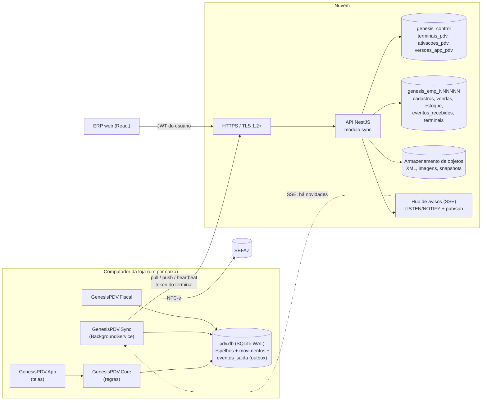

### 1.2 Princípios (obrigatórios)

| # | Princípio | Consequência prática |
|---|---|---|
| P1 | **Local-first**: o PDV grava primeiro no SQLite, em transação, e só depois tenta a rede | Nenhuma tela de venda espera a API (exceções explícitas: PIX dinâmico, TEF, consultas online) |
| P2 | **Cadastros são mestres na nuvem; movimentos são mestres no PDV** | O pull nunca recebe vendas/caixa do próprio terminal; o push nunca altera cadastro (exceto cadastro rápido de cliente, comandas, orçamentos e vales, que têm regras próprias) |
| P3 | **Documento completo, não diff**: cada evento carrega o estado inteiro do agregado naquele fato | Reaplicar é seguro; a nuvem não depende do histórico de diffs |
| P4 | **Idempotência em duas camadas**: `eventos_recebidos.evento_id` único + chaves únicas de negócio | Repetir um lote nunca duplica venda, estoque ou financeiro |
| P5 | **Ordem estrita por terminal**: `sequencia_terminal` contínua, aplicada em ordem | Fechamento nunca chega antes da abertura; cancelamento nunca antes da venda |
| P6 | **A nuvem nunca recusa uma venda por regra de negócio**: estoque negativo, limite de crédito estourado, vale com saldo insuficiente, produto inativo → aplica e gera `alertas` | A venda aconteceu no mundo real; o ERP mostra o problema para alguém decidir |
| P7 | **Se o banco aceita gravar, a nuvem grava**; se não aceita (contrato inválido, referência que nunca existiu, escopo errado), o evento fica guardado em `eventos_recebidos` com `status = 'erro'` e vai para a fila de decisão do ERP | Nada é descartado sem decisão humana auditada |
| P8 | **A nuvem vence nos cadastros**: o PDV nunca "mescla" um cadastro; a versão da nuvem substitui a local | Sem conflito de escrita em cadastros |
| P9 | **Cursor por `versao`** (sequência única por banco + trava de ordenação de commits, modelo 1.5) | O cursor nunca pula uma linha confirmada; exclusões descem como `excluido_em` |
| P10 | **Compatibilidade retroativa**: a API aceita eventos de versões antigas do PDV (upcasters por `versao_schema`) | Nenhum caixa perde venda por estar desatualizado |

### 1.3 Glossário do protocolo

| Termo | Significado |
|---|---|
| **Fluxo** | Grupo de tabelas que descem juntas com um cursor próprio (`configuracao`, `acesso`, `referencia`, `catalogo`, `estoque`, `pessoas`, `operacao` — modelo 6.1) |
| **Cursor** | Maior `versao` já aplicada localmente para um fluxo (`estado_sincronizacao.cursor`) |
| **Cursor teto** | Maior `versao` comprovadamente confirmada no snapshot da leitura do pull (6.4); quando o servidor varre tudo até ele sem cortar a página, o cursor do PDV avança até ele, mesmo que as últimas linhas sejam de outra loja |
| **Evento** | Linha do outbox (`eventos_saida`) com um fato do caixa; na nuvem vira uma linha de `eventos_recebidos` |
| **Agregado** | Entidade que o evento cria/altera (venda, sessão, movimento, vale, comanda…): `agregado_tipo` + `agregado_id` |
| **Dependência** | Agregado que precisa ter sido aplicado antes (ex.: a sessão de caixa de uma venda) |
| **Marcador `versao_nuvem`** | `nextval('seq_versao')` reservado no início da aplicação do evento; toda linha gravada pelo evento tem `versao` maior que ele (modelo 3.15.2) |
| **Marcador `versao_nuvem_fim`** | `nextval('seq_versao')` reservado no **fim** da aplicação do evento, ainda sob a trava de ordenação e antes do commit; toda linha gravada pelo evento tem `versao` menor que ele (8.3) |
| **Refletido** | Um evento confirmado está refletido numa linha baixada quando `linha.versao > eventos_saida.versao_nuvem` **ou** o cursor do fluxo da linha (`estado_sincronizacao.cursor`) já é ≥ `eventos_saida.versao_nuvem_fim` (15.2, modelo 4.5) |
| **Lacuna** | `sequencia_terminal` esperada que não chegou |
| **Retido** | Evento recebido e guardado pela nuvem, mas não aplicado porque uma dependência está com erro |
| **Quarentena** | No PDV: eventos `rejeitado` (com erro ou retidos na nuvem), aguardando decisão no ERP |
| **Fila de decisão** | Aba "Eventos com erro" do terminal no ERP (ERP 12.5) |

### 1.4 Endpoints

Todos sob `https://api.<dominio>/`. Autenticação pelo **token do terminal** (seção 3.6), exceto a ativação.

| Método e rota | Uso | Seção |
|---|---|---|
| `POST /sync/ativar` | Ativa um terminal com código de ativação (sem token) | 3 |
| `POST /sync/token/renovar` | Rotação do token | 3.7 |
| `GET /sync/estado` | Handshake de inicialização: estado do terminal na nuvem, última sequência recebida, numerações, sessão aberta | 5 |
| `GET /sync/pull?fluxo=&desde=&limite=` | Descida incremental por cursor | 6 |
| `GET /sync/snapshot?fluxo=` | Carga inicial acelerada por arquivo pré-gerado (catálogos grandes) | 6.9 |
| `GET /sync/arquivos/{arquivo_id}?variante=` | Imagens (foto de produto, logotipo, banner) | 6.12 |
| `POST /sync/push` | Subida de lote do outbox | 7, 8 |
| `POST /sync/heartbeat` | Telemetria + comandos + eventos resolvidos (com confirmação de recebimento) | 21.1 |
| `GET /sync/eventos-status?ids=` | Situação atual na nuvem de eventos deste terminal (rede de segurança para os `rejeitado`) | 21.1 |
| `GET /sync/eventos` | Canal SSE de avisos ("há novidades") | 18.1 |
| `GET /sync/recuperar?desde_sequencia=` | Re-hidratação: devolve ao terminal os eventos que a nuvem já tem dele | 22.2 |
| `GET /sync/consultas/saldos-outras-lojas?produto_id=` | Consulta online do F4 "Outras lojas" da pesquisa do caixa: o saldo vendável do produto nas lojas reais e no CD, só quantidades (Fase 2, F2-B35) | 1.4 (nota abaixo), 20.2 |
| `POST /sync/recuperacao/chave` | Entrega a chave de backup em custódia de um terminal antigo (com código de recuperação do ERP) | 22.3 |
| `POST /sync/recuperacao/importar` | Importação de outbox órfão de um terminal antigo (com código de recuperação do ERP) | 22.3 |
| `POST /sync/logs` | Envio do pacote de logs (comando `enviar_logs`) | 21.1 |

Endpoints **online do PDV** (fora do protocolo de sync, mesmo token, mesmo escopo de loja; usados só quando há
conexão e sempre com fallback offline definido na especificação do PDV): `GET /vales/{codigo}`,
`POST /vales/{id}/reservar`, `PUT /vales/{id}/reservas/{pagamento_venda_id}/em-uso`,
`DELETE /vales/{id}/reservas/{pagamento_venda_id}` (reservas de vale, `reservas_vale`, 14.4),
`POST /orcamentos/{id}/reservar`, `GET /orcamentos/{codigo}`, `POST /pix/cobrancas`,
`POST /pix/cobrancas/{txid}/devolucao`, `GET /vendas/busca`,
`GET /pessoas/busca?q=` (pessoas fora da relevância da loja, por nome, CPF/CNPJ ou telefone, até 20 resultados, sem
`senha_hash` — modelo 3.5.4 e 6.2, ERP 7.2), `GET /pessoas/{id}/credito`, `POST /pessoas/{id}/credito/reservar`,
`DELETE /pessoas/{id}/credito/reservas/{pagamento_venda_id}` (reserva de crédito, `reservas_credito`, 14.1),
`POST /comandas`, `GET /comandas/{id}`, `POST /comandas/{id}/itens`,
`POST /comandas/{id}/fechar` (comandas online, seção 9.20), `POST /operadores/autenticar` (senha do ERP validada
online, 4.1), `GET /cep/{cep}`. Todo endpoint online que altera estado exige `X-Requisicao-Id` (20.4).

> **Consultas online dentro do `/sync/*` (Fase 2, F2-B35; README da API › decisão 182).** O saldo das outras lojas,
> que esta especificação previa como `GET /estoque/saldos?produto=`, ficou em `GET /sync/consultas/saldos-outras-lojas`
> para reaproveitar a autenticação do terminal, a exclusão do prefixo `/api` e o envelope de erro do protocolo. É só
> leitura e **fica fora do T13** (17.5): não cria tipo de evento nem versão, e a Fase 2 mantém `venda.finalizada` v1 e
> não anuncia nada novo em `versoes_schema`. Regras: exige o hardware registrado (409 `HARDWARE_ALTERADO`, 20.5);
> desligável por `pdv.consulta_outras_lojas` na loja do terminal (403 `ESCOPO_INVALIDO`, `detalhes.chave`); terminal em
> `desativando` recusado como os demais endpoints online (3.8: 403 `ESCOPO_INVALIDO`, sem `detalhes.chave`); limite por
> terminal (`SYNC_CONSULTA_SALDOS_POR_MINUTO`, padrão 30/min → 429 `LIMITE_TAXA` com `Retry-After: 60`); produto
> desconhecido → 404 `NAO_ENCONTRADO` com `detalhes.produto_id` (o 404 sem ele é a rota que a API antiga não tem). Escopo
> (F2-Q12 = roadmap D53, vale a recomendação): o estoque de cada loja ativa e não de treino e os depósitos sem loja,
> somando só os tipos vendáveis do produto (todas as variações), com o local sem saldo em zero; nenhum custo. Ordem: a
> loja do terminal, as outras lojas pelo código, a loja do tipo depósito pelo código e os depósitos sem loja pelo nome.
> `controla_estoque` falso no produto sem controle e nos sem saldo próprio (combo, serviço e produzido). Resposta:
> `respostaSaldosOutrasLojasSchema` (shared) = `RespostaSaldosOutrasLojas` (C#), fixture
> `saldos-outras-lojas.resposta.json`. O PDV chama com prazo de 3 s; offline, sem resposta, API antiga ou recusa, a tela
> mostra o aviso e a venda segue (PDV 10.3). **Publicar a API antes do PDV** (a ordem de sempre).

---

## 2. Convenções do protocolo

### 2.1 Transporte

| Item | Regra |
|---|---|
| Protocolo | HTTPS, TLS 1.2 ou 1.3 (1.3 preferido); HTTP/2 quando disponível, com keep-alive |
| Corpo | JSON UTF-8. Requisições de push e respostas de pull/push com `gzip` (`Content-Encoding: gzip` no push; `Accept-Encoding: gzip, br` no pull) |
| Tempo limite (PDV) | Conexão 5 s; pull 30 s; push 60 s; heartbeat 10 s; ativação 30 s |
| Proxy | Respeita o proxy do sistema ou o proxy configurado no assistente de ativação (PDV 5.3) |

### 2.2 Cabeçalhos

| Cabeçalho | Obrigatório | Exemplo | Uso |
|---|---|---|---|
| `Authorization` | sim (exceto `/sync/ativar`) | `Bearer <terminal_id>.<segredo>` | Token do terminal |
| `X-Genesis-Protocolo` | sim | `1` | Versão do protocolo de sync (seção 17) |
| `X-Genesis-App-Versao` | sim | `1.4.2` | Versão do aplicativo |
| `X-Genesis-Plataforma` | sim | `windows_x64` | `windows_x64`, `linux_x64` (`versoes_app_pdv.plataforma`) |
| `X-Requisicao-Id` | sim | UUID v7 | Correlação com logs da API (`auditoria.requisicao_id`); também protege contra repetição em endpoints online que reservam algo (seção 20.4) |
| `X-Genesis-Hora-Local` | sim | `2026-10-29T14:36:05.120Z` | Relógio local **sem** correção (para medir desvio, seção 12) |
| `X-Genesis-Id-Hardware` | sim | hash hex | Detecção de terminal clonado (seção 20.5) |

Toda resposta traz `X-Agora-Servidor` (ISO-8601 UTC com milissegundos) e `X-Requisicao-Id` (eco).

### 2.3 Formatos

Iguais aos do modelo 6.4 regra 6:

| Dado | Formato no JSON | Exemplo |
|---|---|---|
| Nomes | `snake_case`, exatamente como as colunas do banco | `preco_unitario` |
| UUID | canônico minúsculo com hífens | `01a18756-bc09-76c2-b2b9-437a28df6ec4` |
| Dinheiro, preço, quantidade, percentual | **string decimal** com ponto, na escala da coluna | `"41.88"`, `"3.4900"`, `"0.795"`, `"10.0000"` |
| Data e hora | ISO-8601 UTC, milissegundos, sufixo `Z` | `"2026-10-29T17:36:05.123Z"` |
| Data | `AAAA-MM-DD` | `"2026-10-29"` |
| Booleano | `true`/`false` | |
| Nulo | `null` explícito (coluna conhecida sem valor); coluna ausente = "não informada" | |
| JSON (`jsonb`) | objeto JSON aninhado | `"fiscal_snapshot": {…}` |

O PDV converte do `INTEGER` escalado do SQLite para string decimal na serialização (modelo 4.1); a API valida a
escala com `zod` (`/^-?\d{1,13}\.\d{2}$/` para dinheiro etc.) e recusa número JSON (`41.88` sem aspas) com
`PAYLOAD_INVALIDO`.

### 2.4 Envelope de erro HTTP

```json
{
  "erro": {
    "codigo": "TERMINAL_REVOGADO",
    "mensagem": "Este terminal foi desativado no ERP em 29/10/2026 14:02.",
    "detalhes": { "revogado_em": "2026-10-29T17:02:11.000Z" },
    "requisicao_id": "01a1878f-30e1-7bf4-8f9a-ea4b8acd4e10"
  }
}
```

### 2.5 Códigos de erro HTTP do sync

| HTTP | `codigo` | Quando | O que o PDV faz | Transitório? |
|---|---|---|---|---|
| 400 | `REQUISICAO_INVALIDA` | Parâmetro ausente/inválido, JSON malformado no corpo do lote | Registra em `log_local` (origem `sync`), não repete a mesma requisição, mostra "Erro de sync" (PDV 30.2) | não |
| 401 | `TOKEN_INVALIDO` | Token ausente, malformado ou hash não confere | Para o sync; se houver `token.pendente` (rotação em andamento, 3.7), tenta o outro dos dois tokens conhecidos; se ambos falharem, mostra "Terminal não autenticado — reative" | não |
| 401 | `TERMINAL_REVOGADO` | `terminais_pdv.status = 'revogado'` | Termina a venda em andamento, bloqueia novas vendas, mantém o banco intacto (3.8) | não |
| 403 | `EMPRESA_SUSPENSA` | `empresas.status = 'suspensa'` | Pull/heartbeat recusados; **push continua aceito** (20.6); bloqueia novas vendas após a atual | não |
| 403 | `EMPRESA_CANCELADA` | `empresas.status = 'cancelada'` | Tudo recusado; bloqueia | não |
| 403 | `PDV_DESABILITADO` | `pdv.usa_pdv = false` na empresa ou loja | Igual a `EMPRESA_SUSPENSA` (push aceito) | não |
| 403 | `LOJA_INATIVA` | `lojas.ativa = false` ou `lojas.usa_pdv = false` | Igual a `EMPRESA_SUSPENSA` | não |
| 403 | `ESCOPO_INVALIDO` | Rota não permitida ao token de terminal | Bug: log + alerta | não |
| 409 | `PUSH_EM_ANDAMENTO` | Otimização: o primeiro evento do lote não obteve `pg_try_advisory_xact_lock` do terminal porque outro push dele está aplicando (8.1) | Repete em 2 s | sim |
| 409 | `REGRESSAO_DETECTADA` | `sequencia_terminal` já usada por outro `evento_id` (banco restaurado/clonado) | Para de enviar e entra em recuperação (22.1) | não (exige recuperação) |
| 409 | `LACUNA_INVALIDA` | `declarar_lacuna` cuja faixa não começa na `proxima_sequencia_esperada` (cobre sequência já recebida ou deixaria outra lacuna antes); a mesma declaração repetida não é erro (8.6) | Esquece a faixa; o próximo push mostra a lacuna certa | não |
| 409 | `TERMINAL_CLONADO` | `X-Genesis-Id-Hardware` diverge do registrado e há sinais de duas instâncias | Bloqueia vendas; suporte decide (20.5) | não |
| 409 | `HARDWARE_ALTERADO` | `X-Genesis-Id-Hardware` diverge do registrado (sem sinais de clone) e a troca ainda não foi aprovada no ERP (20.5) | Bloqueia vendas; mantém o outbox; continua só heartbeat, `GET /sync/estado` e pull **sem segredos**; mostra "Hardware alterado — aguardando aprovação no ERP" | não (exige aprovação) |
| 413 | `LOTE_GRANDE_DEMAIS` | Lote acima dos limites (19.2) | Divide o lote ao meio e reenvia | sim |
| 422 | `CODIGO_INVALIDO`, `CODIGO_EXPIRADO`, `CODIGO_USADO` (só repetição legítima tardia), `LIMITE_PLANO`, `CAIXA_OCUPADO` | Ativação (3.3); código usado/cancelado por outra ativação responde `CODIGO_INVALIDO` genérico | Mensagem específica no assistente | não |
| 422 | `LIBERACAO_INVALIDA` | `autorizado_por_id` de `declarar_lacuna`/`recuperar_lacuna` não é usuário ativo da empresa com `pdv.config.fiscal` e acesso à loja do terminal (8.6); nada do lote é processado | Mensagem na tela; outro supervisor libera | não |
| 426 | `PROTOCOLO_NAO_SUPORTADO` | `X-Genesis-Protocolo` abaixo do mínimo da API | Força atualização do app; o push dos pendentes continua permitido enquanto o protocolo estiver na janela de suporte (17.2) | não |
| 429 | `LIMITE_TAXA` | Limite por terminal/empresa (20.3) | Respeita `Retry-After` | sim |
| 429 | `IP_BLOQUEADO` | Ativação: 5 falhas por IP em 10 min (modelo 2.6) | Mostra "aguarde 30 min" | sim |
| 429 | `ATIVACAO_BLOQUEADA` | Ativação: 20 falhas em 1 h para o mesmo `codigo_empresa` (exista ou não a empresa) → bloqueio de 1 h (3.1) | Mostra "ativações temporariamente bloqueadas; peça ao gerente para liberar no ERP" | sim |
| 503 | `MANUTENCAO` | Migração do banco da empresa em andamento ou falhou (modelo 2.12); token de terminal ainda `provisionando` (3.4); defesa: a trava de ordenação 7300001 ocupada além de um `lock_timeout` (`55P03`) numa rota do `/sync` (`Retry-After: 5`) — hoje nenhuma tem limite, todas esperam sem limite (modelo 1.5, Fase 1C, C13) | Respeita `Retry-After` (padrão 60 s) | sim |
| 500/502/504 | `ERRO_INTERNO` / — | Falha da API, gateway | Backoff (18.3) | sim |

---

## 3. Ativação do terminal e ciclo de vida do token

### 3.1 Código de ativação (gerado no ERP)

Regras do ERP 12.3 e do modelo 2.5, consolidadas:

| Item | Regra |
|---|---|
| Quem gera | Usuário com `terminais.ativar`, para uma loja `ponto_venda` ativa com `usa_pdv` e um caixa (`caixas.numero` 1–99) |
| Alfabeto | Base32 sem caracteres ambíguos: `23456789ABCDEFGHJKMNPQRSTUVWXYZ` (sem `0 O 1 I L`) — 31 símbolos, 8 caracteres (~39,6 bits), exibido `XXXX-XXXX` |
| Armazenamento | `ativacoes_pdv.codigo_hash = sha256_hex(codigo_empresa \|\| ':' \|\| codigo)` (sem hífen, maiúsculo); `codigo_final` = 2 últimos caracteres |
| Validade | `validade_horas` ∈ {1, 24, 72}, padrão 24; `expira_em` |
| Uso | Único; `status`: `pendente` → `usado` / `expirado` / `cancelado` |
| Limite do plano | `terminais_pdv` provisionando + ativos + desativando + `ativacoes_pdv` pendentes ≤ `coalesce(empresas.limite_terminais, planos.limite_terminais)`; validado ao gerar e ao ativar |
| Substituição | Caixa com terminal ativo exige "Substituir terminal": grava `ativacoes_pdv.substitui_terminal_id`. Com ou sem substituição, a numeração do terminal novo é decidida contra o **último terminal que ocupou o caixa** (`caixas.terminal_anterior_id`, qualquer status — 13.3) |
| Força bruta | Três limites, todos contados em `tentativas_ativacao`: (1) **por IP**: 5 falhas em 10 min → `IP_BLOQUEADO` por 30 min; (2) **por `codigo_empresa`** (contado pelo valor informado, exista ou não a empresa, para a resposta não revelar existência): 20 falhas em 1 h → `ATIVACAO_BLOQUEADA` para aquele código por 1 h, alerta `ATIVACAO_FORCA_BRUTA` no ERP da empresa (quando existe) e ação "Liberar ativações" (permissão `terminais.ativar`, auditada: grava `empresas.ativacoes_liberadas_em` e as falhas anteriores deixam de contar); (3) **global da plataforma**: mais de 500 falhas em 10 min somando todas as empresas → toda resposta de falha passa a ter atraso fixo de 3 s e a plataforma recebe alerta. A resposta de código errado é genérica: `CODIGO_INVALIDO` para todo código que não esteja `pendente`, exceto a repetição da mesma ativação (mesmo `requisicao_ativacao_id` e `id_hardware`, 3.4), que recebe `CODIGO_USADO` quando já fora da janela de repetição |

### 3.2 `POST /sync/ativar`

Requisição (sem `Authorization`):

```json
{
  "codigo_empresa": 100001,
  "codigo_ativacao": "K7QM2XRD",
  "requisicao_ativacao_id": "01a1878f-bfb9-7958-8cd6-20c20ea2622b",
  "maquina": {
    "nome_maquina": "CAIXA02-HERMES",
    "sistema_operacional": "Windows 11 Pro 24H2 x64",
    "id_hardware": "3f1c9a2e8b7d4c6f0a1e2d3c4b5a69788796a5b4c3d2e1f00f1e2d3c4b5a6978",
    "versao_app": "1.4.2",
    "plataforma": "windows_x64",
    "versao_schema_local": 12
  },
  "chave_backup_publica": "MCowBQYDK2VuAyEAq3x0Wf0bM1u3zJ8yX6Z4D5v8kR2pT7nL9sH1cE6aB0w=",
  "chave_publica_terminal": { "algoritmo": "x25519", "chave": "MCowBQYDK2VuAyEA9fPq1m3cR8wZ0vT4kL7yX2bN6hS5dJ1aG3eU8iO0pQc=" }
}
```

| Campo | Regra |
|---|---|
| `requisicao_ativacao_id` | UUID v7 gerado pelo assistente e guardado em memória; permite repetir a chamada se a resposta se perder (3.4) |
| `maquina.id_hardware` | SHA-256 (hex minúsculo) de `MachineGuid` (Windows, `HKLM\SOFTWARE\Microsoft\Cryptography`) ou de `/etc/machine-id` (Linux), normalizado em minúsculas e sem espaços. **Sem** o número de série da placa-mãe: no Linux ele só é legível como root e no Windows exige WMI, e um id que muda conforme o usuário que roda o PDV daria `409 HARDWARE_ALTERADO` falso (decisão 31 do README do PDV). Sem nenhum dos dois, um id aleatório gravado uma vez em `dados/id_maquina` |
| `chave_backup_publica` | Chave pública X25519 efêmera usada para a nuvem devolver a **chave de backup** cifrada (custódia da chave de backup, 22.3) |
| `chave_publica_terminal` | Chave pública **permanente** do terminal (SPKI DER em base64). Na Fase 1B (D21) o par é sempre X25519, gerado pelo PDV, com a privada guardada protegida como o token (3.6, `configuracao_terminal['terminal.chave_privada']`); o par no provedor de chaves do SO, abaixo, entra com o endurecimento da 3.6. O par é gerado na ativação dentro do provedor de chaves do SO, com a privada **não exportável** (Windows: CNG, `Microsoft Platform Crypto Provider` quando há TPM 2.0 — então `algoritmo = "p256"`, porque o TPM não implementa X25519 —, senão `Microsoft Software Key Storage Provider` com X25519; Linux: X25519 em arquivo `0600` do usuário `genesispdv`). Gravada em `terminais_pdv.chave_publica_terminal`; todo segredo que desce ao PDV vem cifrado para ela (20.2) |

Resposta `201`:

```json
{
  "terminal_id": "01a18751-a521-7238-b924-56de3eb13b90",
  "token": "<terminal_id>.<segredo>",
  "token_emitido_em": "2026-10-29T11:00:41.512Z",
  "renovar_token_apos_dias": 30,
  "empresa": { "codigo": 100001, "razao_social": "ICE BEER COMERCIO DE BEBIDAS LTDA" },
  "loja": {
    "id": "01a18752-3782-7bda-ad3c-2d6d1a3d1fa7",
    "codigo": 1,
    "nome": "Loja 1 - Ice Beer Hermes",
    "cnpj": "00000000000100",
    "fuso_horario": "America/Sao_Paulo",
    "estoque_id": "01a18753-5750-717c-87a0-ca6e0822e8f3",
    "tipo_emissao": "nfce"
  },
  "caixa": {
    "id": "01a18752-c8a9-7970-9641-9f828b9d2434",
    "numero": 2,
    "nfce_serie": 2
  },
  "numeracoes": {
    "venda": { "ultimo_numero": 0 },
    "nfce": [
      { "serie": 2, "ambiente": 2, "ultimo_numero": 0 },
      { "serie": 2, "ambiente": 1, "ultimo_numero": 0 }
    ],
    "vale": { "ultimo_numero": 0 }
  },
  "sequencia_terminal": { "ultima_recebida": 0 },
  "fluxos": ["configuracao", "acesso", "referencia", "catalogo", "estoque", "pessoas", "operacao"],
  "chave_backup_cifrada": "o2FQ8xJ1tq0dV2m7cE3k5bNw9yR4uL6zH0sA1fG8jK2pX5vC7nM3qT9eW1rY4iU=",
  "intervalos": { "heartbeat_s": 30, "pull_s": 30, "pull_com_sse_s": 300, "push_pendente_s": 15 },
  "versao_protocolo": 1,
  "agora_servidor": "2026-10-29T11:00:41.540Z"
}
```

- O nome do banco da empresa (`empresas.nome_banco`) e o servidor nunca são expostos ao PDV.
- `numeracoes.*.ultimo_numero` vem de `numeracoes` (dono `terminal`) do caixa; sempre que o caixa já teve um terminal
  (`caixas.terminal_anterior_id`), com ou sem substituição, pode vir com **salto de segurança** e **série nova** (13.3).
- `sequencia_terminal.ultima_recebida` é sempre 0 numa ativação (terminal novo = `terminal_id` novo = sequência nova).

### 3.3 Validações da ativação (ordem)

| # | Verificação | Erro |
|---|---|---|
| 1 | IP não bloqueado; `codigo_empresa` informado sem bloqueio de ativação; atraso global aplicado se o limite da plataforma estourou (3.1) | 429 `IP_BLOQUEADO` / 429 `ATIVACAO_BLOQUEADA` |
| 2 | `empresas.codigo` existe e `status = 'ativa'` | 422 `CODIGO_INVALIDO` (genérico, grava `motivo_falha = 'empresa_inativa'`) |
| 3 | `ativacoes_pdv` com `codigo_hash` e `status = 'pendente'` existe (`select … for update`). Código `usado` cuja ativação tem o mesmo `requisicao_ativacao_id` e `id_hardware` → repetição (3.4) | 422 `CODIGO_INVALIDO` para todo código inexistente, `usado`, `cancelado` ou `expirado` por status (grava `motivo_falha` real em `tentativas_ativacao`); `CODIGO_USADO` só para a repetição legítima fora da janela de 15 min |
| 4 | `expira_em > now()` | 422 `CODIGO_EXPIRADO` |
| 5 | `pdv.usa_pdv` da empresa/loja e `lojas.ativa`, `lojas.usa_pdv`, `lojas.tipo = 'ponto_venda'` | 403 `PDV_DESABILITADO` / `LOJA_INATIVA` |
| 6 | Limite do plano (contando este) | 422 `LIMITE_PLANO` |
| 7 | Caixa sem terminal `provisionando`/`ativo`, ou ativação com `substitui_terminal_id` igual ao terminal ativo do caixa | 422 `CAIXA_OCUPADO` |
| 8 | `versao_app` ≥ versão mínima publicada para a plataforma | 426 `PROTOCOLO_NAO_SUPORTADO` (com link do instalador) |

Toda tentativa grava `tentativas_ativacao` (sucesso ou `motivo_falha`, com `codigo_empresa` informado e IP), que alimenta os três
limites de 3.1. `CODIGO_EXPIRADO` (status `pendente` com `expira_em` vencido) continua específico: um código vencido é
inútil para o atacante e a mensagem ajuda o usuário legítimo.

### 3.4 Transação da ativação na nuvem

Não existe transação distribuída entre `genesis_control` e o banco da empresa. A ativação é feita em três commits,
com o estado intermediário **`provisionando`** (valor de `ck_terminais_pdv_status`) e uma etapa da empresa
**idempotente**, para que qualquer queda entre os commits possa ser concluída ou compensada:

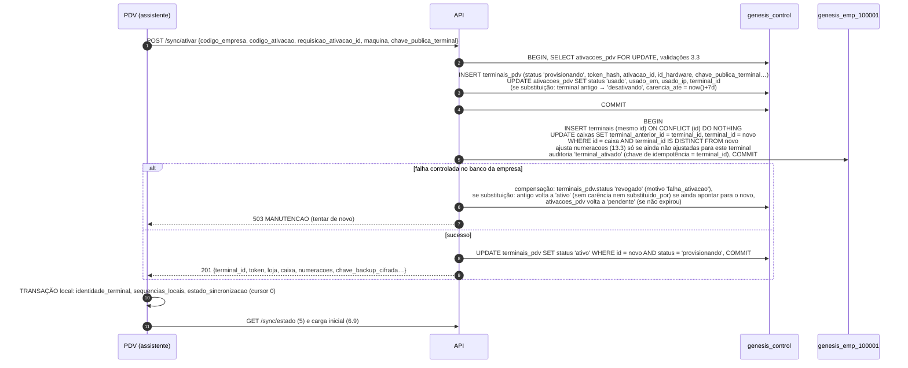

| Regra | Detalhe |
|---|---|
| Ocupação do caixa | `uq_terminais_pdv_caixa_ativo` passa a valer para `status in ('provisionando','ativo')`: um terminal em provisionamento já ocupa o caixa. O 1º commit trava por caixa (`pg_advisory_xact_lock`) antes de ler os ocupantes: de duas ativações simultâneas do mesmo caixa, a segunda recebe `422 CAIXA_OCUPADO` |
| Token de terminal `provisionando` | Qualquer chamada `/sync/*` → `503 MANUTENCAO` (`Retry-After: 30`). Na prática o PDV só recebe o token depois do `ativo`, mas a regra protege contra a repetição concorrente |
| Etapa da empresa idempotente | `insert … on conflict (id) do nothing` em `terminais`; `update caixas` condicional (só troca `terminal_id` se ainda não for o novo, e só então grava `terminal_anterior_id`); o ajuste de `numeracoes` é calculado uma vez e gravado em `auditoria` `terminal_ativado` — a repetição reusa os valores gravados em vez de recalcular |
| API caiu entre os commits | `terminais_pdv` fica `provisionando`. A repetição da ativação (abaixo) ou o reconciliador concluem |
| Substituição em andamento | Entre o 1º commit (antigo `desativando`, `substituido_por_terminal_id` = novo) e a etapa da empresa do novo, o antigo continua sendo o terminal do caixa: heartbeat, `GET /sync/estado` e pull o tratam como `ativo` (sem comando `revogar`, sem confirmar desativação, `status_terminal: "ativo"`), e "Revogar – aceitar pendências" no ERP é recusado (422). A compensação devolve o antigo a `ativo` e cancela os `revogar` pendentes/entregues dele. Motivo: o PDV só avança o estado local; um `desativando` entregue na janela o deixaria preso se a ativação do novo fosse compensada |
| 3º commit sem efeito | Se o `update … status = 'ativo'` não alterar a linha (a manutenção compensou ou o ERP revogou enquanto a etapa rodava), a API relê: já `ativo` → `201`; senão `503 MANUTENCAO` sem token (o código compensado voltou a `pendente` e a nova tentativa do PDV ativa) |
| Reconciliador | Tarefa periódica (`tarefas` da plataforma, a cada 5 min) procura `terminais_pdv.status = 'provisionando'` com `ativado_em` há mais de 20 min (a janela de repetição de 15 min mais a margem da etapa da empresa; as duas medidas pelo relógio do banco): tenta a etapa da empresa (idempotente) e, com sucesso, passa a `ativo`; com falha permanente (empresa cancelada, caixa ocupado por outro terminal), compensa como acima. O PDV que não recebeu a resposta repete a ativação e recebe o resultado (`201`) ou `CODIGO_INVALIDO` (compensado e código vencido) |

**Resposta perdida ou API caída** (rede caiu ou processo morreu depois do primeiro commit): o assistente repete com o
mesmo `requisicao_ativacao_id`. A API encontra `ativacoes_pdv` `usado` cujo `terminal_id` tem o mesmo `id_hardware` e
foi ativado há menos de 15 min com esse `requisicao_ativacao_id` (guardado em `auditoria.depois` da ativação) e:

- terminal `provisionando` → **reexecuta a etapa da empresa** (idempotente), passa a `ativo`, gera novo segredo
  (substitui `token_hash`) e devolve a resposta completa;
- terminal `ativo` → gera **novo segredo** (substitui `token_hash`) e devolve a mesma resposta com o token novo.

Fora dessas condições → `CODIGO_USADO` (repetição legítima tardia) ou `CODIGO_INVALIDO` (3.3).

### 3.5 Estado local criado na ativação

Numa única transação SQLite:

| Tabela local | Conteúdo |
|---|---|
| `identidade_terminal` | `terminal_id`, `empresa_codigo`, `loja_id`, `caixa_id`, `numero_caixa`, `url_api`, `token_protegido`, `status = 'ativo'`, `ativado_em`, `nome_maquina`, `versao_schema_local`, `restaurado_em = null` (preenchido por toda restauração de backup, 22.1) |
| `sequencias_locais` | `evento` = 0; `venda` = `numeracoes.venda.ultimo_numero`; `nfce:<serie>:<ambiente>` = `ultimo_numero` de cada série; `vale` = `numeracoes.vale.ultimo_numero` |
| `estado_sincronizacao` | Uma linha por fluxo, `cursor = 0`, `carga_inicial_concluida = 0` |
| `estado_conexao` | `desvio_relogio_ms` calculado da resposta, com o par da amostra (`desvio_amostra_utc_local`, `desvio_amostra_boot_id`) (12.2), `online = 1`. A amostra segue a regra da 12.2: com ida e volta acima de 3 s ela é descartada (fica sem desvio e sem o par; o primeiro heartbeat ou `/sync/estado` mede) |
| `configuracao_terminal` | Chaves internas (MD 4.4.2): `backup.chave` com a chave de backup decifrada e re-protegida pela chave do terminal (3.6); `terminal.chave_privada` com `{algoritmo, protegida}` (a privada do par da `chave_publica_terminal`, protegida como o token, 3.2); `ativacao.resumo` com empresa, razão social, loja, CNPJ e caixa (nada secreto; cabeçalho do login até os espelhos descerem) |
| `log_auditoria_local` | `terminal_ativado`, no mesmo commit: depois dele a ativação não grava mais nada |

### 3.6 Token do terminal

| Item | Regra |
|---|---|
| Formato | `<terminal_id>.<segredo>`; segredo = 32 bytes aleatórios (CSPRNG) em base64url sem `=` (43 caracteres) — modelo 2.4 |
| Na nuvem | Só `terminais_pdv.token_hash = sha256_hex(segredo)`; comparação em tempo constante (`crypto.timingSafeEqual`). Alta entropia dispensa argon2 |
| Resolução | A API separa o `terminal_id`, busca `terminais_pdv` (cache em memória de 60 s, invalidado por pub/sub na revogação), compara o hash, obtém `empresa_id`/`loja_id`/`caixa_id` e o pool do banco da empresa (ADR-02) |
| No Windows | `identidade_terminal.token_protegido` = token protegido pela **DPAPI no escopo do usuário** (`CurrentUser`) da conta que roda o PDV, com a finalidade do valor (`token:<terminal_id>`) como entropia (decisão D21 do roadmap, Fase 1B: os caixas do piloto são Windows). **Não** se usa DPAPI LocalMachine: qualquer processo local decifra DPAPI LocalMachine. A mesma proteção vale para `token.pendente` (3.7), `backup.chave` e a privada do terminal. Endurecimento previsto para depois do piloto: AES-256-GCM com chave simétrica envolvida por uma chave **CNG não exportável** da conta de serviço do PDV (`NT SERVICE\GenesisPDV`; `Microsoft Platform Crypto Provider`/TPM 2.0 quando houver, senão `Microsoft Software Key Storage Provider` com `NCRYPT_ALLOW_EXPORT_FLAG` desligado) e ACL de `%ProgramData%\GenesisPDV\dados` só para essa conta e Administradores |
| No Linux | AES-256-GCM com chave derivada por HKDF-SHA256 de 32 bytes aleatórios em arquivo `0600` (`/etc/genesispdv/chave_terminal`, dono `genesispdv`, quando o pacote o instala; sem o pacote, `~/.config/genesispdv/chave_terminal`, criado na ativação) com o `/etc/machine-id` como sal; a finalidade do valor é o AAD. libsecret fica fora (D21: Linux funcionando, sem paridade fina) |
| Nunca | Em log, tela, arquivo de diagnóstico, backup não cifrado, URL ou cabeçalho além de `Authorization` |
| Cópia do banco para outra máquina | O token não decifra (chave CNG não exportável / chave local) → o PDV exige reativação ou recuperação (22). Um token extraído na própria máquina e usado de outra esbarra no `id_hardware` (`409 HARDWARE_ALTERADO`) e não recebe segredos, que só descem cifrados para a chave privada que ficou na máquina original (20.2, 20.5) |

### 3.7 Rotação do token

O token não expira por tempo para não derrubar um caixa que está offline (PDV 5.3), mas é **rotacionado** quando o
terminal está online:

| Gatilho | Comportamento |
|---|---|
| `token_emitido_em` há mais de 30 dias | Resposta do heartbeat traz `"renovar_token": true` |
| Ação do ERP/suporte "Renovar token" | Idem, no próximo heartbeat (é flag da resposta, não comando) |
| Suspeita de vazamento | **Revogar imediatamente** + nova ativação (não é rotação) |

O **PDV gera o segredo novo**, grava-o antes de pedir a troca e só o promove depois de vê-lo funcionar. Assim nunca
existe um estado em que o PDV não conheça um token válido:

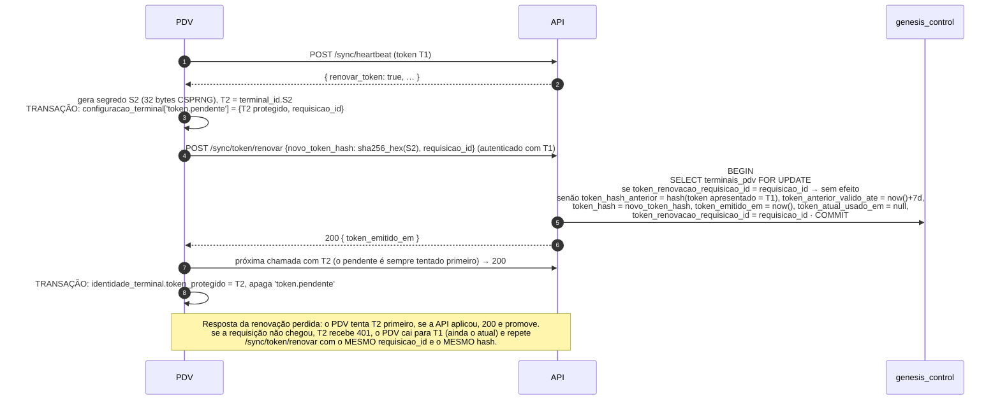

| Regra | Detalhe |
|---|---|
| Quem gera o segredo | O PDV (32 bytes de CSPRNG, base64url sem `=`). A API recebe só `novo_token_hash` (64 hex); recusa com `400 REQUISICAO_INVALIDA` hash malformado ou igual a `token_hash`/`token_hash_anterior` |
| Gravação antes do envio | `token.pendente` é gravado (protegido como o token, 3.6) numa transação SQLite **antes** do `POST`; se o PDV cair depois de gravar, ele ainda tem T1 e T2 |
| Idempotência | A API guarda `terminais_pdv.token_renovacao_requisicao_id`; repetir com o mesmo `requisicao_id` não muda nada e devolve `200`. A repetição pode vir autenticada por T1 (então já é o anterior) ou por T2 |
| Renovação autenticada pelo anterior | Aceita **só** como repetição do mesmo `requisicao_id`. Um `requisicao_id` novo autenticado pelo token anterior → `401 TOKEN_INVALIDO` (impede que um token antigo copiado "roube" a rotação) |
| Nova rotação | Só depois de promover (ou descartar, se o atual respondeu `200` e o pendente `401` por mais de 24 h, sinal de que a API nunca aplicou) o pendente anterior; nunca há dois pendentes |
| Ordem de tentativa no PDV | Com `token.pendente` presente: tenta o pendente; `401` → tenta o atual; promove o pendente **só** no primeiro `200` obtido com ele. Sem pendente: só o atual. Depois de cada `401` o PDV relê os candidatos: se outra chamada promoveu o pendente nesse meio-tempo (ele chegou à API antes do commit da renovação), repete com ele, e não com o atual da lista antiga, que já virou o anterior |
| Descarte do pendente | Só fora de uma renovação: o `200` do próprio `/sync/token/renovar` obtido com o atual é o que aplica o pendente na API, então não conta para o descarte de 24 h |
| Janela do anterior | A API aceita `token_hash` **ou** `token_hash_anterior` (até `token_anterior_valido_ate`, 7 dias). Uma chamada autenticada pelo anterior depois que o atual já foi usado com sucesso (`token_atual_usado_em` preenchido há mais de 30 s, margem que absorve a corrida do próprio PDV entre chamadas concorrentes) é registrada como `auditoria` `token_anterior_reutilizado` (indício de cópia) e gera o alerta crítico `TOKEN_ANTERIOR_REUTILIZADO`, um por terminal enquanto aberto, listado em PDVs/Terminais e resolvido lá ("Máquina conferida", com o que foi verificado) ou revogando o terminal. O registro vem **antes** do `409 HARDWARE_ALTERADO` de push e renovação: o clone em outra máquina também é registrado |

Colunas em `terminais_pdv`: `token_hash_anterior`, `token_anterior_valido_ate`, `token_atual_usado_em` e
`token_renovacao_requisicao_id uuid` (modelo 2.4). `renovar_token` é uma **flag da resposta do heartbeat**, não um
comando de `comandos_terminal` (21.1); a ação "Renovar token" do ERP apenas faz o próximo heartbeat responder
`renovar_token: true`.

### 3.8 Estados do terminal e o que cada endpoint aceita

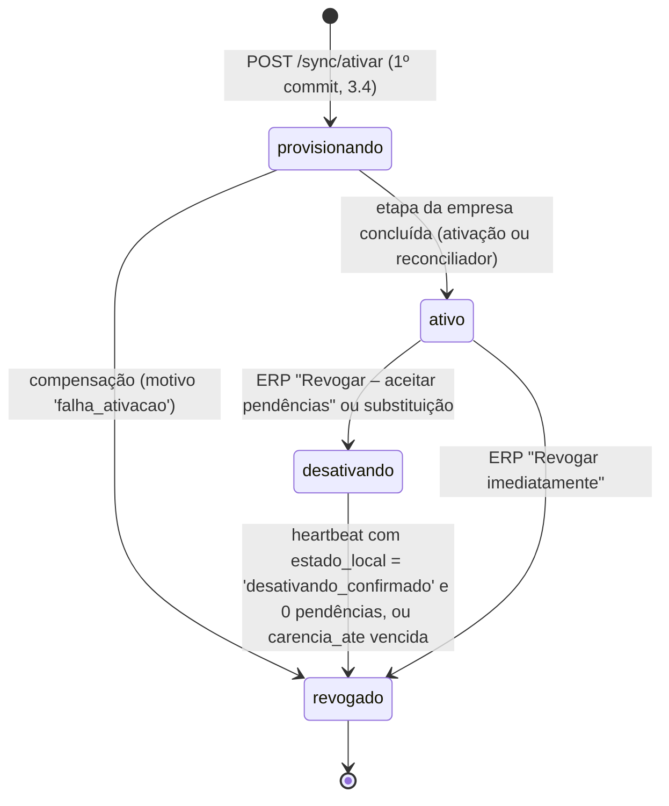

| Endpoint | `provisionando` | `ativo` | `desativando` | `revogado` |
|---|---|---|---|---|
| `GET /sync/estado` | 503 `MANUTENCAO` | 200 | 200 (`status: "desativando"`) | 401 `TERMINAL_REVOGADO` |
| `GET /sync/pull` | 503 | 200 | 200 apenas fluxos `acesso` e `configuracao` (para o PDV ler o status e as mensagens) | 401 |
| `POST /sync/push` | 503 | 200 | **200** (pendências aceitas) | 401 — eventos tardios só pela recuperação assistida (22.3) |
| `POST /sync/heartbeat` | 503 | 200 | 200 + comando `revogar` | 401 |
| `GET /sync/recuperar` | 503 | 200 (409 `HARDWARE_ALTERADO` com o hardware divergente, T41) | 200 | 401 |
| `GET /sync/eventos-status` | 503 | 200 | 200 | 401 |
| Endpoints online (vale, PIX, orçamento) | 503 | 200 | 403 `ESCOPO_INVALIDO` (não vende mais) | 401 |

Comportamento do PDV:

- **`desativando`**: termina a venda em andamento, impede novas vendas e aberturas de caixa, permite fechar o caixa
  (o fechamento sobe), envia todo o outbox, transmite NFC-e em contingência e inutilizações pendentes, mostra
  "Terminal em desativação — enviando pendências (N)". Ao entrar em `desativando` o PDV grava localmente
  `identidade_terminal.status = 'desativando'` e, a partir desse commit, **nunca mais** reserva número de venda,
  NFC-e ou vale. Quando `eventos_pendentes = 0`, não há NFC-e em contingência nem inutilização pendente, o heartbeat
  envia `estado_local = 'desativando_confirmado'` com os números finais (`ultima_sequencia_gerada`,
  `venda_ultimo_numero`, `nfce_ultimo_numero`, `vale_ultimo_numero`, 21.1); a nuvem confere que recebeu tudo até
  esses números, grava a confirmação em `terminais` e passa o terminal para `revogado`. É essa confirmação que permite
  ao próximo terminal do caixa continuar na mesma série e numeração (13.3). **Da contagem até a resposta (D22, Fase
  1C/C9)** o caixa não grava nada que subiria: a contagem roda numa transação `IMMEDIATE` do SQLite (a gravação em voo
  comita antes e entra nos números) que marca `estado_conexao.confirmando_desativacao_em`, e os gatilhos `BEFORE
  INSERT` de `eventos_saida` e `log_auditoria_local` recusam com "Terminal confirmando a desativação" (logout,
  Ctrl+Alt+C, auditoria, qualquer evento). Sem resposta, ou com status diferente de `revogado`, o PDV limpa a marca e o
  heartbeat seguinte reconta; com `revogado`, ela fica. A marca que sobrou de um processo que caiu no meio é limpa no
  handshake e no início do ciclo (MD 4.4.4).
- **`revogado`**: mostra "Terminal desativado pelo ERP"; bloqueia tudo exceto a tela de status/diagnóstico e a
  exportação de pendências para o suporte; **nunca apaga** o banco local.
- Não se aceita push com token revogado com base no `ocorrido_em` anterior à revogação (o relógio do PDV não é
  confiável para autorizar algo); o estado `desativando` cumpre esse papel (PDV 5.3).

---

## 4. Autenticação de operadores offline

O login do operador e a liberação de supervisor são validados **localmente pelo PIN do PDV** (`senha_pdv_hash`, PDV
7.2, 31.3), contra hashes baixados no fluxo `acesso`, online ou offline. A **senha do ERP nunca desce ao PDV**: quando
a empresa permite usá-la no caixa, ela só é aceita **online**, validada pela API (`POST /operadores/autenticar`).

### 4.1 O que desce para autenticar

| Tabela.coluna | Para quê | Observação |
|---|---|---|
| `usuarios.senha_pdv_hash` | Senha numérica do PDV (PIN, 6–8 dígitos; 4–5 só com `pdv.permite_pin_curto`) | Única credencial de operador que desce; válida só no PDV; a API recusa PIN no login do ERP |
| `formas_pagamento.senha_liberacao_hash` | "Senha da forma" (PDV 16.2) | |
| `pessoas.senha_hash` | Senha do cliente para confirmar crediário (PDV 16.8) | **Coluna condicional**: desce só quando `pdv.crediario_exige_senha_cliente = true` (da loja do terminal) **e** a pessoa tem crediário habilitado (`coalesce(limite_compras, financeiro.limite_credito_padrao) > 0` e `bloqueada_credito = false`); senão desce `null`. A mudança de qualquer dessas condições gera `versao` nova na pessoa (toque, modelo 6.4 regra 1), e a configuração alterada toca as pessoas com senha da empresa (ou relevantes para a loja, na configuração da loja): refazer o fluxo não bastaria, porque a linha voltaria com a mesma `versao` e o PDV só aplica versão maior (6.10) |
| `usuarios.ativo`, `master`, `totem`, `pdv_utilitario`, `perfil_id`, `limite_desconto_pct`, `permissoes_versao` | Regras 3–6 do PDV 7.2 e limite de liberação | `ativo` desce já calculado com a demissão (`ativo and (demissao is null or demissao > hoje)`, `hoje` no fuso da empresa; a data não desce, D19); no dia da demissão (mesmo fuso) a nuvem toca o usuário para o `false` descer |
| `usuarios_lojas`, `perfis_permissoes`, `usuarios_permissoes`, `permissoes` (só `pdv.*`) | Loja permitida e permissões efetivas | Negar vence conceder (modelo 3.3.4) |

Não descem: `usuarios.senha_hash` (senha do ERP, de **nenhum** usuário), `tentativas_falhas`, `bloqueado_ate` (o
bloqueio por tentativas do PDV é local, 5 erros / 5 min por terminal), `salario`, `rg`, `cpf`, endereço, `email`,
`observacoes`, `senha_provisoria` e, pela D19, `telefone`, `admissao` e `demissao` (modelo 6.2).

**Senha do ERP no caixa (opcional, só online)**: com `pdv.login_aceita_senha_erp = true` (chave nova, padrão `false`),
a tela de login aceita também a senha do ERP **quando há conexão**: o PDV envia `POST /operadores/autenticar
{usuario_id, senha}` (TLS, `X-Requisicao-Id`, tempo limite 3 s); a API valida contra `usuarios.senha_hash`, aplica o
bloqueio por tentativas do ERP (`tentativas_falhas`, `bloqueado_ate`) e responde `200 {permissoes_versao}` ou `401`.
Sem conexão, só o PIN funciona. A senha digitada nunca é gravada nem registrada no PDV.

**Projeção adotada para `usuarios`** (modelo 6.2): a linha de **todo** usuário da empresa desce, sem a coluna
`senha_hash`, e `senha_pdv_hash` vai `null` quando o usuário não tem acesso à loja do terminal (sem `usuarios_lojas`
não excluída da loja e não `master`). Motivo: com um filtro por linha ("existe `usuarios_lojas` da loja ou `master`"),
um usuário que deixasse de ser `master` (e não tivesse `usuarios_lojas` da loja) **sairia do filtro sem tombstone** e
continuaria logando offline com todas as permissões. Com a projeção condicional, a mudança desce (o `update` de
`master` gera `versao` nova) e o PDV bloqueia. Usuários são poucas dezenas de linhas por empresa; o custo é
desprezível.

### 4.2 Algoritmo e parâmetros

| Item | Regra |
|---|---|
| Algoritmo | **argon2id** (RFC 9106), versão 19, string PHC `$argon2id$v=19$m=65536,t=3,p=1$<sal b64>$<hash b64>` |
| Parâmetros de geração (API) | `m = 65536 KiB` (64 MiB), `t = 3`, `p = 1`, sal 16 bytes aleatórios, saída 32 bytes — iguais para senha do ERP (que não desce), PIN, senha de forma e senha de cliente |
| Meta de tempo | Verificação ≤ 500 ms no hardware mínimo do PDV (Celeron J4125, 4 GB — PDV 32.7); medir no CI de hardware e ajustar `t` antes de mudar `m` |
| Biblioteca | PDV: libsodium (`crypto_pwhash_str_verify`, via `Sodium.Core`), comparação em tempo constante. API: `argon2` (node-argon2). O node-argon2 escreve os parâmetros como `m=,p=,t=` e o libsodium só lê `m=,t=,p=`: o PDV remonta a string na ordem canônica depois de conferir os limites (o PIN já sai canônico da API). A compatibilidade é provada pelos vetores gerados pela API em `packages/shared/testes/sync/argon2.vetores.json`, conferidos pelo Vitest da API e pelo xUnit do PDV |
| Limites aceitos pelo PDV | Só `argon2id`, `v=19`; `19456 ≤ m ≤ 262144` KiB; `1 ≤ t ≤ 10`; `1 ≤ p ≤ 4`; sal ≥ 16 bytes; hash = 32 bytes. Fora disso o hash é tratado como inválido (usuário não loga offline; `log_local` nível `aviso`; auditoria `hash_fora_dos_limites`) — protege contra travar o caixa com parâmetros absurdos vindos de dado corrompido |
| Concorrência | Uma verificação por vez (semáforo) para não alocar 64 MiB × N |
| Atualização de parâmetros | A API refaz o hash no próximo login do ERP quando os parâmetros do hash armazenado forem antigos (`needsRehash`); o PIN é refeito quando trocado. O PDV aceita qualquer hash dentro dos limites |

### 4.3 Por que é aceitável enviar hashes ao PDV, e os limites disso

Ameaça: alguém copia `pdv.db` (ou um backup) e tenta descobrir senhas **offline**, sem o bloqueio de tentativas.

| Segredo | Desce? | Espaço | Custo estimado (atacante com 16 núcleos, ~50 tentativas/s com m = 64 MiB, t = 3) | Conclusão |
|---|---|---|---|---|
| Senha do ERP (qualquer usuário) | **não** | — | — | Fora do alcance do ataque: quebrar uma senha fraca daria acesso ao ERP web (financeiro, cadastros), por isso ela nunca sai da nuvem |
| PIN 4 dígitos (`pdv.permite_pin_curto`) | sim | 10⁴ | ~3 min | **Não protegido** offline |
| PIN 6 dígitos | sim | 10⁶ | ~6 h | Fraco, mas só vale no PDV da loja |
| PIN 8 dígitos | sim | 10⁸ | ~23 dias | Razoável |
| Senha de cliente (crediário), mín. 6 dígitos | só de clientes com crediário e com a exigência ligada | 10⁶ | ~6 h | Fraco; exposição reduzida à fração de clientes que compram a prazo |

argon2id é o algoritmo certo (memory-hard, resistente a GPU/ASIC), mas **não salva PIN curto** de ataque offline.
Por isso, além do algoritmo:

1. **O PIN só vale no PDV** e só para a loja do terminal; descobrir um PIN não dá acesso ao ERP web.
2. **`usuarios.senha_hash` nunca desce**, de nenhum usuário (nem `master`). Login no caixa com a senha do ERP só
   online (4.1). A credencial do ERP nunca sai da nuvem.
3. ERP valida PIN com mínimo de **6 dígitos** (aceita 4–5 apenas se a empresa ligar a configuração nova
   `pdv.permite_pin_curto`), recusa sequências e repetições (`123456`, `111111`) e o próprio código do usuário. A
   **senha do cliente** para crediário tem no mínimo **6 dígitos**, com as mesmas recusas, e sem exceção de PIN curto.
4. `pessoas.senha_hash` só desce para clientes com crediário habilitado e com a exigência de senha ligada (4.1): os
   demais clientes não têm hash no PDV.
5. Pasta de dados com ACL restrita (3.6); backups cifrados (PDV 32.5); banco local cifrado (modelo 4).
6. Ação no ERP **"Terminal perdido/roubado"** = revogar imediatamente + invalidar PINs (`senha_pdv_hash = null`) de
   todos os usuários com acesso à loja até redefinição + invalidar as senhas de cliente de crediário da loja
   (`pessoas.senha_hash = null` das pessoas com crediário que desceram para aquele terminal, com aviso para
   redefinição no próximo atendimento). Como a senha do ERP não desce, ela não precisa ser trocada. A ação vale
   também para um terminal **já revogado** por outro motivo (o furto descoberto depois da revogação imediata, da
   carência vencida ou da desativação confirmada, porque o banco local fica na máquina): o motivo passa a
   `perdido_roubado` e só a anulação acontece. "Desceram" = a mesma condição da projeção do fluxo `pessoas` (item 4)
   na loja do terminal; a revogação que só ficou no controle é completada pela manutenção ou pela etapa da empresa
   da ativação do próximo terminal do caixa, com a mesma anulação e auditoria.
7. Defasagem: PIN trocado/usuário desativado no ERP só vale no PDV depois do pull do fluxo `acesso` (PDV 7.3).
   O SSE prioriza esse fluxo (18.1) e `pdv.dias_max_offline` limita o pior caso.

### 4.4 Bloqueio urgente de usuário

ERP "Desativar usuário" ou remoção da loja → `update usuarios` (ou exclusão lógica de `usuarios_lojas` + toque no
usuário, modelo 6.4 regra 1) → aviso SSE `alteracao {fluxo: "acesso", prioridade: "alta"}` → pull imediato →
o PDV encerra a sessão do usuário ao final da venda atual (PDV 30.3). Terminais offline aplicam no próximo pull.

### 4.5 Registro das tentativas

Login, login negado (com `motivo_falha` do modelo 3.3.6), bloqueio por tentativas e liberações vão para
`log_auditoria_local` e sobem no evento `auditoria.registros` (9.22), virando `auditoria` e `historico_logins` na
nuvem. Isso permite ao ERP mostrar tentativas suspeitas por terminal.

---

## 5. Handshake de inicialização (`GET /sync/estado`)

Chamado: na abertura do aplicativo (depois do `PRAGMA integrity_check`), ao reconectar depois de mais de 1 h
offline, depois de **restaurar backup** (obrigatório antes de liberar a numeração normal — 22.1) e depois de atualizar
o app.

Resposta `200`:

```json
{
  "terminal": {
    "id": "01a18751-a521-7238-b924-56de3eb13b90",
    "status": "ativo",
    "loja_id": "01a18752-3782-7bda-ad3c-2d6d1a3d1fa7",
    "caixa_id": "01a18752-c8a9-7970-9641-9f828b9d2434",
    "numero_caixa": 2,
    "carencia_ate": null,
    "id_hardware_confere": true
  },
  "empresa_status": "ativa",
  "loja": { "ativa": true, "usa_pdv": true, "estoque_id": "01a18753-5750-717c-87a0-ca6e0822e8f3", "tipo_emissao": "nfce" },
  "sequencia_terminal": {
    "ultima_recebida": 1043,
    "ultimo_evento_id": "01a18778-08ab-7f25-b9ac-1b1ea8e56e0c",
    "ultima_recebida_em": "2026-10-29T17:36:07.902Z"
  },
  "numeracoes": {
    "venda": { "ultimo_numero": 126 },
    "nfce": [ { "serie": 2, "ambiente": 1, "ultimo_numero": 4515 } ],
    "vale": { "ultimo_numero": 8 }
  },
  "informado_pelo_terminal": {
    "ultimo_heartbeat_em": "2026-10-29T17:45:00.402Z",
    "ultima_sequencia_gerada": 1046,
    "eventos_pendentes": 3,
    "nfce_contingencia_pendentes": 1
  },
  "sessao_caixa_aberta": {
    "id": "01a18755-98a1-7472-96da-1dac72ff5d2a",
    "operador_id": "01a18754-76cb-7b74-b2e7-06298fadc1a6",
    "aberta_em": "2026-10-29T11:01:15.000Z"
  },
  "eventos": { "com_erro": 0, "retidos": 0 },
  "protocolo": { "atual": 1, "minimo": 1 },
  "versoes_schema": { "venda.finalizada": [1], "caixa.fechado": [1], "nfce.autorizada": [1] },
  "app": { "versao_minima": "1.3.0", "versao_disponivel": "1.4.3", "atualizar_ate": null },
  "agora_servidor": "2026-10-29T17:40:00.015Z"
}
```

- `numeracoes.*.ultimo_numero` é o **maior** entre o que a nuvem recebeu (`numeracoes`) e o que o próprio terminal
  informou no último heartbeat (`terminais.venda_ultimo_numero`, `terminais.nfce_ultimo_numero` por série/ambiente,
  `terminais.vale_ultimo_numero`). No exemplo, a nuvem recebeu só até a venda 123 e a NFC-e 4512, mas o heartbeat
  já tinha informado 126 e 4515 (eventos pendentes e contingência ainda não enviados): o handshake devolve 126/4515.
- `informado_pelo_terminal` traz o último heartbeat (`terminais.ultimo_contato_em` do heartbeat, não de pull/push),
  `ultima_sequencia_gerada` (maior entre `terminais.ultima_sequencia_gerada` e `sequencia_terminal.ultima_recebida`)
  e as pendências declaradas. É o que permite ao PDV restaurado perceber o que foi gerado **e nunca enviado** (22.1).
- `sessao_caixa_aberta` é a sessão com `status <> 'fechada'` **deste** terminal (`terminal_id` do token, MD 3.12.1),
  nunca a de outro terminal do mesmo caixa; a sessão fechada à força na substituição ou revogação não volta (Fase 1C,
  C5: `apps/api/src/sync/sessoes-caixa.ts`).

Verificações do PDV (ao receber):

| Situação | Ação |
|---|---|
| `sequencias_locais.evento` < `sequencia_terminal.ultima_recebida` | **Regressão** (banco restaurado/antigo): bloqueia vendas e executa a recuperação 22.1 (reidratação pelo `GET /sync/recuperar` e salto; Fase 1C, C17) |
| `sequencias_locais.evento` < `informado_pelo_terminal.ultima_sequencia_gerada`, ou `venda`/`nfce:<s>:<a>`/`vale` locais < `numeracoes` (que já incluem o informado por heartbeat) | **Perda provável**: o terminal gerou eventos/números que não estão nem no banco local nem na nuvem. Bloqueia a numeração normal e aplica 22.1 (salto obrigatório); a nuvem abre "Perdas prováveis" (22.4) |
| `identidade_terminal.restaurado_em` preenchido e ainda não resolvido | Aplica a regra de restauração 22.1 (salto obrigatório, salvo prova de que nada se perdeu) |
| `sessao_caixa_aberta` na nuvem que não existe localmente (e não há `caixa.fechado` local pendente) | Banco local perdeu dados: recuperação 22.1 (a sessão volta pelos eventos) |
| Sessão aberta local que a nuvem não conhece | Normal se o `caixa.aberto` ainda está no outbox; senão alerta no status de sync |
| `status` ≠ `ativo` | Aplica 3.8 |
| `id_hardware_confere = false` | 20.5 (`HARDWARE_ALTERADO` ou clonagem): bloqueia vendas até a aprovação no ERP |
| `protocolo.minimo` > protocolo do app ou `versao_app` < `versao_minima` com prazo vencido | 17.3 |

---

## 6. Descida (pull)

### 6.1 Fluxos

Os fluxos e suas tabelas são os do modelo 6.1; aqui ficam a prioridade e o volume esperado (projeção para a Ice
Beer, dimensionada para 50 mil produtos):

| Fluxo | Prioridade (carga inicial e ciclo) | Linhas na carga inicial (estimativa) | Mudanças/dia típicas | Bloqueia vendas até concluir? |
|---|---|---|---|---|
| `configuracao` | 1 | 300–1.000 | dezenas | sim |
| `acesso` | 2 | 200–2.000 | dezenas | sim |
| `referencia` | 3 | ~30.000 (municípios 5.570, NCM ~10.500, IBPT da UF ~10.500, CFOP, UF, países) | quase nenhuma (atualização de tabela oficial) | sim |
| `catalogo` | 4 | 10 mil–300 mil (produtos + códigos de barras + filhas) | centenas (preços, cadastros) | sim |
| `estoque` | 5 | 5 mil–50 mil (`saldos_estoque` do estoque da loja) | milhares (cada venda de qualquer caixa da loja e cada entrada) | sim |
| `pessoas` | 6 | 1 mil–100 mil | dezenas–centenas | não (completa em segundo plano) |
| `operacao` | 7 | dezenas–milhares (orçamentos, comandas, PIX do terminal) | dezenas | não |

### 6.2 Requisição

`GET /sync/pull?fluxo=catalogo&desde=1882001&limite=500`

| Parâmetro | Tipo | Regra |
|---|---|---|
| `fluxo` | texto | Obrigatório; um dos 7 fluxos (o contrato `?desde=&limite=` do ADR-08 é estendido por `fluxo`, modelo 6.1) |
| `desde` | inteiro ≥ 0 | Cursor do fluxo (`estado_sincronizacao.cursor`) |
| `limite` | 1–2000 | Padrão 500; carga inicial usa 2000 |
| `teto` | inteiro, opcional | Na carga inicial o PDV repete o `cursor_teto` da primeira página, para a barra de progresso ser estável |

### 6.3 Resposta

```json
{
  "fluxo": "catalogo",
  "desde": 1882001,
  "novo_cursor": 1882240,
  "tem_mais": false,
  "cursor_teto": 1882240,
  "agora_servidor": "2026-10-29T17:41:12.304Z",
  "alteracoes": [
    {
      "tabela": "produtos",
      "versao": 1882120,
      "linha": {
        "id": "01a1875b-4061-7e2a-9e57-4f7aa0ee89ae",
        "criado_em": "2026-03-02T13:10:00.000Z",
        "atualizado_em": "2026-10-29T17:40:58.114Z",
        "excluido_em": null,
        "versao": 1882120,
        "codigo": 123,
        "nome": "CERV BRAHMA LT 350ML",
        "tipo": "simples",
        "ativo": true,
        "codigo_interno": "0123",
        "unidade_id": "01a1878e-0ed2-74bc-b09d-258c27a0c3d7",
        "permite_fracao": false,
        "ncm": "22030000",
        "cest": "0302100",
        "preco_venda": "3.6900",
        "preco_atacado": "3.1900",
        "qtd_minima_atacado": "12.000",
        "preco_promocional": null,
        "promocao_inicio": null,
        "promocao_fim": null,
        "preco_parcelado": null,
        "qtd_minima_venda": null,
        "localizacao": "A3-02",
        "marca_id": "01a18786-b715-7dfc-bff3-50bf766ecb15",
        "categoria_principal_id": "01a18791-7218-72fb-99f1-95d014822f53",
        "solicita_preco_pdv": false,
        "solicita_lote_pdv": false,
        "generico": false,
        "insumo": false,
        "mais_vendido": true,
        "controla_estoque": true,
        "idade_minima": 18,
        "balanca_tipo": "nao_usa",
        "balanca_plu": null,
        "cfop_venda_estado": "5405",
        "icms_situacao": "500",
        "icms_origem": "0",
        "pis_situacao": "04",
        "cofins_situacao": "04",
        "foto_principal_arquivo_id": "01a18792-00de-7acc-9165-e21098543881",
        "foto_url": "/sync/arquivos/01a18792-00de-7acc-9165-e21098543881?variante=pdv_256",
        "foto_sha256": "4b227777d4dd1fc61c6f884f48641d02b4d121d3fd328cb08b5531fcacdabf8a"
      }
    },
    {
      "tabela": "produtos_codigos_barras",
      "versao": 1882121,
      "linha": {
        "id": "01a1875e-101f-7741-8729-4739614ff3d7",
        "criado_em": "2026-03-02T13:10:00.000Z",
        "atualizado_em": "2026-10-29T17:40:58.114Z",
        "excluido_em": null,
        "versao": 1882121,
        "produto_id": "01a1875b-4061-7e2a-9e57-4f7aa0ee89ae",
        "variacao_id": null,
        "codigo": "7891149103102",
        "tipo": "gtin",
        "principal": true,
        "descricao": null,
        "unidade_id": null,
        "fator": "1.000",
        "preco": null,
        "usa_venda": true,
        "usa_compra": true
      }
    },
    {
      "tabela": "produtos_lojas",
      "versao": 1882230,
      "linha": {
        "id": "01a1878c-ee99-7fee-bb02-6576f512c4c3",
        "criado_em": "2026-03-02T13:10:00.000Z",
        "atualizado_em": "2026-10-29T17:41:02.880Z",
        "excluido_em": null,
        "versao": 1882230,
        "produto_id": "01a1875b-4061-7e2a-9e57-4f7aa0ee89ae",
        "loja_id": "01a18752-3782-7bda-ad3c-2d6d1a3d1fa7",
        "estoque_minimo": "48.000",
        "preco_venda": "3.4900",
        "ativo_na_loja": true
      }
    },
    {
      "tabela": "produtos_codigos_barras",
      "versao": 1882231,
      "linha": {
        "id": "01a1878d-7f7a-7b7e-a970-65e18e46d534",
        "criado_em": "2025-11-10T12:00:00.000Z",
        "atualizado_em": "2026-10-29T17:41:05.001Z",
        "excluido_em": "2026-10-29T17:41:05.001Z",
        "versao": 1882231,
        "produto_id": "01a1875c-60f1-7a94-8bbb-259911ce5dd2",
        "variacao_id": null,
        "codigo": "7894900011517",
        "tipo": "gtin",
        "principal": false,
        "descricao": "Código antigo",
        "unidade_id": null,
        "fator": "1.000",
        "preco": null,
        "usa_venda": true,
        "usa_compra": true
      }
    }
  ]
}
```

- `linha` traz **todas** as colunas da projeção do modelo 6.2 (nunca diff) + campos calculados (`foto_url`,
  `foto_sha256`, `imagem_url`). A última alteração acima é um **tombstone**: `excluido_em` preenchido.
- `cursor_teto` = maior `versao` comprovadamente confirmada **no mesmo snapshot** da leitura (6.4, passo 3) — ou o
  `teto` repetido pelo PDV, quando menor. Nunca vem de `last_value` da sequência nem de leitura fora do snapshot.
- `novo_cursor`:
  - página **cortada** (`tem_mais = true`) → `versao` da última alteração devolvida;
  - página **não cortada** (`tem_mais = false`: o servidor varreu tudo até o teto) → `novo_cursor = cursor_teto`,
    **mesmo que as últimas linhas até o teto tenham sido filtradas** (outra loja, outro estoque, outro terminal) e
    mesmo que a página venha vazia. No exemplo, as versões 1882232–1882240 são `saldos_estoque` do CD e
    `produtos_lojas` da Loja 2: não descem para este terminal, mas o cursor passa por elas.
- Sem isso, numa empresa multiloja (a Ice Beer tem 3 lojas e o CD) o cursor ficaria parado na última linha visível ao
  terminal, abaixo das versões de outras lojas, e a condição de término da carga inicial (6.9) nunca seria
  verdadeira para `estoque`, `catalogo` e `operacao`.
- **Por que é seguro avançar até o teto**: a garantia de prefixo da trava `pg_advisory_xact_lock(7300001)` (6.4,
  modelo 1.5) assegura que, no snapshot, toda linha com `versao` ≤ `cursor_teto` já está confirmada e visível; se a
  varredura não foi cortada, todas as que pertencem ao terminal foram devolvidas, e nenhuma linha que ainda vai ser
  confirmada pode receber `versao` ≤ `cursor_teto`.
- `tem_mais = false` significa "em dia". Como nada é apagado e `versao` só cresce, `cursor_teto < desde` só acontece
  se o banco da nuvem voltou no tempo (22.5); nesse caso a API responde `novo_cursor = desde` e o PDV marca o fluxo para
  ressincronizar.

### 6.4 Algoritmo no servidor

1. Autentica o token, verifica o estado do terminal (3.8) e calcula X (loja), E (`lojas.estoque_id`) e T (terminal).
2. Abre transação **`repeatable read read only`** no banco da empresa — todas as tabelas do fluxo são lidas no mesmo
   snapshot. Sem isso, a tabela A lida num instante e a B lida depois poderiam juntar linhas de momentos diferentes e
   o cursor pularia linhas de A confirmadas entre as duas leituras.
3. **Dentro do snapshot**, calcula o teto:
   `cursor_teto = greatest(max(versao) de cada tabela do fluxo (sem filtro de loja), (select max(versao_nuvem_fim) from eventos_recebidos))`
   — cada `max` usa o índice `ix_<tabela>_versao` (custo de uma descida de índice) e
   `ix_eventos_recebidos_versao_nuvem_fim`. Incluir `versao_nuvem_fim` é o que permite ao cursor passar do marcador de
   fim de um evento mesmo quando nenhuma linha do fluxo foi gravada depois dele (necessário para a regra de
   "refletido", 15.2); vale pela mesma garantia de prefixo. Se o PDV mandou `teto`, usa `least(cursor_teto, teto)`.
4. Para cada tabela do fluxo:
   `select <projeção> from <tabela> t where t.versao > $desde and t.versao <= $cursor_teto and <filtro da tabela> order by t.versao limit $limite + 1`
   (índice `ix_<tabela>_versao`; filtros do modelo 6.2 com `exists` indexados).
5. Junta os resultados por `versao` (merge de listas ordenadas), corta em `limite` linhas **ou 4 MiB** de JSON sem
   compressão (o que vier primeiro, mas sempre ao menos 1 linha) e define `tem_mais`. Página cortada →
   `novo_cursor` = `versao` da última linha devolvida; não cortada → `novo_cursor = cursor_teto` (6.3).
6. Projeção: remove colunas que não descem, calcula `foto_url`/`imagem_url` e `foto_sha256`. Colunas de segredo
   (`certificados_digitais` arquivo/senha, `lojas.*_cifrado`, CSC) descem **só** para terminais da loja dona e **só
   cifradas para a `chave_publica_terminal`** do terminal (20.2), nunca em claro; terminal com `HARDWARE_ALTERADO`
   recebe essas colunas `null`.
7. Atualiza `terminais.ultimo_pull_em` e `cursor_pull` **no máximo uma vez por minuto** (fora da transação de leitura).

Por que o cursor nunca pula linha: `versao` é alocada sob a trava `pg_advisory_xact_lock(7300001)` mantida até o
commit (modelo 1.5); portanto, para as tabelas que descem, o conjunto de linhas visíveis é sempre um **prefixo** da
ordem de `versao`. Como cada linha recebe um `nextval` próprio, não há empate de `versao`: o cursor "última versão
devolvida" (página cortada) e o cursor "teto do snapshot" (página não cortada) são exatos. Lacunas de `versao`
(transações abortadas, tabelas que não descem, linhas filtradas) são inofensivas.

### 6.5 Ciclo de pull no PDV

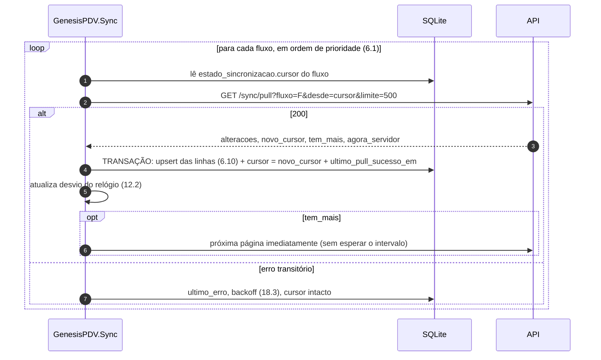

### 6.6 Paginação e término

- Páginas são pedidas em sequência, sem paralelismo dentro de um fluxo (o cursor de uma depende da anterior).
- Fluxos diferentes podem ser baixados em paralelo só na carga inicial (no máximo 2 requisições simultâneas).
- A página é sempre aplicada inteira numa transação local; o cursor só avança no commit. Queda no meio = página
  repetida inteira na próxima vez (upsert idempotente).

### 6.7 Filtros por loja e saída de filtro

Os filtros por tabela são os do modelo 6.2 (X = loja do terminal, E = estoque vinculado, T = terminal). Regras para
que uma linha que **deixa de pertencer** ao terminal não fique esquecida no PDV:

| Regra | Origem | Exemplo |
|---|---|---|
| Colunas de filtro são imutáveis; mudar = excluir logicamente e criar outra linha | Modelo 6.4 regra 2 | `produtos_lojas.loja_id`, `configuracoes.loja_id`, `configuracoes.escopo`, `templates_documentos.loja_id`, `impressoras_destino.loja_id`, `atalhos_pdv.loja_id`, `lojas_banners.loja_id`, `taxas_entrega.loja_id`, `caixas.loja_id`, `certificados_digitais.loja_id`, `numeracoes_faixas.terminal_id`, `cobrancas_pix.terminal_id` (lista completa no modelo) |
| Toque no pai: a linha dependente ganha `versao` nova na mesma transação | Modelo 6.4 regra 1 | `usuarios_lojas` excluída toca `usuarios` |
| Mudança estrutural → comando `ressincronizar_fluxo` aos terminais afetados | Modelo 6.4 regra 3 | Troca de `lojas.estoque_id` (fluxos `estoque`, `catalogo` e `configuracao`, que leva a linha de `estoques` da loja), UF ou município da loja (`referencia`, `catalogo`), nova chave PDV no catálogo de configurações (`configuracao`), `tipos_estoque.vendavel` ou o tipo padrão alterado (`estoque`, terminais de todas as lojas; ERP 13.6 — sem a sombra da 6.11 no PDV, a linha que sai do filtro fica no espelho, por isso o ERP só tira o `vendavel` com saldo zero), `lojas_banners.exibir_em` alterado (`configuracao`), `lojas.tipo_emissao` deixa de ser `nfce` (o certificado sai do filtro — `configuracao`, e o PDV apaga o certificado local) |

### 6.8 Tombstones (exclusões)

- Exclusão é lógica (`excluido_em`); a linha excluída desce como qualquer alteração e o PDV a grava (não apaga),
  filtrando `excluido_em is null` nas telas (modelo 4.2).
- Restaurar (`excluido_em = null`) gera `versao` nova e desce.
- Como nada sincronizável é apagado fisicamente na nuvem, **o cursor nunca expira**: um terminal offline por 60 dias
  retoma do cursor antigo e recebe todas as exclusões. Não existe "cursor velho demais".
- O PDV pode compactar localmente (sem apagar) as linhas excluídas há mais de 180 dias de tabelas grandes
  (`produtos_codigos_barras`, `pessoas_telefones`), removendo-as do índice FTS — continuam na tabela para que um
  upsert posterior funcione.

### 6.9 Carga inicial (terminal novo) e snapshot

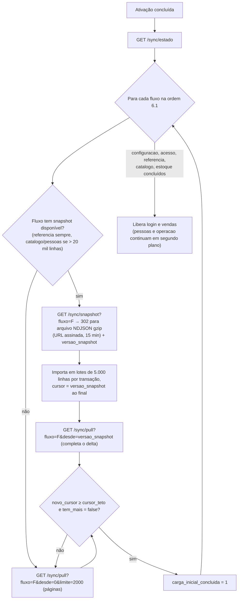

| Item | Regra |
|---|---|
| Snapshot | Arquivo `emp/<codigo>/snapshots/<fluxo>/<loja_id>/<versao>.ndjson.gz` gerado à noite (ou sob demanda na primeira ativação de uma loja), com a mesma projeção e filtros do pull; uma linha JSON por alteração (`{"tabela":…,"versao":…,"linha":{…}}`). `referencia` é por UF (não por loja). Validade: 7 dias; mais velho que isso a API gera outro ou responde 404 e o PDV usa o pull paginado |
| Integridade | Resposta do `/sync/snapshot` traz `sha256` e `linhas`; o PDV confere antes de aplicar |
| Correção | Snapshot é só aceleração: o pull a partir de `versao_snapshot` completa tudo que mudou depois. Por isso o snapshot pode ser gerado com leitura `repeatable read` sem bloquear ninguém |
| Retomada | Interrompida a carga, o PDV retoma do cursor do fluxo (cursor salvo a cada página, PDV 5.3) |
| Término | `tem_mais = false` com `novo_cursor = cursor_teto` (6.3). Como o cursor avança até o teto mesmo quando as últimas versões são de outra loja/estoque, a condição sempre fica verdadeira depois da última página |
| Desempenho local | Durante a carga inicial (antes da primeira venda) o PDV usa transações de até 5.000 linhas, `PRAGMA synchronous=NORMAL` e recria o FTS5 no fim; volta a `synchronous=FULL` antes de liberar login. No F2-B36 o `produtos_busca` é mantido página a página também na carga (dezenas de ms por página de 2.000 produtos), e a abertura do PDV confere a contagem e refaz se preciso (README do PDV › decisão 83) |
| Meta | 50 mil produtos (≈ 250 mil linhas no `catalogo`) em < 5 min numa conexão de 10 Mbit/s |

### 6.10 Aplicação local de uma página

```csharp
// GenesisPDV.Sync — aplicação de uma página do pull (pseudocódigo)
await using var tx = await db.BeginTransactionAsync();
foreach (var alt in pagina.Alteracoes)
{
    if (!Esquema.ConheceTabela(alt.Tabela)) { log.Aviso("tabela desconhecida", alt.Tabela); continue; } // app antigo
    var linha = Esquema.Converter(alt.Tabela, alt.Linha);   // ignora colunas desconhecidas; decimais → INTEGER escalado
    if (await outbox.TemEventoPendente(agregadoId: linha.Id))
    {   // modelo 4.2: não sobrescrever linha com fato local ainda não confirmado
        await adiadas.Guardar(alt.Tabela, linha.Id, alt.Versao, alt.Linha);
        continue;
    }
    // upsert só se a versão recebida for mais nova (cadastro: a nuvem vence)
    await db.ExecuteAsync($"insert into {alt.Tabela} (...) values (...) " +
                          "on conflict(id) do update set ... where excluded.versao > {alt.Tabela}.versao");
    await fts.Atualizar(alt.Tabela, linha);                   // produtos_busca / pessoas_busca
    if (alt.Tabela is "lojas" or "configuracoes" or "certificados_digitais") await segredos.Decifrar(linha); // envelope para a chave do terminal (20.2), re-protegido localmente
}
await estado.AtualizarCursor(pagina.Fluxo, pagina.NovoCursor, sucessoEm: relogio.AgoraCorrigido());
await tx.CommitAsync();
eventosLocais.Publicar(new CadastrosAlterados(pagina.Fluxo));  // telas recarregam caches na próxima venda
```

| Regra | Detalhe |
|---|---|
| Linha adiada | Guardada na tabela local `alteracoes_adiadas` (`tabela`, `registro_id`, `versao`, `linha` JSON, `criado_em`) e aplicada quando o evento pendente do agregado for **confirmado ou descartado** (se a versão adiada ainda for mais nova que a local). Sem isso, se o evento local for rejeitado, a alteração da nuvem nunca seria aplicada (modelo 4.4.12) |
| Colunas desconhecidas | Ignoradas (API mais nova que o app); coluna conhecida ausente → mantém o valor local |
| Venda em andamento | Não é afetada: itens já incluídos guardam snapshot; o próximo item usa o cadastro novo (PDV 30.3) |
| Concorrência com o caixa | Transação de página ≤ 500 linhas (~100–200 ms); `busy_timeout = 5000`; a gravação de uma venda nunca espera mais que uma página |
| Linha criada localmente | Espelhos com inserção local (`vales`, `comandas`, `itens_comanda`, `orcamentos`, `itens_orcamento`, `cobrancas_pix`) recebem a versão da nuvem com o mesmo `id` e passam a ter `versao` real (modelo 4.2) |
| Implementação (Fase 1B) | `GenesisPDV.Sync/Pull/AplicadorPull.cs`: SQL gerado do `Esquema.g.cs` (`insert … on conflict(<chave primária>) do update … where excluded.versao > versao`, um comando preparado por tabela e conjunto de colunas; a chave das referências é a natural, como `ufs.sigla`); coluna `NOT NULL` ausente numa linha **nova** recebe um valor neutro até a próxima versão; `criado_localmente` nunca vem da nuvem (a coluna da linha é ignorada) e a versão da nuvem que substitui a linha local grava `0` (modelo 4.2); página e cursor num commit. A linha adiada entra com os espelhos de escrita local (vales, comandas), que ainda não existem; o evento `CadastrosAlterados` também fica para depois. **FTS5 (F2-B36):** o texto de `produtos_busca` dos produtos gravados na página (e dos produtos das marcas e categorias gravadas) é recalculado na mesma transação, sob um `SAVEPOINT` (com outro aninhado que força a FTS5 a gravar ali dentro); a falha desfaz só o índice e marca a reconstrução, e a página e o cursor seguem (README do PDV › decisão 83). A `pessoas_busca` continua para depois |

### 6.11 Ressincronização (reset) sem parar o caixa

Gatilhos: comando `ressincronizar` (todos os fluxos) ou `ressincronizar_fluxo {fluxo}` (ERP 12.4, modelo 3.15.3),
flag local `estado_sincronizacao.ressincronizar = 1` (suporte), migração local que exige dados novos (17.4).

Problema: refazer o pull do cursor 0 **sobre** o espelho atual não remove linhas que saíram do filtro sem tombstone
(o objetivo da ressincronização). Apagar o espelho antes pararia o caixa. Solução — **ressincronização em sombra**:

1. O PDV cria `pdv_ressinc.db` (mesmo esquema, só as tabelas do fluxo) e baixa o fluxo do cursor 0 (ou snapshot)
   para ele, em segundo plano, enquanto o caixa continua vendendo com o espelho atual.
2. Concluída a sombra, a troca é feita **por renomeação**, nunca por `delete` + `insert` de centenas de milhares de
   linhas numa transação só (isso seguraria a trava de escrita do SQLite por vários segundos, acima de
   `busy_timeout = 5000`, e uma venda finalizada no meio receberia `SQLITE_BUSY`):
   1. Pausa o pull **daquele fluxo** (os outros continuam).
   2. `ATTACH 'pdv_ressinc.db' as r`; para cada tabela do fluxo cria `<tabela>__novo` no banco principal com o mesmo
      esquema e copia `r.<tabela>` para ela **em lotes de 5.000 linhas, cada lote numa transação curta**
      (~50–100 ms). Os índices de `<tabela>__novo` são criados ao final da cópia, também fora de transação longa, com
      sufixo de geração no nome (`ix_<tabela>_<colunas>_g<n>`), porque nomes de índice são únicos no arquivo; os
      gatilhos da tabela (se houver) são criados em `<tabela>__novo` no mesmo momento.
   3. Numa **transação curta** (`PRAGMA legacy_alter_table = ON` na conexão, antes de abrir a transação, para o SQLite
      não reescrever as chaves estrangeiras de outras tabelas para `<tabela>__velho`):
      copia de `<tabela>` para `<tabela>__novo` as **linhas preservadas** (evento local pendente — as mesmas regras de
      6.10 — e linhas criadas localmente ainda não confirmadas; dezenas de linhas), depois
      `ALTER TABLE <tabela> RENAME TO <tabela>__velho; ALTER TABLE <tabela>__novo RENAME TO <tabela>;` para cada tabela
      do fluxo, e `cursor` = cursor final da sombra. Duração típica: dezenas de milissegundos.
   4. Retoma o pull do fluxo a partir do cursor da sombra (o que o espelho antigo tinha recebido depois disso desce de
      novo; o upsert é idempotente).
   5. Em segundo plano, com prioridade mínima: `DROP TABLE <tabela>__velho` (só com o caixa livre, sem venda
      `em_andamento`/`em_pagamento`) e reconstrução do FTS5 (`produtos_busca`/`pessoas_busca`) em lotes de 5.000
      linhas. Enquanto o FTS é refeito, a busca por nome usa `LIKE` sobre a tabela (mais lenta, nunca bloqueia).
3. `DETACH` e apaga o arquivo da sombra. Auditoria local `ressincronizacao` e `comandos_terminal.status = 'executado'`.
   Uma queda de energia em qualquer passo é segura: antes da transação do passo 2.3 o espelho antigo continua em uso
   (as tabelas `__novo` são descartadas e a sombra recomeça); depois dela, só restam passos de limpeza.

A ressincronização **nunca** mexe em `eventos_saida`, tabelas de movimento ou `sequencias_locais`.

### 6.12 Imagens de produto, logotipos e banners

| Item | Regra |
|---|---|
| No banco | Só o id do arquivo (`produtos.foto_principal_arquivo_id`, `lojas.logotipo_arquivo_id`, `lojas_banners.arquivo_id`, `categorias.imagem_arquivo_id`, `marcas.logotipo_arquivo_id`) + campos calculados `foto_url`/`imagem_url` e `foto_sha256` (do `arquivos.sha256` da variante). Nunca o binário |
| URL | Caminho **estável** da API: `/sync/arquivos/{arquivo_id}?variante=pdv_256` (não uma URL assinada, que expiraria e mudaria a linha). O endpoint autentica o token, aplica o escopo abaixo e responde `302` para a URL assinada do armazenamento (validade 15 min) |
| Escopo do endpoint | Só estas categorias de `arquivos` (modelo 3.1.6): `foto_produto`, `imagem_categoria` e `logotipo` de marca (cadastros da empresa que descem ao terminal); `logotipo` e `banner` de loja com `arquivos.loja_id = X`; `xml_nfce`, `xml_evento`, `xml_inutilizacao` com `arquivos.loja_id = X` **e** documento do próprio terminal (`registro_id` → `documentos_fiscais.terminal_id = T` / `inutilizacoes_fiscais.terminal_id = T`). Qualquer outra categoria (`xml_nfe_entrada` de fornecedor, `xml_nfe_saida`, `anexo_financeiro`, `logs_terminal`, planilhas, `danfe_pdf`…), outra loja ou outro terminal → `403 ESCOPO_INVALIDO` (com `auditoria`). Coluna `arquivos.loja_id uuid` (anulável; preenchida para arquivos de loja e XML fiscal, modelo 3.1.6) |
| Variantes | `pdv_256` (WebP 256 px, ~10–20 KB) para foto de produto; `cupom_mono` (PNG 1 bit, largura 384/576 px) para logotipo de cupom; `banner_1366` (WebP) para banners. Geradas pela API no upload. **Fase 2, F2-B43** (README da API › decisão 189): a `pdv_256` já é gerada no envio de toda imagem de cadastro (foto do produto, imagem da categoria, logotipo da marca e da loja, foto da loja), até 256 px no maior lado sem ampliar, com o EXIF girado e sem metadados, e fica em `arquivos.variantes` com o próprio sha256 (o `foto_sha256` da linha); a `cupom_mono` e a `banner_1366` entram com o uso delas, e o endpoint `/sync/arquivos` no F2-B45 |
| Cache local | `%ProgramData%\GenesisPDV\cache\imagens\<sha256>.<ext>` (Linux `/var/lib/genesispdv/cache/imagens`); limite 500 MB com descarte LRU; `If-None-Match` com o sha256 |
| Quando baixar | Logotipo e banners: **antes de liberar vendas** (o cupom precisa do logo offline). Fotos de produto: sob demanda (exibição no painel do item/consulta) e em segundo plano com prioridade mínima, só se `pdv.exibe_foto_produto = true`, limitado a 2 downloads simultâneos e 2 MB/s |
| Offline | Sem a imagem no cache: placeholder (nunca bloqueia) |
| Mudança | Nova foto = novo `arquivo_id`/`sha256` → a linha do produto ganha `versao` nova → o PDV baixa a imagem nova quando precisar |
| **Fase 2, F2-B45** (README da API › decisões 191 e 192; README do PDV › decisões 85 e 86) | **Campos calculados** do pull: `foto_url`/`foto_sha256` (produtos), `imagem_url`/`imagem_sha256` (categorias) e `logotipo_url`/`logotipo_sha256` (marcas), com o caminho estável acima e o sha256 **da variante** `pdv_256`; nulos sem imagem; no `Esquema.g.cs` como colunas projetadas e anuláveis. **Endpoint** só com a variante `pdv_256` e só do arquivo ligado a um produto, categoria ou marca **vivos**, com a categoria do destino; fora disso (outra empresa, envio solto, cadastro excluído, logotipo/foto da loja, XML, planilha) **`404 NAO_ENCONTRADO`**, em vez do 403 acima (não confirma que o id existe). O conteúdo sai pela própria API em vez do `302` (a variante tem 10–20 KB): `Content-Type: image/webp` fixo, `nosniff`, CSP `default-src 'none'; sandbox`, nome gerado e `ETag` = sha256 (`If-None-Match` → `304`); limite de 120 downloads/min por terminal (`SYNC_ARQUIVOS_POR_MINUTO`, 429). Não exige o hardware registrado (são os cadastros que o pull já entrega); terminal em desativação → 403. **PDV:** do `*_url` só aproveita o id (formato exato, a rota é montada pelo cliente), grava `<sha256>.webp` em `<dados>\cache\imagens` só depois de conferir o sha256, com limite de 512 KB; falha = placeholder, nunca trava a venda nem a sincronização. O logotipo e os banners da loja, a `cupom_mono`, o LRU e a exibição da foto (`pdv.exibe_foto_produto = false`) ficam para depois |

### 6.13 Catálogos grandes

| Medida | Detalhe |
|---|---|
| Índices de servidor | `ix_<tabela>_versao` em toda tabela que desce (modelo 1.5); filtros por loja com índices compostos (`produtos_lojas (loja_id, versao)`, `saldos_estoque (estoque_id, versao)`) |
| Índices locais | Os do modelo 4.2 (código de barras, código interno, PLU, FTS5); criados **depois** da carga inicial |
| Cadastro em massa no ERP | Grava em blocos de até 500 linhas por transação (modelo 1.5), para não segurar a trava de ordenação nem gerar páginas gigantes |
| Mudança de preço em massa (ex.: 10 mil produtos) | Vira 10 mil linhas no fluxo `catalogo` (~20 páginas de 500, ~1,5 MB compactado); o PDV aplica entre vendas |
| Tabelas `referencia` | Atualização da tabela oficial (NCM/IBPT) toca milhares de linhas: a API gera um snapshot novo e manda `ressincronizar_fluxo {fluxo: "referencia"}`, mais barato que paginar. **Fase 2, F2-B46** (README da API › decisão 193): a atualização da NCM pela plataforma manda o comando aos terminais `ativo`/`desativando` da empresa quando `ncms` mudou (sem snapshot: o PDV volta o cursor do fluxo a 0 e baixa de novo, como já faz; sem mudança de protocolo) |

---

## 7. Subida (push): outbox e envelope

### 7.1 Gravação de um evento no PDV

Todo fato que sobe é gravado em `eventos_saida` **na mesma transação SQLite** que o fato (modelo 4.4.5):

```csharp
await using var tx = await db.BeginTransactionAsync();
venda.Finalizar(relogio.AgoraCorrigido());                       // status, finalizada_em, rateio, snapshots
await repo.SalvarVendaCompleta(venda);                           // vendas, itens_venda, pagamentos_venda, parcelas_venda…
var seq = await sequencias.Proximo("evento");                    // sequencias_locais, mesma transação
var payload = Payload.VendaFinalizada(venda);                    // documento completo (9.6)
await outbox.Inserir(new EventoSaida {
    Id = Guid.CreateVersion7(), SequenciaTerminal = seq, Tipo = "venda.finalizada", VersaoSchema = 1,
    AgregadoTipo = "venda", AgregadoId = venda.Id, OcorridoEm = venda.FinalizadaEm,
    Payload = Jcs.Serializar(payload), PayloadSha256 = Sha256Hex(Jcs.Serializar(payload)), Status = "pendente" });
await tx.CommitAsync();                                          // synchronous=FULL: durável ao retornar
sync.Acordar();                                                  // push em até 500 ms (debounce)
```

| Regra | Detalhe |
|---|---|
| Gravador único | Fase 1C (C9): venda, caixa, vasilhame e o lote de auditoria entram pelo `GravadorOutbox` do PDV, na transação do fato: sequência, hora do envelope (a do payload, já pelo relógio corrigido, com a monotonicidade da 12.3), `usuario_id`, `contexto` do momento (sessão, `estoque_id` do espelho `lojas`) e `dependencias` (8.5) declaradas pela fábrica do evento, em `eventos_saida.dependencias`; e recusa o tipo que a nuvem não anunciou (17.5, T13) |
| Sequência | `sequencia_terminal` = `sequencias_locais['evento'] + 1`, contínua, começando em 1 na ativação; nunca reaproveitada |
| Serialização | **JCS (RFC 8785)**: JSON canônico (chaves ordenadas por unidades UTF-16, sem espaços, números no formato ES6). `payload_sha256` = SHA-256 hex dos bytes UTF-8 do JCS. A API recalcula com o mesmo algoritmo — por isso dinheiro é string (JCS normaliza números, não decimais) |
| Serializador JCS | **Dedicado** (`Jcs.Serializar` no PDV, `jcs()` em `packages/shared`), escrito sobre um escritor de baixo nível e **nunca** sobre o `System.Text.Json` com o codificador padrão: o `JavaScriptEncoder.Default` escapa não ASCII e `< > & ' +` como `\uXXXX`, o que não é JCS, e todo payload com acento ("ÁGUA", "PRAÇA DA SÉ") geraria hash diferente do recalculado pela API. Regras: caracteres não ASCII saem **literais** em UTF-8; escapa só `"` (`\"`), `\` (`\\`) e controles < 0x20 — `\b \f \n \r \t` na forma curta, os demais como `\u00xx` com hexadecimal **minúsculo**; `/` não é escapado; números (inteiros do envelope) no formato ES6 (sem `+`, sem zeros à esquerda, sem `.0`) |
| Vetores de teste | `packages/shared/testes/jcs/vetores.json`: strings com acentos, `ç`, emoji (par substituto), `&`, `<`, `>`, `'`, `+`, `/`, `\`, aspas, cada controle de 0x00 a 0x1F, `\u2028`, chaves com acento e com ordem UTF-16 diferente da ordem de código, números longos (`9007199254740991`), objetos aninhados e listas vazias — cada vetor com a entrada, a saída JCS esperada e o SHA-256. A mesma suíte roda no CI do C# e do TypeScript (17.5); divergência de um byte reprova o build dos dois |
| Imutável | O `payload` gravado nunca é reescrito (nem em atualização do app); a API converte versões antigas (17.5) |
| `ocorrido_em` | Hora do fato pelo relógio corrigido (12.3), monotônica no terminal **com limite**: `max(calculado, ocorrido_em do evento anterior + 1 ms)` só quando o anterior não está mais de 2 min à frente; senão usa o calculado e marca `relogio_regrediu = true` (12.3). A ordem real é sempre a de `sequencia_terminal` |
| Tamanho | ≤ 2 MiB por evento (JSON sem compressão). Venda com até 990 itens (limite de `det` da NFC-e) fica bem abaixo |

### 7.2 Estados do evento no PDV

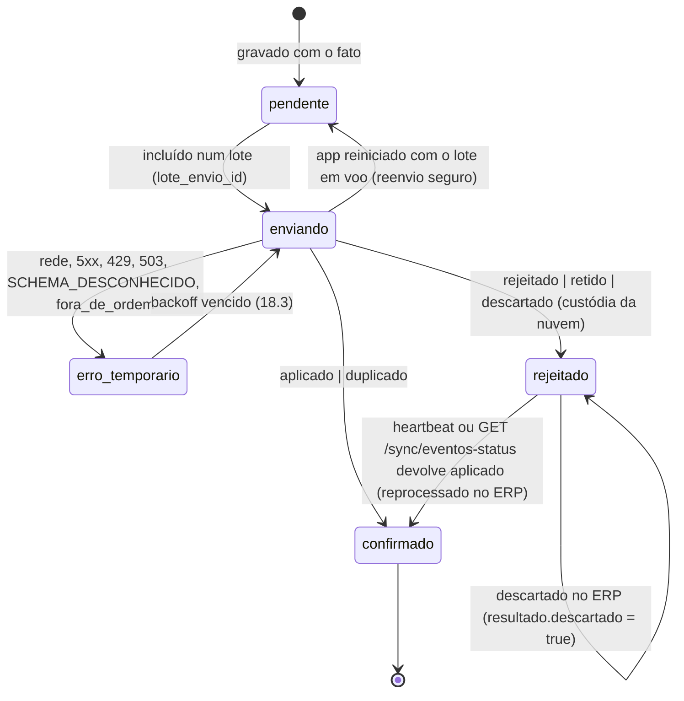

- `rejeitado` no PDV significa "a nuvem **tem** este evento guardado, mas não o aplicou" (com erro ou retido). O PDV
  não reenvia, não apaga e mantém o efeito local (o saldo estimado continua descontando a venda — modelo 4.5).
- Resolução chega pelo heartbeat (`eventos_resolvidos`, 21.1): `aplicado` → `confirmado` com `versao_nuvem`,
  `versao_nuvem_fim` e `resultado`; `descartado` → continua `rejeitado` com
  `resultado = {"descartado": true, "justificativa": "…"}` e deixa de contar no saldo estimado. Isso substitui o
  "rejeitado → pendente: reprocessar" do PDV 34.5: o reprocesso acontece na nuvem, sem reenvio.
- A entrega é **ao menos uma vez**: a nuvem repete o item em todo heartbeat até o PDV confirmar em
  `eventos_resolvidos_ack` (21.1); aplicar a mesma resolução duas vezes não tem efeito (o PDV compara `evento_id` e
  o estado atual). Como rede de segurança, a cada 1 h o PDV consulta `GET /sync/eventos-status?ids=` para todos os
  seus `rejeitado` (até 200 ids por chamada) e aplica o que vier resolvido. Fase 1C (C14): a consulta é só leitura
  (não grava `resolucao_entregue_em`; quem confirma a entrega é o ack do heartbeat, que repete o resolvido até lá) e
  devolve só os eventos deste terminal, na ordem da sequência — id de outro terminal ou desconhecido fica fora da
  resposta, sem distinguir os dois; o PDV a faz em fatias de 200, na ordem da sequência, fora os já descartados
  (decisão final na nuvem) e os rejeitados por `EVENTO_DIVERGENTE` (a linha da nuvem com aquele `evento_id` é a do
  envio original, de outro conteúdo: a situação dela, quase sempre `aplicado`, não vale para o evento local, que fica
  em quarentena até o suporte, 11.2; pelo mesmo motivo o PDV não o confirma por `eventos_resolvidos`), e com falha
  reagenda com o backoff de 18.3 sem tocar no resto do ciclo. Aceita os mesmos
  estados do terminal que o `recuperar` (tabela 3.8, T6) e, como o heartbeat, responde com o hardware divergente.
- `confirmado` grava também `eventos_saida.versao_nuvem_fim` (local), devolvido no push e em `eventos_resolvidos`;
  é usado na regra de "refletido" (15.2).
- `confirmado`: `payload` apagado após 90 dias; a linha permanece (prova de encadeamento das sequências).

### 7.3 Envelope do evento (campo a campo)

| Campo | Tipo | Origem | Regra |
|---|---|---|---|
| `evento_id` | UUID v7 | `eventos_saida.id` | Idempotência (`uq_eventos_recebidos_evento_id`) |
| `terminal_id` | UUID | `identidade_terminal.terminal_id` | Deve ser igual ao do token; senão `ESCOPO_INVALIDO` |
| `sequencia` | inteiro ≥ 1 | `eventos_saida.sequencia_terminal` | Contínua por terminal; aplicada em ordem |
| `tipo` | texto | `eventos_saida.tipo` | Catálogo da seção 9 |
| `versao_schema` | inteiro ≥ 1 | `eventos_saida.versao_schema` | Versão do payload daquele tipo |
| `agregado_tipo` | texto | `eventos_saida.agregado_tipo` | `venda`, `sessao_caixa`, `movimento_caixa`, `troca`, `vale`, `comanda`, `pedido`, `orcamento`, `pessoa`, `documento_fiscal`, `inutilizacao`, `transacao_tef`, `auditoria`, `terminal`, `recebimento_crediario` (9.25, PDV 30.4), `movimento_vasilhame` (9.26), `produto` (`alerta.cadastro`, 9.24) |
| `agregado_id` | UUID | `eventos_saida.agregado_id` | Id da linha principal criada/alterada |
| `dependencias` | lista de `{agregado_tipo, agregado_id}` | calculada pelo PDV (8.5) | Agregados **deste terminal** que precisam estar aplicados antes. Uma entidade criada dentro de evento de **outro** agregado é declarada pelo agregado que a criou (ex.: vale de troca usado como pagamento → `{agregado_tipo: "troca", agregado_id}`) |
| `ocorrido_em` | timestamptz | relógio corrigido | Hora do fato |
| `ocorrido_em_local` | timestamptz | relógio do SO | Sem correção; auditoria de relógio |
| `desvio_relogio_ms` | inteiro | `estado_conexao.desvio_relogio_ms` | Desvio usado na correção |
| `relogio_confiavel` | booleano | 12.3 | `false` se não houve amostra de hora confiável (API, SEFAZ ou NTP) desde a inicialização do PC e o relógio do SO não está sincronizado por NTP |
| `relogio_regrediu` | booleano | 12.3 | `true` quando o `ocorrido_em` calculado ficou mais de 2 min antes do `ocorrido_em` do evento anterior e o PDV **não** aplicou a monotonicidade (omitido = `false`) |
| `usuario_id` | UUID | operador | Quem executou (o supervisor que liberou fica no payload: `autorizado_por_id`) |
| `contexto` | objeto | estado local | `{loja_id, caixa_id, numero_caixa, estoque_id, sessao_caixa_id, versao_app, versao_schema_local}` — `estoque_id` é o `lojas.estoque_id` vigente no PDV no momento do fato (usado para baixar estoque, 10.2) |
| `payload` | objeto | `eventos_saida.payload` | Documento completo (seção 9) |
| `payload_sha256` | hex 64 | `eventos_saida.payload_sha256` | SHA-256 do JCS de `payload` |

Gravados pela nuvem em `eventos_recebidos`: `criado_em` (= **recebido_em**), `loja_id` (do token), `status`,
`tentativas`, `versao_nuvem`, `versao_nuvem_fim`, `resultado`, `aplicado_em`, `resolucao_entregue_em`, além das
colunas do envelope (`agregado_tipo`, `dependencias`, `lote_id`, `ocorrido_em_local`) e de `envelope`: o envelope
recebido inteiro **menos** o `payload` (que tem coluna própria), com `usuario_id`, `contexto` e o relógio
(`desvio_relogio_ms`, `relogio_confiavel`, `relogio_regrediu`), de onde o reprocessamento (11.4) e o `recuperar`
(22.2) remontam o envelope original. Linhas anteriores à migração que criou a coluna têm `{}` até serem reenviadas
— modelo 3.15.2.

### 7.4 `POST /sync/push`

Requisição (`Content-Encoding: gzip`; exemplo com 2 eventos, payloads abreviados — completos na seção 9):

```json
{
  "lote_id": "01a18790-50e8-7da7-ab5c-f46780bacd64",
  "terminal_id": "01a18751-a521-7238-b924-56de3eb13b90",
  "enviado_em": "2026-10-29T17:36:07.410Z",
  "eventos_pendentes_total": 2,
  "eventos": [
    {
      "evento_id": "01a18777-7aaa-7203-840d-b9b4885f6e66",
      "terminal_id": "01a18751-a521-7238-b924-56de3eb13b90",
      "sequencia": 1042,
      "tipo": "caixa.reforco",
      "versao_schema": 1,
      "agregado_tipo": "movimento_caixa",
      "agregado_id": "01a18767-18c6-78fa-beb7-99193f22faf8",
      "dependencias": [ { "agregado_tipo": "sessao_caixa", "agregado_id": "01a18755-98a1-7472-96da-1dac72ff5d2a" } ],
      "ocorrido_em": "2026-10-29T14:02:31.220Z",
      "ocorrido_em_local": "2026-10-29T14:02:29.981Z",
      "desvio_relogio_ms": 1239,
      "relogio_confiavel": true,
      "usuario_id": "01a18754-76cb-7b74-b2e7-06298fadc1a6",
      "contexto": {
        "loja_id": "01a18752-3782-7bda-ad3c-2d6d1a3d1fa7",
        "caixa_id": "01a18752-c8a9-7970-9641-9f828b9d2434",
        "numero_caixa": 2,
        "estoque_id": "01a18753-5750-717c-87a0-ca6e0822e8f3",
        "sessao_caixa_id": "01a18755-98a1-7472-96da-1dac72ff5d2a",
        "versao_app": "1.4.2",
        "versao_schema_local": 12
      },
      "payload": { "movimentos_caixa": { "id": "01a18767-18c6-78fa-beb7-99193f22faf8", "tipo": "reforco", "valor": "100.00", "...": "..." } },
      "payload_sha256": "d4735e3a265e16eee03f59718b9b5d03019c07d8b6c51f90da3a666eec13ab35"
    },
    {
      "evento_id": "01a18778-08ab-7f25-b9ac-1b1ea8e56e0c",
      "sequencia": 1043,
      "tipo": "venda.finalizada",
      "versao_schema": 1,
      "agregado_tipo": "venda",
      "agregado_id": "01a18756-bc09-76c2-b2b9-437a28df6ec4",
      "dependencias": [ { "agregado_tipo": "sessao_caixa", "agregado_id": "01a18755-98a1-7472-96da-1dac72ff5d2a" } ],
      "...": "demais campos do envelope como acima",
      "payload": { "vendas": { "...": "..." }, "itens_venda": [], "pagamentos_venda": [] },
      "payload_sha256": "4e07408562bedb8b60ce05c1decfe3ad16b72230967de01f640b7e4729b49fce"
    }
  ]
}
```

Resposta `200` (sempre 200 quando o lote foi lido; o resultado é **por evento**):

```json
{
  "lote_id": "01a18790-50e8-7da7-ab5c-f46780bacd64",
  "recebido_em": "2026-10-29T17:36:07.902Z",
  "agora_servidor": "2026-10-29T17:36:08.311Z",
  "proxima_sequencia_esperada": 1044,
  "resultados": [
    {
      "evento_id": "01a18777-7aaa-7203-840d-b9b4885f6e66",
      "sequencia": 1042,
      "status": "duplicado",
      "versao_nuvem": 1881990,
      "versao_nuvem_fim": 1881993,
      "resultado": {}
    },
    {
      "evento_id": "01a18778-08ab-7f25-b9ac-1b1ea8e56e0c",
      "sequencia": 1043,
      "status": "aplicado",
      "versao_nuvem": 1882244,
      "versao_nuvem_fim": 1882262,
      "resultado": {
        "venda_id": "01a18756-bc09-76c2-b2b9-437a28df6ec4",
        "alertas": ["ESTOQUE_NEGATIVO"]
      }
    }
  ],
  "comandos": []
}
```

| `status` por evento | Significado | Estado local |
|---|---|---|
| `aplicado` | Aplicado agora | `confirmado` + `versao_nuvem` + `versao_nuvem_fim` + `resultado` |
| `duplicado` | Já estava aplicado (repetição) — devolve `versao_nuvem`, `versao_nuvem_fim` e `resultado` gravados | `confirmado` |
| `rejeitado` | Guardado com `status = 'erro'` (erro permanente, 11.1) — `erro: {codigo, mensagem}` | `rejeitado` (quarentena) |
| `retido` | Guardado, aguardando dependência com erro (8.5) | `rejeitado` (quarentena, motivo "aguardando") |
| `descartado` | Já tinha sido descartado no ERP | `rejeitado` + `resultado.descartado` |
| `fora_de_ordem` | Não processado: há lacuna antes dele (8.6) | volta a `pendente`; o PDV reenvia a partir de `proxima_sequencia_esperada` |
| `lacuna_recuperavel` | Não processado: a `sequencia` está numa faixa declarada como lacuna (`terminal.lacuna`, `descartado`) e o lote não trouxe a autorização de recuperação (8.6); `resultado.lacuna = {de, ate}` traz a faixa declarada e `erro.codigo = 'LACUNA_RECUPERAVEL'`; o lote para | `erro_temporario` com backoff, como o `fora_de_ordem` (1C/C15: sem espera o laço reenviaria a cada 500 ms); o PDV pede liberação de supervisor e reenvia com `recuperar_lacuna` |
| `nao_processado` | Não processado porque um evento anterior do lote parou o lote (erro transitório, regressão) | volta a `pendente` |
| `erro_temporario` | Falha transitória ao aplicar (deadlock esgotado, `SCHEMA_DESCONHECIDO`, banco indisponível) | `erro_temporario` + backoff |

Campos opcionais do lote para as lacunas (8.6; Fase 1C, C15): `declarar_lacuna: {de, ate, motivo, observacao?,
autorizado_por_id}` — `motivo` em `banco_local_perdido`, `restauracao_backup` ou `outro`, e o lote pode ir **sem
eventos** só com ela — e `recuperar_lacuna: {de, ate, autorizado_por_id}`. As duas não vão juntas; cada faixa tem no
máximo 5.000 sequências (`MAXIMO_SEQUENCIAS_LACUNA`). Fixtures `push.lacuna.requisicao.json`,
`push.recuperar_lacuna.requisicao.json` e `push.lacuna.resposta.json`.

### 7.5 Montagem do lote no PDV

1. Seleciona eventos em ordem de `sequencia_terminal` a partir do **menor** com status `pendente`, `enviando` ou
   `erro_temporario` — um **prefixo contínuo**: se o primeiro está em backoff, espera (não pula; a nuvem exige ordem).
   Eventos `rejeitado`/`confirmado` não fazem parte (a nuvem já os tem).
2. Até 50 eventos ou 8 MiB de JSON (19.2), o que vier primeiro.
3. Numa transação: `status = 'enviando'`, `lote_envio_id`, `enviado_em`, `tentativas = tentativas + 1`.
4. Envia; processa a resposta numa transação (todos os resultados de uma vez).
5. Sem resposta (timeout, rede): todos do lote → `erro_temporario` com `proxima_tentativa_em` pelo backoff. O reenvio
   é seguro (idempotência).
6. Na inicialização do app, `enviando` → `pendente`.
7. Enquanto houver pendentes e conexão, repete imediatamente (sem esperar o intervalo de 15 s).

---

## 8. Processamento do push na nuvem

### 8.1 Visão do processamento de um lote

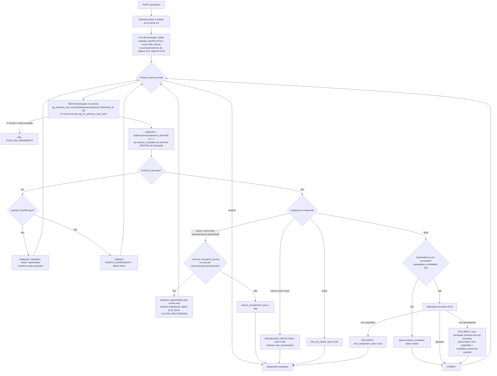

| Regra | Detalhe |
|---|---|
| Linha existente em `recebido` | Tentativa anterior falhou de forma transitória (8.3): o reenvio do mesmo `evento_id` tenta aplicar de novo (não é `duplicado`) |
| Serialização por terminal **dentro de cada transação** | Toda transação de evento começa por `select pg_advisory_xact_lock(hashtextextended('push:' \|\| terminal_id, 0))` e, em seguida, lê `esperado` **dentro** da transação. A trava dura só a transação (liberada no `commit`/`rollback`), funciona com qualquer conexão do pool e com **PgBouncer em modo transação** (travas de sessão não funcionam nesse modo: ficariam numa conexão de servidor reutilizada por outro cliente). Dois pushes simultâneos do mesmo terminal (reenvio por timeout enquanto o primeiro roda) se intercalam evento a evento sem se misturar: cada transação confere `sequencia = esperado` com o estado já confirmado; o perdedor recebe `duplicado` ou `fora_de_ordem` |
| Por que não `select … from terminais for update` | Serviços do ERP também gravam `terminais` (depois de pegar a trava 7300001); travar a linha antes da 7300001 inverteria a ordem de travas e poderia gerar deadlock. A trava consultiva `push:` só é pega pelas transações de evento (linha abaixo) |
| `PUSH_EM_ANDAMENTO` | Só otimização: o **primeiro** evento do lote usa `pg_try_advisory_xact_lock`; se a trava está ocupada, a API responde `409` sem processar nada e o PDV repete em 2 s. Os eventos seguintes usam a forma bloqueante |
| Ordem das travas | `push:<terminal>` → `7300001` (8.3) → travas de linha. Só as **transações de evento** pegam `push:`, sempre como primeira trava: o push (inclusive a transação que grava o `erro`), Reprocessar e Descartar no ERP (11.4), a lacuna declarada ou recuperada (8.6) e a importação 22.3. Nenhum código fora delas a pega. Assim o reprocessamento de um terminal se serializa com um push simultâneo do mesmo terminal. Na API, todas pegam `travarTerminal` primeiro, antes da 7300001 e de qualquer trava de linha (por isso nenhuma abre a transação com `travaVersao`); as que aplicam usam `aplicarEvento` (`apps/api/src/sync/aplicacao.ts`), que reentra na trava do terminal, o que só não inverte a ordem porque o chamador já a pegou |
| Servidor PostgreSQL | `tcp_keepalives_idle = 60`, `tcp_keepalives_interval = 10`, `tcp_keepalives_count = 6` (conexão morta sem FIN detectada em ~2 min, em vez de ~2 h do padrão do SO) e `idle_in_transaction_session_timeout = 30s` (transação esquecida aberta por um processo travado é encerrada e solta as travas). Pool da API com `statement_timeout` de 15 s nas transações de push |
| Uma transação por evento | Falha de um evento não desfaz os anteriores; o PDV recebe resultado por evento |
| Rejeitado não para a fila | Um evento com erro permanente fica guardado (`erro`) e os seguintes continuam — exceto os que dependem dele (`retido`, 8.5) |
| Transitório para a fila | Deadlock esgotado, falha de conexão, `SCHEMA_DESCONHECIDO`, falha no envio do XML ao armazenamento: o evento e os seguintes voltam para o PDV (`erro_temporario` / `nao_processado`) e serão reenviados em ordem |
| Hash na primeira recepção | Antes de gravar um `evento_id` novo, a API recalcula o JCS do `payload` recebido (mesmo serializador e vetores de 7.1). Divergente do `payload_sha256` do envelope → evento gravado com `status = 'erro'`, `erro_codigo = 'PAYLOAD_INVALIDO'`, `resultado.detalhes = {hash_recebido, hash_recalculado}` (diagnóstico de serializador; o suporte reprocessa depois de corrigir) |

### 8.2 Ordem estrita por terminal

- A nuvem só aplica o evento de `sequencia = esperado`. Como o próprio evento rejeitado/retido é **gravado** (ocupa
  sua sequência em `uq_eventos_recebidos_terminal_sequencia`), a sequência nunca fica com buraco por causa de erro.
- Não há ordem **entre** terminais: o que é compartilhado entre caixas é comutativo (razão de estoque, financeiro por
  venda) ou tem regra de corrida (vales, comandas, orçamentos, crédito: aplica e alerta — seções 14 e 16).
- O PDV não aplica nada fora de ordem localmente porque é o dono do próprio fluxo.

### 8.3 Transação de um evento

```ts
// apps/api/src/sync/push.ts + aplicacao.ts (pseudocódigo; aplicarEvento é o trecho comum ao reprocessamento)
async function aplicarEvento(cx: ConexaoEmpresa, ev: EnvelopeEvento, ctx: ContextoTerminal, primeiroDoLote: boolean) {
  // FORA de qualquer transação: E/S externa (regra abaixo). Falha aqui → erro_temporario, nenhuma trava pega.
  const anexos = await enviarXmlsAoArmazenamento(ev, ctx);           // chave por conteúdo, idempotente (9.10)
  return comRetentativa({ codigos: ['40P01', '40001'], vezes: 3 }, () => cx.transacao(async (tx) => {
    const chaveTerminal = `push:${ctx.terminalId}`;
    if (primeiroDoLote) {
      const ok = await tx.one(`select pg_try_advisory_xact_lock(hashtextextended($1, 0)) as ok`, [chaveTerminal]);
      if (!ok.ok) throw new PushEmAndamento();                        // 409, nada processado
    } else {
      await tx.query(`select pg_advisory_xact_lock(hashtextextended($1, 0))`, [chaveTerminal]);
    }
    const existente = await tx.oneOrNone(`select … from eventos_recebidos where evento_id = $1`, [ev.evento_id]);
    if (existente && existente.status !== 'recebido')
      return respostaPelaLinhaExistente(existente, ev);              // duplicado / rejeitado / retido / descartado
    // existente em 'recebido' (falha transitória anterior): segue e reaplica sobre a mesma linha
    const { esperado } = await tx.one(
      `select coalesce(max(sequencia_terminal), 0) + 1 as esperado from eventos_recebidos where terminal_id = $1`,
      [ctx.terminalId]);                                              // lido DENTRO da transação, sob a trava
    if (ev.sequencia !== esperado) return tratarForaDeSequencia(tx, ev, esperado); // 8.1: lacuna, regressão, fora de ordem
    await tx.query(
      `insert into eventos_recebidos (evento_id, terminal_id, loja_id, sequencia_terminal, tipo, versao_schema,
         agregado_tipo, agregado_id, dependencias, ocorrido_em, status, tentativas, payload, envelope, payload_sha256)
       values ($1,$2,$3,$4,$5,$6,$7,$8,$9,$10,'recebido',1,$11,$12,$13)`, [...]); // envelope = tudo menos o payload
    if (await dependenciaPendente(tx, ev)) return reter(tx, ev);       // 8.5 (agregados + entidades_evento)
    const payload = upcast(ev.tipo, ev.versao_schema, ev.payload);       // 17.5 + schema do tipo (PAYLOAD_INVALIDO)
    validarEscopo(ev, ctx);                                              // loja/caixa/terminal do payload = do token
    const cadastros = await handlers[ev.tipo].preparar?.(tx, payload, ev, ctx); // só leitura, sem trava (T21)
    await tx.query(`select pg_advisory_xact_lock(7300001)`);             // trava de ordenação (modelo 1.5)
    const inicio = await tx.one(`select nextval('seq_versao') as v`);   // versao_nuvem
    const resultado = await handlers[ev.tipo].aplicar(tx, payload, ev, ctx, anexos, cadastros); // seção 10 (sem E/S externa)
    await registrarEntidades(tx, ev, payload);                           // entidades_evento (8.5)
    const fim = await tx.one(`select nextval('seq_versao') as v`);      // versao_nuvem_fim: ainda sob a trava
    await tx.query(`update eventos_recebidos set status='aplicado', aplicado_em=now(), versao_nuvem=$1,
                    versao_nuvem_fim=$2, resultado=$3 where evento_id=$4`, [inicio.v, fim.v, resultado, ev.evento_id]);
    return { status: 'aplicado', versao_nuvem: inicio.v, versao_nuvem_fim: fim.v, resultado };
  }));
}
```

| Ponto | Regra |
|---|---|
| Trava do terminal primeiro | `push:<terminal_id>` (8.1) é a primeira trava de toda transação de evento (inclusive a que grava `erro`); `esperado` só é lido depois dela |
| Trava de ordenação logo depois | Pegar `pg_advisory_xact_lock(7300001)` **antes** de qualquer `select … for update` evita deadlock com escritas do ERP (os serviços do ERP que tocam tabelas sincronizáveis também pegam a trava no início da transação via `fn_trava_versao()`; recomendação ainda pendente no modelo 1.5, seção 24 M15) |
| Marcador de início | `versao_nuvem` reservado depois da trava: toda linha gravada pelo evento terá `versao` maior (modelo 3.15.2) |
| Marcador de fim | `versao_nuvem_fim` = `nextval('seq_versao')` reservado **depois** da última escrita do handler, ainda sob a trava 7300001 e antes do `commit`: toda linha gravada pelo evento tem `versao` menor que ele. Gravado em `eventos_recebidos.versao_nuvem_fim`, devolvido no push e em `eventos_resolvidos`, e usado pelo PDV para saber que **todos** os efeitos do evento já desceram (15.2). O cursor do pull consegue passar dele porque o teto inclui `max(eventos_recebidos.versao_nuvem_fim)` (6.4) |
| **Nenhuma E/S externa sob a trava** | Regra geral: nenhuma chamada de rede, armazenamento de objetos, PSP (PIX), SEFAZ, e-mail ou outro serviço dentro de transação que segure a trava 7300001 — ela serializa **todas** as escritas sincronizáveis da empresa (todos os caixas e o ERP), e um upload lento de centenas de milissegundos pararia todo mundo. XML fiscal: enviado **antes** de abrir a transação (9.10). O que precisar de E/S depois da aplicação (conciliação com o PSP, NF-e de devolução, e-mail) vira linha em `tarefas` gravada na mesma transação e executada depois do `commit` |
| Leitura antes da trava | O que o handler só **lê** (produtos, códigos de barras, estoques e tipos de estoque do documento) vem do `preparar` do handler, depois da conferência das dependências e do payload e **antes** da trava 7300001, sem `for update` (Fase 1C, T21): a trava fica presa só enquanto o handler grava. Em READ COMMITTED, um cadastro alterado pelo ERP entre a leitura e a trava vale a partir do evento seguinte, como se este tivesse sido aplicado antes da alteração |
| Ordem de travas de linha | `saldos_estoque` em ordem de (`estoque_id`, `produto_id`, `variacao_id`, `tipo_estoque_id`), cada linha travada uma vez por documento (`lancarDocumento`: um `select … for update` ordenado; movimentos num `INSERT` só e projeções num `UPDATE` só, em blocos de até 1000 linhas por comando, no limite de 65535 parâmetros do protocolo; ids comparados em minúsculas); depois `vales` por `id`; depois `saldos_credito_pessoas` por `pessoa_id`; depois `numeracoes` |
| Duração | Meta < 50 ms por evento de venda (10 itens), possível porque a transação só faz E/S no banco; a trava global serializa as escritas sincronizáveis da empresa: ~20–60 eventos/s por empresa, suficiente para dezenas de caixas, inclusive na recuperação de contingência (milhares de NFC-e). A API mede, por evento aplicado, o tempo de `fn_trava_versao()` até o `commit` (`MedidorTravaVersao`, p50/p95/máximo das últimas 2.000 aplicações por processo); o teste de carga da 1C confere o p95 |
| Erro de regra | `rollback`; nova transação (com a trava do terminal) grava a linha com `status = 'erro'`, `erro_codigo`, `erro` e as entidades do payload em `entidades_evento` (8.5); responde `rejeitado`. Violação de restrição do PostgreSQL que escapa do handler também é erro de regra, com o código da tabela de tradução da 11.2 |
| Exceção não classificada | `rollback`; nova transação incrementa `tentativas` mantendo `status = 'recebido'`; responde `erro_temporario`. Na 3ª tentativa vira `erro` com `erro_codigo = 'ERRO_INTERNO'` (evento venenoso → fila de decisão, 11.3) |

### 8.4 Idempotência

| Camada | Mecanismo | Protege contra |
|---|---|---|
| 1 | `uq_eventos_recebidos_evento_id`: o mesmo evento nunca é aplicado duas vezes; repetição devolve o `resultado` gravado | Reenvio de lote, resposta perdida, backup restaurado reenviando eventos já aplicados |
| 2 | Chaves de negócio: `pk_vendas (id)`, `uq_vendas_numero`, `uq_movimentos_estoque_idempotencia`, `uq_movimentos_vale_pagamento`, `uq_fechamentos_caixa_sessao_caixa_id`, `uq_sessoes_caixa_aberta`, `uq_documentos_fiscais_chave`, `uq_documentos_fiscais_numero`, `pk` de toda linha gerada no PDV | Bug que gere **dois eventos diferentes** para o mesmo fato (ex.: dois `venda.finalizada` da mesma venda) |
| 3 | `payload_sha256`: mesmo `evento_id` com conteúdo diferente → `EVENTO_DIVERGENTE` (não aplica, guarda o payload divergente em `alertas.dados`, alerta crítico para o suporte) | Corrupção local, bug de serialização |

Quando a camada 2 dispara para um evento novo (ex.: `venda.finalizada` de uma venda que já existe **com o mesmo
conteúdo** vinda de outro `evento_id`), o handler trata como aplicado sem efeito (`resultado.ja_existia = true`); com
conteúdo diferente → `erro` `AGREGADO_DIVERGENTE`.

### 8.5 Dependências e eventos retidos

Cada tipo de evento declara suas dependências (calculadas pelo PDV no envelope e **recalculadas** pela nuvem a partir
do payload; vale a união). A nuvem resolve as dependências **por entidade**, não só por `agregado_id`: muitas
entidades nascem dentro de eventos de **outro** agregado (o vale-troca nasce no `troca.registrada`, agregado
`troca`; a pessoa fundida vem de `pessoa.criada_no_caixa`; a sessão vem de `caixa.aberto`).

**Índice `entidades_evento`** (tabela do banco da empresa, modelo 3.15.4): `id`, `criado_em`, `entidade_tipo
varchar(30)` (nome da tabela: `vales`, `pessoas`, `sessoes_caixa`, `comandas`, `itens_comanda`, `orcamentos`,
`trocas`, `vendas`, `movimentos_caixa`, `documentos_fiscais`, `pedidos`, `transacoes_tef`, `recebimentos_crediario`, `movimentos_vasilhame`), `entidade_id uuid`,
`evento_id uuid`, `terminal_id uuid`; `uq_entidades_evento (entidade_tipo, entidade_id, evento_id)`. É alimentado
com **toda linha criada pelo payload** de um evento deste terminal — na transação que aplica o evento **e** na que o
grava como `erro` ou `retido` (lida a partir do payload, sem aplicar). Assim, para cada id referenciado por um evento
novo (`pagamentos_venda.vale_id`, `cliente_id`, `pagamentos_venda.pessoa_id`, `sessao_caixa_id`, `comanda_id`,
`orcamento_id`, `venda_id`, `movimento_caixa_id`…), a nuvem acha o evento que criou a entidade e verifica o status dele.

| Evento | Depende de (agregados do mesmo terminal) |
|---|---|
| `caixa.aberto` | sessão anterior (`sessao_anterior_id`), se troca de turno; **e a outra sessão aberta do mesmo terminal na nuvem**, se houver (T11, abaixo) |
| `caixa.reforco`, `caixa.sangria` | `sessoes_caixa` da sessão |
| `caixa.movimento_cancelado` | o movimento |
| `caixa.fechado` | a sessão |
| `venda.finalizada` | sessão; pessoa local (`cliente_id` ou `pagamentos_venda.pessoa_id` criados no caixa); vales emitidos no caixa usados como pagamento — **inclusive o vale-troca criado no `troca.registrada` deste terminal** (troca imediata: o PDV declara `{agregado_tipo: "troca", agregado_id}` e a nuvem acha a troca por `entidades_evento` do vale); comanda/orçamento criados no caixa |
| `venda.cancelada` | forma A: a venda; sessão em que o cancelamento ocorreu. Forma B: como o `venda.finalizada` (sessão e pessoas locais) |
| `tef.resolvida` | a venda |
| `nfce.*` | a venda (`documentos_fiscais.venda_id`) |
| `nfce.inutilizada` | — |
| `troca.registrada` | sessão; venda de origem **se for deste terminal** |
| `vale.*` | o vale (e a troca/venda de origem, se deste terminal) |
| `orcamento.convertido`, `comanda.fechada` | o orçamento/comanda e a venda |
| `pedido.*` | o pedido e a venda |
| `crediario.recebido` | sessão; pessoa local (`pessoa_id` criada no caixa), se for o caso |
| `crediario.recebimento_cancelado` | o recebimento (`recebimento_crediario`); sessão em que o cancelamento ocorreu |
| `vasilhame.movimentado` | sessão; pessoa local, se for o caso |
| `auditoria.registros`, `terminal.configuracao_alterada`, `alerta.cadastro`, `pessoa.criada_no_caixa`, `orcamento.criado_no_caixa`, `comanda.aberta` | — |

**Recálculo na nuvem** (Fase 1C, C5): cada handler declara as dependências que lê do payload
(`HandlerEvento.dependencias`, `apps/api/src/sync/handlers/comum.ts`), somadas às do envelope sem repetir; a coluna
`dependencias` do evento `retido` guarda essa união e os bloqueadores. O próprio evento nunca bloqueia a si mesmo (no
reprocessamento ele está em `erro` e o `caixa.fechado` depende do próprio agregado). Para tipo com contrato
(`CONTRATOS_EVENTOS`), o `agregado_tipo`/`agregado_id` do envelope tem de ser o do payload, senão `PAYLOAD_INVALIDO`
(T19): é pelo agregado que a dependência acha o evento.

**Abertura com a sessão anterior pendente (T11).** A ordem por terminal garante que o `caixa.fechado` de A chegou antes
do `caixa.aberto` de B, mas não que foi aplicado: se ele foi para `erro`, A continua aberta na nuvem e B violaria
`uq_sessoes_caixa_aberta`. Por isso a abertura depende também da outra sessão aberta do mesmo terminal na nuvem: com
algum evento dela em `erro`/`retido`, a abertura fica `retido` (`DEPENDENCIA_PENDENTE`), e com ela as vendas e os
movimentos de B (a sessão B nasce num evento retido, `entidades_evento`). Reprocessar o fechamento de A e depois os
retidos, em ordem, aplica tudo. `SESSAO_DUPLICADA` só vale quando nada dessa outra sessão está pendente (9.3).

Regra: se algum agregado de dependência (por `agregado_id` em `eventos_recebidos`) **ou alguma entidade referenciada**
(por `entidades_evento`) tem evento deste terminal com `status in ('erro','retido')`, o evento é gravado com
`status = 'retido'`, `erro_codigo = 'DEPENDENCIA_PENDENTE'`, `dependencias` acrescida do `evento_id` bloqueador, e não
é aplicado. Exceção (Fase 1C): o evento em `erro` com `AGREGADO_DIVERGENTE` não bloqueia. Ele é a duplicata de um
agregado que já existe aplicado na nuvem (8.4); reprocessar não o resolve e descartá-lo levaria os retidos legítimos
a `DEPENDENCIA_DESCARTADA` (ex.: segundo `caixa.fechado` divergente da sessão S, PDV 21.5, segurando toda a troca de
turno que cita S). Ele continua na fila de decisão como erro a resolver. Exemplo: `troca.registrada` falhou → o `venda.finalizada` da troca imediata, que paga com o vale da troca,
fica `retido` em vez de quebrar ao baixar um vale inexistente. Quando o evento bloqueador é reprocessado com sucesso no
ERP, a nuvem reprocessa automaticamente os retidos dele **em ordem de sequência**, na mesma tarefa (Fase 1C, C8: um
por vez, sempre o retido de menor sequência cujo bloqueador já foi aplicado nessa tarefa, para a ordem do terminal
valer também numa cadeia — o fechamento anterior, a sessão retida por ele, a venda retida pela sessão). Se o bloqueador é **descartado**, os retidos vão para `erro` com `DEPENDENCIA_DESCARTADA` (decisão humana: em
geral descartar também ou reprocessar com ajuste).

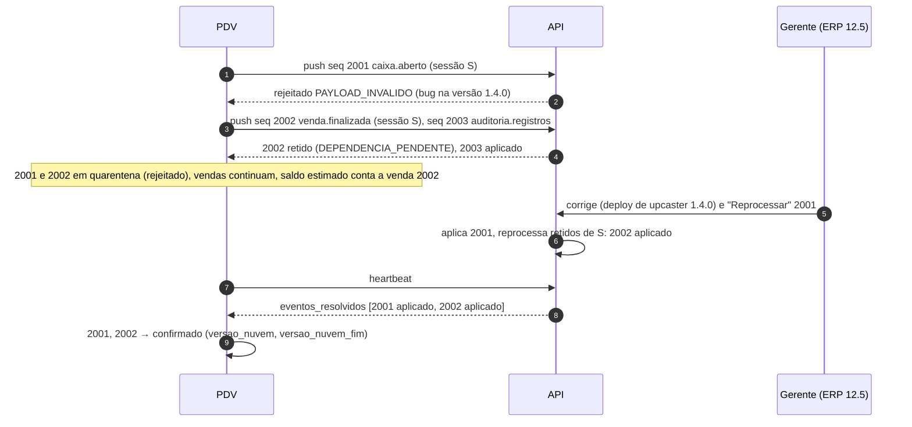

A retenção dos eventos seguintes fica **na nuvem** (status `retido`, PDV 30.4), não no PDV, para que a sequência
continue contínua e nenhum evento fique só num disco local.

### 8.6 Lacunas de sequência

Uma lacuna (`sequencia > esperado`) nunca é operação normal (o PDV sempre envia um prefixo contínuo, 7.5). Causas:
bug local, linhas perdidas no SQLite ou **banco da nuvem restaurado de backup** (a nuvem "esqueceu" eventos que o
PDV já tem como confirmados — 22.5).

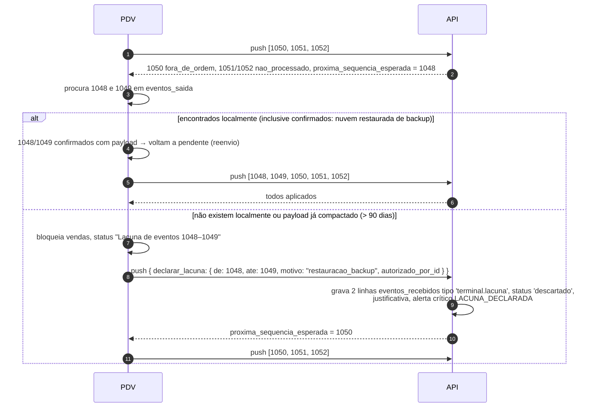

- Declarar lacuna exige liberação de supervisor com `pdv.config.fiscal` ou suporte (é admitir possível perda de
  dados) e só é aceita pela API se a faixa não contém nenhuma sequência já recebida.
- O alerta `LACUNA_DECLARADA` aparece no Dashboard e no detalhe do terminal com a faixa e o motivo; o ERP cruza com
  `terminais.eventos_pendentes` informado antes para estimar o que se perdeu (22.4).
- Antes de declarar, o PDV sempre tenta a re-hidratação (22.2): talvez os eventos estejam na nuvem e o problema seja
  o banco local antigo (regressão, não lacuna).
- **Lacuna recuperada**: se os eventos reais aparecerem depois (backup em pendrive, recuperação 22.3), eles chegam com
  `sequencia` < `esperado` dentro de uma faixa ocupada por placeholders `terminal.lacuna` (`status = 'descartado'`).
  Isso **não** é regressão: a API substitui a linha do placeholder pelo evento real (mesma `sequencia_terminal`; a
  linha passa a ter o `evento_id`, `tipo`, `payload` e `payload_sha256` reais e, desde o F2-B10, o `criado_em` da
  chegada do lote do evento real; o placeholder original, com a hora da declaração, vai para `auditoria`
  `lacuna_substituida`), aplica o evento normalmente (8.3) e gera `alertas` `LACUNA_RECUPERADA` (com a
  faixa, o número de eventos e as vendas recuperadas; o alerta `LACUNA_DECLARADA` da faixa é resolvido quando todos os
  placeholders forem substituídos). Exigências: os eventos chegam pela recuperação assistida
  (`POST /sync/recuperacao/importar`, 22.3) **ou** no push com `recuperar_lacuna: {de, ate, autorizado_por_id}`
  (liberação de supervisor com `pdv.config.fiscal`). Sem isso, o evento recebe `lacuna_recuperavel` e o lote para.
  Eventos recuperados são aplicados fora da ordem original (os seguintes já foram aplicados); por isso, depois de
  substituir a faixa, a nuvem **reprocessa em ordem** os eventos do terminal em `erro`/`retido` posteriores à lacuna
  (tipicamente `SESSAO_INEXISTENTE`, `REFERENCIA_INEXISTENTE`, `DEPENDENCIA_DESCARTADA` causados por ela).
  Um evento recuperado cujo `evento_id` já existe em outra sequência → `EVENTO_DIVERGENTE`.

**Como ficou na Fase 1C (bloco C15; README da API › decisão 140, README do PDV › decisão 59):**

- **Liberação conferida na nuvem**: o `autorizado_por_id` de `declarar_lacuna` e de `recuperar_lacuna` tem de ser um
  usuário ativo da empresa com `pdv.config.fiscal` e acesso à loja do terminal no momento do push (o PIN foi
  conferido offline, com as permissões e as lojas da última descida); senão o lote inteiro volta `422 LIBERACAO_INVALIDA`, sem processar nada. No perfil padrão a
  permissão é só do Master; o "ou suporte" (declarar pelo ERP) não entra na 1C.
- **Faixa da declaração**: só a que começa na sequência esperada (`max + 1`): antes cobriria sequências recebidas,
  depois deixaria outra lacuna antes, que o `esperado = max + 1` pularia em silêncio. A **mesma** declaração repetida
  (reenvio sem resposta: a faixa inteira já é placeholder dela) responde 200 sem gravar; o resto é `409
  LACUNA_INVALIDA` com a `proxima_sequencia_esperada`. A declaração roda numa transação de evento própria, antes dos
  eventos do lote.
- **Placeholder** (decisão técnica T7): `evento_id` próprio, agregado = o terminal, `payload` = a declaração
  (`lacuna: {de, ate}`, `motivo`, `observacao`, `autorizado_por_id`) com o hash do JCS, `descartado_por_id` = quem
  liberou, **`resolucao_entregue_em` já preenchido** (o heartbeat não o manda ao PDV como "descartado") e **sem
  `entidades_evento`** (nada depende dele; trocar o `evento_id` na substituição não esbarra na FK). Volta no
  `GET /sync/recuperar` (C17) com o tipo `terminal.lacuna`.
- **Substituição antes da regressão**: a sequência abaixo da esperada com `evento_id` novo é procurada entre os
  placeholders antes de virar `REGRESSAO_DETECTADA`. A auditoria `lacuna_substituida` (origem PDV, com quem liberou)
  guarda o placeholder em `antes`; se a aplicação falhar com erro de regra, a transação que grava o `erro` substitui de
  novo e o evento segue a fila de decisão (11.4).
- **Alertas**: `LACUNA_DECLARADA` (crítico) e `LACUNA_RECUPERADA` (aviso) ficam no terminal (`entidade = 'terminais'`),
  no detalhe e na listagem do ERP com o "Ciente"; o declarado também no painel de alertas críticos do Dashboard. O
  recuperado é um por lote, com as faixas, os placeholders que restam, as sequências e os números das vendas.
- **Reprocessamento em ordem**: uma tarefa (`reprocessar_apos_lacuna`, ERP 3.6) em nome de quem liberou a recuperação,
  criada na transação do fecho do lote, reaplica um a um, em ordem de sequência, os eventos do terminal acima do início
  da faixa e de outro lote que a lacuna explica — os `retido` e os `erro` `SESSAO_INEXISTENTE`,
  `REFERENCIA_INEXISTENTE` e `DEPENDENCIA_DESCARTADA` —, com a auditoria `evento_reprocessado` (`modo = 'lacuna'`); o
  resultado chega ao PDV pelo heartbeat. Os outros códigos (o `PAYLOAD_INVALIDO` do hash divergente, por exemplo)
  ficam para a decisão na fila do ERP (11.4). Em tarefa para a resposta do push não esperar centenas de reaplicações.
- **No PDV**: no `fora_de_ordem`, as sequências de `proxima_sequencia_esperada` até a anterior à da frente que o caixa
  ainda tem (`confirmado`/`rejeitado` com payload) voltam a `pendente` e sobem na hora; o que não existe mais é a
  lacuna, de a esperada até a anterior à primeira que o caixa tem. A lacuna a declarar bloqueia as vendas **novas**
  (a atual termina) e aparece na barra e em F11 › S, onde o F4 declara com `pdv.config.fiscal` (o próprio operador
  que a tem ou o PIN de um supervisor que a tem); a recuperável só avisa (os eventos estão no caixa) e o F4 libera o
  reenvio, que vale para todos os lotes da faixa (até sair do outbox o último evento dela). A lacuna conhecida fica só
  em memória; na abertura do app e na declaração recusada (`LACUNA_INVALIDA`) a espera do `fora_de_ordem` cai e o
  próximo push a revela na hora. A re-hidratação pelo `GET /sync/recuperar` (22.2) **não** entra antes de declarar
  (Fase 1C, C17; decisão técnica T45): a nuvem responde `fora_de_ordem` porque espera a sequência `de`, então não tem
  nada da faixa, e o `recuperar` só devolve o que ela tem — ele é a saída da regressão e da restauração (22.1), não da
  lacuna. A importação 22.3 como autorização fica para a 1D.

---

## 9. Catálogo de eventos (payloads)

### 9.1 Convenções dos payloads

- Chaves do payload = **nomes de tabela**; valores = uma linha (objeto) ou várias (lista), com **nomes de coluna**
  do modelo. Campos que só existem no payload (não são coluna) estão marcados "(só payload)".
- Linhas de movimento não levam `criado_em`, `atualizado_em`, `excluido_em` nem `versao` (a nuvem preenche); levam
  `id` gerado no PDV e as colunas de data do fato (`ocorrido_em`, `finalizada_em`, `incluido_em`…).
- Colunas que só a nuvem preenche (`vendas.custo_total`, `itens_venda.custo_unitario`, `comissao_pct`,
  `valor_comissao`, `pagamentos_venda.conta_financeira_id`, `codigo` de `trocas`/`pedidos`/`orcamentos`) não são
  enviadas (modelo 4.3).
- Colunas geradas (`fechamentos_caixa.diferenca`, `fechamentos_caixa_formas.diferenca`) não são enviadas.
- Todos os tipos abaixo estão em `versao_schema = 1`. Exemplos usam a Loja 1 (`codigo` 1), Caixa 02, operadora MARIA.
- **Contrato** (Fase 1C, decisão técnica T17): os payloads de caixa, venda, vasilhame e alerta de cadastro têm schema
  `zod` em `packages/shared/src/sync/eventos.ts` (`CONTRATOS_EVENTOS`: tipo → agregado e schema por versão) e fixture
  em `packages/shared/testes/sync/<tipo>.payload.json`. Coluna `not null` sem padrão na nuvem é obrigatória; com padrão
  é opcional (a nuvem aplica o padrão); anulável aceita `null` ou ausente; decimal em texto com a escala exata da
  coluna. O schema aceita chave desconhecida (PDV mais novo não trava o outbox), então quem pega o nome errado é a
  suíte de contrato: a fixture traz **todas** as chaves do contrato em cada linha, inclusive as nulas, e nenhuma pode
  ser descartada pelo parse; o PDV gera exatamente as fixtures de venda (`ContratosEventosTests`); e o teste da API
  confere que as chaves de cada linha são as colunas da tabela menos as padrão e as de `COLUNAS_FORA_DO_PAYLOAD`
  (custo, comissão, conta financeira, quantidade devolvida, fechamento forçado, colunas geradas, colunas da venda do
  ERP), e que cada `z.enum`/`z.literal` das linhas é a lista do CHECK da coluna (a mesma constante exportada pelo
  Drizzle; um `z.literal` pode ser subconjunto, e uma coluna com enum sem lista conhecida quebra o teste). As bordas do
  motivo do cancelamento, as ações de liberação e o `payload_sha256` (JCS) de cada fixture ficam em
  `eventos.conferencias.json`, conferido igual pelo Vitest e pelo xUnit. Os exemplos desta seção podem omitir chaves
  nulas, nunca as obrigatórias; a fixture é a referência.
  Os CHECKs e a coerência interna (linhas da própria venda, sequências sem repetição, casco cobrado de um item da
  venda, combo completo) recusam como `PAYLOAD_INVALIDO`; as somas (P6) não recusam. Contrato não é handler: a nuvem
  só anuncia em `versoes_schema` o tipo que aplica, e o handler valida com o schema do contrato.

Ids usados nos exemplos:

| Nome no texto | Id |
|---|---|
| Terminal T | `01a18751-a521-7238-b924-56de3eb13b90` |
| Loja L (Loja 1 - Ice Beer Hermes) | `01a18752-3782-7bda-ad3c-2d6d1a3d1fa7` |
| Caixa C (nº 2, série NFC-e 2) | `01a18752-c8a9-7970-9641-9f828b9d2434` |
| Estoque E | `01a18753-5750-717c-87a0-ca6e0822e8f3` |
| Operadora MARIA | `01a18754-76cb-7b74-b2e7-06298fadc1a6` |
| Gerente CARLOS | `01a18755-09d1-76b6-8b81-48f6b38a088c` |
| Sessão S | `01a18755-98a1-7472-96da-1dac72ff5d2a` |
| Venda V (`L01-C02-000123`) | `01a18756-bc09-76c2-b2b9-437a28df6ec4` |

### 9.2 Lista de tipos e correspondência com os nomes usados na tarefa

| Nome na tarefa / outros documentos | Tipo oficial (`eventos_saida.tipo`) | Seção |
|---|---|---|
| `caixa_aberto` | `caixa.aberto` | 9.3 |
| `reforco` | `caixa.reforco` | 9.4 |
| `sangria` | `caixa.sangria` | 9.4 |
| cancelamento de sangria/reforço | `caixa.movimento_cancelado` | 9.5 |
| `caixa_fechado` / `troca_turno` | `caixa.fechado` (`fechamentos_caixa.tipo` = `fechamento` / `troca_turno`) | 9.6 |
| `venda_finalizada` | `venda.finalizada` | 9.7 |
| confirmação/desfazimento TEF | `tef.resolvida` (**novo**) | 9.8 |
| `venda_cancelada` | `venda.cancelada` | 9.9 |
| eventos de item | **não existem**: inclusão/cancelamento de item fazem parte do documento da venda (P3) | 9.7 |
| `nfce_emitida` | `nfce.autorizada` (`tipo_emissao = 1`) | 9.10 |
| `nfce_contingencia` | `nfce.contingencia` | 9.11 |
| `nfce_transmitida` | `nfce.autorizada` do mesmo documento com `tipo_emissao = 9` | 9.12 |
| rejeição / denegação | `nfce.rejeitada` (`status` `rejeitada` ou `denegada`) | 9.13 |
| cancelamento de NFC-e | `nfce.cancelada` | 9.14 |
| `inutilizacao` | `nfce.inutilizada` | 9.15 |
| troca/devolução | `troca.registrada` | 9.16 |
| `vale_emitido` / `vale_utilizado` / cancelamento | `vale.emitido`, `vale.utilizado`, `vale.cancelado` | 9.17 |
| `cliente_criado` | `pessoa.criada_no_caixa` | 9.18 |
| orçamentos | `orcamento.criado_no_caixa`, `orcamento.convertido` | 9.19 |
| comandas | `comanda.aberta`, `comanda.itens_incluidos`, `comanda.itens_cancelados`, `comanda.transferida`, `comanda.fechada`, `comanda.cancelada` | 9.20 |
| pedidos/delivery | `pedido.criado`, `pedido.atualizado` (**novo**), `pedido.status_alterado` | 9.21 |
| auditoria | `auditoria.registros` | 9.22 |
| configuração do terminal | `terminal.configuracao_alterada` | 9.23 |
| alerta de cadastro | `alerta.cadastro` | 9.24 |
| recebimento de crediário no caixa (PDV 16.13) | `crediario.recebido`, `crediario.recebimento_cancelado` (**novos**) | 9.25 |
| devolução avulsa de vasilhames (PDV 10.12) | `vasilhame.movimentado` (**novo**); cascos da venda vão no bloco `vasilhames` do `venda.finalizada` | 9.26 |
| `terminal.heartbeat` (PDV 30.4) | **não é evento**: `POST /sync/heartbeat` (modelo 6.3) | 21.1 |

### 9.3 `caixa.aberto`

Agregado `sessao_caixa`. Gravado na transação de abertura (PDV 8.2), inclusive na abertura automática.

```json
{
  "sessoes_caixa": {
    "id": "01a18755-98a1-7472-96da-1dac72ff5d2a",
    "loja_id": "01a18752-3782-7bda-ad3c-2d6d1a3d1fa7",
    "caixa_id": "01a18752-c8a9-7970-9641-9f828b9d2434",
    "numero_caixa": 2,
    "terminal_id": "01a18751-a521-7238-b924-56de3eb13b90",
    "operador_id": "01a18754-76cb-7b74-b2e7-06298fadc1a6",
    "status": "aberta",
    "dia_operacional": "2026-10-29",
    "aberta_em": "2026-10-29T11:01:15.000Z",
    "abertura_automatica": false,
    "fundo_troco": "150.00",
    "sessao_anterior_id": null,
    "valor_recebido_anterior": null,
    "diferenca_recebimento": null,
    "fechada_em": null
  },
  "movimentos_caixa": [
    {
      "id": "01a18756-2b84-7c24-81a9-e71fde8a774b",
      "sessao_caixa_id": "01a18755-98a1-7472-96da-1dac72ff5d2a",
      "loja_id": "01a18752-3782-7bda-ad3c-2d6d1a3d1fa7",
      "caixa_id": "01a18752-c8a9-7970-9641-9f828b9d2434",
      "numero_caixa": 2,
      "terminal_id": "01a18751-a521-7238-b924-56de3eb13b90",
      "tipo": "abertura",
      "valor": "150.00",
      "operador_id": "01a18754-76cb-7b74-b2e7-06298fadc1a6",
      "quem_retira_usuario_id": null,
      "quem_retira_nome": null,
      "observacao": null,
      "inf_adicionais": null,
      "ocorrido_em": "2026-10-29T11:01:15.000Z",
      "autorizado_por_id": null,
      "troca_id": null,
      "cancelado": false
    }
  ],
  "contagem_cedulas": { "100.00": 1, "20.00": 2, "5.00": 1, "1.00": 3, "0.50": 4 }
}
```

- `contagem_cedulas` (só payload): detalhamento do "F2 Contar cédulas" (PDV 8.2); a nuvem guarda em
  `auditoria.depois` (registro `caixa_contagem_cedulas`, PDV 8.2), não no movimento — `movimentos_caixa` não tem
  coluna de contagem.
- Fundo de troco **0,00**: `movimentos_caixa` vem vazio (o `ck_movimentos_caixa_valor` exige `valor > 0`); a sessão
  sozinha registra a abertura.
- **Troca de turno** (abertura do operador seguinte): `sessao_anterior_id` = sessão que fechou com `troca_turno`,
  `valor_recebido_anterior` = `fechamentos_caixa.valor_caixa` dela, `fundo_troco` = o que o novo operador contou e
  `diferenca_recebimento = fundo_troco − valor_recebido_anterior` (ex.: `"295.00"`, `"300.00"`, `"-5.00"`). Efeito
  adicional: a nuvem preenche `fechamentos_caixa.usuario_subsequente_id` da sessão anterior (só no fechamento deste
  terminal e só se ainda está nulo: depois de uma perda do banco local, 22.1, a primeira abertura que continuou o
  turno prevalece).
- Erros permanentes possíveis: `ESCOPO_INVALIDO` (loja/caixa/número/terminal de uma linha ≠ terminal, ou
  `sessao_anterior_id` de uma sessão de outro terminal: a troca de turno é no mesmo terminal),
  `SESSAO_INEXISTENTE` (troca de turno com `sessao_anterior_id` que a nuvem nunca recebeu), `AGREGADO_DIVERGENTE` (a
  sessão já existe com outro conteúdo; com o mesmo, `resultado.ja_existia` e nenhum efeito), `SESSAO_DUPLICADA`
  (**outra** sessão aberta do **mesmo terminal** na nuvem **sem nenhum evento dela em `erro`/`retido`** — só ocorre
  com banco local perdido; ver 22.1). Com evento pendente dessa outra sessão (o fechamento dela em `erro`), a abertura
  fica `retido` (T11, 8.5).
- `terminais.sessao_caixa_id` e `operador_id` (T12): gravados só se o campo está nulo, já é esta sessão (o heartbeat a
  informou antes) ou é a `sessao_anterior_id`. O heartbeat grava a sessão que o PDV informa e pode chegar antes ou
  depois do push; sem a condição, a abertura tardia de A sobrescreveria uma sessão mais nova.
- **Terminal substituído ou revogado** (T16; eventos tardios): a sessão entra já fechada à força (`fechamento_forcado`,
  motivo `substituicao_terminal` se o terminal está `desativando` e o caixa já é de outro terminal,
  `revogacao_terminal` se está `revogado`) com o alerta `SESSAO_FECHADA_POR_SUBSTITUICAO`, e não vai para
  `terminais.sessao_caixa_id`: ninguém mais a fecharia. `resultado.fechamento_forcado` diz o motivo. O `desativando`
  por aceitar pendências continua dono do caixa e abre a sessão normalmente: ele ainda envia o fechamento, e a
  desativação confirmada (13.3) ou a revogação fecham o turno que ficar aberto.

### 9.4 `caixa.reforco` e `caixa.sangria`

Agregado `movimento_caixa`; depende da sessão. Mesmo formato; exemplo de sangria:

```json
{
  "movimentos_caixa": {
    "id": "01a18766-8a42-743c-a493-3b83757750a9",
    "sessao_caixa_id": "01a18755-98a1-7472-96da-1dac72ff5d2a",
    "loja_id": "01a18752-3782-7bda-ad3c-2d6d1a3d1fa7",
    "caixa_id": "01a18752-c8a9-7970-9641-9f828b9d2434",
    "numero_caixa": 2,
    "terminal_id": "01a18751-a521-7238-b924-56de3eb13b90",
    "tipo": "sangria",
    "valor": "1000.00",
    "operador_id": "01a18754-76cb-7b74-b2e7-06298fadc1a6",
    "quem_retira_usuario_id": "01a18755-09d1-76b6-8b81-48f6b38a088c",
    "quem_retira_nome": "CARLOS",
    "observacao": "Depósito banco",
    "inf_adicionais": "Malote 4471",
    "ocorrido_em": "2026-10-29T15:20:44.310Z",
    "autorizado_por_id": null,
    "troca_id": null,
    "cancelado": false
  },
  "dinheiro_estimado_antes": "1284.50",
  "contagem_cedulas": null
}
```

- `dinheiro_estimado_antes` (só payload): valor que o PDV mostrava (PDV 20.1), para a conferência do ERP.
- Reforço: `tipo = "reforco"`, `quem_retira_*` = quem entregou (opcional).
- Erros permanentes: `ck_movimentos_caixa_sangria` violado (sangria sem quem retira) → `PAYLOAD_INVALIDO`; sessão nunca
  recebida → `SESSAO_INEXISTENTE` (com o `caixa.aberto` em `erro`/`retido` o evento fica `retido`, 8.5); sessão de outro
  terminal → `ESCOPO_INVALIDO`; o mesmo movimento com outro conteúdo → `AGREGADO_DIVERGENTE` (com o mesmo,
  `ja_existia`).
- Sangria com `valor` acima do `dinheiro_estimado_antes` → alerta `SANGRIA_ACIMA_DO_ESTIMADO` (aviso; o PDV bloqueia,
  PDV 20.1). A sessão já fechada na nuvem (fechamento forçado) aceita o movimento tardio (`resultado.sessao_fechada`).

### 9.5 `caixa.movimento_cancelado`

Agregado `movimento_caixa` (o movimento cancelado); só colunas liberadas pela imutabilidade (modelo 1.6).

```json
{
  "movimentos_caixa": {
    "id": "01a18766-8a42-743c-a493-3b83757750a9",
    "cancelado": true,
    "cancelado_em": "2026-10-29T15:31:02.004Z",
    "cancelado_por_id": "01a18754-76cb-7b74-b2e7-06298fadc1a6",
    "autorizado_cancelamento_por_id": "01a18755-09d1-76b6-8b81-48f6b38a088c",
    "motivo_cancelamento": "Valor digitado errado (era 100,00)"
  }
}
```

Se já estava cancelado com o mesmo conteúdo → aplicado sem efeito (`ja_existia`); com outro conteúdo →
`AGREGADO_DIVERGENTE`. Movimento inexistente → `retido` se o evento que o criou está em `erro`/`retido` (8.5), senão
`TRANSICAO_INVALIDA`; só `sangria` e `reforco` se cancelam por este evento (PDV 20.3; o `estorno_venda` sai com o
`venda.cancelada`), outro tipo também é `TRANSICAO_INVALIDA`.

### 9.6 `caixa.fechado` (fechamento e troca de turno)

Agregado `sessao_caixa`. Fechamento com **zera caixa** e diferença de R$ 1,50 em dinheiro:

```json
{
  "sessoes_caixa": {
    "id": "01a18755-98a1-7472-96da-1dac72ff5d2a",
    "status": "fechada",
    "fechada_em": "2026-10-29T23:05:40.118Z"
  },
  "fechamentos_caixa": {
    "id": "01a18767-aae7-795a-bf3c-4c06434308bc",
    "sessao_caixa_id": "01a18755-98a1-7472-96da-1dac72ff5d2a",
    "loja_id": "01a18752-3782-7bda-ad3c-2d6d1a3d1fa7",
    "caixa_id": "01a18752-c8a9-7970-9641-9f828b9d2434",
    "terminal_id": "01a18751-a521-7238-b924-56de3eb13b90",
    "numero_caixa": 2,
    "tipo": "fechamento",
    "zera_caixa": true,
    "usuario_anterior_id": "01a18754-76cb-7b74-b2e7-06298fadc1a6",
    "usuario_subsequente_id": null,
    "valor_caixa": "0.00",
    "total_calculado": "9501.40",
    "total_digitado": "9499.90",
    "justificativa": "Diferença de troco",
    "recontagem": true,
    "fechamento_cego": true,
    "ocorrido_em": "2026-10-29T23:05:40.118Z",
    "dia_operacional": "2026-10-29",
    "resumo": {
      "qtd_vendas": 212, "total_vendas": "9421.40", "ticket_medio": "44.44",
      "qtd_canceladas": 3, "total_canceladas": "88.30",
      "qtd_itens_cancelados": 9, "total_itens_cancelados": "61.70",
      "total_descontos": "73.15", "qtd_liberacoes": 4,
      "qtd_trocas": 1, "total_vales_emitidos": "4.50",
      "nfce_emitidas": 212, "nfce_contingencia": 0, "nfce_pendentes": 0,
      "ultima_sequencia_evento": 1288
    }
  },
  "fechamentos_caixa_formas": [
    { "id": "01a18768-3afe-7662-9562-69f0e5d7b875", "fechamento_id": "01a18767-aae7-795a-bf3c-4c06434308bc",
      "forma_pagamento_id": "01a1875e-a2ca-7299-9d65-a441d58842de", "descricao_forma": "Dinheiro", "tipo_forma": "dinheiro",
      "valor_calculado": "1736.00", "valor_digitado": "1734.50", "quantidade_pagamentos": 96,
      "preenchido_automatico": false, "valor_primeira_contagem": "1724.50" },
    { "id": "01a18768-cb42-7ff7-bf50-bde4382567b8", "fechamento_id": "01a18767-aae7-795a-bf3c-4c06434308bc",
      "forma_pagamento_id": "01a1875f-3243-7ab8-b5a2-40ae5af30553", "descricao_forma": "PIX", "tipo_forma": "pix",
      "valor_calculado": "1105.00", "valor_digitado": "1105.00", "quantidade_pagamentos": 31,
      "preenchido_automatico": false, "valor_primeira_contagem": null },
    { "id": "01a18769-5ae5-7175-be57-0ddf827050a8", "fechamento_id": "01a18767-aae7-795a-bf3c-4c06434308bc",
      "forma_pagamento_id": "01a1875f-c261-7aef-afc8-9849b3aa7efe", "descricao_forma": "Cartão de Crédito", "tipo_forma": "cartao_credito",
      "valor_calculado": "3920.40", "valor_digitado": "3920.40", "quantidade_pagamentos": 54,
      "preenchido_automatico": false, "valor_primeira_contagem": null }
  ],
  "movimentos_caixa": [
    { "id": "01a18769-ede5-71c3-9c71-3d960c0fd195", "sessao_caixa_id": "01a18755-98a1-7472-96da-1dac72ff5d2a",
      "loja_id": "01a18752-3782-7bda-ad3c-2d6d1a3d1fa7", "caixa_id": "01a18752-c8a9-7970-9641-9f828b9d2434",
      "numero_caixa": 2, "terminal_id": "01a18751-a521-7238-b924-56de3eb13b90",
      "tipo": "sangria_fechamento", "valor": "1734.50", "operador_id": "01a18754-76cb-7b74-b2e7-06298fadc1a6",
      "quem_retira_usuario_id": "01a18754-76cb-7b74-b2e7-06298fadc1a6", "quem_retira_nome": "MARIA",
      "observacao": "Fechamento", "inf_adicionais": null, "ocorrido_em": "2026-10-29T23:05:40.118Z",
      "autorizado_por_id": null, "troca_id": null, "cancelado": false }
  ]
}
```

(As formas Débito, Caderneta e Vale foram omitidas do exemplo; o evento real traz uma linha por forma listada no
fechamento, PDV 21.2.)

- **Troca de turno**: `fechamentos_caixa.tipo = "troca_turno"`, `zera_caixa = false`, `valor_caixa` = dinheiro
  digitado (ex.: `"1734.50"`), sem `sangria_fechamento`. `usuario_subsequente_id` sobe `null` e é preenchido pela
  nuvem quando chega o `caixa.aberto` seguinte (9.3). Na troca de turno pedida pelo próximo operador (PDV 8.1, opção
  1), o `usuario_anterior_id` continua o dono da sessão e o `usuario_id` do envelope é quem contou e confirmou (7.3,
  "quem executou"): a auditoria do fechamento na nuvem fica com ele, com o dono em `depois.usuario_anterior_id`.
- `resumo.ultima_sequencia_evento` (só payload dentro do `jsonb`): permite ao ERP saber se todos os eventos do turno
  já chegaram ("fechamento recebido, 2 eventos do turno ainda pendentes").
- Se chegar `caixa.fechado` de uma sessão que a nuvem já tem fechada **com outro fechamento** → `erro`
  `AGREGADO_DIVERGENTE` (PDV 21.5); o mesmo fechamento de novo → `ja_existia`, sem efeito. "O mesmo" inclui as
  formas (`fechamentos_caixa_formas`, pelo `id`) e a `sangria_fechamento`: a contagem repartida de outro jeito com o
  mesmo total, ou outra sangria, também é `AGREGADO_DIVERGENTE`. Sessão nunca recebida →
  `SESSAO_INEXISTENTE`.
- `terminais.sessao_caixa_id = null` só onde o campo ainda é esta sessão (T12): o heartbeat pode já ter informado a
  seguinte, aberta offline.
- Sessão fechada à força pela nuvem (substituição ou revogação, MD 3.12.1): o fechamento tardio grava
  `fechamentos_caixa` normalmente; `fechamento_forcado` e o `fechada_em` da nuvem ficam (`resultado.sessao_fechada_a_forca`).
- Evento do turno (da abertura da sessão até `resumo.ultima_sequencia_evento`) em `erro`/`retido` na nuvem → alerta
  `FECHAMENTO_EVENTOS_PENDENTES` (aviso, um por fechamento; `resultado.eventos_pendentes` com o número,
  `dados.sequencias_pendentes` com a lista). O PDV manda a sequência do último evento do turno **antes** do próprio
  `caixa.fechado`; como a ordem é estrita (8.2), tudo até ela já chegou quando o fechamento é aplicado, e o que pode
  faltar é aplicar (o `erro` `AGREGADO_DIVERGENTE`, duplicata de algo já aplicado, não conta).

### 9.7 `venda.finalizada`

Agregado `venda`; depende da sessão (e de pessoa/vale/comanda/orçamento criados no caixa, 8.5). Gravado na transação
de finalização (PDV 17.1), **antes** da emissão fiscal: numa loja NFC-e o evento sobe com `status_fiscal = "pendente"`
e o documento fiscal vem depois em `nfce.*`. Exceção: venda com NF-e solicitada para cliente PJ contribuinte (PDV 14.4)
sobe com `status_fiscal = "nfe_solicitada"` e `nfe_solicitada = true`, sem NFC-e e sem `nfce.*`.

Exemplo: 5 itens (1 cancelado), atacado automático, item de balança tipo Valor, desconto no item, PIX estático +
dinheiro com troco, CPF na nota.

```json
{
  "vendas": {
    "id": "01a18756-bc09-76c2-b2b9-437a28df6ec4",
    "numero": 123,
    "numero_exibicao": "L01-C02-000123",
    "loja_id": "01a18752-3782-7bda-ad3c-2d6d1a3d1fa7",
    "caixa_id": "01a18752-c8a9-7970-9641-9f828b9d2434",
    "numero_caixa": 2,
    "terminal_id": "01a18751-a521-7238-b924-56de3eb13b90",
    "sessao_caixa_id": "01a18755-98a1-7472-96da-1dac72ff5d2a",
    "tipo": "pdv",
    "canal": "pdv",
    "modo": "balcao",
    "id_externo": null,
    "status": "finalizada",
    "status_fiscal": "pendente",
    "devolucao": "nenhuma",
    "dia_operacional": "2026-10-29",
    "operador_id": "01a18754-76cb-7b74-b2e7-06298fadc1a6",
    "vendedor_id": null,
    "cliente_id": null,
    "cpf_cnpj_nota": "12345678909",
    "nome_nota": null,
    "tipo_preco": "varejo",
    "orcamento_id": null,
    "comanda_id": null,
    "pedido_id": null,
    "qtd_itens": 4,
    "subtotal_bruto": "72.08",
    "desconto_itens": "0.50",
    "desconto_total": "0.00",
    "desconto_total_pct": null,
    "acrescimo_total": "0.00",
    "taxa_servico": "0.00",
    "taxa_entrega": "0.00",
    "valor_frete": "0.00",
    "total": "71.58",
    "troco": "8.42",
    "endereco_entrega": null,
    "observacao": null,
    "iniciada_em": "2026-10-29T17:31:02.114Z",
    "finalizada_em": "2026-10-29T17:36:05.123Z",
    "evento_finalizacao_id": "01a18778-08ab-7f25-b9ac-1b1ea8e56e0c"
  },
  "itens_venda": [
    {
      "id": "01a18757-4ab4-7370-a7cd-813047229389",
      "venda_id": "01a18756-bc09-76c2-b2b9-437a28df6ec4",
      "sequencia": 1,
      "produto_id": "01a1875b-4061-7e2a-9e57-4f7aa0ee89ae",
      "variacao_id": null,
      "codigo_lido": "7891149103102",
      "codigo_barras_id": "01a1875e-101f-7741-8729-4739614ff3d7",
      "descricao": "CERV BRAHMA LT 350ML",
      "unidade": "UN",
      "quantidade": "12.000",
      "preco_tabela": "3.1900",
      "preco_unitario": "3.1900",
      "origem_preco": "atacado",
      "valor_bruto": "38.28",
      "desconto_item": "0.00",
      "desconto_rateado": "0.00",
      "acrescimo_rateado": "0.00",
      "frete_rateado": "0.00",
      "valor_liquido": "38.28",
      "lote_id": null,
      "lote": null,
      "validade_lote": null,
      "kit_grupo_id": null,
      "kit_produto_id": null,
      "kit_descricao": null,
      "kit_quantidade": null,
      "kit_preco_unitario": null,
      "kit_componente_id": null,
      "kit_alternativa_id": null,
      "kit_acrescimo": "0.0000",
      "item_comanda_id": null,
      "item_orcamento_id": null,
      "vendedor_id": null,
      "cfop": "5405",
      "ncm": "22030000",
      "fiscal_snapshot": {
        "schema_fiscal": 2,
        "ncm": "22030000", "cest": "0302100", "cfop": "5405", "origem": "0", "c_benef": null,
        "icms": { "cst": null, "csosn": "500", "mod_bc": null, "v_bc": "0.00", "p_icms": "0.0000", "v_icms": "0.00",
                  "p_red_bc": null, "v_fcp": "0.00",
                  "st_retido": { "v_bc_st_ret": "38.28", "p_st": "18.0000", "v_icms_substituto": "4.08", "v_icms_st_ret": "2.81",
                                 "v_bc_fcp_st_ret": null, "p_fcp_st_ret": null, "v_fcp_st_ret": null },
                  "efetivo": null },
        "pis":    { "cst": "04", "v_bc": "0.00", "p_pis": "0.0000", "v_pis": "0.00" },
        "cofins": { "cst": "04", "v_bc": "0.00", "p_cofins": "0.0000", "v_cofins": "0.00" },
        "ibs_cbs": { "cst": "000", "c_class_trib": "000001", "v_bc": "38.28",
                     "p_ibs_uf": "0.1000", "p_red_ibs_uf": "0.0000", "v_ibs_uf": "0.04",
                     "p_ibs_mun": "0.0000", "p_red_ibs_mun": "0.0000", "v_ibs_mun": "0.00",
                     "p_cbs": "0.9000", "p_red_cbs": "0.0000", "v_cbs": "0.34" },
        "is": null,
        "v_tot_trib": "12.04", "fonte_tot_trib": "IBPT 26.1.A"
      },
      "v_ibs": "0.04", "v_cbs": "0.34", "v_is": null,
      "cancelado": false,
      "cancelado_em": null,
      "cancelado_por_id": null,
      "autorizado_por_id": null,
      "motivo_cancelamento": null,
      "incluido_em": "2026-10-29T17:31:02.114Z",
      "componentes_estoque": []
    },
    {
      "id": "01a18757-ddb4-71a1-962b-0f79c37459ee",
      "venda_id": "01a18756-bc09-76c2-b2b9-437a28df6ec4",
      "sequencia": 2,
      "produto_id": "01a1875b-d10a-7312-93cd-59bf5c941cf0",
      "variacao_id": null,
      "codigo_lido": "7896045506873",
      "codigo_barras_id": null,
      "descricao": "ÁGUA CRYSTAL 500ML",
      "unidade": "UN",
      "quantidade": "2.000",
      "preco_tabela": "2.5000",
      "preco_unitario": "2.5000",
      "origem_preco": "loja",
      "valor_bruto": "5.00",
      "desconto_item": "0.50",
      "desconto_rateado": "0.00",
      "acrescimo_rateado": "0.00",
      "frete_rateado": "0.00",
      "valor_liquido": "4.50",
      "lote_id": null, "lote": null, "validade_lote": null,
      "kit_grupo_id": null, "kit_produto_id": null, "kit_descricao": null, "kit_quantidade": null, "kit_preco_unitario": null,
      "kit_componente_id": null, "kit_alternativa_id": null, "kit_acrescimo": "0.0000",
      "item_comanda_id": null, "item_orcamento_id": null,
      "vendedor_id": null,
      "cfop": "5405",
      "ncm": "22011000",
      "fiscal_snapshot": {
        "schema_fiscal": 2, "ncm": "22011000", "cest": "0300400", "cfop": "5405", "origem": "0", "c_benef": null,
        "icms": { "cst": null, "csosn": "500", "mod_bc": null, "v_bc": "0.00", "p_icms": "0.0000", "v_icms": "0.00", "p_red_bc": null, "v_fcp": "0.00", "st_retido": null, "efetivo": null },
        "pis": { "cst": "04", "v_bc": "0.00", "p_pis": "0.0000", "v_pis": "0.00" },
        "cofins": { "cst": "04", "v_bc": "0.00", "p_cofins": "0.0000", "v_cofins": "0.00" },
        "ibs_cbs": { "cst": "000", "c_class_trib": "000001", "v_bc": "4.50", "p_ibs_uf": "0.1000", "p_red_ibs_uf": "0.0000", "v_ibs_uf": "0.00", "p_ibs_mun": "0.0000", "p_red_ibs_mun": "0.0000", "v_ibs_mun": "0.00", "p_cbs": "0.9000", "p_red_cbs": "0.0000", "v_cbs": "0.04" },
        "is": null, "v_tot_trib": "1.40", "fonte_tot_trib": "IBPT 26.1.A"
      },
      "v_ibs": "0.00", "v_cbs": "0.04", "v_is": null,
      "cancelado": false, "cancelado_em": null, "cancelado_por_id": null, "autorizado_por_id": null, "motivo_cancelamento": null,
      "incluido_em": "2026-10-29T17:31:40.551Z",
      "componentes_estoque": []
    },
    {
      "id": "01a18758-6ac6-75bc-98c2-67976142ea7d",
      "venda_id": "01a18756-bc09-76c2-b2b9-437a28df6ec4",
      "sequencia": 3,
      "produto_id": "01a1875c-60f1-7a94-8bbb-259911ce5dd2",
      "variacao_id": null,
      "codigo_lido": "7894900011524",
      "codigo_barras_id": null,
      "descricao": "REFRI COCA 2L",
      "unidade": "UN",
      "quantidade": "1.000",
      "preco_tabela": "9.9900",
      "preco_unitario": "9.9900",
      "origem_preco": "varejo",
      "valor_bruto": "9.99",
      "desconto_item": "0.00", "desconto_rateado": "0.00", "acrescimo_rateado": "0.00", "frete_rateado": "0.00",
      "valor_liquido": "9.99",
      "lote_id": null, "lote": null, "validade_lote": null,
      "kit_grupo_id": null, "kit_produto_id": null, "kit_descricao": null, "kit_quantidade": null, "kit_preco_unitario": null,
      "kit_componente_id": null, "kit_alternativa_id": null, "kit_acrescimo": "0.0000",
      "item_comanda_id": null, "item_orcamento_id": null,
      "vendedor_id": null,
      "cfop": "5405",
      "ncm": "22021000",
      "fiscal_snapshot": {
        "schema_fiscal": 2, "ncm": "22021000", "cest": "0300700", "cfop": "5405", "origem": "0", "c_benef": null,
        "icms": { "cst": null, "csosn": "500", "mod_bc": null, "v_bc": "0.00", "p_icms": "0.0000", "v_icms": "0.00", "p_red_bc": null, "v_fcp": "0.00", "st_retido": null, "efetivo": null },
        "pis": { "cst": "04", "v_bc": "0.00", "p_pis": "0.0000", "v_pis": "0.00" },
        "cofins": { "cst": "04", "v_bc": "0.00", "p_cofins": "0.0000", "v_cofins": "0.00" },
        "ibs_cbs": { "cst": "000", "c_class_trib": "000001", "v_bc": "9.99", "p_ibs_uf": "0.1000", "p_red_ibs_uf": "0.0000", "v_ibs_uf": "0.01", "p_ibs_mun": "0.0000", "p_red_ibs_mun": "0.0000", "v_ibs_mun": "0.00", "p_cbs": "0.9000", "p_red_cbs": "0.0000", "v_cbs": "0.09" },
        "is": null, "v_tot_trib": "3.11", "fonte_tot_trib": "IBPT 26.1.A"
      },
      "v_ibs": "0.01", "v_cbs": "0.09", "v_is": null,
      "cancelado": true,
      "cancelado_em": "2026-10-29T17:31:55.020Z",
      "cancelado_por_id": "01a18754-76cb-7b74-b2e7-06298fadc1a6",
      "autorizado_por_id": null,
      "motivo_cancelamento": "Cliente desistiu",
      "incluido_em": "2026-10-29T17:31:48.300Z",
      "componentes_estoque": []
    },
    {
      "id": "01a18758-fe53-743a-9a8d-ca03580d7b71",
      "venda_id": "01a18756-bc09-76c2-b2b9-437a28df6ec4",
      "sequencia": 4,
      "produto_id": "01a1875c-ef91-7fc1-8a15-544dc5e7ce8a",
      "variacao_id": null,
      "codigo_lido": "2001230015905",
      "codigo_barras_id": null,
      "descricao": "QUEIJO COALHO KG",
      "unidade": "KG",
      "quantidade": "0.795",
      "preco_tabela": "19.9900",
      "preco_unitario": "19.9900",
      "origem_preco": "balanca",
      "valor_bruto": "15.90",
      "desconto_item": "0.00", "desconto_rateado": "0.00", "acrescimo_rateado": "0.00", "frete_rateado": "0.00",
      "valor_liquido": "15.90",
      "lote_id": null, "lote": null, "validade_lote": null,
      "kit_grupo_id": null, "kit_produto_id": null, "kit_descricao": null, "kit_quantidade": null, "kit_preco_unitario": null,
      "kit_componente_id": null, "kit_alternativa_id": null, "kit_acrescimo": "0.0000",
      "item_comanda_id": null, "item_orcamento_id": null,
      "vendedor_id": null,
      "cfop": "5102",
      "ncm": "04061090",
      "fiscal_snapshot": {
        "schema_fiscal": 2, "ncm": "04061090", "cest": null, "cfop": "5102", "origem": "0", "c_benef": null,
        "icms": { "cst": null, "csosn": "102", "mod_bc": null, "v_bc": "0.00", "p_icms": "0.0000", "v_icms": "0.00", "p_red_bc": null, "v_fcp": "0.00", "st_retido": null, "efetivo": null },
        "pis": { "cst": "49", "v_bc": "0.00", "p_pis": "0.0000", "v_pis": "0.00" },
        "cofins": { "cst": "49", "v_bc": "0.00", "p_cofins": "0.0000", "v_cofins": "0.00" },
        "ibs_cbs": { "cst": "000", "c_class_trib": "000001", "v_bc": "15.90", "p_ibs_uf": "0.1000", "p_red_ibs_uf": "0.0000", "v_ibs_uf": "0.02", "p_ibs_mun": "0.0000", "p_red_ibs_mun": "0.0000", "v_ibs_mun": "0.00", "p_cbs": "0.9000", "p_red_cbs": "0.0000", "v_cbs": "0.14" },
        "is": null, "v_tot_trib": "2.10", "fonte_tot_trib": "IBPT 26.1.A"
      },
      "v_ibs": "0.02", "v_cbs": "0.14", "v_is": null,
      "cancelado": false, "cancelado_em": null, "cancelado_por_id": null, "autorizado_por_id": null, "motivo_cancelamento": null,
      "incluido_em": "2026-10-29T17:32:10.004Z",
      "componentes_estoque": []
    },
    {
      "id": "01a18759-8eb2-775a-bacf-b3d00b1f9163",
      "venda_id": "01a18756-bc09-76c2-b2b9-437a28df6ec4",
      "sequencia": 5,
      "produto_id": "01a1875d-7f81-7ddc-bb98-2ef8daf61a26",
      "variacao_id": null,
      "codigo_lido": "0044",
      "codigo_barras_id": null,
      "descricao": "GELO ESCAMA 5KG",
      "unidade": "UN",
      "quantidade": "1.000",
      "preco_tabela": "12.9000",
      "preco_unitario": "12.9000",
      "origem_preco": "loja",
      "valor_bruto": "12.90",
      "desconto_item": "0.00", "desconto_rateado": "0.00", "acrescimo_rateado": "0.00", "frete_rateado": "0.00",
      "valor_liquido": "12.90",
      "lote_id": null, "lote": null, "validade_lote": null,
      "kit_grupo_id": null, "kit_produto_id": null, "kit_descricao": null, "kit_quantidade": null, "kit_preco_unitario": null,
      "kit_componente_id": null, "kit_alternativa_id": null, "kit_acrescimo": "0.0000",
      "item_comanda_id": null, "item_orcamento_id": null,
      "vendedor_id": null,
      "cfop": "5102",
      "ncm": "22019000",
      "fiscal_snapshot": {
        "schema_fiscal": 2, "ncm": "22019000", "cest": null, "cfop": "5102", "origem": "0", "c_benef": null,
        "icms": { "cst": null, "csosn": "102", "mod_bc": null, "v_bc": "0.00", "p_icms": "0.0000", "v_icms": "0.00", "p_red_bc": null, "v_fcp": "0.00", "st_retido": null, "efetivo": null },
        "pis": { "cst": "49", "v_bc": "0.00", "p_pis": "0.0000", "v_pis": "0.00" },
        "cofins": { "cst": "49", "v_bc": "0.00", "p_cofins": "0.0000", "v_cofins": "0.00" },
        "ibs_cbs": { "cst": "000", "c_class_trib": "000001", "v_bc": "12.90", "p_ibs_uf": "0.1000", "p_red_ibs_uf": "0.0000", "v_ibs_uf": "0.01", "p_ibs_mun": "0.0000", "p_red_ibs_mun": "0.0000", "v_ibs_mun": "0.00", "p_cbs": "0.9000", "p_red_cbs": "0.0000", "v_cbs": "0.12" },
        "is": null, "v_tot_trib": "1.88", "fonte_tot_trib": "IBPT 26.1.A"
      },
      "v_ibs": "0.01", "v_cbs": "0.12", "v_is": null,
      "cancelado": false, "cancelado_em": null, "cancelado_por_id": null, "autorizado_por_id": null, "motivo_cancelamento": null,
      "incluido_em": "2026-10-29T17:32:31.700Z",
      "componentes_estoque": []
    }
  ],
  "itens_venda_complementos": [],
  "pagamentos_venda": [
    {
      "id": "01a1875a-1e25-7ec3-b91e-1d4c1ff49b78",
      "venda_id": "01a18756-bc09-76c2-b2b9-437a28df6ec4",
      "sequencia": 1,
      "forma_pagamento_id": "01a1875f-3243-7ab8-b5a2-40ae5af30553",
      "descricao_forma": "PIX",
      "meio_pagamento_fiscal": "20",
      "tipo_forma": "pix",
      "valor": "30.00",
      "valor_recebido": null,
      "troco": "0.00",
      "parcelas": 1,
      "status": "aprovado",
      "lanca_quitada": true,
      "taxa_pct": "0.0000",
      "pessoa_id": null,
      "tipo_integracao": null,
      "bandeira": null, "bandeira_nome": null, "adquirente": null, "cnpj_credenciadora": null,
      "nsu": null, "autorizacao": null, "cartao_mascarado": null,
      "tef_transacao_id": null,
      "pix_cobranca_id": "01a18761-738f-7451-a123-fdf77656af72",
      "vale_id": null,
      "autorizado_por_id": null,
      "transferido_de_id": null
    },
    {
      "id": "01a1875a-ae0b-74b2-8d52-88f1142c3fe8",
      "venda_id": "01a18756-bc09-76c2-b2b9-437a28df6ec4",
      "sequencia": 2,
      "forma_pagamento_id": "01a1875e-a2ca-7299-9d65-a441d58842de",
      "descricao_forma": "Dinheiro",
      "meio_pagamento_fiscal": "01",
      "tipo_forma": "dinheiro",
      "valor": "41.58",
      "valor_recebido": "50.00",
      "troco": "8.42",
      "parcelas": 1,
      "status": "aprovado",
      "lanca_quitada": true,
      "taxa_pct": "0.0000",
      "pessoa_id": null,
      "tipo_integracao": null,
      "bandeira": null, "bandeira_nome": null, "adquirente": null, "cnpj_credenciadora": null,
      "nsu": null, "autorizacao": null, "cartao_mascarado": null,
      "tef_transacao_id": null, "pix_cobranca_id": null, "vale_id": null, "autorizado_por_id": null,
      "transferido_de_id": null
    }
  ],
  "parcelas_venda": [],
  "transacoes_tef": [],
  "cobrancas_pix": [
    {
      "id": "01a18761-738f-7451-a123-fdf77656af72",
      "txid": "L01C02000123",
      "tipo": "estatico",
      "loja_id": "01a18752-3782-7bda-ad3c-2d6d1a3d1fa7",
      "terminal_id": "01a18751-a521-7238-b924-56de3eb13b90",
      "venda_id": "01a18756-bc09-76c2-b2b9-437a28df6ec4",
      "pagamento_venda_id": "01a1875a-1e25-7ec3-b91e-1d4c1ff49b78",
      "psp": null,
      "valor": "30.00",
      "status": "paga",
      "qrcode_payload": "00020126360014BR.GOV.BCB.PIX0114000000000001005204000053039865405" ,
      "expira_em": null,
      "paga_em": "2026-10-29T17:35:40.002Z",
      "e2e_id": null,
      "pagador_nome": null,
      "pagador_documento": null,
      "valor_devolvido": "0.00"
    }
  ],
  "liberacoes": [],
  "vasilhames": [],
  "nfe_solicitada": false,
  "nfe_pendente_erp": false
}
```

Regras do payload:

| Regra | Detalhe |
|---|---|
| Itens cancelados | Vão no documento (`cancelado = true`), com quem/quando/motivo — alimentam o relatório de cancelamentos; não geram estoque |
| `componentes_estoque` (só payload) | Lista `[{produto_id, variacao_id, quantidade, origem}]` com a baixa de estoque **já multiplicada** pela quantidade do item, só para produto produzido (`origem = "ficha_tecnica"`, snapshot da ficha do espelho local, com `perda_pct`, PDV 10.9.2). Vazia para os demais itens, inclusive os do combo (kit): os componentes escolhidos já são itens do grupo (`kit_grupo_id`), cada um com o seu `VENDA_PDV` (PDV 10.9.1). O valor `origem = "kit"` não é mais gerado; a nuvem continua aceitando-o de versões antigas do app (baixa os componentes listados) |
| Itens de combo (kit) | Uma linha por posição do combo, com `kit_grupo_id`, `kit_produto_id`, `kit_descricao`, `kit_quantidade`, `kit_preco_unitario` iguais no grupo, a posição (`kit_componente_id`), a alternativa escolhida (`kit_alternativa_id`, nulo = padrão) e o `kit_acrescimo` (modelo 3.11.3). A API valida Σ `valor_bruto` do grupo = `arred2(kit_quantidade × kit_preco_unitario)`; diferença não rejeita (alerta `VENDA_INCONSISTENTE`, como no fechamento das contas) |
| `liberacoes` (só payload) | `[{acao, item_venda_id, valor_pct, autorizado_por_id, motivo, ocorrido_em}]` para descontos/preços/limites liberados por supervisor; também sobem em `auditoria.registros`, mas aqui ficam ligados à venda (`item_venda_id` nulo = a venda toda). `acao` hoje: `desconto_item`, `desconto_total` e, desde a 1C/C11a, `pix_manual` (confirmação manual do PIX liberada pelo supervisor, PDV 16.7) e `forma_pagamento` (forma com "exige supervisor" ou senha de liberação, PDV 16.2), ambas com `item_venda_id` e `valor_pct` nulos e o supervisor também no `pagamentos_venda.autorizado_por_id`, e, desde o C11c, `desconto_cascos` (desconto pelo valor do casco liberado: operador sem `pdv.venda.desconto_total` ou crédito acima de `pdv.desconto_cascos_max_sem_supervisor`, PDV 10.12; item e % nulos) (`ACOES_LIBERACAO_VENDA`); é texto livre no contrato (T18): ação nova de um PDV mais novo não recusa a venda. `valor_pct` = % pedido que exigiu a liberação; `ocorrido_em` = quando o supervisor digitou o PIN. Fica mesmo que o desconto seja removido depois e conta no `resumo.qtd_liberacoes` do fechamento |
| Fechamento das contas | A API valida: `Σ pagamentos_venda.valor` (status `aprovado`) = `vendas.total`; `vendas.troco = Σ troco`; `subtotal_bruto = Σ valor_bruto` dos itens não cancelados; `valor_liquido` = fórmula do modelo 3.11.3. **Diferença não rejeita** a venda (P6): aplica e cria alerta `VENDA_INCONSISTENTE` com a diferença |
| Cliente local | `cliente_id`/`pessoa_id` pode ser o id de `pessoas_locais` (cadastro rápido); a nuvem resolve por `pessoas_aliases` (9.18) |
| Delivery | `vendas.endereco_entrega` (snapshot) e `modo = "delivery"`; o pedido vem nos eventos `pedido.*` |
| `fiscal_snapshot` | Sempre no formato versionado `schema_fiscal: 2` (modelo 3.11.3): `ncm`, `cest`, `cfop`, `origem`, `c_benef`, blocos `icms` (com `st_retido`/`efetivo`), `pis`, `cofins`, `ibs_cbs`, `is` (bloco ausente ou `null` = tributo não aplicável), `v_tot_trib` e `fonte_tot_trib`; `itens_venda.v_ibs = v_ibs_uf + v_ibs_mun`, `v_cbs`, `v_is` acompanham o item. O bloco plano antigo (`schema_fiscal` 1) só chega de versões antigas do app e é convertido por upcaster (17.5) |
| `vasilhames` (só payload, PDV 10.12) | `[{produto_vasilhame_id, devolvidos, vendidos, emprestados, pessoa_id}]` por casco envolvido na venda: cascos vazios trazidos (`devolvidos`), cobrados (`vendidos`, que também estão como item do produto vasilhame com `itens_venda.vasilhame_item_origem_id`) e emprestados em comodato (`emprestados`, exige `pessoa_id`). Vazia quando a venda não tem produto retornável nem cascos descontados (C11c: o desconto pelo valor do casco vale em qualquer venda com item, mesmo só de latas, e cria a linha do casco com `devolvidos` = os descontados e `vendidos` 0). `produto_vasilhame_id` é sempre um produto do tipo `vasilhame` (outro → `PAYLOAD_INVALIDO`). Os `devolvidos` podem passar dos devidos pelos itens: os vazios a mais **descontados na venda pelo valor do casco** (PDV 10.12; Fase 1C, C11c, decisão técnica T29) entram aqui, e o crédito deles no `vendas.desconto_total` com `desconto_total_origem = 'cliente'` (somado ao desconto no total do operador quando há os dois, com origem `operador` e `desconto_total_pct` nulo), rateado em `desconto_rateado` como todo desconto no total; nenhuma chave nova, a nuvem aplica como qualquer venda (fixture `venda.finalizada.cascos.payload.json`). Efeitos em 10.1 |
| `nfe_solicitada` (só payload, PDV 14.4) | `true` quando o cliente PJ contribuinte pediu NF-e (modelo 55) na finalização: `vendas.status_fiscal = "nfe_solicitada"`, nenhum número NFC-e reservado; a nuvem cria a tarefa de emissão da NF-e e devolve o resultado ao terminal por `vendas_status_pdv` (16.3) |
| `nfe_pendente_erp` (só payload, booleano, PDV 14.4) | `true` quando o cliente PJ contribuinte pediu NF-e (modelo 55) e o caixa estava **offline**: a venda finalizou com NFC-e normal (`nfe_solicitada = false`). A nuvem cria alerta/tarefa no ERP para emitir a NF-e da venda e orientar o cancelamento da NFC-e dentro do prazo, se for o caso. Omitido = `false`; nunca `true` junto com `nfe_solicitada = true` |
| `pagamentos_venda[].transferido_de_id` | Preenchido só na nova venda da opção "Cancelar e refazer" da rejeição (PDV 18.3): pagamento da venda cancelada (estorno `transferido`, 9.9) de onde este veio, com a mesma forma e os mesmos vínculos (`tef_transacao_id`, `pix_cobranca_id`, `vale_id`, NSU, autorização) |

Variações de pagamento (fragmentos de `pagamentos_venda`, `transacoes_tef`, `parcelas_venda`):

```json
{
  "pagamentos_venda": [
    {
      "id": "01a18762-94d8-7d7d-9304-317faf42e12f", "venda_id": "01a18793-256c-73f2-91d6-3f78e3e9de99", "sequencia": 1,
      "forma_pagamento_id": "01a1875f-c261-7aef-afc8-9849b3aa7efe", "descricao_forma": "Cartão de Crédito",
      "meio_pagamento_fiscal": "03", "tipo_forma": "cartao_credito", "valor": "300.00", "valor_recebido": null,
      "troco": "0.00", "parcelas": 3, "status": "aprovado", "lanca_quitada": false, "taxa_pct": "3.4900",
      "pessoa_id": null, "tipo_integracao": 1, "bandeira": "01", "bandeira_nome": "VISA", "adquirente": "CREDENCIADORA X",
      "cnpj_credenciadora": "00000000000191", "nsu": "000123456", "autorizacao": "A1B2C3", "cartao_mascarado": "**** 1234",
      "tef_transacao_id": "01a18762-0723-78ea-b02b-61c4a3d70628", "pix_cobranca_id": null, "vale_id": null, "autorizado_por_id": null
    },
    {
      "id": "01a18763-2792-73a8-8e51-f30dc6a7ee39", "venda_id": "01a18793-256c-73f2-91d6-3f78e3e9de99", "sequencia": 2,
      "forma_pagamento_id": "01a18760-546f-7a2a-9bf0-027312476f57", "descricao_forma": "Caderneta",
      "meio_pagamento_fiscal": "05", "tipo_forma": "crediario", "valor": "71.58", "valor_recebido": null,
      "troco": "0.00", "parcelas": 2, "status": "aprovado", "lanca_quitada": false, "taxa_pct": "0.0000",
      "pessoa_id": "01a18764-d9bf-7e06-9132-b63ef16287e4", "tipo_integracao": null,
      "tef_transacao_id": null, "pix_cobranca_id": null, "vale_id": null,
      "autorizado_por_id": "01a18755-09d1-76b6-8b81-48f6b38a088c"
    },
    {
      "id": "01a18765-f927-7ea3-a27a-984d654821d0", "venda_id": "01a18793-256c-73f2-91d6-3f78e3e9de99", "sequencia": 3,
      "forma_pagamento_id": "01a18760-e30f-73ea-baa8-0dd488bd6407", "descricao_forma": "Vale Compra",
      "meio_pagamento_fiscal": "99", "tipo_forma": "vale", "valor": "20.00", "valor_recebido": null,
      "troco": "0.00", "parcelas": 1, "status": "aprovado", "lanca_quitada": true, "taxa_pct": "0.0000",
      "pessoa_id": null, "tef_transacao_id": null, "pix_cobranca_id": null,
      "vale_id": "01a18765-697f-7a7c-b66e-b16f508ebad7", "autorizado_por_id": null
    }
  ],
  "parcelas_venda": [
    { "id": "01a18763-b851-750f-8e17-7b4e0837b8a3", "pagamento_venda_id": "01a18763-2792-73a8-8e51-f30dc6a7ee39",
      "numero": 1, "vencimento": "2026-11-28", "valor": "35.79" },
    { "id": "01a18764-472a-7360-90f1-bc81448aaa9e", "pagamento_venda_id": "01a18763-2792-73a8-8e51-f30dc6a7ee39",
      "numero": 2, "vencimento": "2026-12-28", "valor": "35.79" }
  ],
  "transacoes_tef": [
    {
      "id": "01a18762-0723-78ea-b02b-61c4a3d70628",
      "loja_id": "01a18752-3782-7bda-ad3c-2d6d1a3d1fa7", "terminal_id": "01a18751-a521-7238-b924-56de3eb13b90",
      "venda_id": "01a18793-256c-73f2-91d6-3f78e3e9de99", "pagamento_venda_id": "01a18762-94d8-7d7d-9304-317faf42e12f",
      "provedor": "sitef", "operacao": "venda", "status": "aprovada_pendente_confirmacao",
      "valor": "300.00", "parcelas": 3, "tipo_cartao": "credito", "bandeira": "01", "bandeira_nome": "VISA",
      "adquirente": "CREDENCIADORA X", "cnpj_credenciadora": "00000000000191",
      "nsu": "000123456", "nsu_host": "998877", "autorizacao": "A1B2C3", "codigo_resposta": "00", "mensagem": "APROVADA",
      "cartao_mascarado": "**** 1234", "data_hora_transacao": "2026-10-29T18:10:02.000Z",
      "comprovante_cliente": "      CREDENCIADORA X\nVISA CREDITO 3X ...", "comprovante_loja": "      CREDENCIADORA X\n...",
      "transacao_original_id": null, "iniciada_em": "2026-10-29T18:09:41.380Z",
      "confirmada_em": null, "desfeita_em": null, "cancelada_em": null
    }
  ],
  "itens_venda_componentes_exemplo": {
    "componentes_estoque": [
      { "produto_id": "01a1875b-4061-7e2a-9e57-4f7aa0ee89ae", "variacao_id": null, "quantidade": "12.000", "origem": "ficha_tecnica" },
      { "produto_id": "01a1875d-7f81-7ddc-bb98-2ef8daf61a26", "variacao_id": null, "quantidade": "1.000", "origem": "ficha_tecnica" }
    ]
  },
  "itens_venda_combo_exemplo": [
    { "sequencia": 4, "produto_id": "01a18771-0b3c-7d42-8a6e-2f9c1d7e5a01", "descricao": "WHISKY 1L", "quantidade": "1.000",
      "preco_unitario": "98.4800", "origem_preco": "kit_rateio", "valor_bruto": "98.48",
      "kit_grupo_id": "01a18772-4e1d-7a93-b5c0-8d2f6e1a3b44", "kit_produto_id": "01a18770-9a2e-7c11-9f3d-5b7e0c4d2a10",
      "kit_descricao": "COMBO DE WHISKY 1L", "kit_quantidade": "1.000", "kit_preco_unitario": "131.9000",
      "kit_componente_id": "01a18773-1c5f-7e08-a2b4-6d9e3f0c7a21", "kit_alternativa_id": null, "kit_acrescimo": "0.0000",
      "componentes_estoque": [] },
    { "sequencia": 5, "produto_id": "01a18774-7d20-7b6a-9c8e-0e1f4a2b5c32", "descricao": "ENERGETICO MONSTER 2L", "quantidade": "1.000",
      "preco_unitario": "24.5500", "origem_preco": "kit_rateio", "valor_bruto": "24.55",
      "kit_grupo_id": "01a18772-4e1d-7a93-b5c0-8d2f6e1a3b44", "kit_produto_id": "01a18770-9a2e-7c11-9f3d-5b7e0c4d2a10",
      "kit_descricao": "COMBO DE WHISKY 1L", "kit_quantidade": "1.000", "kit_preco_unitario": "131.9000",
      "kit_componente_id": "01a18775-3f8a-7c2d-8e61-1a0b9d4c6e43", "kit_alternativa_id": "01a18776-5a9b-7f3e-b7d2-2c1e0f5a8d54",
      "kit_acrescimo": "2.0000", "componentes_estoque": [] },
    { "sequencia": 6, "produto_id": "01a18777-8b0c-7a4f-9d13-3e2f1a6b9c65", "descricao": "GELO DE COCO", "quantidade": "2.000",
      "preco_unitario": "4.4350", "origem_preco": "kit_rateio", "valor_bruto": "8.87",
      "kit_grupo_id": "01a18772-4e1d-7a93-b5c0-8d2f6e1a3b44", "kit_produto_id": "01a18770-9a2e-7c11-9f3d-5b7e0c4d2a10",
      "kit_descricao": "COMBO DE WHISKY 1L", "kit_quantidade": "1.000", "kit_preco_unitario": "131.9000",
      "kit_componente_id": "01a18778-2d1e-7b5a-a4c3-4f3a2b7c0d76", "kit_alternativa_id": null, "kit_acrescimo": "0.0000",
      "componentes_estoque": [] }
  ]
}
```

(Os dois últimos blocos não são chaves do payload: `itens_venda_componentes_exemplo` mostra só o campo
`componentes_estoque` de um item produzido "BALDE 12 LATAS + GELO" (ficha técnica, 1 unidade, perda 0);
`itens_venda_combo_exemplo` mostra, só com os campos do combo, as três linhas de um "COMBO DE WHISKY 1L" de R$ 129,90
vendido com a troca do energético padrão (Red Bull 2L) pelo Monster 2L (+R$ 2,00): preço do combo R$ 131,90, rateado
pelo preço de venda dos componentes escolhidos — Whisky 99,90, Monster 24,90, 2 × Gelo de coco 4,50 — em
98,48 + 24,55 + 8,87 = 131,90 (PDV 10.9.1).)

### 9.8 `tef.resolvida` (novo)

A confirmação TEF (3ª perna) acontece **depois** do commit da venda e da impressão (PDV 17.1), então o
`venda.finalizada` leva `transacoes_tef.status = "aprovada_pendente_confirmacao"`. A resolução sobe num evento próprio,
gravado na transação local que registra a confirmação/desfazimento. Agregado `transacao_tef`; depende da venda.

```json
{
  "transacoes_tef": {
    "id": "01a18762-0723-78ea-b02b-61c4a3d70628",
    "status": "confirmada",
    "confirmada_em": "2026-10-29T18:10:09.512Z",
    "desfeita_em": null
  }
}
```

`status = "desfeita"` depois de uma venda finalizada só ocorre na falha de impressão do PDV 17.1; como a venda já é um
documento imutável, a nuvem registra o desfazimento, gera alerta crítico `TEF_DESFEITO_EM_VENDA_FINALIZADA` e o PDV é
obrigado a emitir em seguida `venda.cancelada` (forma A; numa loja NFC-e, depois de cancelar a nota). A venda **não**
volta para pagamento (PDV 17.1): para cobrar o cliente, abre-se uma nova venda com os mesmos itens.

### 9.9 `venda.cancelada`

Agregado `venda`. Duas formas:

**A) Venda finalizada cancelada** (PDV 13.3) — só colunas de cancelamento + estornos:

```json
{
  "vendas": {
    "id": "01a18787-4a31-7ced-b171-0434134c6c92",
    "status": "cancelada",
    "status_fiscal": "cancelada",
    "cancelada_em": "2026-10-29T17:52:11.090Z",
    "cancelada_por_id": "01a18754-76cb-7b74-b2e7-06298fadc1a6",
    "cancelamento_autorizado_por_id": "01a18755-09d1-76b6-8b81-48f6b38a088c",
    "motivo_cancelamento": "Cliente desistiu da compra apos o pagamento",
    "cancelamento_origem": "pdv"
  },
  "sessao_caixa_cancelamento_id": "01a18755-98a1-7472-96da-1dac72ff5d2a",
  "pagamentos_venda": [
    { "id": "01a18788-67c3-78a7-bfd0-f9d5a6f2f7b8", "status": "estornado", "estorno": "dinheiro_devolvido" },
    { "id": "01a18788-f3a1-7c5e-8d24-6b7a8c9d0e12", "status": "estornado", "estorno": "pos_cancelado_na_maquininha" },
    { "id": "01a18789-2b4c-7d6e-9f80-a1b2c3d4e5f6", "status": "estornado", "estorno": "devolvido_em_dinheiro" }
  ],
  "movimentos_caixa": [
    {
      "id": "01a18793-b480-79e8-8a2c-827e98326856",
      "sessao_caixa_id": "01a18755-98a1-7472-96da-1dac72ff5d2a",
      "loja_id": "01a18752-3782-7bda-ad3c-2d6d1a3d1fa7", "caixa_id": "01a18752-c8a9-7970-9641-9f828b9d2434",
      "numero_caixa": 2, "terminal_id": "01a18751-a521-7238-b924-56de3eb13b90",
      "tipo": "estorno_venda", "forma_pagamento_id": "01a1875e-a2ca-7299-9d65-a441d58842de", "valor": "40.00",
      "operador_id": "01a18754-76cb-7b74-b2e7-06298fadc1a6",
      "quem_retira_usuario_id": null, "quem_retira_nome": null,
      "observacao": "Estorno da venda L01-C02-000131", "inf_adicionais": null,
      "ocorrido_em": "2026-10-29T17:52:11.090Z", "autorizado_por_id": "01a18755-09d1-76b6-8b81-48f6b38a088c",
      "troca_id": null, "cancelado": false
    },
    {
      "id": "01a18793-c5d6-7e8f-9a0b-1c2d3e4f5a60",
      "sessao_caixa_id": "01a18755-98a1-7472-96da-1dac72ff5d2a",
      "loja_id": "01a18752-3782-7bda-ad3c-2d6d1a3d1fa7", "caixa_id": "01a18752-c8a9-7970-9641-9f828b9d2434",
      "numero_caixa": 2, "terminal_id": "01a18751-a521-7238-b924-56de3eb13b90",
      "tipo": "estorno_venda", "forma_pagamento_id": "01a1875f-c261-7aef-afc8-9849b3aa7efe", "valor": "40.00",
      "operador_id": "01a18754-76cb-7b74-b2e7-06298fadc1a6",
      "quem_retira_usuario_id": null, "quem_retira_nome": null,
      "observacao": "Estorno da venda L01-C02-000131", "inf_adicionais": null,
      "ocorrido_em": "2026-10-29T17:52:11.090Z", "autorizado_por_id": "01a18755-09d1-76b6-8b81-48f6b38a088c",
      "troca_id": null, "cancelado": false
    }
  ],
  "transacoes_tef": []
}
```

No exemplo, a venda de R$ 80,00 foi paga com R$ 15,00 em dinheiro, R$ 40,00 no crédito POS e R$ 25,00 em PIX: o
dinheiro e o PIX voltam em dinheiro (uma linha `estorno_venda` de R$ 40,00 na forma Dinheiro, que sai da gaveta) e o
crédito é cancelado na maquininha (linha de R$ 40,00 na forma do cartão, que não sai da gaveta). O teste de integração
do C7 aplica esta fixture pelo push real.

| Campo | Regra |
|---|---|
| `vendas.motivo_cancelamento` | Texto livre de **15 a 255** caracteres, contados e gravados sem os espaços das pontas (dono, O6), nas formas A e B; fora disso `PAYLOAD_INVALIDO` (o PDV recusa antes, `Venda.Cancelar`) |
| `sessao_caixa_cancelamento_id` (só payload) | Sessão em que o cancelamento aconteceu (pode diferir de `vendas.sessao_caixa_id` só no ERP; no PDV é sempre a sessão aberta, PDV 13.3) |
| `pagamentos_venda[].estorno` (só payload) | `dinheiro_devolvido` (só pagamento de forma `tipo_forma = 'dinheiro'`), `devolvido_em_dinheiro` (pagamento de outra forma, cartão ou PIX, devolvido ao cliente em dinheiro, O22: a transação **não** foi desfeita), `dinheiro_nao_devolvido` (cancelamento técnico), `tef_cancelado` (com a transação de cancelamento em `transacoes_tef`: `operacao = "cancelamento"`, `transacao_original_id`), `tef_estorno_pendente`, `pos_cancelado_na_maquininha`, `pix_devolvido_api`, `pix_devolucao_manual`, `pix_devolucao_pendente`, `credito_cancelado` (crediário/crédito funcionário/boleto), `vale_restituido`, `transferido` (opção [2] da rejeição, PDV 18.3: o pagamento passa para a nova venda, sem saída de gaveta e sem estorno no provedor; a nova venda traz `pagamentos_venda.transferido_de_id` = este pagamento e a nuvem religa a conta a receber, a conciliação TEF/PIX e o vale à nova venda em vez de estornar) |
| `movimentos_caixa` tipo `estorno_venda` | Estorno efetivado (PDV 13.3), uma linha por forma com `forma_pagamento_id` (modelo 3.12.2, `ck_movimentos_caixa_tipo` e `ck_movimentos_caixa_estorno_forma`); só a da forma Dinheiro sai da gaveta. Presente se, e só se, algum pagamento tem estorno efetivado (`ESTORNOS_COM_MOVIMENTO_CAIXA`: `dinheiro_devolvido`, `devolvido_em_dinheiro`, `tef_cancelado`, `pos_cancelado_na_maquininha`, `pix_devolvido_api`, `pix_devolucao_manual`); ausente com `dinheiro_nao_devolvido`, pendentes, crédito, vale e `transferido` |
| Cartão/PIX na forma A (dono, O22) | O operador escolhe na hora: **estorno no meio original** (`pos_cancelado_na_maquininha` / `pix_devolucao_manual`, linha `estorno_venda` na forma original, nada sai da gaveta; a nuvem cancela a conta a receber da forma e a conciliação marca a transação como estornada) ou **devolução em dinheiro** (`devolvido_em_dinheiro`, linha `estorno_venda` na forma Dinheiro: sai da gaveta e entra no esperado do fechamento). Na devolução em dinheiro a transação do cartão/PIX continua valendo: a credenciadora ou o PSP ainda paga, então a conta a receber da forma original e a conciliação **ficam como estão** (10.4); `pagamentos_venda.status = 'estornado'` diz só que o pagamento saiu da venda, e quem decide o efeito financeiro é o `estorno`. O handler confere o `estorno` com o pagamento gravado: `dinheiro_devolvido` fora da forma dinheiro, `devolvido_em_dinheiro` na forma dinheiro ou sem uma linha `estorno_venda` na forma Dinheiro, `tef_cancelado`/`tef_estorno_pendente` sem `tef_transacao_id`, `pos_cancelado_na_maquininha` fora dos cartões (crédito, débito, VA, VR), `pix_*` fora do PIX e o mesmo `pagamentos_venda[].id` citado duas vezes são `PAYLOAD_INVALIDO` |
| NFC-e | Venda com NFC-e autorizada: o PDV só grava `venda.cancelada` **depois** de homologar o cancelamento fiscal, logo após o `nfce.cancelada` (mesma transação local, sequências consecutivas). Enquanto o cancelamento fiscal está pendente (offline), nada sobe e a venda continua `finalizada` com `status_fiscal = "cancelamento_pendente"` localmente; se o prazo expirar, o PDV orienta troca/devolução (PDV 13.3) e nunca envia `venda.cancelada` |

**B) Venda em andamento cancelada** (PDV 13.2) — documento completo, igual ao `venda.finalizada`, com
`vendas.status = "cancelada"`, `finalizada_em = null`, colunas de cancelamento preenchidas, todos os itens e os
pagamentos não eletrônicos com `status = "cancelado"`. A nuvem grava a venda para o relatório de canceladas e **não**
gera estoque nem financeiro. É assim que números de venda reservados e não finalizados aparecem no ERP. O motivo
segue a mesma regra da forma A (15 a 255 caracteres, O6).

As duas formas são o mesmo tipo e a mesma versão: a forma vem da chave (`itens_venda` presente = B), e cada uma é
validada só pelo seu schema (`payloadVendaCanceladaSchema`; fixtures `venda.cancelada.em_andamento.payload.json` e
`venda.cancelada.finalizada.payload.json`).

Aplicação na nuvem (Fase 1C, bloco C7; README da API › decisão 134): a forma B é conferida e gravada como o
`venda.finalizada` (escopo, sessão, `NUMERO_VENDA_DUPLICADO`), sem estoque nem custo, e avança `numeracoes`; reenvio
igual → `ja_existia`, a mesma venda já gravada com outro conteúdo (finalizada, por exemplo) → `AGREGADO_DIVERGENTE`.
Na forma A, venda nunca recebida → `TRANSICAO_INVALIDA` (o `venda.finalizada` em `erro`/`retido` já reteve o evento
pela dependência), de outro terminal → `ESCOPO_INVALIDO`, pagamento citado que não é da venda (ou citado duas vezes) e
transação de `transacoes_tef` que não é a de cancelamento (`operacao` diferente de `cancelamento`) → `PAYLOAD_INVALIDO`;
a transação de cancelamento fica ligada à venda, e a conferência do `venda.finalizada` gerado de novo (8.4, camada 2)
a deixa de fora; a venda já cancelada pelo caixa com as mesmas colunas e os mesmos `estorno_venda` → `ja_existia` (nada é estornado de
novo), com outro conteúdo → `AGREGADO_DIVERGENTE`; já cancelada pelo ERP → 10.4 "Corrida com o ERP". Pagamento não
citado fica como está. Pela dependência do agregado, um `venda.cancelada` rejeitado retém o cancelamento seguinte da
mesma venda até a fila de decisão resolver o primeiro.

Geração no PDV (Fase 1C, bloco C11b; README do PDV › decisão 55): a forma A sai da gestão de vendas (PDV 13.3) só para
a venda paga da sessão aberta, com todos os pagamentos aprovados citados (`estornado` + o `estorno` escolhido pelo
operador entre os que o handler aceita para a forma), as linhas `estorno_venda` na sessão do cancelamento (uma por
forma, na ordem dos pagamentos; quem cancelou em `operador_id`, o gerente que liberou em `autorizado_por_id`),
`transacoes_tef` vazio (TEF é da Fase 6) e o envelope com agregado `venda`, `usuario_id` = quem cancelou e as
dependências `venda` e `sessao_caixa`. O PDV gera exatamente a fixture `venda.cancelada.finalizada.payload.json`
(`ContratosEventosTests`). A venda, os estornos e o evento vão num commit local; sem o tipo anunciado (T13) o
cancelamento não é oferecido. Também não é oferecido para a venda cujo `venda.finalizada` foi descartado na fila de
decisão (`resultado.descartado`, que o heartbeat grava no outbox): o descartado não retém nada (só `erro`/`retido`
retêm), então o cancelamento iria direto ao handler e cairia em `TRANSICAO_INVALIDA` ("venda que a nuvem não recebeu")
— ou em `DEPENDENCIA_DESCARTADA`, se chegasse antes do descarte —, um erro permanente com a saída de gaveta que nunca
seria aplicada. O PDV confere no serviço e de novo dentro da transação local.

### 9.10 `nfce.autorizada` (emissão normal)

Agregado `documento_fiscal`; depende da venda.

```json
{
  "documentos_fiscais": {
    "id": "01a1876b-9e02-7ff2-988c-24c961b1cd22",
    "origem_tipo": "venda",
    "origem_id": "01a18756-bc09-76c2-b2b9-437a28df6ec4",
    "venda_id": "01a18756-bc09-76c2-b2b9-437a28df6ec4",
    "loja_id": "01a18752-3782-7bda-ad3c-2d6d1a3d1fa7",
    "caixa_id": "01a18752-c8a9-7970-9641-9f828b9d2434",
    "terminal_id": "01a18751-a521-7238-b924-56de3eb13b90",
    "modelo": 65,
    "serie": 2,
    "numero": 4512,
    "ambiente": 1,
    "tipo_emissao": 1,
    "chave": "35261000000000000100650020000045121102947362",
    "status": "autorizada",
    "emitido_em": "2026-10-29T17:36:05.900Z",
    "contingencia_em": null,
    "contingencia_justificativa": null,
    "transmitido_em": "2026-10-29T17:36:06.020Z",
    "autorizado_em": "2026-10-29T17:36:07.115Z",
    "protocolo": "135260004512345",
    "cstat": 100,
    "motivo": "Autorizado o uso da NF-e",
    "tentativas": 1,
    "valor_total": "71.58",
    "valor_tributos": "20.53",
    "destinatario_cpf_cnpj": "12345678909",
    "destinatario_nome": null,
    "qrcode_url": "https://www.nfce.fazenda.sp.gov.br/qrcode?p=35261000000000000100650020000045121102947362|2|1|1|<hash>",
    "url_consulta": "https://www.nfce.fazenda.sp.gov.br/consulta",
    "xml_sha256": "ef2d127de37b942baad06145e54b0c619a1f22327b2ebbcfbec78f5564afe39d",
    "substituido_por_id": null,
    "chave_referenciada": null
  },
  "documentos_fiscais_eventos": [],
  "vendas": { "id": "01a18756-bc09-76c2-b2b9-437a28df6ec4", "status_fiscal": "autorizada" },
  "xml": "<?xml version=\"1.0\" encoding=\"UTF-8\"?><nfeProc versao=\"4.00\" xmlns=\"http://www.portalfiscal.inf.br/nfe\"><NFe>…</NFe><protNFe versao=\"4.00\">…</protNFe></nfeProc>"
}
```

- `xml` (só payload): `procNFe` completo. **Antes de abrir a transação do evento** (8.3), a API confere
  `sha256(xml) = xml_sha256` e envia o XML ao armazenamento de objetos com **chave endereçada pelo conteúdo**
  `emp/<codigo>/xml/<sha256>.xml` (upload idempotente: se o objeto já existe com o mesmo hash, nada é reenviado; a
  API confere o `sha256` do objeto gravado). Upload que falhe → `erro_temporario` antes de pegar qualquer trava.
  Dentro da transação, só o `insert` dos metadados em `arquivos` (`categoria = 'xml_nfce'`, `loja_id`,
  `chave_armazenamento` = a chave por conteúdo, `retencao_ate` = emissão + 5 anos) e o preenchimento de
  `documentos_fiscais.xml_arquivo_id` (modelo 3.14). XML divergente do hash → `erro` `XML_DIVERGENTE` (gravado sem
  upload). O mesmo vale para `xml_evento` (9.14) e `xml_inutilizacao` (9.15).
- A nuvem confere a chave (44 dígitos, DV, CNPJ da loja, modelo, série, número, `tipo_emissao`); inconsistente →
  `erro` `CHAVE_INVALIDA`.
- Número já usado por **outro** documento na mesma (loja, modelo, série, ambiente) → `erro` `NUMERO_FISCAL_DUPLICADO`
  (alerta crítico: risco fiscal; ver 13.2).

### 9.11 `nfce.contingencia`

Emitida offline (`tpEmis = 9`), já impressa para o cliente; ainda não transmitida.

```json
{
  "documentos_fiscais": {
    "id": "01a1876c-2edf-7f89-805c-acec877409a9",
    "origem_tipo": "venda",
    "origem_id": "01a18793-256c-73f2-91d6-3f78e3e9de99",
    "venda_id": "01a18793-256c-73f2-91d6-3f78e3e9de99",
    "loja_id": "01a18752-3782-7bda-ad3c-2d6d1a3d1fa7",
    "caixa_id": "01a18752-c8a9-7970-9641-9f828b9d2434",
    "terminal_id": "01a18751-a521-7238-b924-56de3eb13b90",
    "modelo": 65, "serie": 2, "numero": 4513, "ambiente": 1,
    "tipo_emissao": 9,
    "chave": "35261000000000000100650020000045139583019274",
    "status": "contingencia",
    "emitido_em": "2026-10-29T18:10:12.330Z",
    "contingencia_em": "2026-10-29T18:10:12.330Z",
    "contingencia_justificativa": "SEM CONEXAO COM A SEFAZ",
    "transmitido_em": null, "autorizado_em": null, "protocolo": null, "cstat": null, "motivo": null,
    "tentativas": 0,
    "valor_total": "391.58", "valor_tributos": "98.10",
    "destinatario_cpf_cnpj": null, "destinatario_nome": null,
    "qrcode_url": "https://www.nfce.fazenda.sp.gov.br/qrcode?p=…|2|1|29|39158|…|1|<hash>",
    "url_consulta": "https://www.nfce.fazenda.sp.gov.br/consulta",
    "xml_sha256": "e7f6c011776e8db7cd330b54174fd76f7d0216b612387a5ffcfb81e6f0919683",
    "substituido_por_id": null, "chave_referenciada": null
  },
  "documentos_fiscais_eventos": [],
  "vendas": { "id": "01a18793-256c-73f2-91d6-3f78e3e9de99", "status_fiscal": "contingencia" },
  "xml": "<?xml version=\"1.0\" encoding=\"UTF-8\"?><NFe xmlns=\"http://www.portalfiscal.inf.br/nfe\">…assinada, sem protocolo…</NFe>",
  "prazo_transmissao_ate": "2026-10-30T18:10:12.330Z"
}
```

- `prazo_transmissao_ate` (só payload): `contingencia_em` + `fiscal.prazo_transmissao_contingencia_h` (PDV 6.7); a
  nuvem cria alerta `NFCE_CONTINGENCIA_PRAZO` a 75 % do prazo se o `nfce.autorizada` não chegar (PDV 18.4).
- Se o PDV tentou antes `tpEmis = 1` sem resposta (timeout), o documento original vai como `documentos_fiscais` com
  `status = "a_verificar"`, `chave_substituta` = chave deste documento (a substituta em contingência, com **novo
  número**) e `substituido_por_id` = este documento, dentro do mesmo payload (lista em vez de objeto), para a nuvem
  acompanhar o número a verificar (PDV 18.4). Ao reconectar, o PDV transmite primeiro a substituta e depois consulta a
  chave original: autorizada → cancelamento por substituição (`110112`, `chNFeRef` = `chave_substituta`, evento
  `nfce.cancelada`); inexistente → inutilização (`nfce.inutilizada`). `a_verificar` (valor de
  `ck_documentos_fiscais_status`) e `chave_substituta varchar(44)` são colunas do modelo (3.14.1).

### 9.12 `nfce.autorizada` depois da contingência ("NFC-e transmitida")

Mesmo documento (mesmo `id`, mesma chave, `tipo_emissao = 9`), agora autorizado. A nuvem atualiza as colunas
liberadas e troca o XML em `arquivos` pelo `procNFe`.

```json
{
  "documentos_fiscais": {
    "id": "01a1876c-2edf-7f89-805c-acec877409a9",
    "status": "autorizada",
    "transmitido_em": "2026-10-29T19:02:00.410Z",
    "autorizado_em": "2026-10-29T19:02:01.009Z",
    "protocolo": "135260004513001",
    "cstat": 100,
    "motivo": "Autorizado o uso da NF-e",
    "tentativas": 1,
    "xml_sha256": "7902699be42c8a8e46fbbb4501726517e86b22c56a189f7625a6da49081b2451"
  },
  "vendas": { "id": "01a18793-256c-73f2-91d6-3f78e3e9de99", "status_fiscal": "autorizada" },
  "xml": "<?xml version=\"1.0\" encoding=\"UTF-8\"?><nfeProc versao=\"4.00\">…</nfeProc>"
}
```

O handler distingue as duas formas de `nfce.autorizada` pela existência do documento: inexistente → insere (9.10);
existente em `contingencia`/`pendente`/`rejeitada` → atualiza; já `autorizada` com o mesmo protocolo → sem efeito.

### 9.13 `nfce.rejeitada`

```json
{
  "documentos_fiscais": {
    "id": "01a1876c-bfbe-702f-b143-262fdc5c0eed",
    "origem_tipo": "venda",
    "origem_id": "01a18775-c643-7913-a0c5-3cb83da9c2a9",
    "venda_id": "01a18775-c643-7913-a0c5-3cb83da9c2a9",
    "loja_id": "01a18752-3782-7bda-ad3c-2d6d1a3d1fa7",
    "caixa_id": "01a18752-c8a9-7970-9641-9f828b9d2434",
    "terminal_id": "01a18751-a521-7238-b924-56de3eb13b90",
    "modelo": 65, "serie": 2, "numero": 4514, "ambiente": 1, "tipo_emissao": 1,
    "chave": "35261000000000000100650020000045141771204565",
    "status": "rejeitada",
    "emitido_em": "2026-10-29T20:15:00.100Z",
    "transmitido_em": "2026-10-29T20:15:00.300Z",
    "autorizado_em": null, "protocolo": null,
    "cstat": 778,
    "motivo": "Rejeicao: Informado NCM inexistente [nItem:2]",
    "tentativas": 1,
    "valor_total": "18.40", "valor_tributos": null,
    "destinatario_cpf_cnpj": null, "destinatario_nome": null,
    "qrcode_url": null, "url_consulta": null,
    "xml_sha256": "5feceb66ffc86f38d952786c6d696c79c2dbc239dd4e91b46729d73a27fb57e9",
    "substituido_por_id": null, "chave_referenciada": null
  },
  "vendas": { "id": "01a18775-c643-7913-a0c5-3cb83da9c2a9", "status_fiscal": "rejeitada" },
  "xml": "<?xml version=\"1.0\" encoding=\"UTF-8\"?><NFe>…assinada…</NFe>",
  "decisao_pdv": "pendente_supervisor"
}
```

- `status = "denegada"` (cstat 301/302) usa o mesmo evento; número consumido, não se inutiliza (PDV 18.3).
- A NFC-e rejeitada **não consome** o número na SEFAZ: a reemissão corrigida da **mesma venda** usa o **mesmo número
  e série** (XML novo, `cNF` novo, chave nova; PDV 18.2/18.3). O `nfce.autorizada` (ou o novo `nfce.rejeitada`) da
  reemissão traz o **mesmo** `documentos_fiscais.id` com a chave nova e o status novo; a nuvem atualiza o documento e
  guarda o XML rejeitado em `arquivos`. Só na **duplicidade** (cStat 204/539 com nota de outro conteúdo) o PDV reserva
  um número novo, reemite com outro `documentos_fiscais.id` e grava `substituido_por_id` no documento antigo.
- `decisao_pdv` (só payload): `pendente_supervisor` (opção [3]: aguarda o supervisor, venda em "NFC-e pendentes"),
  `reemitida` (opções [1] e erros técnicos: mesma venda, mesmo número, após a correção) e `reemitida_nova_venda`
  (opção [2] "Cancelar e refazer": seguido de `venda.cancelada` forma A sem evento fiscal, `nfce.inutilizada` do número
  rejeitado — agora abandonado — e `venda.finalizada` da nova venda com os pagamentos transferidos, 9.9).
- Vem acompanhado de `alerta.cadastro` (9.24) quando a causa é cadastro (NCM, GTIN, CST).

### 9.14 `nfce.cancelada`

```json
{
  "documentos_fiscais": {
    "id": "01a18787-da7a-7192-8ce2-1ea3db20a56e",
    "status": "cancelada",
    "cancelado_em": "2026-10-29T17:52:10.700Z"
  },
  "documentos_fiscais_eventos": [
    {
      "id": "01a18784-743c-7ba5-a712-303a0f844fef",
      "documento_fiscal_id": "01a18787-da7a-7192-8ce2-1ea3db20a56e",
      "tipo_evento": "110111",
      "sequencia": 1,
      "justificativa": "Cliente desistiu da compra apos o pagamento",
      "status": "homologado",
      "protocolo": "135260004512999",
      "cstat": 135,
      "motivo": "Evento registrado e vinculado a NF-e",
      "ocorrido_em": "2026-10-29T17:52:09.880Z",
      "homologado_em": "2026-10-29T17:52:10.700Z",
      "origem": "pdv",
      "usuario_id": "01a18754-76cb-7b74-b2e7-06298fadc1a6"
    }
  ],
  "vendas": { "id": "01a18787-4a31-7ced-b171-0434134c6c92", "status_fiscal": "cancelada" },
  "xml_evento": "<?xml version=\"1.0\" encoding=\"UTF-8\"?><procEventoNFe versao=\"1.00\">…</procEventoNFe>"
}
```

`xml_evento` (só payload) → `arquivos` (`categoria = 'xml_evento'`) → `documentos_fiscais_eventos.xml_arquivo_id`.
Cancelamento por substituição: `tipo_evento = "110112"` e o payload traz `chave_substituta` (só payload).

### 9.15 `nfce.inutilizada`

Agregado `inutilizacao`; sem dependência (a faixa pode envolver números de vendas canceladas).

```json
{
  "inutilizacoes_fiscais": {
    "id": "01a18785-05bb-71bf-9c96-925eccf3a171",
    "loja_id": "01a18752-3782-7bda-ad3c-2d6d1a3d1fa7",
    "caixa_id": "01a18752-c8a9-7970-9641-9f828b9d2434",
    "modelo": 65,
    "serie": 2,
    "numero_inicial": 4514,
    "numero_final": 4514,
    "ano": 26,
    "ambiente": 1,
    "justificativa": "NUMERACAO NAO UTILIZADA POR FALHA NO SISTEMA EMISSOR",
    "status": "homologada",
    "protocolo": "135260004514000",
    "cstat": 102,
    "motivo": "Inutilizacao de numero homologado",
    "homologada_em": "2026-10-29T20:40:03.000Z",
    "origem": "pdv",
    "terminal_id": "01a18751-a521-7238-b924-56de3eb13b90"
  },
  "documentos_fiscais_inutilizados": ["01a1876c-bfbe-702f-b143-262fdc5c0eed"],
  "xml": "<?xml version=\"1.0\" encoding=\"UTF-8\"?><procInutNFe versao=\"4.00\">…</procInutNFe>"
}
```

- `documentos_fiscais_inutilizados` (só payload): documentos da faixa que existiam (rejeitados abandonados pela opção
  "Cancelar e refazer", `a_verificar` inexistentes na SEFAZ); a nuvem
  passa para `status = 'inutilizada'` e a venda para `status_fiscal = 'inutilizada'`.
- A API recusa (`erro` `FAIXA_COM_NUMERO_AUTORIZADO`) faixa que contenha número autorizado ou em contingência
  pendente na nuvem (modelo 3.14.3) — alerta crítico, pois a SEFAZ já homologou.
- Fila local de números a inutilizar: linhas locais de `inutilizacoes_fiscais` com `status = 'pendente'` (modelo 3.14.3 e
  4.4, PDV 18.6). Só sobem quando homologadas ou rejeitadas.

### 9.16 `troca.registrada`

Agregado `troca`; depende da sessão (e da venda de origem, se for deste terminal). Devolução de 2 águas com
**vale-troca**:

```json
{
  "trocas": {
    "id": "01a1876d-50c8-7ae8-9d53-434bb88139b9",
    "loja_id": "01a18752-3782-7bda-ad3c-2d6d1a3d1fa7",
    "caixa_id": "01a18752-c8a9-7970-9641-9f828b9d2434",
    "terminal_id": "01a18751-a521-7238-b924-56de3eb13b90",
    "sessao_caixa_id": "01a18755-98a1-7472-96da-1dac72ff5d2a",
    "numero_caixa": 2,
    "venda_origem_id": "01a18756-bc09-76c2-b2b9-437a28df6ec4",
    "sem_venda_origem": false,
    "cliente_id": null,
    "operador_id": "01a18754-76cb-7b74-b2e7-06298fadc1a6",
    "autorizado_por_id": "01a18755-09d1-76b6-8b81-48f6b38a088c",
    "motivo": "Embalagem danificada",
    "resolucao": "vale_troca",
    "valor_total": "4.50",
    "vale_id": "01a1876e-7233-71c9-9715-bd6fa4161293",
    "venda_nova_id": null,
    "movimento_caixa_id": null,
    "documento_fiscal_id": null,
    "ocorrida_em": "2026-10-29T21:12:40.500Z",
    "status": "registrada"
  },
  "itens_troca": [
    {
      "id": "01a1876d-e222-7447-8039-87108976e334",
      "troca_id": "01a1876d-50c8-7ae8-9d53-434bb88139b9",
      "sequencia": 1,
      "item_venda_origem_id": "01a18757-ddb4-71a1-962b-0f79c37459ee",
      "produto_id": "01a1875b-d10a-7312-93cd-59bf5c941cf0",
      "variacao_id": null,
      "lote_id": null,
      "quantidade": "2.000",
      "valor_unitario": "2.2500",
      "valor_total": "4.50",
      "destino": "avaria",
      "motivo": "Garrafa amassada"
    }
  ],
  "vales": [
    {
      "id": "01a1876e-7233-71c9-9715-bd6fa4161293",
      "codigo": "VC010200000080",
      "tipo": "vale_troca",
      "pessoa_id": null,
      "loja_emissao_id": "01a18752-3782-7bda-ad3c-2d6d1a3d1fa7",
      "terminal_emissao_id": "01a18751-a521-7238-b924-56de3eb13b90",
      "valor_original": "4.50",
      "saldo": "4.50",
      "validade": "2027-01-27",
      "status": "ativo",
      "origem_tipo": "troca",
      "origem_id": "01a1876d-50c8-7ae8-9d53-434bb88139b9",
      "emitido_em": "2026-10-29T21:12:40.500Z",
      "emitido_por_id": "01a18754-76cb-7b74-b2e7-06298fadc1a6"
    }
  ],
  "movimentos_vale": [
    {
      "id": "01a1876f-00d4-7740-a87d-06ca6f4cc69a",
      "vale_id": "01a1876e-7233-71c9-9715-bd6fa4161293",
      "tipo": "emissao",
      "valor": "4.50",
      "venda_id": null,
      "pagamento_venda_id": null,
      "troca_id": "01a1876d-50c8-7ae8-9d53-434bb88139b9",
      "terminal_id": "01a18751-a521-7238-b924-56de3eb13b90",
      "usuario_id": "01a18754-76cb-7b74-b2e7-06298fadc1a6",
      "ocorrido_em": "2026-10-29T21:12:40.500Z"
    }
  ],
  "movimentos_caixa": []
}
```

- Resolução `dinheiro`: `vales`/`movimentos_vale` vazios; `movimentos_caixa` com `tipo = "devolucao_troca"`,
  `troca_id` preenchido e `trocas.movimento_caixa_id` apontando para ele.
- Resolução `troca_imediata`: emite o vale (como acima) e a **nova venda** sobe no `venda.finalizada` seguinte com um
  pagamento `tipo_forma = "vale"` usando esse vale. Como a troca chega antes da venda nova, `trocas.venda_nova_id` sobe
  `null` e a nuvem o preenche ao aplicar a venda cujo pagamento usa o vale da troca.
- O vale emitido na troca **não** gera `vale.emitido` separado (evita aplicação dupla).
- Código do vale: `VC` + `lojas.codigo` (2) + `numero_caixa` (2) + sequencial local `sequencias_locais['vale']` (7) +
  DV Luhn (1) = 12 dígitos — único sem consultar a nuvem (13.4).

### 9.17 `vale.emitido`, `vale.utilizado`, `vale.cancelado`

Agregado `vale`. **Uso de vale como pagamento numa venda não gera `vale.utilizado`**: o `venda.finalizada` com
`pagamentos_venda.vale_id` já baixa o saldo (`uq_movimentos_vale_pagamento` garante uma única baixa). Os três eventos
são para operações de vale **fora** de venda/troca:

| Evento | Quando | Payload |
|---|---|---|
| `vale.emitido` | Emissão avulsa (`origem_tipo = 'manual'`, com permissão nova `pdv.vale.emitir`; vale-presente vendido = FUT) | `vales` + `movimentos_vale` (`emissao`) |
| `vale.utilizado` | Resgate do saldo em dinheiro (permissão `pdv.troca.devolver_dinheiro`) | `movimentos_vale` (`utilizacao`) + `movimentos_caixa` (`devolucao_troca`, `troca_id = null`) |
| `vale.cancelado` | Cancelamento de vale emitido neste terminal na sessão aberta (permissão `pdv.troca.realizar`) | `vales` (colunas de cancelamento) + `movimentos_vale` (`cancelamento`, valor = −saldo) |

```json
{
  "movimentos_vale": [
    {
      "id": "01a18786-273b-72ed-ac00-6f6123e2fcb4",
      "vale_id": "01a18765-697f-7a7c-b66e-b16f508ebad7",
      "tipo": "utilizacao",
      "valor": "-15.00",
      "venda_id": null,
      "pagamento_venda_id": null,
      "troca_id": null,
      "terminal_id": "01a18751-a521-7238-b924-56de3eb13b90",
      "usuario_id": "01a18754-76cb-7b74-b2e7-06298fadc1a6",
      "ocorrido_em": "2026-10-29T21:30:00.000Z"
    }
  ],
  "movimentos_caixa": [
    {
      "id": "01a18785-95e6-7894-b0b1-87ef310c0c00",
      "sessao_caixa_id": "01a18755-98a1-7472-96da-1dac72ff5d2a",
      "loja_id": "01a18752-3782-7bda-ad3c-2d6d1a3d1fa7", "caixa_id": "01a18752-c8a9-7970-9641-9f828b9d2434",
      "numero_caixa": 2, "terminal_id": "01a18751-a521-7238-b924-56de3eb13b90",
      "tipo": "devolucao_troca", "valor": "15.00",
      "operador_id": "01a18754-76cb-7b74-b2e7-06298fadc1a6",
      "quem_retira_usuario_id": null, "quem_retira_nome": "CLIENTE VC010200000098",
      "observacao": "Resgate de saldo de vale", "inf_adicionais": null,
      "ocorrido_em": "2026-10-29T21:30:00.000Z",
      "autorizado_por_id": "01a18755-09d1-76b6-8b81-48f6b38a088c", "troca_id": null, "cancelado": false
    }
  ],
  "saldo_local_antes": "15.00"
}
```

`saldo_local_antes` (só payload): saldo que o PDV enxergava (modelo 4.5) — usado no alerta se a nuvem tiver outro.

### 9.18 `pessoa.criada_no_caixa`

Agregado `pessoa` (id local = futuro `pessoas_aliases.alias_id` se houver fusão).

```json
{
  "pessoas_locais": {
    "id": "01a1876f-9033-7e02-b8db-0672f42d47cc",
    "tipo": "PF",
    "nome": "JOAO DA SILVA",
    "cpf_cnpj": "52998224725",
    "ddd": "11",
    "telefone": "987654321",
    "email": "joao@example.com",
    "endereco": {
      "cep": "01001000", "logradouro": "PRACA DA SE", "numero": "100", "complemento": null,
      "bairro": "SE", "municipio_ibge": 3550308, "uf": "SP", "referencia": "Ao lado da banca"
    },
    "criado_em": "2026-10-29T16:40:12.000Z",
    "criado_por_id": "01a18754-76cb-7b74-b2e7-06298fadc1a6"
  },
  "nascimento": null,
  "categoria": "cliente"
}
```

Resultado devolvido no push (gravado em `eventos_recebidos.resultado` e `eventos_saida.resultado`):

```json
{ "pessoa_id_final": "01a18764-d9bf-7e06-9132-b63ef16287e4", "mesclada": true, "codigo": 4821, "motivo": "mesclada_cpf" }
```

Sem CPF/CNPJ ou CPF inexistente na nuvem → cria `pessoas` com `id` = id local, `origem = 'pdv'`,
`origem_terminal_id`, `codigo` da sequência, `limite_compras = 0` (PDV 14.3) e as filhas (`pessoas_categorias`,
`pessoas_telefones`, `pessoas_enderecos`). CPF já existente → **funde**: mantém a pessoa da nuvem, preenche só campos
vazios, grava `pessoas_aliases (alias_id = id local, motivo 'mesclada_cpf')`. O PDV atualiza `pessoas_locais`
(`status = 'incorporada'`, `pessoa_id_final`) ao receber o resultado (modelo 4.4.9).

### 9.19 `orcamento.criado_no_caixa` e `orcamento.convertido`

```json
{
  "orcamentos": {
    "id": "01a18770-2398-7803-b8cd-a88b436d76e2",
    "loja_id": "01a18752-3782-7bda-ad3c-2d6d1a3d1fa7",
    "pessoa_id": null,
    "nome": "BAR DO ZE",
    "email": null,
    "telefone": "11999990000",
    "data": "2026-10-29",
    "dias_validade": 15,
    "ativo": true,
    "status": "aberto",
    "vendedor_id": "01a18790-e1a7-7f5c-8e8f-a8e0284d82e5",
    "desconto_tipo": "percentual",
    "desconto_valor": "19.14",
    "desconto_pct": "5.0000",
    "subtotal_bruto": "382.80",
    "total": "363.66",
    "condicoes_pagamento": "PIX na retirada",
    "observacoes": "Retira sábado",
    "origem": "pdv",
    "origem_terminal_id": "01a18751-a521-7238-b924-56de3eb13b90"
  },
  "itens_orcamento": [
    {
      "id": "01a18770-b44c-7e9a-81f7-6d1c2dbc2134",
      "orcamento_id": "01a18770-2398-7803-b8cd-a88b436d76e2",
      "sequencia": 1,
      "produto_id": "01a1875b-4061-7e2a-9e57-4f7aa0ee89ae",
      "variacao_id": null,
      "descricao": "CERV BRAHMA LT 350ML",
      "unidade": "UN",
      "quantidade": "120.000",
      "preco_unitario": "3.1900",
      "desconto_item": "0.00",
      "valor_total": "382.80",
      "observacao": null
    }
  ]
}
```

Resultado: `{ "codigo": 321 }` (o PDV grava em `orcamentos.codigo` local para imprimir/importar como `ORC00321`).

`orcamento.convertido` (gravado na mesma transação local do `venda.finalizada`, sequência seguinte):

```json
{ "orcamento_id": "01a18770-2398-7803-b8cd-a88b436d76e2", "venda_id": "01a18793-256c-73f2-91d6-3f78e3e9de99", "convertido_em": "2026-11-01T13:05:00.000Z" }
```

Já convertido pela mesma venda → sem efeito. Já convertido por **outra** venda (dois caixas offline) → aplica mesmo
assim (registra a segunda venda em `auditoria`) e alerta `ORCAMENTO_CONVERTIDO_DUAS_VEZES` (PDV 24.1).

### 9.20 Comandas

Comandas são o único agregado de **escrita compartilhada** entre caixas:

| Situação | Caminho |
|---|---|
| Online **e** nenhum evento não confirmado da comanda no outbox | Chamada direta à API (`POST /comandas`, `POST /comandas/{id}/itens`, `POST /comandas/{id}/fechar`… com `versao` esperada e `X-Requisicao-Id`; 409 `CONFLITO_VERSAO` → recarrega e repete) — **não passa pelo outbox**; a resposta traz as linhas novas, gravadas no espelho local |
| Offline, ou há evento da comanda ainda não confirmado em `eventos_saida` | Evento no outbox com o mesmo `id` das linhas, inserção local no espelho (modelo 4.2) |
| Timeout ou queda de rede **durante** a chamada online | O PDV não sabe se a nuvem aplicou. Repete a mesma chamada com o **mesmo** `X-Requisicao-Id` (a API devolve a mesma resposta, 20.4); se continuar sem resposta, consulta `GET /comandas/{id}` assim que puder e só então decide: as linhas já estão na nuvem → grava no espelho, nada vai ao outbox; não estão (ou continua offline) → evento no outbox com os **mesmos** `id` |

**Regra de canal único por comanda**: enquanto existir evento em `eventos_saida` com `agregado_tipo = 'comanda'` e
`agregado_id` = a comanda (ou `comanda_id` no payload) em status diferente de `confirmado`, o PDV **não** usa o
caminho online para aquela comanda: ou esvazia o outbox primeiro (push imediato; a operação espera no máximo 5 s com
"Sincronizando comanda…") ou segue offline, pelo outbox. Sem isso, a ordem por terminal quebraria: com
`comanda.itens_incluidos` ainda pendente, um `POST /comandas/{id}/fechar` online fecharia a comanda antes de a nuvem
aplicar os itens, que cairiam numa comanda fechada sem ser cobrados. A mesma regra vale para orçamentos: com
`orcamento.criado_no_caixa`/`orcamento.convertido` pendente, o PDV não chama `POST /orcamentos/{id}/reservar`; e toda
chamada de reserva leva `X-Requisicao-Id`, com consulta `GET /orcamentos/{codigo}` antes de cair para o caminho
offline depois de um timeout.

**Idempotência dos handlers `comanda.*`**: `insert into itens_comanda … on conflict (id) do nothing` (e o mesmo para
`comandas`); linha existente com o **mesmo conteúdo** (vinda da chamada online que deu timeout) = sem efeito; com
conteúdo diferente → `AGREGADO_DIVERGENTE`. Cancelamento e transferência comparam o estado atual do item antes de
alterar.

Eventos (agregado `comanda`):

```json
{
  "tipo": "comanda.aberta",
  "payload": {
    "comandas": {
      "id": "01a18771-4234-74c6-a013-ac6ededa4e16",
      "loja_id": "01a18752-3782-7bda-ad3c-2d6d1a3d1fa7",
      "numero": 42,
      "identificacao": "Mesa 7",
      "status": "aberta",
      "cliente_id": null,
      "vendedor_id": "01a18790-e1a7-7f5c-8e8f-a8e0284d82e5",
      "aberta_em": "2026-10-29T22:01:00.000Z",
      "aberta_por_id": "01a18754-76cb-7b74-b2e7-06298fadc1a6",
      "terminal_abertura_id": "01a18751-a521-7238-b924-56de3eb13b90",
      "total": "0.00"
    },
    "numeracao_faixa_id": null
  }
}
```

```json
{
  "tipo": "comanda.itens_incluidos",
  "payload": {
    "comanda_id": "01a18771-4234-74c6-a013-ac6ededa4e16",
    "versao_base": 1882300,
    "itens_comanda": [
      {
        "id": "01a18771-d5ad-79be-81f6-31d4a39231a7",
        "comanda_id": "01a18771-4234-74c6-a013-ac6ededa4e16",
        "sequencia": 1,
        "produto_id": "01a1875b-4061-7e2a-9e57-4f7aa0ee89ae",
        "variacao_id": null,
        "descricao": "CERV BRAHMA LT 350ML",
        "quantidade": "6.000",
        "preco_unitario": "3.4900",
        "valor_total": "20.94",
        "observacao": "Bem gelada",
        "complementos": null,
        "vendedor_id": "01a18790-e1a7-7f5c-8e8f-a8e0284d82e5",
        "incluido_em": "2026-10-29T22:02:10.000Z",
        "incluido_por_id": "01a18754-76cb-7b74-b2e7-06298fadc1a6",
        "terminal_id": "01a18751-a521-7238-b924-56de3eb13b90",
        "impresso_producao": true
      }
    ]
  }
}
```

| Evento | Payload | Regra de corrida na nuvem |
|---|---|---|
| `comanda.aberta` | `comandas` + `numeracao_faixa_id` (só payload, quando o número veio da faixa automática) | Número já aberto por **outra** comanda na loja (`uq_comandas_numero_aberta`): cartão físico é um só, então os itens desta comanda são **fundidos** na comanda aberta existente (a nova vira alias: `comandas.status = 'cancelada'`, `motivo_cancelamento = 'fundida'`, itens com `transferido_de_comanda_id`) + alerta `COMANDA_CONFLITO` |
| `comanda.itens_incluidos` | `comanda_id`, `versao_base` (só payload: `versao` da comanda que o PDV conhecia), `itens_comanda[]` | Aplica com idempotência por `itens_comanda.id` (item já existente com o mesmo conteúdo = sem efeito); `sequencia` em colisão é reatribuída (`max + 1`), o `id` não muda; `versao_base` < versão atual → alerta informativo; comanda já **fechada por outro caixa** → grava os itens e gera alerta `COMANDA_ITENS_APOS_FECHAMENTO` (itens consumidos e não cobrados, para o gerente decidir) |
| `comanda.itens_cancelados` | `comanda_id`, `itens_comanda[]` só com `id` + colunas de cancelamento | Item já cancelado → sem efeito; item já faturado (comanda fechada) → `erro` `COMANDA_FECHADA` (fila de decisão) |
| `comanda.transferida` | `comanda_origem_id`, `comanda_destino_id`, `itens_comanda_ids[]`, `transferido_em`, `usuario_id` | Atualiza `itens_comanda.comanda_id` e `transferido_de_comanda_id`; recalcula `comandas.total` das duas |
| `comanda.fechada` | `comanda_id`, `venda_id`, `fechada_em`, `total` | Gravado na transação do `venda.finalizada` (sequência seguinte). Já fechada por outra venda → aplica + alerta `COMANDA_FECHADA_DUAS_VEZES` |
| `comanda.cancelada` | `comanda_id`, `cancelada_em`, `cancelada_por_id`, `motivo_cancelamento` | Comanda com itens incluídos por outro caixa depois da `versao_base` → aplica + alerta |

### 9.21 Pedidos / delivery

`pedidos.venda_id` é obrigatório, então o pedido sobe junto com a venda em estado `pedido_pendente` (o modelo 3.11.2
prevê que a nuvem receba `pedido_pendente`).

| Evento | Payload | Efeito |
|---|---|---|
| `pedido.criado` | Documento da venda como no `venda.finalizada`, com `vendas.status = "pedido_pendente"` e pagamentos previstos `status = "pendente"`; + `pedidos` + `pedidos_historico_status` | Grava venda pendente (sem estoque/financeiro) e o pedido; `pedidos.codigo` atribuído pela nuvem (`resultado.codigo`) |
| `pedido.atualizado` (**novo**) | Documento completo da venda pendente + `pedidos` + `revisao` (só payload, inteiro crescente) | Itens/endereço alterados antes de "saiu para entrega" (PDV 26.1): substitui itens e pagamentos previstos da venda pendente se `revisao` > a gravada |
| `pedido.status_alterado` | `pedido_id`, `pedidos_historico_status` (linha), `entregador_id`, `saiu_em`/`entregue_em`/`cancelado_em`, `motivo_cancelamento` | Atualiza o pedido; `entregue` não finaliza a venda: o recebimento sobe como `venda.finalizada` (mesmo `id` de venda), que passa a venda de `pedido_pendente` para `finalizada` e aí gera estoque/financeiro |

```json
{
  "tipo": "pedido.status_alterado",
  "payload": {
    "pedido_id": "01a18772-f405-7c77-b418-8f3f8a14be62",
    "entregador_id": "01a18790-e1a7-7f5c-8e8f-a8e0284d82e5",
    "saiu_em": "2026-10-29T22:40:00.000Z",
    "entregue_em": null,
    "cancelado_em": null,
    "motivo_cancelamento": null,
    "pedidos_historico_status": {
      "id": "01a18773-8798-7003-ab22-63dd87c5421e",
      "pedido_id": "01a18772-f405-7c77-b418-8f3f8a14be62",
      "status_anterior": "em_preparo",
      "status_novo": "saiu_para_entrega",
      "ocorrido_em": "2026-10-29T22:40:00.000Z",
      "usuario_id": "01a18754-76cb-7b74-b2e7-06298fadc1a6",
      "terminal_id": "01a18751-a521-7238-b924-56de3eb13b90"
    }
  }
}
```

### 9.22 `auditoria.registros`

Agregado `auditoria` (id = id do lote). Enviado a cada 5 min ou 200 registros; não tem dependência e nunca é retido.

```json
{
  "registros": [
    {
      "id": "01a18774-16d5-704d-bd15-438552fbe43b",
      "ocorrido_em": "2026-10-29T17:33:01.002Z",
      "usuario_id": "01a18754-76cb-7b74-b2e7-06298fadc1a6",
      "autorizado_por_id": "01a18755-09d1-76b6-8b81-48f6b38a088c",
      "acao": "liberacao",
      "entidade": "itens_venda",
      "registro_id": "01a18757-ddb4-71a1-962b-0f79c37459ee",
      "localizacao": "PDV › Desconto",
      "descricao": "Desconto de 10,00% no item 2 liberado por CARLOS",
      "antes": { "desconto_item": "0.00" },
      "depois": { "desconto_item": "0.50", "motivo": "Cliente fidelidade" },
      "sessao_caixa_id": "01a18755-98a1-7472-96da-1dac72ff5d2a"
    }
  ],
  "logins": [
    {
      "id": "01a18775-38d3-73d5-8eb9-3effce88cb2d",
      "ocorrido_em": "2026-10-29T11:00:58.000Z",
      "usuario_id": "01a18754-76cb-7b74-b2e7-06298fadc1a6",
      "login_informado": "maria",
      "sucesso": true,
      "motivo_falha": null
    }
  ]
}
```

A nuvem grava `auditoria` (`origem = 'pdv'`, `terminal_id`, `loja_id`, `evento_id`, mesmo `id` do registro local) e
`historico_logins` (`origem = 'pdv'`). Registro com `id` já existente → ignorado (idempotente por `pk_auditoria`).

### 9.23 `terminal.configuracao_alterada`

```json
{
  "alteracoes": [
    { "chave": "impressora.modelo", "valor_anterior": "Genérica ESC/POS", "valor_novo": "Elgin i9",
      "atualizado_em": "2026-10-29T10:55:00.000Z", "atualizado_por_id": "01a18755-09d1-76b6-8b81-48f6b38a088c" },
    { "chave": "fiscal.certificado_origem", "valor_anterior": "sincronizado", "valor_novo": "sincronizado",
      "atualizado_em": "2026-10-29T10:55:00.000Z", "atualizado_por_id": "01a18755-09d1-76b6-8b81-48f6b38a088c" }
  ],
  "configuracao_completa": { "impressora.modelo": "Elgin i9", "impressora.colunas": 48, "gaveta.modo": "impressora", "tef.provedor": "nenhum" }
}
```

Nunca inclui segredo (senha do certificado, token TEF). Efeito: `auditoria` + cópia em
`terminais.configuracao_local jsonb` (modelo 3.15.1).

### 9.24 `alerta.cadastro`

Agregado `produto`; `agregado_id` = `produto_id`.

```json
{
  "tipo_alerta": "ncm_rejeitado",
  "produto_id": "01a1875c-ef91-7fc1-8a15-544dc5e7ce8a",
  "variacao_id": null,
  "descricao": "NCM 04061090 rejeitado pela SEFAZ (cstat 778) no item QUEIJO COALHO KG",
  "detalhes": { "cstat": 778, "documento_fiscal_id": "01a1876c-bfbe-702f-b143-262fdc5c0eed", "codigo_lido": "2001230015905" }
}
```

`tipo_alerta`: `ncm_rejeitado`, `gtin_rejeitado`, `tributacao_rejeitada`, `unidade_nao_fracionavel_balanca`
(PDV 10.6), `produto_sem_preco`, `ean_duplicado_no_caixa`. Efeito: `alertas` com `tipo = 'CADASTRO_PRODUTO'` (aviso;
um tipo para todos os motivos, que vão no título e em `dados.tipo_alerta`, com a variação, o terminal e os `detalhes`;
decisão técnica T25 da Fase 1C) e `chave_deduplicacao = 'cadastro:<tipo_alerta>:<produto_id>'` (não repete alerta
aberto). O cadastro e a chave são da empresa: o alerta nasce com `loja_id` nulo (todo gerente com acesso aos alertas o
vê), com a loja do primeiro aviso em `dados.loja_id` e as lojas que avisaram em `dados.lojas` (o aviso de outra loja com
o alerta aberto entra na lista). Produto ou variação que nunca existiu na empresa → `REFERENCIA_INEXISTENTE` (o excluído é aceito).
A nuvem abre o mesmo alerta, com `tipo_alerta = 'venda_sem_variacao'`, ao receber a venda de um produto com variações
sem a variação (15.1; F2-B34): o motivo não é um `tipo_alerta` que o caixa manda.

### 9.25 `crediario.recebido` e `crediario.recebimento_cancelado` (novos)

Agregado `recebimento_crediario` (PDV 16.13, 30.4); `agregado_id` = `recebimentos_crediario.id`. Recebimento de
parcelas de crediário/caderneta no caixa, **aceito offline**. Depende da sessão (e da pessoa local, se for o caso, 8.5).

`crediario.recebido`:

```json
{
  "recebimentos_crediario": {
    "id": "01a187a0-1c2e-7d31-9a40-6b2f0c1d8e01",
    "sessao_caixa_id": "01a18755-98a1-7472-96da-1dac72ff5d2a",
    "loja_id": "01a18752-3782-7bda-ad3c-2d6d1a3d1fa7",
    "caixa_id": "01a18752-c8a9-7970-9641-9f828b9d2434",
    "terminal_id": "01a18751-a521-7238-b924-56de3eb13b90",
    "operador_id": "01a18754-76cb-7b74-b2e7-06298fadc1a6",
    "pessoa_id": "01a18764-d9bf-7e06-9132-b63ef16287e4",
    "valor_total": "152.40", "valor_juros": "2.40", "valor_multa": "0.00", "valor_desconto": "0.00",
    "parcelas": [
      { "parcela_financeira_id": "01a1879a-0b11-72c4-8f3e-1a2b3c4d5e61", "valor_principal": "100.00", "juros": "2.40", "multa": "0.00" },
      { "parcela_financeira_id": "01a1879a-0b11-72c4-8f3e-1a2b3c4d5e62", "valor_principal": "50.00", "juros": "0.00", "multa": "0.00" }
    ],
    "ocorrido_em": "2026-10-29T16:05:12.400Z",
    "cancelado": false, "cancelado_em": null, "cancelado_por_id": null, "motivo_cancelamento": null
  },
  "pagamentos_recebimento_crediario": [
    {
      "id": "01a187a0-6f3a-7b52-8c11-0d9e8f7a6b02",
      "recebimento_crediario_id": "01a187a0-1c2e-7d31-9a40-6b2f0c1d8e01",
      "sequencia": 1,
      "forma_pagamento_id": "01a1875e-a2ca-7299-9d65-a441d58842de",
      "descricao_forma": "Dinheiro", "meio_pagamento_fiscal": "01", "tipo_forma": "dinheiro",
      "valor": "152.40", "valor_recebido": "160.00", "troco": "7.60", "parcelas": 1,
      "status": "aprovado", "lanca_quitada": true, "taxa_pct": "0.0000",
      "tef_transacao_id": null, "pix_cobranca_id": null
    }
  ],
  "saldo_local_antes": "300.00"
}
```

| Campo | Regra |
|---|---|
| `parcelas` | Lista FIFO calculada no PDV (vencimento mais antigo primeiro; juros/multa de cada parcela antes do principal, PDV 16.13); a nuvem aplica **nesta ordem**, sem recalcular |
| `pagamentos_recebimento_crediario` | Mesma estrutura de `pagamentos_venda` (9.7) com `recebimento_crediario_id` no lugar de `venda_id`; formas permitidas: dinheiro, PIX, cartão (sem crediário/vale) |
| `saldo_local_antes` (só payload) | `credito_em_aberto` que o PDV enxergava (modelo 4.5), para o alerta de divergência |
| Parcela já paga por outro canal ou valor a maior | **Não rejeita** (P6): o excedente vira crédito do cliente e alerta `RECEBIMENTO_CREDIARIO_A_MAIOR` no ERP |

`crediario.recebimento_cancelado` (só na sessão aberta, permissão `pdv.caixa.cancelar_movimento`, PDV 16.13):
`recebimentos_crediario` só com as colunas de cancelamento (`id`, `cancelado = true`, `cancelado_em`,
`cancelado_por_id`, `motivo_cancelamento`) + `sessao_caixa_cancelamento_id` (só payload) + `pagamentos_recebimento_crediario`
com `status = "estornado"` e `estorno` (mesma lista de 9.9).

### 9.26 `vasilhame.movimentado` (novo)

Agregado `movimento_vasilhame`; `agregado_id` = `id` do movimento. Devolução **avulsa** de cascos vazios sem compra
(PDV 10.12, `F11` › `V`). Os cascos trazidos, cobrados e emprestados **numa venda** não usam este evento: vão no bloco
`vasilhames` do `venda.finalizada` (9.7). Depende da sessão (e da pessoa local, se for o caso, 8.5).

```json
{
  "movimentos_vasilhame": {
    "id": "01a187a2-3d4e-7f60-9a1b-2c3d4e5f6a03",
    "sessao_caixa_id": "01a18755-98a1-7472-96da-1dac72ff5d2a",
    "loja_id": "01a18752-3782-7bda-ad3c-2d6d1a3d1fa7",
    "caixa_id": "01a18752-c8a9-7970-9641-9f828b9d2434",
    "terminal_id": "01a18751-a521-7238-b924-56de3eb13b90",
    "operador_id": "01a18754-76cb-7b74-b2e7-06298fadc1a6",
    "pessoa_id": "01a18764-d9bf-7e06-9132-b63ef16287e4",
    "produto_vasilhame_id": "01a1875d-11aa-7b2c-9d3e-4f5a6b7c8d04",
    "quantidade": "6.000",
    "destino": "baixa_comodato",
    "vale_id": null,
    "ocorrido_em": "2026-10-29T15:20:00.000Z"
  },
  "vales": [],
  "movimentos_vale": []
}
```

| Campo | Regra |
|---|---|
| `destino` | `entrada` (Fase 1: só a entrada dos vazios no estoque `vasilhame_vazio` da loja, `VASILHAME_DEVOLVIDO` com `documento_tipo = 'vasilhame'`; `pessoa_id` opcional, `vale_id` nulo; decisão técnica T2 da Fase 1C, confirmada pelo dono), `baixa_comodato` (Fase 3: cliente identificado com saldo em `saldos_vasilhame_pessoas`) ou `vale` (Fase 3: crédito pelo valor do casco como vale, 16.11: `vales` + `movimentos_vale` `emissao` no mesmo payload, `vale_id` preenchido). Na Fase 1C o handler recusa `baixa_comodato` e `vale` (erro permanente). O desconto na venda atual não usa este evento: vai como `devolvidos` no `vasilhames` da venda, com o valor no `desconto_total` de origem `cliente` (9.7; C11c) |
| Baixa de comodato maior que o saldo da nuvem | Aplica até zerar, alerta `VASILHAME_COMODATO_DIVERGENTE`; o excedente entra como devolução sem comodato |
| Estoque (destino `entrada`, Fase 1C) | `VASILHAME_DEVOLVIDO` de `quantidade` no `vasilhame_vazio` do `contexto.estoque_id` (se ainda válido; senão o da loja, com `ESTOQUE_CONTEXTO_INVALIDO`, como a venda, 10.2), ao custo médio da linha ou ao de referência do casco, `data_movimento = ocorrido_em`; `documento_id = documento_item_id` = o `id` do movimento (o documento tem uma linha só; decisão técnica T26 da Fase 1C). Casco que não controla estoque grava só o movimento; entrada anterior a um "Definir" ganha a compensação (15.3). `produto_vasilhame_id` de produto que não é casco (`tipo` diferente de `vasilhame`, modelo 3.12.6) → `PAYLOAD_INVALIDO`, como no bloco `vasilhames` do `venda.finalizada`. Reenvio igual → `ja_existia`; outro conteúdo com o mesmo `id` → `AGREGADO_DIVERGENTE` |

---

## 10. O que cada evento gera na nuvem

### 10.1 Resumo por evento

| Evento | Grava/atualiza | Estoque (`movimentos_estoque` + `saldos_estoque`) | Financeiro | Outros efeitos |
|---|---|---|---|---|
| `caixa.aberto` | `sessoes_caixa`, `movimentos_caixa` (`abertura`) | — | — | `fechamentos_caixa.usuario_subsequente_id` da sessão anterior; `terminais.sessao_caixa_id`, `operador_id` com condição (T12, 9.3); terminal substituído ou revogado → sessão já fechada à força e alerta (T16; o `desativando` dono do caixa abre normalmente); `numeracoes` não muda |
| `caixa.reforco` / `caixa.sangria` | `movimentos_caixa` | — | Transferência em `movimentos_conta_corrente` ("Caixa – loja" ↔ `financeiro.conta_destino_sangria`) se configurado (ERP 14.10) | Alerta se sangria > dinheiro estimado |
| `caixa.movimento_cancelado` | Colunas de cancelamento de `movimentos_caixa` | — | Estorno da transferência | — |
| `caixa.fechado` | `fechamentos_caixa`, `fechamentos_caixa_formas`, `sessoes_caixa.status/fechada_em`, `movimentos_caixa` (`sangria_fechamento`) | — | Consolidação `por_sessao` das formas Lança Quitada; quebra/sobra se `financeiro.lanca_quebra_automatica` (Fase 4) | `terminais.sessao_caixa_id = null` onde ainda é esta sessão (T12); alerta `FECHAMENTO_EVENTOS_PENDENTES` se há evento do turno até `ultima_sequencia_evento` em `erro`/`retido` |
| `venda.finalizada` | `vendas`, `itens_venda`, `itens_venda_complementos`, `pagamentos_venda`, `parcelas_venda`, `transacoes_tef`, `cobrancas_pix` | `VENDA_PDV` (itens, componentes de kit, complementos com baixa), `BAIXA_INSUMO` (ficha técnica), `saldos_lote`; bloco `vasilhames`: `VASILHAME_DEVOLVIDO` (+ vazios no tipo `vasilhame_vazio`), `VASILHAME_EMPRESTADO` (− vazios, comodato) e, para o item de casco cobrado (`vasilhame_item_origem_id`), `VASILHAME_VENDIDO` no lugar do `VENDA_PDV` (uma só baixa por item) | Contas a receber por forma (10.2), baixas, `saldos_credito_pessoas` | `movimentos_vale`/`vales` dos pagamentos com vale; `reservas_vale`/`reservas_credito` do mesmo `pagamento_venda_id` → `consumida`; custo e comissão nos itens; `vendas.custo_total`; `numeracoes` (venda); `saldos_vasilhame_pessoas` (emprestados/devolvidos com `pessoa_id`); `nfe_solicitada = true` → tarefa de emissão da NF-e (modelo 55) e resultado em `vendas_status_pdv`; `nfe_pendente_erp = true` → alerta/tarefa no ERP para emitir a NF-e e orientar o cancelamento da NFC-e no prazo; pagamentos com `transferido_de_id` religam conta a receber/conciliação do pagamento original (9.9) |
| `tef.resolvida` | `transacoes_tef.status` e datas | — | — | Alerta se `desfeita` |
| `venda.cancelada` (A) | Colunas de cancelamento de `vendas`; `pagamentos_venda.status`; `movimentos_caixa` (`estorno_venda`); `transacoes_tef` (cancelamento) | `CANC_VENDA_PDV` (também do casco cobrado, `VASILHAME_VENDIDO`), `ESTORNO_BAIXA_INSUMO`, `ESTORNO_VASILHAME_DEVOLVIDO` dos vazios trazidos com `pdv.cancelamento_devolve_vazios` (D29) (`estorno_de_id`) | Cancela parcelas em aberto, estorna baixas, ajusta `saldos_credito_pessoas` | `movimentos_vale` `estorno_utilizacao`; devolução PIX pendente → alerta |
| `venda.cancelada` (B) | Venda completa com `status = 'cancelada'` | — | — | Relatório de canceladas; `reservas_vale`/`reservas_credito` ativas dos pagamentos da venda → `liberada` (14.1, 14.4) |
| `nfce.autorizada` / `nfce.contingencia` / `nfce.rejeitada` | `documentos_fiscais`, `arquivos` (XML), `vendas.status_fiscal` | — | — | `numeracoes` (nfce), `terminais.nfce_ultimo_numero`; alertas de prazo de contingência e de rejeição |
| `nfce.cancelada` | `documentos_fiscais` (status), `documentos_fiscais_eventos`, `arquivos` | — | — | `vendas.status_fiscal` |
| `nfce.inutilizada` | `inutilizacoes_fiscais`, `arquivos`, documentos da faixa → `inutilizada` | — | — | — |
| `troca.registrada` | `trocas`, `itens_troca`, `vales`, `movimentos_vale`, `movimentos_caixa` (`devolucao_troca`) | `TROCA_PDV` (tipo de estoque `disponivel` ou `avaria`) | Saída de dinheiro (devolução) | `itens_venda.quantidade_devolvida`, `vendas.devolucao`; NF-e de devolução se `pdv.devolucao_emite_nfe_entrada` (tarefa no ERP) |
| `vale.emitido` / `vale.utilizado` / `vale.cancelado` | `vales`, `movimentos_vale`, `movimentos_caixa` | — | — | Saldo < 0 → alerta |
| `pessoa.criada_no_caixa` | `pessoas` + filhas, ou `pessoas_aliases` | — | — | `resultado.pessoa_id_final` |
| `orcamento.*` | `orcamentos`, `itens_orcamento` | — | — | `resultado.codigo` |
| `comanda.*` | `comandas`, `itens_comanda` | — | — | Alertas de corrida |
| `pedido.*` | `vendas` (pendente), `pedidos`, `pedidos_historico_status` | — (só quando a venda é finalizada) | — | `resultado.codigo` |
| `auditoria.registros` | `auditoria`, `historico_logins` | — | — | — |
| `terminal.configuracao_alterada` | `terminais`, `auditoria` | — | — | — |
| `alerta.cadastro` | `alertas` (`CADASTRO_PRODUTO`, T25) | — | — | — |
| `crediario.recebido` | `recebimentos_crediario` + pagamentos (9.25) | — | `baixas_financeiras` nas parcelas, na ordem FIFO do evento (principal, juros, multa, desconto); formas não-dinheiro lançadas conforme as flags da forma (10.2); `saldos_credito_pessoas` | Dinheiro entra no calculado do fechamento da sessão (`recebimento_crediario_dinheiro`, PDV 20.4); excedente → crédito do cliente + `RECEBIMENTO_CREDIARIO_A_MAIOR`; `parcelas_credito_pessoas` desce atualizada |
| `crediario.recebimento_cancelado` | Colunas de cancelamento de `recebimentos_crediario`; status dos pagamentos | — | Baixas de estorno (`estorno_de_id`) das baixas do recebimento; `saldos_credito_pessoas` recalculado | — |
| `vasilhame.movimentado` | `movimentos_vasilhame`, `vales`/`movimentos_vale` (destino `vale`) | `VASILHAME_DEVOLVIDO` (+ vazios no tipo `vasilhame_vazio`) | — | `saldos_vasilhame_pessoas` (destino `baixa_comodato`); divergência → `VASILHAME_COMODATO_DIVERGENTE` |

Toda aplicação também: grava `eventos_recebidos` (`aplicado`, `versao_nuvem`, `versao_nuvem_fim`, `resultado`), `entidades_evento`, `auditoria` com
`origem = 'pdv'` e `evento_id`, e atualiza `terminais.ultimo_push_em` (no máximo 1×/min).

### 10.2 `venda.finalizada` passo a passo

```mermaid
sequenceDiagram
  autonumber
  participant H as Handler venda.finalizada
  participant DB as genesis_emp (transação do evento)
  H->>DB: resolve pessoas_aliases (cliente_id, pagamentos.pessoa_id)
  H->>DB: confere referências: sessão (aplicada), produtos, formas, usuários (existem, mesmo excluídos)
  Note over H,DB: preparar (antes da 7300001, sem trava): produtos, códigos de barras, estoques e tipos de estoque
  H-->>H: monta as linhas de movimento dos itens não cancelados (VENDA_PDV, BAIXA_INSUMO somado, VASILHAME_*)
  H->>DB: lancarDocumento: cria as linhas de saldos_estoque que faltam e trava todas num SELECT FOR UPDATE, na ordem da 8.3
  H->>DB: INSERT movimentos_estoque (todos, um comando por bloco de até 1000; custo = custo_medio do saldo) → custo de cada item
  H->>DB: UPDATE saldos_estoque (todas, um comando por bloco: quantidade, custo, ultima_saida_em) → versao nova (desce aos PDVs da loja)
  H->>DB: compensação se houver acerto "Definir" posterior ao fato (15.3)
  H->>DB: INSERT vendas (ou UPDATE de pedido_pendente → finalizada) com custo_total, itens com custo_unitario e comissão, complementos, pagamentos, parcelas, TEF, PIX
  loop cada pagamento aprovado
    H->>DB: contas_financeiras / parcelas_financeiras / baixas_financeiras conforme a forma
    H->>DB: vales/movimentos_vale (vale), saldos_credito_pessoas (a prazo), cobrancas_pix (vínculo)
  end
  H->>DB: numeracoes venda: ultimo_numero = greatest(ultimo_numero, numero)
  H->>DB: alertas (estoque negativo, limite de crédito, vale negativo, venda inconsistente)
  H-->>H: resultado {venda_id, alertas[]}
```

Regras do estoque:

| Item | Regra |
|---|---|
| Estoque | `contexto.estoque_id` do envelope se ainda for um estoque válido da empresa; senão `lojas.estoque_id` atual (alerta `ESTOQUE_CONTEXTO_INVALIDO`) |
| Tipo de estoque | `tipos_estoque` com `padrao = true` (Disponível) |
| Quem baixa | Item não cancelado com `produtos.controla_estoque = true` (valor **atual** da nuvem) e tipo diferente de `kit`, `produzido` e `servico`; `componentes_estoque` quando houver (ficha técnica de produto produzido, como `BAIXA_INSUMO` no lugar do item; o legado `origem = 'kit'` também; os componentes do combo já são itens); insumo que não controla estoque não baixa; complemento com `produtos_complementos.baixa_estoque` (`documento_item_id` = id do `itens_venda_complementos`; a tabela entra com os complementos, depois da 1C). Casco cobrado (`vasilhame_item_origem_id`): `VASILHAME_VENDIDO` no tipo padrão; `vasilhames[].devolvidos`: `VASILHAME_DEVOLVIDO` no `vasilhame_vazio`, ao custo médio da linha; `emprestados > 0` (comodato) → `PAYLOAD_INVALIDO` até a Fase 3 |
| Quantidade | `−itens_venda.quantidade` (unidade base); `unidade_documento`/`fator` do `codigo_barras_id` lido |
| Custo | `custo_unitario = saldos_estoque.custo_medio` no momento da aplicação; `custo_total = round(abs(quantidade) × custo_unitario, 2)`; saída não altera o custo médio (ERP 13.1.4). Venda que chega atrasada usa o custo médio da hora em que é aplicada (aproximação documentada no ERP 13.1.4). Item sem baixa (não controla estoque, serviço, produzido sem `componentes_estoque`): `itens_venda.custo_unitario = produtos.preco_custo` (custo de referência; Fase 1C, T22). Item com `componentes_estoque`: Σ `custo_total` dos `BAIXA_INSUMO` + Σ `round(preco_custo × quantidade, 2)` dos insumos que não controlam estoque (T22: o limão e o açúcar da caipirinha entram no custo pelo valor de referência), ÷ quantidade; item cancelado: sem custo |
| Data | `data_movimento = vendas.finalizada_em` (hora do fato, relógio corrigido do PDV) |
| Origem | `terminal_id`, `evento_id`, `pessoa_id` (= `vendas.cliente_id` resolvido) e `lote_id` gravados no movimento. Os movimentos são lançados **antes** do `INSERT` da venda (`documento_id` sem FK): o custo de cada item já sai deles |
| Idempotência | `uq_movimentos_estoque_idempotencia (documento_tipo, documento_item_id, produto_id, variacao_id, lote_id, tipo_estoque_id, tipo_movimento, compensa_movimento_id, estorno_de_id)` (as duas últimas desde a migração 0013, T23: compensações e estornos do mesmo item do acerto ficam distintos; `uq_movimentos_estoque_compensacao` garante uma compensação por movimento e por "Definir", só uma viva, desde a migração 0018, e `uq_movimentos_estoque_estorno` um estorno por movimento), segunda barreira depois de `eventos_recebidos` e do rollback da transação. Linhas com a mesma chave (o mesmo insumo duas vezes na ficha ou em `componentes_estoque` do item) viram **um** `BAIXA_INSUMO` com a soma; os movimentos do bloco `vasilhames`, sem item, levam `documento_item_id` = UUIDv5 de `<venda_id>:vasilhames` num namespace fixo (T4) |
| Negativo | Permitido; `saldo_posterior < 0` → alerta `ESTOQUE_NEGATIVO` (`chave_deduplicacao = 'estoque_negativo:<estoque_id>:<produto_id>:<variacao_id>'`) |
| Compensação | Movimento com `data_movimento` anterior à `data_contagem` de um "Definir" já efetivado da mesma linha → um `ACERTO_COMPENSACAO` de sinal oposto contra o último deles (15.3), na mesma data do fato e, se compensa uma saída, ao custo dela; `compensa_movimento_id` faz parte de `uq_movimentos_estoque_idempotencia` (Fase 1C, T23). Estornar o "Definir" (ERP 13.5) estorna também as compensações dele, e as vendas tardias passam a valer, salvo as anteriores à contagem de outro "Definir" efetivado, compensadas de novo contra ele (ERP 13.1.5 regra 7) |
| Conferências sem recusa | Somas da 9.7 ("Fechamento das contas" e "Itens de combo") que não fecham → a venda grava como veio e cria `VENDA_INCONSISTENTE` (aviso, `registro_id` = venda, as diferenças em `dados.diferencas`, `chave_deduplicacao = 'venda_inconsistente:<venda_id>'`). Item não cancelado de produto excluído (`excluido_em`) ou inativo (`ativo = false`, com `atualizado_em` como o instante em que já estava inativo) antes de `finalizada_em` → `PRODUTO_INATIVO_VENDIDO` (16.2, conflito 28; `chave_deduplicacao = 'produto_inativo_vendido:<loja_id>:<produto_id>'`) |

Regras do financeiro (ERP 14.10):

| Forma do pagamento | Lançamento |
|---|---|
| `lanca_quitada = true` e `financeiro.consolidar_vendas_quitadas = 'por_venda'` | 1 `contas_financeiras` (`tipo = 'receber'`, `origem = 'venda'`, `venda_id`, `pessoa_id` = `pagamentos_venda.pessoa_id` ?? `vendas.cliente_id` ?? nulo (venda sem cliente, exibida como "Consumidor final", modelo 3.9.4/7.12), `plano_contas_id` da forma, `competencia` = 1º dia do mês do `dia_operacional`) + 1 parcela quitada + `baixas_financeiras` (`origem = 'venda'`, `conta_corrente_id` da forma ou "Caixa – loja" para dinheiro) + `movimentos_conta_corrente` |
| `lanca_quitada = true` e `por_sessao` (padrão) | Nada agora; consolidado no `caixa.fechado` (10.3) |
| `lanca_quitada = false` (cartões, vales refeição/alimentação, caderneta, crédito funcionário, boleto) | 1 conta por pagamento, `origem = 'venda'`. Parcelas: as de `parcelas_venda` quando houver (caderneta, boleto); cartão: `parcelas` parcelas com vencimento `dia_operacional + dias_recebimento × n`, valores iguais com a diferença na primeira; `taxa_valor = round(valor × taxa_pct / 100, 2)`; `valor_liquido_previsto`. `pagamentos_venda.conta_financeira_id` preenchido |
| `a_prazo`, `credito_funcionario`, `e_boleto` | Além da conta: `saldos_credito_pessoas` (`saldo_aberto += valor`, `parcelas_abertas += n`), a `reservas_credito` ativa do mesmo `pagamento_venda_id` passa a `consumida` (14.1) e verificação do limite (14.3) |
| `vale_compra` | `movimentos_vale` (`utilizacao`, `−valor`, `pagamento_venda_id`), `vales.saldo −= valor`; saldo 0 → `status = 'utilizado'`; a `reservas_vale` ativa do mesmo `pagamento_venda_id` passa a `consumida` (`consumida_em`), na mesma transação (14.4); saldo < 0 → alerta `VALE_SALDO_NEGATIVO`; vale vencido/cancelado → aplica + alerta `VALE_INVALIDO_UTILIZADO`. Lançamento financeiro conforme as flags da forma |
| PIX dinâmico | `cobrancas_pix` (criada antes pela API) recebe `venda_id`/`pagamento_venda_id`; se ainda `ativa`, a conciliação com o PSP muda para `paga`; se já `paga_sem_venda` → volta a `paga` e resolve o alerta "PIX recebido sem venda" |

Comissão: `itens_venda.comissao_pct = produtos.comissao_pct ?? usuarios.comissao_pct` do `vendas.vendedor_id` (nulo sem
vendedor); `valor_comissao = round(valor_liquido × comissao_pct / 100, 2)`. Custo do item:
`itens_venda.custo_unitario = Σ custo_total dos movimentos do item ÷ quantidade` (4 casas), com a soma vinda de
`custoPorItem` do `lancarDocumento`, e `vendas.custo_total` = Σ dos itens. Como o documento é lançado no estoque
**antes** do `INSERT` da venda, essas colunas e a comissão já entram no próprio `INSERT`, sem `UPDATE` depois sobre o
documento finalizado (decisão 132 do README da API); a liberação de `vendas.custo_total` na imutabilidade (modelo
3.11.2) não é usada por este fluxo.

Fase 1C (dono, O24): não há vendedor nem comissão no balcão; o handler deixa `comissao_pct`/`valor_comissao` nulos e a
regra acima entra com o vendedor (Fase 3). O financeiro desta seção é da Fase 4 (roadmap). Relevância `compra` do
`cliente_id` (MD 3.5.4): criada com o toque da pessoa; a que já existe só avança `ultima_ocorrencia_em` uma vez por dia
(T15). Ver README da API › decisão 133.

### 10.3 `caixa.fechado` e a consolidação por sessão

1. Grava `fechamentos_caixa` + formas; `sessoes_caixa.status = 'fechada'`, `fechada_em`; `sangria_fechamento`.
2. Com `por_sessao`: para cada forma `lanca_quitada` com movimento na sessão, uma `contas_financeiras`
   (`origem = 'sessao_caixa'`, `origem_id` = sessão, `pessoa_id` nulo) com valor = Σ `pagamentos_venda.valor`
   aprovados das vendas **finalizadas e não canceladas** da sessão já aplicadas, uma parcela quitada e a baixa na conta
   da forma.
3. A ordem por terminal garante que todas as vendas da sessão chegaram antes do fechamento. Vendas da sessão que
   estavam `erro`/`retido` e forem aplicadas depois do fechamento geram uma **conta complementar** da mesma sessão
   (`descricao` "Complemento sessão L01-C02 29/10"), e cancelamentos posteriores à consolidação geram baixa de estorno
   parcial na conta consolidada.
4. Diferença (`total_digitado − total_calculado`) com `financeiro.lanca_quebra_automatica = true` → conta de quebra
   (despesa) ou sobra (receita) (ERP 14.9).

### 10.4 `venda.cancelada` (A)

| Efeito | Regra |
|---|---|
| Estoque | Para cada movimento `VENDA_PDV`/`BAIXA_INSUMO` da venda: movimento inverso `CANC_VENDA_PDV`/`ESTORNO_BAIXA_INSUMO` com `estorno_de_id`, mesma quantidade com sinal oposto, no mesmo estoque, tipo, lote e item, entrada ao **custo da saída original** (com saldo positivo recalcula o custo médio como entrada, o mesmo que a venda não ter acontecido; com saldo zero ou negativo mantém o custo médio vigente, 15.4, T20); `data_movimento = vendas.cancelada_em`. O casco cobrado (`VASILHAME_VENDIDO`, no lugar do `VENDA_PDV` do item de casco) volta como `CANC_VENDA_PDV`. Os vazios trazidos (`VASILHAME_DEVOLVIDO` do bloco `vasilhames`) seguem `pdv.cancelamento_devolve_vazios` da loja do terminal, lida na aplicação — **ligada por padrão (decisão do dono, D29)**, o caixa devolve os cascos ao cliente e a entrada dos vazios volta como `ESTORNO_VASILHAME_DEVOLVIDO` (saída do `vasilhame_vazio`, `estorno_de_id`, ao custo médio da linha, como toda saída); desligada, os vazios ficam na loja (a T24 original). A escolha vai na auditoria do cancelamento (`devolve_vazios`). Estorno anterior à contagem de um "Definir" efetivado ganha o `ACERTO_COMPENSACAO` (15.3) |
| Financeiro | Parcelas em aberto da venda → `situacao = 'cancelada'`; baixas de parcelas quitadas → baixa de estorno (`estorno_de_id`); consolidação por sessão já feita → estorno parcial (10.3); `saldos_credito_pessoas` recalculado. **Exceção (O22):** o pagamento com `estorno = 'devolvido_em_dinheiro'` mantém a conta a receber da forma original (a credenciadora/PSP ainda deposita) e a conciliação TEF/PIX; o valor devolvido sai pelo `estorno_venda` na forma Dinheiro, que entra no esperado do fechamento e na consolidação da sessão do cancelamento |
| Vale | `movimentos_vale` `estorno_utilizacao` (+valor) para cada pagamento com vale (PDV 13.3 "saldo restituído") |
| Caixa | `movimentos_caixa` `estorno_venda`, uma linha por forma (só a da forma Dinheiro, que soma `dinheiro_devolvido` e `devolvido_em_dinheiro`, saiu da gaveta) |
| Pagamentos `transferido` | Opção "Cancelar e refazer" da rejeição (PDV 18.3): sem estorno financeiro, de caixa, TEF, PIX ou vale; a conta a receber, a conciliação e a baixa do vale passam para o pagamento da nova venda (`transferido_de_id`) quando o `venda.finalizada` dela é aplicado |
| TEF/PIX desfeitos | `tef_cancelado` → a transação de origem (`pagamentos_venda.tef_transacao_id`) passa a `cancelada`; `pix_devolvido_api`/`pix_devolucao_manual` → a cobrança de origem (`pix_cobranca_id`) passa a `devolvida`, com `valor_devolvido` e `devolvida_em`; `devolvido_em_dinheiro` não mexe nelas (O22) |
| TEF/PIX pendentes | `tef_estorno_pendente`/`pix_devolucao_pendente` → alerta `ESTORNO_PENDENTE` (aviso, um por venda; nome da decisão técnica T25 da Fase 1C; ERP mostra pendência, PDV 13.3) |
| Comissão | Relatórios ignoram vendas `cancelada`; nada é reescrito |
| Corrida com o ERP | Venda já cancelada no ERP (`cancelamento_origem = 'erp'`) → o handler **não repete** os estornos lógicos que o ERP já fez (estoque, financeiro, vale, `saldos_credito_pessoas`), mas **aplica do payload do PDV tudo o que é físico**, porque aconteceu no mundo real: `movimentos_caixa` `estorno_venda` (dinheiro que saiu da gaveta), `transacoes_tef` de cancelamento, `pagamentos_venda.estorno` (informativo, devolução PIX incluída) e `documentos_fiscais_eventos` (cancelamento 110111 homologado), todos com idempotência por `id`. As colunas de cancelamento da venda continuam as do ERP; o cancelamento do PDV fica em `auditoria`. Gera `alertas` `CANCELAMENTO_DUPLO` (aviso) com os dois registros (quem, quando, motivo, e o que o PDV devolveu fisicamente), para o financeiro conferir se houve devolução em duplicidade ao cliente. Um segundo `venda.cancelada` do caixa para a mesma venda é conferido com o registro da auditoria, como no caminho do caixa: o mesmo cancelamento (colunas, estornos e os mesmos `estorno_venda`) → `ja_existia`; outro → `AGREGADO_DIVERGENTE` (outro `estorno_venda` seria uma saída de gaveta em dobro, que o alerta deduplicado não acusaria) |
| Prevenção no ERP | Antes de cancelar uma venda de PDV, o ERP consulta `terminais`: se o terminal informou no último heartbeat a venda em `vendas_cancelamento_pendente` (21.1), o ERP **bloqueia** ("o caixa já cancelou esta venda; aguarde a sincronização"); se o terminal está offline ou com `eventos_pendentes > 0`, o ERP **avisa** ("o caixa está offline com N eventos pendentes; um cancelamento feito lá ainda pode chegar") e exige confirmação |

### 10.5 Fiscal

- `documentos_fiscais` inserido (primeiro evento do documento) ou atualizado nas colunas liberadas (status,
  transmissão, protocolo, cancelamento — modelo 3.14.1).
- XML → enviado ao armazenamento **antes** da transação (chave por conteúdo, 9.10); dentro dela só os metadados em
  `arquivos` (`xml_nfce`, `xml_evento`, `xml_inutilizacao`, com `loja_id`) com `retencao_ate` = data + 5 anos.
- `numeracoes` `nfce` do (loja, caixa, modelo, série, ambiente): `ultimo_numero = greatest(ultimo_numero, numero)`.
- `vendas.status_fiscal` = espelho do documento vigente.
- Alertas: `NFCE_CONTINGENCIA_PRAZO` (75 % do prazo sem autorização), `NFCE_REJEITADA`, `VENDA_SEM_DOCUMENTO_FISCAL`
  (loja NFC-e com venda finalizada há > 1 h sem nenhum `nfce.*` e sem o terminal informar contingência pendente; não
  vale para venda com `status_fiscal = 'nfe_solicitada'`, que acompanha a NF-e emitida pela nuvem).

---

## 11. Erros, fila de decisão e "nenhuma venda perdida"

### 11.1 Classificação

| Classe | Exemplos | Onde é tratado | Resultado |
|---|---|---|---|
| **Transitório de transporte** | Sem rede, DNS, TLS handshake, timeout, 502/504, 503 `MANUTENCAO`, 429 | PDV | `erro_temporario` + backoff; nada muda na nuvem |
| **Transitório de aplicação** | Deadlock/serialização esgotou 3 tentativas, conexão ao banco caiu, `SCHEMA_DESCONHECIDO` (app mais novo que a API), exceção inesperada nas 2 primeiras vezes | Nuvem → PDV | `erro_temporario`; o lote para nesse evento. Só a exceção inesperada incrementa `tentativas` (linha `recebido`, vira `ERRO_INTERNO` na 3ª); deadlock/serialização (`CONCORRENCIA_BANCO`), conexão (`BANCO_INDISPONIVEL`) e `SCHEMA_DESCONHECIDO` não gravam nada nem contam (11.2) |
| **Permanente (contrato/estrutura)** | `PAYLOAD_INVALIDO`, `ESCOPO_INVALIDO`, `REFERENCIA_INEXISTENTE`, `AGREGADO_DIVERGENTE`, `EVENTO_DIVERGENTE`, `CHAVE_INVALIDA`, `NUMERO_FISCAL_DUPLICADO`, `XML_DIVERGENTE`, `ERRO_INTERNO` (3ª falha) | Nuvem | Evento guardado em `eventos_recebidos` `status = 'erro'`; PDV `rejeitado`; fila de decisão |
| **Dependência** | Evento cuja sessão/venda/pessoa está em erro | Nuvem | `retido` |
| **Regra de negócio** | Estoque negativo, limite de crédito, vale insuficiente/vencido, produto inativo/excluído, preço diferente do cadastro, orçamento/comanda já usados, venda com contas não fechando | Nuvem | **Aplica** + `alertas` (P6) |
| **Estado do terminal/empresa** | `TERMINAL_REVOGADO`, `EMPRESA_SUSPENSA`, `REGRESSAO_DETECTADA`, `TERMINAL_CLONADO` | Nuvem → PDV | Resposta HTTP de lote inteiro; ver 3.8, 20.6, 22 |

### 11.2 Códigos de erro por evento

| `erro_codigo` | Classe | Causa | Ação sugerida no ERP |
|---|---|---|---|
| `PAYLOAD_INVALIDO` | permanente | `zod` recusou (campo ausente, escala errada, enum desconhecido, CHECK violado), ou o JCS recalculado na primeira recepção não confere com `payload_sha256` (`resultado.detalhes.hash_recalculado`, 8.1) | Bug do PDV: suporte corrige com upcaster/correção e **Reprocessar** |
| `SCHEMA_DESCONHECIDO` | transitório | `versao_schema` maior que a suportada | Atualizar a API (alerta para a plataforma) |
| `ESCOPO_INVALIDO` | permanente | `loja_id`/`caixa_id`/`terminal_id` do payload ≠ do token, ou o documento citado (sessão, venda a cancelar) é de outro terminal | Investigar (segurança); **Descartar** com justificativa |
| `REFERENCIA_INEXISTENTE` | permanente | `produto_id`, `forma_pagamento_id`, `usuario_id`… que **nunca** existiu na empresa (excluído logicamente existe e é aceito) | Em geral corrupção/terminal de outra empresa: suporte |
| `SESSAO_INEXISTENTE` | dependência/permanente | Venda, movimento, fechamento ou troca de turno de sessão nunca recebida (nem com erro) | Ver lacuna (8.6) |
| `SESSAO_DUPLICADA` | permanente | `caixa.aberto` com outra sessão aberta do mesmo terminal na nuvem e nada dela pendente (9.3; com pendência, `retido`, T11) | Banco local perdido: recuperação 22.1 |
| `AGREGADO_DIVERGENTE` | permanente | O agregado já existe com conteúdo diferente (ex.: fechamento diferente para a mesma sessão) | Comparar os dois documentos; **Descartar** o errado |
| `EVENTO_DIVERGENTE` | permanente | Mesmo `evento_id`, `payload_sha256` diferente | Suporte (corrupção) |
| `NUMERO_VENDA_DUPLICADO` | permanente | `uq_vendas_numero` com outra venda (13.1) | Ação **Aplicar com novo número**: a nuvem grava a venda com `numero` = próximo livre da **faixa de renumeração** do caixa (a partir de 9.000.001, T27 da 1C: o próximo logo acima do último usado é a próxima venda do terminal ativo e colidiria de novo) e guarda o original em `auditoria`/`observacao` e no `resultado` |
| `NUMERO_FISCAL_DUPLICADO` | permanente | Mesmo número/série/ambiente com outra chave | Contador + suporte (risco fiscal) |
| `CHAVE_INVALIDA`, `XML_DIVERGENTE` | permanente | Chave/XML não conferem | Suporte |
| `FAIXA_COM_NUMERO_AUTORIZADO` | permanente | Inutilização de número autorizado | Contador |
| `COMANDA_FECHADA` | permanente | Cancelar item de comanda já faturada | **Descartar** ou orientar troca |
| `TRANSICAO_INVALIDA` | permanente | Ex.: cancelar venda que a nuvem nunca recebeu, ou a venda cancelada em andamento (forma B) que não está finalizada (9.9). A venda de **outro terminal** é `ESCOPO_INVALIDO` | Ver dependências |
| `DEPENDENCIA_PENDENTE` | retido | Dependência em erro | Resolver o bloqueador |
| `DEPENDENCIA_DESCARTADA` | permanente | Bloqueador descartado | Descartar ou reprocessar com ajuste |
| `ERRO_INTERNO` | permanente | Handler lançou exceção 3 vezes | Plataforma: corrigir o bug e **Reprocessar** |
| `CONCORRENCIA_BANCO` | transitório | Deadlock ou falha de serialização (`40P01`, `40001`) depois das 3 repetições da transação | Nenhuma: o PDV reenvia; não conta para o `ERRO_INTERNO` |
| `BANCO_INDISPONIVEL` | transitório | Conexão com o banco caiu ou servidor reiniciando (classe `08`, `57P01`–`57P03`, ou a queda sem SQLSTATE no driver: `ECONNRESET`, `ECONNREFUSED`, `ETIMEDOUT`, `EPIPE`, "Connection terminated") | Nenhuma: o PDV reenvia; não conta para o `ERRO_INTERNO` |

**Erros do PostgreSQL** (decisão técnica T14, `traduzirErroBanco` em `apps/api/src/sync/erros.ts`). A violação de
restrição que escapa do handler vira código desta tabela, e não exceção não classificada, que gastaria duas
tentativas parando o lote antes de virar `ERRO_INTERNO`. A tradução roda depois do `rollback` e das repetições da
transação, e lê o erro do driver por trás do `DrizzleQueryError` (as consultas pelo Drizzle chegam embrulhadas, com o
SQLSTATE só em `.cause`). `resultado.detalhes` guarda o SQLSTATE, a restrição, a tabela e só os **nomes** das colunas
da chave (`colunas`, do 23505/23503), nunca o `detail` do PostgreSQL: ele traz os valores da chave e, no 23514, a linha
inteira (CPF, nome, telefone…), e `resultado` continua na linha depois que o `payload` é anulado aos 13 meses (D19).

| SQLSTATE | Código |
|---|---|
| `23505` em `uq_vendas_numero` | `NUMERO_VENDA_DUPLICADO` |
| `23505` em outra unicidade (chave primária ou chave de negócio da camada 2 de 8.4) | `AGREGADO_DIVERGENTE`. O mesmo conteúdo já gravado não chega aqui: o handler confere antes e responde `ja_existia` |
| `23503` (chave estrangeira) | `REFERENCIA_INEXISTENTE`. O `cliente_id` passa por `pessoas_aliases` antes |
| `23514` (CHECK, inclusive partição de `auditoria` inexistente para a data) | `PAYLOAD_INVALIDO` |
| `40P01`, `40001` | `CONCORRENCIA_BANCO` (transitório) |
| Classe `08`, `57P01`–`57P03`; sem SQLSTATE, a conexão perdida no driver (`ECONNRESET`, `ECONNREFUSED`, `ETIMEDOUT`, `EPIPE`, "Connection terminated") | `BANCO_INDISPONIVEL` (transitório) |
| Restrição de `eventos_recebidos` ou `entidades_evento`, ou qualquer outro erro | Exceção não classificada (8.3): corrida ou bug do próprio push |

### 11.3 Eventos venenosos e dead-letter

- "Dead-letter" = linhas de `eventos_recebidos` com `status in ('erro','retido')`. Ficam guardadas com o `payload`
  completo; nunca expiram enquanto não forem resolvidas (a regra de anular `payload` após 13 meses vale só para
  `aplicado`/`descartado`).
- Exceção não classificada: 1ª e 2ª vez → `erro_temporario` (pode ser falha momentânea); 3ª → `ERRO_INTERNO`
  (`erro` com a pilha resumida). Isso impede que um único evento quebrado trave o terminal para sempre e também evita
  rejeitar por um soluço do banco.
- Alertas: todo evento em `erro` de tipo `venda.*`, `caixa.*` ou `nfce.*` gera `alertas` `severidade = 'critico'`
  (`EVENTO_COM_ERRO`, `chave_deduplicacao = 'evento_erro:<evento_id>'`); os demais, `aviso`. A plataforma recebe
  métrica por empresa (21.4). Fase 1C (C8): o alerta nasce na gravação do `erro` (push ou reprocessamento,
  `marcarEvento`), com o `eventos_recebidos.id` em `registro_id`; o `retido` não gera alerta (quem decide é o
  bloqueador). Fecha quando o evento é reprocessado (aplicado ou retido de novo) ou descartado; o que volta a `erro` com
  **outro** código fecha o anterior e abre um novo, e com o mesmo código o aberto continua.

### 11.4 Fila de decisão no ERP (aba "Eventos com erro", ERP 12.5)

| Coluna | Conteúdo |
|---|---|
| Sequência / tipo / data no PDV | `sequencia_terminal`, `tipo`, `ocorrido_em` |
| Situação | Erro (código + mensagem) ou Retido (aguardando qual evento) |
| Agregado | Link para venda/sessão/vale (quando existir na nuvem) e resumo: "Venda L01-C02-000123 · R$ 71,58 · 4 itens" |
| Tentativas | `tentativas` |
| Payload | Visualizador JSON (somente leitura; nunca editável) |

Ações (permissão `terminais.gerenciar`, todas auditadas):

| Ação | Efeito |
|---|---|
| **Reprocessar** | Reaplica o `payload` gravado com o código atual (após corrigir cadastro ou publicar correção); sucesso → reprocessa os retidos dependentes em ordem |
| **Reprocessar todos com este código** | Mesmo efeito em lote (ex.: depois de publicar um upcaster) |
| **Aplicar com novo número** | Só `NUMERO_VENDA_DUPLICADO` |
| **Descartar** | Exige justificativa (≥ 15 caracteres) e, para `venda.*`/`caixa.*`/`nfce.*`, confirmação digitando o número exibido da venda; grava `descartado_em/por/justificativa`; alerta crítico `EVENTO_DESCARTADO` no Dashboard (ERP 12.5: "venda nunca é descartada sem gerar alerta") |

O resultado volta ao PDV no próximo heartbeat (`eventos_resolvidos`), que tira o evento da quarentena (7.2).

**Regras da Fase 1C (bloco C8; README da API › decisão 135):**

| Ponto | Regra |
|---|---|
| Rotas | `POST /api/eventos-recebidos/:id/reprocessar`, `…/aplicar-novo-numero`, `…/descartar {justificativa, confirmacao?}` e `POST /api/eventos-recebidos/reprocessar-lote {terminalId, codigo}` (`:id` = `eventos_recebidos.id`); a lista é `GET /api/terminais/:id/eventos-erro?status=&codigo=&pagina=&tamanho=`, com `resumo` do agregado (sem dado pessoal para quem não tem `terminais.gerenciar`: o nome digitado de quem retira a sangria só vai com o payload, D19), `confirmacaoDescarte` e os códigos com a quantidade. O id de venda do payload fora do formato UUID não vai à consulta do número (o evento fica com a sequência na confirmação) |
| Transação de evento | Toda ação pega `push:<terminal>` primeiro (8.1) e relê a linha sob ela: o evento já resolvido (outra pessoa, o push) → 409, nada muda. A situação em que a ação foi decidida também é conferida sob a trava: o retido da cadeia precisa continuar `retido` (o que foi a `erro` `DEPENDENCIA_DESCARTADA` no meio espera a decisão humana), o "Aplicar com novo número" precisa continuar `NUMERO_VENDA_DUPLICADO` e o lote, com o código pedido; senão 409 (no lote e na cadeia, pulado). Funciona com o terminal em qualquer status (D20, revogado ou substituído) |
| Reprocessar | `tentativas + 1`, o envelope da linha (`envelope` + colunas, T1) e a aplicação comum (`aplicarEvento`); o `payload_sha256` não é conferido de novo (o hash divergente é diagnóstico do serializador). Erro de regra ou exceção → `erro` gravado em transação nova (a exceção já vira `ERRO_INTERNO`); transitório (`SCHEMA_DESCONHECIDO`, banco) → 409, nada muda. Aplicado → os retidos dependentes, em ordem (8.5). Auditoria `evento_reprocessado` por evento reaplicado (T9) |
| Descartar | Justificativa de 15 a 500 caracteres. Confirmação (T28): o número exibido da venda (do payload; na forma A do cancelamento, o da venda gravada) ou, no evento de caixa e no payload ilegível, a **sequência do evento**; confere sem maiúsculas e espaços, e o número da venda também só pelos dígitos do fim. Os retidos dependentes → `erro` `DEPENDENCIA_DESCARTADA`, cada um com o seu `EVENTO_COM_ERRO`. Alerta crítico `EVENTO_DESCARTADO` (`evento_descartado:<evento_id>`); auditoria `evento_descartado` |
| Aplicar com novo número | Só o `erro` `NUMERO_VENDA_DUPLICADO` de `venda.*` (o `venda.finalizada` e a forma B do `venda.cancelada`). A venda vai para a faixa de renumeração do caixa (T27, 13.1), sob a trava 7300001; `numeracoes` avança com o número do PDV. O `resultado` (`numero_original`, `numero`, `numero_exibicao`…) desce em `eventos_resolvidos`; o PDV guarda a venda com o número dele (o cupom já saiu) |
| Reprocessar todos com este código | Tarefa em segundo plano (`tarefas`, ERP 3.6), por terminal: os `erro` do código em ordem de sequência, cada um como o Reprocessar; o resultado da tarefa conta aplicados, retidos, erros, os já resolvidos ou tirados do código (`ignorados`), os transitórios do banco que persistiram depois de 3 tentativas (`adiados`, continuam em `erro`) e os dependentes aplicados. O pedido é auditado (`evento_reprocessado`, `modo: 'lote_agendado'`, no histórico do terminal), e a tarefa guarda o nome, o IP, o user agent e a requisição de quem pediu para a auditoria de cada evento |
| Alertas na tela | O `EVENTO_DESCARTADO` (um a um) e o `EVENTO_COM_ERRO` (somado por terminal: "Caixa 02: N eventos com erro", com o id e a mensagem do mais recente) aparecem no detalhe e na listagem de terminais, com o terminal tirado de `dados.terminal_id`; o `EVENTO_DESCARTADO` fica até alguém com `terminais.gerenciar` marcar "Ciente" (`POST /api/terminais/:id/alertas/:alertaId/resolver`, auditado como `conferir`). O painel de alertas críticos do Dashboard entra no C14 (O11) |

### 11.5 O que o PDV mostra

- Indicador "▲ Erro de sync" (PDV 30.2) enquanto houver evento `rejeitado` não resolvido; o caixa **continua
  vendendo**.
- `F11 › S` lista os eventos em quarentena (tipo, número da venda, código e mensagem da nuvem, "aguardando decisão no
  ERP"). O pacote para o suporte fica na Central do PDV › P (e no `F2` das telas de erro fatal e de terminal bloqueado;
  PDV 32.1 e README do PDV › decisão 76), não no `F11 › S`.
- Fechamento de caixa avisa "N eventos deste turno estão com erro na nuvem" (não bloqueia).

### 11.6 Garantias de "nenhuma venda perdida"

| # | Garantia | Mecanismo |
|---|---|---|
| G1 | A venda existe no disco antes de qualquer impressão, TEF de confirmação ou rede | Transação local com `synchronous=FULL` incluindo o evento (7.1) |
| G2 | O evento só sai do PDV quando a nuvem confirmou que tem uma cópia durável | `confirmado` só com `aplicado`/`duplicado`; `rejeitado` só quando a nuvem gravou o payload (`erro`/`retido`) |
| G3 | Evento não confirmado nunca é apagado | Modelo 4.4.5; compactação só de confirmados com 90 dias |
| G4 | Erro na nuvem não perde o evento | `eventos_recebidos` guarda o payload; descarte só por pessoa, auditado, com alerta |
| G5 | Repetição não duplica | 8.4 |
| G6 | Ordem não se perde | 8.2 |
| G7 | Disco local perdido ainda tem saída | Backups locais cifrados com chave em custódia na nuvem + recuperação assistida (22.3) |
| G8 | Perda silenciosa é detectada | Reconciliação diária (abaixo) e `terminais.eventos_pendentes` |

**Reconciliação diária**: o heartbeat envia `resumo_vendas` dos últimos 7 `dia_operacional` deste terminal
(`[{dia, qtd_finalizadas, total_finalizadas, qtd_canceladas, ultima_sequencia}]`); uma tarefa da nuvem compara com
`vendas` da nuvem (mesmo terminal e dia, contando também eventos em `erro`/`retido`) e, havendo diferença sem eventos
pendentes que a expliquem, cria `alertas` `VENDAS_DIVERGENTES` com o dia e as diferenças.

---

## 12. Relógio e desvio

### 12.1 Onde o tempo importa

| Uso | Campo | Efeito de relógio errado |
|---|---|---|
| Hora do fato | `ocorrido_em`, `finalizada_em`, `aberta_em`, `data_movimento` | Relatórios por hora/dia errados; compensação de acerto "Definir" errada (15.3) |
| Dia operacional | `dia_operacional` (fuso da loja) | Venda contada no dia errado |
| NFC-e | `dhEmi`, `dhCont` | SEFAZ rejeita `dhEmi` muito distante do horário de recebimento (cStat 703/704 e similares; conferir NT vigente) |
| Prazos | Cancelamento de NFC-e, validade de vale/orçamento, promoção | Aceitar/negar indevidamente |
| Segurança | — | O protocolo **não** usa o relógio do PDV para autorizar nada (3.8) |

### 12.2 Medição do desvio

A cada resposta da API (pull, push, heartbeat), o PDV mede:

```
t0 = relógio monotônico e UTC local no envio      t1 = idem no recebimento
amostra = X-Agora-Servidor − (t0_utc + (t1 − t0)/2)        (estilo NTP; descarta se t1 − t0 > 3 s)
desvio  = mediana das últimas 5 amostras válidas → estado_conexao.desvio_relogio_ms
```

- `agora_corrigido = agora_local + desvio`.
- O desvio é persistido **junto com o par da amostra**: `desvio_amostra_utc_local` (UTC local no momento da amostra) e
  `desvio_amostra_boot_id` (identificador do boot, calculado uma vez por processo: Linux =
  `/proc/sys/kernel/random/boot_id`; Windows = contador de boots do sistema, `BootId` em
  `HKLM\SYSTEM\CurrentControlSet\Control\Session Manager\Memory Management\PrefetchParameters`, como `win:<n>`;
  sem nenhum dos dois, o instante do boot `agora − Environment.TickCount64` arredondado ao **minuto** mais próximo, como
  `boot:yyyyMMddHHmm`, que tolera a correção de alguns segundos do relógio entre dois processos do mesmo boot), em
  `estado_conexao`. A amostra da ativação (3.5) segue a mesma regra de descarte.
- No mesmo boot, o PDV acompanha o par (`relógio monotônico`, `UTC local`); se o UTC local "pular" mais de 2 s em
  relação ao monotônico (usuário mudou a hora, sincronização do Windows), o desvio é ajustado pelo salto
  imediatamente, sem esperar nova amostra, e é registrada auditoria `relogio_alterado`.
- **Depois de um reboot sem amostra nova** (boot id diferente do da amostra): o desvio persistido **não** é
  reaplicado às cegas, porque o Windows Time (ou o técnico) pode ter corrigido o relógio do SO no boot, e a correção
  seria aplicada duas vezes (ex.: −3 h sobre um relógio já certo). Regra:
  - relógio do SO **sincronizado por NTP** (Windows: `w32tm /query /status` com `Source` NTP/domínio e
    `Last Successful Sync Time` posterior ao boot; Linux: `timedatectl show -p NTPSynchronized` = `yes`) → desvio
    **0** e `relogio_confiavel = true`;
  - senão → usa o desvio persistido e marca `relogio_confiavel = false` nos envelopes.
- **Fontes de amostra** além da API, para quando ela estiver fora: (a) SEFAZ — `dhRecbto` das respostas de
  autorização e da consulta de status do serviço (resolução de segundos; descarta se o tempo de ida e volta > 3 s);
  (b) NTP direto (`a.ntp.br`, `b.ntp.br`, SNTP UDP 123, no máximo 1 consulta a cada 15 min). A mediana das 5
  últimas amostras mistura as fontes; amostra da API tem precedência quando há divergência > 2 s entre fontes.

### 12.3 Regras no PDV

| Regra | Detalhe |
|---|---|
| Monotonicidade (com limite) | Se `último ocorrido_em ≤ agora_corrigido + 2 min`: `ocorrido_em = max(agora_corrigido, último ocorrido_em + 1 ms)` (absorve pequenos ajustes sem inverter a ordem). Se `último ocorrido_em > agora_corrigido + 2 min` (houve um evento com relógio adiantado, ex.: BIOS em 2027, ou o relógio foi corrigido para trás): **não** aplica o `max` — usa `agora_corrigido`, marca `relogio_regrediu = true` no envelope e grava auditoria local `relogio_regrediu` (uma vez por regressão: só o evento que deixou de seguir o anterior é marcado; a auditoria vai no commit do fato, com as horas e o recuo em `depois`, e sobe no `auditoria.registros`, Fase 1C, C16). Sem esse limite, um único evento adiantado congelaria todos os seguintes no futuro até o tempo real alcançá-lo (`dhEmi`, `dia_operacional` e a compensação do "Definir" errados). A ordem real continua garantida por `sequencia_terminal`, não por `ocorrido_em` |
| Alerta | desvio absoluto > 2 min → aviso âmbar; `> 5 min` → "Relógio do computador errado" (vermelho em loja NFC-e) (PDV 30.5, ERP 12.4) |
| NFC-e | `dhEmi` usa `agora_corrigido` no fuso da loja. Em loja NFC-e com `relogio_confiavel = false` **e** (relógio local anterior ao último `ocorrido_em` conhecido **ou** `relogio_regrediu`), a emissão pede confirmação do supervisor ("Confirme a data/hora: 29/10/2026 14:36"); se o supervisor não confirmar, a emissão fica bloqueada até o relógio do SO ser corrigido ou chegar uma amostra confiável |
| Correção automática | O PDV nunca altera o relógio do sistema operacional |

### 12.4 Regras na nuvem

| Situação (comparando `ocorrido_em` com `recebido_em`) | Ação |
|---|---|
| `ocorrido_em > recebido_em + 5 min` (futuro) | Aplica; alerta `RELOGIO_SUSPEITO` no terminal; datas de movimento usam `ocorrido_em` mesmo assim (é o melhor dado), mas o `dia_operacional` é recalculado se divergir de `ocorrido_em` no fuso da loja |
| `ocorrido_em` anterior à ativação do terminal (− 1 dia) ou mais de 400 dias no passado | Aplica + `RELOGIO_SUSPEITO` |
| `ocorrido_em` menor que o do evento anterior do terminal | Aplica. Com `relogio_regrediu = true` é esperado (o PDV deixou de forçar a monotonicidade, 12.3): alerta `RELOGIO_SUSPEITO` informativo, uma vez por regressão. Sem a flag e com diferença > 1 s → alerta (bug do PDV). A ordem de aplicação é sempre a de `sequencia_terminal` |
| `relogio_confiavel = false` | O campo vai no envelope, fora do `payload` (junto com `desvio_relogio_ms` e `relogio_regrediu`), e fica guardado em `eventos_recebidos.envelope` para auditoria (MD 3.15.2). No `venda.finalizada` o handler copia o valor para `vendas.relogio_confiavel` (MD 3.11.2; decisão técnica T5 da Fase 1C), e é dessa coluna que o ERP lê o ícone "hora não confirmada" na listagem e no detalhe da venda (nunca do envelope) |
| `desvio_relogio_ms` do heartbeat | `terminais.desvio_relogio_ms`; > 2 min aviso, > 5 min crítico (ERP 12.4): alerta `RELOGIO_DESVIO` no terminal (abaixo) e a coluna "Relógio" da listagem (21.2) |

O atraso de entrega `recebido_em − ocorrido_em` é métrica de observabilidade (21.4), não regra.

**Como a nuvem aplica (Fase 1C, bloco C16; `apps/api/src/sync/relogio.ts`):**

- **Quando:** na transação de evento que dá linha ao evento em `eventos_recebidos` — a linha nova do push, a do `erro`
  gravada à parte (8.3) ou a do placeholder de lacuna substituído (8.6). É uma avaliação por evento recebido: o reenvio
  (`duplicado`) e o reprocessamento pelo ERP (11.4) não avaliam de novo. O evento que vai para `erro` também é
  avaliado, e o `erro_temporario` não grava nada (a próxima tentativa avalia). `recebido_em` é a hora em que a nuvem
  recebeu o lote (a da resposta do push); a ativação é `terminais.ativado_em`; o "evento anterior" é o de maior
  `sequencia_terminal` abaixo da do evento, sem os placeholders `terminal.lacuna`.
- **Futuro, passado e regressão sem a marca** (`> 1 s`): `RELOGIO_SUSPEITO` **aviso**, um aberto por terminal e motivo
  (`chave_deduplicacao = relogio_suspeito:<terminal>:<futuro|passado|regressao>`). Com o alerta aberto, os eventos
  seguintes só somam `dados.ocorrencias` e guardam o último (`ultimo_evento_id`, `ultima_sequencia`,
  `ultimo_ocorrido_em`, `ultima_diferenca_ms`); `dados` traz também o primeiro evento, a diferença, o
  `relogio_confiavel`, o `desvio_relogio_ms` do envelope e o evento anterior. Fica no detalhe e na listagem do
  terminal até o **"Ciente"** (`terminais.gerenciar`, auditoria `conferir`, ERP 12.4), depois de acertar o relógio do
  computador; o próximo evento suspeito abre outro.
- **Regressão marcada** (`relogio_regrediu = true` e `ocorrido_em` menor que o do anterior): `RELOGIO_SUSPEITO`
  **`info`**, um por regressão (`relogio_regrediu:<evento_id>`; o PDV marca só o evento que deixou de seguir o anterior
  adiantado, 12.3), também com o "Ciente". A marca sem regressão de fato (o anterior chegou com a hora certa) não
  alerta. Como não tem deduplicação por terminal, o ERP mostra as abertas **somadas por terminal** ("voltou N vezes",
  com a mais recente) e o "Ciente" dessa linha fecha todas as que ela somava; os filtros de loja e de terminal das
  telas vêm antes do limite de cada grupo, para alertas de relógio de outros caixas não tirarem da tela um crítico mais
  antigo.
- **Desvio do heartbeat** (T40): tipo próprio, **`RELOGIO_DESVIO`** (`relogio_desvio:<terminal>`), com a severidade da
  faixa do último heartbeat (aviso > 2 min, crítico > 5 min — este entra no painel de alertas críticos do Dashboard,
  ERP 6), a mensagem com o sentido (desvio positivo = o computador atrasado) e `dados.desvio_relogio_ms` /
  `maior_desvio_ms`. Só regrava o alerta aberto quando a severidade muda ou o desvio anda 10 s ou mais. Fecha sozinho
  (sem "Ciente") quando um heartbeat traz o desvio de volta a até 2 min, ou quando o terminal sai do caixa (revogação,
  desativação confirmada); o heartbeat sem amostra (`desvio_relogio_ms` nulo) não muda nada, e o de um terminal que o
  banco da empresa já tem como `revogado` (a revogação fez o commit depois da autenticação dele) também não: o alerta
  reaberto ali não fecharia nunca. A manutenção periódica fecha o que ainda estiver aberto de terminal revogado. Separado do
  `RELOGIO_SUSPEITO` porque um mede o computador agora e fecha sozinho, e o outro registra fatos já gravados com a hora
  errada, que alguém precisa conferir.
- **Fora da 1C (1D):** recalcular o `dia_operacional` quando divergir do `ocorrido_em` no fuso da loja (com a D7 e a
  NFC-e); os eventos continuam com o `dia_operacional` e as datas que o caixa mandou.

---

## 13. Numeração offline sem colisão

### 13.1 Número da venda (por caixa)

| Item | Regra |
|---|---|
| Dono | O terminal (`numeracoes.dono = 'terminal'`, tipo `venda`, por caixa); o caixa 0 (ERP) é da nuvem |
| Alocação | `sequencias_locais['venda'] + 1` na mesma transação que cria a venda (primeiro item, PDV 4.3); nunca reaproveitado (venda cancelada mantém o número e sobe como `venda.cancelada`, 9.9 B) |
| Unicidade na nuvem | `uq_vendas_numero (loja_id, numero_caixa, numero)` |
| Exibição | `L{lojas.codigo:00}-C{numero_caixa:00}-{numero:000000}` (modelo 3.11.2) |
| Registro na nuvem | `numeracoes.ultimo_numero = greatest(ultimo_numero, numero)` a cada `venda.*`; o heartbeat também informa `venda_ultimo_numero` |

**Por que não colide**: só existe **um terminal ativo por caixa** (`uq_terminais_pdv_caixa_ativo`,
`uq_terminais_caixa_ativo`) e cada caixa tem sua faixa de números independente (o número da loja é composto com o
número do caixa). Os riscos são três, e cada um tem tratamento:

| Risco | Tratamento |
|---|---|
| **Novo terminal num caixa que já teve terminal** (substituição, ou "Revogar imediatamente" seguido de código novo comum) com o anterior podendo ter vendas não enviadas | Decidido contra o **último terminal que ocupou o caixa** (`caixas.terminal_anterior_id`, qualquer status), com ou sem `substitui_terminal_id` (13.3). O novo começa em `base + 1`, com `base = greatest(numeracoes.ultimo_numero, terminais.venda_ultimo_numero do anterior)`. Sem a **confirmação de desativação** do anterior (`estado_local = 'desativando_confirmado'`, 3.8), aplica-se **salto de segurança**: `base + 1000` (configurável na plataforma). O ERP mostra "Números 000501–001500 do Caixa 02 reservados ao terminal antigo" e a ativação grava `auditoria` |
| **Backup restaurado / banco antigo** | Toda restauração aplica salto de +1000 (22.1), salvo prova de que nada se perdeu; o handshake (5) também detecta `sequencias_locais['venda']` < `numeracoes.ultimo_numero` (que já inclui o informado por heartbeat) |
| **Colisão mesmo assim** (antigo vendeu mais de 1000 vendas offline) | `erro` `NUMERO_VENDA_DUPLICADO` → ação "Aplicar com novo número" (11.2): a venda vai para a faixa de renumeração do caixa (`numero` a partir de 9.000.001, T27 da 1C), que nenhum terminal alcança contando, e fica fora de `numeracoes`. Venda não fiscal: o número é só referência interna; nada se perde |

### 13.2 Número e série da NFC-e (por caixa)

| Item | Regra |
|---|---|
| Série | **Uma série por caixa** (`caixas.nfce_serie`, 1–889, única na loja — `uq_caixas_loja_id_nfce_serie`; padrão = número do caixa, PDV 6.7). Dois caixas nunca compartilham série |
| Número | `sequencias_locais['nfce:<serie>:<ambiente>'] + 1`, reservado na transação que cria `documentos_fiscais` (`status = 'pendente'`) imediatamente antes de montar o XML (PDV 18.2). Produção e homologação têm contadores separados (`numeracoes.ambiente`) |
| Contingência | Usa a **mesma** numeração (tpEmis não cria série nova) |
| Reutilização e inutilização | Número **rejeitado** é reutilizado na reemissão corrigida da mesma venda (mesmo número e série, chave nova; 9.13, PDV 18.3). Número **denegado** é consumido e não se inutiliza. Só número **abandonado** vai para a fila de inutilização local (`inutilizacoes_fiscais` `pendente`, 9.15): rejeitado cuja venda foi cancelada e refeita (`reemitida_nova_venda`), tpEmis=1 `a_verificar` inexistente na SEFAZ (9.11), reservado sem XML transmitido e pulado por salto de segurança (22.1) |
| Registro na nuvem | `numeracoes` `nfce` (`dono = 'terminal'`) com `greatest`; heartbeat informa `nfce_ultimo_numero` por série/ambiente |

**Por que não colide** — e o que fazer nos casos de risco, que aqui são **fiscais** (duplicidade na SEFAZ, cStat
539, e DANFE de contingência já entregue ao consumidor com número repetido):

| Situação | Regra |
|---|---|
| Operação normal | Série exclusiva do caixa + um terminal ativo por caixa ⇒ só um emissor por (CNPJ, modelo 65, série) |
| Novo terminal num caixa cujo último terminal (`caixas.terminal_anterior_id`, qualquer status, com ou sem substituição) **confirmou a desativação** (heartbeat `estado_local = 'desativando_confirmado'` com os números finais, depois de parar de vender, e a nuvem recebeu tudo até eles) | O novo continua a mesma série em `greatest(numeracoes.ultimo_numero, nfce_ultimo_numero confirmado) + 1` (ERP 12.4) |
| Novo terminal num caixa cujo último terminal **não confirmou** (máquina quebrada, "Revogar imediatamente", pendências, contingência não transmitida, ou só um heartbeat antigo "em dia") | **Série nova obrigatória** para o caixa: o ERP sugere a menor série livre da loja a partir de `100 + numero_caixa` (ex.: 102). `caixas.nfce_serie` muda; o antigo, se voltar, termina na série antiga durante a carência (a configuração fiscal local dele não muda). Elimina qualquer chance de o novo reusar números que o antigo emitiu offline. Um heartbeat "em dia" (`eventos_pendentes = 0`, contato recente) **não basta**: o PC antigo pode ficar offline logo depois e continuar vendendo na mesma série sem saber que foi desativado |
| Backup restaurado ou banco local antigo | Depois de **qualquer** restauração (22.1): série NFC-e nova, ou salto de +500 na série atual cujos números pulados só são inutilizados depois de consulta à SEFAZ confirmar que não foram usados — salvo prova de que nada se perdeu. Emissão NFC-e bloqueada até o handshake online, exceto com autorização de supervisor (`pdv.config.fiscal`, auditada) para o salto de +500 offline |
| Dois terminais com o mesmo número de caixa | Impedido pelos índices únicos de terminal ativo por caixa e de série por loja; um PC clonado é detectado pela sequência/hardware (20.5) e bloqueado antes de emitir |
| Troca de ambiente (homologação → produção) | Contadores independentes; a troca exige caixa fechado e gera `ressincronizar_fluxo {configuracao}` |

### 13.3 Numeração na ativação

A decisão é tomada contra o **último terminal que ocupou o caixa** — `caixas.terminal_anterior_id` (modelo 3.2.7,
gravada na etapa da empresa da ativação, 3.4), de qualquer status (`desativando` ou `revogado`) — **com ou sem**
`ativacoes_pdv.substitui_terminal_id`. Isso cobre o caso "Revogar imediatamente" (roubo/pane) seguido de um código
novo comum para o caixa, agora livre: o terminal antigo pode ter emitido NFC-e em contingência, vendas e vales offline
que a nuvem não conhece.

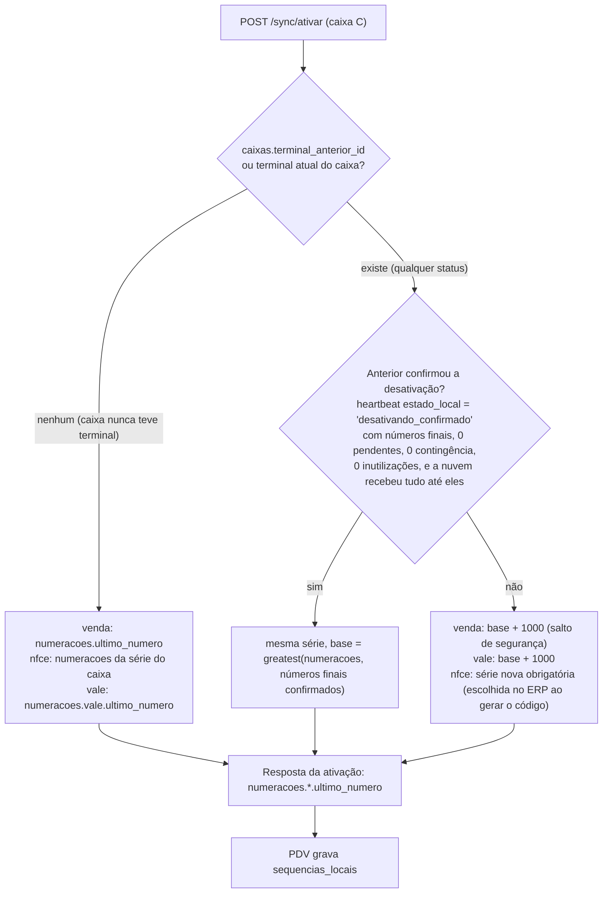

| Regra | Detalhe |
|---|---|
| Confirmação explícita | Só conta o heartbeat com `estado_local = 'desativando_confirmado'` (21.1), enviado pelo terminal **depois** de gravar localmente que parou de vender (3.8), trazendo `ultima_sequencia_gerada`, `venda_ultimo_numero`, `nfce_ultimo_numero` (por série/ambiente) e `vale_ultimo_numero`. A nuvem a aceita só se recebeu todos os eventos até `ultima_sequencia_gerada` e grava em `terminais` (`desativacao_confirmada_em` + os números finais) |
| Base | `base = greatest(numeracoes.ultimo_numero, números finais confirmados, terminais.*_ultimo_numero do último heartbeat)` por tipo |
| Sem confirmação | Série NFC-e nova **obrigatória** e salto de **+1000** em venda e em vale, mesmo que o último heartbeat do antigo parecesse "em dia" |
| Decisão no ERP | O ERP decide entre "série atual" e "série nova" **ao gerar o código** (com ou sem substituição), mostrando o estado do último terminal do caixa. Sem confirmação, só "série nova" é oferecida |
| Revalidação na ativação | A API revalida no momento da ativação; se o código foi gerado para "série atual" e a confirmação deixou de valer (ex.: chegou evento do antigo depois dela), a ativação falha com `CAIXA_OCUPADO` e a mensagem "gere novo código com série nova" |
| Gravação | A etapa da empresa (3.4) grava `caixas.terminal_anterior_id` = terminal que deixa o caixa, `caixas.nfce_serie` (se mudou), os saltos em `numeracoes` e `auditoria` `terminal_ativado` com a decisão (série, bases, se houve salto e por quê) |

### 13.4 Código do vale

`VC` + `lojas.codigo` (2 dígitos) + `numero_caixa` (2) + `sequencias_locais['vale']` (7) + DV Luhn (1) — 12 dígitos
após `VC`, conforme `ck_vales_codigo (^VC[0-9]{12}$)`. Exemplo: loja 1, caixa 2, sequencial 8 → `VC010200000080`.
Único sem consultar a nuvem pelo mesmo motivo do número da venda. Um terminal novo no caixa herda
`numeracoes.vale.ultimo_numero` (ou o `vale_ultimo_numero` confirmado/informado pelo anterior, o maior) e aplica
**salto de +1000** sempre que o último terminal do caixa não confirmou a desativação (13.3), com ou sem substituição;
o mesmo salto vale depois de qualquer restauração de backup (22.1). Sem isso, um vale emitido offline pelo terminal
antigo e o primeiro vale do novo teriam o mesmo código (violação de `uq_vales_codigo`). Vales emitidos no ERP usam o
caixa `00`. A composição está no modelo 3.13.2 (`vales.codigo`) e no PDV 23.2; um "UUID v7 encurtado + DV" não
garantiria unicidade em 11 dígitos.

### 13.5 Número de comanda

| Modo | Regra |
|---|---|
| Cartão físico (`pdv.comandas_numeracao_automatica = false`) | Número digitado 1–9999. Offline, dois caixas podem abrir o mesmo número sem saber; como o cartão é um só, a nuvem **funde** as comandas (9.20) |
| Automática | Faixas de 100 números por terminal em `numeracoes_faixas` (fluxo `configuracao`, filtro `terminal_id = T`); nova faixa reservada pelo comando `reservar_faixa` quando a ativa passa de 80 % (heartbeat). Faixas automáticas começam em **10000** para nunca colidir com números de cartão físico. Faixa esgotada offline → o PDV pede número manual |

### 13.6 Outros números

| Número | Quem atribui | Quando o PDV fica sabendo |
|---|---|---|
| `sequencia_terminal` | PDV (`sequencias_locais['evento']`) | — |
| `pessoas.codigo` (cadastro rápido) | Nuvem | `resultado.codigo` do push; depois pelo pull |
| `orcamentos.codigo` (criado no caixa) | Nuvem | `resultado.codigo` |
| `trocas.codigo`, `pedidos.codigo` | Nuvem | `resultado.codigo` |
| `documentos_fiscais.numero` | PDV (13.2) | — |
| `comandas.numero` | PDV (faixa ou digitado) | — |

---

## 14. Crédito (crediário) e vale-compra offline

### 14.1 O que o PDV verifica localmente (crediário, crédito funcionário, boleto)

| # | Verificação | Dado local |
|---|---|---|
| 1 | Pessoa existe, `ativa`, não excluída; para crédito funcionário, categoria `funcionario` | `pessoas`, `pessoas_categorias` |
| 2 | `bloqueada_credito = false` | `pessoas` |
| 3 | `limite = pessoas.limite_compras ?? financeiro.limite_credito_padrao`; limite 0 = não compra a prazo | `pessoas`, `configuracoes` |
| 4 | `disponivel = limite − (saldos_credito_pessoas.saldo_aberto + Σ pagamentos a prazo de eventos não refletidos) − valor deste pagamento ≥ 0` | Modelo 4.5 |
| 5 | Atraso: `maior_atraso_dias + dias desde saldos_credito_pessoas.calculado_em` (se `saldo_vencido > 0`) ≤ `financeiro.dias_bloqueio_atraso` | `saldos_credito_pessoas` |
| 6 | Senha do cliente (mín. 6 dígitos), se `pdv.crediario_exige_senha_cliente` | `pessoas.senha_hash` (argon2id; só desce para clientes com crediário habilitado, 4.1). Hash `null` com a exigência ligada → a venda a prazo exige consulta online ou liberação com `pdv.pagamento.exceder_limite_credito` |
| 7 | `pdv.crediario_exige_online = true` e offline → recusa | `estado_conexao.online` |

Falha em 3–5 → liberação com `pdv.pagamento.exceder_limite_credito` (PDV 16.8). **Online**, o PDV consulta também
`GET /pessoas/{id}/credito` (tempo limite 2 s), que devolve o saldo aberto da nuvem (inclui vendas já enviadas por
outros caixas); sem resposta, vale a regra local.

**Reserva atômica de crédito (online).** Consultar não basta quando dois caixas online vendem a prazo ao mesmo cliente
ao mesmo tempo. Antes de lançar o pagamento `a_prazo`/`credito_funcionario`/`e_boleto`, o PDV online chama
`POST /pessoas/{id}/credito/reservar {valor, venda_id, pagamento_venda_id, requisicao_id}` (tempo limite 2 s,
`X-Requisicao-Id`, 20.4). Mesmo desenho da reserva de vale (14.4, modelo 3.13.2), na tabela `reservas_credito`
(modelo 3.9.9):

| Item | Regra |
|---|---|
| Disponível na nuvem | `limite efetivo − saldos_credito_pessoas.saldo_aberto − Σ reservas_credito ativas de outros pagamentos`, calculado com `select … for update` na linha de `saldos_credito_pessoas` da pessoa (criada com zero se não existe) |
| Resposta | `200 {reserva_id, expira_em}` ou `409 LIMITE_CREDITO_INSUFICIENTE {disponivel}` → o PDV oferece a liberação `pdv.pagamento.exceder_limite_credito` (PDV 16.8); a venda liberada segue sem reserva e cai na reconciliação (14.3) |
| Consumo | Só pela aplicação do `venda.finalizada` que traz o mesmo `pagamento_venda_id`, na mesma transação que soma `saldos_credito_pessoas.saldo_aberto` (10.2) |
| Liberação | `venda.cancelada` da venda em andamento ou `DELETE /pessoas/{id}/credito/reservas/{pagamento_venda_id}` (pagamento removido no caixa) |
| TTL | Longo: `now() + pdv.dias_max_offline dias` desde a criação (o pagamento a prazo é gravado logo em seguida e o caixa pode cair offline antes do push); tarefa a cada minuto marca `expirada` as vencidas |
| Sem resposta em 2 s | Vale a regra local (risco aceito, 14.2) |

O que o PDV **não** sabe offline: vendas a prazo de outros caixas ainda não sincronizadas, parcelas que venceram
depois do último cálculo de atraso, baixas feitas no ERP após o último pull. Por isso o limite local é uma estimativa.

### 14.2 Riscos aceitos

| Risco | Exposição máxima | Mitigação |
|---|---|---|
| Mesmo cliente compra a prazo em N caixas offline | Até N × limite disponível | `pdv.crediario_exige_online` (por loja); `pdv.limite_valor_venda`; `pdv.dias_max_offline` |
| Mesmo cliente compra a prazo em N caixas **online** ao mesmo tempo | Nenhuma com a reserva respondida; até N × limite quando a reserva não responde em 2 s | Reserva atômica `POST /pessoas/{id}/credito/reservar` (`reservas_credito`, 14.1) |
| Cliente pagou parcelas no ERP mas o PDV não sabe | Recusa indevida (cliente pede liberação) | aviso SSE do fluxo `pessoas` (pull imediato, prioridade normal, 18.1); consulta online |
| Cliente entrou em atraso enquanto o PDV estava offline | Venda a prazo concedida a inadimplente | Atraso estimado (regra 5) |
| Funcionário usa crédito para si | — | Bloqueio por CPF (PDV 16.9) |

### 14.3 Reconciliação na nuvem

1. O `venda.finalizada` **sempre** é aplicado (P6): gera as contas a receber e atualiza `saldos_credito_pessoas`.
2. Depois de aplicar, se `saldo_aberto > limite` (limite efetivo naquele momento) → alerta `LIMITE_CREDITO_EXCEDIDO`
   (`dados`: pessoa, limite, saldo, vendas envolvidas com terminal e se houve liberação). Excesso **com liberação** →
   severidade `info`; sem liberação (corrida offline) → `aviso`.
3. O ERP decide (cobrar, ajustar limite, marcar `bloqueada_credito`). A nuvem não bloqueia sozinha.

### 14.4 Vale-compra

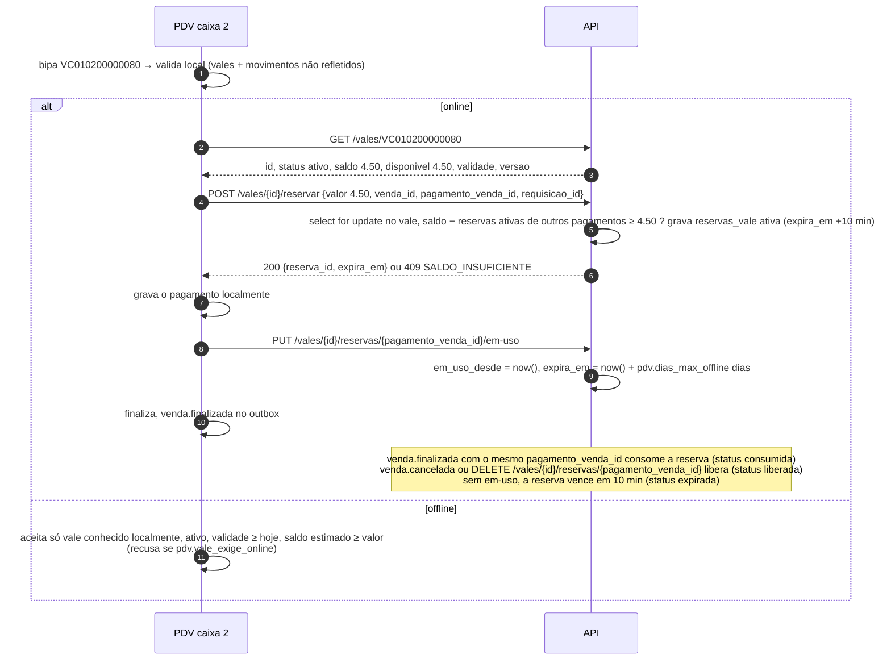

| Caso | Comportamento |
|---|---|
| Vale emitido offline num caixa e apresentado em outro caixa antes do push | Desconhecido no segundo caixa: offline recusa ("vale não encontrado — tente com internet"); online encontra depois que o primeiro caixa sincronizar |
| Mesmo vale usado offline em dois caixas | Nuvem aplica os dois; `vales.saldo` fica negativo; alerta `VALE_SALDO_NEGATIVO` com as duas vendas (PDV 16.11) |
| Vale cancelado/expirado no ERP e usado num caixa offline | Aplica + `VALE_INVALIDO_UTILIZADO` |
| Uso parcial do mesmo vale em dois caixas online | Várias reservas ativas por vale (`reservas_vale`); cada `POST /vales/{id}/reservar` só passa se `vales.saldo − Σ reservas ativas de outros pagamentos` cobre o valor |
| Pagamento removido no caixa | `DELETE /vales/{id}/reservas/{pagamento_venda_id}` → `liberada` |
| Reserva órfã (PDV caiu após reservar, antes de gravar o pagamento) | Sem `em-uso`, vence em 10 min (`expirada`) |
| Caixa gravou o pagamento e caiu offline | Com `em-uso` (ou com o `pagamento_venda_id` informado em `reservas_vale_em_uso` no heartbeat, 21.1, quando a chamada online falhou), `expira_em` passa a `now() + pdv.dias_max_offline dias`: o saldo continua reservado até o `venda.finalizada` chegar e consumir a reserva |

`vales` é projeção de `movimentos_vale` (modelo 3.13.2): o saldo da nuvem é sempre recalculável; o saldo local é
`vales.saldo + Σ movimentos_vale não refletidos` (modelo 4.5), incluindo vales emitidos no próprio caixa.

---

## 15. Estoque: saldo negativo, custo e eventos tardios

### 15.1 Tolerância a saldo negativo

- A nuvem **nunca** recusa uma venda por falta de estoque; `saldos_estoque.quantidade` pode ficar negativa (modelo
  3.7.3). Saldo negativo gera alerta deduplicado `ESTOQUE_NEGATIVO` e aparece nos relatórios de estoque do ERP.
- No PDV, o bloqueio por saldo é opcional (`pdv.bloqueia_venda_sem_estoque`, `vendas.valida_estoque`) e, offline, só
  vale com `pdv.bloqueio_estoque_offline = true` (padrão desligado, PDV 29.1).
- Documentos do ERP (acerto de saída, transferência) não podem deixar saldo negativo, salvo
  `estoque.permite_negativo_erp` (ERP 13.1.1) — a assimetria é proposital: o ERP pode esperar, o caixa não.
- **Lote da venda** (Fase 2, F2-B6; roadmap D48; README da API › decisão 151): o PDV-1 não informa o lote, e a nuvem
  divide a saída do item de produto com lote de saldo positivo no estoque da loja em um movimento por lote, em FEFO,
  com a sobra sem lote (`estoque.lote_baixa_sem_informar`, padrão `fefo`); o `saldos_lote` atualizado desce no fluxo
  `estoque` como qualquer saldo, sem tipo nem versão de evento novos. O `lote_id` informado pelo PDV que não é do
  produto ou do estoque da loja não recusa a venda: a linha segue sem ele (e entra na divisão FEFO). O cancelamento
  devolve cada parte ao lote de onde saiu.
- **Produto com variações sem a variação** (Fase 2, F2-B34; roadmap D44; README da API › decisão 181): o item não
  cancelado sem `variacao_id` cujo código lido (`codigo_barras_id`) é o de uma variação, ou cujo produto é
  `com_variacoes` com variação ativa na nuvem, **não recusa** a venda (o PDV 0.10.0 das lojas não tem a guarda, e o da
  R1 com `pdv.recusa_produto_com_variacoes` desligada vende o pai): a baixa fica no pai, como veio, e abre o
  `CADASTRO_PRODUTO` da empresa com `dados.tipo_alerta = 'venda_sem_variacao'` (chave
  `cadastro:venda_sem_variacao:<produto_id>`, o mesmo formato do `alerta.cadastro`, 9.24), sem tipo nem versão de evento
  novos.

### 15.2 Saldo estimado no PDV

```
saldo_estimado(produto, variação) =
    saldos_estoque.quantidade (estoque vinculado, tipos vendáveis)
  − Σ baixas de vendas finalizadas cujo evento não está refletido (inclui componentes_estoque)
  + Σ vendas canceladas depois de enviadas, ainda não refletidas
  + Σ itens_troca com destino 'estoque' não refletidos
  − Σ quantidades da venda em andamento
refletido(evento, linha) ⇔ evento confirmado
                           e ( linha.versao > evento.versao_nuvem
                               ou estado_sincronizacao.cursor[fluxo da linha] ≥ evento.versao_nuvem_fim )   (modelo 4.5)
```

A segunda condição é necessária porque o evento confirmado nem sempre toca a linha que o PDV consulta: produto com
`controla_estoque` diferente entre a nuvem e o PDV; fallback de `contexto.estoque_id` inválido para o estoque atual
da loja (10.2); composição de kit ou ficha técnica alterada na nuvem; item sem baixa; cliente fundido
(`pessoa_id_final`) no crédito; vale reatribuído. Só com a primeira condição, essas vendas seriam descontadas **para
sempre** do saldo estimado (erro permanente em produtos de pouco giro e bloqueio por estoque indevido). Como
`versao_nuvem_fim` é reservado sob a trava de ordenação depois da última escrita do evento (8.3), e o cursor do pull
só passa dele quando todas as linhas com `versao` menor já estão visíveis e foram varridas (garantia de prefixo +
cursor até o teto, 6.3–6.4), cursor ≥ `versao_nuvem_fim` garante que **todos** os efeitos do evento naquele fluxo já
desceram — ou não eram deste terminal.

Exemplo: saldo baixado 40 latas (`versao 1882000`). O caixa vende 12 → evento confirmado com `versao_nuvem 1882244`,
pull do fluxo `estoque` ainda não rodou → estimado = 40 − 12 = **28**. O pull traz a linha com `versao 1882250`
(> 1882244) e quantidade 23 (o caixa 1 também vendeu 5) → evento refletido → estimado = **23**. Num item cuja linha
o evento não tocou (ex.: o produto deixou de controlar estoque na nuvem), o desconto local some quando o cursor do
fluxo `estoque` passa de `versao_nuvem_fim` (1882262). Eventos `rejeitado` continuam descontando (a venda
aconteceu); descartados deixam de descontar.

Fase 1C (C11a, README do PDV › decisão 54): o PDV calcula o saldo estimado assim para os `venda.finalizada` deste
caixa, lendo a baixa do payload (o item, ou os insumos de `componentes_estoque` no produzido) e a linha de
`saldos_estoque` do estoque da loja; as trocas (Fase 3) entram com o bloco delas. Desde o C11b (README do PDV ›
decisão 55), a venda finalizada cancelada no caixa (forma A) devolve ao estimado o que o `venda.finalizada` dela baixou
enquanto o `venda.cancelada` não se reflete no fluxo `estoque` (o payload da forma A não traz os itens; a baixa vem do
`venda.finalizada` da mesma venda). O cancelamento em andamento (forma B) não baixou nada e não conta.

### 15.3 Eventos tardios e acerto "Definir" (ERP 13.1.5)

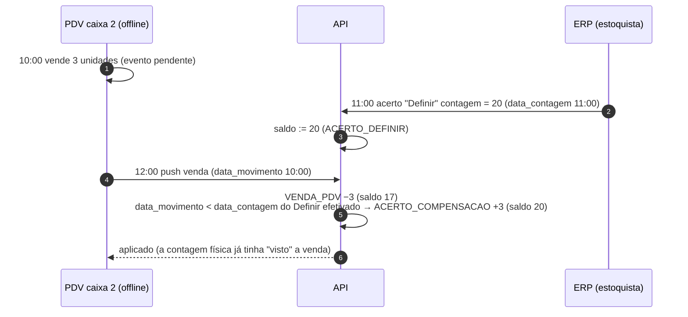

- A compensação é **uma** por movimento tardio (`compensa_movimento_id`; Fase 1C, T23), contra o último
  "Definir" da linha cuja contagem é posterior ao fato, e grava a **mesma data do fato** do movimento compensado: os
  dois se anulam em qualquer janela que um "Definir" futuro some como "posterior à contagem". Estornar esse
  "Definir" estorna a compensação; se outro "Definir" efetivado também tem contagem posterior ao fato, o fato ganha
  uma nova compensação contra ele (uma por "Definir" no índice desde a migração 0018, só uma viva).
- A compensação depende da **hora do fato** do PDV: relógio errado leva a compensação errada; por isso o alerta de
  desvio (12.3) e `relogio_confiavel` aparecem na tela do acerto ao lado das compensações. Fase 2, F2-B10 (ERP 13.1.5
  regra 4; README da API › decisão 155): o detalhe do acerto (`GET /api/acertos/:id`, `compensacoes`) traz cada
  compensação com o movimento compensado, o terminal, a sequência e a hora em que o evento chegou (na lacuna
  recuperada, 8.6, a do lote do evento real: a substituição do placeholder grava essa hora no `criado_em` da linha), o
  estorno que a desfez (com a compensação que entrou no lugar dela, quando outro "Definir" também contou o fato) e o
  relógio do evento, reavaliado com as mesmas regras do `RELOGIO_SUSPEITO` (12.4) sobre o envelope gravado em
  `eventos_recebidos` (`relogio_confiavel`, `relogio_regrediu`, `desvio_relogio_ms`), e não pelo alerta, que soma as
  ocorrências do terminal num registro só e fecha com o "Ciente". O desvio acima de 5 min só destaca a compensação
  sem `relogio_confiavel = true`: com a hora confiável o `ocorrido_em` já saiu corrigido por ele (12.2).
- Antes de efetivar um "Definir", o ERP avisa quando há terminais da loja com eventos pendentes ou offline (ERP 13.1.5),
  usando `terminais.eventos_pendentes`/`ultimo_contato_em`.
- **A compensação é do motor do estoque** (Fase 2, F2-B4; `estoques/compensacao.ts`): a venda, o cancelamento e a
  devolução de cascos usam a mesma função que o acerto e os documentos do ERP da Fase 2. **Regra de data**: o
  movimento do PDV grava a hora do fato; o documento do ERP lança com `data_movimento = now()` (a data do documento é
  atributo do cabeçalho), e só o "Definir" (na `data_contagem`, inclusive o ajuste da importação) e a compensação (na
  data do fato compensado) lançam no passado. O motor recusa, como erro de programação, o movimento que não é do PDV
  com data anterior a `now() − 1 min` sem a permissão explícita de lançamento retroativo (`retroativoPermitido`).
  Assim só o PDV e o próprio "Definir" chegam "atrasados" a uma contagem, e os dois são compensados: o "Definir" de
  contagem anterior à de outro já efetivado é anulado pelo mais novo, e o estorno de qualquer um deles estorna também
  as compensações em que ele aparece; a venda tardia anterior às duas contagens que o mais novo compensava volta a
  ser compensada contra o anterior quando ele é estornado (README da API › decisão 148).
- **Inventário pela planilha** (Fase 2, F2-B11; README da API › decisão 156): o "Atualizar estoque" da importação
  exige a hora da contagem e lança o AJUSTE_IMPORTACAO nela, no estoque escolhido (o da loja ou o CD), como o
  "Definir" da tela: o vendido depois é descontado e a venda offline anterior que chegar depois é compensada. Todos os
  produtos contados entram no "Definir" (os iguais ao saldo com diferença zero, sem movimento), porque é o **item** do
  "Definir" que a compensação procura (`definirPosteriores`): sem ele, a venda tardia anterior à contagem de um
  produto que conferia baixaria o saldo contado. A conferência do "Definir" (ERP 13.1.5 regra 8) soma ao saldo do
  sistema na hora da contagem o que as compensações dele anularam.

### 15.4 Custo

- Saída grava `custo_unitario = custo_medio` vigente do saldo; não altera o custo médio (ERP 13.1.4).
- Com saldo ≤ 0, o custo médio é mantido; a próxima entrada redefine `cm' = c` (ERP 13.1.4: "se s > 0 … senão c").
- Cancelamento entra ao custo da saída original (10.4). Com saldo positivo antes, recalcula a média como qualquer
  entrada (dá o custo médio de quem nunca tivesse vendido); com saldo zero ou negativo **mantém** o custo médio
  vigente em vez de assumir o custo antigo (regra da compra), porque o estorno não traz custo novo (Fase 1C, T20; vale
  para todo estorno de saída, inclusive o de acerto). Devolução (`TROCA_PDV`) entra ao `itens_venda.custo_unitario`
  do item de origem, ou ao custo médio atual quando a troca é sem venda de origem.

### 15.5 Volume de sincronização do estoque

Cada venda atualiza `saldos_estoque` de cada produto vendido → linha nova no fluxo `estoque` para **todos** os
terminais da loja. Para 3 caixas com 500 vendas/dia de 5 itens: ~7.500 atualizações/dia, várias no mesmo produto; o
pull devolve só a versão mais recente de cada linha (o `select … where versao > cursor` traz a linha uma vez, com o
estado atual). Na prática: algumas centenas de KB/dia por terminal.

O fluxo `catalogo` **não** muda com a venda. A projeção `produtos.custo_medio` (e o `custo_medio` do combo) muda com a
saída quando os estoques têm custos diferentes, porque o peso de cada estoque na média muda, mesmo sem mudar o custo
médio de nenhum saldo (15.4). Mas ela é coluna isenta de versão (MD 1.5, "Colunas isentas"; Fase 1C, T3/T10) e não
desce ao PDV. Só o saldo desce.

---

## 16. Edições concorrentes: ERP × cache do PDV

### 16.1 Regra geral

**A nuvem vence nos cadastros.** O PDV nunca grava em tabela espelho (exceto as linhas que ele mesmo cria, modelo
4.2) e aplica sempre a versão mais nova recebida. O que já foi registrado no caixa (snapshot no documento da venda)
**não** é recalculado pela nuvem: a venda vale como foi feita.

### 16.2 Cenários

| Cenário | No PDV | Na nuvem |
|---|---|---|
| Preço alterado no ERP durante uma venda aberta | Itens já incluídos mantêm `preco_tabela`/`preco_unitario`; itens novos usam o preço novo (PDV 30.3). Recalcular faixa/atacado (PDV 11.3) usa o preço **capturado na primeira inclusão do produto na venda** para todas as linhas daquele produto (evita misturar preços antigo e novo na mesma linha de faixa) | Grava o preço praticado; não "corrige" |
| Produto inativado/excluído no ERP com venda aberta | Item já incluído continua; nova inclusão é recusada ("Produto inativo") | Aceita (a linha do produto existe, exclusão é lógica); alerta `PRODUTO_INATIVO_VENDIDO` se o fato é posterior à inativação |
| Produto **que nunca existiu** na empresa | — (impossível pelo fluxo normal) | `erro` `REFERENCIA_INEXISTENTE` |
| Promoção venceu durante a venda | Mantém o preço da inclusão; próxima inclusão recalcula | Grava o praticado |
| NCM/tributação alterados | `fiscal_snapshot` da inclusão vai na NFC-e | Grava o snapshot |
| Forma de pagamento desativada com pagamento já lançado | Pagamento mantido; nova escolha não mostra a forma | Aceita (forma excluída logicamente existe) |
| Usuário desativado/sem loja durante a sessão | Termina a venda atual e força logout (PDV 30.3) | Aceita eventos assinados por ele com `ocorrido_em` anterior ao pull; posteriores (relógio corrigido) → alerta `OPERADOR_INATIVO` |
| Permissão removida | Vale na próxima verificação após o pull (não interrompe diálogo aberto) | — |
| Flag de configuração alterada | Aplicada na próxima venda (PDV 30.3) | — |
| `lojas.estoque_id` alterado | Comando `ressincronizar_fluxo {estoque}`; vendas já feitas sobem com `contexto.estoque_id` antigo | Usa o estoque do contexto (10.2) |
| Limite de crédito reduzido no ERP | Vale após o pull | Venda feita com o limite antigo é aplicada; alerta se excedeu |
| Vale cancelado no ERP e usado offline | Aceito (não sabia) | Aplica + `VALE_INVALIDO_UTILIZADO` |
| Orçamento editado/cancelado no ERP depois de importado no caixa | Mantém o importado; online, a reserva (`POST /orcamentos/{id}/reservar`) impede edição no ERP enquanto válida | `orcamento.convertido` de orçamento cancelado → aplica + alerta |
| Comanda alterada em dois caixas | Online: `CONFLITO_VERSAO` e recarga; offline: eventos | Aplica + alertas (9.20) |
| ERP cancela uma venda do PDV | Ver 16.3 | `cancelamento_origem = 'erp'` |
| Certificado trocado no ERP | Pull de `certificados_digitais`; a próxima emissão usa o novo | — |
| Atalho alterado | Vale após o pull (PDV 28.4) | — |

### 16.3 Vendas do PDV alteradas pela nuvem

Hoje `vendas` não desce ao PDV (modelo 6.2). Mas três coisas mudam uma venda do terminal fora dele: cancelamento pelo
ERP, devolução registrada em **outro** caixa (troca de venda de outro caixa, PDV 30.1) e status fiscal resolvido pela
nuvem. Para a Gestão de vendas (F12) não oferecer cancelar/trocar algo já cancelado/devolvido, o fluxo `operacao`
inclui a projeção **`vendas_status_pdv`** (modelo 3.11.9): uma linha por venda do terminal T alterada por origem que
não seja o próprio T (ERP, evento de outro terminal, tarefa fiscal), gravada na mesma transação da alteração, com
`id` (= `vendas.id`), `terminal_id`, `status`, `status_fiscal`, `devolucao`, `cancelada_em`, `cancelamento_origem` e
`versao`; desce com filtro `terminal_id = T` e `atualizado_em > now() − interval '90 days'`. No PDV ela é um espelho
com o mesmo nome: a Gestão de vendas lê `vendas` local com `left join vendas_status_pdv` e, quando há linha, as
colunas da projeção prevalecem. O PDV **nunca** regrava a própria `vendas` com esses valores (a tabela de movimento
continua imutável localmente). Além disso, operações destrutivas sobre venda
antiga (cancelar, trocar) consultam a API quando online.

---

## 17. Versionamento do app, do protocolo e do banco local

### 17.1 As versões

| Versão | Onde | Exemplo | Muda quando |
|---|---|---|---|
| Aplicativo | `X-Genesis-App-Versao`, `versoes_app_pdv.versao` | `1.4.2` | Toda publicação (SemVer) |
| Protocolo de sync | `X-Genesis-Protocolo` | `1` | Mudança incompatível em endpoints/envelope (raro) |
| Payload por tipo de evento | `versao_schema` do envelope | `venda.finalizada` v1 | Mudança incompatível no payload daquele tipo |
| Banco local | `identidade_terminal.versao_schema_local` | `12` | Toda migração EF Core do SQLite |
| Banco da empresa | `migracoes_empresas`, `empresas.versao_schema` | `0031_sync_lacunas` | Toda migração Drizzle |

### 17.2 Compatibilidade do protocolo

| Regra | Detalhe |
|---|---|
| Mudanças compatíveis não mudam a versão | Campo novo opcional na resposta, tabela nova num fluxo, coluna nova numa projeção, tipo de evento novo, código de erro novo (o PDV trata código desconhecido pela classe HTTP) |
| Janela de suporte | A API atende o protocolo atual e o anterior por pelo menos **12 meses**; `POST /sync/push` aceita o anterior ao anterior por **18 meses** (para esvaziar outboxes de caixas esquecidos) |
| Fora da janela | `426 PROTOCOLO_NAO_SUPORTADO` em pull/heartbeat; push só pela recuperação assistida (22.3) |
| Ordem de implantação | **API primeiro, PDV depois**: nenhuma versão do PDV é publicada antes de a API em produção aceitar seus `versao_schema` e protocolo |

### 17.3 Versão mínima do aplicativo

- `versoes_app_pdv.versao_minima = true` marca a mínima por plataforma/canal.
- O heartbeat devolve `app: {versao_minima, versao_disponivel, url_pacote, sha256, atualizar_ate}`; abaixo da mínima,
  o PDV mostra aviso por 3 dias (`atualizar_ate`) e depois exige a atualização no próximo login (PDV 32.6).
- **O push nunca é bloqueado por versão mínima** (P10); o pull continua enquanto o protocolo estiver na janela.
- Uma flag nova que mude regra de venda (ex.: bloquear algo) só é ligada em produção depois que a versão do PDV que a
  entende virou a mínima — o PDV antigo ignora colunas e chaves de configuração que não conhece.

### 17.4 Migrações do SQLite local

1. Na inicialização, antes de abrir a tela de login: `PRAGMA integrity_check` → backup consistente (API de backup
   online do SQLite, PDV 32.5) → migrações EF Core pendentes, **cada uma numa transação**.
2. Regras de escrita de migração local:
   - Tabelas espelho: coluna nova sempre **anulável** ou com padrão; se o PDV precisa do valor real nas linhas
     existentes, a migração marca `estado_sincronizacao.ressincronizar = 1` do fluxo (ressincronização em sombra, 6.11).
   - Tabela nova num fluxo existente: a migração marca o fluxo para ressincronizar.
   - Até a ressincronização em sombra (6.11) existir, "marcar para ressincronizar" é **voltar o cursor do fluxo a 0**,
     como o comando `ressincronizar_fluxo` (o pull baixa de novo por upsert de versão; nada local é apagado), e, na
     coluna nova, também a **versão local** das linhas da tabela (senão a mesma versão da nuvem, agora com o valor real,
     seria ignorada). O PDV anterior descarta a tabela ou a coluna que não conhece sem travar o cursor, então com a API
     implantada antes os valores já ficaram abaixo dele. Hoje `ressincronizar = 1` quer dizer "esperar o suporte" (teto
     menor que o cursor, 6.3) e o pull pula o fluxo: a migração não usa essa marca. Primeiro caso: a migração EF
     `FormasPagamentoLojas` (Fase 1C, C8b).
   - `eventos_saida`: só acréscimo de coluna; **nunca** reescreve `payload` nem `payload_sha256`.
   - `sequencias_locais`, `identidade_terminal`: só acréscimo.
   - Nada de `DROP` de tabela de movimento numa versão que ainda possa ter eventos pendentes daquela tabela.
3. Sucesso → `versao_schema_local` atualizado e informado no heartbeat. Falha → restaura o backup feito no passo 1 e
   volta o aplicativo para a versão anterior (rollback do instalador, PDV 32.6); auditoria `migracao_falhou`.
4. O modelo EF Core das tabelas espelho/movimento é **gerado** do schema Drizzle (`Esquema.g.cs`, modelo 4.1); o
   gerador também produz a tabela de projeção de colunas do pull, para que nome, escala e nulidade nunca divirjam.

### 17.5 Versões de payload e upcasters

```ts
// apps/api/src/sync/eventos/venda-finalizada/index.ts
export const versoes = {
  1: VendaFinalizadaV1,            // zod
  2: VendaFinalizadaV2,
} as const;
export function upcast(v: number, p: unknown): VendaFinalizadaV2 {
  if (v === 1) return v1ParaV2(VendaFinalizadaV1.parse(p));   // ex.: v2 trouxe `liberacoes` obrigatório → []
  if (v === 2) return VendaFinalizadaV2.parse(p);
  throw new ErroTransitorio('SCHEMA_DESCONHECIDO');            // PDV mais novo que a API
}
```

- O payload gravado (`eventos_recebidos.payload`) é sempre o **original**; o upcast acontece a cada aplicação
  (inclusive no Reprocessar) — corrigir um upcaster e reprocessar resolve eventos rejeitados por bug de versão.
- O PDV grava sempre a maior versão que conhece; o handshake (`versoes_schema`) informa as aceitas pela API, e o PDV
  nunca grava versão que a API não aceita (fica na anterior até a API ser atualizada). Fase 1C (C9, decisão técnica
  T13): o PDV guarda o `versoes_schema` do último handshake (`estado_conexao.versoes_schema_nuvem`, vale offline) e o
  `GravadorOutbox` recusa o evento de tipo ou versão não anunciados, sem gravar o fato (a abertura de caixa numa API sem
  o handler do `caixa.aberto` não acontece; a tela pergunta antes). `auditoria.registros` e
  `terminal.configuracao_alterada`, que toda API desde a 1B aplica, não dependem do anúncio. Sem nenhum handshake
  gravado desde a atualização (coluna nula), todo tipo vale como aceito: a implantação é sempre API primeiro e o caixa
  nunca trava por falta de internet (O18); se a API ainda não tiver o tipo, o evento espera com `SCHEMA_DESCONHECIDO`
  (transitório). Padrão até a confirmação do dono (README do PDV › decisão 51).
- **Release R2 do PDV (Fase 2, F2-B45):** as mudanças de `Esquema.g.cs` da Fase 2 (as colunas calculadas das imagens
  em 6.12 e os espelhos `produtos_grupos_complementos`/`produtos_complementos`, MD 3.6.8) entram numa **única** migração
  EF (`FaseDois`), com uma só volta do cursor do `catalogo` (17.4.2; a versão local das marcas e das categorias também
  volta a 0). `venda.finalizada` continua v1 e `versoes_schema` não muda; o PDV 0.11.0 continua sincronizando com a API
  nova (campos e tabelas desconhecidos descartados, 6.10), e a API vai para a produção antes do 0.12.0 (17.2). O
  `itens_venda_complementos.complemento_id` ganha a FK para `produtos_complementos` (`on delete set null`, exclusão
  física bloqueada), e o handler grava nulo o id que a nuvem não conhece (README da API › decisão 191).
- **Consultas online não passam pelo T13** (Fase 2, F2-B35): o `GET /sync/consultas/saldos-outras-lojas` do `F4` (1.4)
  não grava evento nem anuncia tipo ou versão; o PDV novo diante da API antiga recebe 404 e mostra "requer conexão". A
  Fase 2 inteira mantém `venda.finalizada` v1 (a `variacao_id` e o `lote_id` já existem nele) e não acrescenta nada a
  `versoes_schema`.
- `SCHEMA_DESCONHECIDO` é **transitório** com backoff de 10 min e alerta para a plataforma: o evento é válido, a API é
  que está atrasada.
- `itens_venda.fiscal_snapshot` tem versão própria (`schema_fiscal`, modelo 3.11.3), independente de
  `versao_schema` do evento: o upcaster de `venda.finalizada` converte o bloco plano antigo (sem `schema_fiscal`, lido
  como 1: `icms_situacao`, `icms_origem`, `pis_situacao`, `cofins_situacao`, `ibpt_*_pct`, `v_tot_trib`) para
  `schema_fiscal: 2`, com `ibs_cbs`/`is` nulos; o payload original continua gravado como chegou.
- Todos os tipos nascem em `versao_schema = 1` (seção 9). A suíte de contrato (`packages/shared` + testes do PDV)
  roda os exemplos JSON deste documento contra os schemas `zod` e contra os serializadores C#.

### 17.6 Migração do banco da empresa

Durante `db:migrate:empresas` de uma empresa, a API responde `503 MANUTENCAO` (`Retry-After: 60`) para aquela empresa
(modelo 2.12); o PDV trata como transitório. Migrações que mudam projeção de pull ou tabela de fluxo publicam, ao
terminar, `ressincronizar_fluxo` para os terminais da empresa quando necessário.

---

## 18. Tempo real, intervalos e backoff

### 18.1 Avisos em tempo real (SSE)

`GET /sync/eventos` com `Accept: text/event-stream`, mesmo token. Escolha: **SSE** em vez de WebSocket porque o canal
só precisa ir da nuvem para o PDV (o PDV fala com a nuvem por requisições normais), funciona em HTTP/1.1 e HTTP/2 por
proxies e antivírus, e tem reconexão automática com `Last-Event-ID`.

```
event: alteracao
id: 1882250
data: {"fluxo":"estoque","versao":1882250,"prioridade":"normal"}

event: alteracao
id: 1882301
data: {"fluxo":"acesso","versao":1882301,"prioridade":"alta"}

event: comando
id: 01a1878b-3a74-7009-a104-61e32a25a888
data: {"tipo":"ressincronizar_fluxo","parametros":{"fluxo":"catalogo"}}

event: evento_resolvido
id: 01a1878b-cc4f-7c8b-ad30-49cf43e458fc
data: {"evento_id":"01a18776-e909-7fa4-91b7-e948d0e6e660"}

event: pix
id: 01a1878c-5e6b-76c5-8906-17f2747b6dba
data: {"txid":"GPDV01a1875a1e257ec3b91e1d4c","status":"paga"}

event: ping
data: {}
```

| Item | Regra |
|---|---|
| Origem dos avisos | Depois do commit de qualquer transação que gravou tabela de fluxo, a API publica `pg_notify('sync_alteracao', '{empresa_id, fluxos[], estoque_ids[], loja_ids[], versao}')` (`empresa_id` obrigatório e validado por zod; o ouvinte abre contexto novo com `tenancy.executarNaEmpresa`, visao-geral.md 4.3.1), por gancho "após commit" no serviço, não trigger por linha. Cada instância da API escuta (LISTEN) e repassa por pub/sub (Redis) ao processo que segura a conexão SSE do terminal |
| Filtro | O hub só avisa terminais afetados (ex.: `saldos_estoque` do estoque E → terminais das lojas com `estoque_id = E`) |
| Agrupamento | No máximo 1 `alteracao` por fluxo por terminal a cada 2 s (vários commits viram um aviso) |
| `ping` | A cada 25 s (mantém proxies abertos e detecta queda) |
| Natureza | **Só uma dica**: aviso perdido não causa erro, porque o polling continua (18.2). O conteúdo nunca traz dados de negócio |
| Ao receber | `alteracao` → pull imediato do fluxo; `comando` → heartbeat imediato; `evento_resolvido` → heartbeat; `pix` → atualiza a tela de pagamento PIX dinâmico (PDV 16.7) |
| Limite | 1 conexão SSE por terminal (a nova derruba a antiga) |

### 18.2 Intervalos

| Atividade | Online sem SSE | Online com SSE | Offline |
|---|---|---|---|
| Heartbeat | **30 s** | **60 s** | Tentativa de reconexão com backoff |
| Pull de todos os fluxos | 30 s (ADR-08) | 5 min de segurança + imediato no aviso | — |
| Push | Imediato após cada commit no outbox (debounce 500 ms); a cada 15 s enquanto houver pendentes | Igual | Backoff do evento da frente |
| Fluxo `acesso` | Junto com o ciclo | Imediato (prioridade alta) | — |
| Status SEFAZ (módulo fiscal) | 5 min (PDV 18.2) | 5 min | — |
| Transmissão de contingência | 60 s com fila (PDV 18.4) | 60 s | — |
| `auditoria.registros` | 5 min ou 200 registros | Igual | Acumula |
| Backup local | Fechamento, 2 h com caixa aberto, antes de migração, ao sair (PDV 32.5) | Igual | Igual |
| Consulta `GET /sync/eventos-status` | 1 h, se houver `rejeitado` | Igual | — |

Valores de referência do heartbeat para **todos** os documentos (ERP 12.6, PDV 30.4, roadmap): **30 s sem SSE e 60 s
com SSE conectado**; não existe intervalo "ocioso" de 5 min. A API devolve o intervalo vigente em
`intervalos.heartbeat_s` (ativação, 3.2, e toda resposta de heartbeat, 21.1) conforme o `sse_conectado` informado, e o
PDV sempre obedece ao último valor recebido. O heartbeat é uma chamada `POST /sync/heartbeat`, **não** um evento do
outbox (não existe `terminal.heartbeat`).

### 18.3 Detecção de queda e backoff

- **Offline** = 2 falhas seguidas de transporte em qualquer chamada, ou 1 timeout de heartbeat. **Online** de novo
  na primeira resposta bem-sucedida. O indicador segue o PDV 30.2.
- Backoff exponencial com *jitter* completo: `espera = aleatório(0, min(teto, 5 s × 2^tentativa))`. Tetos: 10 min para
  o evento da frente do outbox (modelo 4.4.5), 5 min para heartbeat/pull/SSE. Zera no primeiro sucesso. No outbox,
  "zerar" na volta de um período offline (a primeira resposta depois de o PDV se marcar offline) é tirar a espera dos
  eventos em `erro_temporario` **por falha de transporte** (sem resposta da nuvem: rede, DNS, TLS, prazo) **e**
  recomeçar a contagem de tentativas que alimenta o expoente: sem isso a frente ficava esperando o backoff sorteado
  durante a queda, e uma falha logo depois da volta sorteava de novo até 10 min (Fase 1C, C13, achado pelo teste do
  PDV 30.7). O lote continua o mesmo (`lote_id` e corpo). A espera que a nuvem pediu não é zerada, mesmo que a volta
  venha de uma resposta de erro (o 503 do heartbeat) ou do próprio push: o `Retry-After` gravado vale até o fim e o
  backoff de um `erro_temporario`/`fora_de_ordem` por evento continua crescendo; só as tentativas que falharam no
  transporte durante a queda saem do expoente desse backoff.
- `429` e `503`: usa `Retry-After` (nunca menos que o informado).
- Ao voltar de um período offline: handshake (se > 1 h) → push até esvaziar → pull de `acesso` → `configuracao` →
  `estoque` → `catalogo` → `pessoas` → `operacao` → `referencia` → imagens.

### 18.4 Concorrência no PDV

- Um único `BackgroundService` de sync com filas por prioridade; no máximo 2 requisições simultâneas (1 de
  push/pull/heartbeat + 1 de imagem/snapshot).
- O SSE fica numa conexão própria.
- O sync nunca segura transação SQLite enquanto espera a rede (lê → solta → envia → grava resultado).

---

## 19. Banda, lotes e desempenho

### 19.1 Tamanhos típicos (JSON, antes e depois do gzip)

| Item | Sem compressão | gzip |
|---|---|---|
| Linha de `produtos` (projeção) | ~1,4 KB | ~0,3 KB em lote |
| Página de pull de 500 linhas de catálogo | ~500 KB | ~70–100 KB |
| Carga inicial com 50 mil produtos (~250 mil linhas) | ~250 MB | ~25–35 MB (ou snapshot NDJSON gzip, mesma ordem) |
| `venda.finalizada` com 10 itens | ~9 KB | ~2 KB |
| `nfce.autorizada` (XML incluso) | ~14 KB | ~4 KB |
| Lote de push com 50 vendas | ~450 KB | ~80 KB |
| Heartbeat (requisição + resposta) | ~2 KB | ~1 KB + TLS |

Consumo diário estimado de um caixa com 500 vendas NFC-e: push ~3 MB, pull ~1–3 MB, heartbeat ~3 MB (30 s) → abaixo
de 10 MB/dia: cabe em 4G de contingência (PDV 32.7).

### 19.2 Limites

| Limite | Valor | Ao exceder |
|---|---|---|
| Linhas por página de pull | padrão 500, máximo 2000 | API usa o máximo |
| Bytes por página de pull | 4 MiB sem compressão | API corta a página (sempre ≥ 1 linha) |
| Eventos por lote de push | 50 | `413 LOTE_GRANDE_DEMAIS` |
| Bytes por lote de push | 8 MiB sem compressão | `413` → PDV divide o lote ao meio |
| Bytes por evento | 2 MiB | Não há divisão de evento: o PDV impede na origem (venda limitada a 990 itens; o XML de NFC-e é bem menor); se acontecer, `PAYLOAD_INVALIDO` |
| Heartbeat | 16 KiB | `413` |
| Conexão SSE | 1 por terminal | A nova encerra a anterior |

### 19.3 Recuperação de longo período offline

7 dias × 500 vendas ≈ 3.500 vendas + NFC-e + auditoria ≈ 8.000 eventos → 160 lotes de 50 → ~3–5 min com aplicação a
~50 ms/evento. O ERP mostra a evolução de `eventos_pendentes` no detalhe do terminal. A transmissão das NFC-e em
contingência à SEFAZ corre em paralelo, pelo módulo fiscal (não depende da API).

---

## 20. Segurança

### 20.1 Transporte

- TLS 1.2+ (1.3 preferido), cifras AEAD, HSTS no domínio da API; certificado validado pelo repositório do sistema
  operacional; proxy corporativo suportado.
- Sem *certificate pinning* na v1 (antivírus/proxies que inspecionam TLS quebrariam lojas); a API fica preparada para
  pinning opcional por SPKI com chave reserva numa versão futura.
- Falha de validação TLS = transitório para o PDV, mas com mensagem específica "Conexão não confiável (certificado)"
  no status de sync e alerta no heartbeat seguinte que conseguir passar.

### 20.2 Escopo do token do terminal

| Pode | Não pode |
|---|---|
| `/sync/*` da própria empresa, filtrado pela loja/estoque/terminal do token | Qualquer rota do ERP (`/api/*`), que exige JWT de usuário |
| Endpoints online do PDV (1.4) restritos à loja do token; `GET /sync/consultas/saldos-outras-lojas` lê o saldo vendável das lojas reais e do CD (só quantidades, sem a loja de treino; PDV 10.3, F2-B35) | Ler dados de outra empresa, de outra loja (exceto saldos), custos, financeiro |
| Receber segredos da **própria loja** (CSC, certificado, token TEF), **cifrados para a `chave_publica_terminal`** | Receber segredos de outra loja; receber qualquer segredo em claro (mesmo dentro do TLS); receber segredos com `HARDWARE_ALTERADO` pendente |
| `GET /sync/arquivos/{id}` só das categorias e escopos de 6.12 (imagens de cadastro; logotipo/banner da loja; XML fiscal da loja e do próprio terminal) | Baixar XML de NF-e de fornecedor, XML/logs de outras lojas ou terminais, anexos financeiros, planilhas (`403 ESCOPO_INVALIDO`; na Fase 2, F2-B45, só as imagens de produto, categoria e marca, e o resto é `404`, 6.12) |
| Enviar eventos com `loja_id`/`caixa_id`/`terminal_id` iguais aos do token | Enviar evento "em nome" de outro terminal (`ESCOPO_INVALIDO`), exceto pela recuperação assistida com código do ERP (22.3) |

**Entrega de segredos** (`certificados_digitais` arquivo e senha, `lojas.*_cifrado`, CSC, token TEF):

| Regra | Detalhe |
|---|---|
| Cifra | Envelope ECIES: chave efêmera X25519 (ou P-256, conforme `chave_publica_terminal.algoritmo`) + ECDH com a chave pública do terminal + HKDF-SHA256 (`info` = `genesis-segredo:<terminal_id>:<tabela>:<coluna>:<versao>`) + AES-256-GCM. A coluna desce como `{"cifrado_para_terminal": "<base64>", "versao_segredo": n}`. Só a chave privada não exportável do terminal (3.6) decifra |
| No máximo uma vez | Cada (terminal, tabela, registro, coluna, `versao_segredo`) é entregue **uma vez**: a API grava `auditoria` `segredo_entregue` (terminal, tabela, registro, coluna, versão, IP) e, nas páginas seguintes ou num novo pull da mesma linha, manda a coluna `null` com `"ja_entregue": true`. O PDV guarda o segredo protegido localmente |
| Nova entrega da mesma versão | Só depois de `ressincronizar` / `ressincronizar_fluxo {configuracao}` comandado pelo ERP ou pelo suporte (que autoriza uma reentrega, auditada) ou de aprovação de troca de hardware (20.5) |
| Segredo novo | Certificado ou CSC trocado no ERP = `versao_segredo` nova → nova entrega |

O token de usuário do ERP (JWT) não acessa `/sync/*`. Nos endpoints online que executam algo em nome de um operador
(reservar vale, criar cobrança PIX, devolução PIX), o PDV envia `X-Genesis-Operador: <usuario_id>` e a API confere a
permissão desse usuário na loja (a senha foi validada localmente; o principal de segurança é o terminal, o operador é
asserção auditada).

### 20.3 Limites de taxa

| Escopo | Limite | Observação |
|---|---|---|
| `POST /sync/ativar` por IP | 5 falhas / 10 min → bloqueio 30 min | Modelo 2.6 |
| `POST /sync/ativar` por `codigo_empresa` | 20 falhas / 1 h → bloqueio de ativações daquele código por 1 h (`ATIVACAO_BLOQUEADA`) + alerta no ERP | 3.1 |
| `POST /sync/ativar` global | 500 falhas / 10 min → atraso de 3 s em toda falha + alerta à plataforma | 3.1 |
| `POST /operadores/autenticar` por terminal | 10 / min | 4.1 |
| `GET /sync/pull` por terminal | 120 / min | Carga inicial cabe (páginas sequenciais) |
| `POST /sync/push` por terminal | 60 / min | |
| `POST /sync/heartbeat` por terminal | 6 / min | |
| `GET /sync/arquivos/*` por terminal | 300 / min | |
| Endpoints online por terminal | 120 / min | |
| Por empresa (soma dos terminais) | 3.000 / min | Protege o banco da empresa |

Resposta `429 LIMITE_TAXA` com `Retry-After`.

### 20.4 Proteção contra repetição (*replay*)

| Superfície | Proteção |
|---|---|
| Push | TLS + idempotência: repetir um lote não tem efeito (8.4) |
| Pull, heartbeat, estado | Leitura/telemetria: repetir é inofensivo |
| Endpoints online que alteram estado (reservas de vale, crédito e orçamento, PIX, comandas online) | `X-Requisicao-Id` obrigatório; a API guarda (terminal, requisição) por 24 h e devolve a **mesma resposta** para a mesma requisição. Depois de um timeout, o PDV repete com o mesmo id e, persistindo a falha, consulta o estado (`GET /comandas/{id}`, `GET /orcamentos/{codigo}`, `GET /vales/{codigo}`) antes de cair para o caminho offline (9.20) |
| Ativação | Código de uso único + `requisicao_ativacao_id` (3.4) |
| Token roubado | Revogação imediata; rotação periódica idempotente; uso do token anterior após troca gera alerta (3.7); uso de outra máquina → `HARDWARE_ALTERADO` sem segredos (20.5) |
| Renovação de token | `requisicao_id` guardado em `terminais_pdv.token_renovacao_requisicao_id`; repetição sem efeito (3.7) |

### 20.5 Terminal clonado ou copiado

- Copiar `pdv.db` para outra máquina não leva o token (chave CNG não exportável / chave local, 3.6).
- Clone de máquina virtual (mesmo `id_hardware`) leva o token. Sinais: (a) push com `sequencia` já usada por outro
  `evento_id` (`REGRESSAO_DETECTADA`); (b) heartbeats alternando `ultima_sequencia_gerada` para trás ou IPs/nomes de
  máquina diferentes no mesmo minuto. Dois sinais em 1 h → a API marca o terminal como suspeito e responde
  `409 TERMINAL_CLONADO` a todas as chamadas até o suporte decidir (revogar um e reativar o outro), com alerta crítico.
- `X-Genesis-Id-Hardware` diferente do registrado, sem os sinais acima (troca de placa-mãe **ou** token roubado e
  usado de outra máquina — a API não distingue): **não** atualiza `terminais_pdv.id_hardware`. Grava
  `terminais_pdv.id_hardware_pendente` e `auditoria` `hardware_alterado`, gera alerta crítico e responde
  `409 HARDWARE_ALTERADO` a push, endpoints online e renovação de token. Continuam respondidos: heartbeat (com
  `status_terminal: "hardware_alterado"`), `GET /sync/estado` (`id_hardware_confere = false`) e pull — **sem
  segredos** (colunas de segredo `null`). O PDV bloqueia vendas e mantém o outbox (nada se perde; sobe depois da
  aprovação). A primeira chamada com cada id pendente grava `hardware_pendente_desde` e `hardware_pendente_ip` (e o
  SO do primeiro heartbeat dela, `hardware_pendente_so`); a chamada de outra máquina **não** grava contato, IP, SO
  nem telemetria do terminal (numeração, pendências) e **não** confirma a desativação (13.3): ela não é o terminal.
- No ERP, a ação **"Confirmar troca de hardware"** (permissão `terminais.gerenciar`, auditada, mostrando nome da
  máquina, SO, IP e horário da primeira chamada com o hardware novo) envia o id pendente exibido — se outra máquina
  chamou depois e o pendente mudou, `409 CONFLITO` e nada muda — e grava `id_hardware = id_hardware_pendente` e
  libera o terminal; se a troca de máquina trocou também a chave do terminal (reinstalação), o caminho é reativar.
  A alternativa "Não reconheço" revoga imediatamente (3.8).
- Por que tanto rigor: o token do terminal dá acesso ao certificado A1 da loja (e-CNPJ capaz de assinar NF-e), ao CSC
  e ao token TEF. Por isso, além do bloqueio por hardware, os segredos só descem cifrados para a chave privada não
  exportável que ficou na máquina original (20.2): um token copiado sozinho não abre nenhum segredo.

### 20.6 Empresa suspensa, loja inativa, PDV desabilitado

Pull e heartbeat recebem `403`; o PDV termina a venda atual e bloqueia novas. O **push continua aceito** (os dados
são do cliente e recusá-los criaria perda). A recusa vale só para pull/heartbeat (modelo 2.3). Empresa `cancelada`: tudo recusado.

### 20.7 Dados pessoais (LGPD)

- Pessoas descem sem `observacoes` e campos internos (modelo 6.2); anonimização no ERP (`anonimizada_em`) sobrescreve
  os campos pessoais e a linha desce de novo — o PDV sobrescreve o espelho e o FTS.
- `pessoas.senha_hash` (senha de crediário) desce **só** para clientes com crediário habilitado e quando a loja exige
  a senha (4.1); para os demais clientes a coluna desce `null`. Minimiza o dado pessoal sensível no PC da loja e
  limita a exposição a ataque offline (4.3).
- Backups locais são cifrados (PDV 32.5); logs técnicos nunca têm CPF completo, senha, token, CSC ou cartão
  (PDV 32.1).
- Payloads em `eventos_recebidos` são anulados após 13 meses quando aplicados (modelo 3.15.2).

---

## 21. Observabilidade e tela "PDVs / Terminais"

### 21.1 Contrato do heartbeat (`POST /sync/heartbeat`)

Este é o **contrato de referência** do heartbeat; o ERP 12.6 deve citá-lo (é uma extensão do contrato resumido de
lá). Intervalo: 30 s sem SSE, 60 s com SSE (18.2). Requisição:

```json
{
  "versao_app": "1.4.2",
  "estado_local": "ativo",
  "so": "Windows 11 Pro 24H2 x64",
  "hora_local": "2026-10-29T17:45:00.010Z",
  "desvio_relogio_ms": 1239,
  "relogio_confiavel": true,
  "cursor_pull": { "configuracao": 1882001, "acesso": 1881870, "referencia": 1200455, "catalogo": 1882231, "estoque": 1882250, "pessoas": 1881999, "operacao": 1882102 },
  "ultimo_pull_sucesso_em": "2026-10-29T17:44:31.112Z",
  "eventos_pendentes": 3,
  "evento_mais_antigo_em": "2026-10-29T17:41:02.880Z",
  "eventos_rejeitados": 0,
  "ultima_sequencia_gerada": 1046,
  "venda_ultimo_numero": 126,
  "vale_ultimo_numero": 8,
  "nfce_ultimo_numero": [ { "serie": 2, "ambiente": 1, "numero": 4515 } ],
  "nfce_contingencia_pendentes": 1,
  "nfce_contingencia_mais_antiga_em": "2026-10-29T17:40:12.000Z",
  "inutilizacoes_pendentes": 0,
  "sessao_caixa_id": "01a18755-98a1-7472-96da-1dac72ff5d2a",
  "operador_id": "01a18754-76cb-7b74-b2e7-06298fadc1a6",
  "dinheiro_estimado_gaveta": "1284.50",
  "certificado_validade": "2027-03-14T23:59:59.000Z",
  "disco_livre_mb": 48210,
  "tamanho_banco_mb": 412,
  "fila_impressao_pendentes": 0,
  "sse_conectado": true,
  "versao_schema_local": 12,
  "ultimo_erro": null,
  "resumo_vendas": [
    { "dia": "2026-10-29", "qtd_finalizadas": 126, "total_finalizadas": "5612.30", "qtd_canceladas": 2, "ultima_sequencia": 1046 },
    { "dia": "2026-10-28", "qtd_finalizadas": 431, "total_finalizadas": "19870.15", "qtd_canceladas": 5, "ultima_sequencia": 1003 }
  ],
  "vendas_cancelamento_pendente": [],
  "reservas_vale_em_uso": [],
  "eventos_resolvidos_ack": [ "01a18776-e909-7fa4-91b7-e948d0e6e660" ],
  "comandos_resultado": [
    { "comando_id": "01a1878b-3a74-7009-a104-61e32a25a888", "status": "executado", "resultado": { "fluxo": "catalogo", "linhas": 251877 } },
    { "comando_id": "01a18789-8c54-73cb-9944-1fa5c0e9ab30", "status": "recebido" }
  ]
}
```

| Campo novo da requisição | Regra |
|---|---|
| `estado_local` | `ativo`, `desativando` ou `desativando_confirmado`. `desativando_confirmado` só é enviado depois que o PDV gravou localmente que parou de vender (3.8), com `eventos_pendentes = 0`, `nfce_contingencia_pendentes = 0`, `inutilizacoes_pendentes = 0`; nesse heartbeat `ultima_sequencia_gerada`, `venda_ultimo_numero`, `nfce_ultimo_numero` e `vale_ultimo_numero` são os **números finais** do terminal. A nuvem confere que recebeu tudo até eles e grava `terminais.desativacao_confirmada_em` + os números (13.3) |
| `vendas_cancelamento_pendente` | Ids de vendas com `venda.cancelada` gravado no outbox e ainda não confirmado (no máximo 50); usado pelo ERP para não cancelar a mesma venda (10.4) |
| `reservas_vale_em_uso` | `pagamento_venda_id` dos pagamentos com vale gravados localmente cujo `venda.finalizada` ainda não foi confirmado (no máximo 50). A nuvem marca `em_uso_desde` e estende `expira_em` das `reservas_vale` ativas correspondentes, como `PUT /vales/{id}/reservas/{pagamento_venda_id}/em-uso` (14.4, modelo 3.13.2) |
| `eventos_resolvidos_ack` | `evento_id` dos itens de `eventos_resolvidos` que o PDV já aplicou localmente (inclusive os que já estavam aplicados: repetição). A nuvem grava `eventos_recebidos.resolucao_entregue_em` e para de reenviá-los |
| `comandos_resultado` | Também é o **ack** dos comandos: `recebido` (gravado no PDV, ainda não executado), `executado`, `falhou` (com `resultado.erro`). Um comando sem ack continua sendo reenviado. No máximo 100 por heartbeat: a resposta nunca traz mais de 100 comandos (os demais, por ordem de criação, nos heartbeats seguintes) e o PDV manda os acks em fatias de até 100 |

Resposta:

```json
{
  "agora_servidor": "2026-10-29T17:45:00.402Z",
  "status_terminal": "ativo",
  "comandos": [
    { "id": "01a18788-fb70-717f-b810-238303c72ba8", "tipo": "reservar_faixa", "parametros": { "numeracao_faixa_id": "01a1878a-19d2-77b1-bc52-fa17680ac07a", "inicio": 10201, "fim": 10300 } },
    { "id": "01a18789-8c54-73cb-9944-1fa5c0e9ab30", "tipo": "mensagem", "parametros": { "texto": "Inventário amanhã às 7h. Não abrir o caixa antes." } }
  ],
  "eventos_resolvidos": [
    { "evento_id": "01a18776-e909-7fa4-91b7-e948d0e6e660", "status": "aplicado", "versao_nuvem": 1882299, "versao_nuvem_fim": 1882305, "resultado": {} }
  ],
  "renovar_token": false,
  "app": { "versao_minima": "1.3.0", "versao_disponivel": "1.4.3", "url_pacote": "https://downloads.<dominio>/pdv/1.4.3/windows_x64.nupkg", "sha256": "6b86b273ff34fce19d6b804eff5a3f5747ada4eaa22f1d49c01e52ddb7875b4b", "atualizar_ate": null },
  "intervalos": { "heartbeat_s": 60, "pull_s": 30, "pull_com_sse_s": 300, "push_pendente_s": 15 }
}
```

| Campo do heartbeat | Coluna em `terminais` (empresa) | Coluna em `terminais_pdv` (controle) |
|---|---|---|
| (chegada) | `ultimo_contato_em`, `ultimo_ip` | `ultimo_contato_em`, `ultimo_ip` (máx. 1×/min) |
| `versao_app`, `so` | `versao_app`, `sistema_operacional` | `versao_app`, `sistema_operacional` |
| `cursor_pull` | `cursor_pull` | — |
| `ultimo_pull_sucesso_em` | `ultimo_pull_em` | — |
| `eventos_pendentes`, `evento_mais_antigo_em` | `eventos_pendentes`, `evento_mais_antigo_em` | — |
| `nfce_contingencia_pendentes`, `nfce_ultimo_numero` | `nfce_contingencia_pendentes`, `nfce_ultimo_numero` (maior número da série atual) | — |
| `desvio_relogio_ms` | `desvio_relogio_ms` | — |
| `certificado_validade` | `certificado_validade` | — |
| `sessao_caixa_id`, `operador_id` | `sessao_caixa_id`, `operador_id` | — |
| `ultimo_erro` | `ultimo_erro` | — |
| `ultima_sequencia_gerada`, `venda_ultimo_numero`, `vale_ultimo_numero`, `eventos_rejeitados`, `disco_livre_mb`, `tamanho_banco_mb`, `fila_impressao_pendentes`, `sse_conectado`, `versao_schema_local`, `dinheiro_estimado_gaveta`, `relogio_confiavel`, `inutilizacoes_pendentes` | Colunas homônimas de `terminais` (modelo 3.15.1) | — |
| `estado_local` = `desativando_confirmado` | `estado_local`, `desativacao_confirmada_em` + números finais `desativacao_ultima_sequencia`, `desativacao_venda_ultimo_numero`, `desativacao_vale_ultimo_numero`, `desativacao_nfce_ultimo_numero` (modelo 3.15.1) | `status = 'revogado'` (3.8) |
| `vendas_cancelamento_pendente` | `terminais.vendas_cancelamento_pendente uuid[]` (modelo 3.15.1) | — |
| `reservas_vale_em_uso` | `reservas_vale.em_uso_desde`/`expira_em` (não é guardado em `terminais`) | — |
| `eventos_resolvidos_ack` | `eventos_recebidos.resolucao_entregue_em` | — |
| `resumo_vendas` | Reconciliação (11.6), não é guardado como coluna | — |
| `comandos_resultado` | `comandos_terminal.status/entregue_em/executado_em/resultado` (ack, inclusive `recebido`) | — |

Resposta — campos:

| Campo | Regra |
|---|---|
| `status_terminal` | `ativo`, `desativando`, `hardware_alterado` (20.5) |
| `comandos` | Comandos `pendente` **e** `entregue` sem ack (ver abaixo) |
| `eventos_resolvidos` | Eventos deste terminal resolvidos no ERP (`aplicado` com `versao_nuvem`, `versao_nuvem_fim` e `resultado`; ou `descartado` com `resultado.descartado`/`justificativa`) cujo `resolucao_entregue_em` ainda é nulo — reenviados em **todo** heartbeat até o ack |
| `renovar_token` | **Flag** (não é comando, não existe em `comandos_terminal`): `true` quando `token_emitido_em` tem mais de 30 dias ou o ERP pediu "Renovar token" (3.7) |
| `app` | Versão mínima/disponível, pacote e prazo (17.3) |
| `intervalos` | `heartbeat_s` (30 sem SSE / 60 com SSE), `pull_s`, `pull_com_sse_s`, `push_pendente_s` (18.2) |

Comandos (modelo 3.15.3, `ck_comandos_terminal_tipo`): `revogar`, `ressincronizar`, `ressincronizar_fluxo`,
`enviar_logs` (o PDV gera o pacote de diagnóstico, PDV 32.1, e envia por `POST /sync/logs` → `arquivos`
`categoria = 'logs_terminal'`), `atualizar_app`, `mensagem`, `reservar_faixa`. `renovar_token` **não** é comando.

**Entrega ao menos uma vez, com confirmação**: a nuvem inclui em toda resposta os comandos com
`status in ('pendente','entregue')` e os `eventos_resolvidos` sem `resolucao_entregue_em`, até receber o ack
(`comandos_resultado` com qualquer status — inclusive `recebido` — ou `eventos_resolvidos_ack`). Se a resposta do
heartbeat se perder, o próximo heartbeat traz os mesmos itens: um `ressincronizar_fluxo`, `revogar` ou
`reservar_faixa` nunca se perde, e um evento resolvido nunca fica `rejeitado` para sempre no PDV. O PDV **deduplica**
por `comando_id` (tabela local `comandos_recebidos`: `comando_id`, `tipo`, `recebido_em`, `status`, `resultado`) e
por `evento_id` (resolução já aplicada = sem efeito), e responde de novo o resultado já obtido. Na nuvem, o ack
`recebido` passa o comando a `entregue`; `executado`/`falhou` encerram. Como rede de segurança para os eventos, o PDV
consulta `GET /sync/eventos-status?ids=` a cada 1 h para os seus `rejeitado` (7.2); a resposta tem o mesmo formato
dos itens de `eventos_resolvidos` (eventos ainda em `erro`/`retido` voltam com o status atual e não mudam nada).
Resposta `200` (C14, `respostaEventosStatusSchema` do shared, fixture `eventos-status.resposta.json`):
`{ "agora_servidor", "eventos": [{ "evento_id", "status": "aplicado" | "descartado" | "erro" | "retido",
"versao_nuvem"?, "versao_nuvem_fim"?, "resultado", "erro"?: { "codigo", "mensagem" } }] }`; o `erro` só vem em
`erro`/`retido`, com o código da 11.2 gravado (`DEPENDENCIA_PENDENTE` no retido). Query fora de 1–200 UUIDs →
`400 REQUISICAO_INVALIDA`.

### 21.2 Tela "PDVs / Terminais" do ERP (ERP 12.2 e 12.4)

| Indicador | Cálculo | Alerta visual |
|---|---|---|
| Conexão | `now() − ultimo_contato_em`: < 2 min Online; < 24 h Offline; ≥ 24 h Sem contato (ERP 12.1) | Cores do ERP 12.1 |
| Última sincronização | `ultimo_pull_em` e `ultimo_push_em` (com sucesso) | Pull > 24 h → "Desatualizado" |
| Pendentes | `eventos_pendentes` + "o mais antigo há …" (`evento_mais_antigo_em`) | Badge laranja se offline > 1 h com pendentes (ERP 12.1) |
| Com erro | `count(*) from eventos_recebidos where terminal_id = … and status in ('erro','retido')` | Vermelho; link para a fila de decisão |
| Contingência NFC-e | `nfce_contingencia_pendentes` + idade da mais antiga vs prazo | Âmbar a 50 %, vermelho a 75 % do prazo |
| Relógio | `desvio_relogio_ms` (sinal: positivo = o computador atrasado) e `relogio_confiavel` ("hora não confirmada") do último heartbeat; coluna na listagem e campo no detalhe (C16) | > 2 min aviso; > 5 min crítico (alerta `RELOGIO_DESVIO`, 12.4) |
| Versão | `versao_app` vs mínima | Abaixo da mínima |
| Caixa | Sessão aberta, operador, desde quando, dinheiro estimado | Sessão > `pdv.horas_alerta_sessao` |
| Certificado | `certificado_validade` | < 30 dias |
| Disco e impressão | `disco_livre_mb`, `tamanho_banco_mb` e `fila_impressao_pendentes` do último heartbeat, no detalhe (bloco "Saúde do computador", ERP 12.4; Central do PDV, G15) | Disco < 1 GB âmbar, < 200 MB vermelho (os limites do Painel de saúde do PDV, PDV 32.2; `nivelDiscoLivre` do shared); fila com algum comprovante âmbar (o heartbeat soma os que esperam e os que falharam: nunca vermelho); tamanho do banco sem cor (só medir) |
| Atraso de entrega | p95 de `eventos_recebidos.criado_em − ocorrido_em` nas últimas 24 h (detalhe) | > 1 h |

O detalhe do terminal mostra também a linha do tempo (ativação, versões, comandos, ressincronizações, lacunas,
descartes) e as abas "Eventos com erro" (11.4) e "Perdas prováveis" (22.4).

### 21.3 Alertas automáticos (`alertas`)

| `tipo` | Regra | Severidade |
|---|---|---|
| `TERMINAL_SEM_CONTATO` | Ativo sem contato > 24 h | aviso (crítico se havia pendentes) |
| `EVENTOS_PENDENTES_ANTIGOS` | `evento_mais_antigo_em` > 4 h com terminal online | aviso |
| `EVENTO_COM_ERRO` / `EVENTO_DESCARTADO` | 11.3 / 11.4 | crítico para venda/caixa/fiscal |
| `NFCE_CONTINGENCIA_PRAZO` | 75 % do prazo sem autorização | crítico |
| `VENDA_SEM_DOCUMENTO_FISCAL` | 10.5 | aviso |
| `RELOGIO_SUSPEITO` | Hora de um evento no futuro (> 5 min), no passado (antes da ativação − 1 dia ou > 400 dias) ou anterior à do evento anterior (12.4); um aberto por terminal e motivo, "Ciente" no detalhe do terminal | aviso (`info` na regressão marcada pelo caixa, uma por regressão, somadas por terminal na tela) |
| `RELOGIO_DESVIO` | Desvio do relógio informado no heartbeat acima de 2 min (12.4, T40); fecha sozinho com o desvio de volta a até 2 min ou com a saída do terminal | aviso; crítico > 5 min |
| `SESSAO_FECHADA_POR_SUBSTITUICAO` | Sessão de caixa fechada pela nuvem na substituição ou revogação do terminal, ou aberta depois disso pelo terminal antigo (MD 3.12.1; T16, 9.3); um por sessão | aviso |
| `SANGRIA_ACIMA_DO_ESTIMADO`, `FECHAMENTO_EVENTOS_PENDENTES` | Sangria acima do `dinheiro_estimado_antes` (9.4); fechamento com eventos do turno em `erro`/`retido` (9.6) | aviso |
| `ESTOQUE_NEGATIVO`, `VALE_SALDO_NEGATIVO`, `LIMITE_CREDITO_EXCEDIDO`, `ORCAMENTO_CONVERTIDO_DUAS_VEZES`, `COMANDA_CONFLITO`, `COMANDA_ITENS_APOS_FECHAMENTO`, `VENDA_INCONSISTENTE`, `PRODUTO_INATIVO_VENDIDO`, `CANCELAMENTO_DUPLO`, `ESTORNO_PENDENTE`, `RECEBIMENTO_CREDIARIO_A_MAIOR`, `VASILHAME_COMODATO_DIVERGENTE` | Regra de negócio aplicada com conflito (9.20, 9.25, 9.26, 10.4) | aviso |
| `CADASTRO_PRODUTO` | Aviso de cadastro do caixa (`alerta.cadastro`, 9.24), um aberto por motivo e produto | aviso |
| `TEF_DESFEITO_EM_VENDA_FINALIZADA`, `LACUNA_DECLARADA`, `TERMINAL_CLONADO`, `HARDWARE_ALTERADO`, `VENDAS_DIVERGENTES`, `REGRESSAO_DETECTADA`, `PERDA_PROVAVEL` | Integridade (20.5, 22.1, 22.4) | crítico |
| `LACUNA_RECUPERADA` | Eventos reais substituíram placeholders de lacuna (8.6) | aviso |
| `ATIVACAO_FORCA_BRUTA` | 20 falhas de ativação em 1 h para o código da empresa (3.1) | crítico |
| `TOKEN_ANTERIOR_REUTILIZADO` | Token anterior usado mais de 30 s depois do primeiro uso do novo (3.7): indício de cópia. Um por terminal enquanto aberto; resolvido no ERP ("Máquina conferida", ERP 12.4) ou com a revogação | crítico |
| `TERMINAL_DESATIVADO_COM_EVENTOS` | Terminal revogado, substituído ou desativado com eventos em `erro`/`retido`: a série e a numeração passam ao próximo na hora (D20 do roadmap) e alguém resolve os eventos (11.4); fecha sozinho quando não sobra nenhum | crítico |
| `CERTIFICADO_VENCENDO` | < 30 dias | aviso |
| `APP_DESATUALIZADO` | Abaixo da mínima | aviso |

### 21.4 Métricas e logs da API

- Métricas (OpenTelemetry/Prometheus) por empresa e terminal: `sync_push_eventos_total{tipo,status}`,
  `sync_aplicacao_ms{tipo}` (p50/p95/p99), `sync_atraso_entrega_s` (`recebido_em − ocorrido_em`),
  `sync_pull_linhas_total{fluxo}`, `sync_pull_ms{fluxo}`, `sync_eventos_erro_abertos`, `sync_sse_conexoes`,
  `sync_trava_ordenacao_espera_ms` (contenção da trava 7300001), `sync_terminais_offline`.
- Logs estruturados com `requisicao_id`, `empresa_codigo`, `terminal_id`, `evento_id`, `sequencia`, `tipo`,
  `status`, duração — sem payload (o payload fica no banco).
- Painel da plataforma: terminais com erro por empresa, versões em uso, empresas com contenção alta.

### 21.5 Diagnóstico no PDV

`F11 › S` (PDV 30.2): estado de conexão, desvio, cursores e último sucesso por fluxo, pendentes por tipo, quarentena,
fila de contingência e de inutilização e o botão "Sincronizar agora" (`Ctrl+Alt+S`). O pacote para o suporte (logs +
status + o outbox sem o conteúdo, mascarado, sem o banco; PDV 32.1) é gerado na Central do PDV › P Pacote de suporte e,
sem login, pelo `F2` das telas de erro fatal e de terminal bloqueado (Central do PDV, bloco G9; README do PDV › decisão
76). `log_local` com origem `sync` registra cada ciclo (duração, linhas, resultado), com retenção do modelo 4.4.10.

---

## 22. Recuperação: reinstalação, backup restaurado, máquina perdida

### 22.1 Banco local restaurado ou antigo (regressão)

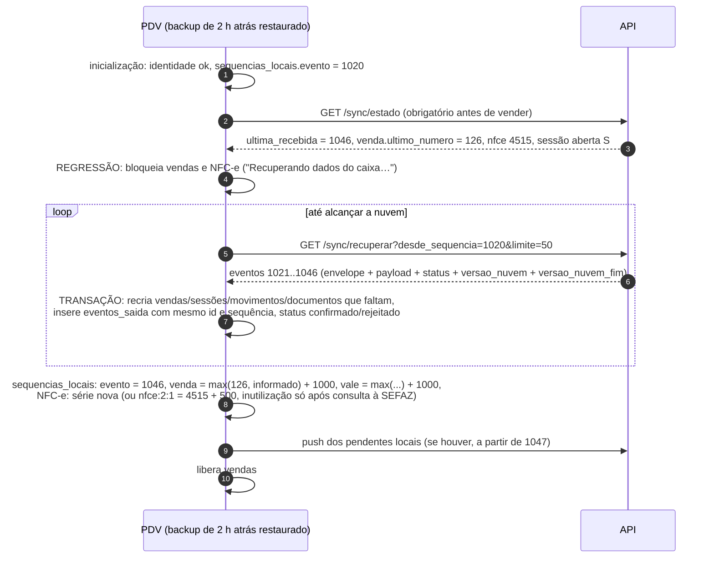

| Regra | Detalhe |
|---|---|
| Restauração é ação explícita | Restaurar backup só acontece pela ação do PDV (`Ctrl+Alt+C › Restaurar backup`, ou automática depois de `integrity_check` falho, PDV 32.2/32.5). A ação grava `identidade_terminal.restaurado_em = now()` e mantém o `ultimo_backup_em` do arquivo restaurado. Copiar um `pdv.db` antigo à mão não é suportado: só o handshake (regressão de sequência/numeração) pode detectá-lo |
| Por que comparar só com a nuvem não basta | Se o banco corrompeu depois de um período offline, as NFC-e em contingência já impressas e as vendas entre o backup e a perda **nunca subiram**: a nuvem não as recebeu, o handshake não veria regressão (`sequencias_locais.evento` ≥ `ultima_recebida`) e o PDV reusaria números de NFC-e já entregues ao consumidor. A idempotência do push não cobre essa reutilização fiscal |
| Regra padrão depois de **qualquer** restauração | Salto obrigatório, salvo a prova da linha seguinte: **NFC-e** — série nova para o caixa (13.2) **ou** salto de +500 na série atual, com os números pulados enviados à fila de inutilização e inutilizados **só depois** de consulta à SEFAZ (consulta por chave/número) confirmar que nenhum foi autorizado; **venda** e **vale** — salto de +1000 sobre `greatest(local, numeracoes, informado por heartbeat)` |
| Prova de que nada se perdeu (dispensa o salto) | Todas as condições, verificadas no handshake online (5): (a) `informado_pelo_terminal.ultimo_heartbeat_em` ≤ `ultimo_backup_em` do arquivo restaurado (nenhum heartbeat depois do backup); (b) os números locais do backup ≥ `numeracoes` e ≥ todos os valores informados por heartbeat (`ultima_sequencia_gerada`, venda, NFC-e por série, vale); (c) o backup é o **backup de saída** (feito ao encerrar o app normalmente) e o marcador de encerramento limpo gravado fora do banco (`%ProgramData%\GenesisPDV\dados\encerramento.json`, gravado depois do backup de saída, com o sha256 dele; apagado a cada inicialização logo depois do `integrity_check` bem-sucedido e antes de qualquer venda) ainda existe e confere — prova de que o app não rodou depois do backup. Falhou qualquer uma → salto obrigatório |
| Perda provável | Heartbeat mais novo que `ultimo_backup_em`, ou valores informados por heartbeat acima dos do backup → a nuvem abre o alerta `PERDA_PROVAVEL` e a aba "Perdas prováveis" (22.4) com as faixas (sequências, vendas, NFC-e, vales) entre o backup e o último heartbeat; o salto é obrigatório e o supervisor confirma a ciência na tela do PDV |
| Detecção | Sempre pelo handshake (5); por isso, **depois de restaurar um backup o PDV exige ficar online** antes de vender com a numeração normal. Sem internet, opera em "modo restaurado": aplica a regra padrão (salto de +1000 em venda e vale; NFC-e com salto de +500 autorizado por supervisor com `pdv.config.fiscal`, auditado) |
| Eventos do backup ainda pendentes | Reenviados normalmente; os que a nuvem já tem respondem `duplicado`. A idempotência evita duplicar **eventos**, não reutilização de **números**: essa é tratada pelas linhas acima |
| `REGRESSAO_DETECTADA` no push | Acontece se o handshake foi pulado: o push para e o PDV executa este fluxo |
| XML fiscal | Documentos recuperados não trazem XML; reimpressão de DANFE usa os dados das tabelas e, se precisar do XML, `GET /sync/arquivos/{xml_arquivo_id}` |

**Na Fase 1C (C17; README do PDV › decisão 61)**:

- **Quando reidrata**: no handshake, com a regressão (sequência local abaixo da `ultima_recebida`), com o `409
  REGRESSAO_DETECTADA` do push (o laço refaz o handshake na hora e reidrata desde a anterior à sequência recusada) ou
  com a restauração pendente (desde a sequência do arquivo restaurado, mesmo sem regressão aparente: o caixa pode ter
  gerado eventos offline que colidem com os que a nuvem tem). Com regressão, as vendas ficam bloqueadas ("Recuperando
  os dados do caixa…") até a reidratação terminar; interrompida (rede, 503), o bloqueio fica e a próxima tentativa
  repete sem duplicar. Restaurado sem regressão, a reidratação que falha não bloqueia: o caixa segue no modo restaurado.
- **A restauração pendente** fica em `configuracao_terminal['restauracao.pendente']` (MD 4.4.2): quando, o arquivo,
  a sequência dele, o `ultimo_backup_em` e se o `encerramento.json` conferia. O handshake aplica a regra desta seção e a
  apaga. **Modo restaurado offline** (T43): a primeira reserva de número de venda depois de restaurar, sem o handshake,
  salta +1000 em venda e vale sobre o local, uma vez; o handshake depois só salta de novo se a nuvem conhecer um número
  acima do local.
- **Salto** (`RegraRestauracao`): regressão, perda provável ou restauração sem a prova → venda e vale em
  `max(local, numeracoes) + 1000` (o `numeracoes` do `/sync/estado` já é o maior entre o recebido e o informado). Na
  perda provável de **eventos** (sequência local abaixo da `ultima_sequencia_gerada` informada), a sequência local vai
  até a informada: os eventos gerados e nunca enviados viram a lacuna que o supervisor declara (8.6), em vez de
  números reaproveitados. NFC-e (série nova ou +500) é da 1D. Tudo vai para o `log_local`.
- **Prova de que nada se perdeu**: as três condições da tabela, com o `encerramento.json` conferido **na hora da
  restauração** (pelo sha256 do arquivo escolhido); o marcador só existe nesse momento quando o app não rodou depois do
  backup de saída — na restauração automática depois de um `integrity_check` falho.
- **Token**: a restauração mantém o token do banco em uso (o do backup pode já ter sido rotacionado; usá-lo de novo
  seria o "token anterior reutilizado" da 3.7).
- **Fora da 1C**: `PERDA_PROVAVEL` e a aba "Perdas prováveis" (22.4), a NFC-e, a custódia da chave de backup e a
  importação de terminal antigo (22.3), o "modo restaurado" com supervisor para o +500 da NFC-e.

### 22.2 `GET /sync/recuperar`

`GET /sync/recuperar?desde_sequencia=1020&limite=50` → eventos do próprio terminal com `sequencia_terminal > 1020`, em
ordem, com o envelope original, `payload` (se ainda não anulado), `status`, `versao_nuvem`, `versao_nuvem_fim`, `resultado`. É a
"re-hidratação": a nuvem devolve ao PDV o que ele mesmo enviou. Também usada quando o PDV encontra uma lacuna (8.6)
antes de declará-la — na Fase 1C, não (T45, 8.6): a lacuna é justamente o que a nuvem não tem.

Contrato (Fase 1C, C17; `recuperarQuerySchema`/`respostaRecuperarSchema` do `@genesis/shared`, fixture
`recuperar.resposta.json`, record `RespostaRecuperar` do PDV):

| Campo | Regra |
|---|---|
| `desde_sequencia` | Obrigatório, inteiro ≥ 0 |
| `limite` | 1–200, padrão 50 (o PDV pede 50: uma página por transação do SQLite) |
| `ultima_recebida` | A maior sequência que a nuvem tem do terminal, placeholders incluídos |
| `tem_mais` | Há página seguinte; o PDV pede de novo com `desde_sequencia` = a última sequência recebida |
| `eventos[].envelope` | O envelope do push (7.3), remontado das colunas e do `envelope` gravado (T1): `usuario_id`, `contexto`, relógio, `dependencias` do envelope; as linhas anteriores à migração 0010 saem só das colunas (contexto do terminal, `usuario_id` nulo); `payload` nulo quando já anulado (13 meses, MD 3.15.2) |
| `eventos[].status` | `aplicado`, `descartado`, `erro` ou `retido`, no formato do `eventos-status` (7.2), pela mesma função da API (`situacaoNaNuvem`): marcadores de versão no aplicado, `{ descartado, justificativa }` no descartado (o placeholder leva também a faixa, `lacuna`; nunca o `resultado` do erro que o evento descartado guardava), `erro` com o código e a mensagem nos outros |
| `eventos[].lacuna` | `true` no placeholder de uma lacuna declarada (`terminal.lacuna`, 8.6; T7): a sequência foi perdida, o caixa não recria nada |

Só leitura, só os eventos do terminal do token. Estados como o `eventos-status` (3.8, T6), mais duas regras (T41):
exige o hardware registrado (409 `HARDWARE_ALTERADO`: os payloads têm dados de clientes — CPF na nota, quem retirou a
sangria — e a re-hidratação só serve ao push, que já exige o hardware) e responde com a empresa suspensa, como o push
(MD 2.3: os dados são do cliente, e é o que deixa o push de um banco restaurado não duplicar nem perder nada). Com o
`/sync/estado` recusado pelo 403 da suspensão, o PDV reidrata assim mesmo quando há o que recuperar — a regressão que o
push recebeu (`409 REGRESSAO_DETECTADA`) ou uma reidratação interrompida —, sem o estado: a `ultima_recebida` vem das
páginas, o push volta (aceito na suspensão) e a regra de numeração (salto, prova de que nada se perdeu) fica para o
handshake depois da reativação; até lá a regressão segura as vendas novas.

**No PDV (C17, `ReidratacaoLocal`)**, idempotente (o evento que o banco já tem não é gravado de novo):

1. Numa transação: a reidratação pendente (`configuracao_terminal['reidratacao.pendente']`: o `desde`, se houve
   regressão e quando começou) é gravada; os eventos ainda a enviar com sequência acima de `desde` — os do "modo
   restaurado" offline, que podem ter a mesma sequência de eventos que a nuvem já recebeu e o banco perdeu — vão para
   uma sequência negativa provisória (o push nunca manda sequência ≤ 0) (T42); e `sequencias_locais.evento` sobe até a
   `ultima_recebida` do estado. Enquanto a pendência existir (também com o app reaberto, e também se só houver evento
   com sequência ≤ 0), o push não manda nada — um evento novo subiria na frente dos deslocados e a nuvem veria uma
   lacuna falsa (8.6) — e o handshake, refeito com backoff, retoma desde o `desde` gravado, com a regressão dela
   valendo (a sequência local já subiu e não a mostra mais). O evento que o caixa grava no meio (a venda que termina,
   a sangria, o fechamento, a auditoria) cai acima de tudo o que a nuvem tem, e não numa sequência que uma página vai
   gravar.
2. Uma transação por página: o evento que o caixa tem fica com a sequência e a situação da nuvem (`aplicado` →
   `confirmado`; `erro`/`retido`/`descartado` → `rejeitado`, como no push); o que não tem é gravado em `eventos_saida`
   com o mesmo id, a mesma sequência e o payload, e os fatos são recriados nas tabelas de movimento (venda com itens,
   pagamentos, parcelas, PIX e liberações; sessão, movimentos e fechamento do caixa; devolução de cascos): a linha do
   payload completo é criada ou atualizada coluna a coluna (chave = coluna, 9.1), a parcial (fechamento da sessão,
   cancelamento do movimento ou da venda finalizada) só atualiza a que existe, e o documento de venda substitui as
   linhas filhas da venda em andamento do backup. O placeholder e o evento sem payload só ocupam a sequência. Ficam de
   fora a auditoria (já na nuvem), os cascos descontados na venda (tabela só local, sem payload próprio) e o snapshot
   dos produtos. A sequência local acompanha a `ultima_recebida` de cada página.
3. Numa transação: os provisórios e os gravados no meio voltam, na ordem em que foram gerados, para depois da última
   sequência da nuvem, `sequencias_locais.evento` fica no último deles e a pendência é apagada; o push os manda em
   seguida.

Na abertura do app, a reidratação interrompida (a nuvem caiu no meio) abre a tela "Recuperando os dados do caixa…" com
o ciclo online ligado: terminada no handshake seguinte, a tela vai sozinha para o login.

### 22.3 Máquina perdida, reinstalação sem o banco

1. **Custódia da chave de backup**: na ativação, a nuvem gera a chave AES-256 dos backups locais e a devolve cifrada
   para a chave pública efêmera do PDV (3.2); a nuvem guarda a chave cifrada com a chave mestra (coluna
   `terminais_pdv.chave_backup_cifrada`, modelo 2.4). Sem isso, um backup cifrado com chave protegida só na máquina (CNG/TPM) de uma máquina morta seria
   ilegível e as vendas não enviadas se perderiam.
2. No ERP, o gerente gera um **código de recuperação** para o terminal antigo (permissão `terminais.gerenciar`, uso
   único, 24 h, vinculado a `terminal_id` antigo; auditado).
3. No PDV novo (já ativado como substituto): `Ctrl+Alt+C › Recuperar dados de terminal antigo` → escolhe o arquivo de
   backup (pasta secundária/pendrive, PDV 32.5) → informa o código.
4. `POST /sync/recuperacao/chave {terminal_antigo_id, codigo_recuperacao}` → chave de backup → o PDV decifra o backup
   em memória/temporário, lê `eventos_saida` não confirmados, as NFC-e em contingência não transmitidas e as
   inutilizações pendentes do terminal antigo.
5. `POST /sync/recuperacao/importar {terminal_antigo_id, codigo_recuperacao, eventos[]}` → a nuvem aplica os eventos
   **com a identidade e a sequência do terminal antigo** (mesmas regras de 8), mesmo que ele esteja `revogado`.
   Eventos cuja sequência cai numa faixa já declarada como lacuna (`terminal.lacuna`) **substituem** os placeholders e
   são aplicados (8.6, alerta `LACUNA_RECUPERADA`); a importação vale como a autorização exigida. Gera `auditoria`
   `recuperacao_importada` com quantos eventos e faixa.
6. NFC-e em contingência do terminal antigo: o PDV novo transmite (mesmo certificado da loja) e envia os
   `nfce.autorizada` também pela importação.
7. Vendas e caixa do terminal antigo **não** passam para o banco local do novo; ficam só na nuvem.

### 22.4 Perda total (sem banco e sem backup)

O que se perdeu não volta, mas é **delimitado** e o ERP mostra a aba "Perdas prováveis" do terminal. A mesma aba é
aberta, com alerta `PERDA_PROVAVEL`, quando um backup restaurado é mais antigo que o último heartbeat do terminal
(22.1) — nesse caso a faixa perdida é a que vai do backup ao último heartbeat:

| Dado | Como a nuvem estima |
|---|---|
| Eventos | `ultima_sequencia_gerada` do último heartbeat − `max(sequencia_terminal)` recebida |
| Vendas | `venda_ultimo_numero` do último heartbeat − `numeracoes.ultimo_numero`; `eventos_pendentes` |
| NFC-e | `nfce_ultimo_numero` informado − maior número recebido na série; `nfce_contingencia_pendentes` |
| Caixa | Sessão aberta sem fechamento; `dinheiro_estimado_gaveta` do último heartbeat |

Procedimento recomendado (texto da tela): conferência física do caixa (conferência manual no ERP), acerto "Definir"
do estoque, série NFC-e nova para o caixa (13.2) e orientação do contador para os números NFC-e possivelmente emitidos
em contingência e não transmitidos (não se pode inutilizar número que pode ter sido entregue ao consumidor).

### 22.5 Banco da empresa restaurado na nuvem (recuperação de desastre)

Se o banco `genesis_emp_<codigo>` voltar de um backup, a nuvem "esquece" o que aconteceu depois do ponto do backup —
mas os PDVs têm os eventos (payload por 90 dias após confirmação) e os cursores à frente. Procedimento (comando de
plataforma `db:pos-restauracao --empresa <codigo>`):

1. `select setval('seq_versao', <maior cursor_pull conhecido de qualquer terminal (controle + logs)> + 1.000.000.000)`
   — impede que linhas novas ganhem `versao` menor que cursores já guardados nos PDVs.
2. Comando `ressincronizar` para todos os terminais (ressincronização em sombra, 6.11).
3. Os PDVs fazem push normalmente: a nuvem responde `fora_de_ordem` com `proxima_sequencia_esperada` menor; o PDV vê
   que tem esses eventos **confirmados com payload** e os reenvia (8.6). Os que não tiverem mais payload viram lacuna
   declarada pelo suporte.
4. `numeracoes` são recalculadas como `greatest(valor restaurado, maior número recebido, último heartbeat)`.
5. Proteção extra no PDV: resposta de pull com `cursor_teto < desde` (a nuvem "voltou no tempo") → o PDV marca o fluxo
   para ressincronizar e alerta o suporte.

---

## 23. Modos de falha

| # | Cenário | Comportamento esperado no PDV | Comportamento esperado na nuvem | Ref. |
|---|---|---|---|---|
| 1 | Internet cai no meio do push (lote enviado, resposta perdida) | Lote → `erro_temporario`; reenvia após backoff | Eventos já aplicados respondem `duplicado` com o mesmo `resultado`; os não aplicados são aplicados | 7.5, 8.4 |
| 2 | Internet cai no meio do pull | Página não aplicada; cursor intacto; repete a página | Nada | 6.6 |
| 3 | Internet cai durante a carga inicial | Retoma do cursor de cada fluxo; login liberado só ao concluir os 5 fluxos obrigatórios | Nada | 6.9 |
| 4 | Mesmo lote enviado duas vezes ao mesmo tempo (timeout + reenvio) | Trata a resposta que chegar; a outra é ignorada pelo `lote_envio_id` | Segundo push recebe `409 PUSH_EM_ANDAMENTO` (trava do terminal ocupada no 1º evento) ou se intercala evento a evento: cada transação confere `sequencia = esperado` sob a trava `push:` e responde `duplicado`/`fora_de_ordem` | 8.1 |
| 5 | API reinicia no meio da transação de um evento | Conexão cai → `erro_temporario` | `rollback` automático do PostgreSQL; travas de transação soltas junto; nada parcial; o reenvio aplica | 8.3 |
| 5a | Processo/VM da API morre sem fechar a conexão (sem FIN) | `erro_temporario`; reenvio | Keepalive TCP do servidor (~2 min) e `idle_in_transaction_session_timeout` encerram a sessão e soltam as travas; nenhuma trava de sessão fica presa | 8.1 |
| 5b | API cai entre o commit no `genesis_control` e o da empresa, na ativação | Repete a ativação com o mesmo `requisicao_ativacao_id` | Terminal fica `provisionando`; a repetição ou o reconciliador concluem a etapa da empresa (idempotente) ou compensam; token `provisionando` → 503 | 3.4 |
| 6 | API cai depois do commit e antes de responder | Igual ao 1 | `duplicado` no reenvio | 8.4 |
| 7 | Banco da empresa em migração | `503 MANUTENCAO` → transitório com `Retry-After` | API em manutenção só para essa empresa | 17.6 |
| 8 | Deadlock/serialização na aplicação | Pode receber `erro_temporario` | Repete 3× (`40P01`, `40001`); trava de ordenação pega primeiro evita a maioria | 8.3 |
| 9 | Queda de energia no meio de uma venda | Venda volta exatamente como estava (cada ação é um commit) | — | PDV 32.3 |
| 10 | Queda de energia entre o commit da venda e o push | Evento está no outbox (mesma transação); sobe ao religar | — | 7.1 |
| 11 | Queda de energia durante a aplicação de uma página do pull | Transação SQLite não confirmada é descartada (WAL); cursor coerente | — | 6.10 |
| 12 | App fechado/morto com lote "enviando" | Na inicialização `enviando` → `pendente`; reenvio seguro | `duplicado` para os já aplicados | 7.5 |
| 13 | Duas instâncias do app no mesmo PC | A segunda não abre (mutex nomeado do sistema + trava exclusiva do arquivo `pdv.db`) | — | 18.4 |
| 14 | PDV reinstalado mantendo `pdv.db` | Encontra `identidade_terminal` e o token (chave CNG da mesma máquina, preservada pela reinstalação); segue normal | — | PDV 5.4 |
| 15 | PDV reinstalado **sem** `pdv.db`, com eventos não enviados, backup local disponível | Restaura o backup (`restaurado_em`) → handshake → regressão → re-hidratação → reenvia pendentes do backup → **salto obrigatório** (série NFC-e nova ou +500 com inutilização só após consulta à SEFAZ; +1000 em venda e vale), salvo a prova de 22.1 | Re-hidratação devolve o que já tinha; pendentes aplicados normalmente; `numeracoes` e o informado por heartbeat entram no máximo do handshake; heartbeat mais novo que o backup → `PERDA_PROVAVEL` | 22.1 |
| 16 | Máquina perdida/queimada com eventos não enviados, backup em pendrive | PDV novo ativado como substituto + "Recuperar dados de terminal antigo" com código do ERP | Entrega a chave de backup em custódia; aplica os eventos com a identidade do terminal antigo | 22.3 |
| 17 | Máquina perdida sem nenhum backup | — | Aba "Perdas prováveis" com faixas de sequência, vendas e NFC-e; alertas críticos | 22.4 |
| 18 | Backup antigo restaurado por engano (inclusive depois de um período offline com NFC-e em contingência que nunca subiram) | Handshake detecta a regressão ou a perda provável (heartbeat mais novo que o backup); bloqueia a numeração normal até alcançar a nuvem e aplica o salto obrigatório; nunca reusa número de venda, NFC-e ou vale | `REGRESSAO_DETECTADA` se o PDV tentar push sem handshake; `PERDA_PROVAVEL` e aba "Perdas prováveis" | 22.1, 22.4, 13 |
| 19 | Relógio do PC 3 h adiantado | Desvio medido corrige `ocorrido_em` e `dhEmi`; alerta "Relógio do computador errado" | `terminais.desvio_relogio_ms` crítico no ERP | 12 |
| 20 | Relógio alterado no meio do turno | Salto detectado pelo relógio monotônico; desvio ajustado na hora; auditoria `relogio_alterado` | — | 12.2 |
| 21 | PC sem internet desde o boot e com relógio da BIOS zerado (ex.: 2001) | SO sem NTP sincronizado → usa o último desvio persistido com `relogio_confiavel = false`; como o último `ocorrido_em` está mais de 2 min à frente, **não** força a monotonicidade: marca `relogio_regrediu = true`; tenta amostra de SEFAZ/NTP; em loja NFC-e a emissão pede confirmação/correção da data pelo supervisor | `RELOGIO_SUSPEITO`; aplica na ordem de `sequencia_terminal` | 12.2, 12.3, 12.4 |
| 21a | Um evento gravado com a BIOS adiantada (2027) e o relógio corrigido depois | Eventos seguintes usam a hora corrigida com `relogio_regrediu = true` (não ficam congelados no futuro) | Aceita a não monotonicidade sinalizada | 12.3 |
| 21b | Windows Time corrige o relógio do SO no boot, sem amostra da API ainda | Boot id diferente da amostra + SO sincronizado por NTP → desvio 0 (a correção não é aplicada duas vezes) | — | 12.2 |
| 22 | Dois terminais com o mesmo número de caixa | Impossível: um terminal ativo por caixa (`uq_terminais_pdv_caixa_ativo`) e série NFC-e única por loja | Ativação recusa `CAIXA_OCUPADO` sem "Substituir" | 13 |
| 23 | Máquina virtual clonada (dois PDVs com o mesmo token) | Bloqueado com `TERMINAL_CLONADO` até o suporte decidir | Detecta sequência repetida/heartbeats conflitantes | 20.5 |
| 24 | Terminal substituído com pendências no antigo | O novo começa com salto de numeração de venda e vale e série NFC-e nova; o antigo, se voltar, envia pendências | Antigo em `desativando` aceita push por 7 dias | 13.1, 13.2 |
| 24a | "Revogar imediatamente" e depois código **novo comum** para o mesmo caixa | O novo começa com série NFC-e nova e salto de +1000 em venda e vale | Decisão contra `caixas.terminal_anterior_id`, sem confirmação de desativação do antigo | 13.3 |
| 24b | Antigo "em dia" no último heartbeat, mas fica offline e continua vendendo sem saber que foi substituído | — | Sem `desativando_confirmado`, o novo terminal recebe série nova e saltos; o antigo, ao voltar, envia suas vendas sem colidir | 13.3 |
| 25 | Terminal revogado "aceitando pendências" | Para de vender, fecha o caixa, envia tudo, transmite contingências | `revogado` quando o heartbeat informa 0 pendentes ou na carência | 3.8 |
| 26 | Terminal revogado imediatamente (roubo) | Bloqueia tudo, mantém o banco | 401 em tudo; "Terminal perdido/roubado" invalida PINs dos usuários da loja e as senhas de crediário que desceram (a senha do ERP nunca esteve no PDV); o próximo terminal do caixa recebe série nova e saltos | 3.8, 4.3, 13.3 |
| 27 | Token vazado | — | Revogar + reativar; uso do token anterior após rotação gera alerta; uso de outra máquina → `HARDWARE_ALTERADO`, sem segredos | 3.7, 20.5 |
| 27a | Resposta da renovação de token perdida (uma ou duas vezes seguidas) | Tenta `token.pendente` primeiro; `401` → volta ao atual e repete com o mesmo `requisicao_id` | Repetição sem efeito; nunca fica sem token válido | 3.7 |
| 27b | Token usado de outra máquina (ou placa-mãe trocada) | Bloqueia vendas; "Hardware alterado — aguardando aprovação"; outbox mantido | `409 HARDWARE_ALTERADO`; pull sem segredos; "Confirmar troca de hardware" no ERP | 20.5 |
| 28 | Produto excluído no ERP com venda aberta no PDV | Item já incluído permanece; nova inclusão recusada após o pull | Aplica a venda (exclusão lógica); alerta `PRODUTO_INATIVO_VENDIDO` | 16.2 |
| 29 | Preço alterado no ERP durante a venda | Itens incluídos mantêm preço; novos usam o novo; faixas usam o preço capturado na 1ª inclusão | Grava o preço praticado | 16.2 |
| 30 | Usuário desativado no ERP com terminal offline | Continua logando até o próximo pull (risco aceito, limitado por `pdv.dias_max_offline`) | Eventos posteriores ao pull → alerta `OPERADOR_INATIVO` | 4.3, 16.2 |
| 31 | Evento rejeitado (bug de payload) | Quarentena; caixa continua vendendo; eventos dependentes ficam retidos **na nuvem** | `erro` + fila de decisão; reprocessar após correção | 8.5, 11.4 |
| 32 | Evento venenoso (handler lança exceção) | `erro_temporario` 2×, depois `rejeitado` | `ERRO_INTERNO` na 3ª vez; alerta à plataforma | 11.3 |
| 33 | Lacuna de sequência | Procura os eventos; se não tem, bloqueia e o supervisor declara a lacuna | Placeholder `terminal.lacuna` + `LACUNA_DECLARADA` | 8.6 |
| 33a | Eventos de uma lacuna declarada achados depois (pendrive) | Reenvia pela recuperação assistida ou com `recuperar_lacuna` (supervisor) | Substitui os placeholders, aplica, `LACUNA_RECUPERADA`; reprocessa em ordem os eventos com erro causados pela lacuna | 8.6, 22.3 |
| 33b | Resposta do heartbeat com `eventos_resolvidos`/comandos perdida | Recebe os mesmos itens no próximo heartbeat; deduplica por id | Reenvia até o ack | 21.1 |
| 34 | App mais novo que a API (`versao_schema` desconhecida) | `erro_temporario` com backoff de 10 min | `SCHEMA_DESCONHECIDO` + alerta à plataforma | 17.5 |
| 35 | App antigo, abaixo da mínima | Aviso por 3 dias, depois atualização obrigatória no login; push continua | Aceita push por upcaster | 17.3 |
| 36 | SEFAZ fora do ar | Contingência `tpEmis = 9`; `nfce.contingencia` sobe; venda sobe independentemente | Alerta a 75 % do prazo | 9.11, PDV 18.4 |
| 37 | SEFAZ volta e rejeita uma nota de contingência | `nfce.rejeitada`; alerta no PDV e no ERP | Alerta crítico; regularização (correção e retransmissão ou contador) | 9.13 |
| 38 | Timeout na autorização (a nota pode ter sido autorizada) | Consulta pela chave; sem resposta → contingência com novo número; o antigo fica "a verificar" e é resolvido depois (cancelamento por substituição ou inutilização) | Acompanha o número pendente | 9.11 |
| 39 | Certificado A1 vencido | Não assina NFC-e (nem em contingência): a finalização de venda com NFC-e fica **bloqueada** até o certificado novo descer; não há alternativa "não fiscal" (loja NFC-e não emite venda não fiscal, modelo 3.6.3, PDV 17.2); alerta 30 dias antes | `CERTIFICADO_VENCENDO`; certificado novo desce pelo fluxo `configuracao` | PDV 6.7, 17.2 |
| 40 | Disco cheio | < 1 GB alerta; < 200 MB bloqueia novas vendas; erro `SQLITE_FULL` na finalização → a transação não é confirmada, a venda fica `em_pagamento` e nada é parcial | `disco_livre_mb` no heartbeat; alerta | PDV 32.2 |
| 41 | SQLite corrompido | `integrity_check` falha → bloqueia → restaurar backup íntegro mais recente (cenário 15/18) | — | PDV 32.2 |
| 42 | Mesmo vale usado em dois caixas offline | Ambos aceitam (saldo local) | Aplica os dois; saldo negativo; `VALE_SALDO_NEGATIVO` | 14.4 |
| 43 | Crediário acima do limite em dois caixas offline | Cada um vê o limite antigo | Aplica; `LIMITE_CREDITO_EXCEDIDO` | 14.3 |
| 44 | Mesmo orçamento convertido em dois caixas | — | Aplica; `ORCAMENTO_CONVERTIDO_DUAS_VEZES` | 9.19 |
| 45 | Mesmo número de comanda aberto em dois caixas offline | — | Funde as comandas; `COMANDA_CONFLITO` | 9.20 |
| 45a | Itens de comanda no outbox e a conexão volta antes de fechar | Não usa o caminho online para a comanda até o outbox dela esvaziar | Itens aplicados antes do fechamento | 9.20 |
| 45b | Timeout numa chamada online de comanda que foi aplicada | Repete com o mesmo `X-Requisicao-Id` e consulta `GET /comandas/{id}` antes de cair para o outbox | Mesma resposta para a mesma requisição; handler idempotente por `itens_comanda.id` | 9.20, 20.4 |
| 45c | Venda cancelada no ERP e, offline, também no PDV (dinheiro devolvido) | — | Aplica só os efeitos físicos do PDV (caixa, TEF, fiscal); `CANCELAMENTO_DUPLO` | 10.4 |
| 45d | Venda da troca imediata paga com vale de troca cujo `troca.registrada` falhou | — | `venda.finalizada` fica `retido` (dependência por entidade) e é reprocessado quando a troca for | 8.5 |
| 46 | Acerto "Definir" no ERP com PDV offline que vendeu antes da contagem | — | `ACERTO_COMPENSACAO` ao aplicar a venda tardia | 15.3 |
| 47 | Loja troca o estoque vinculado | `ressincronizar_fluxo {estoque}`; vendas antigas sobem com o estoque do contexto | Baixa no estoque do contexto | 10.2, 6.7 |
| 48 | Empresa suspensa | Termina a venda atual e bloqueia novas | Pull/heartbeat 403; push aceito | 20.6 |
| 49 | Cliente cadastrado no caixa já existe na nuvem (CPF) | Recebe `pessoa_id_final`; vendas locais mantêm o id local | Funde; `pessoas_aliases` resolve as vendas | 9.18 |
| 50 | TEF aprovado e PDV cai antes de finalizar | Na inicialização desfaz a transação; a venda volta em andamento; nada sobe | — | PDV 16.6 |
| 51 | PIX dinâmico pago depois que a conexão caiu | Confirmação manual liberada (com permissão) | Concilia pelo `txid`; pago sem venda → "PIX recebido sem venda" | PDV 16.7 |
| 52 | Catálogo enorme e snapshot indisponível | Pull paginado de 2000 linhas | Gera snapshot sob demanda para a próxima ativação | 6.9 |
| 53 | Banco da nuvem restaurado de backup | Reenvia eventos confirmados ainda com payload; ressincroniza em sombra | `setval` de `seq_versao`, `ressincronizar` geral, recálculo de `numeracoes` | 22.5 |
| 54 | SSE caído | Polling de 30 s assume | — | 18.1 |
| 55 | `429` | Respeita `Retry-After` | Limites por terminal/empresa | 20.3 |
| 56 | Proxy/antivírus interceptando TLS | Offline com "Conexão não confiável (certificado)" | — | 20.1 |
| 57 | Página do pull com tabela desconhecida (API mais nova) | Ignora a tabela e registra aviso | — | 6.10 |
| 58 | Linha do espelho com evento local pendente (ex.: vale usado) chega no pull | Guarda em `alteracoes_adiadas` e aplica após o evento ser confirmado/descartado | — | 6.10 |

---

## 24. Ajustes necessários nos outros documentos

Registro dos itens que este protocolo exigiu dos outros documentos. A coluna **Situação** indica o estado de cada um:
**Aplicado** = o documento de destino já traz o ajuste (vale o texto de lá, que prevalece pela ordem de precedência);
**Pendente**/**Parcial**/**Em aberto** = ainda precisa ser alinhado antes do código (ADR: "Mudou uma decisão? Atualize
este arquivo primeiro"). Itens aplicados ficam na tabela só para rastreabilidade.

### 24.1 `docs/arquitetura/modelo-de-dados.md`

| # | Onde | Ajuste | Situação |
|---|---|---|---|
| M1 | 2.4 `terminais_pdv` | Colunas novas `token_hash_anterior varchar(64)`, `token_anterior_valido_ate timestamptz`, `token_atual_usado_em timestamptz`, `token_renovacao_requisicao_id uuid` (rotação idempotente, 3.7), `chave_backup_cifrada bytea` (custódia, 22.3), `chave_publica_terminal bytea` + `chave_publica_algoritmo varchar(10)` (`x25519`/`p256`, segredos cifrados para o terminal, 3.2/20.2) e `id_hardware_pendente varchar(128)` com `hardware_pendente_desde timestamptz`, `hardware_pendente_ip inet` e `hardware_pendente_so varchar(60)` (20.5); valor `provisionando` em `ck_terminais_pdv_status` (3.4); `uq_terminais_pdv_caixa_ativo` passa a `where status in ('provisionando','ativo')`; a regra "chamada com token" ganha `provisionando` → 503 `MANUTENCAO` e `id_hardware` divergente → 409 `HARDWARE_ALTERADO` (não atualiza `id_hardware`) | Aplicado |
| M2 | 3.15.2 `eventos_recebidos` | Colunas novas `agregado_tipo varchar(30)`, `dependencias jsonb`, `lote_id uuid`, `ocorrido_em_local timestamptz`, `versao_nuvem_fim bigint` (marcador de fim, 8.3) com `ix_eventos_recebidos_versao_nuvem_fim`, `resolucao_entregue_em timestamptz` (ack do heartbeat, 21.1); valor `retido` em `ck_eventos_recebidos_status`; a regra "payload anulado após 13 meses" vale só para `aplicado`/`descartado`; o fluxo do push passa a pegar `pg_advisory_xact_lock('push:'…)` no início de cada transação de evento e a ler `max(sequencia_terminal)` dentro dela (8.1, 8.3); placeholder `terminal.lacuna` pode ser substituído pelo evento real (8.6) | Aplicado |
| M3 | 3.15.1 `terminais` | Telemetria nova do heartbeat (21.1): `ultima_sequencia_gerada`, `venda_ultimo_numero`, `vale_ultimo_numero`, `eventos_rejeitados`, `inutilizacoes_pendentes`, `disco_livre_mb`, `tamanho_banco_mb`, `fila_impressao_pendentes`, `sse_conectado`, `versao_schema_local`, `dinheiro_estimado_gaveta`, `relogio_confiavel`, `configuracao_local jsonb` (ou uma coluna `telemetria jsonb`); `estado_local varchar(25)`, `desativacao_confirmada_em timestamptz` + números finais confirmados (13.3); `vendas_cancelamento_pendente uuid[]` (10.4) | Aplicado |
| M4 | 3.12.2 `movimentos_caixa` | Valor `estorno_venda` em `ck_movimentos_caixa_tipo` (usado pelo PDV 13.3 e 20.4); coluna opcional `contagem jsonb` (contagem de cédulas, PDV 8.2); abertura com fundo 0,00 não pode gerar movimento (`ck_movimentos_caixa_valor`) — o PDV 8.1 diz que grava "normalmente" | Aplicado (modelo 3.12.2); a contagem de cédulas ficou em `auditoria.depois` (PDV 8.2), sem coluna `contagem` |
| M5 | 3.1.4 `numeracoes` | Tipo `vale` (por caixa, dono `terminal`) em `ck_numeracoes_tipo`/`ck_numeracoes_escopo`, já que `sequencias_locais` tem a chave `vale` e a ativação precisa devolver o último número | Aplicado |
| M6 | 6.2 `usuarios` | Trocar o filtro por "todas as linhas, `senha_pdv_hash` nulo sem acesso à loja" (saída de filtro de ex-master sem tombstone, 4.1) e **retirar `senha_hash` da projeção** (a senha do ERP não desce para nenhum usuário; login com ela no PDV só online, `POST /operadores/autenticar`, 4.1/4.3) | Aplicado |
| M7 | 6.4 regra 2 | Lista de colunas de filtro imutáveis incompleta: acrescentar `configuracoes.escopo/loja_id`, `templates_documentos.loja_id`, `impressoras_destino.loja_id`, `atalhos_pdv.loja_id`, `lojas_banners.loja_id`, `taxas_entrega.loja_id`, `caixas.loja_id`, `certificados_digitais.loja_id`, `numeracoes_faixas.terminal_id`, `cobrancas_pix.terminal_id`; regra 3 — acrescentar `tipos_estoque.vendavel`, `lojas_banners.exibir_em` e saída de `lojas.tipo_emissao = 'nfce'` como gatilhos de `ressincronizar_fluxo` | Aplicado |
| M8 | 6.3 eventos | Acrescentar `tef.resolvida` (9.8) e `pedido.atualizado` (9.21); deixar explícito que `vale.emitido`/`vale.utilizado` **não** são emitidos para vale de troca nem para pagamento em venda (o `troca.registrada` e o `venda.finalizada` já aplicam — senão o saldo seria baixado duas vezes); `venda.finalizada` não traz documento fiscal (vem em `nfce.*`); `terminal.lacuna` é gerado só pela nuvem | Aplicado |
| M9 | 4.4 (local) | Tabela local `alteracoes_adiadas` (6.10); `inutilizacoes_fiscais` local com `status = 'pendente'` como fila de números a inutilizar (o PDV 18.6 chama de `numeros_a_inutilizar`) | Aplicado |
| M10 | 2.3 `empresas` | "`status <> 'ativa'` → `EMPRESA_SUSPENSA` (ERP e sync do PDV)": restringir a pull/heartbeat; push aceito em `suspensa` (20.6) | Aplicado |
| M11 | 3.11.3 `itens_venda` | A ficha técnica vendida precisa de snapshot para a baixa: hoje só no payload (`componentes_estoque`); avaliar coluna `componentes_estoque jsonb` para auditoria. O combo (kit) não precisa: desde 30/10/2026 os componentes escolhidos são linhas de `itens_venda` (`kit_componente_id`, `kit_alternativa_id`) | Em aberto: avaliação (hoje o snapshot fica só no payload `componentes_estoque`) |
| M12 | 3.9.4 `contas_financeiras` | Decidido: **não** há pessoa "CONSUMIDOR FINAL" no seed (7.12); venda `por_venda` sem cliente gera `contas_financeiras` com `pessoa_id` nulo, exibida como "Consumidor final" (10.2) | Aplicado |
| M13 | 3.11.9 `vendas_status_pdv` | Projeção de status das vendas do terminal alteradas fora dele (16.3) no fluxo `operacao`; no PDV é espelho lido com `left join`, sem regravar `vendas` | Aplicado |
| M14 | 3.14.1 `documentos_fiscais` | Valor `a_verificar` em `ck_documentos_fiscais_status` e coluna `chave_substituta varchar(44)` (tpEmis=1 sem resposta substituída em contingência, PDV 18.4, 9.11); `pagamentos_venda.transferido_de_id uuid` (3.11.4, reemissão como nova venda, 9.9) | Aplicado |
| M15 | 1.5 | Recomendar que serviços do ERP que gravam tabelas sincronizáveis peguem a trava de ordenação no início da transação (`fn_trava_versao()`), para evitar deadlock com a aplicação de eventos (8.3) | Aplicado |
| M16 | 3.1.2 catálogo | Chave nova `pdv.permite_pin_curto` (4.3); permissão nova `pdv.vale.emitir` (9.17) | Aplicado (chave no modelo 3.1.2; permissão no catálogo de permissões do PDV) |
| M17 | 3.13.2 `vales.codigo` | Documentar a composição `VC` + loja + caixa + sequencial + DV (13.4) e o salto de +1000 sem confirmação de desativação do terminal anterior ou depois de restauração | Aplicado |
| M18 | `caixas` | Coluna nova `terminal_anterior_id uuid` (→ `terminais`): último terminal que ocupou o caixa, gravado na ativação; base da decisão de série/numeração (13.3) | Aplicado |
| M19 | Banco da empresa (nova) | Tabela `entidades_evento` (`id`, `criado_em`, `entidade_tipo varchar(30)`, `entidade_id uuid`, `evento_id uuid`, `terminal_id uuid`; `uq_entidades_evento (entidade_tipo, entidade_id, evento_id)`, `ix_entidades_evento_evento_id`), alimentada com as linhas criadas pelo payload de todo evento, inclusive `erro`/`retido` (8.5) | Aplicado |
| M20 | 3.1.6 `arquivos` | Coluna nova `loja_id uuid` (anulável; preenchida para logotipo/banner de loja e XML fiscal) usada no escopo de `GET /sync/arquivos` (6.12); XML fiscal com `chave_armazenamento` endereçada por conteúdo `emp/<codigo>/xml/<sha256>.xml` (exceção ao formato com data, 9.10) | Aplicado |
| M21 | 1.5 | Regra geral: **nenhuma E/S externa** (rede, armazenamento de objetos, PSP, SEFAZ, e-mail) dentro de transação que segure a trava 7300001; o que precisar de E/S vai para `tarefas` depois do commit ou é feito antes da transação (8.3) | Aplicado |
| M22 | 1.10 | Segredos não descem "em claro dentro do TLS": descem cifrados para `terminais_pdv.chave_publica_terminal` (ECIES, 20.2), no máximo uma vez por versão do segredo, com `auditoria` `segredo_entregue`; nada desce com `HARDWARE_ALTERADO` pendente. No PDV, a proteção local passa a ser chave CNG não exportável (TPM quando houver) em vez de DPAPI LocalMachine (3.6), inclusive para a chave do SQLCipher (seção 4) | Aplicado |
| M23 | 3.15.3 `comandos_terminal` | Registrar que `renovar_token` é **flag da resposta do heartbeat**, não comando (fica fora de `ck_comandos_terminal_tipo`); entrega ao menos uma vez: comandos `pendente`/`entregue` reenviados em todo heartbeat até o ack em `comandos_resultado` (status `recebido` → `entregue`; `executado`/`falhou` encerram) (21.1) | Aplicado |
| M24 | 4.5 | Regra de refletido: confirmado ∧ (`linha.versao > versao_nuvem` ∨ `estado_sincronizacao.cursor` do fluxo da linha ≥ `versao_nuvem_fim`) (15.2) | Aplicado |
| M25 | 6.1 | `novo_cursor` = versão da última linha devolvida **só quando a página é cortada**; página não cortada → `novo_cursor = cursor_teto`, calculado dentro do snapshot `repeatable read` como `greatest(max(versao) das tabelas do fluxo, max(eventos_recebidos.versao_nuvem_fim))` (6.3–6.4) | Aplicado |
| M26 | 6.2 `pessoas` | `senha_hash` é **coluna condicional**: desce só com `pdv.crediario_exige_senha_cliente = true` e crediário habilitado (`limite > 0`, não `bloqueada_credito`); senão `null`. Senha de cliente com mínimo de 6 dígitos (4.1, 4.3) | Aplicado |
| M27 | 4.4 (local) | `identidade_terminal.restaurado_em` (22.1); `eventos_saida.versao_nuvem_fim` (15.2); `estado_conexao.desvio_amostra_utc_local`/`desvio_amostra_boot_id` (12.2); tabela local `comandos_recebidos` (21.1); chave `token.pendente` em `configuracao_terminal` (3.7) | Aplicado |
| M28 | 3.1.2 catálogo | Chave nova `pdv.login_aceita_senha_erp` (boolean, padrão `false`, 4.1) | Aplicado |
| M30 | 6.3 eventos / 4.4.5 `eventos_saida` | Eventos novos `crediario.recebido`, `crediario.recebimento_cancelado` (9.25) e `vasilhame.movimentado` (9.26); valores `recebimento_crediario` e `movimento_vasilhame` em `eventos_saida.agregado_tipo`; bloco `vasilhames` e flag `nfe_solicitada` no `venda.finalizada` (9.7); valor `transferido` na lista de `estorno` do `venda.cancelada` (9.9) | Aplicado |
| M31 | Crédito e vasilhames (novas) | Tabelas `recebimentos_crediario` (D, ↑) e seus pagamentos (`pagamentos_recebimento_crediario`, estrutura de `pagamentos_venda` com `recebimento_crediario_id`), projeções `parcelas_credito_pessoas` e `saldos_vasilhame_pessoas` (P, ↓), colunas `itens_venda.vasilhame_item_origem_id`, tipos de movimento `VASILHAME_DEVOLVIDO`/`VASILHAME_VENDIDO`/`VASILHAME_EMPRESTADO`, tipo de estoque `vasilhame_vazio`, valor `nfe_solicitada` em `vendas.status_fiscal` (PDV 10.12, 14.4, 16.13) | Aplicado |
| M29 | 3.9 crédito (nova) | Tabela `reservas_credito` (C, —), mesmo desenho de `reservas_vale` (3.13.2): CP, `pessoa_id uuid not null`, `terminal_id uuid not null`, `venda_id uuid not null`, `pagamento_venda_id uuid not null`, `valor numeric(15,2) not null` (> 0), `status varchar(10) not null default 'ativa'` (`ativa`, `consumida`, `liberada`, `expirada`), `expira_em timestamptz not null` (`now() + pdv.dias_max_offline dias`), `consumida_em`, `liberada_em`; `uq_reservas_credito_pagamento (pagamento_venda_id)`, `ix_reservas_credito_pessoa_id_status (pessoa_id, status)`. Endpoints `POST /pessoas/{id}/credito/reservar` e `DELETE /pessoas/{id}/credito/reservas/{pagamento_venda_id}` (14.1); `GET /pessoas/{id}/credito` desconta as reservas ativas de outros pagamentos. Campo `reservas_vale_em_uso` do heartbeat (21.1) como canal do "informa no push/heartbeat" de 3.13.2 | Aplicado (modelo 3.9.9) |

### 24.2 `docs/pdv/especificacao-pdv.md`

| # | Seção | Ajuste | Situação |
|---|---|---|---|
| P1 | 5.3 | `terminais_pdv.hash_token` → `token_hash`; "grava `configuracao_terminal`" → `identidade_terminal`; `POST /terminais/ativar` → `POST /sync/ativar` (como no ERP 12.3); `GET /sync/pull?desde=0` → com `fluxo` | Aplicado |
| P2 | 5.3 | "push com token revogado aceito para eventos com `ocorrido_em` anterior à revogação" → substituir pelo estado `desativando` (3.8) | Aplicado |
| P3 | 5.2 | 5 tentativas/15 min/bloqueio 15 min diverge do modelo 2.6 e ERP 12.3 (10 min/30 min); `empresas.limites` → `limite_terminais`; validade fixa de 24 h → 1/24/72 h; alfabeto "sem 0/O/1/I/L" × ERP "sem 0/O/1/I" (adotado: sem `0 O 1 I L`) | Aplicado |
| P4 | 4.2 | Tabela de tabelas locais ainda usa `configuracao_terminal` para a identidade e põe o desvio de relógio em `estado_sincronizacao` (no modelo: `identidade_terminal` e `estado_conexao`) | Aplicado |
| P5 | 30.4 | `terminal.heartbeat` listado como evento do outbox a cada 5 min → é `POST /sync/heartbeat`, **30 s sem SSE e 60 s com SSE** (18.2, contrato 21.1); quarentena "retém no PDV os eventos seguintes do mesmo agregado" → retenção na nuvem (`retido`, 8.5); lista sem `comanda.itens_cancelados`, `comanda.transferida`, `vale.cancelado`, `tef.resolvida`, `pedido.atualizado` | Aplicado |
| P6 | 34.5 | Transição `rejeitado → pendente` (reprocessar) → `rejeitado → confirmado` por `eventos_resolvidos` (7.2) | Aplicado |
| P7 | 17.1 | "movimentos de caixa (dinheiro/troco)" na transação de finalização: o modelo não tem movimento de caixa por venda (o dinheiro da gaveta é calculado dos pagamentos, PDV 20.4) | Aplicado |
| P8 | 17.1 | "Desfazer transação TEF (a venda então volta para pagamento)" depois do commit contraria a imutabilidade e o outbox já gravado: ou confirmar o TEF antes do commit, ou cancelar a venda finalizada e refazer (9.8) | Aplicado |
| P9 | 13.3 | Movimento `estorno_venda` não existe no modelo (M4); `estorno_pendente` não é status de `pagamentos_venda` (este protocolo usa `estorno` no payload); falta dizer o que acontece com o dinheiro devolvido enquanto o cancelamento fiscal está `cancelamento_pendente` e o prazo expira | Aplicado |
| P10 | 14.3 | `pessoas_equivalencias` → `pessoas_aliases`; `limite_padrao_cliente_pdv` não existe no catálogo de configurações | Aplicado |
| P11 | 23.2 | Código do vale "UUID v7 encurtado + DV" → composição determinística por caixa (13.4) | Aplicado |
| P12 | 18.6 / 18.4 | `numeros_a_inutilizar` e estado "verificar" sem tabela/valor no modelo (M9, M14) | Aplicado |
| P13 | 29.1 | "refletido quando `versao` ≥ a devolvida" → nova regra: confirmado ∧ (`linha.versao > versao_nuvem` ∨ cursor do fluxo ≥ `versao_nuvem_fim`) (15.2) | Aplicado |
| P14 | 30.5 | Alerta só acima de 5 min × ERP 12.4 (aviso > 2 min, crítico > 5 min) — adotado o do ERP | Aplicado |
| P15 | 6.7 | `fiscal.serie_nfce`/`fiscal.proximo_numero_nfce` "locais" × `caixas.nfce_serie` + `numeracoes` + `sequencias_locais` do modelo; edição manual do número precisa subir (auditoria) e respeitar 13.2 | Aplicado |
| P16 | 8.1 | `horas_alerta_sessao` local padrão 16 h × `pdv.horas_alerta_sessao` (nuvem) padrão 24; `bloqueia_sessao_dia_anterior` não está no catálogo | Aplicado |
| P17 | 10.6 | `produtos.codigo_balanca` × `produtos.balanca_plu` do modelo; `balanca_tamanho_valor` não está no catálogo | Aplicado |
| P18 | 11.3 | Recalcular faixa depois de um pull de preço: definir que usa o preço capturado na primeira inclusão (16.2) | Aplicado |
| P19 | 32.5 | Backup cifrado com chave protegida localmente fica ilegível noutra máquina: precisa da custódia da chave (22.3). "Reenvia o outbox (idempotência garante que nada duplica)" não cobre reutilização de número fiscal: restaurar é ação explícita (`restaurado_em`) e exige o salto obrigatório de 22.1 (série NFC-e nova ou +500 com inutilização só após consulta à SEFAZ; +1000 em venda e vale), salvo a prova de que nada se perdeu; backup de saída + marcador `encerramento.json` | Aplicado |
| P20 | 26.1 | Venda `pedido_pendente` precisa subir com o pedido (`pedido.criado` com o documento da venda), porque `pedidos.venda_id` é obrigatório | Aplicado |
| P21 | 5.4 | "Máquina nova para o mesmo caixa: numeração continua a partir do maior número conhecido + 1" → salto de segurança / série nova sem confirmação de desativação do último terminal do caixa (13.3) | Aplicado |
| P22 | 5.3 / 32.10 | Ativação envia `chave_publica_terminal`; token e segredos protegidos por chave CNG não exportável (TPM quando houver), não por DPAPI LocalMachine (3.6); `409 HARDWARE_ALTERADO` bloqueia vendas até "Confirmar troca de hardware" no ERP (20.5); segredos chegam cifrados para a chave do terminal (20.2) | Aplicado |
| P23 | 7.1 / 7.2 | Login e liberação offline só por PIN (`senha_pdv_hash`); a senha do ERP não desce e só é aceita online (`POST /operadores/autenticar`, com `pdv.login_aceita_senha_erp`) (4.1) | Aplicado |
| P24 | 25.4 | Comandas: canal único por comanda (nada online enquanto houver evento dela no outbox); `X-Requisicao-Id` e consulta `GET /comandas/{id}` depois de timeout antes de cair para o outbox; o mesmo para `POST /orcamentos/{id}/reservar` (9.20) | Aplicado |
| P25 | 30.5 | Monotonicidade com limite de 2 min e `relogio_regrediu`; desvio persistido com o par da amostra e desvio 0 depois de reboot com SO sincronizado por NTP; amostras de SEFAZ e NTP (12.2, 12.3) | Aplicado |
| P26 | 5.3 | Rotação de token: o PDV gera o segredo novo, grava `token.pendente` antes de `POST /sync/token/renovar {novo_token_hash, requisicao_id}` e só o promove no primeiro `200` obtido com ele (3.7) | Aplicado |
| P27 | 14.x / 16.8 | Senha de cliente para crediário com mínimo de 6 dígitos; hash local só de clientes com crediário (4.1) | Aplicado |

### 24.3 `docs/erp/especificacao-erp.md`

| # | Seção | Ajuste | Situação |
|---|---|---|---|
| E1 | 12.4 | "Substituir terminal: novo terminal recebe `max(último conhecido) + 1`" → decisão contra o **último terminal que ocupou o caixa** (`caixas.terminal_anterior_id`, qualquer status, com ou sem substituição): mesma série só com `estado_local = 'desativando_confirmado'` informado pelo antigo depois de parar de vender; sem isso, série NFC-e nova e salto de +1000 em venda e vale (13.3, 13.4). Vale também para "Revogar imediatamente" seguido de código novo comum | Aplicado |
| E2 | 12.6 | Citar o contrato de referência do sync (21.1) e o intervalo **30 s sem SSE / 60 s com SSE** (18.2); comandos: `revogar`, `ressincronizar`, `ressincronizar_fluxo`, `enviar_logs`, `atualizar_app`, `mensagem`, `reservar_faixa`; resposta traz `eventos_resolvidos`, `renovar_token` (flag, não comando), `app`, `intervalos`; requisição traz `estado_local`, `eventos_resolvidos_ack`, `comandos_resultado` (ack, inclusive `recebido`), `vendas_cancelamento_pendente`; entrega ao menos uma vez | Aplicado |
| E3 | 12.4 / 12.5 | Ações novas: "Terminal perdido/roubado" (4.3), "Gerar código de recuperação" (22.3), "Aplicar com novo número" (11.4), aba "Perdas prováveis" (22.4), "Renovar token" (3.7), "Confirmar troca de hardware" / "Não reconheço" (20.5), "Liberar ativações" (3.1) | Aplicado |
| E5 | Cancelamento de venda | Antes de cancelar venda de PDV: bloquear se o terminal informou a venda em `vendas_cancelamento_pendente`; avisar e pedir confirmação se o terminal está offline ou com eventos pendentes (10.4) | Aplicado |
| E6 | 4.2 / 12.x | Senha do ERP não desce ao PDV (4.1): a política mínima de senha do ERP deixa de ser pré-requisito de segurança do PDV (continua recomendada); configuração `pdv.login_aceita_senha_erp` para aceitar a senha do ERP no caixa só online | Aplicado |
| E4 | 12.2 / PDV 5.2 | Permissões `terminais.ver/ativar/revogar/gerenciar` (ERP) × `erp.terminais.gerenciar` (PDV 5.2) | Aplicado |

### 24.4 `docs/arquitetura/decisoes.md` (ADR-08)

| # | Ajuste | Situação |
|---|---|---|
| D1 | Contrato do pull: `GET /sync/pull?fluxo=&desde=&limite=` (um cursor por fluxo, modelo 6.1). Corrigir "`novo_cursor` = `versao` da última alteração devolvida": isso só vale para página cortada; página não cortada devolve `novo_cursor = cursor_teto`, o teto calculado dentro do mesmo snapshot `repeatable read` (6.3–6.4) | Aplicado |
| D2 | Registrar: SSE como canal de aviso (18.1), envelope com `sequencia` e dependências, retenção de dependentes na nuvem, custódia da chave de backup, marcador `versao_nuvem_fim` (8.3) | Aplicado |

### 24.5 `docs/arquitetura/visao-geral.md`

| # | Onde | Ajuste | Situação |
|---|---|---|---|
| V1 | 8.4, linha "Conexões" ("PgBouncer na frente quando crescer"), e 10.2, opção D | Registrar que o sync é compatível com PgBouncer em **modo transação**: o push não usa trava de sessão (só `pg_advisory_xact_lock`, 8.1) e nenhuma rotina do sync depende de estado de sessão; servidor com `tcp_keepalives_idle/interval/count` e `idle_in_transaction_session_timeout` configurados | Aplicado (visao-geral.md 8.4 e 10.2) |

### 24.6 `docs/roadmap.md`

| # | Onde | Ajuste | Situação |
|---|---|---|---|
| R1 | Fase 0, item "Intervalo do heartbeat" | Decidido: **30 s sem SSE, 60 s com SSE** (18.2); sem intervalo "ocioso" de 5 min | Aplicado |
| R2 | Fase 0, definição de pronto (teste do pull por `versao`) | Acrescentar teste de integração com **2 lojas**: a carga inicial de `estoque`/`catalogo`/`operacao` de um terminal da Loja 1 termina mesmo com as últimas versões sendo da Loja 2/CD, e o cursor avança quando só a outra loja muda (6.3–6.4) | Aplicado |
