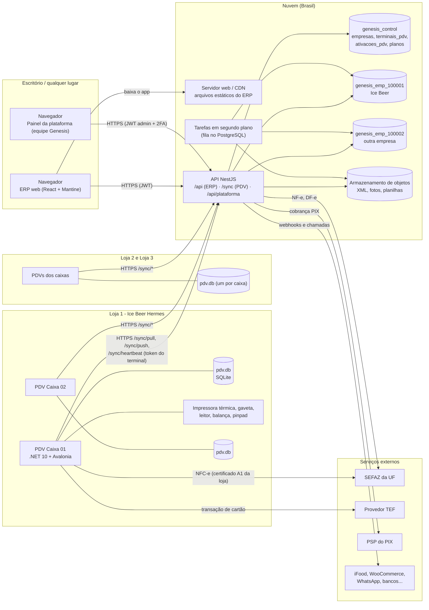
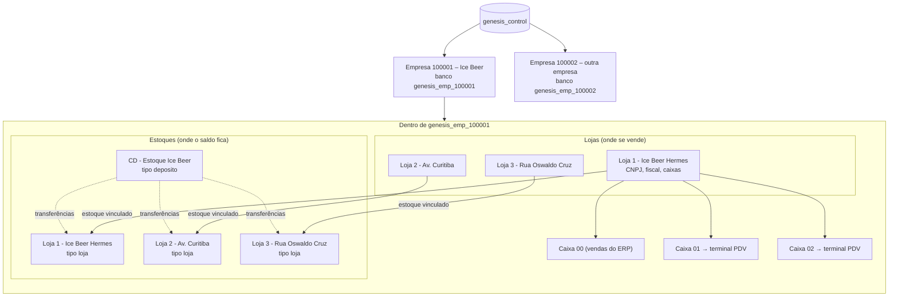
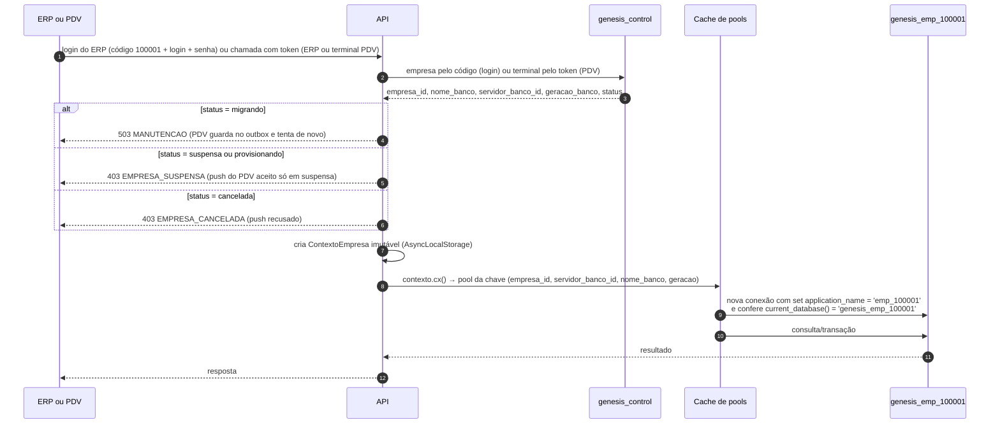
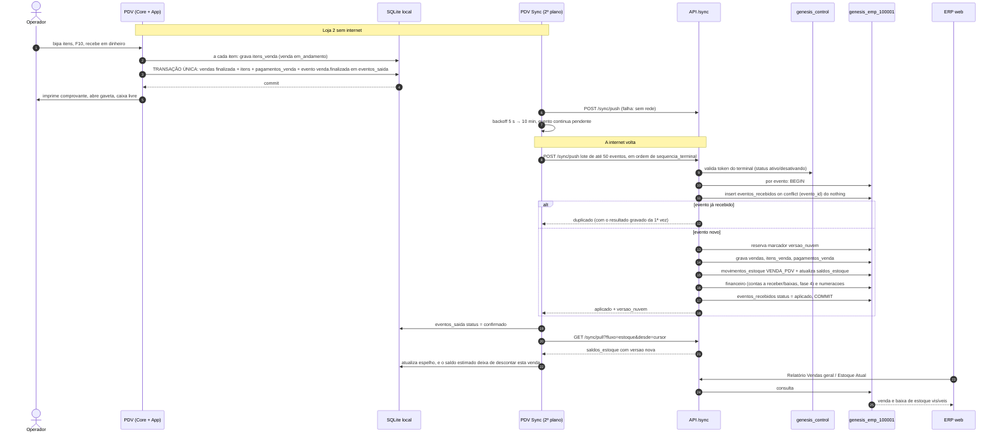
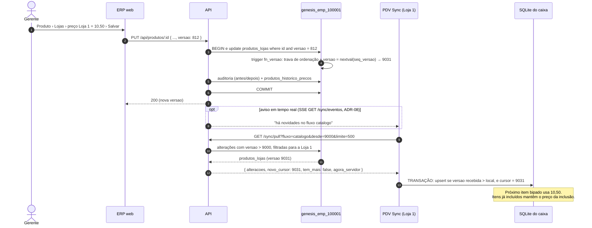
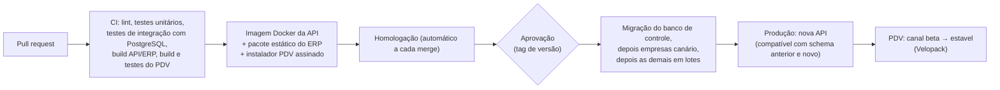

# Visão Geral da Arquitetura – GenesisPDV & ERP

> Documento de entrada do projeto. Serve a dois leitores:
>
> - **Dono do produto (Khauan / Ice Beer)**: cada seção começa com um bloco **"Em poucas palavras"**, sem jargão.
> - **Desenvolvedores**: o restante de cada seção traz o detalhe técnico e aponta para os documentos de implementação.
>
> Este documento **não cria decisões novas**: explica e justifica as de `docs/arquitetura/decisoes.md` (ADRs). Se algo
> aqui divergir dos ADRs, o ADR vence. Nomes de tabelas e colunas seguem `docs/arquitetura/modelo-de-dados.md`.
>
> Documentos relacionados: `docs/pdv/especificacao-pdv.md` (frente de caixa), `docs/erp/especificacao-erp.md`
> (retaguarda web), `docs/roadmap.md` (fases). O levantamento do Nuvem3 (sistema de referência) fica com o dono, fora
> do repositório; as especificações descrevem o que ele trouxe.

## Sumário

1. [O sistema em uma página](#1-o-sistema-em-uma-página)
2. [As partes do sistema](#2-as-partes-do-sistema)
3. [Diagrama de componentes](#3-diagrama-de-componentes)
4. [Multiempresa e multiloja (exemplo Ice Beer)](#4-multiempresa-e-multiloja-exemplo-ice-beer)
5. [Como uma venda percorre o sistema (ponta a ponta)](#5-como-uma-venda-percorre-o-sistema-ponta-a-ponta)
6. [Como uma mudança de preço chega ao caixa (ERP → PDV)](#6-como-uma-mudança-de-preço-chega-ao-caixa-erp--pdv)
7. [Sincronização em resumo](#7-sincronização-em-resumo)
8. [Escolhas de tecnologia e justificativas](#8-escolhas-de-tecnologia-e-justificativas)
9. [Segurança e LGPD](#9-segurança-e-lgpd)
10. [Hospedagem e implantação no Brasil](#10-hospedagem-e-implantação-no-brasil)
11. [Backups](#11-backups)
12. [Ambientes (desenvolvimento, homologação, produção) e homologação na SEFAZ](#12-ambientes-desenvolvimento-homologação-produção-e-homologação-na-sefaz)
13. [Observabilidade e operação](#13-observabilidade-e-operação)
14. [Glossário de termos do varejo brasileiro](#14-glossário-de-termos-do-varejo-brasileiro)

---

## 1. O sistema em uma página

> **Em poucas palavras.** O GenesisPDV & ERP tem duas "caras": o **ERP**, um site acessado pelo navegador onde o
> escritório cadastra produtos, preços, usuários, controla estoque, financeiro e vê relatórios; e o **PDV**, um
> programa instalado em cada computador de caixa das lojas, onde o operador passa os produtos e recebe o pagamento.
> Os dois conversam por um "servidor central" na internet (a **API**). Cada empresa cliente tem um **código**
> (a Ice Beer será, por exemplo, `100001`) e um **banco de dados só dela**. O caixa **continua vendendo sem internet**:
> ele guarda tudo num banco pequeno no próprio computador e envia para a nuvem quando a conexão volta, sem perder nem
> duplicar nada.

O que o sistema garante, em linguagem simples:

| Garantia | Como é obtida (técnico) |
|---|---|
| A venda nunca espera a internet | O PDV grava primeiro no SQLite local e sincroniza em segundo plano (ADR-07, ADR-08) |
| Nada se perde se faltar energia no meio da venda | Cada passo da venda é uma transação SQLite (`synchronous=FULL`); backup local periódico (PDV 32.3, 32.5) |
| Nada é lançado duas vezes quando a internet volta | Cada fato tem um UUID; a nuvem ignora o que já recebeu (idempotência, `eventos_recebidos`) |
| Um cliente nunca vê dados de outro | Um banco PostgreSQL por empresa (ADR-02) |
| Preço alterado no ERP chega ao caixa em segundos | Toda alteração ganha um número de `versao`; o PDV pede "o que mudou depois da versão X" (ADR-08) |
| O estoque fecha mesmo com várias lojas vendendo offline | Estoque é um razão de movimentos (soma de entradas e saídas), não um número sobrescrito (ADR-08) |
| Toda ação fica registrada (quem, quando, o quê) | Auditoria com antes/depois em todas as entidades (ADR-09) |
| Emissão de NFC-e mesmo sem internet | O PDV emite em contingência offline e transmite depois (ADR-11, fase fiscal) |

---

## 2. As partes do sistema

> **Em poucas palavras.** São quatro peças de software (API, ERP web, painel da plataforma e PDV) e quatro tipos de
> "lugar onde os dados ficam" (banco de controle, um banco por empresa, o banco local de cada caixa e o depósito de
> arquivos como XML de notas e fotos).

### 2.1 Software

| Parte | O que é | Quem usa | Tecnologia (ADR) | Onde roda | Pasta no monorepo |
|---|---|---|---|---|---|
| **API** | O "servidor central": recebe pedidos do ERP e dos PDVs, aplica as regras de negócio, grava nos bancos, conversa com SEFAZ (NF-e), bancos, PSP de PIX e integrações | Ninguém diretamente; o ERP e o PDV falam com ela | Node.js 22 LTS + TypeScript + NestJS + Drizzle ORM + PostgreSQL (ADR-09) | Servidor na nuvem (container) | `apps/api` |
| **ERP web** | Retaguarda: cadastros, estoque, financeiro, vendas, relatórios, configurações, terminais | Escritório, gerentes, estoquistas, financeiro | React + Vite + TypeScript + Mantine + TanStack Query/Table (ADR-10) | Navegador; arquivos estáticos servidos por CDN/servidor web | `apps/erp-web` |
| **Painel da plataforma** | Área da equipe Genesis: criar empresas, planos, migrações, backups, versões do PDV, suporte | Só a equipe Genesis (com 2FA) | Mesmo build do ERP, rotas `/plataforma` com token próprio (ERP 19) | Navegador | `apps/erp-web` |
| **PDV (frente de caixa)** | Programa do caixa: venda, pagamentos, sangria, reforço, fechamento, troca, NFC-e, periféricos | Operadores e supervisores de caixa | C# .NET 10 (LTS) + Avalonia UI 12 + EF Core SQLite (ADR-07) | Windows (principal) e Linux, um por computador de caixa | `apps/pdv` (solução `GenesisPDV.slnx`) |
| **Pacote compartilhado** | Tipos, contratos, validações (`zod`), catálogos de permissões e de configurações usados pela API e pelo ERP | Desenvolvedores | TypeScript | — | `packages/shared` |

### 2.2 Dados

| Onde | O que guarda | Tecnologia | Detalhe |
|---|---|---|---|
| **Banco de controle** `genesis_control` | Só o que é da plataforma: empresas e seus códigos, planos e limites, terminais PDV ativados, códigos de ativação, versões do app, admins Genesis, migrações aplicadas | PostgreSQL 16+ | `modelo-de-dados.md` seção 2 |
| **Banco da empresa** `genesis_emp_<código>` | **Tudo** da empresa: lojas, estoques, caixas, usuários e permissões, pessoas, produtos, estoque, compras, financeiro, vendas, caixa, fiscal, auditoria, configurações | PostgreSQL 16+, um banco por empresa | `modelo-de-dados.md` seção 3 |
| **Banco local do PDV** `pdv.db` | Cópia filtrada dos cadastros da loja (espelho, só leitura) + os movimentos que nasceram neste caixa + a fila de saída (outbox) | SQLite (arquivo único, modo WAL), um por computador de caixa | `modelo-de-dados.md` seção 4 |
| **Armazenamento de arquivos** | XML de NFC-e/NF-e (5 anos), logotipos, fotos, planilhas de importação/exportação, pacotes de log | Armazenamento de objetos compatível com S3 | Banco guarda só metadados (`arquivos`) |

### 2.3 Serviços externos

| Serviço | Quem chama | Para quê | Fase (roadmap) |
|---|---|---|---|
| **SEFAZ** (web services da UF) | PDV (NFC-e) e API (NF-e, Distribuição DF-e, manifestação) | Autorizar notas, consultar notas emitidas contra o CNPJ | 2 (DF-e de entrada), 3F (emissão de NFC-e) e 6 (emissão de NF-e) |
| **TEF** (SiTef, PayGo ou outro, a definir) | PDV | Cartão integrado com pinpad | 6 |
| **PSP de PIX** (banco da empresa) | API (o PDV pede à API) | QR code dinâmico e confirmação automática | 6 |
| ViaCEP/BrasilAPI, base de GTIN, tabelas NCM/CEST/IBPT | API | Endereço por CEP, dados de CNPJ, cadastro de produtos, tributos aproximados | 0–2 e 6 |
| E-mail transacional | API | Recuperação de senha, orçamentos, XML para o contador | 0 |
| Integrações (iFood, 99Food, WooCommerce, NuvemShop, WhatsApp, bancos) | API | Canais de venda e cobrança | 7 |

---

## 3. Diagrama de componentes

Regras que o diagrama mostra:

- O **ERP nunca acessa banco diretamente**: só a API. O **PDV nunca acessa o banco da nuvem**: só a API, pelos
  endpoints `/sync/*`, autenticado pelo **token do terminal**.
- **Não existe servidor na loja.** Cada caixa tem o próprio SQLite e fala direto com a nuvem (ADR-07). Os caixas de
  uma mesma loja não dependem uns dos outros.
- O PDV fala diretamente com **SEFAZ** (NFC-e) e **TEF**, porque essas operações precisam funcionar no momento da
  venda e o PDV é o dono do documento do caixa (ADR-11). Todo o resto passa pela API.

### 3.1 Organização interna da API (módulos NestJS)

| Módulo | Responsabilidade |
|---|---|
| `plataforma` | Empresas, provisionamento (`CREATE DATABASE` + migrações + seed), planos, admins, versões do PDV, migrações em massa |
| `auth` | Login (código da empresa + login + senha), JWT de acesso curto + refresh rotativo, troca/recuperação de senha |
| `tenancy` | Resolve o banco da empresa pelo código (login) ou pelo token (claim `emp`) e cria o **`ContextoEmpresa` imutável** da requisição ou da tarefa (`AsyncLocalStorage`); única fonte de conexões (`contexto.cx()`); cache de pools limitado, com chave que inclui servidor e geração do banco (4.3) |
| `cadastros`, `pessoas`, `produtos`, `estoque`, `compras`, `financeiro`, `vendas`, `fiscal`, `relatorios` | Domínio, um módulo por área do ERP |
| `sync` | `ativar`, `pull` por fluxo, `push` idempotente, `heartbeat`, comandos ao terminal |
| `auditoria` | Gravação na mesma transação; consulta |
| `integracoes` | Adaptadores (iFood, WooCommerce…), webhooks, fila de reprocessamento |
| `arquivos` | Upload/download assinado no armazenamento de objetos |
| `tarefas` | Importações, exportações, ZIP de XML, recálculo de saldos (fila no PostgreSQL, ex.: pg-boss); todo job leva `empresa_id` obrigatório e roda num contexto de empresa novo (4.3) |

### 3.2 Organização interna do PDV (projetos .NET, ADR-07)

| Projeto | Responsabilidade |
|---|---|
| `GenesisPDV.Core` | Regras: preço, desconto, rateio, troco, limites, estados da venda e do caixa. Sem UI e sem banco concreto. Testado com xUnit |
| `GenesisPDV.Data` | EF Core + SQLite (WAL); modelo gerado a partir do schema da API (`Esquema.g.cs`) para não divergir |
| `GenesisPDV.Sync` | Cliente de sincronização em segundo plano: pull por cursor, push do outbox, heartbeat |
| `GenesisPDV.Hardware` | Impressora ESC/POS, gaveta, leitor, balança, pinpad/TEF — por interfaces, com simuladores |
| `GenesisPDV.Fiscal` | Não fiscal, NFC-e (contingência), SAT futuro — interface `IEmissorFiscal` com simulador |
| `GenesisPDV.App` | Interface Avalonia (MVVM, `CommunityToolkit.Mvvm`), teclado primeiro |

---

## 4. Multiempresa e multiloja (exemplo Ice Beer)

> **Em poucas palavras.** Igual ao Nuvem3, cada empresa entra no ERP com **código da empresa + usuário + senha** (no PDV, o código
> da empresa é informado só na ativação do terminal). Por trás
> do código existe um **banco de dados inteiro só daquela empresa**. Dentro dele ficam as lojas, os estoques (lojas e
> CD), os caixas, os usuários, os produtos e todo o resto. **Loja** (onde se vende, com CNPJ e caixas) e **estoque**
> (onde a mercadoria fica guardada) são coisas separadas: cada loja aponta para o seu estoque, e o CD é um estoque
> sem caixa.

### 4.1 Os três níveis

> A quantidade de caixas por loja no diagrama (01 e 02) é só um exemplo; o levantamento não informa quantos caixas
> cada loja da Ice Beer tem.

### 4.2 A Ice Beer no modelo

O levantamento do Nuvem3 mostra 4 estoques/lojas (seção 1.5): **CD - Estoque Ice Beer**, **Loja 1 - Ice Beer
Hermes**, **Loja 2 - Av. Curitiba** e **Loja 3 - Rua Oswaldo Cruz**. No GenesisPDV isso fica assim:

| Tabela (banco `genesis_emp_100001`) | Registros | Observação |
|---|---|---|
| `empresa` (linha única) | Ice Beer, `codigo = 100001` | Dados cadastrais da empresa (Nuvem3 5.2) |
| `estoques` | CD - Estoque Ice Beer (`deposito`), Loja 1 - Ice Beer Hermes (`loja`), Loja 2 - Av. Curitiba (`loja`), Loja 3 - Rua Oswaldo Cruz (`loja`) | Onde o saldo fica |
| `lojas` | Loja 1, Loja 2, Loja 3 (`ponto_venda`) e o CD (`deposito`: `usa_pdv = false`, sem caixas além do `0`, `tipo_emissao = 'nao_fiscal'`), cada uma com `estoque_id` do seu estoque, CNPJ, fiscal, TEF | No Nuvem3 o CD também aparece na lista de lojas, com CNPJ; por isso o assistente de primeira configuração cria o CD como loja `tipo = 'deposito'` vinculada ao estoque `deposito` (modelo 7.13). Continuam em aberto só se o CNPJ do CD é distinto dos das lojas e se o CD emite NF-e nas transferências (modelo 7.13) |
| `caixas` | Por loja: caixa `0` (sistema, vendas do ERP) + caixas `01`, `02`… (um terminal PDV ativo por caixa) | Número do caixa compõe o número da venda `L01-C02-000123` |
| `usuarios` + `usuarios_lojas` | Ex.: operadora com loja permitida = Loja 2 só consegue entrar nos PDVs da Loja 2 | `usuarios_estoques` dá acesso ao CD a quem não é de loja (ex.: estoquista do CD) |
| `produtos`, `pessoas`, `formas_pagamento`, `planos_contas` | Únicos para a empresa toda | Preço e estoque mínimo podem variar por loja (`produtos_lojas`) |
| `saldos_estoque` | Uma linha por (estoque, produto, variação, tipo de estoque) | Projeção do razão `movimentos_estoque` |
| `configuracoes` | Padrões da empresa + sobreposições por loja | Ex.: Loja 3 com "Exibe foto do produto no PDV" diferente das outras |

Exemplos práticos:

| Situação | O que acontece |
|---|---|
| Login | **No ERP**: código **100001** + login + senha; a API encontra a Ice Beer em `genesis_control.empresas` e passa a usar `genesis_emp_100001`. **No PDV**: o código da empresa só é digitado uma vez, na ativação do terminal (ADR-02, ADR-08); depois o operador entra com login/código + PIN do PDV (`senha_pdv_hash`), validado localmente, e a API identifica a empresa pelo token do terminal |
| Venda no Caixa 02 da Loja 1 | Baixa o saldo do estoque **Loja 1 - Ice Beer Hermes** (o vinculado à loja) |
| Reposição da Loja 2 pelo CD | Transferência em duas etapas: sai de **CD - Estoque Ice Beer** (em trânsito) e entra em **Loja 2 - Av. Curitiba** quando a loja confirma o recebimento |
| Recebimento de NF-e de fornecedor no CD | Entrada no estoque do CD (ERP › Estoque › Recebimento de NF-e) |
| Gerente da Loja 3 abre relatório de vendas | Vê só as lojas permitidas dele; o dono (Master) vê todas |
| PDV da Loja 1 baixa cadastros | Recebe produtos (todos), preços **da Loja 1**, saldo **do estoque da Loja 1** e **todas** as linhas de `usuarios`, sem `senha_hash` (a senha do ERP nunca desce, ADR-08); `senha_pdv_hash` desce só para quem tem a Loja 1 permitida (ou é master) e vai `null` para os demais, que não conseguem entrar nesse caixa (modelo 6.2) |
| Uma segunda empresa contrata o sistema | Ganha o código 100002 e o banco `genesis_emp_100002`. Nenhuma consulta da Ice Beer consegue enxergar esse banco |

### 4.3 Como a API escolhe o banco

- O token do ERP leva a claim `emp` (código); o token do terminal é `<id do terminal>.<segredo>` e é conferido em
  `genesis_control.terminais_pdv` antes de abrir o banco da empresa.
- Nenhuma consulta de negócio precisa filtrar por empresa: o isolamento é físico. Dentro da empresa, os repositórios
  filtram por **lojas permitidas** do usuário.

#### 4.3.1 Garantias contra usar o banco errado

O isolamento físico só vale se a conexão usada for, de fato, a do banco da empresa certa. O módulo `tenancy` garante
isso com as regras abaixo; elas são obrigatórias para todo código da API (requisição HTTP, SSE, tarefa, ouvinte de
`LISTEN`, gancho "após commit").

| Risco | Garantia |
|---|---|
| Código de negócio abrir conexão "por fora" ou reaproveitar a de outra empresa | **`ContextoEmpresa`** imutável (`Object.freeze`), criado uma vez por requisição/tarefa e guardado em `AsyncLocalStorage`: `{ empresa_id, codigo, nome_banco, servidor_banco_id, geracao }` (`geracao` = `empresas.geracao_banco` lido na resolução). Conexões e transações **só** por `contexto.cx()`; não existe acesso ao pool nem ao Drizzle "cru" fora do `tenancy` (regra de lint que proíbe importar o pool nos módulos de domínio). Sem contexto ativo, `cx()` lança erro — nunca cai num padrão |
| Cache de pool apontar para o servidor antigo depois de mover a empresa (`servidores_banco`) — *split-brain* até o cache expirar em cada instância | Chave do cache de pools = (`empresa_id`, `servidor_banco_id`, `nome_banco`, `geracao_banco`). Coluna nova **`empresas.geracao_banco`** (`integer`, não nula, padrão `1`), incrementada a cada mudança de servidor ou restauração que troque o banco. A mudança publica `tenancy.empresa_alterada {empresa_id, geracao_banco}` por pub/sub (Redis); cada instância descarta o contexto em cache e **fecha** os pools de geração menor. Uma requisição que chegue com geração antiga (cache ainda não invalidado) não acha o pool novo e relê `genesis_control` |
| Gravação nos dois servidores durante a mudança | A empresa passa para o status **`migrando`** (`empresas.status`) enquanto o banco é copiado: ERP e `/sync/*` (inclusive push) respondem **503 `MANUTENCAO`** com `Retry-After` (sincronizacao.md 2.5, mesma resposta da migração de schema); o PDV continua vendendo offline e guarda tudo no outbox. O banco antigo recebe `alter database … set default_transaction_read_only = on` e as sessões abertas nele são encerradas antes da cópia final; só depois `servidor_banco_id`/`geracao_banco` mudam e o status volta a `ativa`. O banco antigo fica somente leitura até ser descartado |
| Conexão do pool pertencer a outro banco (configuração errada, PgBouncer mal roteado) | Ao abrir cada conexão física: `set application_name = 'emp_<codigo>'` (aparece em `pg_stat_activity` e nos logs) e asserção `select current_database()` = `contexto.nome_banco`; divergência fecha a conexão, falha a requisição com 500 e gera alerta crítico. Com PgBouncer em modo transação, a asserção roda no início de cada transação (`contexto.cx()` abre a transação) |
| Tarefa pg-boss, ouvinte `LISTEN/NOTIFY` ou gancho "após commit" herdar o contexto de outra requisição | Payload de todo job e de toda notificação leva **`empresa_id` obrigatório** (validado por zod; job sem ele é rejeitado ao enfileirar). O worker resolve a empresa e cria **um contexto novo por job** (`tenancy.executarNaEmpresa(empresa_id, fn)`), nunca reaproveita o ambiente de quem enfileirou. Ganchos "após commit" recebem o `empresa_id` explicitamente e também abrem contexto novo. Fila e notificações ficam no `genesis_control` (são globais), o trabalho em si roda no banco da empresa |
| Cache Redis colidir entre empresas (produto `codigo = 123` existe em todas) | Toda chave de cache é prefixada por **`emp:<empresa_id>:`** (ex.: `emp:<uuid>:produto:codigo:123`), montada só pelo utilitário `contexto.chaveCache(...)`; chaves sem prefixo são recusadas pelo cliente Redis da API. Chaves globais da plataforma usam o prefixo `plat:` |
| Regressão silenciosa | **Teste de integração com duas empresas em paralelo**: duas empresas com os mesmos códigos de produto/pessoa disparam requisições, jobs e notificações intercalados; o teste confere que nenhuma linha, cache ou evento de uma aparece na outra, e que uma empresa movida de servidor (geração +1) nunca recebe gravação no banco antigo |

---

## 5. Como uma venda percorre o sistema (ponta a ponta)

> **Em poucas palavras.** O operador passa os produtos e recebe. No instante em que a venda é concluída, ela já está
> salva no computador do caixa, junto com um "bilhete" na fila de envio. Se houver internet, o bilhete sobe em
> segundos; se não houver, sobe quando a conexão voltar. Na nuvem, a venda é gravada, o estoque baixa, o financeiro é
> lançado e os relatórios do ERP passam a mostrá-la. Se o mesmo bilhete chegar duas vezes, a nuvem reconhece e não
> duplica.

### 5.1 Sequência completa (com a loja sem internet no momento da venda)

### 5.2 Pontos importantes da sequência

| Etapa | Regra | Onde está especificado |
|---|---|---|
| Inclusão de item | Cada item é persistido antes de aparecer na tela; queda de energia não perde a venda | PDV 10.2, 32.3 |
| Finalização | Venda + pagamentos + evento do outbox no **mesmo commit**: ou tudo existe, ou nada | PDV 17.1; modelo 4.4.5 |
| Impressão e fiscal | Acontecem **depois** do commit; falha de impressora ou SEFAZ não desfaz a venda | PDV 17.1, 18 |
| Envio | Lotes de até 50 eventos, em ordem por terminal; documento completo, nunca "diferença" | Modelo 6.3 |
| Idempotência | `eventos_recebidos.evento_id` único; mesmo id com conteúdo diferente = `EVENTO_DIVERGENTE`; segunda barreira em `uq_movimentos_estoque_idempotencia` | Modelo 3.15.2, 3.7.2 |
| Erro de regra | Evento vai para "Eventos com erro" no ERP (reprocessar/descartar com justificativa); os outros agregados continuam | ERP 12.5; PDV 30.4 |
| Estoque | Nunca recusa venda offline: o saldo pode ficar negativo e o gerente corrige com acerto | Modelo 3.7.3; ERP 13.1 |
| Saldo no caixa | Saldo estimado = último saldo baixado − vendas locais ainda não refletidas | Modelo 4.5 |
| Relatórios | Leem o banco da empresa; a venda aparece assim que o push é aplicado | ERP 16 |

### 5.3 E se duas lojas venderem o último fardo ao mesmo tempo, offline?

Como o estoque é um **razão de movimentos** (cada venda é uma linha de saída, e o saldo é a soma), as duas vendas são
aceitas quando chegam; o saldo do produto fica, por exemplo, em −1 no estoque da loja que vendeu sem ter. Não há
conflito para resolver nem venda perdida. O ERP mostra o saldo negativo em Estoque Atual e o gerente corrige com um
acerto ou uma transferência (o comportamento "Bloqueia venda sem estoque" é uma configuração por loja, PDV 29.1).

### 5.4 Linha do tempo de um dia (exemplo)

| Hora | Caixa 01 da Loja 2 | Nuvem |
|---|---|---|
| 08:00 | Abre o caixa (evento `caixa.aberto`) | Recebe em segundos |
| 14:00 | Internet cai; continua vendendo; indicador "● Offline há 3 min" e contador de pendentes | Nada chega |
| 14:00–18:00 | 120 vendas, 1 sangria; tudo no SQLite e no outbox | ERP mostra o terminal "Offline" com pendências |
| 18:05 | Internet volta; o outbox sobe em lotes | Vendas, estoque e caixa atualizados; relatórios corretos |
| 22:00 | Fechamento cego (`caixa.fechado`), backup local | Gerente confere o fechamento no ERP |

---

## 6. Como uma mudança de preço chega ao caixa (ERP → PDV)

> **Em poucas palavras.** O gerente muda o preço no ERP e clica em Gravar. A nuvem marca aquela alteração com um
> número sequencial. Cada caixa pergunta à nuvem, a cada 30 segundos (ou na hora, se a nuvem avisar), "o que mudou
> depois do número X?" e recebe só as novidades. O próximo produto bipado já sai com o preço novo; o que já estava
> na venda em andamento não muda. Um caixa desligado ou sem internet recebe a mudança quando voltar.

Detalhes:

| Ponto | Regra |
|---|---|
| Quem recebe | Só os terminais da loja afetada: `produtos_lojas` desce com filtro `loja_id = loja do terminal` (modelo 6.2). Preço geral (`produtos.preco_venda`) desce para todos |
| Conflito entre dois usuários no ERP | Concorrência otimista: `PUT` com a `versao` lida; se outra pessoa gravou antes, 409 "alterado por outro usuário" (ERP 1.4) |
| Por que a "trava de ordenação" | Garante que a ordem dos números de `versao` seja a ordem em que as gravações ficaram visíveis, para o PDV nunca pular uma alteração (modelo 1.5) |
| Meta de tempo | Até 1 minuto com o caixa online (PDV 30.7) |
| Caixa offline | Recebe tudo na volta, em ordem; o prazo máximo offline (`pdv.dias_max_offline`, padrão 7 dias) protege contra preços muito antigos (PDV 30.6) |
| Venda em andamento | Itens já incluídos mantêm preço e snapshot fiscal da inclusão; flags de configuração valem a partir da próxima venda (PDV 30.3) |
| Exclusões | Também descem (linha com `excluido_em`), para o PDV esconder o produto (modelo 1.4) |

---

## 7. Sincronização em resumo

> **Em poucas palavras.** Cadastros (produtos, preços, usuários, formas de pagamento, configurações) **descem** da
> nuvem para o caixa e só são alterados no ERP. Movimentos do caixa (vendas, sangrias, fechamentos, trocas) **sobem**
> do caixa para a nuvem e nascem só no caixa. Como cada lado é dono do seu tipo de dado, não há briga sobre "qual
> versão vale".

| Direção | O que | Mecanismo | Dono do dado |
|---|---|---|---|
| ↓ Desce | Configuração, acesso (todos os usuários, sem `senha_hash`, com `senha_pdv_hash` só para quem tem a loja do terminal, e permissões `pdv.*`), referências fiscais, catálogo, saldos de estoque da loja, pessoas, orçamentos e comandas da loja | `GET /sync/pull?fluxo=&desde=<cursor>`; um cursor por fluxo; carga inicial priorizada (modelo 6.1) | Nuvem |
| ↑ Sobe | `caixa.*`, `venda.*`, `nfce.*`, `troca.*`, `vale.*`, `pessoa.criada_no_caixa`, `orcamento.*`, `comanda.*`, `pedido.*`, `auditoria.registros` | Outbox `eventos_saida` + `POST /sync/push` idempotente (modelo 6.3) | PDV |
| ↕ Compartilhado | Comandas, vales, orçamentos (podem ser tocados por mais de um caixa) | Evento + `versao`; a nuvem sempre aplica e gera alerta se houve corrida (modelo 6.4) | Nuvem decide |
| Heartbeat | Estado do terminal (versão, pendências, contingência) e comandos (revogar, ressincronizar, atualizar, logs) | `POST /sync/heartbeat` | — |

Regras que todo desenvolvedor precisa conhecer (detalhe em `modelo-de-dados.md` 1.5 e 6.4):

1. Toda tabela que desce tem `versao bigint`, preenchida por trigger com `nextval('seq_versao')` (uma sequência por
   banco de empresa).
2. Nada que sincroniza é apagado fisicamente (`excluido_em`).
3. Colunas usadas em filtro de descida são imutáveis (mudar = excluir e recriar).
4. Transações em tabelas sincronizáveis são curtas (lotes de até 500 linhas), por causa da trava de ordenação.
5. A API aceita eventos de versões antigas do PDV (`versao_schema`): nenhum caixa perde venda por estar desatualizado.

---

## 8. Escolhas de tecnologia e justificativas

> **Em poucas palavras.** Usamos uma linguagem (TypeScript) para tudo que roda na nuvem e no navegador, e outra (C#)
> para o caixa, porque o caixa precisa conversar com impressora, gaveta, balança, maquininha integrada e SEFAZ — e o
> ecossistema brasileiro para isso é muito mais maduro em .NET. O banco do caixa é o SQLite porque não precisa
> instalar nem administrar nada na loja. Cada empresa tem um banco próprio porque isso dá isolamento total e backup
> por cliente.

### 8.1 Visão geral da pilha

| Camada | Escolha | Por quê |
|---|---|---|
| Monorepo | pnpm workspaces (`apps/api`, `apps/erp-web`, `packages/shared`) + solução .NET em `apps/pdv` (ADR-01) | Uma versão do produto, contratos compartilhados, CI único |
| API | Node.js 22 LTS + NestJS + TypeScript | Mesma linguagem do ERP; NestJS dá módulos, injeção de dependência, guards de permissão e validação organizados para um ERP grande |
| ORM | Drizzle ORM + `pg` + drizzle-kit | Leve, schema em TypeScript, SQL explícito, fácil de abrir uma conexão diferente por empresa e aplicar a mesma migração em N bancos |
| Banco | PostgreSQL 16+ | Transações sólidas, `numeric` exato, índices parciais, `nulls not distinct`, `pg_trgm`/`unaccent` para busca, `btree_gist`, particionamento, triggers — tudo usado pelo modelo de dados |
| Validação | `zod` compartilhado | Mesma regra no formulário do ERP e na API |
| Senhas | argon2id | Padrão atual recomendado para hash de senha |
| ERP | React + Vite + React Router + TanStack Query/Table + Mantine | SPA estática (hospedagem barata, CDN), Mantine cobre formulários, abas, acordeão, datas e notificações típicos de ERP |
| PDV | C# .NET 10 LTS + Avalonia 12 + EF Core SQLite + CommunityToolkit.Mvvm + xUnit | Ver 8.2 |
| Banco local | SQLite (WAL) | Ver 8.3 |
| Multiempresa | Um banco por empresa + banco de controle | Ver 8.4 |
| Atualização do PDV | Velopack (atualização delta, canais `estavel`/`beta`, escolhidos por empresa em `empresas.canal_pdv`) | Instalador e atualização automática para .NET (PDV 32.6, ERP 19.5) |
| Fila de tarefas | No próprio PostgreSQL (ex.: pg-boss) | Sem infraestrutura extra no início |
| Arquivos | Armazenamento de objetos S3-compatível | XML fiscal por 5 anos sem inchar o banco |

### 8.2 Linguagem do PDV: C# vs Python vs Electron/TypeScript

Comparação feita para **este** PDV: Windows principal + Linux, máquinas de caixa modestas (Celeron, 4 GB),
periféricos brasileiros, NFC-e com contingência, TEF, operação offline e uma equipe que já usa TypeScript na API e no
ERP. Escala: ✅ forte · ⚠️ possível com ressalvas · ❌ fraco.

| Critério | C# .NET 10 + Avalonia | Python (PySide6/PyQt) | Electron + TypeScript |
|---|---|---|---|
| **TEF** (SiTef, PayGo: entregues como DLL/biblioteca nativa) | ✅ P/Invoke nativo e maduro; muitos exemplos de integração em C#/Delphi no mercado | ⚠️ `ctypes`/`cffi` funcionam; poucos exemplos e menos gente com experiência | ⚠️ FFI por módulo nativo (ex.: `koffi`); possível, mas o processo de homologação com o provedor tende a ser mais trabalhoso |
| **NFC-e / fiscal** (XML, assinatura com certificado A1, web services SEFAZ, DANFE, contingência) | ✅ Bibliotecas .NET maduras e usadas no varejo (Unimake.DFe, DFe.NET/Zeus) e ACBrLib com wrappers .NET | ⚠️ Existem bibliotecas (ex.: PyNFe) e o ACBrLib pode ser chamado via FFI; comunidade menor para NFC-e com contingência | ⚠️ Ecossistema Node pequeno para NFC-e; na prática chamaria ACBrLib via FFI ou escreveria a assinatura/transmissão do zero |
| **Impressora ESC/POS, gaveta, balança serial, leitor** | ✅ `System.IO.Ports`, bibliotecas ESC/POS, impressão Windows | ✅ `pyserial`, `python-escpos` são bons | ✅ `serialport`, bibliotecas ESC/POS funcionam bem |
| **Dinheiro sem erro de arredondamento** | ✅ `decimal` nativo da linguagem | ✅ `decimal.Decimal` na biblioteca padrão | ⚠️ Não há decimal nativo; exige `decimal.js` em todo cálculo (disciplina constante, risco de um `number` escapar) |
| **Desempenho e consumo** em Celeron/4 GB (abertura < 5 s, item < 150 ms) | ✅ Compilado (JIT/ReadyToRun), baixo consumo de memória | ⚠️ Bom para a UI; inicialização mais lenta quando empacotado em arquivo único; GIL limita trabalho em paralelo | ⚠️ Chromium embutido: maior uso de memória e disco; aceitável em máquina boa, apertado no mínimo de 4 GB |
| **Instalador e atualização automática** | ✅ Executável self-contained (sem pré-requisitos) + Velopack (delta, rollback) | ⚠️ PyInstaller/Nuitka geram executável; atualização automática precisa ser montada à parte | ✅ electron-builder + electron-updater são maduros (ponto forte do Electron) |
| **Licenciamento** | ✅ .NET e Avalonia: MIT | ⚠️ PyQt: GPL ou licença comercial paga; PySide6: LGPL (exige cuidado com a forma de distribuir) | ✅ Electron: MIT |
| **Proteção do código** (dificultar cópia/alteração no PC da loja) | ⚠️ IL pode ser descompilado; ReadyToRun + ofuscação dificulta bastante (Native AOT a avaliar: EF Core ainda tem suporte limitado) | ❌ Bytecode Python é facilmente extraído de pacotes PyInstaller (Nuitka melhora) | ❌ Código JS do pacote `asar` é extraível e legível (ofuscação só dificulta) |
| **Interface de caixa, teclado primeiro, Windows + Linux** | ✅ Avalonia: XAML, MVVM, roda em Windows e Linux, testes de UI "headless" | ✅ Qt é excelente em desktop multiplataforma | ✅ HTML/CSS muito produtivo; teclado/foco exigem cuidado |
| **Proteção de segredos no Windows** (token, certificado) | ✅ CNG nativo (chaves não exportáveis, TPM 2.0) e repositório de certificados nativos | ⚠️ Via bibliotecas de terceiros | ⚠️ `safeStorage` do Electron / módulos nativos |
| **SQLite local** | ✅ EF Core SQLite oficial | ✅ `sqlite3` na biblioteca padrão | ✅ `better-sqlite3` excelente |
| **Reaproveitamento da equipe e do código** (API e ERP são TypeScript) | ⚠️ Segunda linguagem na equipe; mitigado gerando o modelo EF Core a partir do schema Drizzle e contratos versionados | ⚠️ Terceira linguagem; nenhum reaproveitamento | ✅ **Maior vantagem do Electron**: mesma linguagem, mesmos tipos e validações `zod` do `packages/shared` |
| **Mercado de profissionais no Brasil** (automação comercial) | ✅ C#/.NET é muito comum em software house de varejo | ⚠️ Comum em dados/web, raro em automação comercial | ✅ Muitos desenvolvedores web; poucos com experiência em periféricos/fiscal |

**Conclusão: C# .NET 10 + Avalonia (ADR-07).** O Electron venceria em reaproveitamento de equipe e em instalador; o
Python é ótimo para protótipos e periféricos simples. Mas o que define se um PDV brasileiro dá certo é **TEF, NFC-e
com contingência e periféricos funcionando sem surpresa em máquinas modestas** — e nesse ponto o .NET tem o
ecossistema mais maduro, `decimal` nativo, executável self-contained leve, licença MIT e a melhor proteção de código
dos três. O custo de manter duas linguagens é reduzido por: modelo local gerado a partir do schema da API, contratos
de sincronização versionados (`versao_schema`) e regras de negócio do caixa concentradas no `GenesisPDV.Core`, com
testes.

> Proteção de verdade não depende só do binário: o PDV **não funciona sem um terminal ativado** pela nuvem (código de
> ativação de uso único, token revogável, limites do plano), então copiar o programa não dá acesso a nada.

### 8.3 Banco local do PDV: SQLite vs PostgreSQL local vs Firebird

| Critério | SQLite (escolhido) | PostgreSQL instalado no caixa | Firebird |
|---|---|---|---|
| Instalação | ✅ Nenhuma: biblioteca dentro do app, um arquivo `pdv.db` | ❌ Serviço separado, porta, usuário, atualização do servidor | ⚠️ Embarcado ou servidor; tradicional em PDVs brasileiros antigos |
| Manutenção na loja (sem TI) | ✅ Zero; `integrity_check` e backup feitos pelo próprio PDV | ❌ Precisa de alguém para administrar (atualizações, vacuum, serviço parado) | ⚠️ Moderada (backup/restore `gbak`, sweep) |
| Uso de recursos | ✅ Mínimo | ❌ Pesado para um Celeron com 4 GB ao lado do PDV | ✅ Leve |
| Concorrência necessária | ✅ Um único processo escreve (o próprio caixa): exatamente o caso ideal do SQLite | ✅ Sobra (mas não precisamos) | ✅ Sobra |
| Queda de energia | ✅ WAL + `synchronous=FULL`: transações comitadas sobrevivem | ✅ Robusto | ✅ Robusto |
| Backup | ✅ API de backup online + cópia de arquivo, cifrável | ⚠️ `pg_dump`/base backup, mais complexo | ⚠️ `gbak` |
| Criptografia em repouso | ✅ SQLCipher desde a PDV-1 (MVP; modelo 4) | ⚠️ Sem criptografia nativa do banco (depende do disco) | ⚠️ Plugins de criptografia |
| Provedor EF Core | ✅ Oficial da Microsoft | ✅ Npgsql, excelente | ⚠️ Provedor da comunidade |
| Tipo decimal | ⚠️ Não tem: usamos **inteiro escalado** (centavos, ×10.000 etc.), decisão do modelo 4.1 | ✅ `numeric` | ✅ `numeric/decimal` |
| Servidor compartilhado na loja (vários caixas no mesmo banco) | ❌ Não serve | ✅ Possível | ✅ Possível |

**Conclusão: SQLite (ADR-07).** O compartilhamento de banco entre caixas (vantagem do PostgreSQL/Firebird) só faz
sentido com um servidor na loja — que a arquitetura evita de propósito: seria um ponto único de falha, precisaria de
manutenção e de um computador sempre ligado. Cada caixa sincroniza direto com a nuvem. O que se perde (um caixa não vê
as vendas offline do outro) é aceitável: estoque é razão de movimentos e comandas multi-caixa usam a nuvem quando
online (PDV 25.4).

### 8.4 Multiempresa: um banco por empresa vs schema compartilhado com `tenant_id`

| Critério | Um banco por empresa (escolhido) | Um schema por empresa no mesmo banco | Tabelas compartilhadas com `tenant_id` |
|---|---|---|---|
| Isolamento | ✅ Físico: um bug de filtro nunca vaza dado de outra empresa | ✅ Bom (depende de `search_path` correto) | ❌ Lógico: todo `WHERE` precisa do `tenant_id` (mitigável com Row Level Security, mas um erro expõe dados) |
| Backup e restauração por empresa | ✅ `pg_dump` de um banco; restaurar uma empresa não mexe nas outras | ⚠️ `pg_dump -n schema` | ❌ Restaurar uma empresa exige extrair linhas de todas as tabelas |
| Mover empresa grande para outro servidor | ✅ Dump/restore do banco; `servidores_banco` | ⚠️ Possível | ❌ Difícil |
| Exclusão definitiva (LGPD, fim de contrato) | ✅ `DROP DATABASE` | ✅ `DROP SCHEMA` | ⚠️ `DELETE` em todas as tabelas |
| Sequência de `versao` e numerações | ✅ Uma `seq_versao` por empresa: a trava de ordenação de uma empresa não afeta as outras | ✅ Idem | ❌ Contenção global ou complexidade extra |
| Personalização/carga por empresa | ✅ Índices, manutenção e estatísticas por empresa | ⚠️ | ❌ Uma empresa grande pesa para todas |
| Migrações de schema | ❌ Precisam rodar em N bancos (comando `db:migrate:empresas`, canário, lotes, controle em `migracoes_empresas`) | ❌ N schemas | ✅ Uma vez só |
| Conexões | ❌ Um pool por empresa (cache com limite; PgBouncer na frente quando crescer — compatível com PgBouncer em **modo transação**: o push usa só travas de transação (`pg_advisory_xact_lock`, sincronizacao.md 8.1) e nenhuma rotina do sync depende de estado de sessão (a exceção é o ouvinte `LISTEN` do hub de avisos, que usa conexão direta ao `genesis_control`, fora do PgBouncer); o servidor PostgreSQL tem `tcp_keepalives_idle/interval/count` e `idle_in_transaction_session_timeout` configurados) | ⚠️ Um pool, troca de `search_path` | ✅ Um pool |
| Relatórios da plataforma (todas as empresas) | ❌ Exige consultar banco a banco ou um consolidado (ETL) | ⚠️ | ✅ Uma consulta |
| Limite prático | ⚠️ Centenas a poucos milhares de bancos por servidor; acima disso, mais servidores | ⚠️ Similar (catálogo grande) | ✅ Alto |
| Semelhança com o Nuvem3 ("código da empresa") | ✅ Exatamente o modelo pedido | ✅ | ⚠️ O código vira só um filtro |

**Conclusão: um banco por empresa (ADR-02).** Para um ERP com dados financeiros, fiscais e pessoais, o isolamento
físico e o backup/restauração por cliente valem mais que a simplicidade das migrações únicas. Os custos conhecidos
têm mitigação planejada: rotina de migração em massa com canário e modo manutenção por empresa (ERP 19.7), cache de
pools com limite e com garantias contra usar o banco errado (contexto imutável, geração do banco, asserção de
`current_database()`, 4.3.1), distribuição em vários servidores (`servidores_banco`) e, se um dia for necessário, um banco
analítico consolidado para a plataforma.

### 8.5 ERP como SPA estática

O ERP é uma aplicação React compilada em arquivos estáticos (HTML/JS/CSS). Não precisa de servidor Node para
renderizar páginas: pode ser servido pelo mesmo servidor web da API ou por uma CDN. Isso simplifica a hospedagem e
permite cache agressivo. Todo dado vem da API, que é a única fonte de verdade de permissões.

---

## 9. Segurança e LGPD

> **Em poucas palavras.** Os dados de clientes (nome, CPF, telefone, endereço) e de funcionários (salário, documentos)
> são protegidos por lei (LGPD). A Ice Beer é a **controladora** desses dados; a Genesis, como fornecedora do
> sistema, é a **operadora**. O sistema protege os dados com criptografia na transmissão e no armazenamento, controle
> de quem vê o quê, registro de todas as ações e backups — e permite atender pedidos do titular (ver, corrigir,
> anonimizar), respeitando os prazos fiscais de guarda.

### 9.1 Dados pessoais tratados

| Titular | Dados | Onde | Finalidade / base legal típica (LGPD art. 7º) |
|---|---|---|---|
| Cliente/consumidor | Nome, CPF/CNPJ, RG/IE, nascimento, sexo, telefones, e-mails, endereços, limite de crédito, histórico de compras | `pessoas` e filhas, `vendas.cpf_cnpj_nota` | Execução de contrato (venda, crediário, entrega); obrigação legal/regulatória (CPF na nota fiscal); legítimo interesse (histórico) |
| Funcionário/usuário | Nome, login, CPF, RG, endereço, telefone, salário, admissão/demissão, comissão | `usuarios` | Execução de contrato de trabalho e controle de acesso |
| Fornecedor PF, transportador, representante | Nome, CPF, contatos | `pessoas` | Execução de contrato |
| Operador logado | IP, navegador, horários, ações | `auditoria`, `historico_logins`, `sessoes_usuario` | Segurança e prevenção a fraude (legítimo interesse) |

> A definição final de bases legais, textos de privacidade e contrato de tratamento de dados (Ice Beer ↔ Genesis) deve
> ser validada com assessoria jurídica antes da produção.

### 9.2 Controles

| Tema | Controle |
|---|---|
| **Criptografia em trânsito** | HTTPS/TLS 1.2+ em tudo (ERP↔API, PDV↔API, API↔PSP/integrações), HSTS no ERP; conexão API↔PostgreSQL com TLS quando estiverem em máquinas diferentes; SEFAZ com TLS mútuo pelo certificado digital |
| **Criptografia em repouso** | Disco/volumes cifrados no provedor; backups cifrados antes de sair do servidor; segredos (CSC, token TEF, senha do certificado, chaves de integração) cifrados pela aplicação com AES-256-GCM e chave mestra fora do banco (modelo 1.10); no PDV: token e segredos protegidos por chave CNG não exportável (TPM 2.0 quando houver; Windows, sincronizacao.md 3.6) ou libsecret / chave em arquivo `0600` (Linux), backups locais cifrados, banco local com SQLCipher desde a PDV-1 (MVP; modelo 4) |
| **Senhas** | argon2id; nunca armazenadas ou registradas em claro; bloqueio por tentativas; senha provisória com troca obrigatória |
| **Controle de acesso** | Perfis + permissões granulares (`recurso.acao`), ajustes individuais, **lojas permitidas**, estoques permitidos, Usuário Master; colunas sensíveis escondidas sem permissão (custo, salário); PDV recebe todas as linhas de usuários, sem `senha_hash` (ADR-08), com `senha_pdv_hash` só para quem tem a loja do terminal, e só permissões `pdv.*` (ERP 2; PDV 31; modelo 6.2) |
| **Minimização** | O PDV não recebe salário, RG, endereço de usuários, custo de produtos, observações internas de clientes (modelo 6.2) |
| **Auditoria** | `auditoria` append-only (a aplicação não tem `UPDATE`/`DELETE` nela), antes/depois em JSON, segredos mascarados, retenção mínima de 5 anos; ações do PDV sobem por evento; ações da equipe Genesis em `auditoria_plataforma` (ERP 17, 19) |
| **Acesso da equipe Genesis** | Painel com 2FA obrigatório; "acessar como suporte" só se a empresa permitir, com motivo, duração máxima e padrão somente leitura, tudo auditado (ERP 19.6) |
| **Banco de dados** | Nunca exposto à internet; acesso só pela rede privada/firewall; role da aplicação sem `DELETE` nas tabelas de negócio; role de migração separada; credenciais em variáveis de ambiente/cofre de segredos |
| **API** | Rate limit (login, ativação), CORS restrito ao domínio do ERP, cabeçalhos de segurança (CSP no ERP), validação `zod` de toda entrada, mensagens de erro sem detalhes internos |
| **Direitos do titular** | Consulta/exportação dos dados de uma pessoa, correção pelo cadastro, **anonimização** (`pessoas.anonimizada_em`) que preserva documentos fiscais e financeiros obrigatórios por lei |
| **Retenção** | XML fiscal: 5 anos no mínimo (`arquivos.retencao_ate`); auditoria: 5 anos; logs técnicos: 30 dias; empresa cancelada: banco mantido pelo período de retenção e depois removido (`DROP DATABASE`) |
| **Incidentes** | Procedimento escrito: conter, avaliar, registrar e comunicar a ANPD e os titulares quando houver risco relevante, no prazo definido pela regulamentação da ANPD; a Genesis avisa a controladora imediatamente |
| **Cadeia de software** | Dependências fixadas (lockfiles), varredura de vulnerabilidades e de segredos no CI, revisão de código; instalador do PDV assinado (Authenticode) e pacotes de atualização verificados por assinatura |
| **Antes da produção** | Revisão de segurança (incluindo teste de intrusão básico) e teste de restauração de backup |

---

## 10. Hospedagem e implantação no Brasil

> **Em poucas palavras.** O sistema precisa de um servidor que rode **Node.js continuamente** e de um **PostgreSQL**
> onde a API possa **criar um banco para cada empresa**. Uma VPS (servidor virtual) em data center no Brasil resolve
> no começo; depois, o banco pode ir para um serviço gerenciado. **Hospedagem de sites compartilhada que só oferece
> MySQL não serve** para a API nem para o banco.

### 10.1 O que precisa ser hospedado

| Componente | Requisito |
|---|---|
| API NestJS | Processo Node.js 22 sempre ligado (conexões SSE em `GET /sync/eventos` conforme ADR-08, tarefas em segundo plano), atrás de proxy reverso com TLS (Caddy ou Nginx) |
| PostgreSQL 16+ | Permissão para `CREATE DATABASE` (provisionamento de empresa), extensões `pg_trgm`, `unaccent`, `btree_gist`; acesso só privado; backups e WAL arquivável |
| ERP web | Arquivos estáticos (pode ficar no mesmo proxy da API ou em CDN/armazenamento de objetos) |
| Armazenamento de arquivos | S3-compatível (XML, fotos, planilhas), com versionamento e regras de retenção |
| Distribuição do PDV | Instalador e pacotes de atualização (Velopack) em armazenamento de objetos/CDN, com HTTPS |
| E-mail | Provedor SMTP/API transacional com domínio autenticado (SPF, DKIM, DMARC) |

### 10.2 Opções

| Opção | Como fica | Prós | Contras | Quando usar |
|---|---|---|---|---|
| **A. Uma VPS no Brasil** (API + PostgreSQL + ERP estático na mesma máquina, via Docker Compose) | Ex.: 4 vCPU, 8 GB RAM, SSD 100 GB+ | Barato, simples, latência baixa | Tudo em uma máquina (ponto único de falha); backup, atualização do PostgreSQL e monitoramento por nossa conta | Desenvolvimento em nuvem, homologação e o início da produção com poucas empresas |
| **B. Duas VPS** (uma para API/ERP, outra só para PostgreSQL, rede privada) | App e banco separados | Banco isolado e dimensionado à parte; reinício da API não afeta o banco | Ainda administramos o PostgreSQL | Produção inicial recomendada |
| **C. App em VPS/containers + PostgreSQL gerenciado** | API em VPS ou serviço de containers; banco em serviço gerenciado na região São Paulo | Backups automáticos, PITR, réplicas, atualizações e failover pelo provedor | Custo maior; confirmar limites (nº de bancos por instância, conexões, extensões disponíveis, permissão de `CREATE DATABASE`) | Quando houver várias empresas pagantes ou exigência de alta disponibilidade |
| **D. Crescimento** | Vários servidores de banco (`servidores_banco`), PgBouncer (compatível com PgBouncer em **modo transação**: o push usa só travas de transação (`pg_advisory_xact_lock`, sincronizacao.md 8.1) e nenhuma rotina do sync depende de estado de sessão (a exceção é o ouvinte `LISTEN` do hub de avisos, que usa conexão direta ao `genesis_control`, fora do PgBouncer); o servidor PostgreSQL tem `tcp_keepalives_idle/interval/count` e `idle_in_transaction_session_timeout` configurados), 2+ instâncias da API atrás de balanceador | Escala horizontal por empresa | Mais operação | Muitas empresas ou uma empresa muito grande |

Provedores com data center no Brasil a avaliar (preço, região e serviços mudam: conferir na contratação): AWS (região
São Paulo, com RDS/Aurora PostgreSQL e S3), Google Cloud (região São Paulo, com Cloud SQL), Microsoft Azure (Brazil
South, com Azure Database for PostgreSQL), Oracle Cloud (São Paulo e Vinhedo), Magalu Cloud, e provedores de VPS com
localidade em São Paulo (ex.: Vultr, Hostinger VPS, Locaweb). Para arquivos estáticos e objetos também servem
Cloudflare (R2/Pages) ou o armazenamento do próprio provedor.

Observações:

- **Plataformas "serverless" que desligam a aplicação quando ociosa** (escala a zero) não combinam bem com a API: ela
  mantém pools por empresa, tarefas em segundo plano e conexões de aviso em tempo real. Preferir processo sempre
  ligado (VPS ou container contínuo).
- **Hospedagem compartilhada só com MySQL não serve**, mesmo as que já rodam Node.js: o modelo de dados depende do
  PostgreSQL (triggers PL/pgSQL, sequência de `versao` com trava, índices parciais e `nulls not distinct`,
  `btree_gist`, `pg_trgm`, particionamento), a API precisa criar bancos dinamicamente e rodar processo contínuo com
  tarefas, e a operação precisa de `pg_dump`, WAL e rede privada. Esse tipo de plano pode, no máximo, hospedar um site
  institucional.
- **LGPD não obriga** a guardar dados no Brasil, mas manter tudo em região brasileira reduz latência para ERP e PDVs e
  simplifica a conversa com clientes.

### 10.3 Implantação (deploy)

| Regra | Detalhe |
|---|---|
| CI | GitHub Actions (o repositório está no GitHub): pnpm para API/ERP, `dotnet test` para o PDV no Windows (desde 05/11/2026 só nele, com o `dotnet format` num job Linux; README do PDV › decisão 80) |
| Migrações | Padrão expandir/contrair: a API nova funciona com o schema anterior durante a migração em massa; empresa com migração falha fica em "manutenção" (503) só para ela, e os PDVs continuam vendendo offline (ERP 19.7) |
| Rollback | Imagem anterior da API disponível; migrações de contração só depois que nenhuma versão antiga precisa da coluna |
| PDV | Versão publicada primeiro no canal **`beta`** e só depois no **`estavel`** (`versoes_app_pdv.canal`, modelo 2.7). O canal é escolhido **por empresa** em `empresas.canal_pdv` (`estavel`/`beta`, padrão `estavel`; ERP 19.3/19.5): todos os terminais da empresa recebem as versões do canal dela. Empresas no `beta`: a empresa de teste interna da Genesis e, com concordância, a empresa do cliente piloto; versão mínima com carência (PDV 32.6) |
| Domínios | `api.<dominio>`, `erp.<dominio>`, `download.<dominio>`; certificados TLS automáticos (Let's Encrypt) |

### 10.4 Hospedagem adotada no piloto (D13, nov/2026)

Decisão do dono (roadmap, D13): **opção C** da 10.2 — app em VPS e banco gerenciado, tudo no Brasil.

| Peça | Onde | Detalhe |
|---|---|---|
| API e ERP | VPS KVM 2 da **Hostinger** (Campinas, Ubuntu 24.04, 8 GB) | Projeto Docker Compose `genesis` próprio, ao lado do projeto `icebeer` (n8n, Evolution...) que já roda lá; **2,5 GB de RAM no total** para o Genesis, limite somado dos containers (API 2 GB, ERP 128 MB, proxy do banco 192 MB, backup 64 MB e o container de tarefa, 128 MB, só durante migrações e comandos) |
| Proxy reverso e TLS | **Traefik v3** que já existe na VPS | O Genesis só entra na rede Docker `proxy` e se anuncia por labels; certificados do Let's Encrypt; nenhuma porta nova no host |
| PostgreSQL | **Google Cloud SQL PostgreSQL 18** (São Paulo) | Usuário `genesis` com `CREATEDB`/`CREATEROLE` (sem SUPERUSER); só conexão cifrada, sem rede autorizada: acesso só pelo **Cloud SQL Auth Proxy** na rede interna do projeto, com a chave de uma conta de serviço só com o papel Cloud SQL Client |
| Arquivos | Bucket do **Cloud Storage** em São Paulo | Privado, com versões (as antigas apagadas em 90 dias); a API fala S3 com chave HMAC |
| Domínios | `erp.`, `api.` e `download.grupoicebeer.com.br` | O ERP chama a API na própria origem (`erp.../api/*` vai para a API): o cookie de refresh `SameSite=Strict` funciona sem CORS; o PDV usa `api...` |
| Deploy | **GitHub Actions** por SSH | Build das imagens, `docker save \| ssh docker load` (sem registry), migrações num container de tarefa antes da troca, `up --wait` com healthchecks, volta sozinho para a versão anterior se a nova não ficar saudável; manual ou a cada CI verde na `main` |
| Backup do banco | Container **`genesis-backup`** na VPS (I1b) | `pg_dump` diário (04:30 de Brasília) do `genesis_control` e de cada empresa pelo proxy, para o bucket (`backups/AAAA-MM-DD/`, 14 dias no bucket, com todas as versões apagadas na retenção, mais o *soft delete* do GCS: até ~21 dias; sha256 no manifesto); restauração ensaiada no teste local (11.1, 11.2) |
| Monitoramento | `/saude` (público) e **`/api/saude/detalhada`** (token só de leitura, I1b) | O assistente de operação do dono (Hermes, só leitura) consulta os dois: banco, terminais, fila de decisão, tarefas atrasadas, último backup, memória do container e do processo (heap do Node, tempo no ar), sem dado pessoal (13) |

Passo a passo, operação e decisões em `infra/producao/README.md`. A homologação separada (12.1) ainda não existe.

---

## 11. Backups

> **Em poucas palavras.** Cada empresa tem seu banco copiado todo dia, separadamente, guardado cifrado em outro lugar.
> Além disso, o servidor guarda o "diário" de alterações, o que permite voltar a qualquer minuto recente. Os caixas
> também fazem cópia local do que ainda não subiu para a nuvem. E de tempos em tempos a restauração é testada — backup
> que nunca foi restaurado não conta.

### 11.1 Estratégia

| Camada | O que | Frequência | Retenção | Onde |
|---|---|---|---|---|
| Dump lógico **por empresa** | `pg_dump -Fc genesis_emp_<codigo>` (um arquivo por empresa) e `genesis_control` | Diário (madrugada, horário de baixo uso) | 30 dias diários (ERP 19.10) + recomendação de 12 mensais | Armazenamento de objetos em **outra região/provedor**, cifrado |
| Backup físico + WAL do servidor | Base backup + arquivamento contínuo do WAL (ex.: pgBackRest ou WAL-G), ou PITR do serviço gerenciado | Contínuo | 7–14 dias | Armazenamento de objetos |
| Antes de migração em massa | Dump das empresas canário (e ponto de restauração do servidor) | A cada migração | Até a próxima | Idem |
| Backup final | Dump ao cancelar uma empresa | No cancelamento | Período de retenção contratual | Idem |
| Arquivos (XML, fotos) | Versionamento no armazenamento de objetos + replicação | Contínuo | XML fiscal ≥ 5 anos | Bucket com bloqueio de exclusão acidental |
| PDV (local) | Backup cifrado do SQLite: a cada fechamento, a cada 2 h com caixa aberto, antes de atualizar | Ver PDV 32.5 | 7 dias + 4 semanais | Pasta local (+ pasta secundária opcional) |

No piloto (10.4), o **único backup do banco é o dump lógico diário do I1b**. A camada "backup físico + WAL" seria a
do Cloud SQL, mas a instância de teste grátis **recusou** os backups automáticos e o PITR que o script do Cloud Shell
pediu (conferido em 03/11/2026); ficaram só a conexão cifrada, o IP público sem redes autorizadas, a proteção contra
exclusão da instância e a manutenção às terças. O container `genesis-backup` faz, todo dia às 04:30 de Brasília, o
`pg_dump -Fc` (cliente do PostgreSQL 18) do `genesis_control` e de cada `genesis_emp_*`, um arquivo por banco, e envia
ao bucket em `backups/AAAA-MM-DD/` com um `manifesto.json` (tamanho e sha256 de cada arquivo); guarda 14 dias (não 30
como a tabela: a decisão do piloto, revista quando a instância virar paga). O bucket tem versionamento, então a
retenção apaga cada versão dos dias vencidos (um `DELETE` comum só deixaria uma versão antiga por mais 90 dias), e
regras de ciclo de vida de `backups/` cobrem o container parado; o *soft delete* do GCS (7 dias no padrão) ainda
guarda o que foi apagado, então os dados ficam até ~21 dias no Google, não 14. O script grava `backups/estado.json`, que o
`/api/saude/detalhada` mostra (13). Diferenças da tabela acima, aceitas no piloto: o bucket é o mesmo dos arquivos, na
mesma região e no mesmo projeto do Google (cifrado pelo Google em repouso, privado, sem cifra própria do dump), então
não protege contra a perda do projeto inteiro; uma cópia fora do Google fica para depois. Quando a instância virar
paga, os backups automáticos e o PITR do Cloud SQL entram como a segunda camada e o dump continua como a cópia fora
do Cloud SQL. O registro em `backups_empresas` (o painel da plataforma) e o teste mensal automatizado de restauração
ainda não existem; o teste local da stack ensaia a restauração completa a cada execução
(`infra/producao/README.md` › Backup).

### 11.2 Restauração

| Cenário | Procedimento | Meta |
|---|---|---|
| Uma empresa precisa voltar ao backup de ontem | Restaurar o dump em `genesis_emp_<codigo>_restauro_<data>`, conferir, trocar de forma manual e auditada (ERP 19.10) | ≤ 1 h por empresa típica |
| Erro grave há 20 minutos numa empresa | Restaurar o servidor em ponto no tempo (PITR) numa instância temporária e extrair só o banco daquela empresa | ≤ 4 h |
| Perda do servidor inteiro | Novo servidor + base backup + WAL; PDVs reenviam o outbox automaticamente (idempotência) | RPO ≤ 15 min, RTO ≤ 4 h |
| Computador de caixa queimou | Restaurar backup local num PC novo **ou** reativar o caixa; o que já subiu está na nuvem | Mesmo dia |

No piloto, enquanto a instância do Cloud SQL for a de teste grátis (11.1), não há PITR nem base backup: os três
primeiros cenários voltam ao **dump da madrugada** (RPO de até 24 h; as vendas que ainda estão nos caixas sobem de
novo pela idempotência). Uma empresa: `genesis-backup restaurar <dia> genesis_emp_<codigo> --como <nome>` restaura ao
lado, para conferir e trocar à mão. Servidor perdido: instância nova, `restaurar <dia> todos` e
`implantar.sh tarefa migrar-empresas` (recria a role de runtime de cada empresa); o roteiro está em
`infra/producao/README.md` › Backup e é ensaiado no teste local (PostgreSQL 18 vazio, contagens de linhas e colação
iguais às de antes, login no ERP).

- **Teste mensal automatizado** de restauração de pelo menos uma empresa (restaura, roda verificações de contagem e
  integridade, descarta) e alerta se falhar.
- Painel da plataforma mostra último backup por empresa e falhas (ERP 19.3 aba Backups, 19.9). O registro de backups é
  a tabela `backups_empresas` (modelo 2.14).
- Como os eventos do PDV são idempotentes, restaurar a nuvem para um ponto anterior não perde vendas que ainda estão
  nos caixas: basta os PDVs reenviarem o que a nuvem não tem (o suporte pode forçar o reenvio pelo comando
  `ressincronizar`).

---

## 12. Ambientes (desenvolvimento, homologação, produção) e homologação na SEFAZ

> **Em poucas palavras.** Existem três "cópias" do sistema: a de **desenvolvimento** (no computador do
> programador), a de **homologação** (na nuvem, com dados de teste, onde se valida cada versão antes de liberar) e a
> de **produção** (a que as lojas usam). A SEFAZ também tem o seu ambiente de **homologação**, onde notas de teste
> não têm valor fiscal; ele é usado para testar a NFC-e sem risco — inclusive na loja real durante a implantação.

### 12.1 Nossos ambientes

| Item | Desenvolvimento | Homologação (staging) | Produção |
|---|---|---|---|
| Onde | Máquina do dev: `docker compose -f infra/docker-compose.yml up -d` (PostgreSQL 16), API e ERP locais, PDV no Visual Studio/Rider/VS Code | Nuvem, servidor separado da produção | Nuvem |
| Banco | `genesis_control` + empresas de teste locais | Empresas de teste; cópia **anonimizada** de produção quando necessário | Dados reais |
| PDV | Hardware **simulado** (impressora em arquivo/tela, gaveta, balança, TEF e fiscal simulados) e periféricos reais quando disponíveis | Empresas de teste no canal **`beta`**; computadores de teste | Empresas no canal **`estavel`** (a versão passa antes pelas empresas no `beta`) |
| SEFAZ | Sempre **homologação** (`tpAmb = 2`) | Sempre **homologação** | Produção (`tpAmb = 1`); homologação permitida por loja durante a implantação |
| TEF / PIX | Simulador / sandbox do provedor | Sandbox do provedor | Produção |
| E-mail | Capturado localmente (ex.: Mailpit) | Domínio de teste, só destinatários internos | Real |
| Acesso | Desenvolvedores | Equipe + usuários-chave da Ice Beer para aceite | Usuários das empresas |
| Deploy | Manual | Automático a cada merge na branch principal | Por tag de versão aprovada |

Regras de proteção:

- A API de desenvolvimento e homologação **recusa** configurar `lojas.nfce_ambiente = 1` (produção SEFAZ), e o PDV
  compilado para esses ambientes recusa emitir com `tpAmb = 1`. Assim nenhuma nota de teste vira nota real.
- Certificados, CSC e chaves de produção nunca são copiados para desenvolvimento/homologação.
- Dados de produção só vão para homologação anonimizados (CPF, nomes, telefones, e-mails substituídos).

### 12.2 Homologação na SEFAZ (NFC-e) e implantação fiscal

| Passo | O que é | Responsável |
|---|---|---|
| 1. Certificado digital A1 da loja (CNPJ) | Arquivo `.pfx` usado para assinar as notas; cada loja com CNPJ próprio precisa do seu (questão ERP 23.8) | Ice Beer / contador |
| 2. Credenciamento como emissor de NFC-e | Habilitação do CNPJ/IE na SEFAZ da UF da loja, conforme as regras daquela UF | Contador |
| 3. CSC de homologação | Código de Segurança do Contribuinte gerado no portal da SEFAZ (usado no QR code), com seu identificador | Contador / Ice Beer |
| 4. Testes em homologação | Loja configurada com `nfce_ambiente = 2`: emissão, contingência offline, cancelamento, inutilização, rejeições; notas sem valor fiscal (texto obrigatório no 1º item e tarja no DANFE, PDV 18.2) | Genesis + loja piloto |
| 5. CSC de produção e virada | `nfce_ambiente = 1`; numeração de produção é separada da de homologação (`numeracoes.ambiente`) | Genesis + contador |
| 6. Acompanhamento | Fila de contingência, rejeições e cancelamentos monitorados no ERP e no painel | Genesis |

> A UF da loja define prazos (cancelamento, transmissão de contingência, valor que exige identificação do
> consumidor) e a necessidade ou não de SAT. **Decisão D1 (roadmap 16, out/2026):** as lojas da Ice Beer ficam no
> **Paraná** e emitem NFC-e (sem SAT); como o produto pode atender empresas de todo o Brasil, esses parâmetros são
> sempre lidos da UF da loja, nunca fixos em PR. Particularidades do PR em `docs/fiscal/nfce-parana.md`; os valores
> ainda precisam ser confirmados com o contador antes da fase fiscal (PDV 35.6).

TEF segue lógica parecida: o provedor escolhido (SiTef, PayGo ou outro) costuma exigir **homologação da integração**
do nosso PDV com ele antes do uso em produção (roadmap, Fase 6).

---

## 13. Observabilidade e operação

| Tema | Como |
|---|---|
| Logs da API | Estruturados (JSON), com `requisicao_id` correlacionado à auditoria, sem dados sensíveis |
| Logs do PDV | Serilog em arquivo diário (30 dias); "Solicitar logs" pelo ERP envia o pacote para o armazenamento (ERP 12.4) |
| Métricas | Latência e erros por rota, tempo de aplicação de eventos, fila de tarefas, conexões por pool de empresa, tamanho dos bancos |
| Saúde dos terminais | Heartbeat: online/offline, pendências, eventos com erro, contingência NFC-e, versão do app, desvio de relógio (ERP 12.2, 19.9) |
| Alertas | API fora do ar, taxa de erro, backup falho, migração com erro, certificado vencendo, NFC-e em contingência a 75 % do prazo da UF (`fiscal.prazo_transmissao_contingencia_h`; PR 24 h), evento de venda com erro |
| Disponibilidade | Monitor externo de `/saude` da API e do ERP |
| Painel do piloto (I1b) | `GET /api/saude/detalhada` com um token de monitoramento só de leitura (hash SHA-256 no ambiente, comparação em tempo constante, limite por IP; 401 sem ele): versão, banco e latência, terminais online/offline/desativado com a última sincronização, fila de decisão, tarefas atrasadas do pg-boss, último backup, memória do container e, desde 05/11/2026, o tempo no ar e a memória do processo (heap do V8 usado, reservado e o teto; RSS); sem dado pessoal, valor de venda ou segredo. A API registra no log, em `fatal` e com a pilha, a exceção ou a rejeição não tratada antes de sair, e o `implantar.sh` guarda o log do container antes de recriá-lo (README da API › decisão 166). Consultado pelo assistente de operação do dono (Hermes, só leitura, sem acesso ao Docker nem ao banco). Formato em `infra/producao/README.md` › Monitoramento |

---

## 14. Glossário de termos do varejo brasileiro

| Termo | Significado |
|---|---|
| **PDV** | Ponto de Venda. Aqui: o aplicativo de **frente de caixa** instalado no computador do caixa |
| **Frente de caixa / retaguarda** | Frente = onde o cliente paga (PDV). Retaguarda = gestão no escritório (ERP) |
| **ERP** | Sistema de gestão empresarial (cadastros, estoque, compras, financeiro, vendas, relatórios) |
| **Terminal / caixa** | Terminal = instalação ativada do PDV num computador. Caixa = posição numerada da loja (01, 02…) que o terminal ocupa |
| **Sessão de caixa / turno** | Período entre a abertura e o fechamento do caixa por um operador |
| **Fundo de troco** | Dinheiro colocado na gaveta na abertura do caixa |
| **Sangria** | Retirada de dinheiro da gaveta durante o turno (levar ao cofre/banco), com registro de quem retirou |
| **Reforço (suprimento)** | Entrada de dinheiro na gaveta durante o turno (ex.: mais troco) |
| **Fechamento cego** | O operador informa o que contou sem ver o valor que o sistema calculou; a diferença aparece para o gerente |
| **Troca de turno** | Fechamento em que o dinheiro fica na gaveta para o próximo operador (Nuvem3: "Troca de Turno") |
| **Quebra / sobra de caixa** | Diferença negativa / positiva entre o contado e o calculado no fechamento |
| **Supervisor / senha de liberação** | Usuário com permissão que autoriza uma ação do operador (desconto acima do limite, cancelamento) |
| **NF-e (modelo 55)** | Nota Fiscal eletrônica, usada em vendas entre empresas, transferências e devoluções; aqui emitida pela nuvem |
| **NFC-e (modelo 65)** | Nota Fiscal de Consumidor eletrônica, a "nota do caixa" no varejo; aqui emitida pelo PDV. Regras do Paraná (obrigatoriedade, prazos, DANFE) em [`docs/fiscal/nfce-parana.md`](../fiscal/nfce-parana.md); os parâmetros de cada UF ficam em `parametros_fiscais_uf` (MD 3.4.3) |
| **DANFE NFC-e** | Documento impresso da NFC-e, com QR code para consulta |
| **SEFAZ** | Secretaria da Fazenda do estado; autoriza as notas eletrônicas |
| **Ambiente de homologação / produção (SEFAZ)** | Homologação: testes, sem valor fiscal (`tpAmb = 2`). Produção: notas reais (`tpAmb = 1`) |
| **Contingência offline (tpEmis = 9)** | Emissão de NFC-e sem autorização prévia quando não há conexão com a SEFAZ; a nota é transmitida depois, dentro do prazo |
| **Inutilização** | Comunicação à SEFAZ de números de nota que não serão usados (lacunas) |
| **Cancelamento de NFC-e** | Evento enviado à SEFAZ para anular uma nota autorizada, dentro do prazo da UF |
| **Carta de correção (CC-e)** | Evento que corrige informações permitidas de uma NF-e (não serve para NFC-e) |
| **Certificado digital A1 / A3** | Identidade digital do CNPJ para assinar notas. A1 = arquivo; A3 = cartão/token físico |
| **CSC** | Código de Segurança do Contribuinte, usado no QR code da NFC-e (versão 2), gerado no portal da SEFAZ; o QR Code versão 3 dispensa o CSC na emissão normal ([`docs/fiscal/nfce-parana.md`](../fiscal/nfce-parana.md), seção 3) |
| **SAT-CF-e / MF-e** | Equipamentos/modelos fiscais usados em alguns estados (SAT em SP, MF-e no CE) que vêm sendo substituídos pela NFC-e; aqui só se algum estado exigir |
| **ECF** | Emissor de Cupom Fiscal (impressora fiscal antiga), substituída pela NFC-e/SAT |
| **Cupom não fiscal / comprovante** | Recibo da venda sem valor fiscal ("NÃO É DOCUMENTO FISCAL") |
| **DF-e / Distribuição DF-e** | Serviço da SEFAZ que entrega as notas emitidas contra o CNPJ da empresa (para dar entrada nas compras) |
| **Manifestação do destinatário** | Resposta da empresa sobre uma NF-e recebida (ciência, confirmação, desconhecimento, operação não realizada) |
| **CFOP** | Código Fiscal de Operações e Prestações: diz o tipo de operação (ex.: 5102 venda dentro do estado, 1102 compra para revenda) |
| **NCM** | Nomenclatura Comum do Mercosul: código de 8 dígitos que classifica o produto e define tributos |
| **CEST** | Código Especificador da Substituição Tributária (7 dígitos), exigido para produtos sujeitos a ST e, em UFs como o PR, para todo produto de segmento listado, mesmo sem ST ([pesquisa fiscal do PR](../fiscal/nfce-parana.md), seção 6) |
| **CST / CSOSN** | Códigos de situação tributária do ICMS (e de PIS/COFINS/IPI). CSOSN é usado por empresas do Simples Nacional; CST pelas do regime normal |
| **Regime tributário / CRT** | Simples Nacional, Simples com excesso de sublimite, Regime Normal, MEI |
| **ICMS / ICMS-ST / FCP** | Imposto estadual sobre mercadorias; ST = substituição tributária (recolhido antecipadamente na cadeia, comum em bebidas: no caixa a nota sai com CST 60/CSOSN 500 e, onde a UF exige, com o ST retido); FCP = Fundo de Combate à Pobreza, adicional de alíquota em certos produtos (no PR, **FECOP**: +2 pontos em água, refrigerantes, cervejas e destilados), informado em campos próprios da nota. Alíquotas e regras de bebidas no PR: [`docs/fiscal/nfce-parana.md`](../fiscal/nfce-parana.md), seção 8 |
| **PIS / COFINS / IPI** | Tributos federais sobre faturamento (PIS/COFINS) e sobre produtos industrializados (IPI) |
| **IBS / CBS** | Novos tributos da reforma tributária sobre o consumo, em implantação gradual; os campos já estão previstos no cadastro de produtos |
| **IBPT / Lei da Transparência** | Tabela com o percentual aproximado de tributos por NCM, impresso no cupom (Lei 12.741/2012) |
| **IE / CNPJ / CPF** | Inscrição Estadual; Cadastro Nacional da Pessoa Jurídica (agora também alfanumérico); Cadastro de Pessoa Física |
| **CPF na nota** | Identificação do consumidor na NFC-e, a pedido dele ou obrigatória acima de certo valor (conforme a UF) |
| **TEF** | Transferência Eletrônica de Fundos: cartão integrado ao PDV via pinpad e um cliente TEF (SiTef, PayGo…) |
| **POS** | Maquininha de cartão independente; no PDV o operador só informa o pagamento (bandeira, NSU) |
| **Pinpad** | Teclado/leitor de cartão ligado ao computador do caixa (TEF) |
| **Adquirente / credenciadora / bandeira** | Empresa que processa o cartão (Cielo, Rede, Stone…) / sinônimo de adquirente / marca do cartão (Visa, Mastercard, Elo…) |
| **NSU** | Número Sequencial Único da transação de cartão (comprovante e conciliação) |
| **PIX estático / dinâmico** | Estático: QR com a chave da loja, confirmação manual. Dinâmico: QR gerado pelo banco (PSP) para cada venda, com confirmação automática |
| **PSP** | Provedor de Serviços de Pagamento do PIX (o banco/instituição da conta) |
| **tPag** | Código fiscal do meio de pagamento na NFC-e (01 dinheiro, 03 crédito, 04 débito, 17 PIX dinâmico, 20 PIX estático…) |
| **Crediário / caderneta** | Venda a prazo para cliente identificado, que gera contas a receber |
| **Crédito funcionário** | Compra do funcionário lançada para desconto/cobrança posterior |
| **Vale-compra / vale-troca** | Crédito do cliente com código, saldo e validade, gerado por troca/devolução |
| **Comanda** | Conta aberta (cartão/mesa) onde itens são lançados ao longo do consumo e fechados no caixa |
| **Orçamento / pré-venda** | Proposta de venda feita antes (ERP ou balcão) e importada no caixa para pagamento |
| **CD** | Centro de Distribuição: estoque central que abastece as lojas; não vende no caixa |
| **Estoque vinculado** | O estoque (local) de onde a loja baixa as vendas (ADR-03) |
| **Tipo de estoque** | Classificação do saldo dentro de um local: disponível (vendável), avaria, vencido, uso e consumo |
| **Acerto de estoque / inventário** | Ajuste de saldo (entrada, saída ou "definir" após contagem) |
| **Transferência** | Envio de mercadoria entre estoques (ex.: CD → Loja 2), em duas etapas: envio e recebimento |
| **Recebimento** | Entrada de mercadoria comprada, manual ou pela NF-e do fornecedor |
| **Markup / margem** | Markup = percentual somado ao custo para formar o preço; margem = lucro sobre o preço de venda |
| **Custo médio** | Custo ponderado do saldo em estoque, recalculado a cada entrada |
| **EAN / GTIN** | Código de barras padrão GS1 (8, 12, 13 ou 14 dígitos) |
| **DUN-14** | GTIN de embalagem (caixa/fardo) |
| **Código de balança / PLU** | Etiqueta EAN-13 com prefixo 2 gerada pela balança, com código do produto (PLU) e peso ou valor |
| **Plano de contas** | Árvore de receitas e despesas para classificar o financeiro |
| **Conta corrente** | Conta bancária ou caixa interno com saldo |
| **Baixa** | Registro do pagamento/recebimento de uma parcela |
| **Dia operacional** | Data de movimento do caixa, que pode virar depois da meia-noite (lojas que fecham tarde) |
| **LGPD / ANPD** | Lei Geral de Proteção de Dados / Autoridade Nacional de Proteção de Dados |
| **Controlador / operador (LGPD)** | Quem decide sobre os dados (a empresa cliente) / quem trata em nome dela (a Genesis) |
| **Código da empresa** | Número de 6 dígitos (ex.: `100001`) digitado no login do ERP e na ativação do PDV, que identifica a empresa e o banco dela |
| **Outbox** | Fila local de fatos a enviar para a nuvem (`eventos_saida`) |
| **Cursor / versão** | Número que diz até onde o caixa já recebeu as alterações da nuvem |
| **Idempotência** | Propriedade de processar o mesmo evento duas vezes sem efeito duplicado |
| **UUID v7** | Identificador único gerado em qualquer lugar (inclusive offline), ordenado por tempo |
| **Razão (ledger)** | Registro só de inclusões (nada é apagado nem alterado); o saldo é a soma dos lançamentos |
