# Especificação Funcional do ERP Web – GenesisPDV & ERP

> **Documento de implementação.** Descreve, módulo a módulo e tela a tela, o ERP web (retaguarda) do GenesisPDV & ERP.
> Segue obrigatoriamente as decisões de `docs/arquitetura/decisoes.md` (ADRs). Em caso de conflito, o ADR vence e este
> documento deve ser corrigido.
>
> Referência funcional: levantamento do Nuvem3 (29/10/2026; o relatório fica com o dono, fora do repositório).
> O levantamento cobre o ERP do Nuvem3; onde ele não detalhou algo (abas de permissões de usuários, formulário de
> sangria, modais de variações/complementos, relatório Recibos x Cupons, tela do PDV), o comportamento abaixo é um
> projeto nosso.
>
> A frente de caixa (PDV) tem especificação própria em `docs/pdv/`. Aqui o PDV aparece só no que o ERP configura,
> recebe ou consulta.

---

## Sumário

0. [Como ler este documento](#0-como-ler-este-documento)
1. [Visão geral e convenções transversais](#1-visão-geral-e-convenções-transversais)
2. [Modelo de permissões](#2-modelo-de-permissões)
3. [Padrões de interface (componentes reutilizáveis)](#3-padrões-de-interface-componentes-reutilizáveis)
4. [Autenticação e sessão](#4-autenticação-e-sessão)
5. [Layout, navegação e árvore de menus](#5-layout-navegação-e-árvore-de-menus)
6. [Início – Dashboard](#6-início--dashboard)
7. [Pessoas](#7-pessoas)
8. [Produtos](#8-produtos)
9. [Cadastros – Configurações](#9-cadastros--configurações)
10. [Cadastros – Empresa, Formas de Pagamento, Lojas](#10-cadastros--empresa-formas-de-pagamento-lojas)
11. [Cadastros – Usuários e Perfis de acesso](#11-cadastros--usuários-e-perfis-de-acesso)
12. [Cadastros – PDVs / Terminais](#12-cadastros--pdvs--terminais)
13. [Estoque](#13-estoque)
14. [Financeiro](#14-financeiro)
15. [Vendas](#15-vendas)
16. [Relatórios](#16-relatórios)
17. [Auditoria](#17-auditoria)
18. [Integrações](#18-integrações)
19. [Painel da plataforma (equipe Genesis)](#19-painel-da-plataforma-equipe-genesis)
20. [Melhorias em relação ao Nuvem3](#20-melhorias-em-relação-ao-nuvem3)
21. [Modelo de dados – visão consolidada](#21-modelo-de-dados--visão-consolidada)
22. [Roadmap por prioridade e rastreabilidade com o levantamento](#22-roadmap-por-prioridade-e-rastreabilidade-com-o-levantamento)
23. [Questões em aberto](#23-questões-em-aberto)

---

## 0. Como ler este documento

### 0.1 Etiquetas de prioridade

Cada módulo/tela recebe uma etiqueta de **roadmap** igual à seção 12 do levantamento:

| Etiqueta | Fase | Conteúdo |
|---|---|---|
| **[P1]** | Base | Autenticação, empresa, lojas, estoques (locais), usuários e permissões, listagem genérica, auditoria, painel da plataforma (criar empresa, migrações) |
| **[P2]** | Produtos e Estoque | Produto completo, marcas, categorias, razão de movimentos, acerto, transferência, recebimentos (manual, XML, SEFAZ), importação/exportação, relatórios **Estoque Atual** e **Movimentação com custo e última compra** (o levantamento os põe na Prioridade 2) e os relatórios de produto Produtos geral, Histórico de produtos e NCMs inválidos (16.1–16.5) |
| **[P3]** | PDV e Vendas | Formas de pagamento, terminais, caixa (abertura, sangria, reforço, troca de turno), vendas, orçamentos, parâmetros do PDV |
| **[P4]** | Financeiro | Plano de contas, contas a pagar/receber, parcelas, cobranças mensais, contas correntes |
| **[P5]** | Relatórios e Dashboard | Dashboard do mês e os relatórios restantes (16.6–16.16). A Prioridade 5 do levantamento também cita Estoque Atual e Movimentação na ordem recomendada; aqui eles já vêm prontos da P2 |
| **[P6]** | Fiscal e Integrações | NFC-e/NF-e/SAT, tributação, CFOPs, download de XML, TEF, WhatsApp, iFood, 99Food, WooCommerce, NuvemShop, totem/menu digital, PDV mobile |
| **[FUT]** | Módulos opcionais | Partes de bar/restaurante/delivery que a Ice Beer não usa (decisão do dono D4, out/2026: fluxo de balcão, nunca usou comandas): comandas, taxa de serviço, impressoras de produção (`impressoras_destino`), pedidos/delivery e taxas de entrega, cardápio interno do PDV. A especificação fica mantida; as tabelas existem desde a Fase 1 (vazias) e as telas só são feitas quando um cliente precisar (roadmap Fase 8) |

Quando uma tela tem partes em fases diferentes, cada parte recebe a sua etiqueta (ex.: Lojas › Dados Gerais [P1],
Lojas › NFC-e [P6]).

> **Antecipações para a Fase 1 do roadmap (decisões do dono, out/2026).** Para o PDV substituir o Nuvem3 no caixa, a
> Fase 1 entrega, além do produto essencial, partes da [P2]: produto tipo **Vasilhame** e o vínculo do casco no produto
> cheio (8.2.1, 8.2.6; tipo de estoque Vasilhame vazio, 13.6), **Combo (kit)** — o "grupo de itens" do Nuvem3, com troca de componente (8.2.17) — e **Ficha técnica** (8.2.4),
> **atacarejo** completo (atacado com quantidade mínima 8.2.2, preço por quantidade por loja 8.2.9, embalagens 8.2.3)
> e **Grupos de preço por quantidade (mix)** (8.10). **Fiscal por UF**: as lojas da Ice Beer ficam no PR, mas toda
> regra fiscal é parametrizada pela UF da loja (`lojas.uf`), nunca fixa — particularidades do PR em
> `docs/fiscal/nfce-parana.md`.

> **Etiqueta × fase de entrega.** As etiquetas seguem a prioridade do levantamento, não a ordem de entrega. A parte
> **NFC-e** da [P6] (ordem 6a da seção 18, parte NFC-e: Configurações › Fiscal e Tributação, CFOP's, Lojas › Tributação
> e NFC-e, IBPT, Download de XML, monitoramento fiscal; emissão da NFC-e no PDV com contingência) é **antecipada** e
> entregue na **Fase 3F do roadmap**, logo depois da Fase 3, em paralelo com a Fase 4 e antes da Fase 5 (ADR-11,
> roadmap). NF-e modelo 55, TEF, PIX dinâmico e as demais integrações continuam na Fase 6.

### 0.2 Formato de cada tela

Cada tela traz, quando se aplica: **Objetivo**, **Rota**, **Permissões**, **Filtros**, **Colunas**, **Campos do
formulário** (nome do campo de banco, rótulo, tipo, obrigatório, validação, padrão), **Ações/botões**,
**Regras de negócio**, **Entidades** (tabelas lidas/gravadas) e **API**.

Convenções nas tabelas de campos:

| Coluna | Significado |
|---|---|
| Campo | nome da coluna no banco (`snake_case` português, ADR-06) |
| Tipo | tipo lógico: `texto(n)`, `inteiro`, `dinheiro` (`numeric(15,2)`), `preço` (`numeric(15,4)`), `quantidade` (`numeric(15,3)`), `percentual` (`numeric(7,4)`), `data`, `data_hora` (`timestamptz`), `booleano`, `enum`, `uuid→tabela` (chave estrangeira), `arquivo`, `jsonb` |
| Obr. | **S** = obrigatório, **N** = opcional, **C** = condicional (regra na coluna Validação) |

### 0.3 Glossário

| Termo | Significado |
|---|---|
| Código da empresa | Número de 6 dígitos (ex.: `100001`) que identifica a empresa cliente e o banco dela (`genesis_emp_100001`) |
| Loja | Estabelecimento (ponto de venda ou depósito/CD) com CNPJ, configuração fiscal e PDVs |
| Estoque / Local de estoque | Onde o saldo fica (Loja 1, Loja 2, CD…). Cada loja aponta para um estoque vinculado (ADR-03) |
| Caixa | Posição de caixa de uma loja, identificada pelo número (`01`, `02`…). Um caixa é ocupado por um terminal ativo |
| Terminal | Instalação do aplicativo PDV num computador, ativada por código de ativação |
| Sessão de caixa | Período entre a abertura e o fechamento (ou troca de turno) de um caixa por um operador |
| Razão de estoque | Tabela append-only `movimentos_estoque`; saldo = soma dos movimentos (ADR-08) |
| Evento (sync) | Fato gerado no PDV e enviado à nuvem por `POST /sync/push` (venda, sangria, fechamento…) |
| Dia operacional | Data de movimento usada em caixa e relatórios; pode virar depois da meia-noite (hora de corte `geral.dia_operacional_hora_corte`, Configurações › Geral, 9.1) |

---

## 1. Visão geral e convenções transversais

### 1.1 Arquitetura resumida

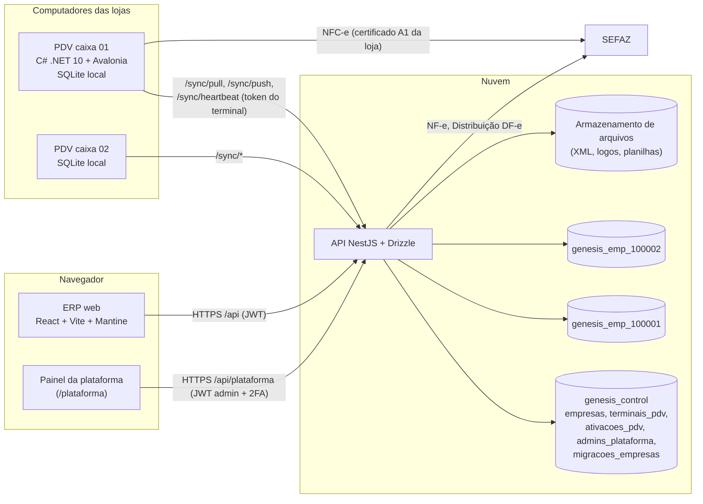

- O ERP só fala com a API. A API descobre o banco da empresa pelo **código da empresa** no login e, depois, pelo
  token (claim `emp`). Pool de conexões por empresa (ADR-02).
- Todo cadastro é **mestre na nuvem**; os PDVs recebem as mudanças por `versao` (ADR-08). Toda gravação feita no ERP
  em tabela sincronizável incrementa `versao` (trigger) e, portanto, desce para os PDVs da(s) loja(s) afetada(s)
  sem nenhum passo extra.
- Movimentos do caixa (vendas, sangrias, reforços, fechamentos) são **mestres no PDV** e chegam por eventos. O ERP
  os exibe e, quando permitido, gera documentos de correção (cancelamento, estorno, conferência), nunca edita o
  original (ADR-06).

### 1.2 Identificadores e URLs

| Regra | Detalhe |
|---|---|
| Chave primária | `id uuid` v7 em todas as tabelas de negócio (ADR-04) |
| URL de edição | `/<recurso>/:id` com o **UUID** (nunca id sequencial). Ex.: `/produtos/01928f3a-7c1e-7b2d-9a40-5e2f1c3d4b5a` |
| Código legível | Coluna `codigo` (inteiro sequencial **por empresa e por entidade**, gerado pela nuvem) exibida no formulário como "Cód." (equivale ao "Id Produto" do Nuvem3). Somente leitura |
| Código do usuário | `codigo_interno` (produto), `codigo` (pessoa, usuário) podem ser digitados quando a tela permitir |
| Registros criados offline no PDV | Chegam com UUID gerado no PDV e `codigo = null`; a nuvem atribui o `codigo` ao incorporar |
| Busca por código | Toda listagem aceita colar um UUID completo ou o `codigo` no filtro principal e abre o registro |

### 1.3 Colunas padrão e exclusão lógica

Toda tabela de negócio tem `id`, `criado_em`, `atualizado_em`, `excluido_em`, `versao` (ADR-06). Além delas, as
tabelas editáveis pelo ERP têm `criado_por_id uuid→usuarios` e `atualizado_por_id uuid→usuarios` (bloco "AU" do
modelo de dados, 1.3).

- **Excluir** no ERP = preencher `excluido_em` (exclusão lógica). Registros excluídos não aparecem nas listagens nem
  nos seletores, mas continuam íntegros para relatórios e sincronização.
- **Restaurar**: usuários com a permissão `<recurso>.excluir` podem ver excluídos (filtro "Mostrar excluídos",
  visível só para eles) e restaurar (limpa `excluido_em`, gera auditoria `restaurar`).
- **Ativo × Excluído**: "Ativo = Não" mantém o registro visível nas listagens (filtro), mas o impede de ser usado em
  novos documentos; "Excluído" o esconde. Regras de bloqueio de exclusão estão em cada tela.

### 1.4 Concorrência otimista

- Todo `GET /<recurso>/:id` devolve `versao`. O `PUT` envia a `versao` lida. Se a versão no banco for diferente, a API
  responde **409 – Registro alterado por outro usuário** com o nome de quem alterou e quando; o formulário oferece
  "Recarregar (perde suas alterações)" ou "Ver diferenças" (compara campo a campo com o estado atual).

### 1.5 Dinheiro, quantidades, datas e fuso

| Item | Regra |
|---|---|
| Dinheiro | `numeric(15,2)`; trafega como **string** na API (`"1234.50"`); cálculo com `decimal.js` no front (ADR-05) |
| Preço unitário e custo | `numeric(15,4)`; a tela mostra 2 casas, ou 4 se Configurações › Vendas › "4 casas decimais" estiver ligado |
| Quantidade | `numeric(15,3)`; produtos com unidade KG/G/L/ML/M aceitam fração; demais unidades exigem inteiro, salvo produto marcado "Permite fração" |
| Arredondamento | Meio para cima (ROUND_HALF_UP) em 2 casas no total de cada item; rateios de desconto/acréscimo distribuem o resto de centavos no maior item |
| Data/hora | `timestamptz` em UTC; exibida no **fuso da loja** do registro (`lojas.fuso_horario`, padrão `America/Sao_Paulo`); registros sem loja usam o fuso da empresa (`empresa.fuso_horario`, 10.1) |
| Filtros de período | Interpretados no fuso da loja selecionada; "Todas as lojas" usa o fuso da empresa |
| Formatos de exibição | `dd/mm/aaaa`, `dd/mm/aaaa hh:mm`, `R$ 1.234,56`, quantidades com até 3 casas sem zeros à direita |

### 1.6 Validações comuns (reutilizadas em todo o sistema, em `packages/shared`)

| Validador | Regra |
|---|---|
| CPF | 11 dígitos, dígitos verificadores, rejeita sequências repetidas (`111.111.111-11`) |
| CNPJ | 14 posições `^[0-9A-Z]{12}[0-9]{2}$`: **CNPJ alfanumérico** (desde julho/2026: 12 primeiras posições alfanuméricas + 2 DV numéricos; maiúsculas automáticas); DVs por módulo 11 sobre o valor **ASCII − 48** de cada caractere (dígitos 0–9, `A` = 17…) — validador único `validarCnpj` (modelo 1.2) |
| IE | Validação por UF (algoritmo de cada estado); aceita `ISENTO` |
| CEP | 8 dígitos; botão de busca (ViaCEP/BrasilAPI) preenche endereço, bairro, cidade (código IBGE) e UF |
| Telefone | DDD 2 dígitos + 8 ou 9 dígitos |
| E-mail | RFC 5322 simplificada; minúsculas |
| GTIN/EAN | 8, 12, 13 ou 14 dígitos com dígito verificador GS1; prefixo `2` = código interno/balança (não validado contra GS1) |
| NCM | 8 dígitos existentes e vigentes na tabela `ncms` |
| CEST | 7 dígitos existentes na tabela `cests` e compatíveis com o NCM |
| CFOP | 4 dígitos existentes na tabela `cfops` |
| Chave de acesso NF-e/NFC-e | 44 posições `^[0-9]{6}[0-9A-Z]{12}[0-9]{26}$` (CNPJ alfanumérico nas posições 7–20; `ck_documentos_fiscais_chave`); DV módulo 11 sobre o valor ASCII − 48 de cada caractere (validador único `validarChaveAcesso`, modelo 1.2) |

### 1.7 Auditoria transversal [P1]

Toda criação, alteração, exclusão, restauração, cancelamento, estorno, importação, exportação, login e mudança de
permissão grava uma linha em `auditoria` (ADR-09) com `antes`/`depois` em `jsonb`. Todo formulário tem o botão
**Histórico** (abre gaveta lateral com a trilha do registro). Detalhes na seção 17.

### 1.8 Contrato padrão da API

| Operação | Método e rota | Observações |
|---|---|---|
| Listar | `GET /api/<recurso>?pagina=1&tamanho=20&ordenar=nome:asc&<filtros>` | resposta `{ itens: [...], total, pagina, tamanho }`; `tamanho=todos` limitado a 5.000 |
| Obter | `GET /api/<recurso>/:id` | inclui `versao` e sub-coleções do formulário |
| Criar | `POST /api/<recurso>` | corpo validado por schema `zod` compartilhado; devolve o registro criado |
| Alterar | `PUT /api/<recurso>/:id` | exige `versao`; 409 em conflito |
| Excluir | `DELETE /api/<recurso>/:id` | exclusão lógica; 422 se uma regra de bloqueio impedir |
| Restaurar | `POST /api/<recurso>/:id/restaurar` | |
| Histórico | `GET /api/auditoria?entidade=<recurso>&registro_id=:id` | |
| Exportar listagem | `GET /api/<recurso>/exportar?formato=xlsx&<filtros>` | gera arquivo com os filtros atuais |

Formato de erro: `{ "codigo": "VALIDACAO", "mensagem": "texto para o usuário", "campos": { "cpf": ["CPF inválido"] } }`.
Códigos: `VALIDACAO` (422), `NAO_AUTENTICADO` (401), `SEM_PERMISSAO` (403), `EMPRESA_SUSPENSA` (403),
`NAO_ENCONTRADO` (404), `CONFLITO_VERSAO` (409), `REGRA_NEGOCIO` (422), `LIMITE_PLANO` (422), `ERRO_INTERNO` (500),
`SISTEMA_OCUPADO` (503, com `Retry-After`: a gravação esperou além do limite pela trava de ordenação enquanto os caixas
enviavam vendas; nada foi gravado e a tela pede para salvar de novo em alguns segundos — Fase 1C, modelo-de-dados.md 1.5).

---

## 2. Modelo de permissões

> [P1]. O levantamento não abriu as abas "Menus do sistema" e "Permissões gerais" dos usuários do Nuvem3; o modelo
> abaixo é projeto nosso, compatível com a recomendação "permissões por menu" da seção 12.

### 2.1 Conceitos

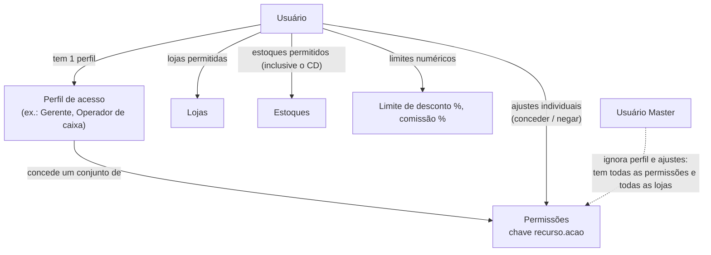

| Conceito | Regra |
|---|---|
| Permissão | Chave estável `recurso.acao` no ERP (ex.: `produtos.editar`) e `pdv.<area>.<acao>` no PDV (ex.: `pdv.venda.cancelar_venda_finalizada`, PDV 31.2). Catálogo único em `packages/shared/permissoes.ts` (seção 11.4), que gera a tabela `permissoes` (modelo 3.3.3) |
| Perfil | Conjunto nomeado de permissões (`perfis`, `perfis_permissoes`). Seeds: Administrador, Gerente, Financeiro, Estoquista, Vendedor, Operador de caixa, Supervisor de caixa, Encarregado |
| Ajuste individual | `usuarios_permissoes (usuario_id, permissao, efeito: conceder/negar)`; **negar vence conceder** |
| Permissão efetiva | `(permissões do perfil ∪ concedidas) − negadas`; Master = todas |
| Usuário Master | Flag `usuarios.master`. Tem tudo, em todas as lojas. Deve existir **pelo menos um master ativo** por empresa (a API bloqueia desativar, excluir ou desmarcar o último) |
| Lojas permitidas | `usuarios_lojas`. O usuário só vê/edita dados das lojas permitidas (vendas, caixa, contas) e só faz login no PDV dessas lojas. Os estoques seguem a linha abaixo, não as lojas |
| Estoques permitidos | Só `usuarios_estoques`, inclusive os estoques sem loja (o CD): é a lista inteira do que o usuário vê e movimenta (locais de estoque, acertos, saldos, saldo do produto, dashboard, "Atualizar estoque" da importação e, na Fase 2, recebimentos, NF-e e transferências). Liberar a loja não libera o estoque dela (no cadastro do usuário, marcar a loja sugere o estoque dela na lista). O Master e quem tem `estoques.todos` (só o Master no seed) veem todos. Na virada da Fase 2 (F2-B5) cada usuário recebeu o que via antes — os estoques das lojas permitidas e todos os sem loja —, e o gerente restringe depois; usuário criado depois começa sem estoque (roadmap D45, padrão até a confirmação do dono; README da API › decisão 149) |
| Dados sem loja | Cadastros globais (produtos, pessoas, marcas, categorias, plano de contas sem restrição) são visíveis a quem tem a permissão `ver` do recurso |
| Limites numéricos | `usuarios.limite_desconto_pct` (PDV e venda ERP), `usuarios.comissao_pct` |
| Liberação por supervisor | No PDV, ação sem permissão pode ser liberada por outro usuário presente que tenha a permissão (login ou código + **PIN do PDV** do supervisor). A liberação é validada **só pelo PIN do PDV** do supervisor (`senha_pdv_hash`), localmente, online e offline (PDV 31.3); a senha do ERP **nunca** é aceita na liberação — `pdv.login_aceita_senha_erp` vale só para o login do operador (sync 4.1). A liberação é auditada com os dois usuários |
| Cache | A permissão efetiva é calculada no login e guardada no token como `perm_versao`; alterar perfil/ajustes/lojas incrementa `usuarios.permissoes_versao` e força nova leitura na próxima requisição (a API compara) |

### 2.2 Onde as permissões são aplicadas

| Camada | Aplicação |
|---|---|
| API | Decorator `@Permissao('produtos.editar')` em cada rota + filtro automático pelas lojas permitidas nas entidades com `loja_id` e pelos estoques permitidos (`usuarios_estoques`, 2.1) nas entidades com `estoque_id`. **A API é a fonte da verdade** |
| ERP web | Esconde itens de menu sem `*.ver`, desabilita botões sem a ação, esconde colunas sensíveis (ex.: custo sem `produtos.ver_custo`) |
| PDV | Recebe na sincronização (fluxo `acesso`) as linhas de **todos** os usuários, com o PIN do PDV (`senha_pdv_hash`, `null` para quem não tem acesso à loja do terminal), permissões efetivas `pdv.*` e limites; valida localmente (ADR-08). A senha do ERP (`usuarios.senha_hash`) **nunca desce**, de nenhum usuário; no caixa ela só vale online, com `pdv.login_aceita_senha_erp` (sync 4.1, 4.3) |

---

## 3. Padrões de interface (componentes reutilizáveis)

> [P1]. Reproduzem o padrão `Consulta.aspx?id=N` do Nuvem3 (seção 1.4 do levantamento) com Mantine + TanStack Table
> (ADR-10).

### 3.1 Componente genérico de listagem (`<Listagem>`)

**Objetivo**: uma única implementação de listagem configurada por entidade (filtros, colunas, rota de edição, endpoint,
permissões).

**Configuração por entidade** (`ConfigListagem`):

| Propriedade | Exemplo | Uso |
|---|---|---|
| `recurso` | `'produtos'` | endpoint `GET /api/produtos` e chave de permissão |
| `titulo` | `'Cadastro de produtos'` | cabeçalho e título da aba do navegador |
| `filtros` | lista de `{ campo, rotulo, tipo: texto/numero/data/periodo/selecao/multisselecao/arvore/booleano/loja/pessoa/produto, opcoes?, padrao? }` | bloco de filtros |
| `colunas` | lista de `{ campo, rotulo, tipo, ordenavel, alinhamento, largura, formato, permissao? }` | tabela |
| `ordenacaoPadrao` | `'nome:asc'` | |
| `rotaEdicao` | `(linha) => '/produtos/' + linha.id` | clique na 1ª coluna |
| `rotaNovo` / `rotuloNovo` | `'/produtos/novo'` / `'Novo Produto'` | botão Novo |
| `totalizadores` | `[{ campo: 'total', agregacao: 'soma' }]` | rodapé (listagens financeiras) |
| `acoesEmLote` | opcional (ex.: quitar várias contas) | caixa de seleção por linha, só quando configurado |

**Estrutura da tela**

```
┌──────────────────────────────────────────────────────────────────────────────┐
│ Título                                              [Exportar ▾] [+ Novo …]   │
├──────────────────────────────────────────────────────────────────────────────┤
│ Filtros (grade responsiva, 4 por linha)                                      │
│ [Nome______] [CPF/CNPJ___] [Cidade____] [Categoria ▾]   [Limpar] [Pesquisar]  │
├──────────────────────────────────────────────────────────────────────────────┤
│ Nome ▲        │ CPF/CNPJ      │ Telefone     │ Email        │ Categoria       │
│ (link)        │               │              │              │                 │
├──────────────────────────────────────────────────────────────────────────────┤
│ Mostrar [20 ▾] registros   1.505 registros   [Primeiro] [Ant.] 3/76 [Próx.] [Último] │
└──────────────────────────────────────────────────────────────────────────────┘
```

**Comportamento**

| Item | Regra |
|---|---|
| Pesquisar | Aplica os filtros e volta à página 1. Enter em qualquer campo de filtro = Pesquisar |
| Limpar | Restaura os filtros padrão (não limpa a ordenação) |
| Filtros na URL | Filtros, página, tamanho e ordenação ficam na query string (`?nome=agua&pagina=2&tamanho=50&ordenar=preco_venda:desc`) — permite voltar do formulário mantendo a pesquisa e compartilhar o link |
| Carga inicial | Executa a pesquisa com os filtros padrão ao abrir (o Nuvem3 exige clicar em Pesquisar; aqui a lista já abre preenchida) |
| Ordenação | Clique no cabeçalho alterna asc → desc → padrão; ordenação no servidor; uma coluna por vez (Shift+clique adiciona segunda coluna) |
| Paginação | Seletor **20 / 25 / 35 / 50 / Todos** (padrão 20); navegação **Primeiro / Ant. / Próx. / Último** + "página X de Y" + total de registros |
| "Todos" | Busca até 5.000 linhas; acima disso mostra aviso "Mostrando 5.000 de N. Use Exportar para obter todos." |
| Preferência | Último tamanho de página escolhido por listagem fica no `localStorage` (conveniência; tolera falha de leitura) |
| Clique na 1ª coluna | A 1ª coluna é um link para `rotaEdicao` (sem ícones de ação por linha, como no Nuvem3). Ctrl/Cmd+clique abre em nova aba. A linha inteira também é clicável |
| Novo | Botão com o rótulo da entidade ("Novo registro", "Novo Produto", "Nova Conta"); só aparece com `<recurso>.criar` |
| Exportar | Menu: "Excel (.xlsx)" e "CSV" com os filtros e a ordenação atuais, todas as linhas (sem limite de 5.000, gerado em segundo plano se passar de 5.000 — ver 3.6); exige `<recurso>.exportar` ou `relatorios.exportar` |
| Vazio | "Nenhum registro encontrado com os filtros informados." + botão Limpar filtros |
| Carregando | Esqueleto de linhas; mantém a página anterior visível durante a troca (TanStack Query `keepPreviousData`) |
| Erro | Faixa vermelha com a mensagem e "Tentar novamente" |
| Loja de contexto | Filtros do tipo `loja` vêm preenchidos com a loja de contexto do cabeçalho (seção 5.2), quando ela não é "Todas" |
| Excluídos | Filtro "Mostrar excluídos" só para quem tem `<recurso>.excluir`; linhas excluídas aparecem riscadas |
| Responsivo | Abaixo de 768 px, a tabela vira cartões (1ª coluna em destaque + 3 colunas principais) |
| Acessibilidade | Tabela com `<th scope>`, ordenação anunciada (`aria-sort`), foco visível, navegação por teclado (setas ↑↓ entre linhas, Enter abre) |

### 3.2 Formulário padrão (`<FormularioEntidade>`)

| Item | Regra |
|---|---|
| Cabeçalho | Título ("Cadastro de produtos"), código legível (`Cód. 1234`), status (Ativo/Inativo/Excluído), data da última alteração e por quem |
| Organização | **Abas** (Pessoas, Lojas, Usuários, Vendas, Configurações) ou **acordeão** (Produto), como no Nuvem3 |
| Botões | **Novo** (limpa para novo registro), **Gravar/Salvar** (Ctrl+S), **Voltar** (Esc; volta à listagem com os filtros), **Excluir** (com confirmação), **Histórico**, e ações específicas (Imprimir, Emitir NF-e…) |
| Validação | Mesmo schema `zod` no front e na API. Erros por campo abaixo do campo; a aba/bloco com erro recebe um marcador vermelho e abre automaticamente |
| Alterações não salvas | Sair com alterações pendentes pede confirmação ("Descartar alterações?") |
| Gravação | Botão desabilitado e indicador durante o envio; sucesso = notificação verde "Registro gravado" e permanece no formulário (com a URL atualizada para `/:id` quando era novo) |
| Somente leitura | Sem permissão de editar, ou documento imutável: todos os campos desabilitados e só Voltar/Histórico/Imprimir |
| Campos monetários | Máscara `R$`, aceita vírgula, alinhado à direita |
| Campos de data | Seletor Mantine com digitação `dd/mm/aaaa`; atalho `H` = hoje |

### 3.3 Grade de itens editável (`<GradeItens>`)

Usada em Acerto, Recebimento manual, Transferência, Orçamento, Venda, Cadastro em massa.

| Item | Regra |
|---|---|
| Inserir linha | Botão "Inserir item" ou **F9** (como no Nuvem3); a nova linha recebe foco no campo Produto |
| Campo Produto | Busca incremental por código interno, EAN (inclusive códigos adicionais e de variação), `codigo` ou nome (mínimo 2 caracteres; até 20 sugestões com nome, EAN, preço, saldo no estoque do documento) |
| Leitor de código de barras | Leitura de EAN no campo Produto insere a linha com quantidade 1 (ou soma 1 na linha existente se a tela não "Permite produtos iguais") |
| Variação | Produto "Com variações" exige escolher a variação (coluna Variação) |
| Navegação | Tab/Enter avançam entre colunas; Enter na última coluna cria nova linha; Delete remove a linha selecionada (com confirmação se houver dados) |
| Rodapé | Qtd. de produtos (linhas), soma das quantidades, total |
| Validação por linha | Linha com erro fica vermelha com dica; gravar é bloqueado até corrigir |
| Colar do Excel | Colar várias linhas (código/EAN + quantidade [+ preço]) preenche a grade |

### 3.4 Componentes de seleção

| Componente | Comportamento |
|---|---|
| `<SeletorPessoa categoria>` | Busca por nome, apelido, CPF/CNPJ (com ou sem máscara) ou código; filtra pela categoria (Cliente, Fornecedor…); botão "+" abre cadastro rápido em modal (nome, tipo, CPF/CNPJ, telefone, categoria). **Fornecedor** (F2-B13): CNPJ ou CPF, nome, fantasia, IE, telefone e o endereço opcional (a UF entra com ele); o documento já cadastrado reaproveita a pessoa (só ganha a categoria Fornecedor, sem mudar o resto); criar exige "Pessoas: Criar", e dar a categoria a quem já existe, "Pessoas: Editar" |
| `<SeletorProduto>` | Igual ao campo Produto da grade |
| `<SeletorLoja>` | Só lojas permitidas e ativas; opção "Todas" onde a tela permitir |
| `<SeletorEstoque>` | Só estoques permitidos (`usuarios_estoques`, ou todos para o Master e `estoques.todos`; a API já filtra); mostra "Loja 1 - Ice Beer Hermes", "CD - Estoque Ice Beer" |
| `<ArvoreSelecao>` | Categorias e plano de contas; busca por texto; seleção simples ou múltipla com checkboxes |
| `<BuscaNcm>` | Modal com busca por código ou descrição; mostra vigência; seleciona e preenche NCM (e sugere CEST quando houver) |
| `<UploadArquivo>` | Arrastar ou escolher; valida tipo e tamanho; mostra prévia de imagem |

### 3.5 Padrão de relatórios (`<Relatorio>`)

| Item | Regra |
|---|---|
| Rota | `/relatorios/<nome>` |
| Filtros | Bloco no topo + botão **Filtrar**; filtros na URL |
| Resultado | Cards de resumo (quando houver), tabela, gráfico (quando houver) |
| Exportar | **Excel (.xlsx)**, **PDF** (layout de impressão com cabeçalho da empresa, filtros usados, data/hora e usuário) e **Imprimir** |
| Lojas | Sempre limitado às lojas permitidas do usuário |
| Volume | Relatórios que passam de 50.000 linhas ou 30 s rodam como tarefa em segundo plano (3.6) |
| Leitura | Consultas de relatório podem usar réplica de leitura do PostgreSQL quando existir |

### 3.6 Tarefas em segundo plano

Importações, exportações grandes, relatórios pesados, download de XML e consulta à SEFAZ viram uma **tarefa**
(`tarefas`, modelo 3.1.8: `tipo`, `status` `na_fila`/`executando`/`concluida`/`falhou`/`cancelada`, `progresso_pct`,
`arquivo_id` do resultado, `erro`, `usuario_id`, `iniciada_em`, `concluida_em`). O cabeçalho do ERP tem o ícone **Tarefas** com contador; o usuário recebe
notificação ao concluir e baixa o arquivo (link expira em 7 dias).

### 3.7 Impressão

Na Fase 2 (padrão do plano, sem o motor de PDF na API), a folha de contagem (13.5), o espelho do recebimento (13.3),
o romaneio e a ficha da marca saem pela **impressão do navegador** (a tela abre o documento em aba nova; o menu e o
cabeçalho do ERP não saem no papel). Os templates abaixo chegam com os documentos que os usam.

Documentos imprimíveis (orçamento, venda, recibo, romaneio de transferência, comprovante de sangria, etiqueta de
marca) usam **templates** (`templates_documentos`, modelo 3.1.3, editados em Configurações › Orçamentos/Financeiro/
Vendas) renderizados em HTML → PDF na API. O template usado é a linha `padrao = true` do `tipo` para a loja do
documento (ou a de `loja_id` nulo); não há chave de configuração apontando para template.
Variáveis no formato `{{cliente.nome}}`, `{{venda.total}}`, `{{itens}}` (bloco repetido); catálogo de variáveis
exibido ao lado do editor.

---

## 4. Autenticação e sessão

> [P1]

### 4.1 Tela de login

**Objetivo**: autenticar o usuário na empresa certa (código da empresa + usuário + senha, como no Nuvem3 e ADR-02).

**Rota**: `/login` (pública). Qualquer rota protegida sem sessão redireciona para `/login?voltar=<rota>`.

| Campo | Tipo | Obr. | Validação | Padrão |
|---|---|---|---|---|
| Código da empresa | inteiro (6 dígitos) | S | só dígitos, 6 posições | último código usado neste navegador (`localStorage`) |
| Usuário | texto(60) | S | sem espaços nas pontas; não diferencia maiúsculas/minúsculas | — |
| Senha | senha | S | — | — |
| Lembrar código da empresa | booleano | N | — | Sim |

Botões: **Entrar** (Enter), link **Esqueci minha senha**. Rodapé: versão do sistema.

**Fluxo**

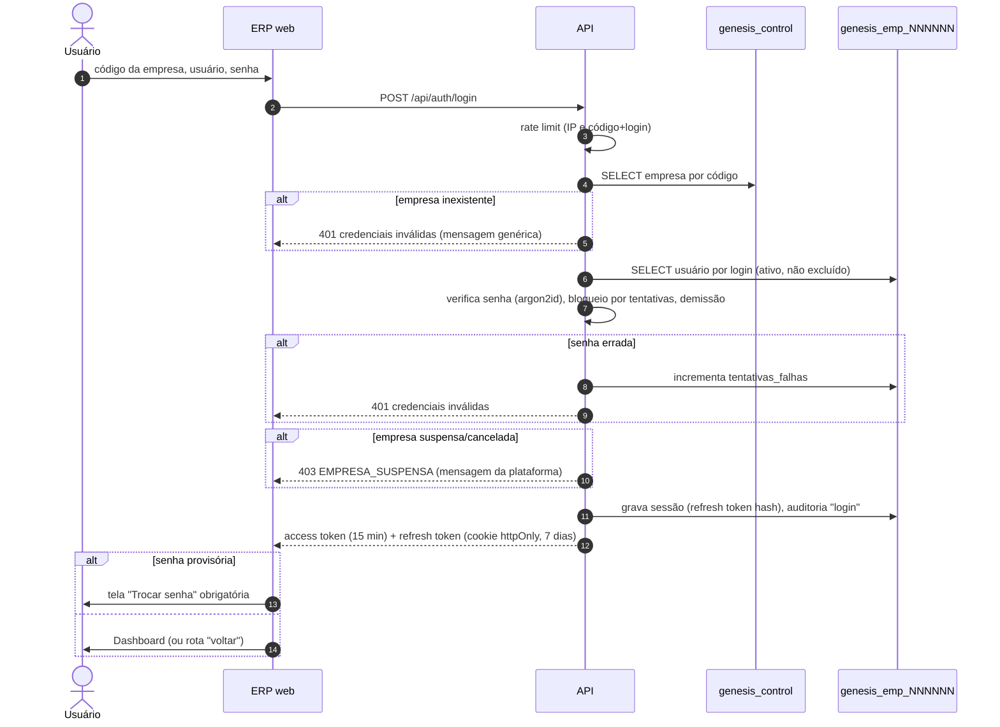

**Regras de negócio**

| Regra | Detalhe |
|---|---|
| Mensagem de erro | Sempre "Código da empresa, usuário ou senha inválidos." (não revela qual está errado) |
| Bloqueio por tentativas | 5 falhas seguidas no mesmo (empresa, login) bloqueiam por 15 minutos; mensagem "Usuário bloqueado temporariamente. Tente em X minutos." Um Master pode desbloquear em Usuários |
| Rate limit | 20 tentativas/minuto por IP |
| Empresa suspensa | Só depois de credenciais válidas mostra "Acesso suspenso. Entre em contato com o suporte Genesis." + motivo público definido no painel da plataforma |
| Usuário inativo, excluído ou com `demissao` ≤ hoje | Tratado como credencial inválida + auditoria `login_negado` com o motivo |
| Usuário sem permissão de ERP | Se o perfil só tem permissões `pdv.*` (ex.: operador de caixa), mostra "Seu usuário não tem acesso ao ERP." |
| Token de acesso | JWT 15 min com `sub` (usuário), `emp` (código), `perm_versao`, `master`; assinado com chave por ambiente |
| Refresh | Cookie `httpOnly`, `Secure`, `SameSite=Strict`, rotativo (cada uso gera outro e invalida o anterior; reuso de refresh antigo derruba todas as sessões do usuário) |
| Inatividade | 60 minutos sem requisição encerram a sessão (configurável por empresa em Configurações › Geral, `geral.sessao_inatividade_min`) |
| Várias abas | Compartilham a sessão (BroadcastChannel); sair em uma sai em todas |
| Senha provisória | Criada pelo admin/seed ou redefinição: `usuarios.senha_provisoria = true` obriga troca no primeiro acesso |

### 4.2 Trocar senha

**Rota**: `/minha-conta/senha` (também acessível pelo menu do usuário).

| Campo | Tipo | Obr. | Validação |
|---|---|---|---|
| Senha atual | senha | S (exceto na troca obrigatória após redefinição, em que é a provisória) | confere |
| Nova senha | senha | S | mínimo 8 caracteres, ao menos 1 letra e 1 número, diferente da atual e das 3 últimas |
| Confirmar nova senha | senha | S | igual à nova |

Efeito: grava hash argon2id, limpa `senha_provisoria`, encerra as outras sessões, auditoria `senha_alterada`. A senha
do ERP **não desce para os PDVs** (ADR-08, sync 4.1): no caixa vale o PIN do PDV (`senha_pdv_hash`, 11.2); a senha do ERP
só é aceita no PDV online, validada pela API, quando `pdv.login_aceita_senha_erp = true`.

### 4.3 Esqueci minha senha

- Se o usuário tem e-mail cadastrado: envia link de redefinição de uso único (expira em 1 h, `redefinicoes_senha.expira_em`, modelo 3.3.6) para o e-mail.
- Se não tem: mostra "Peça a um administrador da sua empresa para redefinir sua senha." (Usuários › Redefinir senha).
- A resposta é sempre a mesma ("Se os dados estiverem corretos, você receberá um e-mail"), para não revelar usuários.

### 4.4 Sair

Menu **SAIR** (`/sair`): encerra a sessão (`sessoes_usuario.encerrada_em = now()`, `motivo_encerramento = 'logout'`),
limpa o estado local, auditoria `logout`, volta para `/login` com o código da empresa preenchido.

**Entidades**: `genesis_control.empresas`; `usuarios`, `sessoes_usuario` (modelo 3.3.6: `refresh_token_hash`,
`familia_id`, `expira_em`, `ultimo_uso_em`, `ip`, `user_agent`, `encerrada_em`, `motivo_encerramento` `logout`/
`expirada`/`encerrada_admin`/`senha_alterada`/`reuso_detectado`), `historico_logins`, `redefinicoes_senha`, `auditoria`.

**API**: `POST /api/auth/login`, `POST /api/auth/refresh`, `POST /api/auth/logout`, `POST /api/auth/trocar-senha`,
`POST /api/auth/esqueci-senha`, `POST /api/auth/redefinir-senha`, `GET /api/auth/eu` (usuário, permissões efetivas,
lojas permitidas, configurações de interface).

---

## 5. Layout, navegação e árvore de menus

> [P1]

### 5.1 Estrutura da página

```
┌───────────────────────────────────────────────────────────────────────────────────────┐
│ [≡] GenesisPDV · Ice Beer (100001)    Loja: [Todas as lojas ▾]   🔍 Buscar   ⏳ 2   ADMIN ▾  │
├──────────────┬────────────────────────────────────────────────────────────────────────┤
│ INÍCIO       │  Início › Produtos › Cadastro de produtos                              │
│ PESSOAS      │                                                                        │
│ PRODUTOS   ▸ │                  (conteúdo da página)                                  │
│ CADASTROS  ▸ │                                                                        │
│ ESTOQUE    ▸ │                                                                        │
│ FINANCEIRO ▸ │                                                                        │
│ VENDAS     ▸ │                                                                        │
│ RELATÓRIOS ▸ │                                                                        │
│ SAIR         │                                                                        │
│ v1.0.0       │                                                                        │
└──────────────┴────────────────────────────────────────────────────────────────────────┘
```

| Elemento | Regra |
|---|---|
| Menu lateral | Grupos INÍCIO, PESSOAS, PRODUTOS, CADASTROS, ESTOQUE, FINANCEIRO, VENDAS, RELATÓRIOS, SAIR (mesmos grupos do Nuvem3); recolhível; item ativo destacado; itens sem permissão `*.ver` não aparecem; grupo sem itens visíveis não aparece |
| Cabeçalho | Nome fantasia + código da empresa; **seletor de loja de contexto**; busca global; ícone de tarefas (3.6); menu do usuário (Minha conta, Trocar senha, Sair) |
| Trilha (breadcrumb) | Grupo › Página › Registro |
| Versão | Versão do ERP no rodapé do menu (como o "2.0.0" do Nuvem3) |
| Avisos globais | Faixa no topo para: empresa em período de suspensão próxima, certificado digital vencendo em ≤ 30 dias, PDV com eventos pendentes há mais de 24 h, ambiente de homologação fiscal ativo |
| Mobile | Menu vira gaveta; cabeçalho compacto |

### 5.2 Loja de contexto

- Seletor no cabeçalho com "Todas as lojas" + lojas permitidas. Guardado no navegador (`localStorage`, chave por
  empresa + usuário; leitura tolerante a falha — sem valor, volta a "Todas as lojas"). Não há coluna de preferências
  em `usuarios`.
- Pré-preenche filtros de loja/estoque das listagens e relatórios e o campo Loja de documentos novos.
- Não é segurança (a segurança é por lojas permitidas na API); é só conveniência.

### 5.3 Busca global

Atalho **Ctrl+K**: busca em produtos (nome, EAN, código interno), pessoas (nome, CPF/CNPJ), vendas (número, chave
NFC-e) e páginas do menu. Respeita permissões.

### 5.4 Árvore de menus e rotas

Correspondência com o Nuvem3 (seção 1.3 do levantamento) + o que acrescentamos (marcado **Novo**).

| Grupo | Item | Rota GenesisPDV | Nuvem3 | Permissão de acesso | Prioridade |
|---|---|---|---|---|---|
| INÍCIO | Dashboard | `/` | Principal.aspx | `dashboard.ver` | P5 |
| PESSOAS | Pessoas | `/pessoas` · `/pessoas/novo` · `/pessoas/:id` | Consulta.aspx?id=7 · Pessoa.aspx | `pessoas.ver` | P1 |
| PRODUTOS | Cadastro de produtos | `/produtos` · `/produtos/novo` · `/produtos/:id` | Consulta.aspx?id=5 · ProdutoV2.aspx | `produtos.ver` | P2 |
| | Cadastro em massa | `/produtos/cadastro-em-massa` | ProdutoCadastroMassa.aspx | `produtos.cadastro_massa` | P2 |
| | Categorias | `/produtos/categorias` | LojaVirtualDepartamentos.aspx | `categorias.ver` | P2 |
| | Exportação | `/produtos/exportacao` | ProdutoExportarV2.aspx | `produtos.exportar` | P2 |
| | Importação | `/produtos/importacao` | ProdutoImportarV2.aspx | `produtos.importar` | P2 |
| | Marcas | `/produtos/marcas` · `/produtos/marcas/:id` | Consulta.aspx?id=4 · ProdutoMarca.aspx | `marcas.ver` | P2 |
| | Promoções **(Novo)** | `/produtos/promocoes` · `/:id` | — | `promocoes.ver` | P3 |
| | Restrições de horário de venda **(Novo)** | `/produtos/restricoes-horario` · `/:id` | — | `restricoes_horario.ver` | P2 |
| | Grupos de preço por quantidade **(Novo)** | `/produtos/grupos-preco` · `/:id` | — (mix; o "grupo de itens" do Nuvem3 é o combo, 8.2.17) | `grupos_preco.ver` | P2 (entregue na Fase 1) |
| CADASTROS | Configurações | `/cadastros/configuracoes/:aba` | Configuracoes.aspx | `configuracoes.ver` | P1 (abas em P2–P6) |
| | Empresa | `/cadastros/empresa` | Empresa.aspx | `empresa.ver` | P1 |
| | Formas de Pagamento | `/cadastros/formas-pagamento` · `/:id` | Consulta.aspx?id=6 · FormaPagamento.aspx | `formas_pagamento.ver` | P3 |
| | Lojas | `/cadastros/lojas` · `/cadastros/lojas/:id/:aba` | Consulta.aspx?id=53 · Lojas.aspx | `lojas.ver` | P1 (abas em P3/P6) |
| | Usuários | `/cadastros/usuarios` · `/:id/:aba` | Consulta.aspx?id=40 · Usuario.aspx | `usuarios.ver` | P1 |
| | Perfis de acesso **(Novo)** | `/cadastros/perfis` · `/:id` | — | `perfis.ver` | P1 |
| | PDVs / Terminais **(Novo)** | `/cadastros/pdvs` · `/cadastros/pdvs/:id` | — | `terminais.ver` | P3 |
| | Implantação › Prontidão da loja **(Novo)** | `/cadastros/implantacao/prontidao` | — | `configuracoes.ver` | Implantação (10.4) |
| | Integrações **(Novo)** | `/cadastros/integracoes` | (abas de integração das Configurações) | `configuracoes.editar_integracoes` | P6 |
| ESTOQUE | Locais de estoque **(Novo)** | `/estoque/locais` · `/:id` | (implícito no "Estoque vinculado") | `estoques.ver` | P1 |
| | Acerto de Estoque | `/estoque/acertos` · `/:id` | Consulta.aspx?id=47 · EstoqueAcertoV2.aspx | `estoque_acertos.ver` | P2 |
| | Recebimento manual de produtos | `/estoque/recebimentos` · `/:id` | Consulta.aspx?id=34 · RecebimentoProdutoV2 | `recebimentos.ver` | P2 |
| | Recebimento de NFe | `/estoque/notas-entrada` · `/:id` | Consulta.aspx?id=42 · RecebimentoNFeV2 | `notas_entrada.ver` | P2 |
| | Tipo de Estoque | `/estoque/tipos` · `/:id` | Consulta.aspx?id=45 | `tipos_estoque.ver` | P2 |
| | Transferência de estoque | `/estoque/transferencias` · `/:id` | Consulta.aspx?id=79 · EstoqueTransferencia | `transferencias.ver` | P2 |
| FINANCEIRO | Contas a Pagar | `/financeiro/contas-pagar` · `/:id` | Consulta.aspx?id=32 · ContaPagarReceber | `contas_pagar.ver` | P4 |
| | Contas a Receber | `/financeiro/contas-receber` · `/:id` | Consulta.aspx?id=33 | `contas_receber.ver` | P4 |
| | Notas e Cupons Fiscais › Download de XML | `/financeiro/download-xml` | NotaFiscalDownloadXML.aspx | `fiscal.download_xml` | P6 |
| | Contas correntes | `/financeiro/contas-correntes` · `/:id` | Consulta.aspx?id=12 · BancoContaCorrente | `contas_correntes.ver` | P4 |
| | Plano de contas | `/financeiro/plano-contas` | PlanoContas.aspx | `plano_contas.ver` | P4 |
| | Fechamento de caixa | `/financeiro/fechamentos-caixa` · `/:id` | Consulta.aspx?id=72 | `fechamentos_caixa.ver` | P3 |
| VENDAS | Orçamentos | `/vendas/orcamentos` · `/:id` | Consulta.aspx?id=54 · Orcamentos.aspx | `orcamentos.ver` | P3 |
| | Reforço de caixa | `/vendas/reforcos` · `/:id` | Consulta.aspx?id=63 | `movimentos_caixa.ver` | P3 |
| | Sangria | `/vendas/sangrias` · `/:id` | Consulta.aspx?id=61 · Sangria.aspx | `movimentos_caixa.ver` | P3 |
| | Vendas | `/vendas` · `/vendas/nova` · `/vendas/:id/:aba` | Consulta.aspx?id=13 · Venda.aspx | `vendas.ver` | P3 |
| RELATÓRIOS | Produtos: Produtos geral · Histórico de produtos · NCMs inválidos | `/relatorios/produtos-geral` · `/relatorios/historico-produtos` · `/relatorios/ncm-invalidos` | RelatProduto*.aspx | `relatorios.<nome>` | P2 |
| | Estoque: Estoque Atual · Movimentação | `/relatorios/estoque-atual` · `/relatorios/movimentacao-estoque` | RelatEstoqueAtual · RelatMovimentacaoEstoque | idem | P2 |
| | Financeiro: Financeiro geral · Fechamento de caixa · Sangria/Reforço | `/relatorios/financeiro-geral` · `/relatorios/fechamento-caixa` · `/relatorios/sangria-reforco` | RelatFinanceiro · RelatFechamentoCaixa · RelatSangriaReforco | idem | P5 |
| | Vendas: Comissão · Evolução gráfico · Produtos x Clientes · Produtos x Vendedor · Produtos vendidos · Recibos x Cupons · Vendas geral · Por forma de pagamento | `/relatorios/comissao` · `/relatorios/evolucao-vendas` · `/relatorios/produtos-clientes` · `/relatorios/produtos-vendedor` · `/relatorios/produtos-vendidos` · `/relatorios/recibos-cupons` · `/relatorios/vendas-geral` · `/relatorios/vendas-forma-pagamento` | RelatVendas*.aspx | idem | P5 |
| | Auditoria **(Novo)** | `/auditoria` | (evolução do Histórico de produtos) | `auditoria.ver` | P1 |
| SAIR | Logoff | `/sair` | Logoff.aspx | — | P1 |

Rotas fora do menu: `/login`, `/minha-conta`, `/minha-conta/senha`, `/tarefas`, `/sem-permissao` (403),
`/nao-encontrado` (404). O painel da plataforma vive em `/plataforma/*` (seção 19), com login próprio.

---

## 6. Início – Dashboard

> [P5] (rota e casca da página em P1, para ser a página inicial desde o começo).

**Objetivo**: mostrar os totais do mês e levar ao detalhe (como o `Principal.aspx` do Nuvem3).

**Rota**: `/` · **Permissão**: `dashboard.ver`; cards financeiros exigem `dashboard.ver_financeiro`.

**Filtros**

| Filtro | Tipo | Padrão | Regra |
|---|---|---|---|
| Mês/Ano | seletor de mês | mês do dia operacional de hoje (Fase 1C: corte da empresa, D7) | rótulo "Outubro/2026" + botão **Filtrar** |
| Loja | `<SeletorLoja>` com "Todas" | loja de contexto | limita a lojas permitidas |

**Cards** (cada um com link **Listagem**)

| Card | Valor principal | Detalhe secundário | Fonte | Link "Listagem" |
|---|---|---|---|---|
| Pessoas | quantidade de pessoas ativas | novas no mês | `pessoas` | `/pessoas` |
| Produtos | quantidade de produtos ativos | sem preço · NCM inválido | `produtos` | `/produtos` |
| Vendas no mês | total líquido das vendas finalizadas não canceladas | quantidade de vendas · ticket médio | `vendas` | `/vendas?data_inicial=…&data_final=…` |
| Contas a receber no mês | soma das parcelas a receber com vencimento no mês | recebido × em aberto × atrasado | `parcelas_financeiras` (tipo receber) | `/financeiro/contas-receber?vencimento_inicial=…` |
| Contas a pagar no mês | soma das parcelas a pagar com vencimento no mês | pago × em aberto × atrasado | `parcelas_financeiras` (tipo pagar) | `/financeiro/contas-pagar?vencimento_inicial=…` |

**Gráficos**

| Gráfico | Tipo | Eixo X | Séries |
|---|---|---|---|
| Vendas no mês | colunas | dias do mês (dia operacional) | total vendido por dia; linha do mesmo período do mês anterior |
| Contas a pagar e receber | colunas agrupadas | dias do mês | a receber × a pagar por vencimento; linha de saldo acumulado previsto |

**Painéis adicionais (Novo)**, cada um oculto se o usuário não tiver a permissão do módulo:

| Painel | Conteúdo | Permissão |
|---|---|---|
| PDVs | quantos terminais online/offline, com eventos pendentes, com NFC-e em contingência | `terminais.ver` |
| Estoque | produtos abaixo do estoque mínimo nas lojas filtradas (top 10) | `estoque_saldos.ver` |
| Validade | lotes vencendo nos próximos N dias (N = Configurações › Parâmetros › Aviso de vencimento) | `estoque_saldos.ver` |
| Contas vencendo hoje | parcelas a pagar e a receber de hoje | `contas_pagar.ver` / `contas_receber.ver` |

**Regras**: valores calculados no servidor (`GET /api/dashboard?mes=2026-10&loja_id=…`), cache de 60 s por
(empresa, loja, mês); vendas pelo **dia operacional**; cancelamentos e devoluções abatem do total.

**Fase 1C (bloco C12)**: o card "Vendas no mês", a tabela de vendas do dia e do mês por loja e a série por dia
(`vendasPorDia`, com o mesmo dia do mês anterior, para o gráfico da Fase 5) leem `vendas` com `status = 'finalizada'`
pelo `dia_operacional` gravado pelo PDV (D7) — a venda cancelada sai do total; devoluções na Fase 3. O "hoje" de cada
loja é o dia operacional corrente dela: hora local no `fuso_horario` da loja menos a hora de corte efetiva
(`geral.dia_operacional_hora_corte`, loja ?? empresa ?? 05:00). A **loja de treino** (`lojas.treino`, O10) fica fora das
vendas e do "Estoque abaixo do mínimo" por padrão (`treino=excluir`; o filtro "Incluir loja de treino" aparece só
quando a empresa tem uma; escolher a loja no filtro a mostra); o painel PDVs a conta (o terminal dela também é
acompanhado). O link "Listagem" do card abre `/vendas` com o mês, as finalizadas, a mesma loja e, com "Incluir loja de
treino", `treino=incluir`. O **mês padrão** é o do dia operacional da empresa (fuso de Brasília menos o corte da
empresa), não o do calendário: de madrugada no dia 1, antes do corte, o "hoje" das lojas ainda é o último dia do mês
anterior e o card continua nesse mês; o ERP só manda `mes` quando o usuário escolhe um. As vendas contam também as
**lojas inativas** no mês em que venderam (a loja desativada no dia 20 vendeu do 1 ao 19), para o total bater com a
listagem de Vendas; na tabela por loja a inativa só aparece com venda no período; o estoque abaixo do mínimo e os PDVs
continuam só com as lojas ativas.

**Fase 1C (bloco C14; O11, padrão aplicado, roadmap D40)**: painel mínimo **Alertas críticos** (com `terminais.ver`):
os alertas `critico` abertos das lojas filtradas e os da empresa (sem loja), com o total por tipo e os 10 mais
recentes, cada um com o link ao detalhe do terminal (ERP 12.4–12.5), onde se reprocessa, descarta ou dá "Ciente". Só
entram os tipos que têm essa tela, todos do PDV e dos terminais: `EVENTO_DESCARTADO` ("venda nunca é descartada sem
alerta", 12.5), `EVENTO_COM_ERRO` crítico, `EVENTO_DIVERGENTE` (o mesmo evento recebido com outro conteúdo, SYNC 8.4;
"Ciente" no detalhe do terminal depois de conferir o caixa com o suporte), `TERMINAL_DESATIVADO_COM_EVENTOS`,
`TOKEN_ANTERIOR_REUTILIZADO`, `ATIVACAO_FORCA_BRUTA` (sem terminal: o link leva à listagem, onde fica o "Liberar
ativações") e, desde o C15, `LACUNA_DECLARADA` (o caixa declarou perdidos os eventos de uma faixa, SYNC 8.6: fecha
sozinho se os eventos voltarem; senão, "Ciente" no detalhe do terminal depois de conferir as vendas da faixa; o aviso
`LACUNA_RECUPERADA` fica só no terminal, também com o "Ciente") e, desde o C16, `RELOGIO_DESVIO` crítico (o relógio do
computador do caixa mais de 5 min errado, pelo heartbeat, SYNC 12.4: fecha sozinho quando o relógio é acertado; o
`RELOGIO_SUSPEITO` por evento é aviso e fica no terminal). Um crítico de outro tipo só entra quando ganhar onde
decidir.
Junto, **Caixas abertos há muito tempo** (com `fechamentos_caixa.ver`): sessões ainda abertas há mais de
`pdv.horas_alerta_sessao` (loja ?? empresa ?? 24 h; 14.9), da mais antiga, com o link ao fechamento da sessão. Os dois
só aparecem com algo a resolver e seguem a loja do filtro com a de treino junto, como o painel PDVs. O painel completo
(todos os tipos e severidades, "Ciente" no próprio painel) fica para a Fase 5.

---

## 7. Pessoas

> [P1] — cadastro base usado por vendas, recebimentos e financeiro (o levantamento não atribui fase; entra na base
> porque fornecedor e cliente são pré-requisito das fases 2–4).

### 7.1 Listagem

**Rota**: `/pessoas` · **Permissões**: `pessoas.ver` (listar), `pessoas.criar` (Novo), `pessoas.exportar`.

| Filtro | Tipo | Regra |
|---|---|---|
| Nome | texto | contém, sem acento e sem diferenciar maiúsculas; busca também em Apelido |
| CPF/CNPJ | texto | ignora pontuação; busca exata ou prefixo |
| CEP | texto | qualquer endereço da pessoa |
| Cidade | texto/autocomplete | qualquer endereço |
| Categoria | multisseleção | Cliente, Fornecedor, Funcionário, Transportadora, Representante, Consumidor |
| Estado | seleção | 27 UFs |
| Situação | seleção | Ativas (padrão) / Inativas / Todas |
| Código | inteiro | `pessoas.codigo` |

| Coluna | Ordenável | Observação |
|---|---|---|
| Nome (link) | S | |
| CPF/CNPJ | S | formatado |
| Telefone | N | telefone principal |
| Email | N | e-mail principal |
| Categoria | N | categorias separadas por vírgula |
| Cidade/UF **(Novo)** | S | endereço principal |

Botões: **Novo registro**, **Pesquisar**, **Exportar**.

### 7.2 Formulário

**Rota**: `/pessoas/novo`, `/pessoas/:id` · **Abas**: Dados gerais · Vendas e Financeiro · Total.

#### Aba Dados gerais

| Campo | Rótulo | Tipo | Obr. | Validação / regra | Padrão |
|---|---|---|---|---|---|
| `codigo` | Cód. pessoa | inteiro | — | gerado; somente leitura | sequencial |
| `tipo` | Tipo | enum `PF`/`PJ` | S | muda rótulos (CPF/CNPJ, RG/IE, Nascimento/Fundação, Nome/Razão social) | `PF` |
| `nome` | Nome / Razão social | texto(150) | S | mín. 2 caracteres | — |
| `apelido` | Apelido / Nome fantasia | texto(150) | N | | — |
| `ativa` | Ativa | booleano | S | | Sim |
| `cpf_cnpj` | CPF / CNPJ | texto(14) | C | obrigatório para Fornecedor PJ e para quem compra a prazo ou recebe NF-e; validação 1.6; **único** entre pessoas não excluídas (erro mostra link para o cadastro existente) | — |
| `rg_ie` | RG / IE | texto(20) | N | PJ: validação de IE pela UF do endereço principal; aceita `ISENTO` | — |
| `indicador_ie` | Contribuinte ICMS **(Novo)** | enum `contribuinte`/`isento`/`nao_contribuinte` | C | obrigatório para PJ (usado na NF-e) | `nao_contribuinte` |
| `nascimento` | Nascimento / Fundação | data | N | não futura | — |
| `sexo` | Sexo | enum `M`/`F`/`O`/`N` (não informado) | N | só PF | `N` |
| `senha_hash` | Senha | senha | N | numérica, **mínimo 6 dígitos** (até 8), recusa sequências e repetições (`123456`, `111111`), sem exceção de PIN curto (sync 4.3); usada para o cliente confirmar compra a prazo (caderneta/crediário) no PDV quando `pdv.crediario_exige_senha_cliente = true`; gravada com argon2id; desce ao PDV só para clientes com crediário habilitado e a exigência ligada (sync 4.1); campo mostra "definida/não definida" + botão Redefinir | — |
| `limite_compras` | Limite de Compras | dinheiro | N | ≥ 0; limite de crédito para vendas a prazo; vazio = `financeiro.limite_credito_padrao` (Configurações › Financeiro, 9.7) | — |
| `desconto_pct` | Desconto | percentual | N | 0–100; desconto padrão do cliente, **aplicado automaticamente** no PDV (PDV 12.2) e na venda ERP como desconto no total com origem `cliente` (`vendas.desconto_total_origem = 'cliente'`); **não conta no limite de desconto do operador**, que pode removê-lo | 0 |
| `categorias` | Categorias | multisseleção (checkbox) | S | ao menos uma: Cliente, Fornecedor, Funcionário, Transportadora, Representante, Consumidor; várias ao mesmo tempo | Cliente |
| `bloqueada_credito` | Bloquear vendas a prazo **(Novo)** | booleano | N | impede vendas com forma "a prazo" | Não |
| `observacoes` | Observações | texto longo | N | | — |
| `observacao_pdv` | Aviso no PDV **(Novo)** | texto(200) | N | mostrado ao operador quando o cliente é identificado no caixa | — |
| — | Manter no PDV (consulta offline) **(Novo)** | booleano | N | grava a relevância `manual` (modelo 3.5.4, D19): a pessoa desce para o espelho de todos os PDVs da empresa. Funcionários e clientes com limite de crédito já descem sem a marca (motivos `funcionario` e `crediario`); funcionário relevante só por ser funcionário desce sem telefone nem endereço | Não |

**Endereços** (múltiplos, grade com Inserir/Remover)

| Campo | Tipo | Obr. | Regra |
|---|---|---|---|
| `tipo` | enum `principal`/`entrega`/`cobranca`/`outro` **(Novo)** | S | exatamente um `principal` |
| `cep` | texto(8) | S | botão buscar (preenche o resto) |
| `logradouro` (Endereço) | texto(150) | S | |
| `numero` | texto(20) | S | aceita "S/N" |
| `complemento` | texto(80) | N | |
| `bairro` | texto(80) | S | |
| `uf` (Estado) | enum UF | S | |
| `municipio_ibge` (Cidade) | inteiro→`municipios` | S | lista filtrada pela UF |
| `exterior` (Cliente fora do país) | booleano | N | se Sim: CEP/UF/município deixam de ser obrigatórios, aparecem País (`pais_codigo` BACEN) e Cidade (texto livre) |

**Telefones** (múltiplos): `tipo` (Celular, Comercial, Residencial, WhatsApp, Outro) · `ddd` (2 dígitos) · `numero`
(8–9 dígitos) · `contato` (texto(80)) · `principal` (booleano, um só).

**Emails** (múltiplos): `email` (validação 1.6) · `principal` (booleano) · `recebe_documentos` (booleano: recebe
XML/DANFE/boletos) **(Novo)**.

#### Aba Vendas e Financeiro (somente leitura, com links)

| Bloco | Conteúdo |
|---|---|
| Crédito | Limite de compras, total em aberto (parcelas a receber não quitadas), disponível = limite − em aberto, atrasado |
| Últimas vendas | 20 últimas vendas (data, loja, número, total, situação) → link `/vendas/:id` |
| Contas a receber | parcelas em aberto/atrasadas → link para a conta |
| Contas a pagar | se Fornecedor: parcelas em aberto |
| Orçamentos | orçamentos da pessoa |
| Vasilhames em comodato **(Novo)** | saldo de cascos emprestados ao cliente por vasilhame (`saldos_vasilhame_pessoas`, PDV 10.12) |
| Recebimentos | se Fornecedor: últimos recebimentos manuais e NF-e de entrada |

#### Aba Total (somente leitura)

Total comprado (vida toda e últimos 12 meses), quantidade de compras, ticket médio, data da primeira e da última
compra, produto mais comprado, total devolvido, total em aberto, maior atraso em dias.

**Botões**: Novo, Gravar, Voltar, Excluir, Histórico.

**Regras de negócio**

| Regra | Detalhe |
|---|---|
| Duplicidade | CPF/CNPJ único (não excluídos). Sem CPF/CNPJ, alerta (não bloqueia) se houver outra pessoa com mesmo nome + telefone |
| Consulta CNPJ **(Novo)** | Botão ao lado do CNPJ preenche razão social, fantasia, endereço e telefone por serviço público (BrasilAPI) |
| Exclusão | Bloqueada se a pessoa tiver parcelas em aberto, venda a prazo não quitada ou documento fiscal emitido nos últimos 5 anos; nesses casos, apenas inativar |
| Inativa | Não aparece no `<SeletorPessoa>` de documentos novos; continua nos relatórios |
| Clientes criados no PDV | Chegam pelo evento `pessoa.criada_no_caixa` (sync 9.18) com `origem = 'pdv'`; se já existir pessoa com o mesmo CPF/CNPJ, a nuvem **mescla** (mantém o cadastro da nuvem, vincula o UUID do PDV como alias em `pessoas_aliases` para as vendas apontarem certo) e registra auditoria |
| Sincronização | O que desce e com quais colunas segue o **modelo 6.2** e a projeção de relevância do **modelo 3.5.4** (minimização, LGPD): o fluxo `pessoas` leva para a loja X **só** as pessoas (ativas ou inativas) com linha não excluída em `pessoas_relevancia_loja` com `loja_id = X` ou `loja_id` nulo — motivos `crediario`, `funcionario`, `compra`, `delivery`, `manual` —, e as filhas `pessoas_categorias`, `pessoas_enderecos`, `pessoas_telefones`, `saldos_credito_pessoas`, `parcelas_credito_pessoas`, `saldos_vasilhame_pessoas` (pela pessoa), sem `observacoes`, `inscricao_municipal`, `busca`, `origem*`, `anonimizada_em`, e `pessoas_aliases` (todas as lojas, só ids, modelo 6.2). As relevâncias `compra`/`delivery` expiram depois de `pdv.pessoas_meses_relevancia` meses sem ocorrência (9.9) e o PDV purga a pessoa local quando a linha é excluída. As demais pessoas são buscadas **online** pelo PDV (`GET /pessoas/busca?q=` por nome, CPF/CNPJ ou telefone, até 20 resultados, sem `senha_hash`) e, se usadas numa venda, passam a descer (relevância `compra`). O PDV filtra localmente categoria e `ativa`. O saldo em aberto de cada cliente relevante desce em `saldos_credito_pessoas` |
| LGPD | Botão **Anonimizar** (permissão `pessoas.anonimizar`): substitui dados pessoais por "ANONIMIZADO", mantendo documentos fiscais exigidos por lei; auditado |

**Entidades**: `pessoas`, `pessoas_categorias` (pessoa_id, categoria enum), `pessoas_enderecos`, `pessoas_telefones`,
`pessoas_emails`, `pessoas_aliases`, `saldos_credito_pessoas`, `municipios`.

**API**: `/api/pessoas` (CRUD padrão), `GET /api/pessoas/:id/resumo-financeiro`, `GET /api/pessoas/:id/totais`,
`GET /api/utilitarios/cep/:cep`, `GET /api/utilitarios/cnpj/:cnpj`.

---

## 8. Produtos

> [P2]

### 8.1 Cadastro de produtos – listagem

**Rota**: `/produtos` · **Permissões**: `produtos.ver`; colunas de custo exigem `produtos.ver_custo`.

| Filtro | Tipo | Regra |
|---|---|---|
| Nome | texto | contém, sem acento |
| Cód. (Id Produto) | inteiro | `produtos.codigo` |
| Cód. Interno | texto | `codigo_interno`, exato ou prefixo |
| Cód. Barras | texto | EAN principal, códigos adicionais e EAN de variações |
| NCM | texto | prefixo (ex.: `2203` traz todas as cervejas) |
| Marca | seleção com busca | |
| Categoria **(Novo)** | `<ArvoreSelecao>` | inclui subcategorias |
| Produtos ativos | seleção | Somente ativos (padrão) / Somente inativos / Todos |
| Local | seleção | Todos / PDV / Totem / Menu digital (flags `usa_totem`, `usa_menu_digital`) |
| Tipo de produto | seleção | Todos + os tipos de 8.2.1 (no Nuvem3 o filtro tem 9 opções e o formulário 7; a lista definitiva depende da questão 18, seção 23.2) |
| Situação de cadastro **(Novo)** | seleção | Todos / Sem preço / Sem NCM ou NCM inválido / Sem código de barras / EAN duplicado / Tipo sem suporte (os tipos travados pelas chaves `produtos.*_habilitados`, 8.2.1) |

| Coluna | Ordenável |
|---|---|
| Nome (link) | S |
| Ref. Interna (`codigo_interno`) | S |
| Cód. Barras (EAN principal) | S |
| Marca | S |
| Localização | S |
| Preço custo | S |
| Preço venda | S |

Botões: **Novo Produto**, **Pesquisar**, **Exportar**. Clique no nome abre `/produtos/:id`.

### 8.2 Formulário de produto (acordeão)

**Rota**: `/produtos/novo`, `/produtos/:id`, `/produtos/:id/duplicar` **(Novo: abre um novo produto copiando os dados,
sem EAN e sem estoque)**. Botões: **Novo**, **Salvar**, **Voltar**, **Excluir**, **Duplicar**, **Histórico**.

Blocos do acordeão, nesta ordem (o Cabeçalho fica sempre aberto; os demais abrem sob demanda e mostram um resumo
quando fechados, ex.: "Categorias: CERVEJA › LATA"):

#### 8.2.1 Cabeçalho

| Campo | Rótulo | Tipo | Obr. | Validação / regra | Padrão |
|---|---|---|---|---|---|
| `codigo` | Id Produto | inteiro | — | gerado; somente leitura | sequencial |
| `nome` | Nome | texto(120) | S | mín. 2; vai para cupom e NF-e (`xProd` — corta em 120) | — |
| `tipo` | Tipo | enum | S | ver tabela de tipos abaixo; mudar de tipo depois de haver movimento só entre tipos compatíveis (Simples ↔ Matéria-prima ↔ Serviço sem saldo) | `simples` |
| `ativo` | Ativo | booleano | S | | Sim |
| `codigo_interno` | Código Interno | texto(30) | N | **único** entre produtos não excluídos | — |
| `ean` (campo virtual) | Cód Barras (EAN-13) | texto(14) | N | não é coluna de `produtos`: grava a linha de `produtos_codigos_barras` com `principal = true` (modelo 3.6.5); GTIN válido (1.6); unicidade conforme Configurações › Geral › "EAN duplicado" (`geral.ean_duplicado`: `bloquear`/`avisar`, padrão `bloquear`); botão **Gerar código interno** cria código `tipo = 'interno'` com prefixo `2` | — |
| `unidade_id` | Unid. tributável venda | `uuid→unidades_medida` | S | 17 unidades padrão (abaixo) | UN |
| `permite_fracao` | Permite fração **(Novo)** | booleano | N | padrão Sim para KG/G/L/ML/M/M2/M3 | conforme unidade |
| `ncm` | NCM | texto(8) | C | obrigatório se a loja emite NFC-e/NF-e; busca `<BuscaNcm>`; padrão = NCM padrão da aba Tributação das Configurações | NCM padrão |
| `cest` | CEST **(Novo)** | texto(7) | C | obrigatório quando o NCM exige e houver ST | — |
| `preco_custo` | Preço de Custo | preço | N | ≥ 0; atualizado por recebimentos (último custo). No tipo **Combo (kit)**: somente leitura, calculado pela composição (8.2.17) | 0 |
| `custo_medio` | Custo médio **(Novo)** | preço | — | somente leitura (calculado pelo razão, 13.1.4) | — |
| `markup_pct` | Markup % | percentual | N | botão **Calcular**: `preco_venda = preco_custo × (1 + markup/100)`, arredondado a 2 casas; ao digitar preço de venda, o markup exibido é recalculado. No **Combo (kit)** o preço é sempre digitado: o markup é só exibição (recalculado com o custo) e o botão Calcular não aparece | Margem de lucro das Configurações › Geral |
| `preco_venda` | Preço de Venda | preço | S | > 0 para produtos vendáveis (não exigido para Matéria-prima); se Configurações › Geral › "Altera Preço do Produto no ERP" = Não, só editável com `produtos.alterar_preco` | — |
| `margem_pct` | Margem % **(Novo)** | — | — | exibição: `(venda − custo) / venda` | — |

Tipos de produto (`tipo`, enum `produtos.tipo` do modelo 3.6.3). O levantamento registra **7 opções** no formulário e
**9 opções** no filtro da listagem do Nuvem3, mas só nomeia cinco (Simples, Kit, Com variações, Com complementos,
Matéria-prima). `servico`, `produzido` e `vasilhame` são **projeto nosso** (não observados no Nuvem3); a lista real será conferida
antes da migração (questão 18, seção 23.2) e o enum ajustado se preciso.

| Valor | Rótulo | Efeito | Origem |
|---|---|---|---|
| `simples` | Simples | produto com estoque próprio | Nuvem3 |
| `com_variacoes` | Com variações | estoque, EAN e preço por variação (modal Gerar variações, 8.2.16) | Nuvem3 |
| `kit` | Combo / kit | o **"grupo de itens" do Nuvem3** (roadmap D16): composto por outros produtos em posições, com troca de componente opcional; sem estoque próprio (a venda baixa os componentes escolhidos), custo calculado, preço manual (bloco Combo, 8.2.17); vendido no PDV desde a Fase 1 (PDV 10.9.1) | Nuvem3 |
| `com_complementos` | Com complementos | permite adicionais/opções na venda (lanches, drinks) (modal Complementos, 8.2.16) | Nuvem3 |
| `materia_prima` | Matéria-prima | não vendável no PDV; usada em ficha técnica | Nuvem3 |
| `servico` | Serviço | sem estoque (`controla_estoque = false`); usa código de serviço (LC 116, `servico_codigo_lc116`) em vez de NCM `00` | projeto nosso |
| `produzido` | Produzido (ficha técnica) | vendável; ao vender, baixa os insumos da ficha técnica (8.2.4); Fase 1 (PDV 10.9.2). Mapeia o checkbox "Ficha técnica" do Nuvem3 quando ele baixa os componentes (questão 24) | projeto nosso |
| `vasilhame` | Vasilhame (casco) | casco vazio retornável, com preço, NCM e estoque próprios (PDV 10.12); o saldo de cascos vazios fica no tipo de estoque Vasilhame vazio (13.6); Fase 1 (a Ice Beer vende casco, decisão D3) | projeto nosso |

**Tipos sem suporte (Fase 2, F2-B1; roadmap D43, decidida pelo dono: complementos sim, variações não).** "Com variações" e "Com
complementos" só podem ser **escolhidos** (produto novo, cópia ou troca de tipo, no formulário, na API e na
importação) com as chaves `produtos.variacoes_habilitadas` e `produtos.complementos_habilitados` ligadas (9.1;
padrão Não): sem elas, o select da criação não os oferece e a gravação é recusada com "Tipo disponível em breve". O
produto **já gravado** com o tipo (legado do Nuvem3) continua editável e importável sem trocar o tipo, aparece no
filtro "Tipo sem suporte" (8.1) e abre com o aviso de que o tipo não tem suporte. Sair de "Com variações" é livre
quando não há variação ativa; sem grade, o produto só movimentou o pai e troca para Simples mesmo com movimento. "Com
complementos" continua vendável no PDV, sem os complementos (PDV 10.2).

Unidades padrão (seed de `unidades_medida`, editável): UN, PC, CX, FD (fardo), PCT, DZ, KG, G, L, ML, M, CM, M2, M3,
PAR, CJ, KIT.

#### 8.2.2 Preços complementares

| Campo | Rótulo | Tipo | Regra |
|---|---|---|---|
| `preco_atacado` | Atacado | preço | candidato quando o tipo de preço da venda é Atacado (`vendas.tipo_preco = 'atacado'`) ou pela quantidade mínima de atacado |
| `qtd_minima_atacado` | Qtd. mínima atacado **(Novo)** | quantidade | se preenchida, o atacado vira candidato automaticamente a partir dela |
| `preco_promocional` | Promocional | preço | vale entre `promocao_inicio` e `promocao_fim` **(Novo)**; vazio nas datas = vigente até ser removido |
| `preco_menu_digital` | Menu Digital | preço | preço no menu digital/totem; vazio = preço de venda |
| `preco_ifood` | iFood | preço | enviado ao iFood; vazio = preço de venda |
| `preco_parcelado` | Parcelado | preço | **depende da forma de pagamento** (PDV 11.2): aplicado quando a venda recebe um pagamento numa forma com **Permite Parcelar** (10.2) e `parcelas > 1` — no PDV, ao escolher as parcelas na tela de pagamento; na venda ERP, ao lançar esse pagamento na grade de Pagamentos da aba Financeiro (15.4.2) — e então `vendas.tipo_preco = 'parcelado'` e os itens com `preco_parcelado > 0` ficam com `origem_preco = 'parcelado'`. Remover esse pagamento (ou mudar para 1 parcela) volta os preços. Não é escolhido no seletor de tipo de preço (`F8` do PDV); com pagamento eletrônico já aprovado, a troca para parcelado é recusada |

**Resolução do preço unitário** — um único algoritmo para o PDV e para a venda ERP (15.4), o do **PDV 11.3**,
implementado em `packages/shared` (ERP/API) e em `GenesisPDV.Core` (PDV) com **os mesmos casos de teste**:

1. Preço manual (solicita preço, genérico, alterado com permissão) → usa-o. Fim.
2. Item vindo de orçamento válido → preço do orçamento. Fim.
3. `base` = preço da loja (8.2.10) ?? preço de venda do produto (origem `loja` ou `varejo`).
4. Candidatos = { `base` } + promocional vigente (> 0) + faixa de preço por quantidade da loja (8.2.9, só com
   `pdv.usa_preco_volume`) + atacado (> 0, se `tipo_preco = 'atacado'` ou quantidade total ≥ `qtd_minima_atacado`)
   + embalagem (item lido por embalagem com preço, 8.2.3: `produtos_codigos_barras.preco ÷ fator`)
   + faixa do grupo de preço por quantidade (mix, 8.10; grupo `modo_preco = 'grupo'`, com `pdv.usa_preco_volume`).
5. Se a venda tem pagamento parcelado (forma com Permite Parcelar e `parcelas > 1`, que grava
   `tipo_preco = 'parcelado'`) e `preco_parcelado` > 0 → o preço é o parcelado (substitui todos os candidatos). Fim.
6. Preço = **menor candidato vigente**; empate na ordem embalagem > promocional > grupo_mix > quantidade > atacado >
   loja > varejo (a origem gravada em `itens_venda.origem_preco` é a do vencedor).

A quantidade considerada para faixa e atacado é a soma das linhas não canceladas do mesmo produto/variação no
documento — ou, se o produto pertence a um **grupo de preço por quantidade** (8.10) em `modo_preco = 'produto'`, a soma
de todos os membros do grupo; o fardo conta `fator` unidades. Mudar essa quantidade recalcula todas as linhas do
produto (e do grupo). Faixa da loja prevalece sobre a geral na mesma quantidade. Regras completas de atacarejo (tela,
cupom, fardo, rateio, NFC-e) no **PDV 11.3.1**. Regra automática nunca cobra mais que o varejo,
e a diferença entre varejo e preço aplicado não é desconto (não conta no limite do operador).

#### 8.2.3 Embalagens e códigos adicionais (Novo)

Para bebidas é comum o mesmo produto ter EAN da unidade e EAN do fardo/caixa. Grade sobre a tabela
`produtos_codigos_barras` (modelo 3.6.5), a mesma que guarda o EAN principal (`principal = true`) e os EANs das
variações (`variacao_id`):

| Campo | Tipo | Regra |
|---|---|---|
| `codigo` | texto(30) | GTIN válido quando `tipo = 'gtin'`; mesma regra de unicidade do EAN principal |
| `tipo` | enum `gtin`/`interno` | `interno` = prefixo 2 ou código livre (sem validação GS1) |
| `descricao` | texto(40) | ex.: "Fardo 12 un" |
| `unidade_id` | →`unidades_medida` | ex.: FD |
| `fator` | quantidade > 0 | quantas unidades do produto a embalagem contém (ex.: 12) |
| `preco` | preço | opcional; vazio = preço efetivo × `fator` |
| `usa_venda` / `usa_compra` | booleano | se o código vale no PDV e/ou no recebimento |

Leitura do EAN do fardo no PDV insere o produto com quantidade = fator (estoque sempre na unidade base).

#### 8.2.4 Ficha técnica

| Campo | Tipo | Regra |
|---|---|---|
| `usa_ficha_tecnica` | booleano | ativa a composição |
| Itens (`produtos_componentes` com `tipo = 'ficha_tecnica'`, modelo 3.6.7): `componente_id` (+ `componente_variacao_id`) | →`produtos` (tipos Matéria-prima ou Simples) | o insumo; não pode ser o próprio produto nem gerar ciclo |
| `quantidade` | quantidade > 0 | por 1 unidade do produto |
| `unidade` | exibição | do insumo |
| `perda_pct` | percentual | acrescida à baixa |
| Custo calculado | exibição | soma de (custo médio do insumo × qtd × (1+perda)) — botão "Usar como preço de custo" |

Regras (Fase 1 do roadmap — a Ice Beer vende itens com ficha técnica):

- Produto `tipo = 'produzido'` exige `usa_ficha_tecnica` (`ck_produtos_ficha_tecnica`): na venda (PDV ou ERP), a nuvem
  gera movimentos "Baixa de insumos (ficha técnica)" (`BAIXA_INSUMO`) para cada insumo no estoque da loja, com
  `quantidade × (1 + perda_pct/100)`; o produto em si não tem saldo. Cancelamento → `ESTORNO_BAIXA_INSUMO` (PDV 10.9.2).
- Produto `simples` com `usa_ficha_tecnica`: a ficha é só **informativa** (custo calculado); a venda baixa o próprio
  produto. Qual comportamento corresponde ao checkbox do Nuvem3 é a questão 24 (roadmap D17); a migração usa
  `produzido` por padrão.
- Alterar a ficha não muda vendas já feitas (o PDV envia o snapshot da composição, `componentes_estoque`).
- Na NFC-e o produzido sai como um item, com a tributação do próprio produto.

#### 8.2.5 Dimensões e peso

`largura_cm`, `altura_cm`, `profundidade_cm` (decimal(10,2)), `peso_g` (Peso (gr)), `peso_abatimento_g` (Peso
abatimento (gr): tara/peso descontado na pesagem), `peso_pacote_kg` (Peso por pacote (kg)). Usados em frete,
e-commerce e no campo de volumes da NF-e (peso bruto/líquido).

#### 8.2.6 Outras informações

| Campo | Rótulo | Tipo | Regra |
|---|---|---|---|
| `localizacao` | Localização | texto(40) | endereço físico (gôndola, corredor) |
| `impressora_destino_id` | Impressora destino | →`impressoras_destino` | impressora de cozinha/bar que recebe o item da comanda (Configurações › Parâmetros) — **[FUT]**, módulo opcional; campo oculto enquanto não houver impressora de produção cadastrada |
| `qtd_minima_venda` | Qtd. mín. venda | quantidade | PDV impede quantidade menor |
| `material` | Material | texto(60) | |
| `comissao_pct` | Comissão % | percentual | se preenchida, prevalece sobre a comissão do vendedor (16.9) |
| `marca_id` | Marca | →`marcas` | |
| `solicita_preco_pdv` | Solicita preço PDV | booleano | PDV pede o preço na venda (produto genérico/variável) |
| `solicita_lote_pdv` | Solicita Lote PDV | booleano | PDV pede o lote; baixa do lote escolhido. Fase 2 (F2-B17): exibido no bloco Validade (8.2.12); até a Fase 3 o caixa não pede o lote, e o recebimento exige lote e validade do produto (13.3) |
| `generico` | Produto genérico | booleano | aceita descrição livre no PDV (ex.: "Diversos") |
| `usa_menu_digital` | Menu digital | booleano | aparece no menu digital |
| `insumo` | Insumo | booleano | aparece em listas de insumos; não aparece na busca do PDV |
| `reposicao_rodizio` | Reposição rodízio | booleano | entra na reposição automática de itens de rodízio (rodízio/buffet) |
| `usa_totem` | Usa no totem | booleano | aparece no totem de autoatendimento |
| `mais_vendido` | Mais vendido | booleano | destaque no cardápio interno do PDV, totem e menu digital |
| `descricao_curta` | Descrição curta | texto(250) | menu digital, totem, e-commerce |
| `descricao_longa` | Descrição completa **(Novo)** | texto rico | e-commerce |
| `foto_principal_arquivo_id` | Foto **(Novo)** | uuid→`arquivos` (jpg/png/webp, ≤ 2 MB) | exibida no PDV quando "Exibe foto do produto no PDV" (desce como `foto_url`) |
| `controla_estoque` | Controla estoque **(Novo)** | booleano | Não = vendas não geram movimento (ex.: taxa de entrega) |
| `idade_minima` | Idade mínima **(Novo)** | inteiro (smallint, ex.: 18) | vazio = sem restrição; preenchido, o PDV pede confirmação de idade (bebidas alcoólicas = 18; frequência em `pdv.confirmacao_idade`, 9.9) |
| `vasilhame_produto_id` | Vasilhame (casco) **(Novo)** | →`produtos` com `tipo = 'vasilhame'` | só no produto **cheio** retornável (não em um vasilhame): o casco devido por unidade vendida (PDV 10.12; `ck_produtos_vasilhame`) |
| `vasilhame_quantidade` | Cascos por unidade **(Novo)** | inteiro > 0 | obrigatório junto com `vasilhame_produto_id` (1; engradado de 24 = 24) |

#### 8.2.7 Categorias

Árvore de categorias com checkboxes (múltipla escolha, N:N) + botão **Nova Categoria** (abre modal: nome + categoria
pai). A primeira categoria marcada é a **principal** (usada em relatórios e no cardápio do PDV); o usuário pode trocar
pela estrela ao lado do nó. Desmarcar a principal passa a estrela à próxima marcada. A árvore abre expandida até as
marcadas e tem busca; a categoria criada no modal já vem marcada (Fase 2, F2-B12; "Nova Categoria" exige
`categorias.editar`).

#### 8.2.8 Produtos relacionados

Lista de produtos vinculados (`produtos_relacionados`: produto_id, relacionado_id, tipo `sugestao`/`substituto`/`acessorio`),
com Inserir/Remover. Uso: sugestão no PDV ("leve também gelo") e no e-commerce. Relação não é automaticamente
bidirecional (checkbox "Criar relação inversa").

Regras (Fase 2, F2-B12; README da API › decisão 157): um produto por tipo (o mesmo produto pode entrar com outro
tipo); o próprio produto não entra. "Criar relação inversa" grava, ao gravar o produto, a relação do outro produto
para este, com o mesmo tipo, se ela ainda não existe (auditada no outro produto); a grade mostra "Nos dois sentidos"
quando a inversa existe com o tipo gravado da linha (trocar o tipo volta a oferecer "Criar relação inversa"). A
inversa altera o outro produto: exige "Produtos: Editar" (também ao criar) e é recusada quando o outro já tem 50
relacionados, o teto da lista. **Remover não remove a inversa**: cada sentido é do seu produto. Excluir o produto tira as
relações dele e as dos outros para ele. A importação de planilha não mexe nos relacionados.

#### 8.2.9 Preço por quantidade

Grade `produtos_precos_quantidade`: **Loja** (→`lojas`, vazio = todas), **Qtd inicial**, **Qtd final** (vazio = sem
limite), **Preço** (unitário); botão **Inserir**. Regras: faixas da mesma loja não podem se sobrepor; Qtd final >
Qtd inicial; só vale no PDV se Configurações › Parâmetros › "Usa Produto Preço Volume" = Sim. Entregue na Fase 1
(atacarejo). Uma faixa com Loja preenchida prevalece sobre a de Loja vazia na mesma quantidade (preço de atacado
diferente por loja).

Campo **Grupo de preço por quantidade (mix)** **(Novo)** (`grupo_preco_quantidade_id` →`grupos_preco_quantidade`,
seleção com busca; vazio = sem grupo): o produto passa a somar as quantidades com os demais membros do grupo para
ativar atacado/faixa (8.10; PDV 11.3.1); com o atacado/faixas do próprio produto também valendo, o PDV cobra o menor
preço. Só para tipos Simples, Com variações e Produzido, unidade não fracionável e a
mesma unidade dos outros membros (`ck_produtos_grupo_preco_tipo`); a tela mostra o modo e as faixas do grupo
escolhido, somente leitura, com link para o grupo.

#### 8.2.10 Lojas

Uma linha por loja ativa (`produtos_lojas`):

| Campo | Tipo | Regra |
|---|---|---|
| `loja_id` | →`lojas` | |
| `estoque_minimo` | quantidade | alerta e relatório Estoque Atual |
| `estoque_maximo` **(Novo)** | quantidade | sugestão de compra |
| `preco_venda` | preço | vazio = usa o preço de venda geral |
| `ativo_na_loja` **(Novo)** | booleano | Não = o PDV dessa loja não vende o produto (a linha desce normalmente — modelo 6.2 — e o PDV filtra) |
| `acrescimo_gelada` **(Novo)** | preço ≥ 0 | acréscimo em R$ por unidade quando vendido gelado (`Alt+G` no PDV 11.4); soma ao preço unitário e não é acréscimo da venda; vazio = sem versão gelada |

Sub-grade **ST retido por loja** **(Novo)** (mesma linha de `produtos_lojas`, modelo 3.6.9; valores por unidade base
para o grupo de ICMS-ST retido anteriormente da NFC-e com CST 60/CSOSN 500): `st_bc_retido_unitario` (vBCSTRet),
`st_aliquota_pct` (pST), `st_icms_substituto_unitario` (vICMSSubstituto), `st_icms_retido_unitario` (vICMSSTRet),
`fcp_st_bc_retido_unitario` (vBCFCPSTRet), `fcp_st_aliquota_pct` (pFCPSTRet), `fcp_st_retido_unitario` (vFCPSTRet),
com `st_atualizado_em` e a NF-e de origem (`st_nota_entrada_id`) somente leitura. Preenchidos automaticamente a cada
recebimento de NF-e movimentado na loja (`fiscal.st_retido_criterio`, 9.4) ou por transferência recebida; o
**preenchimento manual** (todos ≥ 0, `ck_produtos_lojas_st`) é auditado e é o que libera a venda do item quando
`fiscal.exige_st_retido_nfce = true` e ainda não houve entrada (modelo 3.6.9).

#### 8.2.11 Estoque (somente leitura)

Saldo atual por estoque e por tipo de estoque (`saldos_estoque`), saldo em trânsito (transferências enviadas e não
recebidas), custo médio por estoque, data da última entrada e da última venda. Link "Ver movimentação" →
`/relatorios/movimentacao-estoque?produto_id=…`. Botão **Ajustar** (permissão `estoque_acertos.criar`) abre o modal de
ajuste rápido (estoque, tipo de estoque, nova quantidade, motivo) que gera um `acertos_estoque` com
`origem = 'cadastro_produto'` e o movimento `AJUSTE_CADASTRO` ("Atualização pelo cadastro de produtos").

Regras do Ajustar (Fase 2, F2-B12; `POST /produtos/:id/ajustar-estoque`; README da API › decisão 157): é um
**"Definir" de um item**, criado e efetivado na hora (13.1.5): o modal mostra o saldo atual do estoque × tipo e pede
a **nova quantidade** (≥ 0) e a **hora da contagem** (padrão: agora, renovado a cada abertura; sem alterar, vale o
instante da gravação; não futura), e a diferença é calculada nela,
descontando os movimentos posteriores, com a compensação das vendas tardias e a regra do saldo negativo do acerto.
Só os estoques permitidos para movimentar (2.1). O produto sem saldo próprio não tem o botão e a API recusa: combo,
serviço, **produzido** (ajustar os insumos da ficha técnica), "Com variações" (o saldo é por variação) e o que não
controla estoque. O acerto aparece em Estoque › Acertos com a origem "Cadastro de produtos" e se estorna por lá.

No **Combo (kit)** o bloco não mostra saldo próprio (o combo não tem estoque) nem o botão Ajustar: mostra, por
estoque, os **combos montáveis** (8.2.17).

#### 8.2.12 Validade

Grade **Validade (Loja, Data, Lote)** sobre `produtos_lotes` (modelo 3.6.9): **Loja** (→`lojas`, opcional; grava
`produtos_lotes.estoque_id = lojas.estoque_id`, o estoque vinculado da loja escolhida, e a grade mostra também esse
estoque; vazio = todos, `estoque_id` nulo; imutável depois de gravado), **Lote** (texto(30)), **Data** de validade,
**Fabricação** **(Novo)**, **Fornecedor** **(Novo)**, **Ativo**. Único por (produto, variação, estoque, lote)
(`uq_produtos_lotes`). A validade digitada para uma loja aparece no PDV daquela loja mesmo sem movimento de estoque
(o PDV 10.8 e o relatório de produtos vencidos filtram `estoque_id is null or estoque_id = E`). Lotes criados
automaticamente por recebimento, NF-e de entrada ou transferência têm `estoque_id` nulo, porque o lote viaja entre
estoques. Abaixo de cada lote, somente leitura, o saldo por estoque e tipo de estoque vem de `saldos_lote`
(**Estoque**, **Tipo de estoque**, **Quantidade**), mantido pelo razão quando o produto controla lote; movimento com
lote exige `produtos_lotes.estoque_id` nulo ou igual ao estoque do movimento. Regras: aviso de vencimento conforme
Configurações › Parâmetros (`pdv.aviso_vencimento`, `pdv.aviso_vencimento_dias`); lote vencido não pode ser vendido no
PDV sem liberação (`pdv.venda.vender_vencido`).

Regras (Fase 2, F2-B17; README da API › decisão 162; README do ERP › decisão 57; roadmap D57):

| Item | Regra |
|---|---|
| Bloco | depois de Estoque; não aparece nos tipos sem saldo próprio — Combo (kit), Serviço, Produzido (a venda baixa os insumos) e "Com variações" (o saldo é por variação) —, os mesmos que não têm o Ajustar (8.2.13) nem entram no recebimento (13.3): sem estoque próprio, sem lote; traz também o **Solicita lote no PDV** (8.2.6), cuja descrição remete à chave da saída sem lote (`estoque.lote_baixa_sem_informar`, 13.1.1) em vez de prometer a baixa pelo vencimento |
| Loja | só no lote novo: as lojas ativas cujo estoque o usuário pode ver (2.1), ou "Todas as lojas"; no lote gravado é texto, a loja e o estoque vinculado em que o lote vale ("Loja Centro · Depósito Centro", mesmo sem saldo), o estoque sem loja só, ou "Todas as lojas": **o estoque não muda depois de gravado** — trocar = excluir o lote e criar outro (422) |
| Lote | texto(30), obrigatório, gravado como veio (sem os espaços das pontas): o recebimento acha o lote pelo texto exato; um por (loja, lote), também contra os gravados que não mudaram; trocar o texto de dois lotes entre si é permitido |
| Datas | validade e fabricação opcionais; a fabricação não passa da validade; selo "vencido" na validade passada |
| Fornecedor | `<SeletorPessoa categoria="fornecedor">` (3.4); o lote novo, ou que troca de pessoa, exige a categoria Fornecedor (como 8.2.14) |
| Saldo | somente leitura, por estoque e tipo de estoque, das linhas ≠ 0 de `saldos_lote` dos estoques permitidos (`GET /produtos/:id/saldos`): o mesmo que desce ao PDV |
| Excluir o lote | **não se exclui lote com saldo, com movimento de estoque ou usado num acerto em rascunho** (422): inativa-se (Ativo = Não); a grade tira o "Remover" do lote com movimento. O lote sem histórico sai (exclusão lógica) |
| Estoques não permitidos | os lotes de outros estoques não aparecem e a gravação os mantém; mandar um estoque fora dos permitidos é 403 |
| Inativos | os lotes gravados inativos ficam escondidos atrás de "Mostrar os inativos (N)" (o recebimento cria um lote por texto novo e o lote com histórico não sai: a lista só cresce); a linha com erro aparece sempre |
| Gravação | o "Gravar" do produto leva **só os lotes novos e os alterados**, e os removidos à parte (excluir é explícito); o gravado que não mudou não vai e fica como está, e sem mudança no bloco o corpo não leva lotes (a troca de preço não depende da lista). O teto de 200 vale para o que muda numa gravação, não para os lotes do produto. Ausente (importação de planilha, ERP antigo) mantém os gravados |
| Duplicar | não copia os lotes (são da mercadoria do produto de origem) |
| Excluir o produto | exclui os lotes junto (o produto só se exclui sem saldo) |

#### 8.2.13 Balança

| Campo | Tipo | Regra |
|---|---|---|
| `balanca_tipo` | enum `nao_usa`/`peso`/`unidade` | `peso` = vendido por kg com etiqueta/leitura de balança |
| `balanca_plu` **(Novo)** | inteiro (1–999999) | código do produto na balança e no EAN de balança (prefixo `2`) |
| `balanca_validade_dias` **(Novo)** | inteiro | impresso na etiqueta |

O PDV interpreta EAN de balança conforme Configurações › Geral (9.1): "Tipo de Balança" (`geral.tipo_balanca`: Peso ou Valor embutido no código), prefixo (`geral.balanca_prefixo`) e tamanhos do PLU e do valor (`geral.balanca_tamanho_codigo`, `geral.balanca_tamanho_valor`).

#### 8.2.14 Fornecedores (Novo — visível se Configurações › Geral › "Produto Usa Fornecedores" = Sim)

Grade `produtos_fornecedores`: **Fornecedor** (→`pessoas` categoria Fornecedor), **Código no fornecedor** (`cProd` da
NF-e), **EAN do fornecedor**, **Unidade de compra**, **Fator de conversão** (ex.: CX → 24 UN), **Custo do fornecedor**
(Novo), **Último custo**, **Data da última compra**, **Principal**. Preenchida automaticamente na vinculação de itens
da NF-e (13.4).

Regras (Fase 2, F2-B13; README da API › decisão 158; README do ERP › decisão 55):

| Item | Regra |
|---|---|
| Fornecedor | `<SeletorPessoa categoria="fornecedor">` (3.4) com o "+" do cadastro rápido; o vínculo novo exige a categoria Fornecedor; a grade mostra código e nome (sem o CPF/CNPJ, que só aparece em Pessoas) |
| Pessoa excluída ou sem a categoria | excluir a pessoa (ou tirar a categoria Fornecedor) não mexe nos vínculos: a linha gravada continua gravável (a pessoa excluída com o selo "excluído"); linha nova ou troca para essa pessoa é recusada |
| Código no fornecedor | gravado como veio (sem os espaços das pontas); (fornecedor, código) é único entre os produtos: o código já ligado a **outro** produto é recusado (409) com o produto atual, e o usuário com "Produtos: Editar" pode **mover o vínculo** para este produto; digitado de novo no mesmo produto, a linha é reaproveitada |
| Repetições | o mesmo fornecedor com códigos diferentes são vínculos diferentes (CX 12 e CX 24); o mesmo fornecedor sem código só uma vez; um principal só |
| Custo do fornecedor | digitado, **na unidade do produto** (a do preço de custo), visível e gravável só com "Produtos: Ver custo"; o botão **Usar como preço de custo** leva-o ao preço de custo do Cabeçalho (D49). A compra não o muda |
| Último custo / Última compra | somente leitura: gravados pelo recebimento e pela NF-e (13.3, 13.4), na unidade do produto |
| Bloco escondido | com "Produto Usa Fornecedores" = Não o bloco não aparece e a gravação mantém os vínculos gravados (o que a NF-e aprendeu não se perde) |
| Duplicar | copia fornecedor, unidade, fator e custo, sem o código e o EAN do fornecedor |
| Excluir o produto | exclui os vínculos: o código fica livre para outro produto |

#### 8.2.15 Tributação

| Campo | Rótulo | Tipo | Regra | Padrão |
|---|---|---|---|---|
| `cfop_venda_estado` | CFOP de venda dentro do estado | →`cfops` (5xxx) | | 5102 (ou 5405 com ST) |
| `cfop_venda_fora_estado` **(Novo)** | CFOP fora do estado | →`cfops` (6xxx) | | 6102 |
| `icms_situacao` | ICMS – Situação (CST/CSOSN) | enum | lista conforme regime da loja (CSOSN para Simples, CST para Normal) | Configurações › Tributação |
| `icms_origem` | ICMS – Origem | enum 0–8 | | 0 |
| `icms_modalidade_bc` | ICMS – Modalidade | enum 0–3 | | 3 |
| `icms_modalidade_bcst` | ICMS – Modalidade BCST | enum 0–6 | obrigatório com ST | — |
| `icms_aliquota` | ICMS – Alíquota | percentual | | Configurações |
| `icms_mva_pct` **(Novo)** | MVA ST % | percentual | | — |
| `icms_reducao_bc_pct` **(Novo)** | Redução de BC % | percentual | | — |
| `icms_aliquota_st` | ICMS-ST – Alíquota | percentual | só ST calculada pelo emitente (CST 10/70, CSOSN 201–203); CST 60 usa o ST retido por loja | — |
| `fcp_aliquota` **(Novo)** | FCP % (Fundo de Combate à Pobreza) | percentual | à parte da alíquota de ICMS; sugerido por `regras_icms_uf.fcp_pct` da UF (no PR, FECOP) | — |
| `fcp_st_aliquota` **(Novo)** | FCP-ST % | percentual | FCP retido por ST quando o emitente calcula a ST | — |
| `beneficio_fiscal_codigo` **(Novo)** | cBenef | texto(10) | com `parametros_fiscais_uf.exige_cbenef`, deve existir em `beneficios_fiscais_uf` para a UF e aceitar o CST; recusado em CST sem benefício | — |
| — | Tributação por UF **(Novo)** | sub-grade | uma linha por UF (`produtos_tributacao_uf`, modelo 3.6.9) para empresa com lojas em mais de uma UF: CFOP, CST/CSOSN, alíquotas, FCP, ST, cBenef dessa UF (vazio = valor do produto) | — |
| — | Sugestão pela UF **(Novo)** | botão + alerta | "Sugerir pela regra da UF" preenche alíquota, FCP e indicação de ST pelo NCM/CEST a partir de `regras_icms_uf` (modelo 3.4); ao salvar, valor diferente da regra vigente gera o aviso "tributação divergente da regra da UF" (não bloqueia: vale o cadastro validado pelo contador). Pesquisa do PR: `docs/fiscal/nfce-parana.md`, seção 8 | — |
| `pis_situacao` | PIS – Situação | enum (CST PIS) | | Configurações |
| `pis_aliquota` **(Novo)** | PIS – Alíquota | percentual | | Configurações |
| `cofins_situacao` | COFINS – Situação | enum (CST COFINS) | | Configurações |
| `cofins_aliquota` **(Novo)** | COFINS – Alíquota | percentual | | Configurações |
| `ipi_situacao` | IPI – Situação | enum (CST IPI) | | — |
| `ipi_aliquota` **(Novo)** | IPI – Alíquota | percentual | | — |
| `ibs_cbs_classificacao` **(Novo)** | Classificação tributária IBS/CBS | texto | preparado para a reforma tributária (NT de IBS/CBS); só gravação na P2, uso na P6 | — |
| — | ST retido por loja | — | valores de ICMS-ST retido anteriormente por loja: editados na sub-grade **ST retido por loja** de 8.2.10 (modelo 3.6.9) | — |
| — | Emite documento fiscal | — | **não adotado**: o modelo (3.1.2, 3.6.3, mapa de nomes 8) removeu `produtos.emite_nota` e a flag "Produto Emite NFe" — em loja NFC-e todo item vendido entra na nota | — |

#### 8.2.16 Modais

| Modal | Conteúdo |
|---|---|
| **Busca de NCM** | Pesquisa por código ou descrição em `ncms`; mostra código, descrição, vigência e % aproximada de tributos (Lei da Transparência); Enter seleciona |
| **Gerar variações** | (1) escolher até 3 atributos (`atributos_variacao`: ex.: Tamanho, Sabor, Cor) e seus valores; (2) o sistema gera a grade de combinações; (3) por combinação: nome gerado ("CERVEJA X 350ML LATA"), código interno, EAN, preço (vazio = do produto), custo, ativo; (4) Gravar cria `produtos_variacoes`. Estoque, venda e transferência passam a exigir a variação |
| **Complementos** | Grupos de complementos (`produtos_grupos_complementos`: `nome`, `minimo`, `maximo`, `obrigatorio`, `ordem`) e itens (`produtos_complementos`: `produto_id` vinculado **ou** `descricao` livre, `preco_adicional`, `baixa_estoque` + `quantidade_baixa` do produto vinculado, `ordem`, `ativo`) — modelo 3.6.8. Ex.: grupo "Gelo" (0–1) com "Com gelo +R$ 0,00", grupo "Adicionais" (0–5) |
| **Itens do kit** | Substituído pelo bloco **Combo (kit)** do acordeão (8.2.17), que aparece no tipo Combo / kit |

#### 8.2.17 Combo (kit) — Fase 1 do roadmap

Bloco do acordeão visível só no tipo **Combo / kit** (`tipo = 'kit'`), sempre aberto nesse tipo. É o **"grupo de
itens" do Nuvem3** (decisão do dono, roadmap D16, 30/10/2026): ex.: "COMBO DE WHISKY 1L" = Whisky 1L (1) + Energético
2L (1) + Gelo de sabor (2). Modelo 3.6.7 (`produtos_componentes` `tipo = 'kit'`, `produtos_componentes_alternativas`);
venda no PDV 10.9.1.

Grade **Posições** (`<GradeItens>`, uma linha por posição, ao menos uma; F9 insere):

| Coluna | Campo | Regra |
|---|---|---|
| Ordem | `ordem` | arrastar ou Alt+↑/↓; ordem do diálogo do PDV, do comprovante e da NFC-e |
| Posição | `rotulo_posicao` | texto(40), opcional ("Energético 2L"); vazio = nome do produto padrão |
| Produto padrão | `componente_id` (+ `componente_variacao_id`) | busca de produto; não pode ser Combo / kit, Matéria-prima, Serviço nem Com complementos; Com variações exige a variação; não pode ser o próprio combo |
| Qtd | `quantidade` | > 0, por 1 combo; vale também para a alternativa escolhida. Para o cliente poder escolher sabores diferentes, cadastrar posições de quantidade 1 (ex.: duas posições "Gelo de sabor") |
| Custo | exibição | custo do padrão × qtd (`preco_custo`, com `produtos.ver_custo`) |
| Preço de venda | exibição | preço de varejo do padrão × qtd (peso do rateio na NFC-e) |
| Permite troca | `permite_substituicao` | liga a sub-grade de alternativas da posição; desligar exclui as alternativas (confirmação) |
| Alternativas | exibição | resumo ("Monster 2L +2,00; Fusion 2L"); Enter ou o botão **Alternativas** abre a sub-grade |

Sub-grade **Alternativas** da posição (`produtos_componentes_alternativas`; só com Permite troca, ao menos uma):
**Produto** (+ variação; mesmas regras do padrão, diferente do padrão e sem repetir), **Acréscimo** (R$ ≥ 0, padrão
0,00, somado ao preço de 1 combo quando a alternativa é escolhida no PDV), **Ordem**, **Ativo**; colunas de exibição
Custo e Preço de venda da alternativa e a diferença de custo para o padrão.

Resumo do bloco (somente leitura, recalculado ao editar a grade):

| Campo | Regra |
|---|---|
| Custo do combo | **Σ (custo do componente padrão × qtd)** — é o `preco_custo` do combo (o `custo_medio` usa o custo médio dos componentes), somente leitura e **recalculado automaticamente** pela API sempre que muda o custo de um componente (recebimento de NF-e, edição, atualização do custo médio) ou a composição (modelo 3.6.3) |
| Preço de venda | o do Cabeçalho (8.2.1), **sempre digitado**; mudança de custo de componente não altera o preço |
| Margem % e Markup % | `(preço − custo) ÷ preço` e `(preço ÷ custo − 1)`, com os padrões; com alternativas, também a faixa "margem de X% a Y%" considerando a alternativa mais cara e a mais barata de cada posição (com o acréscimo). Margem negativa fica em vermelho e pede confirmação ao gravar |
| Soma dos preços dos componentes | Σ (preço de venda do padrão × qtd), com a diferença para o preço do combo ("desconto do combo: R$ 9,80") |
| Combos montáveis | por estoque das lojas (saldo vendável): **mínimo de ⌊saldo do componente padrão ÷ qtd⌋** entre as posições cujo componente controla estoque, com o componente que limita destacado ("limitado por: GELO COCO"); sem posição com controle de estoque = "sem limite". Calculado na consulta, não é gravado |

Regras:

- O combo **não tem estoque próprio**: não recebe entrada, acerto, transferência nem inventário (a API recusa) e a
  venda baixa os componentes escolhidos (PDV 10.9.1). O custo da venda é o dos componentes efetivamente escolhidos
  (o relatório de margem soma as linhas do grupo `kit_grupo_id`).
- NCM e tributação do próprio combo não vão para a NFC-e (cada componente sai como um `det` com a própria
  tributação, preço rateado proporcionalmente ao preço de venda dos componentes escolhidos): o bloco Tributação
  (8.2.15) não é exigido no combo e a validação de emissão vale para cada componente e alternativa — componente sem NCM
  válido ou com CFOP × CST incoerente torna o combo não vendável em loja NFC-e, com o aviso ao gravar.
- Alterar posições e alternativas não muda vendas já feitas (as linhas da venda são o snapshot) e é auditado.
- Migração do Nuvem3: o "grupo de itens" vira combo com as posições do Nuvem3, sem alternativas (as trocas são
  cadastradas depois no ERP).

**Regras de negócio do produto**

| Regra | Detalhe |
|---|---|
| EAN duplicado | Conforme `geral.ean_duplicado`: `bloquear` (padrão: erro) ou `avisar` (confirmação "O EAN 789… já está no produto X. Gravar mesmo assim?" — só no período de migração do Nuvem3, que aceita duplicados). Relatório e filtro "EAN duplicado" sempre disponíveis |
| Alteração de preço | Grava auditoria com antes/depois e alimenta o histórico de preços (`produtos_historico_precos`: produto, loja, tipo de preço, valor anterior, novo, usuário, data) **(Novo)** |
| Exclusão | Bloqueada se houver saldo ≠ 0 em algum estoque ou se o produto for componente (padrão ou alternativa ativa) de combo ou insumo de ficha técnica ativa; com movimentos, exclusão é lógica e o produto some do PDV |
| Sincronização | Segue o **modelo 6.2** (fluxo `catalogo`): descem **todos** os produtos, ativos e inativos (o PDV filtra `ativo` e `produtos_lojas.ativo_na_loja`), com as filhas (`produtos_codigos_barras`, variações, componentes, complementos, lotes…), `produtos_lojas` e `produtos_precos_quantidade` da loja do terminal, sem custo, markup, `descricao_longa`, preços de menu digital/iFood e dimensões; foto como `foto_url`. O saldo vai no fluxo `estoque` (`saldos_estoque` do estoque vinculado, tipos vendáveis) |
| Cadastro mínimo | Para vender no PDV: nome, unidade, preço de venda > 0; para loja com NFC-e: + NCM válido, CFOP, situação ICMS/PIS/COFINS e origem |

**Entidades** (nomes do modelo 3.6): `produtos`, `produtos_codigos_barras`, `produtos_lojas`,
`produtos_precos_quantidade`, `produtos_lotes`, `produtos_relacionados`, `produtos_categorias`, `produtos_fornecedores`,
`produtos_componentes` (`tipo` `kit`/`ficha_tecnica`), `produtos_componentes_alternativas`, `atributos_variacao`, `atributos_variacao_valores`,
`produtos_variacoes`, `produtos_variacoes_valores`, `produtos_grupos_complementos`, `produtos_complementos`,
`produtos_imagens`, `produtos_historico_precos`, `grupos_preco_quantidade`, `unidades_medida`, `ncms`, `cests`, `cfops`,
`marcas`, `categorias`, `saldos_estoque`, `saldos_lote`, `arquivos`.

**API**: `/api/produtos` (CRUD), `POST /api/produtos/:id/duplicar`, `GET /api/produtos/verificar-ean?ean=…`,
`POST /api/produtos/:id/variacoes/gerar`, `GET /api/ncms?busca=…`, `GET /api/produtos/:id/saldos`.

### 8.3 Cadastro em massa

**Objetivo**: cadastrar ou atualizar muitos produtos rapidamente, digitando numa grade (bom para receber uma linha nova
de bebidas) e já lançando o estoque inicial.

**Rota**: `/produtos/cadastro-em-massa` · **Permissão**: `produtos.cadastro_massa` (+ `estoque_acertos.criar` para
lançar estoque).

| Elemento | Detalhe |
|---|---|
| Estoque | Seletor de estoque (Loja 1 - Ice Beer Hermes, CD - Estoque Ice Beer, Loja 2 - Av. Curitiba, Loja 3 - Rua Oswaldo Cruz) — destino do estoque inicial e dos preços por loja |
| Botões | **Gravar**, **Limpar** (esvazia a grade, com confirmação), **Pesquisar EAN** (consulta o EAN digitado na base da empresa e, se configurada, em base externa de GTIN para sugerir nome, NCM, marca e foto) |

Colunas da grade (`<GradeItens>`):

| Coluna | Obr. | Regra |
|---|---|---|
| EAN | N | se já existir produto com o EAN, a linha vira "Atualização" (fundo azul) e mostra o nome atual |
| Nome | S (novo) | |
| Unidade | S (novo) | padrão UN |
| NCM | C | conforme regra fiscal da loja |
| Marca | N | autocomplete; digitar marca inexistente oferece criar |
| Categoria | N | autocomplete na árvore |
| Preço custo | N | |
| Markup % | N | recalcula Preço venda |
| Preço venda | S (novo) | |
| Estoque | N | quantidade a **somar** (novo: estoque inicial) no estoque selecionado |
| Estoque mínimo | N | grava em `produtos_lojas` da loja vinculada ao estoque |

Regras: validação por linha antes de gravar; **Gravar** processa tudo numa transação (ou nada); cria produtos tipo
Simples com tributação padrão das Configurações; estoque gera um acerto "Entrada" automático com motivo "Cadastro em
massa" e movimentos "Atualização pelo cadastro de produtos"; resultado mostra quantos criados/atualizados com link
para cada um. Limite de 500 linhas por gravação.

### 8.4 Categorias

**Objetivo**: manter a árvore de categorias (departamentos) ligada aos produtos em N:N.

**Rota**: `/produtos/categorias` · **Permissões**: `categorias.ver`, `categorias.editar`.

| Elemento | Detalhe |
|---|---|
| Árvore | Raiz fixa "Departamentos"; nós ordenados por `ordem` e nome; mostra a quantidade de produtos de cada nó; busca por texto destaca e expande |
| Menu de contexto (clique direito ou botão ⋮) | **Configurar Categoria** (abre painel lateral), **Adicionar** (subcategoria), **Excluir** |
| Arrastar e soltar | Move nó para outro pai ou reordena irmãos |

Campos da categoria (`categorias`):

| Campo | Tipo | Obr. | Regra |
|---|---|---|---|
| `nome` | texto(60) | S | único entre irmãos |
| `categoria_pai_id` | →`categorias` | N | vazio = filho da raiz; sem ciclos; profundidade máxima 5 |
| `ordem` | inteiro | N | |
| `ativa` | booleano | S | inativa some do PDV/menu digital |
| `exibe_pdv` **(Novo)** | booleano | N | aparece como aba do cardápio interno do PDV |
| `exibe_menu_digital` / `exibe_totem` / `exibe_site` | booleano | N | |
| `imagem` | arquivo | N | |
| `cor` **(Novo)** | cor hex | N | botão no cardápio do PDV |

Regras: excluir categoria com subcategorias exige excluir/mover as filhas antes; excluir categoria com produtos pede
confirmação e remove apenas os vínculos (os produtos ficam).

**Entidades**: `categorias`, `produtos_categorias`. **API**: `/api/categorias` (árvore em `GET /api/categorias/arvore`),
`POST /api/categorias/:id/mover`.

### 8.5 Exportação

**Rota**: `/produtos/exportacao` · **Permissão**: `produtos.exportar` (clientes: `pessoas.exportar`).

| Campo | Tipo | Regra |
|---|---|---|
| Loja | seleção: Todas, CD, Lojas 1–3 (exibe CNPJ de cada uma) | define preço da loja, estoque e estoque mínimo exportados |
| Exportar informações da NF | booleano | inclui colunas fiscais (NCM, CEST, CFOP, CST/CSOSN, origem, alíquotas) |
| Com NCM inválido | booleano | só produtos com NCM vazio/inválido |
| Estoque zerado ou negativo | booleano | só produtos com saldo ≤ 0 no estoque da loja |
| Somente ativos **(Novo)** | booleano | padrão Sim |

Botões: **Exportar Produtos**, **Exportar Clientes** (gera `.xlsx`). Gera tarefa (3.6) acima de 5.000 linhas.

Layout da planilha de produtos (mesmo layout aceito pela importação — "ida e volta"):

| Coluna | Campo |
|---|---|
| `id` | UUID (chave para atualização na reimportação) |
| `codigo` | Id Produto |
| `codigo_interno`, `ean`, `nome`, `tipo`, `unidade`, `ativo` | cabeçalho |
| `marca`, `categoria` (caminho "CERVEJA > LATA") | |
| `preco_custo`, `markup_pct`, `preco_venda`, `preco_atacado`, `preco_promocional`, `preco_menu_digital`, `preco_ifood`, `preco_parcelado` | preços |
| `preco_loja`, `estoque_minimo`, `estoque_atual` | da loja escolhida |
| `ncm`, `cest`, `cfop_venda_estado`, `icms_situacao`, `icms_origem`, `icms_aliquota`, `pis_situacao`, `cofins_situacao`, `ipi_situacao` | se "Exportar informações da NF" |
| `localizacao`, `peso_g`, `descricao_curta` | outros |

Planilha de clientes: `id`, `codigo`, `tipo`, `nome`, `apelido`, `cpf_cnpj`, `rg_ie`, `nascimento`, `telefone`,
`email`, `cep`, `logradouro`, `numero`, `complemento`, `bairro`, `cidade`, `uf`, `limite_compras`, `categorias`.

"Ida e volta": a planilha exportada, reimportada sem mudanças, dá **Sem alteração** em todas as linhas (nada é
gravado); editada, só as células mudadas viram **Atualizar** (8.6).

### 8.6 Importação

**Rota**: `/produtos/importacao` · **Permissão**: `produtos.importar` (clientes: `pessoas.importar`).

| Campo | Tipo | Obr. | Regra |
|---|---|---|---|
| Loja | seleção | S, salvo com o Estoque escolhido | loja dos preços por loja, do estoque mínimo e, sem o campo Estoque, do estoque; opcional quando o "Atualizar estoque" vai para um estoque escolhido (a carga do CD, sem loja) |
| Planilha | arquivo `.xlsx`/`.csv` (≤ 10 MB) | S | layout de 8.5; botão **Baixar modelo** |
| Atualizar estoque | booleano | N | coluna `estoque_atual` **define** o saldo (gera acerto "Definir" com motivo "Importação de planilha", movimento `AJUSTE_IMPORTACAO`) |
| Estoque que recebe a contagem **(Novo)** | seleção dos estoques permitidos (ERP 2.1) | N | só com "Atualizar estoque"; vazio = o estoque da loja; aceita o estoque sem loja (o CD) do usuário que o tem permitido (Fase 2, F2-B11) |
| Data/hora da contagem **(Novo)** | data_hora | S com "Atualizar estoque" | não futura; atalhos "Agora", "Hoje, 07:00" e "Ontem, 23:00". O ajuste lança nessa hora, como o "Definir" (13.1.5 regras 2 e 6): o vendido depois dela é descontado, e a venda offline anterior a ela que chegar depois é compensada (Fase 2, F2-B11) |
| Atualizar estoque mínimo | booleano | N | |
| Atualizar preços **(Novo)** | booleano | N | Não = ignora colunas de preço em produtos existentes |
| Criar marcas e categorias inexistentes **(Novo)** | booleano | N | |

Botões: **Importar Produtos**, **Importar Clientes**.

Fluxo: upload → **pré-visualização** (validação de todas as linhas; tabela com Linha, **Ação** prevista, Descrição,
**O que muda** e Erros/inconsistências; filtros por erro/inconsistência e por ação) → **Confirmar importação** →
tarefa em segundo plano → relatório final (criados, atualizados, inativados, sem alteração, com erro, planilha de
erros para download). Auditoria por produto gravado com origem `importacao`.

**Identificação do produto existente**, nesta ordem: `id` (UUID) → `codigo` (Id Produto; aceita a coluna `IdProduto`
do Nuvem3) → `codigo_interno` → `ean` (pelo EAN só quando a linha não traz código interno ou o produto achado não tem
um). Código inválido (não inteiro de 1 a 2.147.483.647) ou repetido na planilha é erro da linha; código de produto
excluído também (o número continua ocupado). Na **criação**, o código livre da linha vira o código do produto
(preserva o IdProduto do Nuvem3, que os operadores conhecem); sem código, vale a sequência normal, que salta de uma vez
a faixa de números já usados. Em produto existente o código nunca é trocado. Duas linhas não alteram o mesmo produto: a
que só cai nele pelo código interno/EAN quando outra linha o identifica pelo Id/código, ou a 2ª que o identifica, é
erro. Proteção contra cruzamento errado (aviso **Conferir código**, não bloqueia): o código achou um produto, mas o EAN
da linha é de **outro** produto ou o nome é totalmente diferente — sem o prefixo de categoria "CERVEJA - " e sem as
palavras de embalagem (LATA, LONG NECK, SEM GAS, ZERO, COLA…), a 1ª palavra (a marca) difere e menos da metade das
palavras coincide (`SKOL LATA` × `BRAHMA LATA` = diferentes); ou a linha traz um código diferente do produto achado pelo
Id, código interno ou EAN.

**Ações da prévia**:

| Ação | Quando | O que grava |
|---|---|---|
| Criar | produto não encontrado e linha válida | o produto (com o código da linha, se houver) |
| Atualizar | produto existente com alguma diferença | **só** os campos que mudaram (coluna "O que muda": `Preço de venda: 4,49 → 4,99`) |
| Sem alteração **(Novo)** | produto existente igual à planilha (decimais comparados como decimal: 2,5 = 2,50) | nada: sem auditoria e sem versão nova para o sync |
| Inativar **(Novo)** | coluna `Excluir` afirmativa em produto existente ativo | `ativo = Não` (o histórico fica; as outras colunas da linha não valem) |
| Ignorar | erro na linha, ou `Excluir` em produto que não existe (aviso) | nada |

Comparação campo a campo: nome, tipo, ativo, código interno, código de barras (o da planilha é **acrescentado** se o
produto não o tem), unidade, marca, categorias (conjunto e principal), preços (custo só com `produtos.ver_custo`),
NCM e demais fiscais, localização, peso, descrição curta, menu digital, balança; e, com as opções ligadas, estoque
mínimo, preço da loja e estoque atual. O estoque atual é comparado com o saldo do estoque escolhido **na hora da
contagem** (o de agora menos os movimentos posteriores a ela): o produto contado ontem cujo saldo de hoje coincide com a
contagem não fica "Sem alteração". O acerto "Definir" só é gerado se algum saldo muda e leva **todos os produtos
contados** (os iguais com diferença zero, sem movimento: a contagem também os viu, a compensação da venda tardia vale
para eles, e a conferência tem a base inteira), menos o produto com variações (o legado da D43: o saldo é por
variação, e a linha avisa "Estoque atual ignorado"); acima de 5.000 produtos, um acerto por parte, com a mesma hora,
cada um efetivado à parte (o caixa não espera a planilha inteira; a parte que falha não desfaz as anteriores, e a
tarefa diz quais ficaram) (Fase 2, F2-B11). Célula vazia não muda o cadastro (preços opcionais vazios limpam, como antes).

**Planilha de produtos do Nuvem3** (edição em massa: o Nuvem3 exporta e reimporta este arquivo, aba "Produtos"):

| Coluna do Nuvem3 | Campo | Regra |
|---|---|---|
| `IdProduto` | `codigo` | identificação; na criação vira o código do produto |
| `NomeProduto` | `nome` | |
| `CodigoInterno` | `codigo_interno` | muitas vezes é outro EAN do produto: PDV e busca do ERP já acham o produto por ele ao bipar (o PDV procura o código de barras e depois o código interno) |
| `CodigoBarras` | código de barras principal | GTIN inválido ("17", "2384236") é gravado como código de barras do **tipo interno** (o campo Código interno não muda), com o aviso EAN inválido |
| `NCM` | `ncm` | 7 dígitos = zero à esquerda perdido no Excel (`9030090` → `09030090`); aviso só se mesmo assim não existir na tabela |
| `PrecoCusto`, `PrecoVenda` | `preco_custo`, `preco_venda` | |
| `PrecoPJ` | — | **ignorada**: sem equivalente no GenesisPDV (não há preço para pessoa jurídica; use preço de atacado ou grupo de preço); a prévia mostra o motivo |
| `EstoqueMinimo` | estoque mínimo da loja | com "Atualizar estoque mínimo" |
| `EstoqueAtual` | saldo (acerto "Definir") | com "Atualizar estoque"; **negativo é aceito** (saldo real do Nuvem3) com o aviso Estoque negativo, se o usuário é Master ou a loja tem "Permitir saldo negativo em documentos do ERP" (`estoque.permite_negativo_erp`, a regra da Saída manual); sem isso o saldo negativo não é lançado (aviso). Produto que não controla estoque: a coluna é ignorada (aviso) |
| `Categoria` | categorias | lista com cada categoria seguida de vírgula (`CERVEJA,`, `MERCEARIA,PIPOCA,`); separa pela vírgula **não** seguida de espaço (`NICSALTS, JUICE E PODS,` é uma só), a 1ª é a principal, cada uma pode ser um caminho `PAI > FILHA`; comparação sem acento/caixa (`AGUA` = `ÁGUA`); nome único de subcategoria também é achado (e continua sendo ela mesmo quando outra categoria da célula é criada); inexistente é criada com "Criar marcas e categorias inexistentes" (e a permissão); no máximo 50 por célula (mais é erro da linha, antes de criar qualquer uma) |
| `Unidade` | `unidade_id` | sigla ou descrição de Unidades, sem acento/caixa, e os nomes por extenso do Nuvem3: Unidade→UN, Conjunto→CJ, Pacote→PCT, Caixa→CX, Fardo→FD, Litro→L, Quilograma/Quilo→KG, Grama→G, Mililitro→ML, Metro→M, Dúzia→DZ, Peça→PC; vazio = UN no produto novo |
| `UsaNoMenuDigital` | `usa_menu_digital` | Sim/Não |
| `UsaBalancaEtiquetadoraStr` | `balanca_tipo` | **provisório** (a coluna veio vazia na exportação real; a confirmar com uma exportação do Nuvem3 com ela preenchida — pendência registrada na decisão 104): Peso/Sim → `peso`; Unidade → `unidade`; Não → `nao_usa`; outro texto = aviso |
| `Excluir` | ação Inativar | afirmativo (S, Sim, X, 1, true) inativa o produto existente; vazio/Não = nada; outro texto = aviso |

Valores numéricos do Excel (IdProduto, EAN, NCM) são lidos como texto inteiro, sem `.0` nem notação científica.

### 8.7 Marcas

**Rota**: `/produtos/marcas`, `/produtos/marcas/:id` · **Permissões**: `marcas.ver/criar/editar/excluir`.

Listagem: filtro **Nome**; coluna **Nome** (+ **Produtos**: quantidade **(Novo)**).

| Campo | Rótulo | Tipo | Obr. | Regra |
|---|---|---|---|---|
| `descricao` | Descrição | texto(60) | S | única (sem diferenciar maiúsculas/acentos) |
| `sem_marca` | Sem Marca | booleano | N | marca genérica "SEM MARCA"; só uma por empresa |
| `exibe_site` | Exibe no Site | booleano | N | |
| `ordem` | Ordem | inteiro | N | |
| `logotipo_arquivo_id` | Logotipo | uuid→`arquivos` (imagem ≤ 1 MB) | N | |

Botões: **Novo**, **Gravar**, **Voltar**, **Imprimir** (ficha da marca com a lista de produtos), **Excluir** (bloqueado
se houver produtos ativos da marca), **Mesclar marcas (Novo)** — move os produtos de marcas duplicadas para uma marca
escolhida e exclui as demais (permissão `marcas.excluir`).

**Entidades**: `marcas`. **API**: `/api/marcas`, `POST /api/marcas/mesclar`.

### 8.8 Promoções (Novo) [P3]

**Rota**: `/produtos/promocoes`, `/produtos/promocoes/:id` · **Permissões**: `promocoes.ver/criar/editar/excluir`.
Cadastro das promoções que o PDV aplica depois do preço unitário (PDV 11.3–11.4; modelo 3.6.11). Não observado no
Nuvem3 (projeto nosso).

Listagem: filtros **Nome**, **Tipo**, **Situação** (Vigentes, Futuras, Encerradas, Inativas, Todas) e **Loja**;
colunas Nome (link), Tipo, Vigência, Dias/horário, Lojas, Prioridade, Acumulativa, Ativo.

| Campo | Rótulo | Tipo | Obr. | Regra | Padrão |
|---|---|---|---|---|---|
| `nome` | Nome | texto(60) | S | impresso no cupom ("LEVE 3 PAGUE 2 – …") | — |
| `tipo` | Tipo | enum `leve_pague`/`combo`/`desconto_pct_item`/`preco_fixo`/`forma_pagamento` | S | `ck_promocoes_tipo`; define os campos de `parametros` | — |
| `parametros` | Parâmetros | conforme o tipo | S | `leve_pague`: leve N, pague M (M < N); `desconto_pct_item`: % ou faixas por quantidade (`{faixas: [{qtd, pct}]}`); `preco_fixo`: preço; `forma_pagamento`: forma + %; `combo`: itens gatilho + preço/desconto | — |
| `inicio`, `fim` | Vigência | data e hora | N | `fim > inicio` (`ck_promocoes_vigencia`); vazio = sem limite; o PDV usa a hora corrigida (PDV 30.5) | — |
| `dias_semana` | Dias da semana | multisseleção dom–sáb | N | vazio = todos | — |
| `hora_inicio`, `hora_fim` | Faixa do dia (happy hour) | hora | N | os dois ou nenhum (`ck_promocoes_horario`); fuso da loja | — |
| `lojas` | Lojas | multisseleção | N | vazio = todas | — |
| `prioridade` | Prioridade | inteiro | S | desempate entre não acumulativas | 0 |
| `acumulativa` | Acumulativa | booleano | S | Não = vale só a de maior desconto por item | Não |
| `ativo` | Ativo | booleano | S | | Sim |

Grade **Itens** (`promocoes_itens`): Produto **ou** Categoria (exatamente um, `ck_promocoes_itens_alvo`), Quantidade
(padrão 1), Papel `gatilho`/`brinde`. Regras: o desconto vai para `itens_venda.desconto_promocao` + `promocao_id` (na
NFC-e entra em `vDesc`) e não consome o limite de desconto do operador; todas as linhas descem ao PDV (fluxo
`catalogo`), que filtra loja, vigência e `ativo`; alterações auditadas. **Entidades**: `promocoes`, `promocoes_itens`.
**API**: `/api/promocoes`.

### 8.9 Restrições de horário de venda (Novo) [P2 — entregue na Fase 1 do roadmap]

**Rota**: `/produtos/restricoes-horario`, `/produtos/restricoes-horario/:id` · **Permissões**: `restricoes_horario.ver`,
`restricoes_horario.editar`. Horários proibidos de venda (leis municipais de bebida, lei seca de eleição), aplicados
pelo PDV (PDV 10.11; modelo 3.6.12).

| Campo | Rótulo | Tipo | Obr. | Regra | Padrão |
|---|---|---|---|---|---|
| `descricao` | Descrição | texto(100) | S | mostrada ao operador ("Lei municipal 1.234/2020") | — |
| `loja_id` | Loja | →`lojas` | N | vazio = todas as lojas; imutável depois de gravado | — |
| `categoria_id` | Categoria | →`categorias` | C | restringe os produtos da categoria e subcategorias | — |
| `idade_minima_produto` | Idade mínima do produto | inteiro | C | restringe todo produto com `idade_minima ≥` valor (ex.: 18); categoria ou idade obrigatória (`ck_restricoes_horario_venda_alvo`) | — |
| `dias_semana` | Dias da semana | multisseleção dom–sáb | N | vazio = todos; ignorado com data específica | — |
| `hora_inicio`, `hora_fim` | Faixa proibida | hora | S | fuso da loja; pode atravessar a meia-noite (22:00–06:00) | — |
| `data_especifica` | Data específica | data | N | restrição de um dia só (eleição) | — |
| `ativo` | Ativo | booleano | S | | Sim |

No PDV, incluir item que case com restrição ativa na hora corrigida bloqueia a inclusão; liberação só com
`pdv.venda.horario_restrito` (supervisor), com motivo e auditoria `horario_restrito_liberado`.
**Entidades**: `restricoes_horario_venda`. **API**: `/api/restricoes-horario-venda`.

### 8.10 Grupos de preço por quantidade – mix (Novo) [P2 — entregue na Fase 1 do roadmap]

**Rota**: `/produtos/grupos-preco`, `/produtos/grupos-preco/:id` · **Permissões**: `grupos_preco.ver`,
`grupos_preco.editar`. Atacarejo por **mix**: produtos diferentes cujas quantidades somam na venda para ativar o preço
de atacado/oferta (ex.: 6 Brahma + 6 Skol = 12 latas do grupo "cerveja lata 350 ml" no preço de oferta).
Funcionalidade própria da Fase 1, pedida pelo dono (30/10/2026); **não** é o "grupo de itens" do Nuvem3, que é o
combo (8.2.17; questão 23, roadmap D16). Quando o mix e o atacado/faixas do próprio produto valem ao mesmo tempo,
vale o **menor preço para o cliente** (PDV 11.3). Modelo 3.6.13; regras de preço no PDV 11.3/11.3.1.

Listagem: filtros **Nome**, **Modo**, **Ativo**; colunas Código, Nome (link), Modo, Nº de produtos, Faixas (resumo
"12+ R$ 2,99"), Ativo.

| Campo | Rótulo | Tipo | Obr. | Regra | Padrão |
|---|---|---|---|---|---|
| `codigo` | Código | inteiro | — | gerado; somente leitura | sequencial |
| `nome` | Nome | texto(60) | S | único (sem diferenciar maiúsculas/acentos); aparece no PDV e no comprovante ("MIX LATAS 350ML") | — |
| `modo_preco` | Modo de preço | enum `produto`/`grupo` | S | `produto`: a soma do grupo ativa o **atacado e as faixas de cada produto** (cada um com o seu preço); `grupo`: o preço vem das **faixas do grupo**, igual para todos os membros | `produto` |
| `ativo` | Ativo | booleano | S | inativo = cada produto conta só a própria quantidade | Sim |

Grade **Faixas** (`grupos_preco_quantidade_faixas`, só no modo `grupo`, ao menos uma): **Loja** (→`lojas`, vazio =
todas; imutável depois de gravada), **Qtd inicial**, **Qtd final** (vazio = sem limite), **Preço** (unitário de cada
membro). Faixas da mesma loja não se sobrepõem; Qtd final > Qtd inicial; a faixa da loja prevalece sobre a geral. Só
valem no PDV com "Usa Produto Preço Volume" (`pdv.usa_preco_volume`) = Sim.

Grade **Produtos do grupo**: Inserir (busca de produto; grava `produtos.grupo_preco_quantidade_id`) e Remover; colunas
Código, Nome, Unidade, Preço de venda, Atacado (preço e qtd. mínima). Validações: tipo Simples, Com variações ou
Produzido; unidade não fracionável e igual à dos demais membros; um produto pertence a um só grupo (inserir um
produto que já está em outro grupo pede confirmação e o move). Botão **Simular**: quantidades de exemplo por produto →
preço de cada linha pela regra do PDV 11.3 (mesmo código de `packages/shared`).

Regras: alterações auditadas; excluir o grupo desvincula os produtos na mesma transação; descem ao PDV no fluxo
`catalogo` (grupos: todos; faixas: loja nula ou do terminal — modelo 6.2). **Entidades**: `grupos_preco_quantidade`,
`grupos_preco_quantidade_faixas`, `produtos`. **API**: `/api/grupos-preco-quantidade`.

---

## 9. Cadastros – Configurações

> Tela em [P1]; cada aba tem a prioridade da funcionalidade que ela configura (indicada no título da aba).

**Objetivo**: parâmetros da empresa em **10 abas**, cada uma com seu botão **Gravar** (como no Nuvem3).

**Rota**: `/cadastros/configuracoes/:aba` (`geral`, `ordem-servico`, `parametros`, `fiscal`, `tributacao`, `orcamentos`,
`financeiro`, `cfops`, `pdv`, `vendas`) · **Permissões**: `configuracoes.ver`, `configuracoes.editar`;
credenciais de integração e fiscal exigem também `configuracoes.editar_integracoes` / `configuracoes.editar_fiscal`.

### 9.0 Modelo de armazenamento

| Item | Regra |
|---|---|
| Tabela | `configuracoes` (modelo 3.1.1): `escopo` (`empresa`/`loja`), `loja_id` (obrigatório se `escopo = 'loja'`), `chave`, `valor jsonb` (nulo quando segredo), `valor_cifrado bytea` (segredos), `segredo_definido_em`, + colunas padrão; único `(escopo, loja_id, chave)` *nulls not distinct*. Só existem linhas para valores **diferentes do padrão** |
| Catálogo (fonte dos nomes) | O **catálogo do modelo 3.1.2** é a fonte única de chave, tipo, padrão e flags Loja/PDV, e é o mesmo que `packages/shared/configuracoes.ts` (schema `zod`). As tabelas abaixo repetem esses valores; em divergência, vale o modelo |
| O que **não** é chave | Números de documentos (NF-e, vendas do ERP, NFC-e) → `numeracoes` (modelo 3.1.4); templates → linha `padrao` de `templates_documentos` por (tipo, loja) (3.1.3); impressoras de cozinha → tabela `impressoras_destino` (3.2.8); fuso da empresa → coluna `empresa.fuso_horario` (10.1); listas de CFOP → `cfops_grupos`/`conversoes_cfop`; atalhos → `atalhos_pdv` |
| Valor efetivo | `valor da loja` ?? `valor da empresa` ?? `padrão do catálogo` |
| Sobreposição por loja | Chaves marcadas "Loja = S" podem ser ajustadas em Lojas › Parâmetros (10.3.9); a tela de Configurações mostra o ícone 🏬 quando alguma loja sobrepõe aquela chave. "S (só loja)" = a chave só existe no escopo loja (gravada nas abas da loja, 10.3.7–10.3.8) |
| Segredos | Chaves do tipo `segredo` (secrets, tokens) são gravadas cifradas em `valor_cifrado` (AES-256-GCM, chave fora do banco), nunca voltam para o navegador (a tela mostra "•••••• definido em 12/10/2026 por KHAUAN" + botão Alterar) e só descem ao PDV quando a coluna PDV indicar |
| Sincronização | Chaves com "PDV = S" descem para os PDVs (fluxo `configuracao`) pela `versao` da linha de `configuracoes`, de escopo empresa ou da loja do terminal (modelo 6.2) |
| Auditoria | Cada Gravar registra antes/depois das chaves alteradas (segredos aparecem mascarados) |

Legenda das tabelas abaixo: **Loja** = aceita sobreposição por loja; **PDV** = desce para o PDV; **N** = não.

### 9.1 Aba 1 – Geral [P1]

| Rótulo | Chave | Tipo | Padrão | Loja | PDV | Efeito |
|---|---|---|---|---|---|---|
| Logotipo | `geral.logotipo_arquivo_id` | uuid→`arquivos` (png/jpg/svg ≤ 1 MB) | — | N | S | cabeçalho do ERP, impressões, cupom não fiscal (a loja tem logotipo próprio em Lojas › Anexos, 10.3.4) |
| Banner | `geral.banner_arquivo_id` | uuid→`arquivos` (imagem ≤ 3 MB) | — | N | S | tela de espera do PDV, menu digital (banners por loja em Lojas › Aparência, 10.3.5) |
| Ativa | `geral.ativa` | booleano | Sim | N | S | (efeito não observado no Nuvem3) aqui: Não = **modo implantação**: ERP funciona, PDVs não abrem caixa e exibem "Empresa em implantação" |
| Altera Preço do Produto no ERP | `geral.altera_preco_produto_erp` | booleano | Sim | N | N | Não = preço de venda só muda por recebimento (markup) ou por quem tem `produtos.alterar_preco` |
| Produto Usa Fornecedores | `geral.produto_usa_fornecedores` | booleano | Não | N | N | exibe o bloco Fornecedores no produto (8.2.14) |
| Cadastrar produtos "Com variações" **(Novo)** | `produtos.variacoes_habilitadas` | booleano | Não | N | N | Não = o tipo não pode ser escolhido no cadastro nem na importação (8.2.1; F2-B1, roadmap D43); ligada pelo bloco da grade de variações (8.2.16) |
| Cadastrar produtos "Com complementos" **(Novo)** | `produtos.complementos_habilitados` | booleano | Não | N | N | idem para "Com complementos"; ligada pelo bloco do modal Complementos (8.2.16) |
| Custo base do markup na compra **(Novo)** | `produtos.custo_base_margem` | enum `preco_custo` (o que o produto terá depois da compra) / `custo_medio` (do estoque depois da entrada) / `ultimo_custo` (o desta compra) | `preco_custo` (D49) | N | N | Fase 2, F2-B16; roadmap D49: base do markup ⇄ preço de venda dos itens do recebimento (13.3) e da NF-e (13.4.1, F2-B20/F2-B21) |
| Utiliza Serviço Avulso | `geral.utiliza_servico_avulso` | booleano | Não | S | S | PDV e venda ERP aceitam item de serviço sem cadastro (descrição + valor), lançado no produto técnico "SERVIÇO AVULSO" |
| Margem de Lucro (%) | `geral.margem_lucro_pct` | percentual | 0 | N | N | markup padrão de produtos novos e de itens de recebimento (0 = sem sugestão) |
| Tipo de Balança | `geral.tipo_balanca` | enum `peso`/`valor` | `valor` | S | S | o que vem embutido no EAN de balança: peso (kg) ou valor (R$) |
| Prefixo do EAN de balança **(Novo)** | `geral.balanca_prefixo` | texto(1) | `2` | S | S | 1º dígito que identifica etiqueta de balança |
| Dígitos do código (PLU) **(Novo)** | `geral.balanca_tamanho_codigo` | inteiro 4–6 | 5 | S | S | posição do PLU (`produtos.balanca_plu`) no EAN-13 |
| Dígitos do valor **(Novo)** | `geral.balanca_tamanho_valor` | inteiro 5–6 | 6 | S | S | dígitos do peso/valor no EAN-13 |
| EAN duplicado **(Novo)** | `geral.ean_duplicado` | enum `bloquear`/`avisar` | `bloquear` | N | N | regra de 8.2.1; `avisar` só no período de migração do Nuvem3 (que aceita duplicados) |
| Hora de corte do dia operacional **(Novo)** | `geral.dia_operacional_hora_corte` | hora `hh:mm` | `05:00` (D7) | S | S | `dia_operacional` = data de (hora do fato no fuso da loja − corte) para vendas, sessões e fechamentos (modelo 1.2). Ex.: corte `05:00` → venda às 02:30 de 30/10 conta em 29/10. Não é o "Resumo Diário por" do Nuvem3 (9.3.1) |
| Tempo de inatividade da sessão (min) **(Novo)** | `geral.sessao_inatividade_min` | inteiro 15–480 | 60 | N | N | 4.1 (modelo 3.1.2) |
| Permitir acesso do suporte Genesis **(Novo)** | `geral.permite_acesso_suporte` | booleano | Sim | N | N | habilita "Acessar como suporte" no painel da plataforma (19.6; modelo 3.1.2) |
| Permitir saldo negativo em documentos do ERP **(Novo)** | `estoque.permite_negativo_erp` | booleano | Não | N | N | 13.1.1 (vendas do PDV sempre são aceitas) |
| Transferência com recebimento automático **(Novo)** | `estoque.transferencia_recebimento_automatico` | booleano | Não | N | N | 13.7 (envio já gera a entrada no destino) |
| Custo da NF-e inclui ICMS ST / IPI / frete e despesas **(Novo)** | `estoque.custo_inclui_st`, `estoque.custo_inclui_ipi`, `estoque.custo_inclui_frete` | booleano | Sim | N | N | composição do custo na importação de NF-e (13.4.1) |
| Abater créditos de ICMS/PIS/COFINS do custo **(Novo)** | `estoque.custo_abate_creditos` | booleano | Não | N | N | só para regime normal (13.4.1; modelo 3.1.2) |
| Compra atualiza o preço de custo do produto **(Novo)** | `estoque.compra_atualiza_preco_custo` | enum `sempre` / `perguntar` (ao movimentar) / `nunca` | `perguntar` (D49) | N | N | Fase 2, F2-B15; roadmap D49: o recebimento e a NF-e sempre atualizam o custo médio e o último custo; o preço de custo cadastrado à mão só muda conforme a chave (13.3) |
| Assinatura do XML que não confere **(Novo)** | `notas_entrada.assinatura_invalida` | enum `avisar` / `recusar` / `nao_conferir` | `avisar` (D50, decidida pelo dono em 05/11/2026) | N | N | Fase 2, F2-B18: importação de NF-e de fornecedor (13.4); as demais recusas valem sempre |
| Saída sem lote de produto com lote **(Novo)** | `estoque.lote_baixa_sem_informar` | enum `fefo` (Baixar dos lotes, o que vence primeiro) / `nao_baixar` | `fefo` (D48) | N | N | Fase 2, F2-B6; roadmap D48 (13.1.1; modelo 3.7.4) |
| Conferência: tolerância total (%) **(Novo)** | `estoque.tolerancia_conferencia_total_pct` | percentual | 1 (D47, decidida pelo dono, ajustável) | S | N | Fase 2, F2-B11; roadmap D47: soma dos módulos das diferenças a custo sobre o valor contado (13.1.5 regra 8) |
| Conferência: tolerância por item (%) **(Novo)** | `estoque.tolerancia_conferencia_item_pct` | percentual | 5 (D47, decidida pelo dono, ajustável) | S | N | Fase 2, F2-B11; roadmap D47: diferença de cada item sobre o próprio saldo no sistema (13.1.5 regra 8) |

O fuso horário da empresa (dados sem loja) **não é chave**: é a coluna `empresa.fuso_horario` (Cadastros › Empresa,
10.1); cada loja tem `lojas.fuso_horario`.

### 9.2 Aba 2 – Ordem de Serviço [P6 – módulo futuro]

> O módulo de Ordem de Serviço não foi levantado além desta aba. Fica fora das fases 1–5; os campos são gravados para
> uso futuro.

| Rótulo | Chave | Tipo | Padrão | Loja | PDV | Efeito |
|---|---|---|---|---|---|---|
| Tipo | `os.tipo` | enum `loja_celulares`/`oficina_mecanica` | — | N | N | define os campos da OS (aparelho/IMEI × veículo/placa) |
| Anexo (upload) | `os.template_arquivo_id` | uuid→`arquivos` (pdf/imagem) | — | N | N | termo/condições anexados à OS |
| Template OS | — (não é chave) | linha `padrao` de `templates_documentos` com `tipo = 'ordem_servico'` | — | — | — | impressão da OS |

### 9.3 Aba 3 – Parâmetros

Organizada em sub-blocos recolhíveis.

#### 9.3.1 PDV [P3]

| Rótulo | Chave | Tipo | Padrão | Loja | PDV | Efeito |
|---|---|---|---|---|---|---|
| Exibe cardápio interno | `pdv.exibe_cardapio_interno` | booleano | Não | S | S | PDV mostra grade visual de produtos por categoria (toque/clique), além da busca — **[FUT]** módulo opcional (PDV 9.1) |
| Exibe estoque na busca | `pdv.exibe_estoque_busca` | booleano | Sim | S | S | busca de produto no PDV mostra saldo estimado |
| Dias de validade do cupom de troca | `pdv.dias_validade_cupom_troca` | inteiro 0–365 | 30 | S | S | troca no PDV só aceita venda dentro do prazo (fora dele, `pdv.troca.fora_prazo`) |
| Tamanho da fonte – lista de itens | `pdv.fonte_lista` | inteiro (pt) 10–32 | 14 | S | S | lista de itens da venda (o terminal pode sobrescrever localmente, PDV 6) |
| Tamanho da fonte – total | `pdv.fonte_total` | inteiro (pt) 20–72 | 36 | S | S | total da venda |
| Tamanho da fonte – campo de código | `pdv.fonte_codigo` | inteiro (pt) 10–40 | 20 | S | S | campo de leitura/digitação do código |
| Usa pinpad virtual | `pdv.usa_pinpad_virtual` | booleano | Não | S | S | TEF com pinpad virtual (sem aparelho físico) |
| Desmembra Produto Kit | `pdv.desmembra_produto_kit` | booleano | Não | S | S | só a tela de venda do PDV: linhas dos componentes do combo visíveis (Sim) ou recolhidas sob a linha do combo (Não); comprovante e NFC-e sempre trazem os componentes (8.2.17; PDV 10.9.1) |
| Solicita abertura de caixa no PDV | `pdv.solicita_abertura_caixa` | booleano | Sim | S | S | exige abertura (fundo de troco) antes da primeira venda da sessão; Não = abertura automática no login com o fundo herdado da troca de turno ou 0 (PDV 8.1) |
| Resumo diário por | `pdv.resumo_diario_modo` | enum `intervalo_dias`/`horario` | `intervalo_dias` | S | S | só o **filtro** do relatório Resumo diário do PDV (PDV 21.6): por intervalo de dias operacionais ou por faixa de horário dentro do dia. Não muda o dia operacional (`geral.dia_operacional_hora_corte`, 9.1) |
| Comandas com numeração automática | `pdv.comandas_numeracao_automatica` | booleano | Não | S | S | PDV gera o número da comanda (faixas por terminal, `numeracoes_faixas`); Não = operador digita/lê o cartão — **[FUT]** módulo opcional (PDV 25) |
| Usa Produto Preço Volume | `pdv.usa_preco_volume` | booleano | Não | S | S | ativa o preço por quantidade (8.2.9) e as faixas dos grupos de preço (8.10); Fase 1 (atacarejo) |
| Validade do Vale Compra (dias) | `pdv.vale_compra_validade_dias` | inteiro 1–730 | 90 | N | S | vale gerado em troca/devolução expira após N dias (`vales.validade` = emissão + N, sempre preenchida; modelo 3.13.2) |
| Imprime cupom de troca | `pdv.imprime_cupom_troca` | booleano | Não | S | S | imprime cupom de troca junto com a venda (por item ou geral, pergunta ao operador) |
| Bloqueia venda sem estoque | `pdv.bloqueia_venda_sem_estoque` | booleano | Não | S | S | Sim = PDV bloqueia item com saldo estimado < 0 após a inclusão (liberação `pdv.venda.vender_sem_estoque`). `vendas.valida_estoque` (9.10) também liga esse bloqueio no PDV (PDV 29.1) |
| Limite de valor de vendas PDV | `pdv.limite_valor_venda` | dinheiro | nulo (sem limite) | S | S | venda com total acima do valor exige liberação `pdv.venda.exceder_limite_valor` (semântica no Nuvem3 em aberto, questão 22 / roadmap D15) |
| Aviso de vencimento | `pdv.aviso_vencimento` | booleano | Não | S | S | alerta lotes vencendo ao vender e no Dashboard |
| Dias de aviso de vencimento | `pdv.aviso_vencimento_dias` | inteiro 1–365 | 30 | S | S | antecedência do aviso |
| Limite de venda em aberto | `pdv.limite_venda_em_aberto` | inteiro | nulo (sem limite) | S | S | **máximo de vendas suspensas/em aberto por terminal** (PDV 22.3, 29.3) — semântica no Nuvem3 em aberto (questão 22 / roadmap **D15**). Não é limite de crédito: o limite padrão do cliente é `financeiro.limite_credito_padrao` (9.7) |
| Imprime sangria automaticamente | `pdv.imprime_sangria_automaticamente` | booleano | Sim | S | S | imprime comprovante (2 vias) ao confirmar sangria, reforço e abertura |
| Valor limite para bloquear PDV e fazer sangria | `pdv.valor_limite_sangria` | dinheiro | nulo (desligado) | S | S | dinheiro estimado na gaveta acima do valor: PDV avisa a 80% e bloqueia novas vendas até registrar sangria (liberação `pdv.caixa.ignorar_limite_sangria`) |
| Impressoras de cozinha **[FUT]** | — (não é chave: tabela `impressoras_destino`) | lista: `nome`, `descricao`, `loja_id` (vazio = todas), `ordem`, `ativo` | — | por `loja_id` | S | módulo opcional (comandas/pedidos); **destinos lógicos** de impressão de itens de comanda/pedido (8.2.6 "Impressora destino"). O mapeamento para a impressora física (tipo `rede`/`usb`/`compartilhada`, endereço, modelo, colunas 32/42/48, cópias) é configuração local de cada terminal (`configuracao_terminal`, chave `impressao.destino.<id>`, PDV 6) |
| Exibe foto do produto no PDV | `pdv.exibe_foto_produto` | booleano | Não | S | S | mostra a foto do último item lançado |

#### 9.3.2 iFood Mercado [P6]

| Rótulo | Chave | Tipo | Loja | PDV |
|---|---|---|---|---|
| Client ID | `integracoes.ifood_mercado.client_id` | texto | S | N |
| Secret | `integracoes.ifood_mercado.secret` | segredo | S | N |

#### 9.3.3 WooCommerce [P6]

| Rótulo | Chave | Tipo | Loja | PDV |
|---|---|---|---|---|
| Client ID (consumer key) | `integracoes.woocommerce.client_id` | texto | N | N |
| Secret (consumer secret) | `integracoes.woocommerce.secret` | segredo | N | N |
| URL da loja | `integracoes.woocommerce.url` | URL https | N | N |
| Webhook Secret | `integracoes.woocommerce.webhook_secret` | segredo | N | N |
| Loja/estoque de referência **(Novo)** | `integracoes.woocommerce.loja_id` | →`lojas` | N | N |

`integracoes.woocommerce.loja_id`: modelo 3.1.2.

#### 9.3.4 Pesquisa de satisfação [P6]

| Rótulo | Chave | Tipo | Padrão | Loja | PDV | Efeito |
|---|---|---|---|---|---|---|
| URL da imagem | `pdv.pesquisa_satisfacao_url_imagem` | URL | — | S | S | imagem (ex.: QR code da pesquisa) exibida na tela do PDV ao concluir a venda e/ou impressa no cupom |
| Exibir em **(Novo)** | `integracoes.pesquisa_satisfacao.exibir_em` | multisseleção `tela_pdv`/`cupom`/`whatsapp` | `tela_pdv` | S | S | onde a imagem aparece (modelo 3.1.2) |

#### 9.3.5 PDV Mobile [P6]

| Rótulo | Chave | Tipo | Padrão | Loja | PDV |
|---|---|---|---|---|---|
| Usa Comanda | `pdv.mobile.usa_comanda` | booleano | Não | S | S |
| Usa Pedido | `pdv.mobile.usa_pedido` | booleano | Não | S | S |
| Imprime pelo Mobile | `pdv.mobile.imprime_pelo_mobile` | booleano | Não | S | S |
| Abertura (de caixa) | `pdv.mobile.abertura` | booleano | Não | S | S |
| Reforço | `pdv.mobile.reforco` | booleano | Não | S | S |
| Sangria | `pdv.mobile.sangria` | booleano | Não | S | S |

#### 9.3.6 99Food [P6]

| Rótulo | Chave | Tipo | Loja | PDV |
|---|---|---|---|---|
| Secret Key | `integracoes.99food.secret_key` | segredo | S | N |
| App Shop Id | `integracoes.99food.app_shop_id` | texto | S | N |
| App Id | `integracoes.99food.app_id` | texto | S | N |
| Nome Loja | `integracoes.99food.nome_loja` | texto | S | N |
| Entrega pela 99 | `integracoes.99food.entrega_pela_99` | booleano | S | N |

#### 9.3.7 ERP – alertas [P5]

| Rótulo | Chave | Tipo | Padrão | Loja | PDV | Efeito |
|---|---|---|---|---|---|---|
| Enviar e-mail de produtos vencendo | `erp.email_produtos_vencendo` | booleano | Não | S | N | tarefa diária (07:00 no fuso da loja) envia a lista de lotes vencendo |
| Dias | `erp.dias_produtos_vencendo` | inteiro | 30 | S | N | antecedência |
| E-mail | `erp.email_destino_vencendo` | e-mail (lista separada por vírgula) | — | S | N | destinatários |

#### 9.3.8 NuvemShop [P6]

| Rótulo | Chave | Tipo | Loja | PDV |
|---|---|---|---|---|
| AccessToken | `integracoes.nuvemshop.access_token` | segredo | N | N |
| UserId | `integracoes.nuvemshop.user_id` | texto | N | N |
| AppId | `integracoes.nuvemshop.app_id` | texto | N | N |
| StoreId | `integracoes.nuvemshop.store_id` | texto | N | N |
| AppName | `integracoes.nuvemshop.app_name` | texto | N | N |
| AdminEmail | `integracoes.nuvemshop.admin_email` | e-mail | N | N |

### 9.4 Aba 4 – Fiscal [P6]

Valores padrão da empresa; cada loja (CNPJ) pode sobrepor em Lojas › Tributação. A **numeração de NF-e é por loja e
série em `numeracoes`** (10.3.2) — "Numeração da Próxima" do Nuvem3 não é chave.

| Rótulo | Chave | Tipo | Padrão | Loja | PDV | Validação / efeito |
|---|---|---|---|---|---|---|
| Regime | `fiscal.regime` | enum `simples_nacional`/`simples_excesso_sublimite`/`regime_normal`/`mei` | `simples_nacional` | coluna `lojas.regime` | S | define CRT (1, 2, 3, 4) e se usa CSOSN ou CST |
| Numeração da próxima NF-e | — (não é chave) | `numeracoes` `tipo = 'nfe'` por loja/série/ambiente | — | — | — | editada em Lojas › Tributação (10.3.2); não pode ser menor que o último número autorizado da série |
| Série | `fiscal.nfe_serie` | inteiro 0–889 | 1 | coluna `lojas.nfe_serie` | N | padrão para lojas novas |
| Inf. Adic. Contribuinte | `fiscal.inf_adic_contribuinte` | texto(2000) | — | S | S | `infCpl` da NF-e/NFC-e; aceita variáveis (`{{venda.numero}}`, `{{vendedor}}`) |
| Inf. Adic. Fisco | `fiscal.inf_adic_fisco` | texto(2000) | — | S | S | `infAdFisco` |
| Ambiente | `fiscal.ambiente` | enum `producao`/`homologacao` | `homologacao` | coluna `lojas.nfce_ambiente` (1/2) | S | homologação mostra faixa de aviso global no ERP |
| Prazo de transmissão em contingência (h) **(Novo)** | `fiscal.prazo_transmissao_contingencia_h` | inteiro | 24 | S | S | conforme a UF; alerta a 75 % do prazo |
| Dia limite para inutilizar números do mês **(Novo)** | `fiscal.inutilizacao_prazo_dia` | inteiro 1–28 | 10 | S | S | alerta no PDV e no ERP |
| Exige ICMS-ST retido na NFC-e **(Novo)** | `fiscal.exige_st_retido_nfce` | booleano | Não | S | S | conforme a UF (CST 60 / CSOSN 500) |
| Critério do ST retido **(Novo)** | `fiscal.st_retido_criterio` | enum `ultima_entrada`/`media_ponderada` | `ultima_entrada` | S | N | como o recebimento de NF-e atualiza o ST retido do produto na loja |
| Exige vinculação do pagamento **(Novo)** | `fiscal.exige_vinculacao_pagamento` | booleano | Não | S | S | conforme a UF: bandeira, NSU e autorização obrigatórios no pagamento eletrônico |
| Taxa de entrega no documento fiscal como **(Novo)** | `fiscal.taxa_entrega_como` | enum `vfrete`/`outro` | `vfrete` | S | S | taxa de entrega do delivery rateada em `vFrete` (`modFrete = 0`) ou em `vOutro` (`modFrete = 9`) (PDV 18.2) |
| Modo do DANFE NFC-e **(Novo)** | `fiscal.danfe_modo` | enum `completo`/`resumido`/`eletronico_se_solicitado` | `completo` | S | S | modo de entrega do DANFE NFC-e, conforme a regra da UF (PDV 18.5) |
| Serviço no PDV **(Novo)** | `fiscal.servico_no_pdv` | enum `bloquear`/`documento_separado` | `bloquear` | S | S | produto `tipo = 'servico'` em loja NFC-e é bloqueado no caixa ou registrado fora do documento fiscal para NFS-e pela nuvem (futuro) (PDV 10.2) |
| Produto Emite NFe | — (**não adotada**) | — | — | — | — | o modelo 3.1.2 não adota esta flag do Nuvem3: em loja NFC-e todo item vendido entra na nota (8.2.15) |

### 9.5 Aba 5 – Tributação [P6 – campos gravados desde a P2]

Padrões aplicados a produtos novos (e a produtos sem tributação na exportação/importação). Nenhuma chave aceita
sobreposição por loja.

| Rótulo | Chave | Tipo | Padrão | PDV |
|---|---|---|---|---|
| NCM padrão | `tributacao.ncm_padrao` | NCM | — | N (só pré-preenche o NCM de produto novo no ERP; nunca é aplicado na emissão) |
| % Lei da Transparência | `tributacao.lei_transparencia_pct` | percentual | — (vazio = usa a tabela IBPT por NCM, quando carregada) | S |
| ICMS – Situação | `tributacao.icms_situacao` | enum CSOSN 101, 102, 103, 201, 202, 203, 300, 400, 500, 900 (Simples) / CST 00, 10, 20, 30, 40, 41, 50, 51, 60, 70, 90 (Normal) | `102` | S |
| ICMS – Origem | `tributacao.icms_origem` | enum `0`–`8` | `0` | S |
| ICMS – Modalidade BC | `tributacao.icms_modalidade_bc` | enum `0`–`3` | `3` | S |
| ICMS – Modalidade BCST | `tributacao.icms_modalidade_bcst` | enum `0`–`6` | — | S |
| ICMS – Alíquota | `tributacao.icms_aliquota` | percentual | 0 | S |
| ICMS – Crédito | `tributacao.icms_credito_pct` | percentual | 0 | S (`pCredSN`, CSOSN 101/201) |
| PIS – Situação | `tributacao.pis_situacao` | enum CST PIS (01–09, 49–56, 60–67, 70–75, 98, 99 — 34 opções) | `49` | S |
| PIS – Alíquota | `tributacao.pis_aliquota` | percentual | 0 | S |
| COFINS – Situação | `tributacao.cofins_situacao` | enum CST COFINS (34 opções) | `49` | S |
| COFINS – Alíquota | `tributacao.cofins_aliquota` | percentual | 0 | S |

Botão **Aplicar a produtos existentes (Novo)**: aplica os padrões a produtos filtrados (por NCM/categoria/marca), com
pré-visualização e auditoria.

### 9.6 Aba 6 – Orçamentos [P3]

Editor de templates de orçamento (`templates_documentos`, modelo 3.1.3, com `tipo` `orcamento_logado` ou
`orcamento_nao_logado`).

| Campo | Tipo | Regra |
|---|---|---|
| Template | seleção: existentes + **Novo Template** | |
| Tipo (o "uso" do Nuvem3) | enum `orcamento_logado` (impressão/envio pelo usuário do ERP ou PDV) / `orcamento_nao_logado` (página pública do orçamento aberta pelo cliente pelo link) | coluna `tipo` |
| Descrição | texto(255) | coluna `descricao`; `nome` = nome curto do template |
| Assunto | texto(150) | assunto do e-mail ao enviar o orçamento; aceita variáveis |
| Conteúdo | editor de texto rico (Tiptap/Mantine RichTextEditor, no lugar do CKEditor do Nuvem3), `formato = 'html'` | variáveis `{{empresa.*}}`, `{{loja.*}}`, `{{orcamento.numero}}`, `{{orcamento.validade}}`, `{{cliente.*}}`, `{{itens}}`, `{{totais.*}}`, `{{condicoes_pagamento}}` |
| Loja | →`lojas` ou vazio (todas) | coluna `loja_id` |
| Padrão | booleano | um padrão por (tipo, loja) — `uq_templates_documentos_padrao`; é o template usado (não há chave de configuração) |

Botões: **Gravar**, **Pré-visualizar** (com um orçamento de exemplo), **Excluir template**.

### 9.7 Aba 7 – Financeiro [P4]

Templates desta aba (`templates_documentos`, escolhidos pela linha `padrao` de cada tipo e loja — sem chave de
configuração): **e-mail ao cliente** (`email_cliente`: envio de parcela/boleto/cobrança), **recibo de remessa com
boleto** (`recibo_remessa_boleto`), **recibo de contas a receber** (`recibo_receber`, impresso na baixa) e **recibo de
contas a pagar** (`recibo_pagar`, impresso na baixa).

| Campo | Chave | Tipo | Padrão | Loja | PDV | Efeito |
|---|---|---|---|---|---|---|
| Gera Boleto Automaticamente | `financeiro.gera_boleto_automaticamente` | booleano | Não | N | S | parcelas a receber com forma "É Boleto" geram boleto ao serem criadas (exige integração bancária, 18.12) |
| Consolidação das vendas quitadas **(Novo)** | `financeiro.consolidar_vendas_quitadas` | enum `por_sessao`/`por_venda` | `por_sessao` | N | N | 14.10 |
| Lançar quebra/sobra de caixa automaticamente **(Novo)** | `financeiro.lanca_quebra_automatica` | booleano | Não | N | N | 14.9 |
| Juros ao mês % **(Novo)** | `financeiro.juros_mes_pct` | percentual | 0 | N | S | sugestão na baixa de contas a receber (14.4) e cálculo local no recebimento de crediário do PDV (PDV 16.13; modelo 3.1.2), pro rata die |
| Multa % **(Novo)** | `financeiro.multa_pct` | percentual 0–2 | 0 | N | S | sugestão na baixa de contas a receber (14.4) e cálculo local no recebimento de crediário do PDV (PDV 16.13; modelo 3.1.2); para pessoa física a API aplica no máximo 2 % (CDC, modelo 3.1.2) |
| Conta de destino da sangria **(Novo)** | `financeiro.conta_destino_sangria` | →`contas_correntes` | — | S | N | 14.10 |
| Limite de crédito padrão **(Novo)** | `financeiro.limite_credito_padrao` | dinheiro | 0.00 | N | S | limite de crediário/crédito funcionário da pessoa com `limite_compras` vazio (7.2); 0 = não compra a prazo |
| Dias de atraso para bloquear crédito **(Novo)** | `financeiro.dias_bloqueio_atraso` | inteiro | 30 | N | S | cliente com parcela vencida há mais de N dias fica bloqueado no crediário (PDV 16.8) |

### 9.8 Aba 8 – CFOP's [P2 para conversão no recebimento; P6 para emissão]

**Grupos de CFOP** (`cfops_grupos`: grupo, cfop) — define quais CFOPs aparecem em cada contexto (51 CFOPs disponíveis
no seed):

| Grupo | Uso | Exemplos |
|---|---|---|
| Global | todos os contextos (NF-e, entradas, transferências, bonificação) | 1102, 1403, 1152, 2102, 5152, **5403**, 5409, 5910, 5929, 6152, 6910… (lista completa no seed, modelo 7.11) |
| Venda no Estado | venda NFC-e/NF-e para destinatário da mesma UF; só CFOPs aceitos na NFC-e do varejo | **5102** (padrão), 5101, 5405 |
| Venda Fora do Estado | NF-e interestadual | **6102** (padrão), 6108, 6404, 6403 |
| Remessa de Vendedor no Estado | remessa para venda fora do estabelecimento (vendedor externo) | 5904 |
| Remessa de Vendedor Fora do Estado | idem interestadual | 6904 |

5403 (operação do substituto tributário, não do varejista) e 5929 (não aceito em NFC-e) ficam **só** em Global, para
NF-e; a escolha 5102 × 5405 na venda segue a regra de emissão do modelo 3.6.3.

**Conversão de CFOP no recebimento de NF-e** — tabela `conversoes_cfop` (modelo 3.8.3), botão **Adicionar Conversão
CFOP**:

| Campo | Tipo | Obr. | Regra |
|---|---|---|---|
| `loja_id` **(Novo)** | →`lojas` | N | vazio = todas as lojas |
| `fornecedor_id` **(Novo)** | →`pessoas` (categoria Fornecedor) | N | vazio = qualquer fornecedor; preenchido = conversão específica daquele emitente |
| `cfop_origem` | CFOP da NF do fornecedor (saída: 5xxx/6xxx) | S | único por (loja, fornecedor) (`uq_conversoes_cfop` em `(loja_id, fornecedor_id, cfop_origem)`, nulls not distinct) |
| `cfop_destino` | CFOP de entrada (1xxx/2xxx) | S | primeiro dígito compatível (5→1, 6→2) |
| `descricao` | texto(100) | N | |
| `ativo` | booleano | S | |

**Precedência** na vinculação da NF-e (13.4), para cada `cfop_origem` do item e só entre linhas ativas:
**fornecedor > loja > geral** — 1º (`fornecedor_id` = emitente e `loja_id` = loja destinatária), 2º (`fornecedor_id` =
emitente, `loja_id` vazio), 3º (`fornecedor_id` vazio, `loja_id` = loja destinatária), 4º (ambos vazios). Sem
conversão, o usuário escolhe o CFOP de entrada na linha do item (13.4, aba Conversão de CFOP).

Seed (modelo 7.11, `loja_id` e `fornecedor_id` vazios): 5102→1102, 5101→1102, 5405→1403, 5403→1403, 6102→2102, 6108→2102, 6403→2403, 6404→2403,
5152→1152 (transferência), 5409→1409, 5910→1910 (bonificação).

### 9.9 Aba 9 – PDV [P3]

| Rótulo | Chave | Tipo | Padrão | Loja | PDV | Efeito |
|---|---|---|---|---|---|---|
| Usa PDV | `pdv.usa_pdv` | booleano | Sim | S | S | valor efetivo (loja ?? empresa) AND `lojas.usa_pdv` (10.3.1): ativação, pull/heartbeat e novas sessões de terminais só com **os dois** = Sim (sync 3.3 #5; recusa `403 PDV_DESABILITADO`/`LOJA_INATIVA`); o push nunca é recusado |
| Orçamento PDV | `pdv.orcamento_pdv` | booleano | Não | S | S | PDV cria e importa orçamentos |
| Altera Preço no PDV | `pdv.altera_preco_pdv` | booleano | Não | S | S | operador com `pdv.venda.alterar_preco` (ou com liberação de supervisor) pode alterar o preço unitário do item |
| Pedido PDV | `pdv.pedido_pdv` | booleano | Não | S | S | PDV registra pedidos (delivery/retirada) que viram venda depois — **[FUT]** módulo opcional (PDV 26) |
| Agrupa produtos | `pdv.agrupa_produtos` | booleano | Não | S | S | lançar o mesmo produto soma na linha existente |
| Solicita Vendedor na Comanda | `pdv.solicita_vendedor_comanda` | booleano | Não | S | S | pede vendedor/atendente na inclusão em comanda — **[FUT]** |
| Força Escolha do Vendedor | `pdv.forca_escolha_vendedor` | booleano | Não | S | S | venda não conclui sem vendedor (vale também para a venda ERP, 15.4.2) |
| Solicita Vendedor na Finalização | `pdv.solicita_vendedor_finalizacao` | booleano | Não | S | S | pergunta o vendedor ao concluir |
| Atendente ao invés de Vendedor | `pdv.atendente_ao_inves_vendedor` | booleano | Não | S | S | troca o rótulo "Vendedor" por "Atendente" no PDV e nos relatórios |
| Taxa de Serviço (%) | `pdv.taxa_servico_pct` | percentual 0–20 | 0 | S | S | sugerida no fechamento de comanda; remover exige `pdv.taxa_servico.remover` (auditado) — **[FUT]** (PDV 25.3) |

**Parâmetros novos do PDV (Novo)** — chaves do catálogo do modelo 3.1.2 sem equivalente no Nuvem3, exibidas num bloco
"Avançado" desta aba (todas Loja = S, PDV = S; descrição completa no modelo e no PDV):

| Rótulo | Chave | Tipo | Padrão |
|---|---|---|---|
| Taxa de serviço também no balcão **[FUT]** | `pdv.taxa_servico_no_balcao` | booleano | Não |
| Fechamento cego | `pdv.fechamento_cego` | booleano | Sim (14.9) |
| Tolerância de diferença no fechamento | `pdv.tolerancia_diferenca_caixa` | dinheiro | 0.00 |
| Permite recontagem no fechamento | `pdv.permite_recontagem` | booleano | Não (O3) |
| Mostra o calculado × contado no PDV depois da contagem | `pdv.fechamento_mostra_conferencia` | booleano | Não (O3: só o gerente vê, aqui no ERP) |
| Formas eletrônicas preenchidas automaticamente no fechamento | `pdv.fechamento_eletronico_automatico` | booleano | Sim |
| Imprime o calculado no relatório de fechamento | `pdv.imprime_calculado_no_fechamento` | booleano | Não |
| Sangria limitada ao saldo da gaveta | `pdv.sangria_limitada_ao_saldo` | booleano | Sim |
| Sangria exige senha de quem retira | `pdv.sangria_exige_senha_quem_retira` | booleano | Não |
| Dias máximos offline | `pdv.dias_max_offline` | inteiro | vazio = sem limite (O18 do dono, roadmap D35) |
| Bloqueio de estoque também offline | `pdv.bloqueio_estoque_offline` | booleano | Não |
| Crediário exige internet / senha do cliente | `pdv.crediario_exige_online`, `pdv.crediario_exige_senha_cliente` | booleano | Não, Não |
| Vale exige internet / cliente acima de | `pdv.vale_exige_online`, `pdv.vale_exige_cliente_acima` | booleano, dinheiro | Não, 0.00 (0 = nunca) |
| Troca parcial de kit | `pdv.troca_kit_parcial` | booleano | Não |
| Devolução emite NF-e de entrada | `pdv.devolucao_emite_nfe_entrada` | booleano | Não |
| Delivery emite nota na saída **[FUT]** | `pdv.delivery_emite_nota_na_saida` | booleano | Sim |
| Validade do QR PIX (s) | `pdv.pix_validade_s` | inteiro | 300 |
| 1º vencimento do crediário (dias) | `pdv.primeiro_vencimento_dias` | inteiro | 30 |
| Pergunta CPF na finalização | `pdv.pergunta_cpf_na_finalizacao` | booleano | Não (O8 do dono, roadmap D26: CPF só pelo F5) |
| Alerta de sessão aberta há mais de (h) | `pdv.horas_alerta_sessao` | inteiro | 24 |
| Bloqueia sessão de dia anterior | `pdv.bloqueia_sessao_dia_anterior` | booleano | Não |
| Cancelar item sempre pede supervisor | `pdv.cancelar_item_exige_supervisor` | booleano | Não |
| Limite de preço digitado | `pdv.limite_preco_digitado` | dinheiro | 9999.99 |
| Troco máximo sem confirmação | `pdv.troco_maximo` | dinheiro | 500.00 |
| Exige impressão do DANFE NFC-e | `pdv.exige_impressao_danfe` | booleano | Sim |
| Imprime QR do PIX estático | `pdv.imprime_qr_pix` | booleano | Não |
| Limite de crediário do cliente criado no caixa | `pdv.limite_padrao_cliente_pdv` | dinheiro | 0.00 |
| Imprime itens cancelados no comprovante | `pdv.imprime_itens_cancelados` | booleano | Não |
| Meses de relevância de clientes no PDV | `pdv.pessoas_meses_relevancia` | inteiro | 12 |
| Aceita PIN curto (4–5 dígitos) | `pdv.permite_pin_curto` | booleano | Não (mínimo do PIN = 6 dígitos; sync 4.3) |
| Login no PDV aceita a senha do ERP (só online) | `pdv.login_aceita_senha_erp` | booleano | Não (offline vale só o PIN; sync 4.1) |
| Taxa de serviço no documento fiscal **[FUT]** | `pdv.taxa_servico_no_documento_fiscal` | booleano | Não (Não = gorjeta fora do `vNF`, lançada como passivo `gorjetas_a_repassar`, 14.8; PDV 25.3) |
| Confirmação de idade | `pdv.confirmacao_idade` | `por_venda`/`por_item`/`desligado` | `desligado` (O20 do dono, roadmap D36; produtos com `idade_minima`; PDV 10.11) |
| Empréstimo de cascos (comodato) | `pdv.vasilhame_comodato` | booleano | Não (PDV 10.12; comodato na PDV-2, o restante do vasilhame na Fase 1) |
| Cancelar venda devolve os vazios trazidos | `pdv.cancelamento_devolve_vazios` | booleano | Sim (PDV 13.3; decisão do dono, D29: o caixa devolve os cascos ao cliente e o estoque de vazios volta; Não = os vazios ficam na loja) |
| PIX manual exige supervisor | `pdv.pix_manual_exige_supervisor` | booleano | Sim (PDV 16.7) |
| Desconto pelos cascos sem supervisor até (R$ por venda) | `pdv.desconto_cascos_max_sem_supervisor` | dinheiro | 50,00 (PDV 10.12; Fase 1C, C11c; acima, o caixa pede o supervisor; 0 = sem teto; roadmap D38, decidida pelo dono) |

**Tabela de atalhos** (`atalhos_pdv`: acao, tecla, habilitado, ordem; empresa ou loja) — o ERP define **Atalho**
(tecla), **Habilitado** e **Ordem** (posição no menu de funções do PDV). Ações do Nuvem3 (códigos fixos; o catálogo
completo de ações do GenesisPDV e as teclas padrão estão no seed do modelo 7.8 e no PDV 28):

| Código | Ação |
|---|---|
| `fechar_comanda` | Fechar comanda |
| `incluir_comanda` | Incluir na comanda |
| `gestao_comandas` | Gestão de comandas |
| `concluir_venda` | Concluir venda |
| `pedidos_orcamentos` | Pedidos/orçamentos |
| `ordem_servico` | Ordem de serviço |
| `nova_venda` | Nova venda |
| `remover_item` | Remover Item |
| `pesquisar_produto` | Pesquisar Produto |
| `troca_produtos` | Troca de produtos |
| `acompanhamento_pedidos` | Acompanhamento de Pedidos |
| `delivery` | Delivery |
| `tabela_precos` | Tabela de preços |
| `balcao` | Balcão |
| `gestao_vendas` | Gestão de vendas |
| `produtos_vencidos` | Produtos vencidos |
| `agenda` | Agenda |
| `tipo_preco` | Tipo de preço |

Regras: tecla única entre atalhos habilitados (F1–F12, combinações Ctrl/Alt + letra/número; teclas reservadas pelo PDV
são recusadas — a lista vem da especificação do PDV); valores iniciais (seed) seguem a especificação do PDV;
botão **Restaurar padrão**.

### 9.10 Aba 10 – Vendas [P3]

| Rótulo | Chave | Tipo | Padrão | Loja | PDV | Efeito |
|---|---|---|---|---|---|---|
| Gera datas de parcelamento | `vendas.gera_datas_parcelamento` | booleano | Sim | N | S | ao informar Qtd. de parcelas, gera vencimentos mensais a partir da data da venda (editáveis); no PDV, datas automáticas do crediário/boleto (PDV 16.8) |
| Usa Remessa | `vendas.usa_remessa` | booleano | Não | N | N | habilita vendas do tipo remessa (consignação/vendedor externo) com CFOP de remessa |
| Usa Recibo | `vendas.usa_recibo` | booleano | Sim | N | S | imprime recibo não fiscal quando a venda não tem documento fiscal |
| 4 casas decimais | `vendas.quatro_casas_decimais` | booleano | Não | N | S | preço unitário exibido/digitado com 4 casas |
| Exige Tipo de Frete | `vendas.exige_tipo_frete` | booleano | Não | N | N | venda ERP não grava sem modalidade de frete |
| Valida Estoque | `vendas.valida_estoque` | booleano | Não | N | S | venda ERP bloqueia item sem saldo; no PDV equivale a **Bloqueia venda sem estoque** (PDV 29.1; liberação `pdv.venda.vender_sem_estoque`) |
| Solicita Id do Orçamento | `vendas.solicita_id_orcamento` | booleano | Não | N | S | PDV pergunta o número do orçamento ao iniciar a venda, antes do primeiro item (PDV 24.1) |
| Numeração Própria | `vendas.numeracao_propria` | booleano | Não | N | N | Sim = o número das vendas do ERP de cada loja pode ser definido em "Nº da próxima venda" (abaixo); Não = segue a sequência a partir de 1 |
| Nº da próxima venda | — (não é chave) | inteiro, por loja | — | por loja | N | editado sobre `numeracoes` `tipo = 'venda'` do **caixa 0** da loja (dono `nuvem`): grava `ultimo_numero = valor − 1`; não pode ser ≤ último número usado; auditado |
| Permite produtos iguais | `vendas.permite_produtos_iguais` | booleano | Sim | N | N | só documentos do ERP (`<GradeItens>`, 3.3): Não = o mesmo produto não pode aparecer em duas linhas; no PDV vale **Agrupa produtos** (9.9) |
| Bloqueia PF fora do estado | `vendas.bloqueia_pf_fora_estado` | booleano | Não | N | N | impede NF-e para pessoa física de outra UF |
| Valida volumes NFe | `vendas.valida_volumes_nfe` | booleano | Não | N | N | NF-e não é emitida sem volumes/peso |
| Template de impressão da venda | — (não é chave) | linha `padrao` de `templates_documentos` com `tipo = 'impressao_venda'` (por loja ou todas) | — | por `loja_id` | S | Imprimir da venda ERP (15.4.2) |
| Template de recibo | — (não é chave) | linha `padrao` de `templates_documentos` com `tipo = 'recibo_venda'` | — | por `loja_id` | S | recibo não fiscal (ERP e PDV) |
| Frase de bloqueio do vale compra | `vendas.vale_frase_bloqueio` | texto(500) | — | N | S | impressa no vale ("Não é válido como dinheiro") |
| Rodapé do vale compra | `vendas.vale_rodape` | texto(500) | — | N | S | |
| Título do recibo | `vendas.titulo_recibo` | texto(60) | `COMPROVANTE DE VENDA` | S | S | título do comprovante não fiscal (PDV 19.2) |

---

## 10. Cadastros – Empresa, Formas de Pagamento, Lojas

### 10.1 Empresa [P1]

**Objetivo**: dados cadastrais da empresa cliente (a matriz / titular do contrato).

**Rota**: `/cadastros/empresa` (formulário único, sem listagem) · **Permissões**: `empresa.ver`, `empresa.editar`.

| Campo | Rótulo | Tipo | Obr. | Validação |
|---|---|---|---|---|
| `codigo` | Código da empresa | inteiro | — | somente leitura (igual a `genesis_control.empresas.codigo`) |
| `razao_social` | Razão Social | texto(150) | S | |
| `nome_fantasia` | Nome fantasia | texto(150) | S | usado no cabeçalho do ERP |
| `cnpj` | CNPJ | texto(14) | S | 1.6; alteração só por Master, com confirmação |
| `ie` | IE | texto(20) | N | validação pela UF |
| `inscricao_municipal` | Insc. Municipal | texto(20) | N | |
| `cep`, `logradouro`, `numero`, `complemento`, `bairro`, `uf`, `municipio_ibge` | CEP (com busca), Endereço, Número, Complemento, Bairro, Estado, Cidade | — | S (exceto complemento) | 1.6 |
| `telefone` | Telefone | texto | N | |
| `email` | Email | e-mail | N | recebe avisos da plataforma (certificado vencendo, suspensão) |
| `email_contador` **(Novo)** | E-mail do contador | lista de e-mails | N | destino padrão do Download de XML |
| `fuso_horario` **(Novo)** | Fuso horário da empresa | texto IANA (padrão `America/Sao_Paulo`) | S | usado em dados sem loja e em filtros "Todas as lojas" (1.5); cada loja tem o próprio (10.3.1); não é chave de configuração |

Botão: **Gravar**. Regras: tabela `empresa` tem **uma linha**; ao gravar, razão social, fantasia e CNPJ são replicados
para `genesis_control.empresas` (a plataforma lista empresas por esses dados). Auditoria.

### 10.2 Formas de Pagamento [P3]

**Rota**: `/cadastros/formas-pagamento`, `/cadastros/formas-pagamento/:id` · **Permissões**: `formas_pagamento.ver/criar/editar/excluir`.

**Listagem**

| Filtro | Tipo | Regra |
|---|---|---|
| Nome | texto | |
| Tipo | seleção: Todos, PDV, Totem autoatendimento, Menu digital | pelas flags de uso |
| Status | seleção: Ativo (padrão), Inativos, Todos | |
| Loja **(Novo)** | seleção | formas que valem na loja: as da loja + as de todas as lojas |

Colunas: **Nome** (link), **Tipo de uso** (PDV, Totem, Menu digital — combinados), **Ordem**, **Lojas** **(Novo)** ("Todas"
ou os nomes das lojas em que a forma vale).

**Formulário**

| Campo | Rótulo | Tipo | Obr. | Validação / regra | Padrão |
|---|---|---|---|---|---|
| `descricao` | Descrição | texto(40) | S | única na empresa (desde a Fase 1C, C8b: a forma vale em várias lojas) | — |
| `ordem` | Ordem | inteiro | N | ordem dos botões no PDV | 0 |
| `tipo_forma` **(Novo)** | Tipo da forma | enum `dinheiro`/`cartao_credito`/`cartao_debito`/`pix`/`crediario`/`credito_funcionario`/`vale`/`vale_alimentacao`/`vale_refeicao`/`boleto`/`cheque`/`consumo_interno`/`outros` (modelo 3.10.1; `consumo_interno` abaixo) | S | define o comportamento no PDV: dinheiro na gaveta e troco (`dinheiro`), limite de crédito (`crediario`, `credito_funcionario`), saldo de vale (`vale`), baixa interna sem receita (`consumo_interno`) | `outros` |
| `meio_pagamento_fiscal` | Meio de Pagamento CFe/NFC-e | →`meios_pagamento_fiscais` (código `tPag` da SEFAZ; tabela abaixo) | S | só códigos com `ativo = true`; 99 exige `descricao_fiscal` | — |
| `descricao_fiscal` **(Novo)** | Descrição fiscal (`xPag`) | texto(60) | C | obrigatória com tPag 99 ("Outros"); vai para o `xPag` da NFC-e | — |
| `integracao` **(Novo)** | Integração | enum `nenhuma`/`tef`/`pos_externo`/`pix_dinamico`/`pix_estatico` | S | `tef` exige TEF configurado na loja; `pix_dinamico` exige PSP (18.11) | `nenhuma` |
| `exige_dados_pos` **(Novo)** | Pede dados do POS | booleano | N | com `integracao = 'pos_externo'`: o PDV pede bandeira, NSU/CV e autorização da maquininha (grupo de cartão da NFC-e, PDV 16.5) | Não |
| `tipo_pinpad` | Tipo de Pin Pad | enum `virtual`/`fisico` | C | **nulo** quando a forma não é TEF; obrigatório só com `integracao = 'tef'` (`ck_formas_pagamento_tipo_pinpad`) | — (nulo) |
| Lojas **(Novo, Fase 1C/C8b)** | Lojas | várias →`lojas` (`formas_pagamento_lojas`, modelo 3.10.1) | N | vazio = todas as lojas (inclusive as criadas depois); a forma só desce ao caixa das lojas escolhidas, e tirar uma loja tira a forma do caixa dela (pedido do dono O9a/D25). Quem não tem acesso a todas as lojas da forma só a consulta | vazio (todas) |
| `taxa_pct` | Taxa % | percentual 0–100 | N | taxa da administradora; descontada no valor líquido da conta a receber | 0 |
| `dias_recebimento` **(Novo)** | Prazo de recebimento (dias) | inteiro | N | vencimento da conta a receber = data da venda + N (crédito: por parcela, 30 × n) | 0 |
| `conta_corrente_id` **(Novo)** | Conta corrente de destino | →`contas_correntes` | N | conta usada na baixa automática | Caixa interno |
| `plano_contas_id` **(Novo)** | Plano de contas | →`planos_contas` (receita) | N | | Vendas |
| `senha_liberacao_hash` | Senha de liberação | senha | N | se definida, o PDV pede a senha (ou supervisor) para usar a forma | — |
| `sempre_zerado_pdv` | Sempre Zerado no PDV | booleano | N | PDV não sugere o valor restante; o operador digita o valor | Não |
| `lanca_quitada` | Lança Quitada | booleano | N | Sim = a conta a receber nasce quitada (dinheiro, PIX); Não = nasce em aberto (cartão a receber da adquirente, caderneta) | Sim |
| `permite_troco` | Dá troco (Permite Troco) | booleano | N | regra do PDV 16.4: `troco ≤ Σ valor lançado nas formas da venda com Permite Troco` (pode haver mais de uma); o troco sai sempre em dinheiro. **O23 (dono, 1C)**: só em forma sem integração (`integracao = 'nenhuma'`) e fora de cartão de crédito/débito e PIX (`ck_formas_pagamento_troco`): cartão e PIX não passam do total | Sim para Dinheiro |
| `exige_supervisor` **(Novo, Fase 1C/C8b)** | Exige liberação do supervisor no PDV | booleano | N | o caixa pede a liberação de um supervisor (PIN, PDV 31.3) para lançar a forma; soma-se a `pdv.pix_manual_exige_supervisor` (pedido do dono O9a/D25) | Não |
| `e_boleto` | É Boleto | booleano | N | parcelas recebem boleto (9.7) | Não |
| `exige_pessoa` | Exige Pessoa | booleano | N | PDV obriga identificar cliente (vendas a prazo) | Não |
| `ativa` | Ativa | booleano | S | | Sim |
| `abrir_gaveta` | Abrir Gaveta | booleano | N | PDV abre a gaveta ao concluir com esta forma | Sim para Dinheiro |
| `usa_pdv` **(Novo)** | Usa no PDV | booleano | N | | Sim |
| `usa_totem` | Usa no Totem | booleano | N | | Não |
| `usa_menu_digital` | Usa no Menu Digital | booleano | N | | Não |
| `credito_funcionario` | Crédito Funcionário | booleano | N | exige pessoa com categoria Funcionário; gera conta a receber do funcionário (desconto em folha) | Não |
| `permite_parcelar` | Permite Parcelar | booleano | N | | Não |
| `parcelas_maximo` **(Novo)** | Máximo de parcelas | inteiro 1–48 | C | com Permite Parcelar | 1 |
| `parcela_valor_minimo` **(Novo)** | Valor mínimo da parcela | dinheiro | N | | — |
| `gera_qrcode_pix` | Gera QR Code Pix | booleano | N | PDV mostra QR (dinâmico pelo PSP ou estático pela chave da loja) | Não |
| `a_prazo` **(Novo)** | Venda a prazo (crediário/caderneta) | booleano | N | conta no limite de crédito do cliente; exige pessoa | Não |
| `vale_compra` **(Novo)** | Aceita vale compra / crédito de troca | booleano | N | abate do saldo de vales do cliente | Não |
| `restringe_idade_minima` **(Novo)** | Não paga itens com idade mínima | booleano | N | a forma não paga itens com `produtos.idade_minima` (bebida alcoólica, tabaco): no PDV, o máximo lançável nela é a soma dos itens permitidos (modelo 3.10.1). Ligada no seed de Vale Alimentação e Vale Refeição (PAT, Lei 14.442/2022) | Não (Sim em VA/VR) |

**Meio de pagamento fiscal (`meios_pagamento_fiscais`, referência nacional — modelo 7.2)**. O Nuvem3 oferece **20
opções** no campo "Meio de Pagamento CFe" (levantamento 5.3), mas a lista das 20 não foi registrada. O seed tem todos
os códigos do layout NFC-e/CF-e-SAT, com `ativo = false` nos que não valem mais para a NFC-e, para que formas migradas
do Nuvem3 com código antigo não quebrem a chave estrangeira (a migração aceita código inativo e marca a forma para
revisão; o ERP só deixa escolher código ativo em forma nova ou editada):

| Código | Meio | `ativo` |
|---|---|---|
| 01 | Dinheiro | sim |
| 02 | Cheque | sim |
| 03 | Cartão de Crédito | sim |
| 04 | Cartão de Débito | sim |
| 05 | Crédito Loja | sim |
| 10 | Vale Alimentação | sim |
| 11 | Vale Refeição | sim |
| 12 | Vale Presente | sim |
| 13 | Vale Combustível | sim |
| 14 | Duplicata Mercantil | não (removido da NFC-e; existe no CF-e-SAT e em cadastros antigos) |
| 15 | Boleto Bancário | sim |
| 16 | Depósito Bancário | sim |
| 17 | PIX Dinâmico | sim |
| 18 | Transferência bancária / Carteira Digital | sim |
| 19 | Programa de fidelidade / Cashback / Crédito virtual | sim |
| 20 | PIX Estático | sim |
| 90 | Sem pagamento | sim |
| 99 | Outros | sim |

A tabela é atualizável pela plataforma conforme a NT vigente; códigos que aparecerem na migração e não estiverem na
lista são incluídos como `ativo = false` depois de conferidos (questão 21, seção 23.2).

**Avarias e consumo interno (`tipo_forma = 'consumo_interno'`, Novo).** O Nuvem3 lista formas como "Avarias" e
"Baixas de utilização em loja" no filtro de Contas a Receber (levantamento 7.2) — ou seja, as lojas registram hoje no
caixa, como se fosse "pagamento", perdas e uso interno de mercadoria. Lançadas como venda comum, gerariam contas a
receber falsas, receita inexistente e saída de estoque com tipo `VENDA_PDV`. No GenesisPDV:

| Regra | Detalhe |
|---|---|
| Documento fiscal | nunca entra em NFC-e/NF-e: o PDV finaliza a baixa como não fiscal (`status_fiscal = 'nao_aplicavel'`), mesmo em loja NFC-e. É a **única exceção explícita** à regra do modelo 3.6.3 e do PDV 17.2 ("em loja NFC-e não existe venda finalizada sem nota"): não é venda a consumidor nem operação de circulação para terceiro, só baixa de mercadoria da própria loja, por isso não entra na regra de que todo item vendido em loja NFC-e vai para a nota (9.4). A exceção vale só quando **todos** os pagamentos da venda são `consumo_interno` — o PDV não aceita misturar `consumo_interno` com outra forma na mesma venda —, e o registro fica fora dos relatórios de vendas, lucro e Dashboard. O `meio_pagamento_fiscal` é 90 (Sem pagamento) só porque a coluna é obrigatória. A exceção já está no modelo 3.6.3 (exceção (c)); **pendente de propagação**: escrevê-la no PDV 17.2, e o fluxo de baixa interna no PDV (seleção da forma, motivo, liberação `pdv.pagamento.consumo_interno`) precisa de seção própria na especificação do PDV |
| Financeiro | `lanca_quitada = true` obrigatório; não gera conta a receber nem receita: a nuvem lança uma **despesa** já quitada no plano de contas da forma (`plano_contas_id` obrigatório, despesa analítica; seed "Avarias e perdas" e "Uso e consumo", em Despesas variáveis) pelo **custo** dos itens, sem movimento de dinheiro |
| Estoque | a saída vai para o tipo de movimento `BAIXA_INTERNA` (novo no seed `tipos_movimento_estoque`, sinal −1, `documento_tipo = 'venda'`) em vez de `VENDA_PDV`, no estoque vinculado; aparece separada na Movimentação (16.5) e fora dos relatórios de vendas, lucro e Dashboard |
| Comissão | nenhuma (`valor_comissao = 0`) |
| Uso no PDV | exige permissão `pdv.pagamento.consumo_interno` (liberação de supervisor) e motivo; `exige_pessoa = false`, `permite_troco = false`, `abrir_gaveta = false` |
| Seed | duas formas inativas por padrão: "Avarias" e "Baixas de utilização em loja" (`tipo_forma = 'consumo_interno'`), para a Ice Beer ativar se confirmar o uso |
| Alternativa | quem não quiser registrar no caixa usa um **Acerto de saída** no ERP (13.5, motivos "Avaria"/"Consumo interno"), que já não gera financeiro |

O uso real dessas formas no Nuvem3 e como migrar o histórico delas ficam na questão 20 (seção 23.2). No modelo:
valor `consumo_interno` em `ck_formas_pagamento_tipo_forma` e `ck_formas_pagamento_consumo_interno` (3.10.1),
`BAIXA_INTERNA` em 7.3, as contas Avarias e perdas/Uso e consumo no plano de contas 7.5 e as duas formas em 7.7.

Seed (ADR-02, modelo 7.7): Dinheiro, PIX, Cartão de Débito, Cartão de Crédito, Cartão de Crédito Parcelado, Vale
Alimentação, Vale Refeição, Caderneta (a prazo), Crédito Funcionário, Vale Compra, Boleto (+ Avarias e Baixas de
utilização em loja, inativas, acima).

Regras: forma com vendas não pode ser excluída (só inativada); alterar taxa ou prazo **não** altera contas já geradas;
desce para o PDV conforme o modelo 6.2 (todas as formas, sem `conta_corrente_id`, `plano_contas_id` e
`dias_recebimento`; o PDV filtra ativa, `usa_pdv` e loja). **Entidades**: `formas_pagamento`, `meios_pagamento_fiscais`.
**API**: `/api/formas-pagamento`.

### 10.3 Lojas

**Rota**: `/cadastros/lojas`, `/cadastros/lojas/:id/:aba` · **Permissões**: `lojas.ver/criar/editar/excluir`;
certificado exige `lojas.certificado`; o recebedor do PIX exige `lojas.editar_pix` (10.3.1).

**Listagem**: filtro **Nome**; colunas **Nome** (link), **CNPJ**, **Tipo** (Ponto de venda / Depósito-CD),
**Estoque vinculado**, **Caixas ativos**, **Ativa** (as quatro últimas são **Novo**).

Limite do plano: criar ou reativar loja além de `empresas.limite_lojas` responde `LIMITE_PLANO` ("Seu plano permite 4
lojas ativas. Fale com a Genesis para ampliar.").

Abas: Dados Gerais · Tributação · NFC-e · Anexos · Aparência · TEF · WhatsApp · iFood · Parâmetros · Caixas (Novo) ·
Taxas de entrega (Novo).

#### 10.3.1 Dados Gerais [P1]

| Campo | Rótulo | Tipo | Obr. | Validação / regra | Padrão |
|---|---|---|---|---|---|
| `codigo` | Id Registro | inteiro 1–99 | — | gerado, somente leitura; compõe o número das vendas (`L01-C02-000123`) | sequencial |
| `nome` | Nome | texto(60) | S | único | — |
| `tipo` **(Novo)** | Tipo | enum `ponto_venda`/`deposito` | S | `deposito` (CD com CNPJ próprio) não aceita PDVs, mas emite NF-e (transferências) | `ponto_venda` |
| `razao_social` | Razão Social | texto(150) | S | | da Empresa |
| `nome_fantasia` | Fantasia | texto(150) | S | impresso no cupom | — |
| `cnpj` | CNPJ | texto(14) | S | 1.6; único entre lojas | — |
| `ie` | IE | texto(20) | C | obrigatória para emitir NFC-e/NF-e | — |
| `telefone`, `celular` | Telefone, Celular | texto | N | | — |
| `estoque_id` | Estoque vinculado | →`estoques` | S | um estoque só pode ser vinculado a uma loja; botão "Criar estoque com o nome da loja" | — |
| endereço (`cep`…`municipio_ibge`) | Endereço | — | S | 1.6 | — |
| `fuso_horario` **(Novo)** | Fuso horário | texto IANA | S | ADR-05 | `America/Sao_Paulo` |
| `frase_rodape_cupom` | Frase rodapé cupom | texto(300) | N | impressa no fim do cupom | — |
| `ordem` | Ordem | inteiro | N | ordem nos seletores | 0 |
| `ativa` | Ativa | booleano | S | inativar exige não haver sessão de caixa aberta nem terminal ativo | Sim |
| `usa_pdv` **(Novo)** | Usa PDV nesta loja | booleano | N | só `ponto_venda` (`ck_lojas_deposito_sem_pdv`). A loja aceita ativação, pull/heartbeat e novas sessões somente com o valor efetivo de **`pdv.usa_pdv` (Configurações › PDV, 9.9: valor da loja ?? valor da empresa) = Sim e `lojas.usa_pdv` = Sim** (sync 3.3 #5); o push nunca é recusado | Sim |
| `usa_menu_digital` | Usa menu digital | booleano | N | | Não |
| `treino` **(Novo)** | Loja de treino | booleano | N | dono, O10 (Fase 1C, C12): a loja "Treino" dentro da empresa real (estoque próprio, não fiscal); as vendas e o caixa dela ficam fora das consultas (14.9, 15.2–15.4) e do Dashboard (6) por padrão, com o filtro "Loja de treino" (sem / com / só ela); escolher a loja no filtro mostra a loja de treino. Não desce ao PDV | Não |
| `chave_publica` | Chave | texto(40) | C | (semântica não observada no Nuvem3) aqui: identificador público da loja na URL do menu digital/totem (`/m/<chave>`); obrigatória com menu digital; único; letras minúsculas, números e hífen | — |
| `chave_pix` **(Novo)** | Chave PIX | texto(77) | N | recebedor do PIX estático com valor do caixa (PDV 16.7): conferida pelo formato do DICT (CPF/CNPJ com dígito, e-mail, celular `+55` com DDD, aleatória) e gravada como vai para o QR (CPF/CNPJ só dígitos, e-mail em minúsculas); sem ela o PIX vai por confirmação manual, sem QR; fora do CD (implantação I5). Os três campos do recebedor só mudam com **`lojas.editar_pix`** (só o Administrador no seed; o Gerente edita o resto da loja e vê os campos travados) e cada troca grava a auditoria `pix_recebedor_alterado` com antes/depois dos três | — |
| `pix_nome_recebedor` **(Novo)** | Nome do recebedor | texto(25) | C | obrigatório com a chave (campo 59 do BR Code; sem ele o caixa usaria a razão social) | — |
| `pix_cidade_recebedor` **(Novo)** | Cidade do recebedor | texto(15) | N | campo 60 do BR Code; vazio: o caixa usa o município da loja (e "BRASIL" só sem município) | — |

#### 10.3.2 Tributação [P6; certificado A1 em P2 para a consulta SEFAZ de 13.4]

| Campo | Rótulo | Tipo | Obr. | Regra |
|---|---|---|---|---|
| `regime` | Regime | enum (9.4) | N | vazio = `fiscal.regime` da empresa (Configurações › Fiscal) |
| `nfe_serie` | Série NF-e | inteiro | C | obrigatória para emitir NF-e |
| Próx. NFe | Próx. NFe | inteiro | — | **não é coluna de `lojas`**: editado sobre `numeracoes` (`tipo = 'nfe'`, loja + série + ambiente, dono `nuvem`; a tela mostra `ultimo_numero + 1`); só aumenta e nunca abaixo do último autorizado (a API valida, auditado) |
| `nfce_ambiente` | Ambiente NFC-e | smallint `1` produção / `2` homologação | S | homologação mostra a faixa de aviso global; padrão `2` |
| `tipo_emissao` | Tipo de emissão | enum `nao_fiscal`/`sat`/`mfe`/`nfce` (`ck_lojas_tipo_emissao`) | S | ADR-11; `nao_fiscal` = PDV emite só recibo; `sat` = CF-e SAT (SP) e `mfe` = CF-e MFE (CE), só sob demanda (ADR-11) |
| `certificado_tipo` | Certificado | enum `A1`/`A3` | C | **A1** recomendado (necessário para NF-e na nuvem, consulta SEFAZ e NFC-e no PDV); A3 só se o PDV emitir com token físico no computador do caixa |
| Certificado A1 **(Novo)** | Arquivo (.pfx/.p12) + senha | linha de `certificados_digitais` (`arquivo_cifrado`, `senha_cifrada`, `titular`, `cnpj`, `numero_serie`, `valido_de`, `valido_ate`, `impressao_digital`, `ativo`) | C | upload valida senha, CNPJ do certificado = CNPJ da loja (raiz igual aceita com aviso), validade; trocar o certificado cria nova linha ativa e inativa a anterior (um ativo por loja) |
| Exibição | Titular, CNPJ, emissão, **validade** | — | — | aviso global 30 dias antes de vencer |
| `sat_codigo_ativacao_cifrado` **(Novo)** | Código de ativação SAT/MFE | segredo | C | só `sat`/`mfe` |

O certificado (`certificados_digitais`) desce para os PDVs da loja **somente** quando `tipo_emissao = nfce`, pelo
canal de sincronização autenticado do terminal, e é guardado cifrado no computador (ADR-08, modelo 6.2).

#### 10.3.3 NFC-e [P6]

| Campo | Rótulo | Tipo | Obr. | Regra |
|---|---|---|---|---|
| `nfce_ambiente` | Ambiente | smallint 1/2 | S | espelho do campo da aba Tributação |
| `nfce_csc_id` | Identificador (ID do CSC / idToken) | texto(6) | S | produção |
| `nfce_csc_cifrado` | CSC | segredo | S | produção; desce ao PDV (necessário para o QR Code) |
| `nfce_csc_homologacao_id` / `nfce_csc_homologacao_cifrado` **(Novo)** | CSC de homologação | texto/segredo | N | permite alternar ambiente sem redigitar |
| `nfce_prazo_cancelamento_min` **(Novo)** | Prazo de cancelamento (min) | inteiro | S | conforme UF (padrão 30) |
| `nfce_valor_exige_identificacao` **(Novo)** | Valor que exige CPF do consumidor | dinheiro | N | conforme UF |

**Inutilização** (grade `inutilizacoes_fiscais`): **Nº inicial**, **Nº final**, **Série**, **Data**, **Justificativa**
(15–255 caracteres), **Modelo** (55/65) **(Novo)**, **Status** (pendente, homologada, rejeitada + motivo) **(Novo)**,
**Protocolo** **(Novo)**. Botão **Inutilizar** envia à SEFAZ pela API (certificado da loja). Regra: a faixa não pode
conter número já autorizado ou em contingência pendente; o ERP sugere faixas "buracos" detectadas na numeração por caixa.

#### 10.3.4 Anexos [P1]

`logotipo_arquivo_id` (→`arquivos`; imagem para cupom/DANFE: PNG monocromático recomendado, ≤ 500 KB),
`foto_arquivo_id` (→`arquivos`; fachada, usada no menu digital).

#### 10.3.5 Aparência [P6]

Banners (`lojas_banners`): imagem, título, ordem, exibir em (`pdv_espera`, `menu_digital`, `totem`), início, fim, ativo.

#### 10.3.6 TEF [P6]

| Campo | Rótulo | Tipo | Obr. | Regra |
|---|---|---|---|---|
| `tef_provedor` **(Novo)** | Provedor | enum `sitef`/`paygo`/`outro` | S | |
| `tef_codigo_loja` | Código loja | texto | S | código da loja no provedor |
| `tef_servidor` | Servidor | texto (host/IP:porta) | S | |
| `tef_token_cifrado` | Token | segredo | N | desce ao PDV |
| `tef_cnpj_credenciadora` **(Novo)** | CNPJ da credenciadora padrão | CNPJ | N | grupo de cartão da NFC-e quando o TEF não informar |

Número do terminal TEF por caixa fica na aba Caixas.

#### 10.3.7 WhatsApp [P6]

Não são colunas de `lojas`: são chaves de `configuracoes` com **escopo loja** (modelo 3.1.2, "S (só loja)"),
gravadas por esta aba.

| Chave | Rótulo | Tipo | Regra |
|---|---|---|---|
| `integracoes.whatsapp.ativo` | Ativo | booleano | |
| `integracoes.whatsapp.evolution_url` | Evolution API – URL | URL | |
| `integracoes.whatsapp.evolution_instancia` **(Novo)** | Instância | texto | |
| `integracoes.whatsapp.evolution_apikey` **(Novo)** | API key | segredo | |
| `integracoes.whatsapp.numero` | Número | telefone | número da loja |
| Status **(Novo)** | conectado/desconectado + botão **Conectar** (exibe QR code de pareamento da Evolution API) | — | consultado na Evolution API, não gravado |
| `integracoes.whatsapp.eventos` **(Novo)** | Eventos | multisseleção: enviar cupom/recibo, orçamento, cobrança de parcela, aviso de pedido | 18.6 |

#### 10.3.8 iFood [P6]

Chaves de `configuracoes` com escopo loja (modelo 3.1.2): `integracoes.ifood.ativo`, `integracoes.ifood.merchant_id`,
`integracoes.ifood.aceite_automatico` (booleano), `integracoes.ifood.sincroniza_cardapio` (booleano),
`integracoes.ifood.sincroniza_estoque` (booleano), `integracoes.ifood.tempo_preparo_min`,
`integracoes.ifood.caixa_destino_id` (→`caixas`, caixa que recebe os pedidos). Detalhes em 18.2.

#### 10.3.9 Parâmetros [P3]

Lista as chaves de Configurações marcadas **Loja = S** (9.1, 9.3, 9.4, 9.9, 9.10), cada uma com três estados: **Herdar da
empresa** (mostra o valor herdado), **Personalizar** (campo editável). Ex.: a Loja 3 pode ter "Valor limite para
bloquear PDV e fazer sangria" = R$ 800,00 enquanto a empresa usa R$ 1.500,00. As taxas de entrega por bairro do
delivery não são chaves: ficam na aba própria **Taxas de entrega** (10.3.11).

#### 10.3.10 Caixas (Novo) [P3]

Posições de caixa da loja (`caixas`, modelo 3.2.7):

| Campo | Rótulo | Tipo | Obr. | Regra |
|---|---|---|---|---|
| `numero` | Nº do caixa | inteiro 0–99 | S | único na loja; o caixa **0** (`sistema = true`) é criado pelo sistema junto com a loja para as vendas do ERP, aparece somente leitura e não aceita terminal; caixas de PDV usam 1–99 |
| `descricao` | Descrição | texto(40) | N | ex.: "Caixa balcão" |
| `nfce_serie` | Série NFC-e | inteiro 1–889 | C | **única na loja** (uma série por caixa, ADR-04); obrigatória com NFC-e |
| Último nº NFC-e conhecido | Último nº NFC-e | inteiro | — | somente leitura; **não é coluna**: vem de `numeracoes` (`tipo = 'nfce'`, caixa + série + ambiente, dono `terminal`), atualizado pelos eventos e pelo heartbeat |
| Nº inicial (para ativação) | Nº inicial | inteiro | N | editável só enquanto o caixa nunca teve terminal: grava `numeracoes.ultimo_numero = nº inicial − 1` da série/ambiente; depois, o PDV é o dono da sequência (sync 13.2) |
| `tef_terminal` | Nº terminal TEF | texto | N | |
| `pos_id_terminal` **(Novo)** | Nº lógico/serial do POS | texto(40) | N | maquininha POS usada neste caixa: padrão de `pagamentos_venda.id_terminal_pagamento` (`idTermPag` da NFC-e) |
| `ativo` | Ativo | booleano | S | |
| Terminal atual | link para `/cadastros/pdvs/:id` (`caixas.terminal_id`) | — | — | |

#### 10.3.11 Taxas de entrega (Novo) [FUT – módulo opcional de delivery, decisão D4]

Taxa de entrega do delivery por bairro (`taxas_entrega`, modelo 3.2.9; PDV 26.1), uma grade por loja:

| Campo | Rótulo | Tipo | Obr. | Regra | Padrão |
|---|---|---|---|---|---|
| `bairro` | Bairro | texto(80) | S | único por loja e município, sem diferenciar maiúsculas/acentos (`uq_taxas_entrega_loja_bairro`) | — |
| `municipio_ibge` | Município | →`municipios` | S | | município da loja |
| `valor` | Valor | dinheiro ≥ 0 | S | sugerido no pedido de delivery; vai ao documento fiscal conforme `fiscal.taxa_entrega_como` (9.4) | — |
| `tempo_estimado_min` | Tempo estimado (min) | inteiro | N | exibido no pedido | — |
| `ativo` | Ativo | booleano | S | | Sim |

**Entidades (Lojas)**: `lojas`, `lojas_banners`, `caixas`, `taxas_entrega`, `numeracoes`, `inutilizacoes_fiscais`, `configuracoes`
(escopo loja), `certificados_digitais`, `estoques`, `arquivos`. **API**: `/api/lojas`, `POST /api/lojas/:id/certificado`,
`POST /api/lojas/:id/inutilizacoes`, `/api/lojas/:id/caixas`, `/api/lojas/:id/taxas-entrega`.

---

### 10.4 Implantação › Prontidão da loja (Novo; implantação do piloto, I5)

**Rota**: `/cadastros/implantacao/prontidao` (`GET /api/implantacao/prontidao?lojaId=`) · **Permissão**:
`configuracoes.ver`, só nas lojas permitidas. Só leitura e sem dado pessoal (contagens, situações e números de caixa).

O que falta para a loja vender no dia da implantação, conferido pelo dono no D-1 e no dia D
(`docs/implantacao/roteiro-piloto.md`). Seletor de loja (URL › loja de contexto › primeira ativa); faixa de resumo
(verde "pronta para vender" ou vermelha "faltam N itens", com ok/avisos/faltas e a hora); os itens por grupo, cada um
com o ícone da situação, a mensagem e o link da tela que resolve; "Só o que falta resolver"; "Conferir de novo".
Situações: **falta** (o caixa não abre, não vende ou não conclui um fluxo do piloto — impede o "pronta"), **aviso**
(vende, mas convém olhar), **ok**. A avaliação segue o caixa: configurações efetivas, usuários com acesso à loja e
PIN (fora o totem e os demitidos no dia da empresa), permissões efetivas e quem libera = PIN + `pdv.acesso.entrar` +
`pdv.supervisor` + a permissão e não ser o próprio operador (PDV 31.3). Nas liberações que o caixa sempre pede (PIX
manual com `pdv.pix_manual_exige_supervisor`, forma "exige supervisor", desconto pelos cascos acima do teto), o único
liberador que também é o único operador conta como ninguém. Com o PIX manual sem a chave (D37), a regra fica enquanto
houver operador sem `pdv.pagamento.confirmar_pix_manual`. Sem `terminais.ver`, o grupo PDVs / Terminais vira um aviso
só (`terminais.sem_permissao`), sem o estado dos caixas.

| Grupo | Regra (código) | Falta | Aviso |
|---|---|---|---|
| Empresa | `empresa.ativa` | empresa fora de `ativa` na plataforma ou em implantação (`geral.ativa` desligada) | — |
| Loja e caixas | `loja.usa_pdv`, `loja.dia_operacional`, `loja.caixas` | loja inativa, depósito ou sem "Usa PDV"; nenhum caixa ativo além do 0 | sessão de caixa aberta além de `pdv.horas_alerta_sessao` (O1b) |
| Usuários e liberações | `usuarios.operador`, `usuarios.liberacao.*` | nenhum operador com PIN que entra, abre o caixa e vende; ninguém que libere cancelar venda paga (O6) ou em andamento, o PIX manual (O9b, com PIX ativo), a forma "exige supervisor", o limite de gaveta (com `pdv.valor_limite_sangria`) ou a configuração do terminal (`pdv.config.terminal` com `pdv.supervisor`: o Ctrl+Alt+C do login e o "Restaurar backup" sempre pedem o supervisor) | ninguém para cancelar sangria/reforço, o desconto pelos cascos (D38) ou a lacuna (`pdv.config.fiscal`, só Master no seed) |
| Formas de pagamento | `formas.dinheiro`, `formas.pix`, `formas.cartao` | sem Dinheiro ativo na loja; PIX com QR sem chave válida ou sem o nome do recebedor (10.3.1) | sem forma PIX; sem débito ou crédito (O9a) |
| Catálogo | `catalogo.produtos`, `.sem_preco`, `.sem_codigo`, `.ean_invalido`, `.ean_duplicado`, `.combos`, `.ncm`, `.estoque_negativo` | nenhum produto ativo com preço | preço zero; sem código de barras; código numérico de tamanho GTIN com dígito errado; código em mais de um produto (no caixa entra o primeiro); combo com componente inativo; NCM ausente (fiscal depois); saldo negativo (O15) |
| PDVs / Terminais | `terminais.ativo`, `.contato`, `.versao`, `.relogio`, `.fila_decisao`, `.lacuna` (`.sem_permissao` sem `terminais.ver`) | nenhum PDV ativo; abaixo da versão mínima (19.5) | sem contato em 2 min; relógio não confiável ou alertado (C16); evento com erro/retido (12.5); lacuna declarada aberta (C15) |
| Operação da nuvem | `operacao.backup`, `operacao.tarefas` | — | backup lógico com mais de 26 h ou com falha, ou sem registro no controle ("não verificável aqui": o genesis-backup grava no bucket e quem confere é o monitoramento); tarefa da empresa ou trabalho do pg-boss parado há mais de 5 min (só os da empresa e os recorrentes da plataforma; a fila inteira fica no monitoramento) |

## 11. Cadastros – Usuários e Perfis de acesso

> [P1]

### 11.1 Usuários – listagem

**Rota**: `/cadastros/usuarios` · **Permissões**: `usuarios.ver/criar`.

Filtros: **Nome** (nome ou login), **Situação** (Ativos/Inativos/Todos) **(Novo)**, **Perfil** **(Novo)**, **Loja**
**(Novo)**. Colunas: **Cód.**, **Nome** (link — aqui a 1ª coluna é Cód., ambas abrem o formulário), **Login**,
**Perfil**, **Último acesso**, **Ativo** (as quatro últimas **Novo**).

### 11.2 Usuários – formulário

**Rota**: `/cadastros/usuarios/novo`, `/cadastros/usuarios/:id/:aba` · Abas: **Dados Gerais** · **Menus do sistema** ·
**Permissões Gerais** · **Acessos (Novo)**.

#### Aba Dados Gerais

| Campo | Rótulo | Tipo | Obr. | Validação / regra | Padrão |
|---|---|---|---|---|---|
| `codigo` | Código | inteiro | S | único; digitável (usado no login rápido do PDV) | sequencial |
| `nome` | Nome | texto(100) | S | | — |
| `login` | Login | texto(60) | S | único (sem diferenciar maiúsculas), sem espaços | — |
| `senha_hash` | Senha | senha | C | obrigatória na criação (ou "Gerar senha provisória"); política de 4.2; no ERP aparece só "Redefinir senha" | — |
| `senha_pdv_hash` **(Novo)** | Senha numérica do PDV (PIN) | senha 6–8 dígitos (4–5 só com `pdv.permite_pin_curto`, 9.9) | N | login e liberação de supervisor no PDV (login ou código + PIN), online e offline; **única credencial de operador que desce ao PDV** (sync 4.1); recusa sequências e repetições (`123456`, `111111`) e o próprio código do usuário (sync 4.3); a API recusa o PIN no login do ERP | — |
| `email` **(Novo)** | E-mail | e-mail | N | esqueci a senha (4.3) | — |
| `ativo` | Ativo | booleano | S | | Sim |
| `perfil_id` **(Novo)** | Perfil de acesso | →`perfis` | C | obrigatório se não for Master | — |
| `master` | Usuário Master | booleano | N | só um Master pode marcar/desmarcar; último Master ativo não pode ser desmarcado | Não |
| `limite_desconto_pct` | Limite de Desconto % | percentual 0–100 | N | desconto máximo por venda/item sem liberação | 0 |
| `comissao_pct` | Comissão % | percentual 0–100 | N | | 0 |
| `telefone` | Telefone | texto | N | | — |
| `salario` | Salário | dinheiro | N | visível só com `usuarios.ver_dados_rh` **(Novo)** | — |
| `admissao` | Admissão | data | N | | — |
| `demissao` | Demissão | data | N | ≥ admissão; a partir da data o login é bloqueado (ERP e PDV) | — |
| `rg`, `cpf` | RG, CPF | texto | N | CPF válido e único entre usuários | — |
| endereço | Endereço | bloco CEP/logradouro/… | N | | — |
| `vendedor` | É Vendedor | booleano | N | aparece nos seletores de vendedor (PDV e venda ERP) e no relatório de comissão | Não |
| `entregador` | É Entregador | booleano | N | aparece na atribuição de entregas (delivery) | Não |
| `tecnico` | É Técnico | booleano | N | aparece na OS (módulo futuro) | Não |
| `pdv_utilitario` | Usa PDV como utilitário | booleano | N | **modo utilitário** do PDV (PDV 7.2): usuário sem `pdv.venda.vender` que entra no PDV para consulta de preço, tabela de preços, produtos vencidos, gestão de vendas (consulta), reimpressão, comandas (incluir itens) e pré-vendas/orçamentos (criar), **sem** abrir caixa, receber nem finalizar venda (ex.: repositor, atendente de salão). Diagnóstico de periféricos e configuração do terminal não fazem parte do modo: exigem `pdv.config.terminal`. Significado no Nuvem3 a confirmar (questão 19, seção 23.2) | Não |
| `comanda_eletronica` | Comanda Eletrônica | booleano | N | pode entrar no PDV mobile/comanda (garçom) | Não |
| `totem` | É Totem | booleano | N | usuário de dispositivo do totem; não entra no ERP; senha longa gerada | Não |
| Lojas permitidas | Lojas permitidas | multisseleção →`lojas` | S | ao menos uma (Master: todas, campo oculto) | loja de contexto |
| Estoques permitidos **(Novo)** | Estoques que o usuário vê e movimenta (inclusive o CD; oculto para o Master) | multisseleção →`estoques` | N | ex.: Loja 1, CD; marcar uma loja traz o estoque dela | Só estoques permitidos ao editor (2.1); os que ele não vê ficam preservados |
| `observacoes` | Observações | texto longo | N | | — |

Botões: **Novo**, **Gravar**, **Voltar**, **Excluir**, **Redefinir senha** (gera senha provisória exibida uma vez,
permissão `usuarios.redefinir_senha`), **Desbloquear** (após tentativas falhas), **Histórico**.

#### Aba Menus do sistema

Árvore com os grupos e itens do menu (5.4). Para cada item, colunas de checkbox: **Ver**, **Criar**, **Editar**,
**Excluir**, **Exportar** (só as que existem para o recurso). Cada célula tem três estados: herdado do perfil (✓ cinza),
**concedido** individualmente (✓ azul), **negado** individualmente (✗ vermelho). Marcar "Ver" do grupo marca todos os
itens. Desmarcar "Ver" desmarca as demais ações do item.

#### Aba Permissões Gerais

Permissões de ação que não são "menu", agrupadas (ver catálogo 11.4): **ERP – Produtos e estoque**, **ERP –
Financeiro**, **ERP – Vendas e fiscal**, **ERP – Administração**, **PDV – Acesso e supervisão**, **PDV – Caixa**,
**PDV – Venda**, **PDV – Pagamento**, **PDV – Troca e vale**, **PDV – Comandas, pedidos e orçamentos**, **PDV –
Fiscal e configuração**. Mesmo controle de três estados. Botão **Ver permissões efetivas** mostra a lista final calculada.

#### Aba Acessos (Novo)

Último login (ERP e PDV), sessões ativas no ERP (IP, navegador, início) com **Encerrar sessão**, últimos 20 logins
(sucesso/falha), terminais PDV em que o usuário operou por último.

**Regras de negócio**

| Regra | Detalhe |
|---|---|
| Sincronização com PDV | Segue o **modelo 6.2** (fluxo `acesso`) com o ajuste M6 do sync (24.1): descem as linhas de **todos** os `usuarios` (sem `senha_hash`, `salario`, `rg`, `cpf`, endereço, `email`, `observacoes`, `tentativas_falhas`, `bloqueado_ate`, `senha_provisoria`), com `senha_pdv_hash` **nulo** para quem não tem acesso à loja do terminal (sem `usuarios_lojas` da loja e não `master`), mais `usuarios_lojas` da loja, perfis e permissões `pdv.*`. A senha do ERP (`senha_hash`) **não desce para nenhum usuário**, nem `master` (ADR-08, sync 4.1/4.3); login e liberação offline só pelo PIN, e a senha do ERP só é aceita online (`POST /operadores/autenticar`) com `pdv.login_aceita_senha_erp`. O PDV decide o login localmente (PDV 7.2: PIN, ativo, demissão, loja permitida, `pdv.acesso.entrar`). Desativar, demitir ou remover a loja vale no próximo pull do fluxo `acesso` (sync 4.4) |
| Exclusão | Lógica; bloqueada para o último Master; usuário com vendas continua nos relatórios |
| Auto-edição | O usuário não pode alterar o próprio perfil, permissões, lojas, limite de desconto nem a flag Master |
| Escalada | Quem não é Master só concede permissões que ele mesmo tem |
| Limite do plano | Opcional `empresas.limite_usuarios` (19.3) |

**Entidades**: `usuarios`, `usuarios_lojas`, `usuarios_estoques`, `usuarios_permissoes`, `perfis`, `perfis_permissoes`,
`sessoes_usuario`, `auditoria`. **API**: `/api/usuarios`, `POST /api/usuarios/:id/redefinir-senha`,
`POST /api/usuarios/:id/desbloquear`, `GET /api/usuarios/:id/permissoes-efetivas`, `DELETE /api/usuarios/:id/sessoes/:sessaoId`.

### 11.3 Perfis de acesso (Novo)

**Rota**: `/cadastros/perfis`, `/cadastros/perfis/:id` · **Permissões**: `perfis.ver/criar/editar/excluir`.

Listagem: filtro Nome; colunas **Nome**, **Descrição**, **Usuários** (quantidade). Formulário: `nome` (texto(40),
único, obrigatório), `descricao`, abas **Menus do sistema** e **Permissões Gerais** (iguais às do usuário, com dois
estados: concedido/não), botão **Duplicar**. Excluir perfil com usuários é bloqueado. Alterar perfil incrementa
`permissoes_versao` de todos os usuários dele.

Perfis do seed (resumo; lista exata em `packages/shared/perfis-padrao.ts`, modelo 7.9). As permissões `pdv.*` de cada
perfil são **as colunas da matriz do PDV 31.2**, com este mapeamento:

| Perfil (`perfis.chave_sistema`) | Coluna do PDV 31.2 | Escopo |
|---|---|---|
| Administrador (`administrador`) | Gerente | tudo, exceto ser Master |
| Gerente (`gerente`) | **Gerente** | cadastros (sem usuários/configurações fiscais), estoque, vendas, relatórios, conferência de caixa; no PDV, todas as permissões ✔ da coluna "Gerente" (inclui `pdv.supervisor`) |
| Financeiro (`financeiro`) | — | financeiro completo, relatórios financeiros, download de XML, consulta de vendas |
| Estoquista (`estoquista`) | — | produtos (sem preço), acertos, recebimentos, NF-e de entrada, transferências, relatórios de estoque; `pessoas.criar_fornecedor` e `pessoas.criar` (decisões do dono de 05/11/2026: cadastra o fornecedor pelo cadastro rápido do recebimento — o `POST /pessoas/fornecedor-rapido`, que também dá a categoria Fornecedor a quem já existe — e faz o cadastro completo de pessoas pela tela de Pessoas; sem `pessoas.editar`, `pessoas.excluir`, `pessoas.importar` nem `pessoas.editar_credito`: cria, mas não corrige depois de gravado, não exclui, não importa a planilha de clientes nem define limite de compras ou bloqueio; README da API › decisões 165 e 168) |
| Vendedor (`vendedor`) | — | orçamentos, vendas ERP, consulta de produtos e pessoas, relatório de comissão próprio |
| Operador de caixa (`operador_caixa`) | **Operador** | só PDV: as permissões ✔ da coluna "Operador" (as marcadas L ficam sem a permissão e pedem liberação; as "sem liberação" não existem para ele) |
| Supervisor de caixa (`supervisor_caixa`) | **Supervisor (fiscal de caixa)** | as permissões ✔ da coluna "Supervisor", incluindo `pdv.supervisor` |
| Encarregado (`encarregado`) | **Supervisor** + cancelar a venda paga | só PDV: quem libera na loja sem gerente (PC-8 do dono); cancela a venda paga do caixa aberto (`pdv.venda.cancelar_venda_finalizada`, dono, 05/11/2026; o Supervisor de caixa não), sem `pdv.config.*` nem histórico de uso; na empresa que já tem um perfil próprio "Encarregado", o de sistema entra como "Encarregado (padrão)" |

### 11.4 Catálogo de permissões

Ações padrão de recurso: `ver`, `criar`, `editar`, `excluir`, `exportar`.

| Grupo | Chave | Descrição |
|---|---|---|
| Início | `dashboard.ver`, `dashboard.ver_financeiro` | Dashboard e cards financeiros |
| Pessoas | `pessoas.ver/criar/editar/excluir/exportar`, `pessoas.importar`, `pessoas.anonimizar`, `pessoas.editar_credito` | `editar_credito` = alterar limite de compras e bloqueio |
| Produtos | `produtos.ver/criar/editar/excluir/exportar`, `produtos.importar`, `produtos.cadastro_massa`, `produtos.ver_custo`, `produtos.alterar_preco` | |
| | `categorias.ver`, `categorias.editar`, `marcas.ver/criar/editar/excluir` | |
| | `promocoes.ver/criar/editar/excluir`, `restricoes_horario.ver`, `restricoes_horario.editar` | promoções (8.8) e restrições de horário de venda (8.9) |
| | `grupos_preco.ver`, `grupos_preco.editar` | grupos de preço por quantidade – mix (8.10) |
| Cadastros | `configuracoes.ver`, `configuracoes.editar`, `configuracoes.editar_fiscal`, `configuracoes.editar_integracoes` | |
| | `empresa.ver`, `empresa.editar` | |
| | `formas_pagamento.ver/criar/editar/excluir` | |
| | `lojas.ver/criar/editar/excluir`, `lojas.certificado`, `lojas.editar_pix` | `editar_pix` = chave, nome e cidade do recebedor do PIX (10.3.1); só o Administrador no seed |
| | `usuarios.ver/criar/editar/excluir`, `usuarios.permissoes`, `usuarios.redefinir_senha`, `usuarios.ver_dados_rh` | |
| | `perfis.ver/criar/editar/excluir` | |
| | `terminais.ver`, `terminais.ativar`, `terminais.revogar`, `terminais.gerenciar` | `gerenciar` = renomear, ressincronizar, renovar token, pedir logs, código de recuperação, fila de eventos com erro; `revogar` inclui "Terminal perdido/roubado" |
| Estoque | `estoques.ver/criar/editar/excluir`, `estoques.todos`, `estoque_saldos.ver` | locais de estoque e consulta de saldos; `estoques.todos` dispensa os estoques permitidos do usuário (vê e movimenta todos; só o Master no seed, 2.1) |
| | `estoque_acertos.ver`, `estoque_acertos.criar`, `estoque_acertos.estornar` | |
| | `recebimentos.ver/criar/editar`, `recebimentos.movimentar`, `recebimentos.estornar` | |
| | `notas_entrada.ver`, `notas_entrada.importar`, `notas_entrada.manifestar`, `notas_entrada.movimentar`, `notas_entrada.estornar` | |
| | `tipos_estoque.ver/criar/editar/excluir` | |
| | `transferencias.ver`, `transferencias.criar`, `transferencias.enviar`, `transferencias.receber`, `transferencias.cancelar` | |
| Financeiro | `contas_pagar.ver/criar/editar/excluir/exportar`, `contas_pagar.baixar`, `contas_pagar.estornar` | |
| | `contas_receber.ver/criar/editar/excluir/exportar`, `contas_receber.baixar`, `contas_receber.estornar` | |
| | `contas_correntes.ver/criar/editar/excluir`, `contas_correntes.lancar` | lançamentos manuais e transferências |
| | `plano_contas.ver`, `plano_contas.editar` | |
| | `fechamentos_caixa.ver`, `fechamentos_caixa.conferir` | |
| Fiscal | `fiscal.download_xml`, `fiscal.emitir_nfe`, `fiscal.cancelar`, `fiscal.carta_correcao`, `fiscal.inutilizar` | |
| Vendas | `orcamentos.ver/criar/editar/excluir`, `orcamentos.converter` | |
| | `movimentos_caixa.ver`, `movimentos_caixa.imprimir` | sangrias e reforços |
| | `vendas.ver/criar/editar/exportar`, `vendas.cancelar`, `vendas.desconto_acima_limite`, `vendas.ver_lucro`, `vendas.alterar_preco` | |
| Relatórios | `relatorios.produtos_geral`, `relatorios.historico_produtos`, `relatorios.ncm_invalidos`, `relatorios.estoque_atual`, `relatorios.movimentacao_estoque`, `relatorios.financeiro_geral`, `relatorios.fechamento_caixa`, `relatorios.sangria_reforco`, `relatorios.comissao`, `relatorios.comissao_todos`, `relatorios.evolucao_vendas`, `relatorios.produtos_clientes`, `relatorios.produtos_vendedor`, `relatorios.produtos_vendidos`, `relatorios.recibos_cupons`, `relatorios.vendas_geral`, `relatorios.vendas_forma_pagamento`, `relatorios.exportar` | `comissao` sem `comissao_todos` = só a própria |
| Administração | `auditoria.ver` | |
| PDV – Acesso e supervisão | `pdv.acesso.entrar`, `pdv.aplicativo.sair`, `pdv.supervisor`, `pdv.usuario.desbloquear`, `pdv.offline.estender` | `pdv.acesso.entrar` = logar no PDV; `pdv.supervisor` = pode digitar login/código + PIN do PDV para **liberar** ações de outro operador (PDV 31.3; o liberador precisa também da permissão da ação e limite suficiente); `pdv.aplicativo.sair` = fechar o aplicativo |
| PDV – Caixa | `pdv.caixa.abrir`, `pdv.caixa.fechar` (fechamento e troca de turno), `pdv.caixa.ver_calculado_fechamento`, `pdv.caixa.sangria`, `pdv.caixa.reforco`, `pdv.caixa.cancelar_movimento`, `pdv.caixa.ignorar_limite_sangria`, `pdv.caixa.operar_de_outro`, `pdv.gaveta.abrir_avulsa`, `pdv.relatorio.resumo_diario` | |
| PDV – Venda | `pdv.venda.vender`, `pdv.venda.cancelar_item`, `pdv.venda.cancelar_venda_aberta`, `pdv.venda.cancelar_venda_finalizada`, `pdv.venda.desconto_item`, `pdv.venda.desconto_total`, `pdv.venda.acrescimo`, `pdv.venda.alterar_preco`, `pdv.venda.tipo_preco_atacado`, `pdv.venda.vender_sem_estoque`, `pdv.venda.peso_manual`, `pdv.venda.vender_vencido`, `pdv.venda.abaixo_qtd_minima`, `pdv.venda.exceder_limite_valor`, `pdv.venda.consultar`, `pdv.documento.reimprimir`, `pdv.cliente.cadastro_rapido`, `pdv.taxa_servico.remover`, `pdv.venda.horario_restrito` | `horario_restrito` = vender produto em horário restrito (8.9, PDV 10.11); desconto acima do limite % do usuário = liberação por supervisor com limite suficiente (PDV 12.3), não uma chave própria |
| PDV – Pagamento | `pdv.pagamento.forma_com_senha`, `pdv.pagamento.confirmar_pix_manual`, `pdv.pagamento.exceder_limite_credito`, `pdv.pagamento.consumo_interno`, `pdv.tef.cancelar` | `consumo_interno` = usar forma `tipo_forma = 'consumo_interno'` (10.2; PDV 31.2) |
| PDV – Crediário | `pdv.crediario.receber`, `pdv.crediario.desconto_juros` | `receber` = recebimento de crediário no caixa (PDV 16.13); `desconto_juros` = dispensar juros/multa no recebimento |
| PDV – Troca e vale | `pdv.troca.realizar`, `pdv.troca.fora_prazo`, `pdv.troca.devolver_dinheiro`, `pdv.vale.emitir` | `vale.emitir` = emissão avulsa de vale (sync 9.17) |
| PDV – Comandas, pedidos e orçamentos | `pdv.comanda.operar`, `pdv.comanda.cancelar`, `pdv.pedido.operar`, `pdv.pedido.cancelar`, `pdv.orcamento.importar`, `pdv.orcamento.criar` | |
| PDV – Fiscal e configuração | `pdv.fiscal.retransmitir`, `pdv.config.terminal`, `pdv.config.fiscal` | `config.terminal` = configuração local e **diagnóstico de periféricos** do terminal; `config.fiscal` = série/número NFC-e local e salto de numeração/lacuna (sync 8.6, 13.2, 22.1) — no seed só Master/suporte; a empresa pode concedê-la a um supervisor |
| PDV – Central do PDV | `pdv.venda.consultar_historico`, `pdv.caixa.consultar_fechamentos`, `pdv.diagnostico.ver`, `pdv.diagnostico.pacote_suporte`, `pdv.auditoria.ver_local`, `pdv.config.parametros_locais` | engrenagem do caixa (PDV 31.2): vendas e fechamentos dos caixas fechados dos últimos 30 dias (o fechamento só como foi impresso; reimprimir segue `pdv.documento.reimprimir`), diagnóstico, pacote de suporte, histórico de uso e parâmetros do caixa; os dois últimos, no seed, só do Gerente e do Administrador (e do Master) |

Formato: ERP `recurso.acao`; PDV **`pdv.<area>.<acao>`**, nomes exatamente iguais aos da matriz do PDV 31.2 (com as
renomeações `pdv.acessar` → `pdv.acesso.entrar`, `pdv.reimpressao` → `pdv.documento.reimprimir`,
`pdv.sair_aplicativo` → `pdv.aplicativo.sair`; `pdv.fiscal.emitir_nao_fiscal` foi removida pelo modelo, mapa de nomes 8: em loja NFC-e todo item entra na nota). A única chave PDV de dois segmentos é `pdv.supervisor` (papel de
liberador, não uma ação). Fonte única: `packages/shared/permissoes.ts`.

---

## 12. Cadastros – PDVs / Terminais

> [P3] (Novo — no Nuvem3 isso é implícito). Implementa a ativação e o acompanhamento de terminais do ADR-08.

### 12.1 Ciclo de vida do terminal

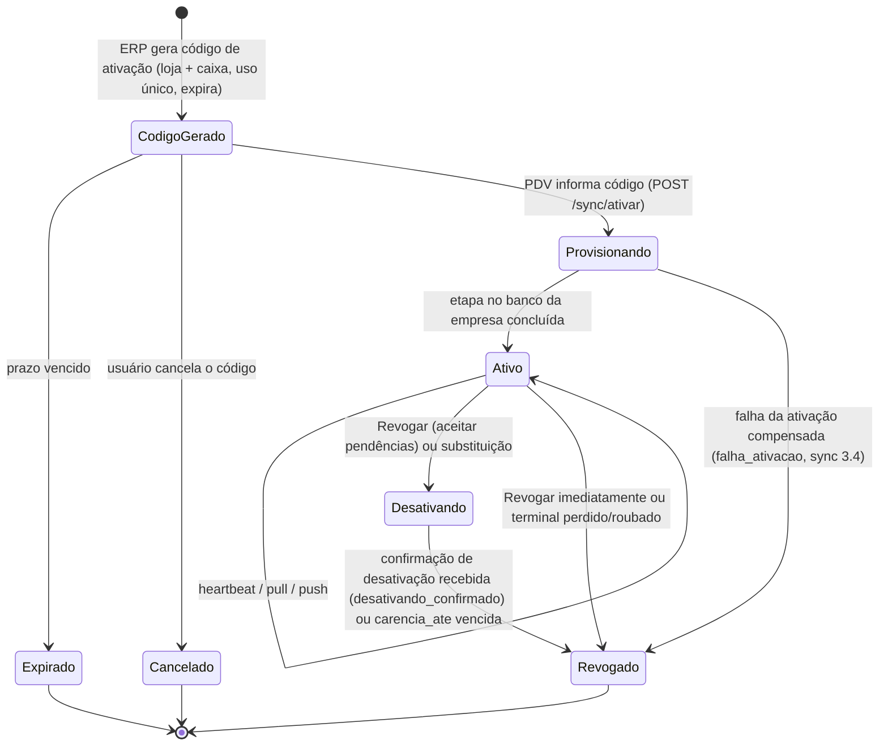

Status de conexão de um terminal **Ativo** (calculado pelo último contato):

| Status | Regra | Cor |
|---|---|---|
| Online | último contato < 2 min | verde |
| Offline | 2 min ≤ último contato < 24 h | amarelo |
| Sem contato | último contato ≥ 24 h | vermelho |
| Com pendências | `eventos_pendentes > 0` informado no último heartbeat e offline há > 1 h | badge laranja |
| Hardware alterado | `terminais_pdv.id_hardware_pendente` preenchido: o terminal recebe `409 HARDWARE_ALTERADO`, não vende e não recebe segredos até "Confirmar troca de hardware" ou "Não reconheço" (12.4, sync 20.5) | badge vermelho |

### 12.2 Listagem

**Rota**: `/cadastros/pdvs` · **Permissão**: `terminais.ver`.

| Filtro | Tipo |
|---|---|
| Loja | seleção (lojas permitidas) |
| Situação | Ativos (padrão), Desativando, Revogados, Todos |
| Conexão | Todos, Online, Offline, Sem contato, Com pendências, Hardware alterado |
| Versão do app | texto/seleção |

| Coluna | Conteúdo |
|---|---|
| Loja / Caixa (link) | "Loja 1 - Ice Beer Hermes · Caixa 02" |
| Descrição | nome do computador / descrição dada |
| Conexão | status 12.1 + "há 3 min" |
| Última sincronização | data/hora do último pull e do último push com sucesso |
| Eventos pendentes | quantidade informada pelo PDV no último heartbeat |
| Eventos com erro | eventos com status `erro` ou `retido` aguardando ação (12.5) |
| NFC-e em contingência | quantidade não transmitida |
| Relógio **(Novo, C16)** | desvio do relógio do computador no último heartbeat (sync 21.2): o valor até 2 min; acima disso em âmbar e acima de 5 min em vermelho, com o sentido ("6 min adiantado"); "hora não confirmada" quando o caixa não tem amostra confiável desde que o computador ligou (`relogio_confiavel = false`, sync 12.2); "—" sem amostra ou revogado |
| Versão do app | com alerta se abaixo da versão mínima (19.5) |
| Operador atual | usuário com sessão de caixa aberta, se houver |

Topo da tela: **Gerar código de ativação** (permissão `terminais.ativar`), contadores (online/offline/sem contato), e
a lista de **códigos de ativação pendentes** (código mascarado, loja, caixa, gerado por, expira em, botão Cancelar).
Com o código da empresa bloqueado por força bruta (20 falhas de ativação em 1 h → `429 ATIVACAO_BLOQUEADA` por 1 h,
alerta crítico `ATIVACAO_FORCA_BRUTA`, sync 3.1), o topo mostra a faixa "Ativações temporariamente bloqueadas" com a
ação **Liberar ativações** (permissão `terminais.ativar`, auditada): zera o bloqueio daquele `codigo_empresa` antes do
fim da hora.
Atualização automática a cada 30 s.

### 12.3 Gerar código de ativação

Modal:

| Campo | Tipo | Obr. | Regra | Padrão |
|---|---|---|---|---|
| Loja | →`lojas` (tipo ponto de venda, ativa, com "Usa PDV") | S | | loja de contexto |
| Caixa | →`caixas` da loja (1–99; o caixa 0 não aceita terminal) ou "Novo caixa" (pede número e série NFC-e) | S | caixa já ocupado por terminal ativo → só com "Substituir terminal" (12.4) | próximo livre |
| Numeração NFC-e (caixa que já teve terminal) | enum **Série atual** / **Série nova** | C | aparece sempre que o caixa já teve terminal — decisão tomada contra o **último terminal que ocupou o caixa** (`caixas.terminal_anterior_id`, de qualquer status, ou o terminal ativo na substituição), **com ou sem** "Substituir terminal" (sync 13.3); mostra o estado desse terminal. **Série atual** só é oferecida quando ele **confirmou a desativação** (heartbeat `estado_local = 'desativando_confirmado'` com os números finais, e a nuvem recebeu todos os eventos até eles, sync 3.8): o novo continua em `greatest(numeracoes.ultimo_numero, números finais confirmados) + 1`. Sem essa confirmação ("Revogar imediatamente", pane, pendências, contingência ou só um heartbeat recente "em dia") → **Série nova** obrigatória, com a menor série livre da loja a partir de `100 + nº do caixa` sugerida, e salto de segurança de +1000 em venda e vale (sync 13.1–13.3) | Série atual se confirmado; senão Série nova |
| Descrição | texto(40) | N | ex.: "PC do balcão" | — |
| Validade | enum 1 h / 24 h / 72 h | S | | 24 h |

Regras:
- Verifica o limite do plano (`coalesce(empresas.limite_terminais, planos.limite_terminais)`, terminais Provisionando +
  Ativos + Desativando + códigos pendentes); acima → `LIMITE_PLANO`.
- Gera código de **8 caracteres** em base32 sem caracteres ambíguos — alfabeto `23456789ABCDEFGHJKMNPQRSTUVWXYZ`
  (sem `0 O 1 I L`, 31 símbolos, sync 3.1) —, exibido como `K7QM-2XRD` + QR code com o mesmo valor + código da
  empresa. Guardado como hash em `genesis_control.ativacoes_pdv` (`codigo_hash`, `codigo_final`, empresa, loja, caixa,
  descrição, `validade_horas`, `expira_em`, `substitui_terminal_id`, `criado_por_usuario_id`, `usado_em`,
  `terminal_id`). Uso único.
- O código é exibido **uma vez** (botão copiar); depois aparece mascarado (`••••-••RD`) na lista de pendentes.
- 5 tentativas erradas de ativação por IP em 10 min bloqueiam o IP por 30 min.

Ativação (lado da API, para referência; contrato completo no sync 3.2–3.4):

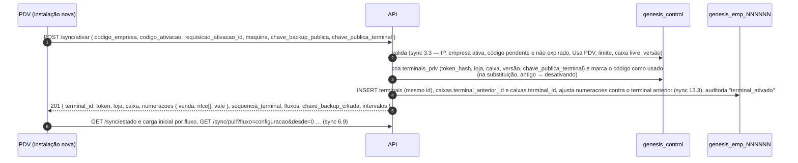

### 12.4 Detalhe do terminal

**Rota**: `/cadastros/pdvs/:id`.

| Bloco | Conteúdo |
|---|---|
| Identificação | loja, caixa, descrição (editável com `terminais.gerenciar`), nome do computador, SO, id de hardware, IP do último contato, ativado em/por |
| Sincronização | último heartbeat, último pull (cursor `versao`), último push, eventos pendentes, eventos com erro, relógio (diferença entre hora do PDV e da nuvem, como a coluna da 12.2; alerta > 2 min, crítico > 5 min por causa da NFC-e) |
| Fiscal | tipo de emissão, série, último número NFC-e, NFC-e em contingência (quantidade e a mais antiga), validade do certificado no PDV |
| Caixa | sessão aberta (operador, abertura, valor estimado em dinheiro) |
| Saúde do computador **(Novo, Central do PDV G15)** | bloco na largura toda, depois de Identificação, Sincronização, Fiscal e Caixa; do último heartbeat (sync 21.1, 21.2): disco livre (< 1 GB selo âmbar "pouco espaço", < 200 MB vermelho "quase cheio": abrir caixa novo fica bloqueado até o supervisor liberar por 1 h; os limites e as frases do Painel de saúde do PDV, PDV 32.2: apagar arquivos que não são do caixa, como downloads, fotos e vídeos, ou chamar o suporte), tamanho do banco do caixa (só o arquivo `pdv.db`, sem o WAL: pode ser menor que o do Sobre do PDV; sem cor) e fila de impressão (comprovantes que esperam ou que falharam, "N não impressos": âmbar com "imprima de novo na Central do PDV › 3 Impressora e gaveta (F7)"); o que fazer vem escrito embaixo do campo, e a última linha diz de quando são os números ("Fila do último heartbeat (há 3 min); disco e banco da última medida": um heartbeat que não mediu o disco não apaga o anterior); sem heartbeat há mais de 24 h, os selos ficam cinza com "Dado antigo" no lugar do que fazer; no revogado, os últimos valores sem cor |
| Histórico | linha do tempo: ativação, versões instaladas, revogações, ressincronizações, erros |

Ações:

| Ação | Permissão | Efeito |
|---|---|---|
| **Revogar – aceitar pendências** (padrão) | `terminais.revogar` | estado `Desativando` (sync 3.8): o PDV recebe o aviso no próximo contato, termina a venda atual, **para de vender** (grava localmente que não reserva mais número de venda, NFC-e ou vale), permite fechar o caixa, envia todos os eventos pendentes, NFC-e em contingência e inutilizações pendentes. `Desativando → Revogado` quando o heartbeat traz `estado_local = 'desativando_confirmado'` com os números finais e a nuvem confere que recebeu tudo até eles (é essa confirmação que libera a **Série atual** para o próximo terminal do caixa, 12.3), **ou** ao fim da carência (`terminais_pdv.carencia_ate`, máx. 7 dias) — neste caso sem confirmação, e o próximo terminal do caixa recebe série nova e salto de segurança |
| **Revogar imediatamente** | `terminais.revogar` + confirmação digitando o nº do caixa | token invalidado na hora; qualquer chamada responde 401 `TERMINAL_REVOGADO`; o PDV bloqueia o uso e mantém o banco local intacto para suporte |
| **Terminal perdido/roubado** **(Novo)** | `terminais.revogar` + confirmação digitando o nº do caixa | revoga imediatamente **e** invalida os PINs do PDV (`senha_pdv_hash = null`) de todos os usuários com acesso à loja até redefinição **e** as senhas de cliente do crediário (`pessoas.senha_hash = null` das pessoas com crediário que desceram para aquele terminal, com aviso para redefinição no próximo atendimento) (sync 4.3 item 6). A senha do ERP não desce ao PDV, por isso **não** precisa ser trocada (`senha_provisoria` não muda). O próximo terminal do caixa recebe série nova e salto (12.3) |
| Terminal revogado com eventos tardios | — | um terminal Revogado recebe **401** em tudo, inclusive no push; eventos que ficaram nele só entram pela **recuperação assistida** (sync 22.3): ação **Gerar código de recuperação** abaixo, usado no PDV substituto |
| **Gerar código de recuperação** **(Novo)** | `terminais.gerenciar` | código de uso único (24 h, vinculado ao `terminal_id` antigo, auditado) para o PDV novo importar o backup do antigo: eventos não enviados, NFC-e em contingência e inutilizações pendentes (sync 22.3) |
| **Substituir terminal** | `terminais.ativar` + `terminais.revogar` (PDV 5.2) | gera código de ativação para o **mesmo caixa** com a escolha "Série atual / Série nova" (12.3); ao ativar o novo, o antigo vai para `Desativando`. Regra de numeração do sync 13.1–13.3, a mesma de qualquer código gerado para um caixa que já teve terminal (`caixas.terminal_anterior_id`, com ou sem substituição): antigo com desativação **confirmada** (`estado_local = 'desativando_confirmado'` com números finais que a nuvem recebeu) → venda, NFC-e e vale continuam em `greatest(numeracoes.ultimo_numero, números finais confirmados) + 1` na série atual; sem confirmação (mesmo com heartbeat recente "em dia") → **salto de segurança** na venda e no vale (`base + 1000`, configurável na plataforma; o ERP mostra "Números 000501–001500 do Caixa 02 reservados ao terminal antigo") e **série NFC-e nova obrigatória**. Se o código foi gerado para "Série atual" e a confirmação deixou de valer até a ativação (ex.: chegou evento do antigo depois dela), a ativação falha com `CAIXA_OCUPADO` ("gere novo código com série nova") |
| **Ressincronizar** | `terminais.gerenciar` | comando `ressincronizar` (todos os fluxos) ou `ressincronizar_fluxo {fluxo}`: o PDV refaz o fluxo **em sombra** (sync 6.11) sem parar o caixa e sem zerar o espelho, a outbox nem `sequencias_locais` |
| **Renovar token** **(Novo)** | `terminais.gerenciar` | o próximo heartbeat traz `renovar_token: true` (sync 3.7); o token anterior continua aceito por 7 dias |
| **Solicitar logs** | `terminais.gerenciar` | comando `enviar_logs`: o PDV envia o pacote de diagnóstico (`arquivos`, categoria `logs_terminal`); link aparece no histórico |
| **Renomear** | `terminais.gerenciar` | descrição |
| **Confirmar troca de hardware** **(Novo)** | `terminais.gerenciar` | só com `id_hardware_pendente` preenchido (sync 20.5); mostra nome da máquina, SO, IP e horário da primeira chamada com o hardware novo; vale só para o id exibido (se outra máquina chamou depois, 409 e a tela recarrega); grava `id_hardware = id_hardware_pendente` e limpa a pendência — o terminal volta a vender e a receber segredos no próximo contato; auditada |
| **Não reconheço** **(Novo)** | `terminais.revogar` | alternativa à confirmação: revoga imediatamente (como "Revogar imediatamente", sync 3.8); auditada |
| **Máquina conferida** **(Novo)** | `terminais.gerenciar` | só no alerta crítico `TOKEN_ANTERIOR_REUTILIZADO` (token anterior usado depois que o novo já funcionou, indício de cópia, sync 3.7), que aparece na listagem e no detalhe: pede o que foi verificado (3–255 caracteres) e resolve o alerta (`resolvido_por_id`, `resolucao`; auditoria `conferir`). Não reconhecendo o uso, **Revogar terminal** no próprio alerta abre a revogação imediata. Os outros alertas de terminal fecham sozinhos |
| **Ciente do relógio** **(Novo, C16)** | `terminais.gerenciar` | no alerta `RELOGIO_SUSPEITO` (a hora de um evento do caixa não bate com a da nuvem: no futuro, antes da ativação, mais de 400 dias no passado ou anterior à do evento anterior, sync 12.4; aviso, ou `info` quando o próprio caixa marcou a correção do relógio — estas vêm somadas numa linha por terminal, "relógio do computador voltou N vezes", e o "Ciente" fecha todas): pede o que foi feito (3–255 caracteres), como o "Máquina conferida". O `RELOGIO_DESVIO` (desvio do heartbeat > 2 min aviso, > 5 min crítico) não tem botão: fecha sozinho quando o desvio volta a até 2 min ou quando o terminal sai do caixa |

Abas do detalhe: **Eventos com erro** (12.5) e **Perdas prováveis** **(Novo)** — para terminal perdido sem banco nem
backup, a estimativa do sync 22.4: eventos (`ultima_sequencia_gerada` do último heartbeat − maior sequência
recebida), vendas (`venda_ultimo_numero` − `numeracoes.ultimo_numero`, `eventos_pendentes`), NFC-e (`nfce_ultimo_numero`
informado − maior recebido; contingência pendente) e caixa (sessão aberta sem fechamento, `dinheiro_estimado_gaveta`),
com o procedimento recomendado (conferência do caixa, acerto "Definir", série NFC-e nova, orientação do contador).

### 12.5 Eventos com erro (fila de decisão)

Eventos recebidos que a nuvem não conseguiu aplicar (ex.: referência inexistente, sessão de caixa inexistente, versão
de contrato desconhecida) ficam em `eventos_recebidos` com `status = 'erro'`; eventos que dependem de outro ainda não
aplicado ficam `retido` (sync 8.5). A aba **Eventos com erro** do terminal (sync 11.4) lista os dois status com:
sequência, tipo, data no PDV (`ocorrido_em`), situação (Erro com código e mensagem, ou Retido aguardando qual
evento), agregado (link e resumo: "Venda L01-C02-000123 · R$ 71,58 · 4 itens"), tentativas e payload (visualizador
JSON somente leitura). Ações (permissão `terminais.gerenciar`, todas auditadas):

| Ação | Efeito |
|---|---|
| **Reprocessar** | reaplica o payload gravado com o código atual (depois de corrigir o cadastro ou publicar correção); sucesso reprocessa os retidos dependentes em ordem |
| **Reprocessar todos com este código** | o mesmo, em lote (ex.: depois de publicar um upcaster) |
| **Aplicar com novo número** | só para `NUMERO_VENDA_DUPLICADO` (sync 13.1) |
| **Descartar** | justificativa ≥ 15 caracteres e, para `venda.*`/`caixa.*`/`nfce.*`, confirmação digitando o número exibido da venda; grava `descartado_em/por/justificativa` e gera alerta crítico `EVENTO_DESCARTADO` no Dashboard (venda nunca é descartada sem alerta) |

O resultado volta ao PDV no heartbeat seguinte (`eventos_resolvidos`).

Fase 1C (C8), na tela: a lista é paginada (50 por página) e filtra por situação e código; cada linha tem o menu
**Ações** (Reprocessar, Aplicar com novo número só no `NUMERO_VENDA_DUPLICADO`, Descartar, Ver payload), e o botão
**Reprocessar todos com o código** lista os códigos de erro do terminal com a quantidade e cria uma tarefa (ícone
Tarefas, 3.6). Reprocessar e Aplicar com novo número pedem confirmação e mostram o desfecho do evento e dos
dependentes reaplicados em seguida ("Evento nº 1 aplicado. 3 de 3 evento(s) que dependiam dele aplicados"). O
Descartar pede a justificativa e, nos tipos críticos, "Digite L01-C02-000123 para confirmar" (no evento de caixa, que
não tem número de venda, a sequência do evento; sync 11.4, T28). Na venda renumerada, a tela mostra o número novo e o
do caixa. O link para a venda chega com a consulta de vendas (15.4); por ora só o resumo. Regras da API no sync 11.4.

### 12.6 Contrato de heartbeat

`POST /sync/heartbeat` a cada 30–60 s quando online (intervalo devolvido pela nuvem). Contrato completo no **sync
21.1**: a requisição traz, entre outros, `versao_app`, `so`, `hora_local`, `desvio_relogio_ms`, `cursor_pull` (por
fluxo), `eventos_pendentes`, `evento_mais_antigo_em`, `ultima_sequencia_gerada`, `venda_ultimo_numero`,
`vale_ultimo_numero`, `nfce_ultimo_numero[]`, `nfce_contingencia_pendentes`, `sessao_caixa_id`, `operador_id`,
`dinheiro_estimado_gaveta`, `certificado_validade`, `resumo_vendas`, `comandos_resultado`; a resposta traz `comandos`
(`revogar`, `ressincronizar`, `ressincronizar_fluxo`, `enviar_logs`, `atualizar_app`, `mensagem`, `reservar_faixa`),
`eventos_resolvidos`, `renovar_token`, `app` (versão mínima/disponível) e `intervalos`.

**Entidades**: controle `terminais_pdv`, `ativacoes_pdv`; empresa `terminais`, `caixas`, `numeracoes`,
`eventos_recebidos`, `comandos_terminal`, `sessoes_caixa`, `alertas`, `auditoria`. **API**: `GET /api/terminais`,
`GET /api/terminais/:id`, `POST /api/terminais/ativacoes`, `DELETE /api/terminais/ativacoes/:id`,
`POST /api/terminais/:id/revogar { modo: aceitar_pendencias|imediato|perdido }`,
`POST /api/terminais/:id/ressincronizar { fluxo? }`, `POST /api/terminais/:id/renovar-token`,
`POST /api/terminais/:id/codigo-recuperacao`, `POST /api/terminais/:id/solicitar-logs`,
`GET /api/terminais/:id/eventos-erro`, `GET /api/terminais/:id/perdas-provaveis`,
`POST /api/terminais/:id/alertas/:alertaId/resolver { resolucao }`,
`POST /api/eventos-recebidos/:id/reprocessar|aplicar-novo-numero|descartar`,
`POST /api/eventos-recebidos/reprocessar-lote { terminalId, codigo }` (tarefa).

---

## 13. Estoque

> [P2] (Locais de estoque em [P1], porque a loja precisa de um estoque vinculado desde o início.)

### 13.1 Conceitos do estoque

#### 13.1.1 Razão de movimentos (fonte única do saldo)

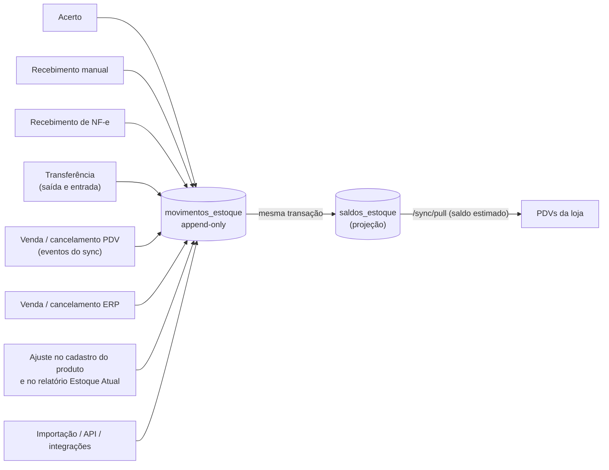

- Todo efeito sobre o estoque é **um ou mais movimentos** em `movimentos_estoque`. Movimentos nunca são alterados nem
  apagados; correção = movimento de estorno (`estorno_de_id`) ou novo ajuste (ADR-06/ADR-08).
- `saldos_estoque` é uma **projeção** atualizada na mesma transação do movimento (com `SELECT … FOR UPDATE` na linha
  do saldo para serializar). Um comando de manutenção (`db:recalcular-saldos`) reconstrói a projeção a partir do razão
  e compara (relatório de divergências). Fase 2 (F2-B3): o replay segue a ordem de lançamento (`seq_lancamento`) com a
  mesma conta do motor e confere quantidade, custo médio, datas de última entrada e saída, último movimento, linhas sem
  razão e o custo médio do produto; o relatório traz, por linha divergente, o gravado, o recalculado, a diferença e o
  primeiro movimento divergente. O `--corrigir` é seguro com os PDVs sincronizando: regrava só a projeção (nunca um
  movimento), em blocos sob a trava de ordenação, sem perder a venda que chega no meio, com a auditoria
  `recalcular_saldos`; a versão das linhas sobe e o saldo certo desce ao PDV. Uma verificação periódica opcional
  (desligada por padrão) só confere e abre o alerta `RAZAO_SALDO_DIVERGENTE` (README da API › decisão 147).
- Saldo é por **(estoque, produto, variação, tipo de estoque)**; lote é rastreado no movimento (`lote_id`) e tem saldo
  próprio em `saldos_lote` quando o produto controla lote. Fase 2 (F2-B6): o motor mantém `saldos_lote` na mesma
  transação; o lote do movimento é do produto e do estoque do documento (ou sem estoque), senão o documento é recusado
  (o acerto, no campo do item). A saída sem lote (a venda do caixa, que só informa o lote na Fase 3; a Saída do acerto
  sem lote; a diferença negativa do "Definir") de produto com lote de saldo positivo sai **por lote, o que vence
  primeiro antes (FEFO)**, ao custo médio, e a sobra sem saldo de lote sai sem lote (Configurações › Geral › Estoque,
  `estoque.lote_baixa_sem_informar`: "Baixar dos lotes" (padrão) ou "Não baixar o saldo por lote"); o lote informado em
  outro item do mesmo documento sai dele antes da divisão; estorno e cancelamento voltam ao mesmo lote, e o estorno do
  ERP também não deixa o lote negativo sem a permissão abaixo. O custo do item é a soma do custo das partes. O
  "Definir" conta o produto inteiro, sem lote. A entrada de compra (recebimento,
  NF-e) grava a última compra da linha (data e custo unitário), que o estorno não volta (README da API › decisão 151).
- **Saldo negativo** é aceito no razão (vendas offline não podem ser recusadas). Documentos do ERP (acerto de saída,
  transferência) não podem deixar saldo negativo, salvo `estoque.permite_negativo_erp = Sim` (Configurações › Geral,
  padrão Não) ou usuário Master.

#### 13.1.2 Campos do movimento (`movimentos_estoque`)

| Campo | Tipo | Descrição |
|---|---|---|
| `id` | uuid | (export do Nuvem3: `idmovimentacaoestoque`) |
| `estoque_id` | →`estoques` | local (export: `Estoque`) |
| `loja_id` | →`lojas` | loja do documento (export: `nomeLoja`) |
| `tipo_estoque_id` | →`tipos_estoque` | padrão "Disponível" |
| `produto_id`, `variacao_id`, `lote_id` | → | (export: `CodigoInterno`, `NomeProduto`, `nomeVariacao`) |
| `tipo_movimento` | varchar(30) →`tipos_movimento_estoque.codigo` | ex.: `VENDA_PDV` (export: `TipoMovimento`) |
| `quantidade` | quantidade com sinal | + entrada, − saída, sempre na unidade base (export: `QtdMovimentada`) |
| `unidade_documento`, `fator` | texto, quantidade | unidade/embalagem usada no documento (export: `sigla`) |
| `saldo_anterior`, `saldo_posterior` | quantidade | saldo do (estoque, produto, variação, tipo) na ordem de lançamento (export: `EstoqueAnterior`, `EstoqueAtual`) |
| `custo_unitario` | preço | **custo gravado no movimento** (melhoria sobre o Nuvem3): entradas = custo do documento; saídas = custo médio vigente |
| `custo_total` | dinheiro | `|quantidade| × custo_unitario` |
| `custo_medio_posterior` | preço | custo médio do saldo depois do movimento |
| `preco_venda` | preço | preço de venda praticado (vendas) ou de referência (acertos) |
| `data_movimento` | data_hora | quando o fato aconteceu (ex.: hora da venda no PDV) (export: `DataHora`); nos documentos do ERP, o momento do lançamento, salvo o "Definir" e a compensação (13.1.5 regra 6) |
| `criado_em` | data_hora | quando a nuvem lançou |
| `usuario_id` | →`usuarios` | (export: `Usuario`) |
| `pessoa_id` | →`pessoas` | cliente da venda / fornecedor do recebimento (export: `PessoaVenda`, `fornecedornf`) |
| `documento_tipo`, `documento_id`, `documento_item_id` | enum, uuid, uuid | origem: `venda`, `troca`, `acerto`, `recebimento`, `nota_entrada`, `transferencia`, `vasilhame` (devolução avulsa de cascos, `movimentos_vasilhame`) (os ajustes do cadastro, do relatório Estoque Atual, de importação e de API geram um `acertos_estoque` com a `origem` correspondente) (export: `idvenda`) |
| `terminal_id`, `evento_id` | uuid | origem PDV; `evento_id` é só rastreio: **não é único** (um `venda.finalizada` gera um movimento por item e por componente de kit/insumo) |
| `estorno_de_id` | →`movimentos_estoque` | movimento que este estorna |
| `compensa_movimento_id` | →`movimentos_estoque` | só em `ACERTO_COMPENSACAO`: o movimento tardio compensado (13.1.5) |
| `observacao` | texto | |

Idempotência: a do evento é `eventos_recebidos` (`uq_eventos_recebidos_evento_id`, sync 8.4); a segunda barreira é
`uq_movimentos_estoque_idempotencia` (`documento_tipo`, `documento_item_id`, `produto_id`, `variacao_id`, `lote_id`,
`tipo_estoque_id`, `tipo_movimento`, `compensa_movimento_id`, `estorno_de_id`) quando `documento_item_id` é preenchido
(modelo 3.7.2; as duas últimas entraram na Fase 1C, T23, migração 0013: compensações e estornos do mesmo item do
acerto não colidem), com `uq_movimentos_estoque_compensacao` garantindo uma compensação por movimento e por
"Definir" (desde a migração 0018; só uma viva, 13.1.5 regra 7) e `uq_movimentos_estoque_estorno`, um estorno por
movimento.

#### 13.1.3 Tipos de movimento (seed de `tipos_movimento_estoque`, não editável pelo usuário)

| Código | Nome | Sinal | Origem |
|---|---|---|---|
| `VENDA_PDV` | Venda pelo PDV | − | evento `venda.finalizada` |
| `CANC_VENDA_PDV` | Cancelamento de venda PDV | + | evento `venda.cancelada` (forma A) / cancelamento pelo ERP: estorno de cada `VENDA_PDV` e do `VASILHAME_VENDIDO` do casco cobrado, com `estorno_de_id`, ao custo da saída original; os vazios trazidos na venda voltam como `ESTORNO_VASILHAME_DEVOLVIDO` conforme `pdv.cancelamento_devolve_vazios` |
| `TROCA_PDV` | Devolução de venda PDV | + | evento `troca.registrada` (destino avaria entra no tipo de estoque Avaria) |
| `ESTORNO_TROCA_PDV` | Estorno de devolução PDV | − | cancelamento da troca |
| `DEVOLUCAO_ERP` | Devolução de venda registrada no ERP | + | 15.4.3 (troca com `origem = 'erp'`) — **novo no seed** |
| `ESTORNO_DEVOLUCAO_ERP` | Estorno de devolução ERP | − | cancelamento dessa troca — **novo no seed** |
| `BAIXA_INTERNA` | Baixa interna (avaria/consumo no caixa) | − | venda paga com forma `consumo_interno` (10.2) — **novo no seed** |
| `VASILHAME_DEVOLVIDO` | Devolução de vasilhame vazio | + | bloco `vasilhames` do `venda.finalizada` ou `vasilhame.movimentado` (devolução avulsa, `movimentos_vasilhame`); entra no tipo de estoque Vasilhame vazio (PDV 10.12) — **novo no seed** |
| `ESTORNO_VASILHAME_DEVOLVIDO` | Estorno de devolução de vasilhame | − | cancelamento da venda finalizada (`venda.cancelada` forma A) com `pdv.cancelamento_devolve_vazios` (ligada por padrão, decisão do dono D29): os vazios trazidos voltam ao cliente, saem de Vasilhame vazio com `estorno_de_id` — **novo no seed** |
| `VASILHAME_VENDIDO` | Venda de vasilhame (casco) | − | casco faltante cobrado na venda (substitui o `VENDA_PDV` do item de casco) — **novo no seed** |
| `VASILHAME_EMPRESTADO` | Empréstimo de vasilhame (comodato) | − | sai de Vasilhame vazio e soma em `saldos_vasilhame_pessoas` (`pdv.vasilhame_comodato`) — **novo no seed** |
| `VENDA_ERP` | Venda pelo ERP | − | venda finalizada no ERP |
| `CANC_VENDA_ERP` | Cancelamento de venda ERP | + | |
| `VENDA_INTEGRACAO` | Venda por integração (iFood, 99Food, e-commerce) | − | 18.x |
| `CANC_VENDA_INTEGRACAO` | Cancelamento de venda por integração | + | 18.x |
| `BAIXA_INSUMO` | Baixa de insumos (ficha técnica) | − | venda de produto produzido |
| `ESTORNO_BAIXA_INSUMO` | Estorno de baixa de insumos | + | cancelamento |
| `RECEB_MANUAL` | Recebimento manual de produtos | + | 13.3 |
| `ESTORNO_RECEB_MANUAL` | Estorno de recebimento manual | − | |
| `RECEB_NFE` | Recebimento de NF-e | + | 13.4 |
| `ESTORNO_RECEB_NFE` | Estorno de recebimento de NF-e | − | |
| `ACERTO_ENTRADA` | Acerto de estoque – Entrada | + | 13.5 |
| `ACERTO_SAIDA` | Acerto de estoque – Saída | − | 13.5 |
| `ACERTO_DEFINIR` | Acerto de estoque – Definir | ± | 13.5 (quantidade = diferença) |
| `ACERTO_COMPENSACAO` | Compensação de acerto por sincronização tardia | ± | 13.1.5 |
| `ESTORNO_ACERTO` | Estorno de acerto | ± | |
| `TRANSF_SAIDA` | Transferência de estoque – Saída | − | 13.7 |
| `TRANSF_ENTRADA` | Transferência de estoque – Entrada | + | 13.7 |
| `TRANSF_RETORNO` | Transferência – Retorno à origem | + | divergência/cancelamento |
| `AJUSTE_CADASTRO` | Atualização pelo cadastro de produtos | ± | 8.2.11 e 8.3 |
| `AJUSTE_RELATORIO` | Atualização pelo relat. estoque | ± | 16.4 |
| `AJUSTE_API` | Atualização por API | ± | integrações |
| `AJUSTE_IMPORTACAO` | Importação de planilha | ± | 8.6 |
| `MUDANCA_TIPO_ESTOQUE` | Mudança de tipo de estoque | ± (par) | sai de um tipo e entra em outro no mesmo estoque |

#### 13.1.4 Custo médio

- Custo médio ponderado por **linha de saldo — (estoque, produto, variação, tipo de estoque)** —, guardado em
  `saldos_estoque.custo_medio` (modelo 3.7.3). A mudança de tipo de estoque (`MUDANCA_TIPO_ESTOQUE`) sai pelo custo
  médio da linha de origem e entra com esse custo na linha de destino.
- Entrada com custo `c` e quantidade `q` sobre saldo `s` e custo médio `cm`:
  `cm' = (s × cm + q × c) / (s + q)` se `s > 0`; senão `cm' = c`.
- Saídas não mudam o custo médio; gravam `custo_unitario = cm` vigente.
- Estorno de uma saída (cancelamento de venda, estorno de baixa de insumo, estorno de acerto de saída) entra ao custo
  `c` gravado na saída original: com `s > 0`, a fórmula acima (o mesmo custo médio de quem nunca tivesse feito a
  saída); com `s ≤ 0`, `cm` é **mantido** (sem `cm`, `cm' = c`), porque o estorno não traz custo novo e não deve
  redefinir o custo da última compra de um saldo que segue negativo (Fase 1C, T20; SYNC 15.4).
- Transferência: a saída grava o `cm` da origem e a entrada no destino usa esse custo (recalcula o `cm` do destino).
- Estorno da mudança de tipo (Fase 2, F2-B8; 13.5): a perna do destino sai ao custo `c` com que entrou, com
  `cm' = (s × cm − q × c) / (s − q)` (a conta inversa da entrada, `q` em módulo), e a perna da origem entra, como o
  estorno de uma saída, ao custo que saiu do destino. Sem saldo positivo no destino, sem nada que sobre ou com `cm' ≤ 0`,
  a perna do destino é uma saída comum (`cm` vigente) e a origem recebe esse custo. O valor do estoque a custo não muda.
- Acerto de entrada sem custo informado usa o `cm` atual (ou `produtos.preco_custo` se não houver saldo).
- `produtos.custo_medio` exibido no cadastro = média ponderada dos estoques com saldo positivo.
- Eventos de venda que chegam atrasados usam o `cm` do momento em que a nuvem os aplica (aproximação documentada; o
  relatório de lucro usa o `custo_unitario` gravado).
- A conta depende da **ordem de lançamento** na linha de saldo, não da data do movimento: ela fica gravada em
  `movimentos_estoque.seq_lancamento` (sequência tomada com a linha de saldo travada), e é nessa ordem que o razão é
  refeito para conferir o saldo e o custo médio (Fase 2, F2-B2; modelo 3.7.2).

#### 13.1.5 Eventos tardios do PDV e acertos "Definir"

Um PDV offline pode enviar, depois de um acerto "Definir" (contagem), vendas que aconteceram **antes** da contagem. Como
a contagem física já refletia essas vendas, aplicá-las de novo deixaria o saldo errado. O inverso também acontece:
vendas que aconteceram **entre** a contagem e a efetivação do acerto (e já estavam aplicadas) não foram vistas pela
contagem e não podem ser apagadas pelo "saldo := contado". Regras (as mesmas do sync 15.3):

1. O acerto "Definir" grava a **data/hora da contagem** (`data_contagem`) e a quantidade contada por item.
2. **Efetivação do "Definir"** — a diferença desconta os movimentos já aplicados que a contagem não viu:
   `diferenca = contado − (saldo_atual − Σ quantidade dos movimentos já aplicados com data_movimento > data_contagem)`
   no mesmo (estoque, produto, variação, tipo de estoque). Ex.: contagem às 11:00 = 20; venda de 2 às 11:30 já
   aplicada; efetivação às 12:00 com saldo 18 → `diferenca = 20 − (18 − (−2)) = 0`, o saldo fica 18 (= 20 − 2).
3. **Movimento tardio** (chega depois da efetivação, com `data_movimento < data_contagem`): a nuvem aplica o movimento
   **e** lança **um único** `ACERTO_COMPENSACAO` de sinal oposto, contra **o último "Definir" efetivado** cuja
   `data_contagem > data_movimento` no mesmo (estoque, produto, variação, tipo) — nunca um por "Definir" (dois
   "Definir" depois de uma venda tardia de 3 geram +3, não +6). A compensação grava `documento_tipo = 'acerto'`,
   `documento_id` = esse acerto, `documento_item_id` = o item do acerto e `compensa_movimento_id` = o movimento tardio
   compensado (no máximo uma compensação viva por movimento, e uma por "Definir", `uq_movimentos_estoque_compensacao`
   desde a migração 0018: o estorno do "Definir" compensa de novo contra o anterior, regra 7), o que
   também a mantém distinta em `uq_movimentos_estoque_idempotencia` (a coluna entrou no índice na Fase 1C, T23: duas
   vendas tardias do mesmo produto contra o mesmo item do acerto). A compensação grava a mesma data do fato do
   movimento compensado e, quando compensa uma saída, entra ao custo dela (o custo médio fica como estava).
4. A tela do acerto mostra as compensações geradas (movimento compensado, terminal, hora do fato, desvio de relógio).
   Fase 2, F2-B10 (README da API › decisão 155): aba **Compensações** no acerto efetivado ou estornado, com o número
   no rótulo. Duas tabelas: os movimentos **anulados por este acerto** (a venda, o cancelamento e a devolução de
   cascos do PDV offline anteriores à contagem e recebidos depois, e o acerto lançado antes da contagem) e os
   movimentos **deste acerto anulados por outro "Definir"** de contagem posterior (regra 7), com o link para ele.
   Cada linha: hora do fato, produto (e lote), quantidade compensada, custo (só com `produtos.ver_custo`), o
   movimento compensado (tipo, quantidade e documento de origem, com o link para a venda ou o acerto), o terminal
   ("Caixa 01 · PC do balcão", com o link para o PDV, e a sequência do evento), quando a nuvem o recebeu, o relógio do
   caixa e a situação ("Valendo" ou "Estornada", com a data, o acerto estornado e o motivo; se outro "Definir"
   efetivado também contou o fato, o estorno o compensa de novo contra ele, e a linha mostra esse acerto). O **relógio
   é suspeito** quando o evento veio sem hora confiável, quando cai nas regras do `RELOGIO_SUSPEITO` (sync 12.4: no
   futuro, muito no passado ou anterior ao evento anterior do caixa, reavaliadas no evento) ou quando o desvio medido
   pelo caixa passa de 5 min **sem** a hora confiável: a linha fica laranja, a aba ganha o marcador e um aviso pede
   para conferir com a loja e acertar o relógio do computador, porque é a hora do fato que decide se a venda entrou na
   contagem. Com a hora confiável o caixa já corrigiu a hora do fato pelo desvio medido (sync 12.2), e o desvio só
   aparece na dica. A regressão marcada pelo caixa ("relógio corrigido") aparece, mas não destaca. A hora em que a
   nuvem recebeu a venda de uma lacuna recuperada (sync 8.6) é a do lote em que ela chegou. Até 5.000 compensações por acerto, pela hora do fato (acima,
   a aba avisa quantas há).
5. Antes de efetivar um "Definir", a tela avisa quando há terminais da loja do estoque **com eventos pendentes ou
   offline** ("2 PDVs da Loja 1 estão offline; vendas ainda não recebidas serão compensadas automaticamente").
6. **Data dos documentos do ERP** (Fase 2, F2-B4): todo documento do ERP (acerto Entrada/Saída, recebimento, NF-e,
   transferência, estornos) lança com `data_movimento` = o momento do lançamento; a data do documento (a "Data" do
   acerto, a emissão ou a entrada da nota) fica só no cabeçalho. Só o "Definir" (na `data_contagem`, inclusive o
   ajuste da importação de planilha) e a compensação da regra 3 (na data do fato) lançam no passado; o motor recusa
   qualquer outro movimento do ERP com data anterior ao lançamento (folga de 1 min). Consequência: a Entrada com a
   "Data" de ontem efetivada depois da contagem conta como posterior a ela (a contagem não a viu) e não é desfeita.
7. **"Definir" com contagem anterior à de outro já efetivado** (a contagem de terça lançada depois da de quarta, no
   mesmo estoque, produto, variação e tipo): o movimento dele é tardio pela regra 3 e é compensado contra o mais novo,
   na data da própria contagem — a contagem mais nova vale. Estornar o mais novo estorna as compensações dele, e a
   contagem anterior volta a valer por inteiro: o fato que ele compensava e que também é anterior à contagem
   anterior (a venda tardia de segunda, anterior às duas) não passa a valer, porque a contagem de terça já o tinha
   visto, e ganha uma nova compensação contra o "Definir" efetivado anterior, na data do fato. Estornar o anterior
   estorna também a compensação que o anulava, e o saldo não muda. A mesma compensação vale para a Entrada/Saída
   lançada antes de um "Definir" com a contagem informada um pouco no futuro (a folga de relógio de `data_contagem`).
   O estorno confere o saldo negativo pelo efeito líquido de cada produto: o estorno do movimento anulado e o da
   compensação que o anulava se cancelam, e o estorno que não muda o saldo não pede a permissão de negativo.
8. **Conferência da contagem** (Fase 2, F2-B11; roadmap D47, decidida pelo dono em 05/11/2026, ajustável por loja; README da API › decisão
   156): o "Definir" (o da tela, o da importação de contagem e o da planilha) tem o relatório de conferência, aba
   **Conferência** do acerto: por item, o contado, o **saldo do sistema na hora da contagem** e a diferença, em
   quantidade, em percentual do saldo e valorizada a custo. Efetivado, o saldo na hora é o usado na efetivação menos
   o que as compensações deste "Definir" anularam (a venda offline anterior à contagem que chegou depois: o sistema
   "na hora" já devia tê-la, regra 3); no rascunho, uma estimativa com o saldo de agora; o estornado não tem. O
   veredito é **Conferido** quando a soma dos módulos das diferenças a custo (a sobra de um item não paga a falta de
   outro) fica até `estoque.tolerancia_conferencia_total_pct` (padrão 1%) do valor contado a custo **e** nenhum item
   passa de `estoque.tolerancia_conferencia_item_pct` (padrão 5%) do próprio saldo do sistema; senão, **Fora da
   tolerância**. O limite é comparado com o percentual exato (5,004% passa de 5%, ainda que a tela mostre "5,00%"); no
   limite exato fica dentro. Sempre em percentual e valor, nunca em unidades (venda a granel e por kg). O item com saldo zero no
   sistema e contado diferente de zero não tem percentual e fica fora. Os limites são de Configurações › Estoque (por
   loja; o CD usa os da empresa) e a aba os troca só para a consulta. Os valores a custo exigem `produtos.ver_custo`;
   o percentual e o veredito aparecem sem ela.

#### 13.1.6 Saldo estimado no PDV

A nuvem envia ao PDV o saldo de cada produto no estoque vinculado à loja do terminal; o PDV mostra
`saldo baixado − vendas locais ainda não confirmadas` (ADR-08). Saldos de outros estoques (CD, outras lojas) podem ser
consultados online no PDV (consulta de preço/estoque), quando houver internet.

### 13.2 Locais de estoque (Novo) [P1]

**Rota**: `/estoque/locais`, `/estoque/locais/:id` · **Permissões**: `estoques.ver/criar/editar/excluir`.

Listagem: filtro **Nome**; colunas **Nome**, **Loja vinculada**, **Tipo**, **Ativo**.

| Campo | Rótulo | Tipo | Obr. | Regra |
|---|---|---|---|---|
| `codigo` | Cód. | inteiro | — | gerado |
| `nome` | Nome | texto(60) | S | único; ex.: "CD - Estoque Ice Beer", "Loja 1 - Ice Beer Hermes" |
| `tipo` | Tipo | enum `loja`/`deposito`/`outro` | S | `deposito` = CD |
| Loja vinculada | exibição | — | — | a loja que aponta para este estoque (10.3.1), se houver |
| `endereco` | Endereço | texto | N | |
| `ativo` | Ativo | booleano | S | inativar exige saldo zero em todos os produtos e nenhuma transferência em trânsito |

Seed na criação da empresa: nenhum (criado junto da primeira loja). Exclusão bloqueada com movimentos.

### 13.3 Recebimento manual de produtos

**Rota**: `/estoque/recebimentos`, `/estoque/recebimentos/:id` · **Permissões**: `recebimentos.ver/criar/editar/movimentar/estornar`.

**Listagem**

| Filtro | Tipo |
|---|---|
| Fornecedor | `<SeletorPessoa categoria=Fornecedor>` |
| Id Recebimento | inteiro (`codigo`) |
| Cód. Remessa | texto |
| Estoque/Loja **(Novo)** | seleção |
| Período **(Novo)** | data inicial/final do recebimento |
| Movimentado? **(Novo)** | Todos / Sim / Não / Estornado |

Colunas: **Fornecedor** (link), **Data recebimento**, **Cód. Remessa**, **Movimentado?**, **Id** **(Novo)**,
**Estoque** **(Novo)**, **Total** **(Novo)**.

**Formulário — cabeçalho**

| Campo | Rótulo | Tipo | Obr. | Regra | Padrão |
|---|---|---|---|---|---|
| `codigo` | Id Recebimento | inteiro | — | gerado | — |
| `loja_id` | Loja | →`lojas` permitidas | S | loja destinatária (contas a pagar e filtros); alterar ou excluir o rascunho também exige a loja já gravada entre as permitidas (o rascunho de outra loja num estoque compartilhado se vê, mas não se descarta nem se toma) | loja de contexto |
| `estoque_id` | Estoque de destino | →`estoques` permitidos | S | destino das mercadorias | estoque vinculado da loja |
| `fornecedor_id` | Fornecedor | →`pessoas` (Fornecedor) | S | + cadastro rápido | — |
| `data_recebimento` | Data | data | S | não futura, no fuso da loja destinatária (1.5; a API confere) | hoje no fuso da loja |
| `codigo_remessa` | Cód. remessa | texto(30) | N | nº do documento do fornecedor; aviso se repetido para o mesmo fornecedor | — |
| `tem_validade` | Tem prazo de validade | booleano | N | exige Lote e Validade nos itens | Não |
| `valor_frete`, `valor_desconto`, `valor_outras_despesas` **(Novo)** | Frete, Desconto, Outras despesas | dinheiro | N | rateados no custo dos itens proporcionalmente ao valor | 0 |
| `observacoes` | Observações | texto | N | | — |

**Grade de itens**

| Coluna | Tipo | Obr. | Regra |
|---|---|---|---|
| Produto | `<SeletorProduto>` | S | botão **Cadastrar novo produto** abre o cadastro rápido em modal |
| Variação | seleção | C | produto com variações |
| Embalagem **(Novo)** | unidade/fator | N | ex.: FD × 12 (8.2.3) |
| Quantidade | quantidade | S | > 0 |
| Preço compra | preço | S | ≥ 0, por unidade da embalagem |
| Markup % | percentual | N | padrão = markup atual do produto; alterar recalcula Preço venda |
| Preço venda | preço | N | padrão = preço atual; alterar recalcula Markup |
| Lote, Validade | texto, data | C | se "Tem prazo de validade" ou produto com `solicita_lote_pdv`; a fabricação não pode ser futura (fuso da loja) |
| Custo unitário final **(Novo)** | exibição | — | preço compra / fator + rateios |
| Total | exibição | — | quantidade × preço compra |

Rodapé: **Total geral** (soma dos itens + frete + outras − desconto), quantidade de itens. O mesmo produto pode
repetir em várias linhas; o mesmo item (linha já gravada) não. Os totais gravados saem das linhas gravadas.

**Bloco "Gerar financeiro?"** (checkbox; quando marcado):

| Campo | Tipo | Obr. | Padrão |
|---|---|---|---|
| Plano de contas | →`planos_contas` (despesa analítica) | S | "Compra de mercadorias" |
| Forma de pagamento | →`formas_pagamento` | N | — |
| Quantidade de parcelas | inteiro 1–60 | S | 1 |
| Primeiro vencimento | data | S | hoje + 30 |
| Intervalo | enum mensal / a cada N dias | S | mensal |
| Grade de parcelas | nº, vencimento, valor (editáveis; soma = total geral) | S | gerada |
| Código de barras/PIX | texto por parcela | N | — |

**Botões**: **Novo**, **Salvar** (rascunho), **Salvar e movimentar** (efetiva), **Voltar**, **Estornar**,
**Imprimir** (espelho do recebimento), **Histórico**.

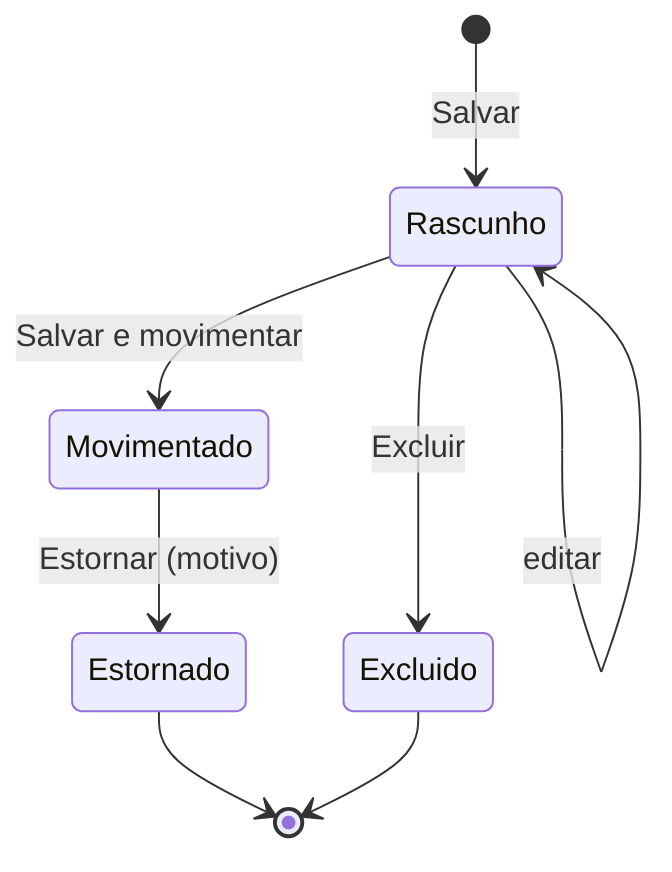

**Regras de negócio**

| Regra | Detalhe |
|---|---|
| Movimentar | Numa transação: gera `RECEB_MANUAL` por item (quantidade × fator, custo final), atualiza custo médio, grava `produtos.preco_custo` = último custo unitário, atualiza `produtos_fornecedores` (último custo/data), cria lotes, e — se marcado — a conta a pagar com as parcelas (origem `recebimento`). "Movimentado?" = Sim |
| Preço de venda | Se algum item teve preço de venda alterado, pergunta: **Atualizar preço geral** / **Atualizar só o preço da loja** (`produtos_lojas`) / **Não atualizar**. Respeita "Altera Preço do Produto no ERP" e `produtos.alterar_preco` |
| Edição | Só em Rascunho. Movimentado é somente leitura |
| Estorno | Gera `ESTORNO_RECEB_MANUAL` de cada item; bloqueado se o saldo ficar negativo (salvo Master) ou se alguma parcela gerada estiver paga (estornar a baixa antes); parcelas em aberto são canceladas. Exige motivo |
| Última compra | Alimenta "data da última compra" e "último custo" usados no relatório de Movimentação (melhoria apontada no levantamento) |

**Entidades**: `recebimentos`, `itens_recebimento`, `movimentos_estoque`, `saldos_estoque`, `produtos_lotes`,
`produtos_fornecedores`, `contas_financeiras`, `parcelas_financeiras`. **API**: `/api/recebimentos`,
`POST /api/recebimentos/:id/movimentar`, `POST /api/recebimentos/:id/estornar`.

**Rascunho na API (Fase 2, F2-B14; README da API › decisão 159)**: `GET /api/recebimentos` (filtros desta seção) e
`GET /api/recebimentos/:id` com `recebimentos.ver`; `POST` com `recebimentos.criar`; `PUT` e `DELETE` do rascunho
com `recebimentos.editar` (o `PUT` confere a versão do documento: 409 se outro usuário alterou). Regras decididas:

| Regra | Detalhe |
|---|---|
| Loja × estoque | A loja destinatária (lojas permitidas) e o estoque de destino (estoques permitidos para movimentar) são escolhidos à parte: a nota em nome de uma loja pode entrar no CD (D6). Fora dos permitidos, 403 no campo; o recebimento de estoque não permitido não aparece |
| Tipo de estoque **(Novo)** | O cabeçalho leva o tipo de estoque de destino (padrão: o tipo padrão, Disponível) |
| Fornecedor | Pessoa com a categoria Fornecedor; a inativa só continua no rascunho que já a tinha |
| Embalagem | O código de barras de embalagem tem de ser do produto, com "Usa na compra" e o mesmo fator do item; a unidade de compra vem dele |
| Produto | Recusados: combo, serviço e produzido (receber os componentes/insumos), "Com variações" (D43) e o que não controla estoque |
| Lote | "Tem prazo de validade" e o produto que pede lote no PDV exigem Lote e Validade; validade e fabricação só com o lote |
| Remessa repetida | Outro recebimento não estornado do mesmo fornecedor com o mesmo Cód. remessa (sem diferenciar maiúsculas) só gera aviso; não impede salvar |
| Preços do documento | O preço de compra e os totais do recebimento aparecem com `recebimentos.ver` (são o conteúdo da nota); o custo do produto continua exigindo `produtos.ver_custo` |
| Rascunho | Rateio, custo unitário final e o lote cadastrado são calculados ao movimentar (F2-B15); até 990 itens |

**Movimentar e estornar na API (Fase 2, F2-B15; README da API › decisão 160)**: `POST /api/recebimentos/:id/movimentar`
com `recebimentos.movimentar` e `POST /api/recebimentos/:id/estornar` (motivo obrigatório) com `recebimentos.estornar`,
os dois com a loja gravada entre as permitidas e o estoque entre os permitidos, como a edição. Regras decididas:

| Regra | Detalhe |
|---|---|
| Rateio | Frete, desconto e outras despesas rateados pelo total de cada item (quantidade × preço de compra), em decimal a 2 casas; o resíduo do arredondamento vai para o item de maior valor e o rateio sempre fecha com o cabeçalho |
| Custo final | `(total do item + frete + outras − desconto) / (quantidade × fator)`, a 4 casas, na unidade do produto: 10 FD × 12 a R$ 60,00 com R$ 12,00 de frete = R$ 5,10 |
| Movimento | `RECEB_MANUAL` por item, no momento da movimentação (a "Data" fica no cabeçalho), com o custo médio ponderado com o saldo anterior e a última compra do saldo |
| Lote | O lote digitado é achado (o mesmo texto no produto, sem estoque ou do estoque de destino) ou criado sem estoque; o mesmo lote com outra validade ou fabricação é recusado no item |
| Preço de custo | `estoque.compra_atualiza_preco_custo` (D49): `perguntar` (padrão) devolve a pergunta com os produtos cujo preço de custo mudaria (o atual e o novo) e o "Salvar e movimentar" responde Sim/Não; só quem tem `produtos.ver_custo` decide: sem ela não há pergunta e o preço de custo fica (como no cadastro do produto). `sempre` e `nunca` não perguntam. Vale o custo do último item do produto |
| Fornecedor | O vínculo produto × fornecedor recebe o último custo e a data da compra (sem voltar para trás com um documento mais antigo) e, no vínculo sem código, a unidade e o fator da embalagem; sem vínculo, é criado |
| Preço de venda | Por item: geral, só da loja destinatária ou não; respeita "Altera Preço do Produto no ERP" e `produtos.alterar_preco` (403 no item; repetir o preço de agora não é alteração); na loja sem preço próprio (que segue o geral), o "só da loja" igual ao preço geral não fixa preço na loja; o markup do produto é refeito e o histórico de preços leva a origem `recebimento` e o documento |
| Idempotência | Movimentar o que já está movimentado devolve o recebimento sem lançar de novo; estornado não movimenta |
| Estorno | `ESTORNO_RECEB_MANUAL` de cada item (no mesmo lote) e `ESTORNO_ACERTO` de cada compensação que um "Definir" lançou contra ele (13.1.5), bloqueado se o saldo da linha ou do lote ficar negativo (mercadoria já vendida), salvo Master ou "Permite saldo negativo no ERP" (D56, decidida pelo dono em 05/11/2026), que confirmam vendo a lista dos produtos/lotes que ficarão negativos ("O saldo ficará negativo em: … Estornar mesmo assim?"; a confirmação fica na auditoria); não desfaz preço, preço de custo nem o vínculo com o fornecedor |

**Telas (Fase 2, F2-B16; README do ERP › decisão 56; README da API › decisão 161)**: listagem e formulário em
`/estoque/recebimentos`, o espelho em `/estoque/recebimentos/:id/espelho`. Regras decididas:

| Regra | Detalhe |
|---|---|
| Produto ou EAN | O campo Produto aceita o código de barras: o código de uma embalagem de compra do produto (o fardo, `GET /api/recebimentos/dados-produtos`) preenche a Embalagem e o Fator; o EAN lido põe a quantidade 1 (3.3). Sem embalagem, o fator é digitável (a caixa sem EAN) |
| Rateio e custo final | A grade mostra o rateio (frete + outras − desconto) e o custo final por unidade do produto com as mesmas contas que a movimentação grava |
| Markup ⇄ preço | O preço proposto começa no preço de venda atual na loja do recebimento (o próprio da loja, quando ela tem, ou o geral — o mesmo que o movimentar compara no "só da loja"); vale o último digitado: o markup refaz o preço (e acompanha o custo final), o preço refaz o markup. A base é `produtos.custo_base_margem` (D49): o preço de custo que o produto terá depois da compra (padrão: o custo final, salvo `estoque.compra_atualiza_preco_custo = nunca`, em que fica o atual), o custo médio do estoque depois da entrada ou o último custo (o desta compra); sem `produtos.ver_custo`, sempre o custo da compra |
| Atualizar preço | Ao salvar (ou salvar e movimentar), os itens com o preço diferente do atual na loja e sem resposta recebem de uma vez a pergunta geral / só da loja / não (na loja com preço próprio, com o aviso de que o geral não vale nela); cada linha pode ser trocada depois. A resposta gravada (inclusive "não") fica ao reabrir: só a edição do preço ou do markup da linha volta a perguntar. Quem só movimenta (sem editar) não recebe a pergunta: movimenta o que está gravado. Quem não pode mudar o preço ("Altera Preço do Produto no ERP" = Não e sem `produtos.alterar_preco`; vem em `podeAlterarPreco` dos dados de compra) também não: o preço de venda e o markup ficam só leitura, sem a coluna para escolher, e o item novo vai com "Não" (decisão do dono de 05/11/2026) |
| Lote e validade | Colunas Lote, Validade e Fabricação (`dd/mm/aaaa`) quando o cabeçalho tem "Tem prazo de validade", o produto pede lote no PDV ou já tem lote cadastrado |
| Cadastrar novo produto | Modal reutilizável (também na vinculação da NF-e): nome, EAN, unidade, NCM (`<BuscaNcm>`), marca, categoria e preço de venda; cria um Simples com controle de estoque e a tributação vazia (sem nada fiscal na Fase 2; o EAN repetido segue `geral.ean_duplicado`), e o produto entra na grade |
| Salvar e movimentar | Confirma, grava o rascunho se for novo ou alterado (só com a permissão de editar) e movimenta; no novo, a tela passa a ser a do rascunho gravado antes do movimentar, para a recusa do movimentar não levar a um segundo rascunho; a pergunta do preço de custo (D49) mostra cada produto com o preço de custo atual e o desta compra. Os dados de compra da grade (embalagens, lote, saldo, preço da loja, base do markup) são lidos em blocos e precisam estar carregados para gravar; se falharem, a tela avisa e não grava |
| Markup no documento | O markup gravado no item só aparece para quem tem `produtos.ver_custo` (com o preço de venda, revelaria a base: o custo médio ou o preço de custo do cadastro) |
| Estornar | Só o movimentado, com o motivo obrigatório; avisa que o preço não volta |
| Imprimir | O espelho do documento gravado (cabeçalho, itens, rateio, custo final, preço de venda, lote e totais) pela impressão do navegador, em aba nova (padrão do plano da Fase 2 em vez do template em PDF de 3.7) |
| Remessa repetida | O aviso fica no topo do formulário, com o link para os outros recebimentos do fornecedor com o mesmo Cód. remessa |
| Gerar financeiro | Escondido até a Fase 4 |

### 13.4 Recebimento de NF-e (por XML e pela SEFAZ)

**Rota**: `/estoque/notas-entrada`, `/estoque/notas-entrada/:id` · **Permissões**: `notas_entrada.ver/importar/manifestar/movimentar/estornar`.

**Listagem**

| Filtro | Tipo |
|---|---|
| Nome | texto (emitente: razão social/fantasia) |
| Loja **(Novo)** | seleção |
| Período **(Novo)** | emissão ou recebimento |
| Situação **(Novo)** | Pendente de vinculação / Pronta / Movimentada / Estornada / Ignorada / Resumo SEFAZ (sem XML completo) |
| Número / Chave **(Novo)** | texto |

Colunas: **Nome** (emitente, link), **Data Recebimento**, **Data Movimentação**, **Número/Série** **(Novo)**,
**Valor total** **(Novo)**, **Situação** **(Novo)**, **Manifestação** **(Novo)**.

**Tela de entrada** (Novo registro): **Loja** (destinatário) + abas:

| Aba | Conteúdo |
|---|---|
| **Por Arquivo** | Upload de um ou vários XML (`.xml` ou `.zip`, ≤ 20 MB) + botão **Importar NF** |
| **Pela Sefaz** | Lista das NF-e emitidas contra o CNPJ da loja (Distribuição DF-e): emitente, CNPJ, número, emissão, valor, situação na SEFAZ, manifestação; botões **Consultar agora**, **Dar ciência e baixar XML**, **Manifestar** (Confirmação da operação / Desconhecimento / Operação não realizada), **Importar** |

**Validações na importação**

| Validação | Resultado |
|---|---|
| XML bem formado, `procNFe` com protocolo de autorização (cStat 100/150) | erro se falhar |
| Schema NF-e 4.00 (XSD) | **(Fase 2)** não validado; o parser confere os campos que lê (formato, casas decimais, tamanho) |
| Assinatura digital | conforme `notas_entrada.assinatura_invalida` (D50): **avisar** (decidida pelo dono em 05/11/2026; quem importa confirma), recusar ou não conferir |
| Modelo 55 | NFC-e não é aceita |
| Chave de acesso (DV, igual à do protocolo e aos dados da nota) | erro se falhar |
| Nota de homologação (tpAmb = 2) | **(Fase 2)** erro (sem valor fiscal) |
| CNPJ do destinatário = CNPJ de uma loja da empresa (inclusive a do tipo depósito, D6) | a loja do CNPJ é o padrão e o estoque de destino é escolhido entre os permitidos; senão erro |
| Chave já importada (inclusive a nota ignorada) | erro com link para a nota existente |
| Nota cancelada/denegada na SEFAZ (consulta protocolo, quando há certificado) | bloqueia; sem certificado, apenas aviso (**Fase 2**: sempre o aviso fixo, sem consulta) |

**Fase 2, F2-B18** (README da API › decisão 163): sem SEFAZ, o parser recusa também o XML com DTD (`<!DOCTYPE`/
`<!ENTITY`: XXE, "bilhão de risadas"), acima de 1 MiB ou aninhado demais; o ZIP do upload é conferido contra zip-bomba
pelo mesmo método da importação de planilha, com limites próprios (1.000 entradas, 100 MiB descompactados, taxa ≤ 100
acima de 64 KiB, cada XML até 1 MiB). A assinatura conferida é a da `NFe` (a do protocolo, que algumas autorizadoras
assinam, não conta). Os totais que não batem com os itens só avisam. A nota guarda o CFOP do XML e os impostos
só gravados; a aba **Conversão de CFOP** e a coluna CFOP de entrada ficam para a 3F/4.

**Fase 2, F2-B19** (README da API › decisão 164; README do ERP › decisão 59): sem a aba "Pela Sefaz", a "Tela de
entrada" é a área de upload no topo da listagem (arrastar ou escolher `.xml`/`.zip`, até 20 MB no envio), sem campo
Loja: cada nota entra na loja do CNPJ do destinatário (qualquer loja da empresa, inclusive o CD como depósito, D6),
que tem de estar entre as lojas permitidas de quem importa; o **Estoque de destino** é opcional (vazio = o estoque da
loja de cada nota) e fica entre os permitidos. O resultado é por arquivo: importada, já importada (com o link para a
nota existente, só para quem vê a loja e o estoque dela) ou recusada com o motivo; uma nota que não grava (o sistema
ocupado com os caixas, por exemplo) recusa só aquele arquivo. Acima de 20 XMLs o envio vira uma tarefa, acompanhada
na própria tela do upload (progresso e, no fim, o mesmo resultado por arquivo, ou a mensagem da falha) até o ícone
Tarefas do cabeçalho chegar (F2-B30). Os limites contra zip-bomba (1.000 entradas e 100 MiB descompactados) valem
por `.zip` e somados para o envio inteiro. O emitente vira o
fornecedor pelo CNPJ/CPF normalizado: a pessoa que já existe não é alterada (só ganha a categoria Fornecedor), e a
nova nasce com o nome, a fantasia, a IE, o telefone e o endereço do XML. O aviso fixo "Sem consulta à SEFAZ: confira se
a nota não foi cancelada pelo emitente." aparece no upload e em toda nota. "Ignorar nota" (pendente ou pronta, com
motivo; a chave continua ocupada) e "Reabrir" (volta a pendente) exigem `notas_entrada.importar`, como a troca do
destino na aba Dados da nota. As abas desta fase são **Dados da nota**, **Duplicatas** (somente leitura) e **XML**
(formatado e download do original); a coluna Manifestação e o DANFE em PDF ficam fora da Fase 2.

**Formulário da nota importada** (abas):

| Aba | Conteúdo |
|---|---|
| Dados da nota | Emitente (vira/acha Fornecedor pelo CNPJ — cria pessoa Fornecedor automaticamente se não existir), número, série, chave, emissão, natureza da operação, totais (produtos, frete, seguro, desconto, outras, IPI, ICMS ST, FCP ST, total da nota), transportadora, volumes, informações complementares |
| Itens e vinculação | uma linha por `det` (13.4.1) |
| Conversão de CFOP | CFOP da nota → CFOP de entrada por item (regras de 9.8); itens sem regra ficam em vermelho com botão **Adicionar Conversão CFOP** |
| Financeiro | Duplicatas (`cobr/dup`: número, vencimento, valor) → parcelas da conta a pagar (editáveis); checkbox **Gerar financeiro** (padrão Sim se houver duplicatas); plano de contas (padrão "Compra de mercadorias"); se não houver duplicatas, condição manual como em 13.3 |
| XML / DANFE | visualização do XML e geração do DANFE em PDF |

#### 13.4.1 Vinculação de itens

| Coluna | Conteúdo / regra |
|---|---|
| Item do fornecedor | `cProd`, `xProd`, `cEAN`, NCM, CFOP, unidade comercial, quantidade, valor unitário |
| Produto vinculado | sugestão automática, nesta ordem: (1) `produtos_fornecedores` (fornecedor + `cProd`); (2) EAN (`cEAN`/`cEANTrib`) em produto, código adicional ou variação; (3) nenhuma → o usuário busca manualmente ou clica **Cadastrar novo produto** (pré-preenchido com nome, NCM, CEST, EAN, unidade e custo do XML) |
| Variação | se o produto tiver variações |
| Fator de conversão | unidade do fornecedor → unidade do produto (ex.: CX → 24); sugerido pelo vínculo anterior ou pelo `qTrib/qCom`; quantidade no estoque = `qCom × fator` |
| Custo unitário | `(vProd + vFrete + vSeg + vOutro − vDesc + vIPI + vICMSST + vFCPST) / quantidade no estoque`; composição configurável (Configurações › Geral: `estoque.custo_inclui_st`, `estoque.custo_inclui_ipi`, `estoque.custo_inclui_frete`); regime normal pode abater créditos de ICMS/PIS/COFINS (`estoque.custo_abate_creditos`) |
| Lote/validade | do grupo `rastro` (nLote, dFab, dVal), editáveis |
| Markup / Preço venda | como no recebimento manual |
| Ignorar item | checkbox (ex.: brinde que não entra no estoque); exige motivo |

Ao movimentar, os vínculos (fornecedor + `cProd` → produto + fator) são gravados em `produtos_fornecedores` para as
próximas notas (Fase 2, F2-B21).

**Fase 2, F2-B20** (README da API › decisão 167; README do ERP › decisão 61): a aba **Itens e vinculação** mostra a
sugestão já preenchida, com a **origem** visível ("Vínculo anterior", "EAN da embalagem" ou "Manual"). O EAN do XML
procurado é o cEAN (a unidade comercial: o EAN do fardo cadastrado como código adicional com fator 12 sugere o fator
12) e, sem ele, o cEANTrib (a unidade do produto: fator = o da embalagem × `qTrib/qCom`), regra que vale também para
o cEAN igual ao cEANTrib (o GTIN da lata nos dois com uCom CX sugere 12, não 1); o EAN de **variação** não
sugere nada enquanto as variações estão travadas (D43), nem o EAN que está em mais de um produto. A sugestão nunca é
gravada sozinha: o **fator é sempre editável e confirmado pelo usuário** ("Fator confirmado" por item, ou "Confirmar
todos os fatores", que pula o fator vazio ou inválido), e só o item com o fator confirmado conta; o fator que
**diverge do vínculo anterior** fica em destaque, e o que diverge das quantidades da nota (qTrib/qCom) também. Quantidade no estoque = `qCom × fator`. O lote/validade do `rastro` e o preço proposto (markup ⇄ preço) ficam
gravados para a movimentação (F2-B21); o custo da coluna segue as chaves `estoque.custo_inclui_*` (a do frete leva
junto o seguro e as outras despesas, como diz o rótulo de 9.1), e `estoque.custo_abate_creditos` é ignorada na Fase 2. "Cadastrar novo produto" é o
modal do recebimento manual (13.3), pré-preenchido com nome, NCM, CEST, EAN da unidade, unidade tributável e o custo
por unidade. A nota fica **"pronta" quando todos os itens estão vinculados com o fator confirmado ou ignorados — o
CFOP não entra na regra** (sem conversão de CFOP na Fase 2) — e volta a "pendente" quando algum deixa de estar;
"Reabrir" uma ignorada com tudo resolvido a devolve direto a "pronta". A coluna "Variação" fica fora (D43).

**Fase 2, F2-B21** (README da API › decisão 169; README do ERP › decisão 62): **Movimentar** (só a nota "pronta",
com `notas_entrada.movimentar`) lança um `RECEB_NFE` por item vinculado no estoque e tipo de destino, com a quantidade
`qCom × fator`, a unidade comercial do XML e o **custo por unidade** da tabela acima, gravado no item (o das chaves
`estoque.custo_inclui_st/ipi/frete` da loja destinatária no momento; D49: entram todas; sem abater créditos). Pelo
mesmo núcleo do recebimento manual (13.3): o custo médio ponderado, a última compra, a pergunta do preço de custo
(`estoque.compra_atualiza_preco_custo`), o preço de venda proposto (geral ou só da loja, com a permissão de alterar
preço) e o histórico de preços com a origem "NF-e de entrada". O item com **mais de um lote no `rastro`** (com o lote
sugerido mantido) entra em cada lote com a sua parte, na proporção do qLote; com o lote trocado, entra inteiro no lote
digitado. Ao movimentar, o **vínculo fornecedor + `cProd` → produto, fator e unidade** é gravado em
`produtos_fornecedores` (o vínculo sem código do mesmo produto com o fornecedor ganha o código; o código ligado agora a
outro produto passa para ele como no "Mover o vínculo" do cadastro do produto: exige "Produtos: Editar", e o outro
produto registra a mudança no histórico): a próxima nota do fornecedor chega com esses itens sugeridos pelo "Vínculo
anterior". O erro de um item ao movimentar (o lote já cadastrado com outra validade, a embalagem que deixou de ser de
compra) aparece com o número do item e destacado na aba de itens.
A nota com todos os itens ignorados não se movimenta (use "Ignorar nota"). **Estornar** (com `notas_entrada.estornar`,
motivo obrigatório) lança o `ESTORNO_RECEB_NFE` de cada movimento, nos mesmos lotes, com a regra do saldo negativo do
recebimento (bloqueado salvo Master ou "Permite saldo negativo no ERP", com a lista e a confirmação; D56); não desfaz
preço, preço de custo nem o vínculo, e a nota estornada não volta (a chave continua ocupada). Sem DANFE e sem
financeiro na Fase 2.

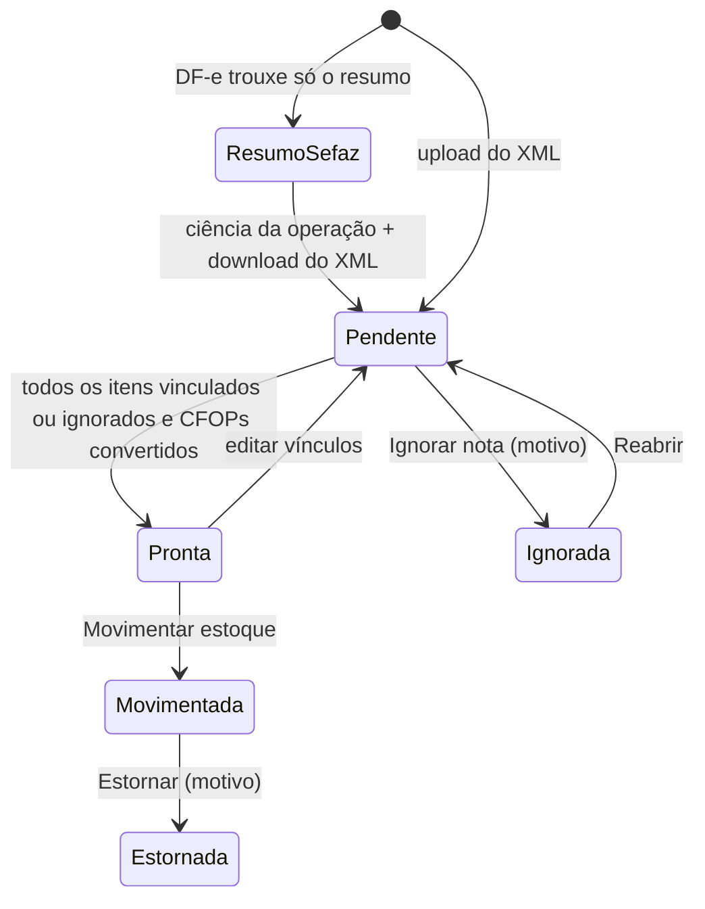

#### 13.4.2 Consulta pela SEFAZ (Distribuição DF-e)

| Regra | Detalhe |
|---|---|
| Pré-requisito | Certificado A1 da loja (10.3.2) — por isso o upload de certificado entra já na P2 |
| Execução | Tarefa automática a cada 1 h por CNPJ de loja + botão **Consultar agora** (respeitando o intervalo mínimo da SEFAZ) |
| Controle | Último NSU por CNPJ em `dfe_controle_nsu`; documentos recebidos em `dfe_documentos` (resumo ou XML completo, eventos) |
| Consumo indevido | Ao receber rejeição de consumo indevido (cStat 656) ou "nenhum documento" (137), espera 1 h antes de nova consulta |
| Manifestação | "Ciência da operação" é enviada automaticamente ao pedir o download (configurável); manifestação conclusiva (Confirmação / Desconhecimento / Operação não realizada) pelo botão **Manifestar**, com prazo legal exibido; desconhecimento e não realizada exigem justificativa (15+ caracteres) |
| Eventos | Cancelamento de NF-e já importada recebido pelo DF-e gera alerta na nota e no Dashboard |

**Regras de negócio**: movimentar gera `RECEB_NFE` por item com o custo calculado, atualiza custos e preços como em
13.3, cria a conta a pagar (origem `nota_entrada`, com a chave da NF-e) e guarda o XML no armazenamento (usado pelo
Download de XML de entrada). Estorno como em 13.3. A NF-e de devolução ao fornecedor fica para a P6.

**Entidades**: `notas_entrada`, `itens_nota_entrada`, `dfe_controle_nsu`, `dfe_documentos`, `manifestacoes_destinatario`,
`conversoes_cfop`, `produtos_fornecedores`, `movimentos_estoque`, `contas_financeiras`, `parcelas_financeiras`,
`arquivos`. **API**: `POST /api/notas-entrada/importar-xml`, `GET /api/notas-entrada/sefaz?loja_id=…`,
`POST /api/notas-entrada/sefaz/consultar`, `POST /api/notas-entrada/sefaz/:dfeId/manifestar`,
`PUT /api/notas-entrada/:id/itens`, `POST /api/notas-entrada/:id/movimentar`, `POST /api/notas-entrada/:id/estornar`.

### 13.5 Acerto de Estoque

**Rota**: `/estoque/acertos`, `/estoque/acertos/:id` · **Permissões**: `estoque_acertos.ver/criar/estornar`.

**Listagem**

| Filtro | Tipo |
|---|---|
| Responsável | seleção de usuário |
| Estoque **(Novo)** | seleção |
| Tipo de ajuste **(Novo)** | Entrada / Saída / Definir / Mudar tipo |
| Período **(Novo)** | data |
| Situação **(Novo)** | Rascunho / Efetivado / Estornado |

Colunas: **Responsável** (link), **Data**, **Motivo**, **Estoque** **(Novo)**, **Tipo** **(Novo)**, **Qtd. itens**
**(Novo)**, **Valor de custo** **(Novo)**, **Situação** **(Novo)**.

**Formulário**

| Campo | Rótulo | Tipo | Obr. | Regra | Padrão |
|---|---|---|---|---|---|
| `codigo` | Nº | inteiro | — | gerado | — |
| `estoque_id` | Estoque (loja) | →`estoques` permitidos | S | | estoque da loja de contexto |
| `tipo_estoque_id` **(Novo)** | Tipo de estoque (na mudança de tipo, "Tipo de origem") | →`tipos_estoque` | S | | Disponível |
| `tipo_ajuste` | Tipo de ajuste | enum `entrada`/`saida`/`definir`/`mudanca_tipo` ("Mudar tipo", Fase 2) | S | não muda depois de haver itens | `entrada` |
| `tipo_estoque_destino_id` **(Novo)** | Tipo de destino | →`tipos_estoque` ativos | só na mudança de tipo | diferente do de origem (depois de resolver o padrão) | — |
| `data_contagem` | Data | data_hora | S | não futura; para "Definir" é a hora da contagem (13.1.5) e a data do movimento; Entrada/Saída lançam no momento da efetivação e esta é só a data do documento (13.1.5 regra 6) | agora |
| `motivo` | Motivo | texto(120) com sugestões: Inventário, Avaria, Vencimento, Consumo interno, Furto/perda, Bonificação, Correção de lançamento | S | | — |
| `responsavel_id` | Responsável | →`usuarios` | S | | usuário logado |
| `observacoes` | Observações | texto | N | | — |

**Grade** (F9 insere linha):

| Coluna | Regra |
|---|---|
| Produto | `<SeletorProduto>`; produtos sem controle de estoque são recusados |
| Variação / Lote | quando aplicável |
| Saldo atual **(Novo)** | exibição (saldo no estoque e tipo; na mudança de tipo, "Saldo na origem") |
| Quant. | Entrada/Saída/Mudar tipo: quantidade > 0; Definir: quantidade contada ≥ 0 |
| Diferença **(Novo)** | Definir: contada − saldo na hora da contagem (exibição; recalculada ao efetivar pela fórmula de 13.1.5, que desconta os movimentos posteriores a `data_contagem`) |
| Custo unitário **(Novo)** | Entrada: editável (padrão custo médio); Saída/Definir/Mudar tipo: custo médio (exibição; na mudança de tipo, o da origem) |
| Preço venda | exibição (preço de venda atual) |
| Total | quantidade × preço de venda (como no Nuvem3) + **Total custo (Novo)** |

Rodapé: **Qtd produtos**, total a preço de venda, total a custo.

Botões: **Novo**, **Salvar** (rascunho), **Efetivar**, **Estornar**, **Importar contagem (Novo)** (CSV/coletor:
EAN;quantidade), **Imprimir** (folha de contagem com ou sem saldo — "contagem cega"), **Voltar**, **Histórico**.

**Importar contagem** (Fase 2, F2-B9; README da API › decisão 154): só no "Definir" em rascunho (fora do rascunho, 409).
Arquivo `.csv`/`.txt` (UTF-8, Windows-1252 ou "Texto Unicode"/UTF-16) com uma leitura por linha, `código;quantidade` —
EAN, código de barras de embalagem (aplica o `fator`: o fardo de 12 conta 12 unidades) ou código interno; separador
`;`, tabulação, `|` ou `,` detectado, com campos entre aspas; linhas vazias ignoradas e o cabeçalho também, só quando a
primeira linha é o rótulo inteiro (`EAN`, `Código de barras`…; `COD0001` é leitura), com aviso na prévia; vírgula ou
ponto decimal (o `1.000` com um só sinal e 3 dígitos é decimal, e a prévia avisa: pode ser milhar); quantidade até
999.999.999.999 (acima, linha inválida: o EAN bipado na quantidade); a linha só com o código vale 1. As leituras do
mesmo produto somam.
A **prévia** não grava e lista o que fica no rascunho e o que não entra: código não encontrado, **EAN ambíguo**
(duplicado entre produtos: não grava), combo, produzido, serviço, sem controle de estoque, variação ou produto "Com
variações" contado no pai, total acima do máximo e linha inválida, com as linhas do arquivo. O produto que já está no
rascunho, ou noutro rascunho da mesma contagem (mesmo estoque, tipo e hora), tem a quantidade do arquivo **somada**
(padrão) ou **substituída** no rascunho em que está (nunca fica em dois). **"Zerar os não contados"** (desligada por
padrão) inclui com contado 0 os produtos com saldo no estoque × tipo que não estão no arquivo nem em outro rascunho da
mesma contagem; o produto que o arquivo trouxe com a leitura recusada (EAN ambíguo, linha inválida) não é zerado. Sem
nada a gravar (só problemas), a gravação é recusada.
Acima de **5.000 itens**, a contagem é dividida em vários rascunhos com a **mesma hora da contagem**, e a tela avisa
para efetivar todos. **Conferência** (Fase 2, F2-B11): aba do "Definir" com o contado × o saldo do sistema na hora
da contagem × a diferença a custo e o veredito pela tolerância (13.1.5 regra 8). **Imprimir**: folha de contagem pelo navegador, **cega** (padrão, sem o saldo) ou com o saldo do
estoque × tipo, em ordem de **localização** (vazia por último) ou de nome, filtrável por marca e categoria (com as
subcategorias), com a coluna "Contado" em branco; só produtos com estoque próprio. A coluna **Lote** da grade (Entrada,
Saída, Mudar tipo) escolhe o lote do produto no estoque, com a validade e o saldo; vazio na Saída = FEFO (13.1.1).

**Regras**: efetivar gera um movimento por item (`ACERTO_ENTRADA`/`ACERTO_SAIDA`/`ACERTO_DEFINIR` com a diferença
de 13.1.5; diferença zero não gera movimento) com custo gravado, e grava em `itens_acerto_estoque` o `saldo_anterior` e a
`diferenca` usados; acerto efetivado é imutável; estorno gera `ESTORNO_ACERTO` e não
desfaz compensações já feitas (essas são estornadas junto: um `ESTORNO_ACERTO` para o movimento do acerto e um para
cada `ACERTO_COMPENSACAO` dele, e as vendas tardias passam a valer, salvo as que outro "Definir" efetivado também
contou, compensadas de novo contra ele; e, quando o próprio "Definir" foi anulado por um mais novo, 13.1.5 regra 7,
também a compensação que o anulava). **Mudar tipo** (Fase 2, F2-B8; README da API › decisão 153): cada item gera o par
`MUDANCA_TIPO_ESTOQUE` com o mesmo item — sai da origem ao custo médio dela, com a regra do saldo negativo e a
divisão FEFO da Saída, e entra no destino com o mesmo custo unitário e o mesmo lote de cada parte, recalculando o
custo médio do destino (13.1.4); o custo total não muda. O estorno é o par invertido (também
`MUDANCA_TIPO_ESTOQUE`, com o vínculo ao movimento estornado, e não `ESTORNO_ACERTO`), com as duas pernas ao mesmo custo
unitário: a de entrada sai do destino ao custo com que entrou, refazendo o custo médio do destino pela conta inversa
da média ponderada, e a de saída volta à origem ao custo que de fato saiu do destino. Sem movimento no meio, origem e
destino voltam ao custo médio de antes; com outro movimento no destino no meio, o destino fica com o médio do que
sobrou, e, se nada sobrar nele (vendido ou baixado), a perna do destino sai ao médio vigente e a origem recebe esse
custo. Em todos os casos o valor do estoque a custo não muda (README da API › decisão 153). A efetivação e o estorno exigem a origem e o destino ativos; o tipo que é
destino de um rascunho não se inativa. Com destino não vendável, a quantidade sai do saldo que desce aos PDVs. Acerto
não gera financeiro nem nota (igual ao Nuvem3);
perdas valorizadas aparecem no relatório de Movimentação (custo).

**Entidades**: `acertos_estoque`, `itens_acerto_estoque`, `movimentos_estoque`, `saldos_estoque`. **API**:
`/api/acertos`, `POST /api/acertos/:id/efetivar`, `POST /api/acertos/:id/estornar`, `POST /api/acertos/:id/importar-contagem`,
`GET /api/acertos/:id/conferencia`.

### 13.6 Tipo de Estoque

**Rota**: `/estoque/tipos`, `/estoque/tipos/:id` · **Permissões**: `tipos_estoque.*`.

> O levantamento só registra o campo **Nome** desta tela (e "Tipo estoque" no modal de ajuste do Estoque Atual). O uso
> abaixo é projeto nosso: classificar o saldo **dentro** de um local de estoque.

Listagem: filtro e coluna **Nome** (+ **Uso**, **Vendável**, **Padrão**, **Ativo**). Poucos registros: a lista vem
inteira, sem paginação; o Uso dos tipos do seed sai da `chave_sistema` (o nome é editável).

| Campo | Tipo | Obr. | Regra |
|---|---|---|---|
| `nome` | texto(40) | S | único (sem diferença de maiúsculas) |
| `vendavel` | booleano | S | só saldo de tipo vendável é enviado ao PDV e baixado nas vendas; tipo novo nasce **não** vendável; travado no Disponível (sim, o padrão de fábrica) e no Vasilhame vazio (não, e por isso ele nunca é o padrão); deixar de ser vendável exige saldo zero em todos os estoques |
| `padrao` | booleano | S | exatamente um, sempre vendável e ativo; usado quando o documento não informa o tipo e pelas vendas do PDV; marcar outro tira a marca do anterior na mesma gravação; o padrão não se desmarca |
| `ativo` | booleano | S | inativar exige saldo zero em todos os estoques e nenhum acerto nem recebimento (F2-B14) em rascunho no tipo; o padrão e o Vasilhame vazio não se inativam; o acerto não se efetiva nem se estorna em tipo inativo |

Regras de gravação (Fase 2, F2-B7; README da API › decisão 152): os tipos do seed (`chave_sistema`) não se excluem;
o tipo da empresa só se exclui se nunca foi usado (sem movimento, acerto nem recebimento), senão se inativa. **Mudar o "Vendável"
ou o padrão** manda `ressincronizar_fluxo {estoque}` a todos os terminais ativos da empresa (MD 6.4 regra 3): o saldo
que entra no filtro do PDV não ganha versão nova, e só a ressincronização o põe no espelho. O que sai do filtro não sai
do espelho enquanto o PDV não tiver a sombra da SYNC 6.11 (apagar o que não voltou): por isso o "Vendável" só sai com
saldo zero, e a linha que fica no PDV vale 0. As vendas baixam do tipo **padrão**, qualquer que seja; a trava do
"Vendável" do Disponível é conservadora (ele pode voltar a ser o padrão). A tela avisa antes de salvar (trocar o padrão muda para onde vão as vendas futuras) e diz depois quantos PDVs
foram avisados.

Seed (modelo 7.4): **Disponível** (padrão, vendável), **Avaria**, **Vencido**, **Uso e consumo**, **Vasilhame vazio**
(`vasilhame_vazio`, não vendável: cascos vazios retornáveis da loja/CD, PDV 10.12). Mover saldo entre tipos: modal
do Estoque Atual (16.4) ou acerto "Mudar tipo" (13.5, desde o F2-B8), gerando o par `MUDANCA_TIPO_ESTOQUE`; o modal
usa o mesmo acerto, com a origem `relatorio_estoque`.

### 13.7 Transferência de estoque (duas etapas)

**Rota**: `/estoque/transferencias`, `/estoque/transferencias/:id` · **Permissões**: `transferencias.ver/criar/enviar/receber/cancelar`.

**Listagem**

| Filtro | Tipo |
|---|---|
| Estoque Origem / Estoque Destino | seleção |
| Situação **(Novo)** | Rascunho / Em trânsito / Recebida / Recebida com divergência / Cancelada |
| Período **(Novo)** | data de criação ou de transferência |

Colunas: **Nº** **(Novo)** (link), **Estoque Origem**, **Estoque Destino**, **Data criação**, **Data transferência**
(envio), **Data recebimento** **(Novo)**, **Qtd. Itens**, **Situação** **(Novo)**.

**Formulário**

| Campo | Rótulo | Tipo | Obr. | Regra |
|---|---|---|---|---|
| `codigo` | Nº | inteiro | — | gerado |
| `estoque_origem_id` | Estoque Origem | →`estoques` permitidos | S | |
| `estoque_destino_id` | Destino | →`estoques` | S | ≠ origem; o destino não precisa ser permitido para quem envia |
| `data` | Data | data | S | hoje |
| `tipo_estoque_id` | Tipo de estoque **(Novo)** | →`tipos_estoque` ativos | S | padrão = o tipo padrão (Disponível); o mesmo na origem e no destino (ex.: Vasilhame vazio para os cascos voltarem ao CD) |
| `motivo` | Motivo | texto(120) | S | ex.: "Reposição semanal" |
| `observacoes` | Observações | texto | N | |
| `nfe_externa_chave` / `nfe_externa_numero` | NF-e de transferência (emitida por fora) **(Novo)** | chave (44, com DV) / número e série | N | só anotação até a fase fiscal (D6): entre CNPJs diferentes a NF-e sai pelo Nuvem3/contador; anotável também depois do envio, menos na cancelada |

Fase 2, F2-B22: schema (MD 3.7.6, migração `0025_transferencias`) e contratos (`packages/shared/src/transferencias.ts`);
os endpoints e as telas entram nos F2-B23..B27 (README da API › decisão 170).

Grade: **Produto**, **Variação**, **Lote** **(Novo)**, **Saldo na origem** **(Novo)**, **Quant** (enviada), **Qtd.
recebida** **(Novo, etapa 2)**, **Diferença** **(Novo)**. Botão **Sugerir reposição (Novo)**: preenche a grade com
os produtos do destino abaixo do estoque mínimo, na quantidade `máximo − saldo` (ou `mínimo × 2 − saldo` sem máximo),
limitada ao saldo da origem.

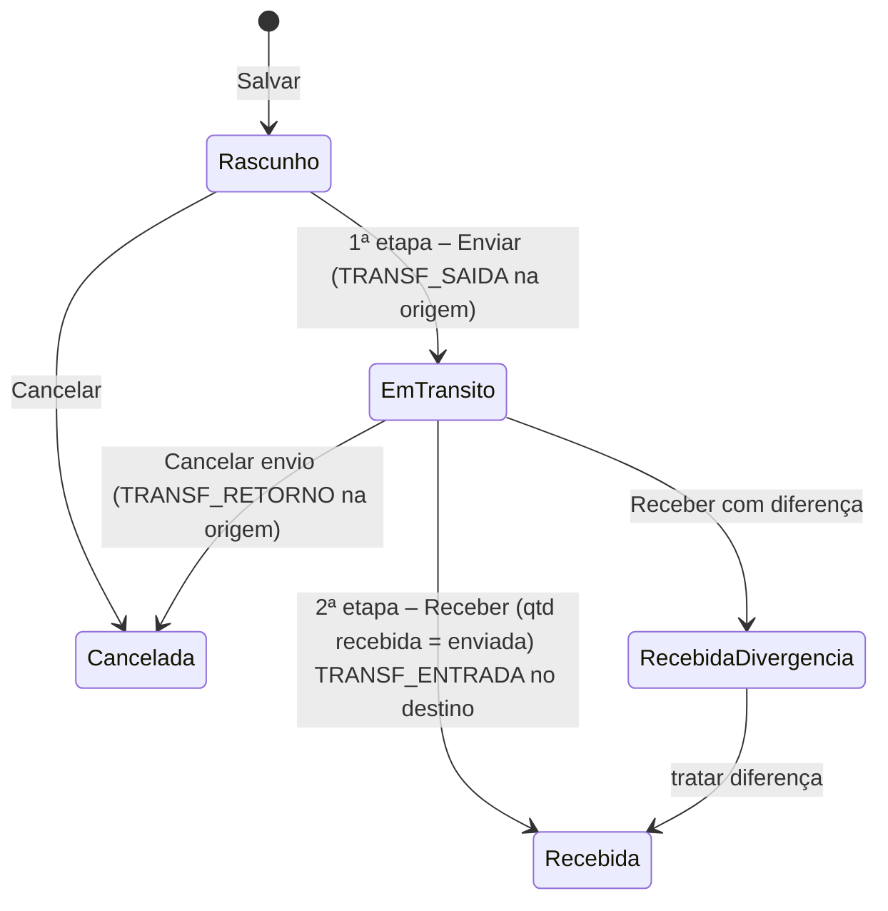

**Regras de negócio**

| Regra | Detalhe |
|---|---|
| Etapa 1 – Enviar | Usuário com acesso à origem e `transferencias.enviar`. Valida saldo na origem (13.1.1). Gera `TRANSF_SAIDA` com custo médio da origem. Situação Em trânsito. Imprime **romaneio** |
| Em trânsito | A quantidade não está em nenhum estoque; aparece como "Em trânsito" no produto (8.2.11) e no Estoque Atual |
| Etapa 2 – Receber | Usuário com acesso ao destino e `transferencias.receber` informa a quantidade conferida por item (botão "Receber tudo como enviado"). Gera `TRANSF_ENTRADA` com o custo da saída |
| Divergência | Se recebida < enviada, a diferença precisa de decisão: **Retornar à origem** (`TRANSF_RETORNO`) ou **Baixar como perda** (acerto de saída automático no estoque de origem com motivo "Perda em transferência"). Recebida > enviada é recusada (fazer nova transferência) |
| Cancelamento | Rascunho: sem efeito. Em trânsito: `TRANSF_RETORNO` integral na origem, com motivo |
| Uma etapa | Opção `estoque.transferencia_recebimento_automatico` (Configurações › Geral, padrão Não) faz o envio já gerar a entrada (para estoques do mesmo endereço) |
| Fiscal [P6] | Se origem e destino pertencem a lojas com **CNPJs diferentes**, a transferência exige NF-e de transferência (CFOP 5152/5409 ou 6152/6409) emitida pela nuvem ao Enviar; a entrada no destino referencia a chave. Mesmo CNPJ: sem nota |
| PDV | Saldos alterados descem aos PDVs da loja destino/origem na próxima sincronização |

**Entidades**: `transferencias_estoque`, `itens_transferencia`, `movimentos_estoque`, `saldos_estoque`,
`documentos_fiscais` (P6). **API**: `/api/transferencias`, `POST /api/transferencias/:id/enviar`,
`POST /api/transferencias/:id/receber`, `POST /api/transferencias/:id/cancelar`, `GET /api/transferencias/sugestao-reposicao`.

---

## 14. Financeiro

> [P4], exceto Fechamento de caixa [P3] (faz parte da operação do PDV) e Download de XML [P6].

### 14.1 Conceitos

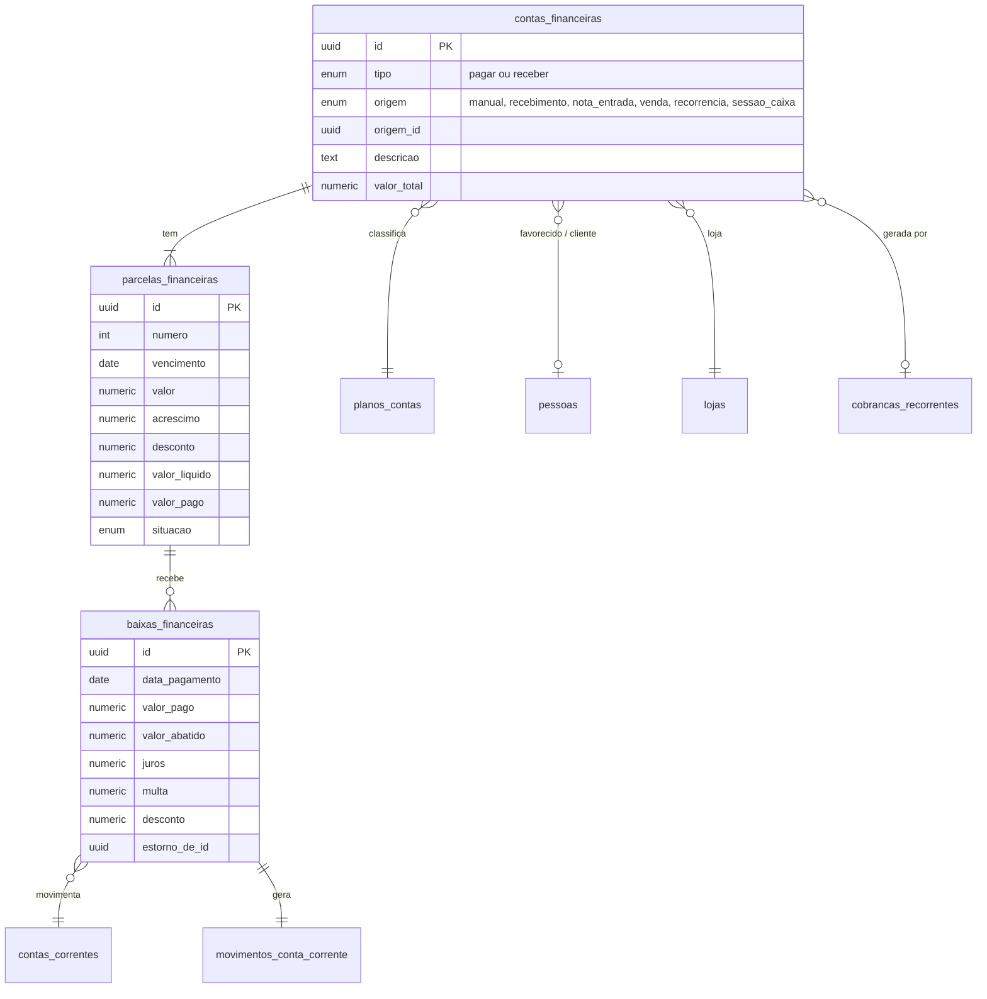

- **Conta** (`contas_financeiras`) = o documento (ex.: "Boleto Ambev NF 12345"). **Parcela** (`parcelas_financeiras`)
  = cada vencimento. **Baixa** (`baixas_financeiras`) = cada pagamento/recebimento (parcial ou total) de uma parcela.
- As listagens de Contas a Pagar/Receber mostram **uma linha por parcela** (vencimento e situação são da parcela, como
  no Nuvem3).
- `valor_liquido = valor + acrescimo − desconto`; `saldo = valor_liquido − Σ baixas válidas`.

**Situação da parcela**

| Situação | Regra |
|---|---|
| Em aberto | saldo > 0, sem baixa, vencimento ≥ hoje |
| Atrasada | **derivada**: saldo > 0 e vencimento < hoje (no fuso da loja); exibida no lugar de Em aberto/Parcial/Boleto enviado |
| Parcialmente paga | 0 < Σ baixas < valor líquido |
| Quitada | saldo = 0 |
| Boleto enviado | (receber) boleto gerado/enviado ao cliente e ainda não pago |
| Renegociada | parcela substituída por novas parcelas numa renegociação (vínculo `renegociada_em_conta_id`) |
| Cancelada | cancelada com motivo (sem baixas válidas) |

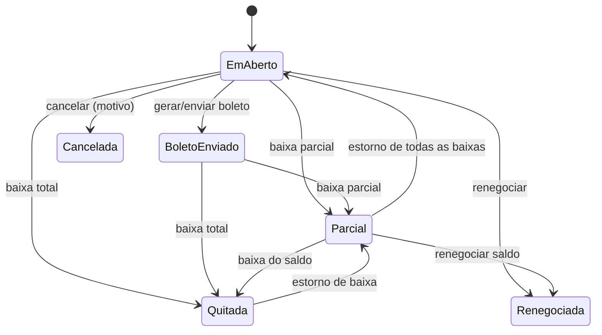

### 14.2 Contas a Pagar

**Rota**: `/financeiro/contas-pagar`, `/financeiro/contas-pagar/:id` (id da **conta**) ·
**Permissões**: `contas_pagar.ver/criar/editar/excluir/baixar/estornar/exportar`.

**Listagem**

| Filtro | Tipo | Padrão |
|---|---|---|
| Favorecido/Descrição | texto (nome do fornecedor ou descrição) | — |
| Plano de Contas | `<ArvoreSelecao>` (inclui filhos) | — |
| Situação | multisseleção: Atrasada, Boleto enviado, Em aberto, Parcialmente paga, Quitada, Renegociada, Cancelada | Em aberto + Atrasada + Parcialmente paga |
| Vencimento inicial / final | data | mês atual |
| Loja | seleção | loja de contexto |
| Data de pagamento inicial / final **(Novo)** | data | — |
| Origem **(Novo)** | Manual / Recebimento / NF-e / Recorrência | — |
| Conta corrente **(Novo)** | seleção (das baixas) | — |

| Coluna | Ordenável |
|---|---|
| Favorecido (link) | S |
| Descrição | S |
| Plano de Contas | S |
| Parcela **(Novo)** ("2/5") | N |
| Data vencimento | S |
| Total (valor líquido) | S |
| Pago **(Novo)** | S |
| Situação | S |
| Loja **(Novo)** | S |

Rodapé com totalizadores: total, pago, saldo (das linhas filtradas). Botões: **Nova Conta**, **Pesquisar**,
**Exportar**; ação em lote **Quitar selecionadas** (mesma data e conta corrente; uma baixa por parcela).

**Formulário — cabeçalho da conta**

| Campo | Rótulo | Tipo | Obr. | Regra | Padrão |
|---|---|---|---|---|---|
| `codigo` | Nº | inteiro | — | gerado | — |
| `pessoa_id` | Fornecedor | →`pessoas` (qualquer categoria; sugere Fornecedor) | S | | — |
| `descricao` | Descrição | texto(150) | S | | — |
| `documento` **(Novo)** | Nº documento | texto(40) | N | NF, boleto, contrato | — |
| `loja_id` | Loja | →`lojas` permitidas | S | | loja de contexto |
| `plano_contas_id` | Plano de Contas | →`planos_contas` (despesa, analítica, permitida na loja) | S | | — |
| `data_lancamento` | Data Lançamento | data | S | | hoje |
| `competencia` **(Novo)** | Competência | mês/ano | S | base do regime de competência no Financeiro geral | mês do lançamento |
| `forma_pagamento_id` **(Novo)** | Forma de pagamento prevista | →`formas_pagamento` | N | | — |
| `observacoes` | Observações | texto | N | | — |
| Anexos **(Novo)** | boleto, nota, comprovante | arquivos (pdf/imagem ≤ 10 MB) | N | | — |

**Parcela única** (padrão): `vencimento` (Vencimento, S), `valor` (Valor, S, > 0), `acrescimo` (Acréscimo, ≥ 0),
`desconto` (Desconto, ≥ 0 e ≤ valor + acréscimo), `valor_liquido` (Valor líquido, calculado), `codigo_barras_pix`
(Código de barras/PIX, 14.5), `situacao` (exibição / Cancelar).

**Lançar múltiplas parcelas** (checkbox): abre o gerador — **Quantidade** (2–120), **Primeiro vencimento**,
**Intervalo** (mensal no mesmo dia / a cada N dias / quinzenal), **Valor** (total a dividir ou valor por parcela) →
gera a grade de parcelas (nº, vencimento, valor, acréscimo, desconto, líquido, código de barras/PIX), editável. A soma
das parcelas deve bater com o total; o resto dos centavos vai para a **primeira** parcela. Vencimentos em fim de mês
caem no último dia do mês curto (31/01 → 28/02).

**Repetir mensalmente (Novo)**: para despesas fixas (aluguel, energia) — mesma mecânica das cobranças mensais (14.3.1),
gerando contas a pagar.

**Botões**: **Novo**, **Gravar**, **Voltar**, **Excluir**, **Baixar/Quitar** (14.4), **Estornar baixa**, **Cancelar
parcela**, **Renegociar**, **Imprimir recibo**, **Histórico**.

**Regras**

| Regra | Detalhe |
|---|---|
| Origem automática | Contas geradas por recebimento/NF-e: valor, pessoa e loja **não** editáveis; vencimento, código de barras, plano e observações sim. Para mudar valores, estornar o documento de origem |
| Exclusão | Só sem baixas válidas; contas de origem automática não são excluídas por aqui |
| Cancelamento | Por parcela, com motivo, sem baixas válidas |
| Renegociação | Seleciona parcelas em aberto da mesma pessoa → nova conta com novas parcelas (valor pode incluir juros/desconto); as antigas ficam "Renegociada" com vínculo |
| Alerta de duplicidade | Mesmo fornecedor + mesmo documento + mesmo valor → confirmação |

### 14.3 Contas a Receber

**Rota**: `/financeiro/contas-receber`, `/financeiro/contas-receber/:id` · **Permissões**: `contas_receber.*`.

Listagem igual à de Contas a Pagar, com:
- filtro **Cliente/Descrição** no lugar de Favorecido;
- filtro **Forma de Pagamento** (todas as formas da empresa, ex.: Caderneta, Cartão de crédito, Cartão de débito…).
  No Nuvem3 aparecem aqui também "Avarias" e "Baixas de utilização em loja"; no GenesisPDV essas formas são
  `tipo_forma = 'consumo_interno'` e **não geram conta a receber** (10.2) — só aparecem neste filtro para títulos
  migrados do Nuvem3;
- filtro **Data de Pagamento inicial/final**;
- filtro **Origem** com Venda PDV / Venda ERP / Recorrência / Manual / Integração;
- colunas **Cliente**, **Forma de pagamento** **(Novo)**, **Venda** (nº, link) **(Novo)**.

Formulário igual ao de Contas a Pagar, com **Cliente** no lugar de Fornecedor, **sem** código de barras/PIX de
pagamento (no lugar: **Boleto/PIX de cobrança** gerado pela integração, P6), **Forma de pagamento** e **Criar
cobranças mensais**. Campos extras por parcela: `taxa_valor` (taxa da administradora, de 10.2), `valor_liquido_previsto`.

Ações extras: **Gerar boleto** (P6), **Enviar cobrança** (e-mail/WhatsApp com o template de 9.7), **Imprimir recibo**.

#### 14.3.1 Cobranças mensais

Modal "Criar cobranças mensais" (`cobrancas_recorrentes`):

| Campo | Tipo | Obr. | Regra | Padrão |
|---|---|---|---|---|
| Cliente | →`pessoas` | S | | da conta |
| Descrição | texto(150) | S | aceita `{{mes}}`, `{{ano}}` ("Mensalidade {{mes}}/{{ano}}") | — |
| Valor | dinheiro | S | > 0 | — |
| Dia do vencimento | inteiro 1–31 | S | dia inexistente → último dia do mês | — |
| Primeiro mês | mês/ano | S | | próximo mês |
| Término | enum: após N meses / em data / indeterminado | S | | após 12 |
| Plano de contas, Loja, Forma de pagamento | → | S/S/N | | |
| Enviar cobrança automaticamente | booleano | N | N dias antes do vencimento (P6) | Não |

Regras: com término definido, as parcelas são geradas todas de uma vez (uma conta por mês, origem `recorrencia`);
indeterminado mantém sempre **3 meses à frente** (tarefa diária). Editar a recorrência ("alterar valor a partir de
<mês>") afeta só parcelas futuras em aberto; **Encerrar recorrência** cancela as futuras em aberto.

### 14.4 Baixa (quitação) e estorno

Modal **Baixar** (uma parcela ou várias da listagem):

| Campo | Tipo | Obr. | Regra | Padrão |
|---|---|---|---|---|
| Data do pagamento | data | S | não futura | hoje |
| Valor da parcela / saldo | exibição | — | | |
| Juros | dinheiro | N | receber: sugestão por `financeiro.juros_mes_pct` pró-rata dia **(Novo)** | 0 |
| Multa | dinheiro | N | receber: `financeiro.multa_pct` **(Novo)** | 0 |
| Desconto | dinheiro | N | | 0 |
| Valor pago | dinheiro | S | ≤ saldo + juros + multa − desconto; menor = baixa parcial | saldo |
| Conta corrente | →`contas_correntes` ativas | S | | da forma de pagamento ou "Caixa interno" |
| Forma de pagamento | →`formas_pagamento` | N | | da parcela |
| Observação | texto | N | | |
| Imprimir recibo | booleano | N | template 9.7 | Não |

Efeitos: grava `baixas_financeiras`, gera `movimentos_conta_corrente` (saída para pagar, entrada para receber), recalcula
situação. **Estornar baixa** (permissão `*.estornar`, motivo obrigatório): baixa de estorno com `estorno_de_id` + movimento
inverso na conta corrente; a baixa original fica marcada como estornada (nada é apagado).

### 14.5 Código de barras / PIX

| Entrada | Tratamento |
|---|---|
| Linha digitável de boleto bancário (47 dígitos) | valida DVs; extrai banco, **valor** e **vencimento** (fator de vencimento, considerando o reinício do fator em 22/02/2025); preenche a parcela se vazia, ou alerta se divergir |
| Código de barras de boleto (44 dígitos, leitor) | converte para linha digitável e trata igual |
| Arrecadação/convênio (48 dígitos, começa com 8) | valida DVs (módulo 10/11 conforme identificador); extrai valor |
| PIX copia e cola (BR Code EMV) | valida CRC16; extrai chave/URL, beneficiário, cidade, valor (se houver), txid |

Campo com botão **Copiar** na listagem e no formulário; QR code do PIX exibido para pagar pelo celular.

### 14.6 Notas e Cupons Fiscais › Download de XML [P6]

**Rota**: `/financeiro/download-xml` · **Permissão**: `fiscal.download_xml`.

| Campo | Tipo | Obr. | Regra | Padrão |
|---|---|---|---|---|
| Tipo | enum: Cupons fiscais (NFC-e/SAT) · Notas fiscais (NF-e de saída/DANFE) · NF-e de entrada **(Novo)** · Eventos e inutilizações **(Novo)** | S | | Cupons fiscais |
| Loja | seleção (permitidas) ou Todas | S | | loja de contexto |
| Mês | 1–12 | S | | mês anterior |
| Ano | do primeiro ano com documentos até o atual | S | | |
| Incluir PDF (DANFE/DANFCE) **(Novo)** | booleano | N | | Não |
| Enviar ao contador **(Novo)** | booleano | N | envia o link para `empresa.email_contador` | Não |

Botão **Gerar arquivo** → tarefa (3.6) → ZIP organizado `loja/modelo/autorizadas|canceladas|inutilizadas/`, com
planilha-resumo (número, série, chave, emissão, valor, situação, caixa) e totais por situação. **Alerta** antes de
gerar se houver no período NFC-e em contingência não transmitidas ou rejeitadas ("3 NFC-e da Loja 2 ainda não foram
autorizadas; o arquivo sairá incompleto").

### 14.7 Contas correntes

**Rota**: `/financeiro/contas-correntes`, `/financeiro/contas-correntes/:id/:aba` · **Permissões**: `contas_correntes.ver/criar/editar/excluir/lancar`.

Listagem: filtro **Descrição**; colunas **Descrição** (link), **Banco**, **Saldo Atual** (+ **Tipo**, **Loja**
**(Novo)**). Seed: **Caixa interno** (como no Nuvem3).

**Aba Dados**

| Campo | Rótulo | Tipo | Obr. | Regra | Padrão |
|---|---|---|---|---|---|
| `tipo` **(Novo)** | Tipo | enum `caixa`/`conta_corrente`/`poupanca`/`aplicacao`/`carteira_digital`/`adquirente` | S | `caixa` dispensa banco | `conta_corrente` |
| `banco_codigo` | Banco | →`bancos` (tabela FEBRABAN/COMPE completa, com os mais usados no topo) | C | obrigatório exceto caixa | — |
| `descricao` | Descrição | texto(60) | S | única | — |
| `agencia`, `agencia_digito` | Agência, Dígito | texto | C | | — |
| `conta`, `conta_digito` | Conta | texto | C | | — |
| `carteira` | Carteira | texto(5) | N | boleto | — |
| `convenio_boleto` **(Novo)** | Convênio/beneficiário | texto | N | P6 | — |
| `chave_pix` **(Novo)** | Chave PIX | texto | N | QR estático | — |
| `saldo_inicial` | Saldo | dinheiro (pode ser negativo) | S | | 0 |
| `data_saldo` | Data do saldo | data | S | | hoje |
| `loja_id` **(Novo)** | Loja | →`lojas` | N | restringe visibilidade às lojas permitidas | — |
| `ativa` **(Novo)** | Ativa | booleano | S | | Sim |

`saldo_atual = saldo_inicial + Σ movimentos com data ≥ data_saldo` (movimentos anteriores à data do saldo são
ignorados no saldo, mas aparecem no extrato marcados).

**Aba Extrato (Novo)**: período; colunas Data, Descrição, Documento/origem (link), Plano de contas, Entrada, Saída,
Saldo; botões **Lançamento manual** (crédito/débito com plano de contas, descrição, data, valor — gera
`movimentos_conta_corrente` origem `manual`) e **Transferência entre contas** (origem, destino, valor, data: dois
movimentos ligados; não afeta o Financeiro geral). Conciliação bancária por OFX fica como evolução (P4+).

Regras: excluir só sem movimentos; inativar com saldo ≠ 0 pede confirmação.

### 14.8 Plano de contas

**Rota**: `/financeiro/plano-contas` · **Permissões**: `plano_contas.ver`, `plano_contas.editar`.

| Elemento | Detalhe |
|---|---|
| Seletor de Lojas | filtra a árvore às contas válidas para a loja (contas sem restrição valem para todas) |
| Árvore | raízes fixas **Receitas**, **Despesas** e a raiz de sistema **Valores a repassar** (passivo, fora da DRE e do resultado: gorjetas da taxa de serviço, PDV 25.3); menu de contexto Adicionar subconta, Editar, Inativar, Excluir; arrastar e soltar dentro da mesma raiz |

| Campo | Tipo | Obr. | Regra |
|---|---|---|---|
| `codigo` | texto ("2.01.003") | S | gerado pela posição; editável respeitando o prefixo do pai |
| `nome` | texto(80) | S | único entre irmãos |
| `tipo` | enum `receita`/`despesa`/`passivo` | — | herdado da raiz (`passivo` só na raiz Valores a repassar; modelo 3.9.1) |
| `natureza` | enum `sintetica`/`analitica` | S | só analíticas recebem lançamentos; sintética = agrupadora |
| `lojas` | multisseleção | N | vazio = todas |
| `ativo` | booleano | S | |
| `ordem` | inteiro | N | |

Seed: **Receitas** › Vendas (Vendas PDV, Vendas ERP, Vendas por integração), Outras receitas (Sobra de caixa, Juros
recebidos); **Despesas** › Compra de mercadorias, Despesas fixas (Aluguel, Energia, Água, Internet/telefone, Salários e
encargos, Pró-labore), Despesas variáveis (Taxas de cartão, Fretes, Impostos sobre vendas, Quebra de caixa,
Manutenção, Avarias e perdas, Uso e consumo), Despesas financeiras (Juros pagos, Tarifas bancárias); **3 Valores a
repassar** › 3.01 Gorjetas a repassar (`gorjetas_a_repassar`, taxa de serviço fora do documento fiscal). Igual ao seed
do modelo 7.5, inclusive os códigos e as `chave_sistema`.

Regras: excluir conta com lançamentos é bloqueado (inativar); analítica com lançamentos não pode virar sintética nem
receber filhas; mover não troca de raiz.

### 14.9 Fechamento de caixa / Troca de turno [P3]

**Objetivo**: acompanhar e conferir as sessões de caixa vindas dos PDVs (abertura, vendas, sangrias, reforços,
fechamento e troca de turno).

**Rota**: `/financeiro/fechamentos-caixa`, `/financeiro/fechamentos-caixa/:id` · **Permissões**: `fechamentos_caixa.ver`,
`fechamentos_caixa.conferir`.

**Listagem**

| Filtro | Tipo | Padrão |
|---|---|---|
| Loja | seleção | loja de contexto |
| Data inicial / final | data (dia operacional) | hoje |
| Caixa **(Novo)** | seleção | — |
| Operador **(Novo)** | usuário | — |
| Situação **(Novo)** | Aberta / Fechada / Conferida / Divergente | — |
| Somente com diferença **(Novo)** | booleano | Não |

| Coluna | Conteúdo |
|---|---|
| Usuário Anterior (link) | operador que encerrou a sessão |
| Usuário Subsequente | operador que assumiu (troca de turno) ou vazio (fechamento) |
| Loja | |
| Caixa **(Novo)** | |
| Data | data/hora do encerramento |
| Tipo **(Novo)** | Fechamento (zera caixa) / Troca de turno |
| Valor de Caixa | dinheiro deixado/recolhido na troca/fechamento |
| Calculado / Informado / Diferença **(Novo)** | totais de todas as formas |
| Situação **(Novo)** | |

**Detalhe da sessão**

| Bloco | Conteúdo |
|---|---|
| Cabeçalho | loja, caixa, terminal, operador, abertura (data/hora, valor de abertura/fundo de troco), encerramento (data/hora, tipo, usuário subsequente), dia operacional |
| Resumo por forma de pagamento | Forma · **Valor calculado** · **Valor informado** (contado pelo operador no PDV) · **Diferença** (`informado − calculado`) |
| Cálculo do dinheiro | Fórmula do PDV 20.4: abertura (fundo de troco) + vendas em dinheiro − troco dado por formas não dinheiro com Permite Troco + reforços − sangrias (inclusive `sangria_fechamento`) − estornos de vendas canceladas em dinheiro (`estorno_venda`) − devoluções/resgates em dinheiro (`devolucao_troca`) + recebimentos de crediário em dinheiro |
| Movimentos | abertura, reforços e sangrias (data/hora, valor, quem retira, observação, cancelado), vendas (quantidade e total, link para a listagem filtrada), cancelamentos, trocas/devoluções |
| Conferência | **(Novo)** gerente informa o valor conferido por forma (dinheiro recontado no cofre, comprovantes de cartão), observação; situação vira Conferida (sem diferença) ou Divergente |

Regras:

| Regra | Detalhe |
|---|---|
| Origem dos dados | Eventos do PDV (sync 9): `caixa.aberto`, `caixa.reforco`, `caixa.sangria`, `caixa.movimento_cancelado`, `venda.finalizada`, `venda.cancelada`, `troca.registrada` e `caixa.fechado` — este com `fechamentos_caixa.tipo = 'fechamento'` ou `'troca_turno'` e os valores informados por forma (`fechamentos_caixa_formas`) |
| Imutável | A sessão, o fechamento e os valores informados no PDV não são editados no ERP; o ERP só registra a **conferência** (`conferencias_caixa` + `conferencias_caixa_formas`, modelo 3.12.4) |
| Fechamento cego | `pdv.fechamento_cego` (Configurações › PDV, padrão Sim; snapshot em `fechamentos_caixa.fechamento_cego`): o operador informa os valores sem ver o calculado; o ERP sempre mostra os dois |
| Troca de turno | Não zera o caixa: o "Valor de Caixa" (`fechamentos_caixa.valor_caixa`) deixado vira a abertura da sessão seguinte (`zera_caixa = false`, `usuario_subsequente_id` preenchido quando o próximo abre); fechamento zera (`zera_caixa = true`) |
| Diferença | Ao conferir (ou ao receber o fechamento, se `financeiro.lanca_quebra_automatica = Sim`), lança "Quebra de caixa" (despesa) ou "Sobra de caixa" (receita) |
| Sessão aberta há mais de 24 h | Alerta no Dashboard e no detalhe do terminal |

**Fase 1C (bloco C12), só leitura**: `GET /api/sessoes-caixa` (filtros `lojaId`, `dataInicial`/`dataFinal` pelo dia
operacional da sessão, `numeroCaixa`, `operadorId`, `situacao` aberta/fechada, `somenteComDiferenca`, `treino`; padrão
das datas: o dia operacional de hoje) e `GET /api/sessoes-caixa/:id`, com `fechamentos_caixa.ver`. Com o fechamento
cego do dono (O3/D12), é aqui que o **gerente** vê o calculado e a diferença por forma; o operador e o supervisor não
veem no PDV. A situação "Fechada pela nuvem" marca a sessão fechada à força na substituição/revogação do terminal
(MD 3.12.1) cujo `caixa.fechado` ainda não chegou; quando o fechamento tardio do terminal antigo chega, a sessão passa
a "Fechada" e o detalhe só anota que a nuvem a fechou (a marca `fechamento_forcado` continua no banco, para a
auditoria). O bloco "Cálculo do dinheiro" é a fórmula do PDV 20.4 refeita na
nuvem com o que já chegou da sessão (pagamentos aprovados ou estornados de vendas finalizadas na sessão, movimentos não
cancelados; o esperado é antes da `sangria_fechamento`) e aparece ao lado do calculado que o PDV mandou: diferente =
evento da sessão ainda pendente ou retido (fila de decisão, 12.5). "Vendas" leva à listagem filtrada pela sessão
(sem datas: a sessão esquecida aberta tem vendas de mais de um dia); enquanto esse filtro vale, a listagem de Vendas
mostra um aviso com "Remover" (o filtro não tem campo no formulário). Fica para a Fase 3 a conferência (Conferida /
Divergente, `fechamentos_caixa.conferir`, `POST /api/sessoes-caixa/:id/conferir`) e para a Fase 4 a quebra/sobra no
financeiro; o alerta de sessão aberta há mais de 24 h está no Dashboard desde o C14 ("Caixas abertos há muito
tempo", ERP 6, calculado com `pdv.horas_alerta_sessao`).

**Entidades** (modelo 3.12): `sessoes_caixa`, `movimentos_caixa`, `fechamentos_caixa` e `fechamentos_caixa_formas`
(calculado e digitado por forma, vindos do PDV), `conferencias_caixa` e `conferencias_caixa_formas` (conferido por
forma, gravado no ERP), `vendas`, `pagamentos_venda`, `trocas`. **API**: `GET /api/sessoes-caixa`, `GET /api/sessoes-caixa/:id`,
`POST /api/sessoes-caixa/:id/conferir`.

### 14.10 Integração financeira das vendas e do caixa

| Fato | Lançamento financeiro |
|---|---|
| Venda finalizada (PDV ou ERP) — pagamento em forma **Lança Quitada** | conta a receber (origem `venda` ou `sessao_caixa`) já quitada, com baixa na conta corrente da forma na data da venda. Consolidação conforme `financeiro.consolidar_vendas_quitadas`: `por_sessao` (padrão: uma conta por sessão × forma, criada no fechamento) ou `por_venda` |
| Pagamento em forma **não quitada** (cartão a receber da adquirente, caderneta, crédito funcionário, boleto) | uma conta a receber **por venda**, com as parcelas da forma (ex.: crédito 3×: 3 parcelas, vencimentos a cada `dias_recebimento`), taxa da forma em `taxa_valor` |
| Troco | abate do dinheiro da venda |
| Cancelamento de venda | cancela as parcelas em aberto; parcelas quitadas recebem estorno de baixa |
| Sangria | registro em `movimentos_caixa`; se a loja tiver `financeiro.conta_destino_sangria` (Lojas › Parâmetros), transferência da conta "Caixa – loja" para a conta de destino (cofre/banco) |
| Reforço | registro em `movimentos_caixa`; sem lançamento automático (não há chave de conta de origem no catálogo, modelo 3.1.2) |
| Diferença de fechamento | 14.9 |
| Recebimento manual / NF-e com "Gerar financeiro" | conta a pagar (13.3, 13.4) |

Chaves de configuração usadas aqui (aba Financeiro, 9.7): `financeiro.consolidar_vendas_quitadas` (enum
`por_sessao`/`por_venda`, padrão `por_sessao`), `financeiro.lanca_quebra_automatica` (booleano, Não),
`financeiro.juros_mes_pct` (percentual, 0), `financeiro.multa_pct` (percentual, 0),
`financeiro.conta_destino_sangria` (→`contas_correntes`, Loja = S).

---

## 15. Vendas

> [P3]; emissão de NF-e e cancelamento fiscal em [P6].

### 15.1 Orçamentos

**Rota**: `/vendas/orcamentos`, `/vendas/orcamentos/:id` · **Permissões**: `orcamentos.ver/criar/editar/excluir/converter`.

**Listagem**

| Filtro | Tipo | Padrão |
|---|---|---|
| Nome | texto (nome do cliente/contato) | — |
| Data inicial / final | data | últimos 30 dias |
| Situação **(Novo)** | Aberto / Respondido – aprovado / Respondido – recusado / Convertido / Expirado / Cancelado — **derivada** (modelo 3.11.1): `cancelado` → Cancelado; `convertido` → Convertido; `aberto` com `valido_ate` < hoje → Expirado; `aberto` com `respondido = 'aprovado'`/`'recusado'` → Respondido – aprovado/recusado; senão → Aberto | Aberto |
| Loja **(Novo)**, Vendedor **(Novo)** | seleção | loja de contexto |

Colunas: **Cód** (link), **Nome**, **Data**, **Total bruto**, **Respondido?** (Sim/Não), **Validade** **(Novo)**,
**Situação** **(Novo)**, **Total líquido** **(Novo)**.

**Formulário**

| Campo | Rótulo | Tipo | Obr. | Regra | Padrão |
|---|---|---|---|---|---|
| `codigo` | Id | inteiro | — | gerado; é o número que o PDV pede em "Solicita Id do Orçamento" | — |
| `pessoa_id` + `nome` | Nome (busca + **Cadastrar pessoa**) | →`pessoas` ou texto livre | S | permite orçamento para quem não tem cadastro (só nome) | — |
| `email` | Email | e-mail | N | preenchido da pessoa | — |
| `telefone` | Telefone | texto | N | | — |
| `data` | Data | data | S | | hoje |
| `dias_validade` | Dias de validade | inteiro 0–365 (`ck_orcamentos_dias_validade`) | S | `valido_ate = data + dias` (coluna gerada); 0 = válido só no dia | 15 |
| `ativo` | Ativo | booleano | S | inativo não pode ser convertido | Sim |
| `loja_id` **(Novo)** | Loja | →`lojas` | S | | loja de contexto |
| `vendedor_id` **(Novo)** | Vendedor | →`usuarios` (É Vendedor) | N | | usuário logado se vendedor |
| Itens **(Novo)** | grade: Produto, Variação, Quantidade, Preço unitário, Desconto item, Total | `<GradeItens>` | S | ao menos 1 item | — |
| `desconto_tipo` + `desconto_valor` | Desconto (R$ ou %) | enum + número | N | respeita limite de desconto do usuário (`orcamentos` usa `vendas.desconto_acima_limite`) | 0 |
| `condicoes_pagamento` | Condições de pagamento | texto(500) | N | | — |
| `observacoes` | Observações | texto | N | | — |
| `respondido` (+ `respondido_em`, `resposta_observacao`) | Respondido? | varchar(10) `nao`/`aprovado`/`recusado` (`ck_orcamentos_respondido`) | — | marcada manualmente (**Marcar resposta**) ou pelo cliente no link público (com comentário opcional em `resposta_observacao`, até 500); "Respondido?" da listagem = `respondido <> 'nao'`; revisar um orçamento recusado volta `respondido` a `nao` | `nao` |
| `status` | Status | `aberto`/`convertido`/`cancelado` | — | por ações (Converter, Cancelar); a resposta não muda o status; a Situação exibida é derivada (filtro acima) | `aberto` |
| Totais | Total bruto (`subtotal_bruto`), desconto (`desconto_valor`), total líquido (`total`) | exibição | — | | — |

**Botões**: **Novo**, **Gravar**, **Voltar**, **Excluir**, **Imprimir/PDF** (template `orcamento_logado`, 9.6), **Enviar**
(e-mail com o template; WhatsApp P6), **Copiar link público** (página com template `orcamento_nao_logado`, onde o cliente pode
**Aprovar** ou **Recusar**), **Marcar resposta**, **Converter em venda**, **Duplicar**, **Histórico**.

```mermaid
stateDiagram-v2
  state "status = aberto" as Aberto {
    [*] --> SemResposta
    SemResposta --> Aprovado: respondido = aprovado (cliente/usuário)
    SemResposta --> Recusado: respondido = recusado (cliente/usuário)
    Recusado --> SemResposta: orçamento revisado (respondido = nao)
    Aprovado --> SemResposta: orçamento revisado
  }
  [*] --> Aberto
  Aberto --> Convertido: Converter em venda (ERP ou PDV); se expirado (valido_ate < hoje), com confirmação
  Aberto --> Cancelado: Cancelar
  Convertido --> [*]
  Cancelado --> [*]
```

"Expirado" não é um status gravado: é `status = 'aberto'` com `valido_ate` < hoje no fuso da loja (sem tarefa
diária). Orçamento recusado continua `aberto`: pode ser revisado e reenviado, convertido (o cliente mudou de ideia) ou
cancelado.

**Regras de negócio**

| Regra | Detalhe |
|---|---|
| Converter no ERP | Cria uma venda ERP em **rascunho** (15.4) com cliente, itens, desconto e observações; pergunta "Manter preços do orçamento" ou "Atualizar para os preços atuais"; orçamento vira Convertido com link para a venda |
| Converter no PDV | Com Configurações › PDV › "Orçamento PDV" (`pdv.orcamento_pdv`) = Sim, o PDV busca o orçamento pelo Id (online, com reserva `reservado_terminal_id`/`reservado_ate`) ou na cópia local — os orçamentos descem pelo fluxo `operacao` com o filtro do **modelo 6.2** (`loja_id` = loja do terminal; o PDV escolhe localmente os `aberto` e não expirados); a venda gerada leva `orcamento_id` e o evento `orcamento.convertido` marca o orçamento como Convertido |
| Conversão dupla | Se dois caixas converterem o mesmo orçamento offline, a primeira venda que chegar converte; a segunda é aceita normalmente (a venda é fato consumado) e gera alerta "Orçamento convertido duas vezes" na auditoria e no Dashboard |
| Expirado | Converter um expirado exige confirmação; preços são recalculados por padrão |
| Estoque | Orçamento não reserva estoque |

**Entidades**: `orcamentos`, `itens_orcamento`, `templates_documentos`. **API**: `/api/orcamentos`,
`POST /api/orcamentos/:id/converter`, `POST /api/orcamentos/:id/enviar`, `GET /publico/orcamentos/:token` (página
pública, token aleatório de 32 bytes, expira com a validade).

### 15.2 Reforço de caixa (e abertura)

**Rota**: `/vendas/reforcos`, `/vendas/reforcos/:id` · **Permissões**: `movimentos_caixa.ver`, `movimentos_caixa.imprimir`.

Listagem: filtros **Data inicial/final** (+ **Loja**, **Caixa**, **Operador**, **Tipo** Abertura/Reforço, **Situação**
Ativos/Cancelados **(Novo)**); colunas **Data** (link), **Valor** (+ **Tipo**, **Loja**, **Caixa**, **Operador**,
**Cancelado** **(Novo)**); totalizador de valor.

Detalhe (somente leitura): Tipo (abertura/reforço), Operador, Loja, Número do Caixa, Data/Hora, Valor, Observação, Inf.
Adicionais, Cancelado, Data de cancelamento, Cancelado por, Sessão de caixa (link 14.9), Terminal. Botões: **Imprimir
comprovante**, **Voltar**, **Histórico**.

### 15.3 Sangria

**Rota**: `/vendas/sangrias`, `/vendas/sangrias/:id` · **Permissões**: `movimentos_caixa.ver`, `movimentos_caixa.imprimir`.

Listagem: filtros **Data inicial/final** (+ Loja, Caixa, Operador, Situação); colunas **Data** (link), **Valor**
(+ **Loja**, **Caixa**, **Operador**, **Quem Retira**, **Cancelado**).

Detalhe (somente leitura; o formulário `Sangria.aspx` do Nuvem3 não abriu no levantamento — campos tirados do
relatório 9.8). São as colunas de `movimentos_caixa` (modelo 3.12.2), que nascem no PDV (tela de sangria, PDV 20.1)
e chegam pelo evento `caixa.sangria`; o ERP não edita o movimento:

| Campo | Tipo | Observação |
|---|---|---|
| `operador_id` | →`usuarios` | quem registrou no PDV |
| `quem_retira_usuario_id` / `quem_retira_nome` | →`usuarios` / texto(60) | quem levou o dinheiro (gerente, malote): usuário ou nome livre (um dos dois é obrigatório) |
| `loja_id`, `caixa_id`, `numero_caixa` | | |
| `ocorrido_em` | data_hora | "Data Hora" |
| `valor` | dinheiro | > 0 e ≤ dinheiro estimado na gaveta (o PDV valida, `pdv.sangria_limitada_ao_saldo`) |
| `observacao`, `inf_adicionais` | texto(255) | "Observação", "Inf. Adicionais" (ex.: nº do malote) |
| `autorizado_por_id` | →`usuarios` | liberação de supervisor, quando houve |
| `cancelado`, `cancelado_em`, `cancelado_por_id`, `autorizado_cancelamento_por_id`, `motivo_cancelamento` | | o cancelamento é feito **no PDV, com a sessão aberta** (evento `caixa.movimento_cancelado`) |
| `movimento_conta_corrente_id` | →`movimentos_conta_corrente` | transferência "Caixa – loja" → conta de destino, quando configurada (14.10) |
| `sessao_caixa_id`, `terminal_id` | | origem (o `evento_id` fica em `eventos_recebidos`) |

A sangria **não tem finalidade nem plano de contas**: o destino do dinheiro segue `financeiro.conta_destino_sangria`
da loja (14.10). Dinheiro da gaveta usado para pagar uma despesa é lançado depois no ERP como conta a pagar quitada
pela conta "Caixa – loja".

Botões: **Imprimir comprovante** (2 vias, com assinatura de quem retira), **Voltar**, **Histórico**.

Regras comuns a 15.2 e 15.3: são **lançadas somente no PDV** (ou PDV mobile com `pdv.mobile.reforco`/`pdv.mobile.sangria`, 9.3.5) porque afetam o dinheiro
da gaveta da sessão aberta; o ERP consulta, imprime e as usa na conferência (14.9). Correções depois do fechamento são
feitas pela conferência de caixa, nunca editando o movimento.

**Fase 1C (bloco C12), só leitura**: `GET /api/movimentos-caixa/reforcos` (tipos `abertura` e `reforco`),
`GET /api/movimentos-caixa/sangrias` (tipos `sangria` e `sangria_fechamento` — a retirada do fechamento também sai da
gaveta e aparece aqui, com o tipo "Sangria de fechamento") e `GET /api/movimentos-caixa/:id`, com `movimentos_caixa.ver`.
A **data filtrada é o dia operacional da sessão** (D7), como no 14.9, e não a data do relógio do movimento: a sangria
da 1h da manhã fica no dia de quem abriu o caixa. Filtros: datas (padrão hoje), loja, caixa, operador, tipo, situação
(ativos/cancelados/todos), sessão e loja de treino (O10, fora por padrão). O totalizador soma só os não cancelados; o
cancelado aparece com a marca e os dados do cancelamento (feito no PDV, `caixa.movimento_cancelado`). O detalhe liga à
sessão (14.9) quando o usuário tem `fechamentos_caixa.ver`. **Imprimir comprovante** espera os templates de impressão
do ERP (3.7) e `movimento_conta_corrente_id` fica oculto até a Fase 4.

### 15.4 Vendas

**Rota**: `/vendas`, `/vendas/nova`, `/vendas/:id/:aba` · **Permissões**: `vendas.ver/criar/editar/cancelar/exportar`,
`vendas.ver_lucro`, `vendas.desconto_acima_limite`, `vendas.alterar_preco`; NF-e: `fiscal.emitir_nfe`, `fiscal.cancelar`,
`fiscal.carta_correcao`.

#### 15.4.1 Listagem

**Fase 1C (bloco C12), só leitura das vendas do PDV**: `GET /api/vendas` e `GET /api/vendas/:id`, com `vendas.ver`.
Entram os filtros Código (o número de exibição inteiro ou só o sequencial), Cliente (nome/CPF do cadastro ou da nota),
Data inicial/final pelo **dia operacional** (padrão hoje pelo corte padrão da empresa, 05:00 — o campo só traz a data;
a consulta usa o `dia_operacional` que o caixa gravou), Num. caixa, Loja (de contexto), Tipo, Situação (padrão todas
exceto Rascunho), Devolução, Operador PDV (com `usuarios.ver`), Forma de pagamento (com `formas_pagamento.ver`), a
sessão de caixa (só pela URL, vinda do 14.9) e **Loja de treino** (O10: fora por padrão). Os totalizadores são de todas
as vendas do filtro: quantidade (com as canceladas contadas à parte) e total bruto, descontos (`desconto_itens +
desconto_total`) e total líquido **sem as canceladas** (mesma regra do Dashboard). O detalhe tem as abas Dados gerais
(cabeçalho, loja/caixa/terminal/operador com o link para a sessão, cliente ou CPF da nota, itens com combo e item
cancelado), Financeiro (pagamentos com a situação — `estornado` no cancelamento —, totais e o **Lucro** só com
`vendas.ver_lucro`: `custo_total` gravado pela nuvem, lucro e margem), Documento fiscal (vazio até a 1D) e Histórico
(auditoria `vendas`). Ficam fora: Vendedor (O24: sem vendedor na 1C), Documento fiscal e chave de acesso (1D), Nova
venda, Complementos, cancelar, devolução e NF-e (Fase 3/6) e o Exportar.

| Filtro | Tipo | Padrão |
|---|---|---|
| Código | texto: número da venda (`L01-C02-000123` ou só o sequencial) | — |
| Cliente | `<SeletorPessoa>` ou texto | — |
| Data inicial / final | data (dia operacional) | hoje |
| Num. caixa | inteiro | — |
| Loja | seleção | loja de contexto |
| Tipo **(Novo)** | Venda (ERP) / PDV / Integração — derivado de `canal` (`erp` → Venda; `pdv`, `totem` → PDV; `ifood`, `99food`, `woocommerce`, `nuvemshop`, `menu_digital` → Integração) | — |
| Situação **(Novo)** | `status`: Rascunho (`rascunho`) / Finalizada (OK) / Cancelada / Pedido pendente | todas exceto Rascunho |
| Devolução **(Novo)** | `devolucao`: Todas / Sem devolução / Parcial / Total (independente da situação, como no PDV 34.1) | Todas |
| Vendedor, Operador PDV **(Novo)** | usuário | — |
| Forma de pagamento **(Novo)** | seleção | — |
| Documento fiscal **(Novo)** | Sem documento / NFC-e autorizada / NFC-e em contingência / NF-e autorizada / Rejeitada / Cancelada | — |
| Chave de acesso / nº do documento **(Novo)** | texto | — |

| Coluna | Ordenável |
|---|---|
| Cliente (link) | S |
| Código | S |
| Data | S |
| Tipo | S |
| Situação (ex.: OK) | S |
| Total bruto | S |
| Total líquido **(Novo)** | S |
| Loja / Caixa **(Novo)** | S |
| Documento fiscal **(Novo)** (ícone + número) | N |

Totalizadores no rodapé (quantidade, total bruto, descontos, total líquido). Botão **Nova venda** (venda ERP).

#### 15.4.2 Formulário (`Venda.aspx` → `/vendas/:id/:aba`)

Abas: **Dados Gerais** · **Complementos** · **Financeiro** · **Documento fiscal (Novo)** · **Histórico (Novo)**.

**Aba Dados Gerais**

| Campo | Rótulo | Tipo | Obr. | Regra | Padrão |
|---|---|---|---|---|---|
| `numero`, `numero_exibicao` | Código | bigint, texto | — | `L{lojas.codigo:00}-C{numero_caixa:00}-{numero:000000}`; vendas ERP usam o **caixa 0** da loja (`caixas.sistema`), numeração `numeracoes` `tipo = 'venda'` desse caixa (dono `nuvem`). O número é **reservado ao criar o rascunho** (as duas colunas são NOT NULL também em `rascunho`); rascunho excluído deixa o número sem uso (aceitável: não é documento fiscal) | ao criar |
| `iniciada_em` | Data | data_hora | S | criação do rascunho; `finalizada_em` é gravada ao Finalizar e é a data usada nos relatórios (`dia_operacional`) | agora |
| `tipo` / `canal` | Tipo | `tipo` `venda`/`pdv`; `canal` `erp`/`pdv`/`ifood`/`99food`/`woocommerce`/`nuvemshop`/`menu_digital`/`totem` | — | somente leitura (venda criada no ERP = `tipo = 'venda'`, `canal = 'erp'`); o "Tipo" exibido (Venda/PDV/Integração) é derivado de `canal` | `venda` / `erp` |
| `cliente_id` | Cliente (+ cadastrar nova pessoa) | →`pessoas` | C | obrigatório para NF-e, a prazo e formas com "Exige Pessoa"; vazio = consumidor final (`cpf_cnpj_nota`/`nome_nota` opcionais) | — |
| `endereco_entrega_id` | Endereço de entrega | →`pessoas_enderecos` do cliente | N | snapshot em `endereco_entrega` | principal |
| `loja_id` | Loja | →`lojas` permitidas | S | estoque baixado = estoque vinculado | loja de contexto |
| `vendedor_id` | Vendedor | →`usuarios` (É Vendedor) | C | obrigatório se "Força Escolha do Vendedor" (`pdv.forca_escolha_vendedor`) | — |
| `tipo_preco` **(Novo)** | Tipo de preço | enum `varejo`/`atacado` no seletor (`parcelado` só é gravado automaticamente pelo pagamento parcelado da aba Financeiro, 8.2.2) | S | mudar recalcula os itens sem preço manual pela regra de 8.2.2 | `varejo` |
| Itens | grade (abaixo) | | S | ao menos 1 | — |

Grade de itens (`itens_venda`): **Produto**, **Variação**, **Lote**, **Quantidade**, **Unidade**, **Preço unitário**
(editável só com `vendas.alterar_preco`; vira `origem_preco = 'manual'`), **Desconto** (R$/%), **Total**, **Saldo**
(exibição), **CFOP** (exibição, P6), **Observação do item**. Preço pelo **mesmo algoritmo do PDV 11.3** (8.2.2, via
`packages/shared`); desconto total (itens + geral, **excluído o desconto de origem `cliente`**) ÷ bruto ≤ limite do
usuário, senão exige `vendas.desconto_acima_limite`; estoque validado se "Valida Estoque".

**Aba Complementos**: `data_entrega` (Data de entrega), `observacao_nfe` (observação na NFe → `infCpl`, até 2.000
caracteres), `observacao` (interna, até 500), Frete: `frete_modalidade` (`modFrete`: 0 emitente, 1 destinatário, 2
terceiros, 3 próprio remetente, 4 próprio destinatário, 9 sem frete; obrigatório se "Exige Tipo de Frete"),
`frete_tipo` (`entrega_propria`/`transportadora`/`retirada`/`correios`), `valor_frete` (dinheiro, entra no total),
`volumes` (jsonb, grade `[{quantidade, especie, marca, numeracao, peso_liquido, peso_bruto}]`, pesos sugeridos pelos
pesos dos produtos), `transportadora_id` (→`pessoas` categoria Transportadora).

**Aba Financeiro**

| Campo | Rótulo | Tipo | Regra |
|---|---|---|---|
| `acrescimo_total` | Acréscimo | dinheiro | rateado nos itens (`acrescimo_rateado`, NF-e `vOutro`) |
| `desconto_total` (+ `desconto_total_pct`) | Desconto | dinheiro ou % (o % fica em `desconto_total_pct`) | rateado nos itens (`desconto_rateado`); `desconto_total_origem` = `operador`, `cliente` (desconto padrão da pessoa, 7.2) ou `orcamento` |
| `endereco_faturamento_id` | Endereço de faturamento | →`pessoas_enderecos` | padrão: principal |
| `qtd_parcelas` | Qtd. de parcelas | inteiro | com "Gera datas de parcelamento", gera vencimentos mensais |
| Pagamentos **(Novo)** | grade: Forma de pagamento, Valor, Parcelas, Vencimentos | | soma = total líquido; formas com "Exige Pessoa" pedem cliente; limite de crédito do cliente validado para formas a prazo; lançar pagamento em forma com Permite Parcelar e Parcelas > 1 aplica o preço parcelado nos itens (8.2.2, mostra o novo total para confirmar) e removê-lo volta os preços |
| Totais | subtotal, acréscimo, desconto, frete, **total** | exibição | |
| Lucro **(Novo)** | custo (soma do custo médio dos itens), lucro R$, margem % | exibição só com `vendas.ver_lucro` | |

**Aba Documento fiscal (Novo)**: modelo (NFC-e 65 / NF-e 55), série, número, chave, situação, protocolo, data de
autorização, tipo de emissão (normal/contingência), motivo de rejeição, eventos (cancelamento, CC-e), botões **DANFE/
DANFCE (PDF)**, **XML**, **Enviar por e-mail**.

**Botões**: **Novo**, **Gravar** (rascunho), **Finalizar**, **Emitir NFe**, **Imprimir** (template padrão do tipo
`impressao_venda`; recibo: `recibo_venda` — 9.10),
**Cancelar venda**, **Devolução**, **Voltar**, **Histórico**.

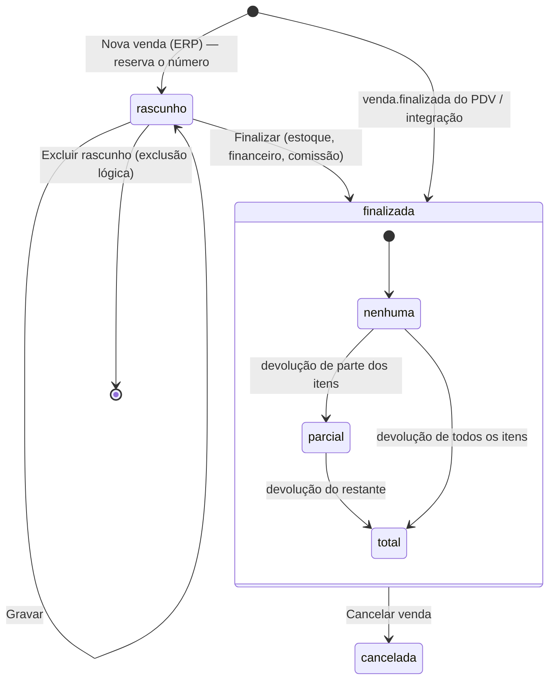

`status` (`rascunho`, `finalizada`, `cancelada`; `pedido_pendente` para pedidos do PDV) e `devolucao` (`nenhuma`,
`parcial`, `total`) são colunas **independentes** (modelo 3.11.2, PDV 34.1): a devolução não muda o status.

#### 15.4.3 Regras de negócio da venda

| Regra | Detalhe |
|---|---|
| Finalizar (ERP) | Numa transação: confirma o número reservado no rascunho (caixa 0 da loja, `numeracoes` `venda`, dono `nuvem`), grava `finalizada_em`/`dia_operacional`, gera `VENDA_ERP` (e `BAIXA_INSUMO`/componentes de kit) no estoque vinculado da loja com custo gravado, gera contas a receber (14.10) e grava a comissão prevista por item em `itens_venda.comissao_pct` e `itens_venda.valor_comissao` (não há tabela de comissões). Depois de finalizada, itens, valores, cliente e pagamentos ficam somente leitura (Complementos e observações continuam editáveis enquanto não houver NF-e autorizada) |
| Vendas do PDV | Chegam pelo evento `venda.finalizada` (sync 9.7: itens, complementos, pagamentos, parcelas, TEF, PIX, operador, vendedor, sessão); o **documento fiscal** chega em eventos próprios `nfce.*` (`nfce.autorizada`, `nfce.contingencia`, `nfce.rejeitada`, `nfce.cancelada`, sync 9.10–9.14), que atualizam `documentos_fiscais` e `vendas.status_fiscal`. São **somente leitura** no ERP. Se a venda referir cliente criado no caixa (`pessoa.criada_no_caixa`), aplica 7.2 (mescla por CPF/CNPJ via `pessoas_aliases`) |
| Cancelar venda | Exige motivo (15–255 caracteres) e `vendas.cancelar`. **Prevenção (venda de PDV, sync 10.4)**: antes de cancelar, o ERP consulta o terminal de origem em `terminais` — se o último heartbeat informou a venda em `terminais.vendas_cancelamento_pendente`, **bloqueia** ("o caixa já cancelou esta venda; aguarde a sincronização"); se o terminal está offline (`ultimo_contato_em` antigo) ou com `eventos_pendentes > 0`, **avisa** ("o caixa está offline com N eventos pendentes; um cancelamento feito lá ainda pode chegar") e exige confirmação. Venda com **NFC-e/NF-e autorizada**: só dentro do prazo legal de cancelamento (10.3.3; NF-e 24 h), e a nuvem envia o evento de cancelamento à SEFAZ [P6] (`documentos_fiscais_eventos`, `origem = 'erp'`) — sem autorização do evento, a venda não é cancelada. Fora do prazo: bloqueado, com orientação para devolução. Efeitos: `CANC_VENDA_*` no estoque, cancelamento/estorno das contas a receber (14.10), estorno de comissão, `cancelamento_origem = 'erp'`. **`vendas` não desce ao PDV** (modelo 6.2): o cancelamento chega ao terminal de origem pela **projeção de status das vendas** do fluxo `operacao` (sync 16.3, ajuste M13), que impede troca/reimpressão da venda cancelada |
| Cancelamento de venda de sessão fechada | Pede a **forma de devolução ao cliente** (dinheiro do cofre → saída na conta corrente escolhida; estorno no cartão → informativo; vale compra → gera vale) |
| Devolução (Novo) | Seleciona itens/quantidades devolvidos de uma venda finalizada e grava uma **troca** com `trocas.origem = 'erp'` (abaixo); NF-e de devolução de venda com NF-e em P6 |
| Emitir NF-e [P6] | Para vendas finalizadas tipo `venda`, ou tipo `pdv` **sem** documento fiscal (cliente pediu nota depois). Venda com NFC-e autorizada não pode receber NF-e (duplicidade). Validações: cliente com CPF/CNPJ e endereço completo, indicador de IE, "Bloqueia PF fora do estado", itens com NCM/CFOP/CST/origem, volumes se "Valida volumes NFe"; CFOP dentro/fora do estado escolhido pela UF do destinatário; transmissão pela API com o certificado A1 da loja; contingência SVC-AN/SVC-RS quando a SEFAZ autorizadora estiver fora. Situações: Processando → Autorizada / Rejeitada (mostra motivo; corrigir e reenviar com o mesmo número) / Denegada. Ações: DANFE, XML, e-mail ao cliente (e-mails com "recebe documentos"), **Carta de correção** (até 20 por nota, 15–1.000 caracteres), **Cancelar NF-e** |
| Comissão | Base = valor líquido do item (após rateio de descontos); % do produto prevalece sobre o % do vendedor (snapshot em `itens_venda.comissao_pct`, valor em `itens_venda.valor_comissao`); cancelamentos e devoluções estornam |
| Numeração do PDV | `numero` sequencial por caixa, gerado no PDV (offline); a nuvem garante unicidade por (loja, caixa, numero) (`uq_vendas_numero`) e, em colisão, o evento vai para a fila de decisão com "Aplicar com novo número" (12.5, sync 13.1) |
| Vendas por integração | iFood/99Food/e-commerce criam vendas com `canal` da integração e `id_externo` (18.x), finalizadas ao confirmar o pedido |

**Devolução feita no ERP** (Novo). Grava nas mesmas tabelas da troca do PDV (`trocas` + `itens_troca`, modelo 3.13.1),
com estas diferenças (modelo 3.13.1 e seed 7.3): `trocas.origem = 'erp'` (`erp`/`pdv`), `terminal_id` e
`sessao_caixa_id` nulos quando `origem = 'erp'`, `caixa_id` = caixa 0 da loja e os tipos de movimento
`DEVOLUCAO_ERP`/`ESTORNO_DEVOLUCAO_ERP`:

| Item | Regra |
|---|---|
| Origem | venda finalizada (do ERP, do PDV ou de integração), `venda_origem_id` obrigatório; quantidades ≤ `quantidade − quantidade_devolvida` de cada item |
| Estoque | `DEVOLUCAO_ERP` (+) por item no estoque vinculado da loja, ao `itens_venda.custo_unitario` do item de origem; `itens_troca.destino = 'avaria'` entra no tipo de estoque Avaria |
| Venda de origem | atualiza `itens_venda.quantidade_devolvida` e `vendas.devolucao` (`parcial`/`total`); o terminal de origem fica sabendo pela projeção de status (sync 16.3) |
| Resolução (`trocas.resolucao`) | `vale_troca` (gera `vales` + `movimentos_vale` `emissao`, código `VC` do caixa 0, sync 13.4) ou `dinheiro` (estorno: cancela parcelas em aberto / saída na conta corrente escolhida). `troca_imediata` não existe no ERP (faça uma venda nova) |
| Cancelamento | `trocas.status = 'cancelada'` + `ESTORNO_DEVOLUCAO_ERP`; bloqueado se o vale gerado já foi utilizado |

#### 15.4.4 Vales compra / créditos de cliente (Novo — consulta)

**Rota**: `/vendas/vales` · **Permissão**: `vendas.ver`. Listagem de `vales` (modelo 3.13.2) gerados em trocas/devoluções
(PDV ou ERP) e emissões avulsas: código (`VC` + 12 dígitos), tipo (`vale_troca`/`vale_compra`), cliente, loja de
emissão, valor original, saldo (projeção de `movimentos_vale`), validade (emissão + `pdv.vale_compra_validade_dias`),
situação (`ativo`, `utilizado`, `expirado`, `cancelado`) e o extrato de `movimentos_vale`.

Regra de uso (a do **PDV 16.11 / sync 14.4**): online, o PDV confirma o saldo na nuvem e **reserva** o valor; offline,
aceita qualquer vale **conhecido localmente**, ativo, dentro da validade e com saldo estimado suficiente — e recusa se
`pdv.vale_exige_online` estiver ligado. Uso do mesmo vale offline em dois caixas é aceito pela nuvem, deixa o saldo
negativo e gera o alerta `VALE_SALDO_NEGATIVO`.

**Cancelar vale** (`vendas.cancelar` + motivo): grava `movimentos_vale` `tipo = 'cancelamento'` (zera o saldo),
`vales.status = 'cancelado'` e as colunas de cancelamento; o vale cancelado desce aos PDVs (fluxo `pessoas`). Se um
caixa offline ainda o utilizar depois, a nuvem aplica e gera o alerta `VALE_INVALIDO_UTILIZADO` (sync 14.4).

**Entidades (Vendas)** (modelo 3.11, 3.13, 3.14): `vendas`, `itens_venda`, `itens_venda_complementos`,
`pagamentos_venda`, `parcelas_venda`, `transacoes_tef`, `cobrancas_pix`, `documentos_fiscais`,
`documentos_fiscais_eventos`, `trocas`, `itens_troca`, `vales`, `movimentos_vale`, `numeracoes`, `movimentos_estoque`,
`contas_financeiras`, `alertas`. **API**: `/api/vendas`, `POST /api/vendas/:id/finalizar`, `POST /api/vendas/:id/cancelar`,
`POST /api/vendas/:id/devolucoes`, `POST /api/vendas/:id/nfe`, `POST /api/documentos-fiscais/:id/cancelar`,
`POST /api/documentos-fiscais/:id/carta-correcao`, `GET /api/documentos-fiscais/:id/danfe`, `GET /api/vales`.

---

## 16. Relatórios

> [P5], exceto os relatórios de produto e de estoque (**16.1–16.5, [P2]**): o levantamento põe "Estoque Atual" e
> "Movimentação com custo e última compra" na Prioridade 2 (Produtos e Estoque), e o roadmap entrega 16.1–16.5 na
> Fase 2. A ordem recomendada pelo levantamento para a Prioridade 5 — **Vendas geral (16.15), Produtos vendidos
> (16.13), Estoque Atual (16.4), Movimentação (16.5) e Fechamento de caixa (16.7)** primeiro — continua valendo para os
> relatórios restantes (16.4 e 16.5 já chegam prontos da P2).
> Todos seguem o padrão 3.5 (filtros + Filtrar, Excel/PDF/Imprimir, lojas permitidas, tarefas para volumes grandes).
> A numeração 16.N corresponde à seção 9.N do levantamento.

Regras comuns de valores de venda: **dia operacional** (`geral.dia_operacional_hora_corte`, 9.1); vendas canceladas fora, salvo filtro "Canceladas";
"Lucro" usa o `custo_unitario` gravado nos movimentos de estoque (13.1.2), não o custo atual do produto — melhoria
sobre o Nuvem3.

### 16.1 Produtos geral [P2]

**Rota**: `/relatorios/produtos-geral` · **Permissão**: `relatorios.produtos_geral` (colunas de custo/lucro exigem `produtos.ver_custo`).

| Filtros | Nome; Marca; Departamento (árvore, inclui filhos); Produtos sem preço; **Loja (Novo)** (usa preço da loja); **Situação (Novo)** ativos/inativos/todos |
|---|---|
| Colunas | Produto, Unidade, Código Interno, Código Barras, Marca, NCM, Preço custo, Preço venda, Preço atacado, **Lucro R$** (venda − custo), **Lucro %** (lucro ÷ venda), **Markup %** (lucro ÷ custo), Departamentos, **WooComm** (publicado no WooCommerce: Sim/Não) |
| Ação | **Editar produto** (abre `/produtos/:id`) |
| Totais | quantidade de produtos; médias de margem e markup |

### 16.2 Histórico de produtos [P2]

**Rota**: `/relatorios/historico-produtos` · **Permissão**: `relatorios.historico_produtos`.

Visão da auditoria (17) filtrada às entidades de produto (`produtos` e sub-tabelas, preços, códigos de barras).

| Filtros | Data (período); Histórico (texto contido); **Usuário (Novo)**; **Tipo (Novo)**; **Produto (Novo)** |
|---|---|
| Legenda | **G** = Gravação (criação ou alteração), **E** = Exclusão (+ **R** = Restauração, **I** = Importação — Novo) |
| Colunas | Usuário, Tipo, Localização (tela/origem: "Cad. prod.", "Cadastro em massa", "Importação", "Recebimento", "NF-e", "API", "PDV"), Data/hora, Histórico (texto legível, ex.: "Preço de venda: 9,90 → 10,90; Marca: — → HEINEKEN") |
| Ação | abrir o produto; ver diferença completa (antes/depois) |

### 16.3 NCMs inválidos [P2]

**Rota**: `/relatorios/ncm-invalidos` · **Permissão**: `relatorios.ncm_invalidos`. Sem filtros (como no Nuvem3).

Colunas: Produto, Código interno, EAN, NCM atual, **Motivo (Novo)** (vazio, inexistente, fora de vigência, CEST
incompatível), Ação **Editar**. Ação em lote **(Novo)**: selecionar produtos → **Definir NCM** (abre `<BuscaNcm>`),
com auditoria por produto.

### 16.4 Estoque Atual [P2]

**Rota**: `/relatorios/estoque-atual` · **Permissão**: `relatorios.estoque_atual` (ajuste exige `estoque_acertos.criar`).

| Filtros | Nome/código (nome, código interno, EAN); Marca; **Estoque** (situação do saldo: Todos / Positivo / Zerado / Negativo / Abaixo do mínimo); Departamento; Situação (produtos ativos/inativos/todos); **Loja** (local de estoque; "Todas" soma os estoques permitidos); Com estoque com variação (abre uma linha por variação); **Tipo de estoque (Novo)** |
|---|---|
| Colunas | Ref. Interna, Produto, Preço Custo (custo médio), Venda, Atacado, iFood, Est. Mínimo, Est. Atual, **Em trânsito (Novo)**, Custo total (est. atual × custo médio), Venda total (est. atual × preço de venda), Unidade, Estoque (local) |
| Totais | soma de Custo total e Venda total; quantidade de itens |
| Modal de ajuste | clique no saldo abre: Nome (produto), Tipo estoque, Nova quantidade, **Motivo (Novo)**; **Fechar** / **Gravar** → movimento `AJUSTE_RELATORIO` (diferença), auditado |
| Exportação | Excel (como no Nuvem3) e PDF |
| Data-base **(Novo)** | opcional "Saldo em <data>": recalcula pelo razão (soma dos movimentos com `data_movimento` ≤ data); sem ajuste nesse modo |

### 16.5 Movimentação de Estoque [P2]

**Rota**: `/relatorios/movimentacao-estoque` · **Permissão**: `relatorios.movimentacao_estoque` (custo exige `produtos.ver_custo`).

> No levantamento, a tela deu timeout e o conteúdo veio dos exports `.xls`. Aqui a tela é projetada para paginar no
> servidor (nunca carregar tudo) e exportar em segundo plano.

| Filtros | **Local de estoque** (S); **Período** data inicial/final (S, máx. 366 dias); Produto; Tipo de movimento (multisseleção, 13.1.3); Usuário; Documento (tipo + número); Pessoa (cliente/fornecedor); Visão: **Analítica** / **Sintética por produto** |
|---|---|

**Visão analítica** (uma linha por movimento, colunas compatíveis com o export do Nuvem3 + custo):

| Coluna | Origem |
|---|---|
| CodigoInterno, NomeProduto | produto |
| EstoqueAnterior, QtdMovimentada, EstoqueAtual | `saldo_anterior`, `quantidade`, `saldo_posterior` (recalculados na ordem de `data_movimento` dentro do período) |
| DataHora, Usuario | `data_movimento`, usuário |
| TipoMovimento | tipo (13.1.3) |
| idmovimentacaoestoquetipo | `tipos_movimento_estoque.id_nuvem3` (nulo quando não confirmado; no levantamento só o 28) |
| Estoque, nomeLoja | local e loja |
| idmovimentacaoestoque | `id` (e `codigo` legível) |
| idvenda, PessoaVenda | documento de venda (link) e cliente |
| fornecedornf | fornecedor do recebimento/NF-e (preenchido — no Nuvem3 vinha vazio) |
| sigla, nomeVariacao | unidade do documento e variação |
| **CustoUnitario, CustoTotal (Novo)** | custo gravado no movimento |
| **Documento (Novo)** | tipo + número com link |

**Visão sintética por produto (Novo)**: Produto, Saldo inicial, Entradas, Saídas, Saldo final, Custo das entradas,
Custo das saídas, **Data da última compra** e **Último custo** (último `RECEB_MANUAL`/`RECEB_NFE` até o fim do período).

Exportação: `Relatorio_Movimentacao_Estoque_DD_MM_AAAA_HH_MM.xlsx`, com as colunas da visão escolhida.

### 16.6 Financeiro geral

**Rota**: `/relatorios/financeiro-geral` · **Permissão**: `relatorios.financeiro_geral`.

| Filtros | Período (S); Plano de contas (árvore); **Loja (Novo)**; **Regime (Novo)**: Caixa (por data de pagamento, só baixas) / Competência (por competência) / Previsto (por vencimento, inclui em aberto); **Conta corrente (Novo)** |
|---|---|

| Aba | Conteúdo |
|---|---|
| Resumo financeiro | **Receitas resumidas** e **Despesas resumidas**: Plano de contas (hierárquico, com subtotais por nível), Total; **Resultado** (receitas − despesas) e margem. A raiz **Valores a repassar** (`tipo = 'passivo'`, 14.8) fica fora do resultado: aparece só num quadro separado "Valores a repassar" (saldo a repassar no período) |
| Detalhamento | (não levantado; projeto nosso) cada lançamento: data, pessoa, descrição, plano de contas, loja, valor, situação, conta corrente, link para a conta |
| Gráficos | (não levantado; projeto nosso) colunas receitas × despesas por mês do período; pizza das despesas por plano (1º nível); linha do saldo acumulado |

### 16.7 Fechamento de caixa

**Rota**: `/relatorios/fechamento-caixa` · **Permissão**: `relatorios.fechamento_caixa`.

| Filtros | Data (período); Lojas (multisseleção); **Caixa (Novo)**; **Operador (Novo)** |
|---|---|
| Colunas | Loja, **Caixa (Novo)**, **Operador (Novo)**, Data, Valor Calculado, Valor Digitado, **\|Diferença\|** (valor absoluto; cor vermelha para falta, azul para sobra), Zera caixa (Sim = fechamento, Não = troca de turno), **Conferido (Novo)** |
| Totais | Total calculado, total digitado, soma das diferenças absolutas e saldo líquido de diferenças |
| Ação | abrir a sessão (14.9) |

### 16.8 Sangria/Reforço

**Rota**: `/relatorios/sangria-reforco` · **Permissão**: `relatorios.sangria_reforco`.

| Filtros | Data (período); Tipo (Todas / Sangria / Reforço); Loja; Caixa; Somente Cancelados |
|---|---|
| Colunas | Operador, Quem Retira, Nome Loja, Observação, Inf. Adicionais, Número Caixa, Data Hora, Cancelado, Data Cancelamento, Valor |
| Paginação | 100 / 200 / 500 / Todos (como no Nuvem3) |
| Resumo | quantidade e total de **Sangria**; quantidade e total de **Reforço** (cancelados à parte) |

### 16.9 Comissão

**Rota**: `/relatorios/comissao` · **Permissão**: `relatorios.comissao` (só as próprias) / `relatorios.comissao_todos`.

| Filtros | Vendedor; Data (período); Tipo (**Sintético** / **Analítico**); Loja — botões **Filtrar**, **Exportar** |
|---|---|
| Colunas (analítico) | Vendedor, Data/hora (da venda), Valor (base: líquido dos itens), % comissão (do item: produto ou vendedor), Comissão a receber, link da venda |
| Colunas (sintético) | Vendedor, Qtd. vendas, Valor, % médio, Comissão a receber |
| Totais | Total de valor e de comissão |
| Regras | 15.4.3 (base líquida, % do produto prevalece, cancelamentos/devoluções estornam no período em que ocorrem) |

### 16.10 Evolução de vendas (gráfico)

**Rota**: `/relatorios/evolucao-vendas` · **Permissão**: `relatorios.evolucao_vendas`.

| Filtros | Mês (ou "Ano inteiro"); Ano 1; Ano 2; Caixa; Tipo (**Por dia** / **semana** / **hora** / **mês**); Lojas |
|---|---|
| Gráfico | linhas/colunas comparando Ano 1 × Ano 2 no agrupamento escolhido (biblioteca de gráficos do ERP, no lugar do Highcharts) |
| Tabela | Dia (ou semana/hora/mês), Dia da Semana, Total Ano 1, Total Ano 2, **Variação % (Novo)** |
| Totais | total por ano e variação |

### 16.11 Produtos x Clientes

**Rota**: `/relatorios/produtos-clientes` · **Permissão**: `relatorios.produtos_clientes`.

Filtros: Cliente, Data, Lojas (+ **Produto (Novo)**). Colunas: Cliente, Data/Hora, Produto, **Quantidade (Novo)**,
Valor. Ação: **Visualizar Venda**.

### 16.12 Produtos x Vendedor

**Rota**: `/relatorios/produtos-vendedor` · **Permissão**: `relatorios.produtos_vendedor`.

Filtros: Produto, Data, Vendedor (+ **Loja (Novo)**). Colunas: Produto, Vendedor, Data Compra, Quantidade, Valor.
Totais por vendedor **(Novo)**.

### 16.13 Produtos vendidos

**Rota**: `/relatorios/produtos-vendidos` · **Permissão**: `relatorios.produtos_vendidos`.

| Filtros | Produto; Marca; Categoria; Data; Caixa; Loja; **Ordenado por** (7 opções: Quantidade, Valor total, Nome, Lucro R$, Margem %, Custo total, Nº de vendas); Vendedor; Usuário logado no PDV; **Considerar descontos (Novo, padrão Sim)** |
|---|---|
| Aviso | se "Considerar descontos" = Não: "Valores sem descontos (preço de tabela)" — o Nuvem3 só oferece esse modo |
| Tabelas | **30 mais vendidos** (Produto, Quantidade, Unidade, Valor unitário médio, Total, Lucro*), **10 menos vendidos** (entre os vendidos), **Produtos não vendidos** (ativos sem venda no período; 400 primeiros na tela, todos no Excel) |
| Exportar | lista completa de vendidos no Excel |

### 16.14 Recibos x Cupons

**Rota**: `/relatorios/recibos-cupons` · **Permissão**: `relatorios.recibos_cupons`.

> Página com erro no levantamento; conteúdo projetado por nós: compara vendas com documento **não fiscal (recibo)** e
> com **cupom fiscal (NFC-e/SAT)**.

| Filtros | Data; Loja; Caixa; Operador |
|---|---|
| Colunas | Loja, Caixa, Data, Qtd. recibos, Valor recibos, Qtd. cupons autorizados, Valor cupons, Em contingência (qtd/valor), Rejeitados (qtd/valor), Cancelados, **% fiscal** (valor cupons ÷ total) |
| Detalhe | clique abre a lista de vendas do grupo |
| Totais | por loja e geral |

### 16.15 Vendas geral ("Relatório Geral de Vendas")

**Rota**: `/relatorios/vendas-geral` · **Permissão**: `relatorios.vendas_geral` (lucro/custo exigem `vendas.ver_lucro`).

| Filtros | Cliente; Data; Caixa; Lojas; **Agrupado por** (8 opções: Nenhum, Cliente, Data, Hora, Loja, Caixa, Vendedor, Forma de pagamento); Tipo (**Vendas** / **Canceladas** / **Trocas**); Vendedor; Usuário PDV; Produto; Forma de pagamento (todas as formas); **Somente a forma selecionada** (Sim = só vendas pagas exclusivamente com a forma; Não = vendas que usaram a forma) |
|---|---|
| Cards | Qtd vendas, SubTotal, Acréscimos, Descontos, Total, Markup %, Lucro R$ (+ **Ticket médio (Novo)**) |
| Colunas | Cliente, Data/Hora, SubTotal, Desconto, Acréscimo, Usuário, Itens (quantidade), Preço de custo (custo gravado), Valor Total, Lucro R$, Lucro %, Forma Pagamento (várias separadas por "+"), Ações (**Detalhes da venda**: abre modal com itens, pagamentos e documento fiscal) |
| Agrupamento | com "Agrupado por", a tabela mostra uma linha por grupo (mesmas métricas) com expansão para as vendas |

### 16.16 Vendas por forma de pagamento

**Rota**: `/relatorios/vendas-forma-pagamento` · **Permissão**: `relatorios.vendas_forma_pagamento`.

Filtros: Data, Caixa, Loja. Colunas: Forma de pagamento, Total, % do Total geral (+ **Quantidade**, **Ticket médio**,
**Taxa estimada**, **Líquido estimado** — Novo); linha de **Total geral**; **gráfico de barras** por forma. Troco
abatido do dinheiro.

---

## 17. Auditoria

> [P1] — evolução do "Histórico de produtos" do Nuvem3 para **todas as entidades** (recomendação da seção 12).

### 17.1 O que é registrado

Valores de `auditoria.acao` (modelo 3.1.7, `varchar(40)`). A lista é **aberta**: o catálogo único de ações fica em
`packages/shared` (a API e o PDV só gravam ações desse catálogo) e o modelo 3.1.7 traz os exemplos; não há CHECK de
banco em `acao`. Ações usadas por este ERP:

| Ação | Quando |
|---|---|
| `criar`, `editar`, `excluir`, `restaurar` | qualquer entidade de negócio, pelo ERP, API, importação ou integração |
| `cancelar`, `estornar` | documentos |
| `importar`, `exportar` | entrada/saída de dados em massa |
| `login`, `login_negado`, `logout` | autenticação |
| `liberacao` | ações liberadas no PDV por outro usuário (chega por `auditoria.registros`; `autorizado_por_id` = o liberador) |
| `permissoes_alteradas` | perfis, ajustes individuais, lojas permitidas, flag Master |
| `terminal_ativado`, `gaveta_aberta` | terminais / PDV |
| `efetivar`, `movimentar`, `converter`, `conferir` | acerto, recebimento/NF-e, orçamento, conferência de caixa |
| `senha_alterada`, `senha_redefinida`, `bloqueio` | autenticação; o `bloqueio` de `usuarios` é a conta bloqueada por tentativas, e o de `tela_pdv` (origem PDV) é a tela do caixa bloqueada por inatividade ou pelo operador (PDV 7.4), não uma tentativa de acesso |
| `download_xml` | Download de XML (14.6) |
| `terminal_revogado`, `evento_descartado`, `evento_reprocessado`, `lacuna_substituida`, `hardware_alterado`, `segredo_entregue` | terminais, fila de decisão (Reprocessar e Aplicar com novo número gravam `evento_reprocessado`, uma por evento reaplicado, também os reprocessados em ordem depois de uma lacuna recuperada, com origem PDV), lacunas de sequência (`lacuna_substituida`: o placeholder trocado pelo evento real, origem PDV, sync 8.6) e entrega de segredos (12.4, 12.5; sync 20.5, modelo 1.10) |
| `idade_confirmada`, `idade_recusada`, `horario_restrito_liberado` | PDV: confirmação de idade e venda em horário restrito (8.9; PDV 10.11) |
| `hash_fora_dos_limites` | PDV: PIN com parâmetros argon2 fora dos limites aceitos no caixa, login offline recusado (sync 4.2) |
| `relogio_regrediu` | PDV: o relógio do computador voltou mais de 2 min em relação ao último evento e o caixa deixou de forçar a monotonicidade (sync 12.3; C16): uma por regressão, com as horas em `depois` (`ocorrido_em`, `ultimo_ocorrido_em`, `recuo_ms`); na nuvem o evento marcado abre o `RELOGIO_SUSPEITO` informativo (sync 12.4) |
| `sangria_recusada` | PDV: sangria acima do dinheiro estimado recusada (`depois` com `valor_tentado` e `dinheiro_estimado`; PDV 20.1): com o fechamento cego, as tentativas repetidas mostram ao gerente quem procurou o esperado |
| `reimpressao` | PDV: reimpressão do comprovante pela gestão de vendas ou F11 › 4 (`depois` com o número da venda e o documento; PDV 22.2) |
| `acesso_suporte` | sessão de suporte da plataforma (19.6) |
| `recalcular_saldos` | projeção do saldo (`saldos_estoque`) ou o custo médio do produto refeito pelo razão no `db:recalcular-saldos --corrigir` (13.1.1; Fase 2, F2-B3): a linha em `antes`/`depois`, origem `sistema`; nunca altera movimento |

### 17.2 Estrutura (`auditoria`)

Colunas do **modelo 3.1.7** (tabela particionada por mês em `ocorrido_em`):

| Campo | Tipo | Descrição |
|---|---|---|
| `id` | uuid v7 | do PDV, quando o registro vem de lá |
| `ocorrido_em` | timestamptz | quando aconteceu (hora do fato no PDV, para eventos) |
| `criado_em` | timestamptz | gravação na nuvem |
| `origem` | enum `erp`/`pdv`/`api`/`sistema`/`importacao`/`integracao`/`suporte` | |
| `usuario_id`, `usuario_nome` | uuid, texto | nome gravado (não muda se o usuário for renomeado) |
| `autorizado_por_id` | uuid | supervisor que liberou (PDV) |
| `admin_plataforma_id` | uuid | admin Genesis num acesso de suporte (19.6) |
| `terminal_id`, `loja_id` | uuid | contexto |
| `entidade`, `registro_id` | texto, uuid | tabela (`produtos`) ou área (`login`, `pdv`) e registro |
| `acao` | enum (17.1) | |
| `localizacao` | texto | tela/rotina ("Cad. prod.", "Recebimento manual", "PDV › Desconto") |
| `descricao` | texto | texto legível das diferenças e do motivo ("Preço de venda 9,90 → 10,50"; "Motivo: inventário") |
| `antes`, `depois` | jsonb | estado completo antes/depois (sub-coleções incluídas); a lista campo/de/para da tela é calculada a partir deles |
| `ip`, `user_agent` | | contexto |
| `requisicao_id` | uuid | correlação com os logs da API |
| `evento_id` | uuid | evento do PDV que originou |

Regras: gravada **na mesma transação** da alteração; tabela **append-only** (o usuário de banco da aplicação não tem
`UPDATE`/`DELETE` nela); particionada por mês; campos sensíveis (hashes de senha, segredos, certificado) gravados como
`"***"`; retenção mínima de 5 anos (exigência fiscal para documentos), configurável pela plataforma. Não há coluna de
código legível do registro: o filtro "Registro (código)" da tela resolve o código para `registro_id` na entidade
escolhida.

### 17.3 Tela de auditoria

**Rota**: `/auditoria` · **Permissão**: `auditoria.ver`.

| Filtros | Período (S, padrão hoje, sobre `ocorrido_em`); Usuário; Entidade; Ação; Origem; Loja; Registro (UUID, ou código + entidade); Texto (busca em `descricao`) |
|---|---|
| Colunas | Data/hora (link para o detalhe), Usuário, Liberado por, Origem, Localização, Entidade, Registro (link para o formulário), Ação, Descrição |
| Detalhe | gaveta com antes × depois lado a lado, campos alterados destacados |
| Exportar | Excel |

O botão **Histórico** de cada formulário abre a mesma visão filtrada pelo registro (incluindo as sub-coleções).

---

## 18. Integrações

> Nível de especificação funcional; cada integração terá documento técnico próprio antes da implementação.
> O levantamento coloca todas na **Prioridade 6**; dentro dela, a ordem sugerida está na coluna "Ordem".

| Ordem | Integração | Prioridade | Motivo da ordem |
|---|---|---|---|
| — | Utilitários (CEP, CNPJ) e e-mail transacional | **P1** | necessários aos cadastros e à recuperação de senha |
| — | Consulta de GTIN, tabela NCM/IBPT | **P2** | cadastro de produtos |
| 6a | NFC-e/NF-e/SAT (ADR-11) | **P6** | obrigação fiscal; a parte **NFC-e** é antecipada para a Fase 3F do roadmap (0.1, 22.1), a NF-e fica na Fase 6 |
| 6b | TEF e PIX dinâmico | **P6** | pagamento no caixa (até lá, cartão em maquininha POS registrado manualmente) |
| 6c | WhatsApp (Evolution API) e boleto | **P6** | cobrança e comunicação |
| 6d | iFood, 99Food | **P6** | delivery |
| 6e | WooCommerce, NuvemShop | **P6** | e-commerce |
| 6f | Totem, menu digital, PDV mobile, pesquisa de satisfação | **P6** (totem, menu digital e PDV mobile: **[FUT]**, módulos opcionais — D4) | canais adicionais |

### 18.1 Princípios comuns

| Item | Regra |
|---|---|
| Módulo | `integracoes` na API; cada integração é um adaptador com a mesma interface (autenticar, sincronizar catálogo, receber pedido, atualizar status, enviar estoque) |
| Credenciais | Chaves de Configurações (9.3) e Lojas (10.3), tipo `segredo`; nunca no navegador |
| Entrada (webhooks) | `POST /api/webhooks/<integracao>/<codigo_empresa>` com validação de assinatura (HMAC) ou token; resposta rápida (202) e processamento em fila |
| Idempotência | `integracoes_eventos (integracao, externo_id único, payload, status, tentativas, erro)`; evento repetido é ignorado — **tabela ainda não modelada** em `modelo-de-dados.md`: a modelar na fase das integrações (roadmap Fase 7) |
| Mapeamento | `integracoes_mapeamentos (integracao, entidade, id_interno, id_externo)` — produtos, categorias, pedidos, clientes — **a modelar na Fase 7**; pedidos já usam `vendas.canal` + `vendas.id_externo` (`uq_vendas_canal_id_externo`) |
| Reprocessamento | Falhas com nova tentativa exponencial (1 min, 5 min, 30 min, 2 h, 12 h) e depois "erro" para ação manual |
| Tela | **Cadastros › Integrações (Novo)** `/cadastros/integracoes`: cartão por integração com status (ativa/erro/desligada), última sincronização, contadores do dia, lista de erros com **Reprocessar**, botão **Sincronizar agora**; permissão `configuracoes.editar_integracoes` |
| Auditoria | origem `integracao` |

### 18.2 iFood (e iFood Mercado) [P6]

| Aspecto | Especificação |
|---|---|
| Configuração | Configurações › Parâmetros › iFood Mercado (Client ID, Secret) + Lojas › iFood (merchant, aceite automático, sincronizar cardápio/estoque, tempo de preparo, caixa destino) |
| Catálogo | Envia produtos com `usa_menu_digital`/categorias marcadas, nome, descrição curta, foto, **preço iFood** (8.2.2; vazio = preço de venda), complementos; iFood Mercado: catálogo de mercado com EAN e estoque da loja |
| Pedidos | Recebidos por consulta periódica de eventos ou webhook (conforme a API do iFood); aceite automático ou manual (no PDV do caixa destino, na tela de Delivery/Acompanhamento de Pedidos); status: recebido → confirmado → em preparo → despachado/pronto → concluído / cancelado |
| Venda | Pedido confirmado vira venda `canal = 'ifood'` (`id_externo` = id do pedido) na loja, itens mapeados (código interno/EAN; item sem mapeamento vai para "erro de integração"), movimentos `VENDA_INTEGRACAO`, conta a receber na forma "iFood" (repasse, com taxa) |
| Impressão | Pedido desce ao PDV do caixa destino para impressão (impressoras de cozinha por item) |
| Estoque | Saldo da loja enviado após movimentos (agrupado a cada 5 min); produto com saldo ≤ 0 é pausado se "sincronizar estoque" |
| Cancelamento | Cancelamento pelo iFood cancela a venda (15.4.3, sem documento fiscal ou com cancelamento fiscal no prazo) |

### 18.3 99Food [P6]

Mesmo modelo do iFood, com as credenciais de 9.3.6 por loja; "Entrega pela 99" define se o pedido exige atribuição
de entregador (usuário É Entregador) ou se a 99 entrega.

### 18.4 WooCommerce [P6]

| Aspecto | Especificação |
|---|---|
| Autenticação | REST API com Client ID/Secret (consumer key/secret) e URL (9.3.3) |
| Produtos | Envio de produtos marcados para o site: nome, descrição curta/longa, preço (venda/promocional), categorias (com "Exibe no site"), marca, fotos, estoque da loja de referência; mapeamento por SKU = código interno |
| Pedidos | Webhooks de pedido criado/atualizado validados pelo **Webhook Secret** (assinatura HMAC-SHA256 do corpo); pedido pago vira venda `canal = 'woocommerce'`; cliente vira/acha pessoa por CPF/e-mail |
| Estoque | Atualização após movimentos (agrupada) |
| Relatório | Coluna "WooComm" em Produtos geral (16.1) |

### 18.5 NuvemShop [P6]

Mesmo escopo do WooCommerce, com as credenciais de 9.3.8 (AccessToken, UserId, AppId, StoreId, AppName, AdminEmail) e
webhooks de pedido da NuvemShop.

### 18.6 WhatsApp – Evolution API [P6]

| Aspecto | Especificação |
|---|---|
| Configuração | Por loja (10.3.7, chaves `integracoes.whatsapp.*` de escopo loja): URL, instância, API key, número; pareamento por QR code exibido no ERP |
| Envios | Cupom/recibo ou DANFCE (link do PDF) ao cliente que informar celular no PDV; orçamento (15.1); cobrança de parcela a receber / lembrete de vencimento (9.7); aviso de pedido pronto (delivery); pesquisa de satisfação (18.10) |
| Templates | Textos com variáveis, por evento, em `templates_documentos` com os tipos `whatsapp_cupom`, `whatsapp_orcamento`, `whatsapp_cobranca`, `whatsapp_pedido_pronto` e `whatsapp_pesquisa` (padrão por tipo e loja; `ck_templates_documentos_tipo`, modelo 3.1.3) |
| Fila | Envio pela fila com limite de mensagens por minuto por instância; registro em `mensagens_enviadas` (canal `whatsapp`, destino, template, status, erro; modelo 3.1.10) |
| Consentimento | Só envia para telefone da pessoa cadastrado com `pessoas_telefones.tipo = 'whatsapp'` (cadastrar o número como WhatsApp registra o consentimento; auditado) ou informado pelo cliente na hora da venda |

### 18.7 TEF [P6]

| Aspecto | Especificação |
|---|---|
| Onde roda | No PDV (DLL/cliente do provedor, ADR-07); o ERP só configura e consulta |
| Configuração | Lojas › TEF (provedor, código da loja, servidor, token), Caixas (nº terminal TEF), Formas de pagamento (integração `tef`, tipo de pinpad), Configurações › Parâmetros (Usa pinpad virtual) |
| Dados recebidos | Na venda: NSU, código de autorização, bandeira, CNPJ da credenciadora, tipo (crédito/débito/voucher), parcelas, comprovante — gravados em `pagamentos_venda` e usados no grupo de cartão da NFC-e e na conferência de caixa |
| Cancelamento | Estorno TEF é feito no PDV (com o cartão); o ERP não estorna transações |
| Relatório | Vendas por forma de pagamento com bandeira; conciliação com extrato da adquirente fica como evolução |

### 18.8 Totem de autoatendimento e Menu digital [P6 → FUT, módulo opcional (D4)]

| Aspecto | Totem | Menu digital |
|---|---|---|
| O que é | o aplicativo PDV em **modo totem** (tela cheia, toque), ativado como terminal e logado com usuário **É Totem** | página web pública da loja `/m/<chave>` (10.3.1) |
| Produtos | `usa_totem`, foto, descrição curta, complementos, preço de venda | `usa_menu_digital`, **preço menu digital** |
| Categorias | `exibe_totem` | `exibe_menu_digital` |
| Pagamento | formas com `usa_totem` (TEF/PIX) | formas com `usa_menu_digital`; ou só cardápio (sem pedido) |
| Pedido | vira venda no caixa do totem; emite NFC-e | pedido para mesa/comanda/retirada vai ao PDV da loja (fila de pedidos) |
| Aparência | banners `totem` | banners `menu_digital`, logotipo, foto da loja |

### 18.9 PDV mobile (comanda eletrônica e pedidos) [P6 → FUT, módulo opcional (D4)]

Aplicativo/página para celular usado por garçons/atendentes (usuários com **Comanda Eletrônica**), conforme as chaves
`pdv.mobile.*` de 9.3.5: abrir/incluir em comanda, fazer pedido, imprimir pelo mobile, e — se permitido — abertura, reforço e sangria.
Funciona **online** com a API; a comanda é compartilhada pela nuvem com o PDV da loja, que a fecha e recebe (estratégia
offline do mobile é questão em aberto, 23).

### 18.10 Pesquisa de satisfação [P6]

Imagem configurada em 9.3.4 (ex.: QR code de um formulário externo) exibida no PDV ao concluir a venda e/ou impressa
no cupom e/ou enviada por WhatsApp. Evolução: pesquisa própria (NPS 0–10 + comentário) com relatório.

### 18.11 PIX dinâmico (PSP) [P6]

Forma com integração `pix_dinamico`: a nuvem cria a cobrança no PSP (valor, txid = id do pagamento da venda), o PDV
mostra o QR, o PSP confirma por webhook na nuvem e a nuvem avisa o PDV (canal de tempo real ou consulta a cada 2 s
durante a espera). **Exige internet**; offline, o PDV oferece PIX estático (chave da loja) com confirmação manual pelo
operador (auditada). Taxa e conta corrente de destino conforme a forma.

Configuração da integração com o PSP (chaves do catálogo de configurações, modelo 3.1.2; tela em Cadastros ›
Integrações). Todos os campos aceitam sobreposição por loja, **não descem ao PDV** (o PDV só pede a cobrança à nuvem,
PDV 16.7) e exigem a permissão `configuracoes.editar_integracoes`:

| Campo | Chave | Tipo | Regra |
|---|---|---|---|
| PSP | `integracoes.pix.psp` | seleção | provedor PIX da conta recebedora |
| Client ID | `integracoes.pix.client_id` | texto | credencial da API do PSP |
| Client Secret | `integracoes.pix.client_secret` | segredo | gravado cifrado; a tela mostra "•••••• definido em …" + botão Alterar (9.0) |
| Certificado do PSP | `integracoes.pix.certificado_arquivo_id` | arquivo → `arquivos` | certificado de cliente (mTLS), quando o PSP exige |

### 18.12 Boleto / integração bancária [P6]

Emissão de boleto registrado pela API do banco (convênio da conta corrente, 14.7) para parcelas com forma "É Boleto"
(manual ou automático, 9.7); situação "Boleto enviado"; baixa automática por webhook/retorno do banco (CNAB 240/400 como
alternativa); PDF do boleto anexado à parcela e enviado por e-mail/WhatsApp.

### 18.13 Serviços utilitários

| Serviço | Prioridade | Uso |
|---|---|---|
| CEP (ViaCEP / BrasilAPI, com fallback) | P1 | endereços |
| CNPJ (BrasilAPI) | P1 | pessoas, lojas, empresa |
| Base de GTIN (ex.: Cosmos) — opcional, chave por empresa | P2 | "Pesquisar EAN" do cadastro em massa |
| Tabela NCM (Siscomex) e CEST | P2 | atualização periódica de `ncms`/`cests` pela plataforma |
| Tabela IBPT (Lei da Transparência) | P6 | % aproximado de tributos por NCM |

### 18.14 E-mail transacional [P1]

Provedor SMTP/API configurado pela plataforma (remetente padrão `nao-responda@…`, com "Responder para" = e-mail da
loja/empresa). Usos: recuperação de senha, orçamentos, cobranças, XML ao contador, alerta de vencimento. Registro em
`mensagens_enviadas` (canal `email`/`whatsapp`, destino, template, entidade/registro, status, erro, enviada_em;
modelo 3.1.10, Fase 0, porque o e-mail de recuperação de senha é P1).

### 18.15 API para terceiros [P6]

Tokens de API por empresa (`tokens_api`: nome, escopos `produtos:ler`, `estoque:escrever`…, último uso, expira em),
criados em Cadastros › Integrações; ajustes de estoque por API geram um acerto `origem = 'api'` com `AJUSTE_API`;
limite de requisições por token. `tokens_api` **ainda não está modelada**: a modelar na Fase 7 (integrações).

---

## 19. Painel da plataforma (equipe Genesis)

> [P1] para empresas, provisionamento e migrações (sem isso não existe a primeira empresa); demais telas em P3–P6.
> Usa **somente** o banco de controle `genesis_control` (ADR-02) e rotinas administrativas sobre os bancos de empresa.

### 19.1 Acesso e segurança

| Item | Regra |
|---|---|
| Rotas | `/plataforma/login` e `/plataforma/*` no mesmo build do ERP web, com token próprio (audiência `plataforma`), separado do token das empresas; API em `/api/plataforma/*` |
| Usuários | `admins_plataforma`: nome, e-mail (login), senha argon2id, **TOTP obrigatório (2FA)**, papel, ativo, último acesso |
| Papéis | `admins_plataforma.papel` (modelo 2.8): `superadmin` (tudo, inclusive cancelar/remover empresa, servidores e admins), `suporte` (consultar, suspender/reativar, acessar como suporte, terminais, migrações), `financeiro` (empresas, planos e uso; suspender/reativar por inadimplência; sem acesso como suporte nem terminais), `somente_leitura` (só consulta) |
| Sessão | 30 min de inatividade; IP de origem registrado; opcional lista de IPs permitidos (`sessoes_admin`) |
| Auditoria | `auditoria_plataforma` (modelo 2.11: `admin_id`, `empresa_id`, `acao`, `entidade`, `registro_id`, `antes`, `depois`, `ip`) para toda ação |

### 19.2 Empresas – listagem

**Rota**: `/plataforma/empresas`.

| Filtros | Código; Razão social/Fantasia; CNPJ; Status (`ck_empresas_status`: Provisionando, Ativa, Migrando, Suspensa, Cancelada) + "Com falha de provisionamento/migração" (`migracoes_empresas.status = 'falhou'`) + "Removidas" (canceladas com `excluido_em`); Plano; Versão do schema (atrasada) |
|---|---|
| Colunas | Código (link), Razão social, Fantasia, CNPJ, Status, Plano, Lojas (ativas/limite), Terminais (ativos/limite), Usuários, Versão do schema, Último acesso ao ERP, Último contato de PDV, Criada em |
| Botões | **Nova empresa**, Exportar |

### 19.3 Empresa – formulário

**Rota**: `/plataforma/empresas/nova`, `/plataforma/empresas/:codigo/:aba` · Abas: **Dados** · **Plano e limites** ·
**Uso** · **Terminais** · **Migrações** · **Backups** · **Histórico**.

| Campo | Tipo | Obr. | Regra | Padrão |
|---|---|---|---|---|
| `codigo` | inteiro 6 dígitos | S | **gerado** (próximo da sequência, começando em 100001); pode ser informado se livre; imutável depois de criado | próximo |
| `razao_social`, `nome_fantasia` | texto | S | | — |
| `cnpj` | CNPJ | S | aviso (não bloqueio) se já houver outra empresa com o mesmo CNPJ (`ix_empresas_cnpj` não é único: o mesmo grupo pode ter 2 contratos) | — |
| `nome_responsavel`, `email_responsavel`, `telefone_responsavel` | texto | S | contato do cliente | — |
| `status` | enum `provisionando`/`ativa`/`migrando`/`suspensa`/`cancelada` (19.4) | — | por ações (`migrando` = banco sendo movido de servidor; ERP e `/sync/*` respondem 503 `MANUTENCAO`) | `provisionando` |
| `motivo_status` | texto(255) | C | obrigatório ao suspender/cancelar; é o texto exibido no login do ERP e no aviso do PDV | — |
| `plano_id` | →`planos` | S | os módulos liberados vêm de `planos.recursos` (não há sobreposição por empresa) e escondem menus/configurações não contratados | — |
| `limite_lojas` | inteiro ≥ 1 | N | lojas **ativas**; vazio = do plano | do plano |
| `limite_terminais` | inteiro ≥ 0 | N | terminais Provisionando + Ativos + Desativando + códigos pendentes; vazio = do plano | do plano |
| `limite_usuarios` | inteiro | N | vazio = do plano (plano sem limite = ilimitado) | do plano |
| `canal_pdv` | enum `estavel`/`beta` | S | canal de atualização do PDV da empresa (19.5; modelo 2.3, `ck_empresas_canal_pdv`) | `estavel` |
| `servidor_banco_id` | →`servidores_banco` | S | onde o banco é criado; só servidores com `aceita_novas_empresas`. Depois de criada, muda **só** pela ação **Mover para outro servidor** (19.4), nunca por edição direta | padrão |
| `nome_banco` | texto | — | `genesis_emp_<codigo>` | gerado |
| `observacoes` | texto | N | interno da equipe Genesis, não visível ao cliente | — |
| Administrador inicial: `admin_nome`, `admin_login`, `admin_email` | texto | S | o login padrão é `admin` | — |

A **primeira loja** (e seu estoque, caixa 0, conta "Caixa – loja" e numerações) não é criada aqui: nasce no assistente
de primeira configuração do ERP (modelo 7.13), feito pelo administrador da empresa no primeiro acesso.

Aba **Uso**: lojas, terminais, usuários, tamanho do banco, vendas no mês, último acesso, tarefas com erro, certificados
vencendo. Aba **Terminais**: terminais da empresa (mesmas colunas de 12.2) com Revogar (papéis `suporte` e
`superadmin`).

### 19.4 Provisionamento e status da empresa

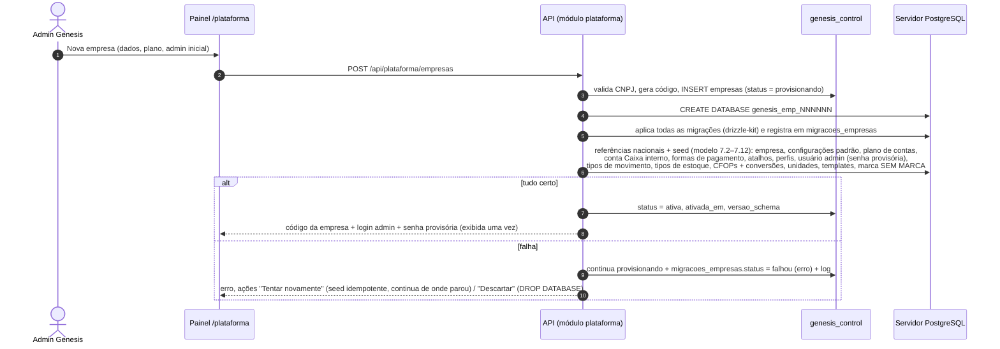

Status (`ck_empresas_status`, modelo 2.3): `provisionando`, `ativa`, `migrando`, `suspensa`, `cancelada`. `migrando`
= banco sendo movido para outro servidor (visao-geral.md 4.3.1): ERP e `/sync/*` (inclusive push) respondem 503
`MANUTENCAO` com `Retry-After`. Falha de
provisionamento não é um status: a empresa fica `provisionando` com a migração `falhou`. "Removida" também não: é
`cancelada` com os dados apagados (`excluido_em` preenchido, registro mínimo mantido; o código nunca é reutilizado).
Período de teste é tratado comercialmente pelo plano, sem status próprio.

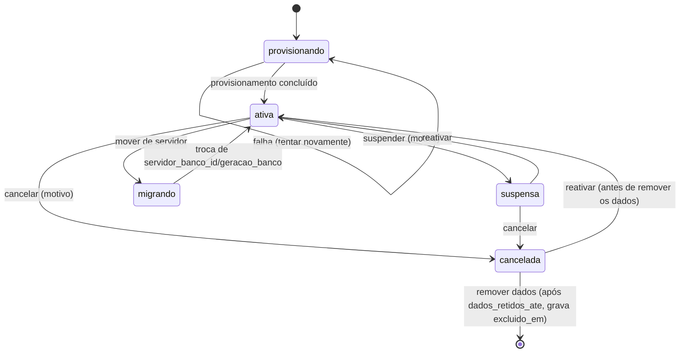

Comportamento por status = tabela do **modelo 2.3** e **sync 20.6** (sem carência de PDV):

| Ação | Quem | Efeitos |
|---|---|---|
| **Suspender** | `suporte`, `financeiro` (inadimplência), `superadmin` | `motivo_status` (inadimplência, pedido do cliente, uso indevido, outro), `suspensa_em`; ERP: login e chamadas recusados (`EMPRESA_SUSPENSA`); PDVs: `/sync/pull`, `/sync/estado` e `/sync/heartbeat` respondem **403 `EMPRESA_SUSPENSA`** já no próximo contato — o PDV **termina a venda atual e bloqueia novas**, mostrando o motivo; **`/sync/push` continua aceito** (as vendas já feitas são do cliente e não podem se perder); uma ativação nova com a empresa suspensa recebe 422 `CODIGO_INVALIDO` genérico (`motivo_falha = 'empresa_inativa'`, modelo 2.3; sync 3.3 #2), sem revelar o status da empresa. Não há carência de PDV; se a política comercial exigir uma (questão 15), é preciso acrescentar `empresas.carencia_pdv_dias` ao modelo e mudar o sync 20.6 antes |
| **Reativar** | `suporte`, `financeiro`, `superadmin` | volta a `ativa`; PDVs desbloqueiam no próximo contato |
| **Mover para outro servidor** | `superadmin` | só de `ativa`; escolhe o `servidores_banco` de destino; status = `migrando` (ERP e `/sync/*`, inclusive push, respondem **503 `MANUTENCAO`** com `Retry-After`; o PDV continua vendendo offline e guarda no outbox); o banco antigo fica somente leitura (`default_transaction_read_only = on`, sessões encerradas), é copiado para o destino e só então `servidor_banco_id` e `geracao_banco` mudam e o status volta a `ativa` (visao-geral.md 4.3.1); o banco antigo fica somente leitura até ser descartado; auditado em `auditoria_plataforma` |
| **Cancelar** | `superadmin` | `cancelada_em`, `dados_retidos_ate` = hoje + 90 dias; tudo recusado com `EMPRESA_CANCELADA` (inclusive push); backup final gerado |
| **Remover dados** | `superadmin`, com 2FA e digitando o código da empresa | após `dados_retidos_ate`: `DROP DATABASE`, mantém em `empresas` só o registro mínimo (`excluido_em`) |

### 19.5 Versões do PDV

**Rota**: `/plataforma/versoes-pdv`. Cadastro de `versoes_app_pdv` (modelo 2.7): `versao` (semver), `canal`
(`estavel`/`beta`), `plataforma` (`windows_x64`/`linux_x64`), `url_pacote`, `sha256`, `tamanho_bytes`, `notas`,
`publicada_em` (vazio = rascunho) e a marca **`versao_minima`** (versão mínima aceita por canal/plataforma). Uma empresa
recebe as versões do canal de `empresas.canal_pdv` (19.3; a lista "empresas no canal beta" é o filtro por essa coluna).
O heartbeat (12.6) devolve `app.versao_minima`/`versao_disponivel` e o comando `atualizar_app` quando o terminal está
abaixo da mínima; o ERP mostra o alerta em PDVs / Terminais. Gráfico de distribuição de versões instaladas.

### 19.6 Acessar como suporte

Só se a empresa permitir (`geral.permite_acesso_suporte`, 9.1). O admin (`suporte` ou `superadmin`) escolhe a
empresa, informa o **motivo** e a duração (padrão 1 h, **máx. 4 h**, `acessos_suporte.expira_em`, modelo 2.10); a API
grava `acessos_suporte` e emite um token do ERP com o `admin_plataforma_id` (não existe usuário técnico na empresa: o
token carrega as permissões de Master em modo leitura). O ERP mostra faixa fixa "Sessão de suporte Genesis – <admin> –
até hh:mm". Padrão **somente leitura** (`somente_leitura = true`); gravar exige ativar "modo escrita" com novo motivo
(novo `acessos_suporte`). Toda ação vai para a auditoria da empresa com `origem = 'suporte'`,
`admin_plataforma_id` preenchido e `usuario_id` nulo, e para `auditoria_plataforma`.

### 19.7 Migrações

**Rota**: `/plataforma/migracoes`.

| Elemento | Detalhe |
|---|---|
| Situação | versão de schema mais recente do código × versão de cada empresa (`migracoes_empresas`, modelo 2.12: `empresa_id`, `migracao`, `ordem`, `hash`, `status` `pendente`/`aplicando`/`aplicada`/`falhou`, `iniciada_em`, `concluida_em`, `duracao_ms`, `erro`, `executado_por`); filtro "atrasadas" e "com erro" |
| **Aplicar em todas** | executa a mesma rotina do comando `pnpm --filter api db:migrate:empresas` (ADR-02): primeiro as empresas marcadas como **canário**, depois as demais em lotes paralelos (padrão 4); opção "parar no primeiro erro"; progresso em tempo real |
| **Aplicar em uma** | por empresa |
| **Simular** | lista as migrações pendentes e o SQL, sem aplicar |
| Log | saída de cada execução: resultado, migrações aplicadas e o erro ou os **avisos** de cada empresa (relato de uma preparação de dados, que não é falha: ex.: "N linha(s) de saldo com a cadeia do razão quebrada", Fase 2, F2-B2) |

Regras: migrações seguem o padrão **expandir/contrair** (compatíveis com a versão anterior da API) porque a API continua
atendendo durante a execução; cada empresa migra numa transação quando possível; ao conectar, a API compara a versão
do schema da empresa com a mínima exigida e, se estiver abaixo, responde **503 "Empresa em manutenção"** só para
aquela empresa (os PDVs continuam vendendo offline e reenviam depois).

### 19.8 Planos

**Rota**: `/plataforma/planos`. Campos: nome, descrição, limites padrão (lojas, terminais, usuários), módulos
incluídos, valor mensal (informativo), ativo. Mudar o plano de uma empresa copia os limites (editáveis). Reduzir um
limite abaixo do uso atual é permitido com aviso: nada é desativado, mas novas lojas/ativações ficam bloqueadas.

### 19.9 Monitoramento

**Rota**: `/plataforma` (painel inicial): empresas por status; terminais online/offline/sem contato por empresa;
empresas com eventos com erro, tarefas com falha, migração atrasada, certificado vencendo em ≤ 15 dias, NFC-e em
contingência a 75 % do prazo da UF (`fiscal.prazo_transmissao_contingencia_h`; PR 24 h); uso de conexões do pool por empresa; tamanho dos bancos.

### 19.10 Backups

Backup diário por empresa (dump lógico), retenção de 30 dias + backup final no cancelamento. O registro dos backups
fica em `backups_empresas` (modelo 2.14: empresa, tipo, chave de armazenamento, tamanho, `sha256`, iniciado/concluído
em, status, retenção). Aba **Backups** da empresa: lista, download (`superadmin`,
auditado) e **Restaurar em novo banco** (cria `genesis_emp_<codigo>_restauro_<data>`
para conferência, sem substituir o banco ativo; troca manual e auditada).

### 19.11 Administradores da plataforma

**Rota**: `/plataforma/admins` (só `superadmin`): listagem, criar (convite por e-mail para definir senha e TOTP),
mudar papel, desativar, redefinir 2FA. Não é possível desativar o último `superadmin`.

---

## 20. Melhorias em relação ao Nuvem3

| # | Melhoria | Onde | Origem |
|---|---|---|---|
| 1 | **Custo gravado em cada movimento de estoque** + custo médio por estoque | 13.1.2, 13.1.4 | levantamento, seção 12 |
| 2 | **Validação de EAN** (dígito GS1) e **unicidade** (padrão bloquear; avisar só na migração) | 8.2.1, 9.1 | levantamento, seção 12 (o Nuvem3 aceita duplicados) |
| 3 | **Auditoria em todas as entidades** com antes/depois | 17 | levantamento, seção 12 |
| 4 | **Ids públicos não sequenciais** (UUID v7 na URL) + código legível no formulário | 1.2 | levantamento, seção 12 |
| 5 | Transferência em **duas etapas** com tratamento de divergência e sugestão de reposição | 13.7 | levantamento, seção 12 |
| 6 | Movimentação com **custo, última compra e visão sintética**, paginada no servidor | 16.5 | levantamento, seções 9.5 e 12 |
| 7 | Vínculo **fornecedor × produto × fator** aprendido na importação de NF-e | 8.2.14, 13.4.1 | projeto |
| 8 | Compensação de **eventos tardios** do PDV após contagem ("Definir") | 13.1.5 | projeto (local-first, ADR-08) |
| 9 | **Perfis + permissões granulares** em três estados, lojas e estoques permitidos | 2, 11 | levantamento (abas não abertas) |
| 10 | **PDVs / Terminais**: ativação por código, status, pendências, revogação | 12 | projeto (ADR-08) |
| 11 | **Fechamento cego** + conferência gerencial + quebra/sobra no financeiro | 14.9 | projeto |
| 12 | Produtos vendidos **considerando descontos** | 16.13 | levantamento (aviso do Nuvem3) |
| 13 | Listagem já abre pesquisada; filtros na URL; exportação de qualquer listagem | 3.1 | projeto |
| 14 | Tarefas em segundo plano para importações, exportações e relatórios pesados (a Movimentação do Nuvem3 deu timeout) | 3.6 | levantamento, pendências |
| 15 | **Códigos de barras de embalagem** (fardo/caixa) com fator | 8.2.3 | projeto (bebidas) |
| 16 | **Histórico de preços** por produto/loja | 8.2 | projeto |
| 17 | Devoluções e vales compra controlados (uso duplo offline evitado) | 15.4.3, 15.4.4 | projeto |
| 18 | Concorrência otimista (aviso de "alterado por outro usuário") | 1.4 | projeto |
| 19 | **Dia operacional** com hora de corte (lojas que fecham após meia-noite) | 9.1 (`geral.dia_operacional_hora_corte`) | projeto (o "Resumo Diário por intervalo de dias ou horário" do Nuvem3 continua só como filtro do resumo do PDV, 9.3.1) |
| 20 | CNPJ alfanumérico e campos de IBS/CBS já previstos | 1.6, 8.2.15 | projeto (legislação) |
| 21 | Painel da plataforma: provisionamento, limites de plano, migrações, backups por empresa | 19 | projeto (ADR-02) |

---

## 21. Modelo de dados – visão consolidada

**A fonte única das tabelas, colunas, tipos, restrições e filtros de sincronização é
`docs/arquitetura/modelo-de-dados.md`** (seções 2 a 7). Esta seção só mostra onde cada módulo do ERP está no modelo,
com os nomes oficiais; nomes antigos que apareciam aqui (`produtos_kit_itens`, `sessoes_caixa_formas`, `devolucoes`,
`vales_compra`, `comissoes`, `eventos_fiscais`, `versoes_pdv`…) estão no mapa de nomes do modelo (seção 8) e não devem
ser usados. **Sync**: o que desce e o que sobe é o do modelo 6.1–6.3 (fluxos e regras de filtro).

### 21.1 Banco de controle (`genesis_control`, modelo 2)

| Tabela oficial | Uso no ERP |
|---|---|
| `planos`, `servidores_banco`, `empresas` | Painel da plataforma (19.2–19.4, 19.8) |
| `terminais_pdv`, `ativacoes_pdv`, `tentativas_ativacao` | PDVs / Terminais (12) |
| `versoes_app_pdv` | Versões do PDV (19.5) |
| `admins_plataforma`, `sessoes_admin`, `acessos_suporte`, `auditoria_plataforma` | Acesso da equipe Genesis (19.1, 19.6, 19.11) |
| `migracoes_empresas` | Migrações (19.7) |
| `backups_empresas` | Backups (19.10; modelo 2.14) |

### 21.2 Banco de cada empresa (`genesis_emp_<código>`, modelo 3)

| Módulo | Tabelas oficiais (seção do modelo) |
|---|---|
| Sistema | `configuracoes`, `templates_documentos`, `numeracoes`, `numeracoes_faixas`, `arquivos`, `auditoria`, `tarefas`, `alertas`, `mensagens_enviadas` (3.1) |
| Empresa, lojas, estoques e caixas | `empresa`, `lojas`, `lojas_banners`, `certificados_digitais`, `estoques`, `tipos_estoque`, `caixas`, `impressoras_destino`, `taxas_entrega` (3.2) |
| Acesso | `usuarios`, `perfis`, `permissoes`, `perfis_permissoes`, `usuarios_permissoes`, `usuarios_lojas`, `usuarios_estoques`, `sessoes_usuario`, `historico_logins`, `redefinicoes_senha` (3.3) |
| Referências | `unidades_medida`, `cfops_grupos`, `ncms`, `ncms_ibpt`, `cests`, `cfops`, `meios_pagamento_fiscais`, `ufs`, `municipios`, `paises`, `bancos` (3.4, 7.2) |
| Pessoas | `pessoas`, `pessoas_categorias`, `pessoas_enderecos`, `pessoas_telefones`, `pessoas_emails`, `pessoas_aliases`, `saldos_credito_pessoas` (3.5) |
| Produtos | `marcas`, `categorias`, `produtos`, `produtos_categorias`, `produtos_codigos_barras`, `atributos_variacao`, `atributos_variacao_valores`, `produtos_variacoes`, `produtos_variacoes_valores`, `produtos_componentes` (`tipo` `kit`/`ficha_tecnica`), `produtos_componentes_alternativas`, `produtos_grupos_complementos`, `produtos_complementos`, `produtos_relacionados`, `produtos_precos_quantidade`, `produtos_lojas`, `produtos_lotes`, `produtos_fornecedores`, `produtos_imagens`, `produtos_historico_precos`, `promocoes`, `promocoes_itens`, `restricoes_horario_venda`, `grupos_preco_quantidade`, `grupos_preco_quantidade_faixas` (3.6) |
| Estoque | `tipos_movimento_estoque`, `movimentos_estoque`, `saldos_estoque`, `saldos_lote`, `acertos_estoque`, `itens_acerto_estoque`, `transferencias_estoque`, `itens_transferencia` (3.7) |
| Compras e entradas | `recebimentos`, `itens_recebimento`, `notas_entrada`, `itens_nota_entrada`, `notas_entrada_duplicatas`, `conversoes_cfop`, `dfe_controle_nsu`, `dfe_documentos`, `manifestacoes_destinatario` (3.8) |
| Financeiro | `planos_contas`, `planos_contas_lojas`, `contas_correntes`, `movimentos_conta_corrente`, `contas_financeiras`, `parcelas_financeiras`, `baixas_financeiras`, `cobrancas_recorrentes`, `cobrancas_parcelas` (3.9) |
| Formas de pagamento e PDV | `formas_pagamento`, `atalhos_pdv` (3.10) |
| Vendas | `orcamentos`, `itens_orcamento`, `vendas`, `itens_venda` (comissão em `comissao_pct`/`valor_comissao`, sem tabela própria), `itens_venda_complementos`, `pagamentos_venda`, `parcelas_venda`, `transacoes_tef`, `cobrancas_pix`, `comandas`, `itens_comanda`, `pedidos`, `pedidos_historico_status` (3.11) |
| Caixa | `sessoes_caixa`, `movimentos_caixa`, `fechamentos_caixa`, `fechamentos_caixa_formas`, `conferencias_caixa`, `conferencias_caixa_formas` (3.12) |
| Trocas e vales | `trocas`, `itens_troca` (também a devolução feita no ERP, 15.4.3), `vales`, `movimentos_vale` (3.13) |
| Fiscal | `documentos_fiscais`, `documentos_fiscais_eventos`, `inutilizacoes_fiscais` (3.14) |
| Sincronização e terminais | `terminais`, `eventos_recebidos`, `comandos_terminal` (3.15) |
| Integrações | `integracoes_eventos`, `integracoes_mapeamentos`, `tokens_api` — **ainda não modeladas** (a modelar na Fase 7) |

Itens que este ERP pede e que ainda faltam no modelo: só as tabelas de integração `integracoes_eventos`,
`integracoes_mapeamentos` e `tokens_api` (18.1, 18.15; a modelar na Fase 7). Os demais (`vendas.desconto_total_origem`,
`trocas.origem`, `tipo_forma = 'consumo_interno'` e `BAIXA_INTERNA`, contas do plano 7.5, `empresas.canal_pdv`,
`mensagens_enviadas`, `backups_empresas`, tipos `whatsapp_*` de `templates_documentos` e as chaves de 9) já estão no
modelo.

### 21.3 Diagrama das entidades centrais

Resumo; os diagramas completos por módulo estão no modelo 5.

```mermaid
erDiagram
  lojas }o--|| estoques : "estoque vinculado"
  lojas ||--o{ caixas : "possui (caixa 0 = ERP)"
  usuarios }o--o{ lojas : "lojas permitidas"
  usuarios }o--o| perfis : "perfil"
  produtos }o--o| marcas : "marca"
  produtos }o--o{ categorias : "categorias"
  produtos ||--o{ produtos_variacoes : "variações"
  produtos ||--o{ produtos_lojas : "preço e mínimo por loja"
  produtos ||--o{ produtos_codigos_barras : "EAN principal e adicionais"
  produtos ||--o{ produtos_componentes : "combo (posições) / ficha técnica"
  produtos_componentes ||--o{ produtos_componentes_alternativas : "alternativas da posição"
  produtos }o--o| grupos_preco_quantidade : "mix (atacarejo)"
  grupos_preco_quantidade ||--o{ grupos_preco_quantidade_faixas : "faixas por loja"
  movimentos_estoque }o--|| produtos : "produto"
  movimentos_estoque }o--|| estoques : "local"
  movimentos_estoque }o--|| tipos_movimento_estoque : "tipo_movimento"
  saldos_estoque }o--|| produtos : "produto"
  saldos_estoque }o--|| estoques : "local"
  vendas }o--|| lojas : "loja"
  vendas }o--|| caixas : "caixa"
  vendas }o--o| pessoas : "cliente"
  vendas }o--o| sessoes_caixa : "sessão"
  vendas ||--|{ itens_venda : "itens"
  vendas ||--|{ pagamentos_venda : "pagamentos"
  vendas ||--o{ documentos_fiscais : "NFC-e / NF-e"
  documentos_fiscais ||--o{ documentos_fiscais_eventos : "cancelamento, CC-e"
  pagamentos_venda }o--|| formas_pagamento : "forma"
  sessoes_caixa }o--|| caixas : "caixa"
  sessoes_caixa ||--o{ movimentos_caixa : "abertura, reforço, sangria"
  sessoes_caixa ||--o| fechamentos_caixa : "fechamento / troca de turno"
  fechamentos_caixa ||--|{ fechamentos_caixa_formas : "por forma"
  fechamentos_caixa ||--o| conferencias_caixa : "conferência no ERP"
  trocas }o--o| vendas : "venda de origem"
  trocas ||--|{ itens_troca : "itens"
  trocas ||--o| vales : "vale gerado"
  vales ||--|{ movimentos_vale : "extrato"
  contas_financeiras ||--|{ parcelas_financeiras : "parcelas"
  contas_financeiras }o--|| planos_contas : "plano"
  recebimentos ||--|{ itens_recebimento : "itens"
  notas_entrada ||--|{ itens_nota_entrada : "itens"
  transferencias_estoque ||--|{ itens_transferencia : "itens"
  acertos_estoque ||--|{ itens_acerto_estoque : "itens"
```

---

## 22. Roadmap por prioridade e rastreabilidade com o levantamento

### 22.1 O que entra em cada fase

| Fase | Telas do ERP | Plataforma / API | Depende de |
|---|---|---|---|
| **P1 – Base** | Login, trocar/esqueci senha, layout e menu, `<Listagem>`/`<Formulario>`/`<GradeItens>`, Empresa, Lojas (Dados Gerais, Anexos), Locais de estoque, Usuários, Perfis, Pessoas, Configurações › Geral, Auditoria, Dashboard (casca) | criação de empresa, provisionamento, migrações, planos, admins, CEP/CNPJ, e-mail | — |
| **P2 – Produtos e Estoque** | Produtos (completo, inclusive tributação gravada), Cadastro em massa, Categorias, Marcas, Restrições de horário de venda (8.9), Exportação/Importação, Tipo de Estoque, Acerto, Recebimento manual (financeiro gerado só quando a P4 existir — até lá a opção fica oculta), Recebimento de NF-e (XML e SEFAZ, conversão de CFOP), Transferência, Configurações › CFOP's (conversão), Lojas › Tributação (certificado A1); relatórios **Estoque Atual** e **Movimentação** (16.4–16.5, Prioridade 2 do levantamento) e Produtos geral, Histórico de produtos, NCMs inválidos (16.1–16.3) | razão de estoque, tarefas em segundo plano, Distribuição DF-e | P1 |
| **P3 – PDV e Vendas** | Formas de Pagamento, Lojas › Caixas/Parâmetros, Promoções (8.8), PDVs / Terminais, Configurações › Parâmetros (PDV) e abas PDV, Vendas e Orçamentos, Vendas (listagem/formulário, cancelamento não fiscal, devolução), Reforço, Sangria, Fechamento de caixa, Vales | `/sync/ativar`, `/sync/pull`, `/sync/push`, `/sync/heartbeat`, eventos com erro, versões do PDV | P2 |
| **P4 – Financeiro** | Plano de contas, Contas a pagar/receber, baixas, cobranças mensais, código de barras/PIX, Contas correntes, Configurações › Financeiro, integração financeira das vendas (14.10) e do recebimento | — | P3 |
| **P5 – Relatórios e Dashboard** | Dashboard completo; os relatórios restantes (16.6–16.16): 1º Vendas geral, Produtos vendidos e Fechamento de caixa (a Prioridade 5 do levantamento também cita Estoque Atual e Movimentação, que já vêm da P2); depois os demais | alertas por e-mail (vencimento) | P4 |
| **P6 – Fiscal e Integrações** | Configurações › Fiscal/Tributação, Lojas › NFC-e/TEF/WhatsApp/iFood/Aparência, emissão de NF-e, cancelamento fiscal, CC-e, inutilização, Download de XML, NF-e de transferência, Integrações (18), Ordem de Serviço (futuro) | emissão NF-e na nuvem; NFC-e no PDV com contingência (ADR-11) | P5 (exceto a parte NFC-e, abaixo) |

> **Antecipado para a Fase 1 / adiado para FUT (decisões do dono, out/2026).** Da P2 vão para a Fase 1: tipos
> Combo / kit (8.2.17, com troca de componente), Produzido e Vasilhame, ficha técnica, atacarejo completo (8.2.2,
> 8.2.3, 8.2.9) e Grupos de preço por quantidade (8.10). Saem da P3 para **[FUT]** (módulos opcionais, 0.1): Lojas › Taxas de entrega (10.3.11),
> impressoras de produção, comandas, taxa de serviço, pedidos/delivery e cardápio interno.

> **NFC-e antecipada (roadmap Fase 3F).** A parte NFC-e da P6 (ordem 6a da seção 18, parte NFC-e: Configurações ›
> Fiscal e Tributação, CFOP's, Lojas › Tributação e NFC-e, IBPT, Download de XML, monitoramento fiscal, e a emissão da
> NFC-e no PDV com contingência, cancelamento e inutilização) é entregue na **Fase 3F** do roadmap, que depende só da P2
> (tributação) e da P3 e roda em paralelo com a P4 e **antes** da P5. NF-e modelo 55, TEF, PIX dinâmico e as
> demais integrações seguem na Fase 6, depois da P5.

### 22.2 Rastreabilidade

| Levantamento Nuvem3 | Esta especificação |
|---|---|
| 1.1 Tecnologia, login, ids criptografados | 1.2, 4 |
| 1.2–1.3 Layout e árvore de menus | 5 |
| 1.4 Padrão de listagem `Consulta.aspx?id=N` | 3.1 |
| 1.5 Multiloja | 2.1, 10.3, 13.2 |
| 2 Dashboard | 6 |
| 3 Pessoas | 7 |
| 4.1–4.2 Produtos | 8.1–8.2 |
| 4.3 Cadastro em massa | 8.3 |
| 4.4 Categorias | 8.4 |
| 4.5–4.6 Exportação/Importação | 8.5–8.6 |
| 4.7 Marcas | 8.7 |
| 5.1 Configurações (10 abas) | 9 |
| 5.2 Empresa | 10.1 |
| 5.3 Formas de Pagamento | 10.2 |
| 5.4 Lojas | 10.3 |
| 5.5 Usuários | 11 |
| 6.1 Acerto | 13.5 |
| 6.2 Recebimento manual | 13.3 |
| 6.3 Recebimento de NFe | 13.4 |
| 6.4 Tipo de Estoque | 13.6 |
| 6.5 Transferência | 13.7 |
| 7.1–7.2 Contas a pagar/receber | 14.1–14.5 |
| 7.3 Download de XML | 14.6 |
| 7.4 Contas correntes | 14.7 |
| 7.5 Plano de contas | 14.8 |
| 7.6 Fechamento de caixa | 14.9 |
| 8.1 Orçamentos | 15.1 |
| 8.2 Reforço/Sangria | 15.2–15.3 |
| 8.3 Vendas | 15.4 |
| 8.4 PDV | `docs/pdv/` (aqui: 9.3.1, 9.9, 10.2, 12) |
| 9.1–9.16 Relatórios | 16.1–16.16 |
| 10 Modelo de dados sugerido | 21 |
| 11 Pendências | 23 e notas "não levantado" nas seções |
| 12 Recomendações | 0.1, 20, 22 |

---

## 23. Questões em aberto

> **Decididas pelo dono (out/2026; roadmap 16):** lojas da Ice Beer no **PR** com NFC-e obrigatória e fiscal sempre
> parametrizado pela UF da loja (D1; `docs/fiscal/nfce-parana.md`); a Ice Beer **vende vasilhame/casco, fardo, kit,
> itens com ficha técnica, grupo de itens e atacarejo** — tudo na Fase 1 (D3); o **"grupo de itens" é o combo/kit**
> com troca de componente e o **mix** fica como funcionalidade própria (D16, 30/10/2026, questão 23); a baixa da
> ficha técnica de produto produzido segue a confirmar (questão 24); **não usa comandas nem delivery** — módulos
> [FUT] (D4).

### 23.1 Questões gerais

| # | Questão | Impacto | Proposta até decidir |
|---|---|---|---|
| 1 | O **CD** da Ice Beer tem CNPJ próprio e emite NF-e de transferência para as lojas? As lojas têm CNPJs distintos entre si? | Fiscal da transferência (13.7) e cadastro do CD como Loja tipo Depósito ou só Estoque | cadastrar CD como Loja tipo `deposito` se tiver CNPJ; transferência sem nota até a P6 |
| 2 | Qual a semântica real de "Tipo de Estoque", "Ativa" (Config › Geral), "Id Registro" e "Chave" (Lojas) no Nuvem3? ("Produto Emite NFe" não foi adotado, 9.4) | Campos desenhados por nós (13.6, 9.1, 10.3.1, 9.4) | manter o desenho; ajustar se o Khauan souber o uso no dia a dia |
| 3 | Vendas pagas à vista (dinheiro/PIX) devem gerar conta a receber **por venda** ou **consolidada por sessão**? | Volume do financeiro e conciliação | `por_sessao` (14.10), configurável |
| 4 | Política de **saldo negativo** e de "Bloqueia venda sem estoque" nas lojas (bebida gelada costuma vender sem entrada lançada) | PDV e acertos | aceitar negativo no razão; bloqueio desligado por padrão |
| 5 | **Dia operacional**: as lojas fecham depois da meia-noite? Qual hora de corte? | Caixa, Dashboard, relatórios | **decidida (dono, 31/10/2026)**: `geral.dia_operacional_hora_corte` = `05:00` na empresa, ajustável por loja; roadmap D7 |
| 6 | Sangria/reforço devem poder ser lançados **no ERP** (ex.: gerente lança depois)? | Consistência do caixa local-first | só no PDV; correções via conferência (15.3) |
| 7 | Quem pode **cancelar venda do PDV pelo ERP** e até quando (prazo da NFC-e na UF das lojas)? | 15.4.3 | permissão `vendas.cancelar`, prazo da UF da loja (parametrizado por UF; lojas da Ice Beer no PR, `docs/fiscal/nfce-parana.md`; padrão 30 min até confirmar) |
| 8 | Certificado **A1 único** (mesma raiz de CNPJ) ou um por loja? | Upload em Lojas › Tributação | um por loja, aceitando o mesmo arquivo em várias |
| 9 | Evolution API é não oficial (risco de bloqueio do número). Aceitável ou preferir a API oficial do WhatsApp (Cloud API)? | 18.6 | adaptador permite trocar depois |
| 10 | TEF: qual provedor/adquirente as lojas usam hoje (SiTef, PayGo, maquininha POS solta)? | 18.7 e P6 | até a P6, cartão registrado manualmente com bandeira e NSU opcional |
| 11 | O **PDV mobile/comanda** precisa funcionar sem internet? | 18.9 | online na primeira versão — sem urgência: comandas são módulo [FUT] (D4), a Ice Beer não usa |
| 12 | Quais **relatórios do Nuvem3 são usados de verdade** (para ordenar a P5)? Faltou algum (ex.: DRE, curva ABC, inventário)? | 16 | ordem recomendada pelo levantamento |
| 13 | Ordem de Serviço (aba 2 das Configurações) será usada pela Ice Beer? | Módulo futuro | fora das fases 1–5 |
| 14 | Migração de dados do Nuvem3 (produtos, clientes, saldos) — via planilhas de Exportação do Nuvem3 + Importação nossa? | Implantação | layout de importação (8.6) aceita as colunas do export do Nuvem3 com mapeamento |
| 15 | Limites de plano: além de lojas e terminais, limitar usuários? Qual política comercial na suspensão — os PDVs param no próximo contato ou têm carência? | 19.3–19.4, sync 20.6 | usuários sem limite; **sem carência** (regra atual do modelo 2.3 e do sync 20.6: o PDV termina a venda e bloqueia novas; o push continua aceito). Carência exigiria `empresas.carencia_pdv_dias` e mudança no sync |
| 16 | O painel da plataforma pode ficar no mesmo build do ERP (`/plataforma`) ou deve virar um app separado (mudaria o ADR-01)? | Segurança/deploy | mesmo build, token e host separados; revisar antes da produção |
| 17 | Base externa de GTIN (consulta paga) e tabela IBPT: quem contrata/atualiza? | 18.13 | opcional, por empresa |

### 23.2 Semântica de campos do Nuvem3 e migração

Pontos que o levantamento registrou sem detalhe suficiente e que afetam enums, seeds e a migração de dados. Confirmar
com o Khauan (telas e exportações do Nuvem3) antes da implementação da fase indicada.

| # | Questão | Impacto | Proposta até decidir |
|---|---|---|---|
| 18 | Quais são os **7 tipos de produto** do formulário e as **9 opções do filtro** de produtos do Nuvem3 (o levantamento só nomeia Simples, Kit, Com variações, Com complementos e Matéria-prima)? | Enum `produtos.tipo` (modelo 3.6.3), 8.1, 8.2.1, migração | manter os 8 valores de 8.2.1 (`servico`, `produzido` e `vasilhame` são projeto nosso) e ajustar o enum antes da migração (Fase 2) |
| 19 | O que faz **"Usa PDV como utilitário"** (Usuários) no Nuvem3? | Menu do PDV, `usuarios.pdv_utilitario` (11.2, PDV 7.2/35.2) | modo utilitário do PDV 7.2: consultas, comandas, pré-vendas/orçamentos, sem abrir caixa nem receber; diagnóstico de hardware fica em `pdv.config.terminal` |
| 20 | Como as lojas usam hoje as formas **"Avarias"** e **"Baixas de utilização em loja"** (filtro de Contas a Receber, levantamento 7.2)? Registram no caixa? Geram conta a receber? Como migrar o histórico? | 10.2, 14.3, migração do financeiro e do estoque | forma `tipo_forma = 'consumo_interno'` (sem documento fiscal, despesa quitada pelo custo, estoque `BAIXA_INTERNA`), seed inativo; ou Acerto de saída no ERP. Títulos migrados dessas formas entram quitados e marcados "migrado — consumo interno" (também PDV 35) |
| 21 | Quais são as **20 opções do "Meio de Pagamento CFe"** do Nuvem3 (o seed tem 18 códigos)? Enviar print do campo | `meios_pagamento_fiscais`, migração das formas (10.2) | seed com todos os códigos NFC-e/CF-e-SAT, inativos os que não valem para NFC-e (ex.: 14); códigos desconhecidos entram inativos depois de conferidos |
| 22 | O que fazem **"Limite de Valor de Vendas PDV"** e **"Limite Venda em Aberto"** (Parâmetros) no Nuvem3? | 9.3.1, 7.2, PDV 22.3/29.3, roadmap **D15** | até a decisão D15: `pdv.limite_valor_venda` = valor máximo de uma venda; `pdv.limite_venda_em_aberto` = máximo de vendas suspensas por terminal (inteiro); o limite de crédito padrão do cliente sem limite próprio é outra chave, `financeiro.limite_credito_padrao` (9.7) |
| 23 | ~~O que é o **"grupo de itens"** do Nuvem3?~~ **Decidida pelo dono (30/10/2026, roadmap D16)** | 8.2.17, 8.10, modelo 3.6.7/3.6.13, PDV 10.9.1/11.3.1 | **grupo de itens = combo/kit** com composição (ex.: "COMBO DE WHISKY 1L"): custo calculado, preço manual, sem estoque próprio, troca de componente com acréscimo, NFC-e com um `det` por componente (8.2.17). O **mix** (`grupos_preco_quantidade`, 8.10) continua na Fase 1 como funcionalidade própria, também pedida pelo dono |
| 24 | No Nuvem3, vender item com **ficha técnica** baixa os componentes do estoque, ou a ficha é só para custo? | 8.2.1, 8.2.4, PDV 10.9.2, roadmap **D17** | baixa os insumos (`tipo = 'produzido'`, `BAIXA_INSUMO`); ficha informativa em produto `simples` continua possível. O combo (= "grupo de itens", questão 23) já baixa os componentes; resta confirmar se a Ice Beer usa a ficha técnica também para produto montado na loja (drinque, balde) |
| 25 | **Atacarejo**: o preço de atacado é o mesmo em todas as lojas ou muda por loja? O preço do fardo é próprio da embalagem ou sai do atacado 12+? | 8.2.2, 8.2.3, 8.2.9, PDV 11.3.1 | preço da empresa em `preco_atacado`; por loja via faixas de `produtos_precos_quantidade` com Loja; fardo com preço próprio opcional (vale o menor) |
