# Especificação Funcional do PDV (Frente de Caixa) – GenesisPDV

> **Documento de implementação.** Descreve, tela por tela e regra por regra, o aplicativo de frente de caixa
> instalado nos computadores das lojas. Segue obrigatoriamente `docs/arquitetura/decisoes.md` (ADRs).
> Referência funcional: o levantamento do Nuvem3 (29/10/2026), que fica com o dono, fora do repositório; o que ele
> trouxe está descrito nesta especificação com palavras próprias.
>
> A tela do PDV do Nuvem3 **não foi levantada** (seção 8.4 e Pendências do levantamento). O que se sabe dela são as
> flags de configuração (abas Parâmetros, PDV, Vendas, Fiscal), as formas de pagamento, as lojas, os usuários e os
> relatórios de caixa. Este documento projeta um **PDV padrão brasileiro de frente de caixa** e transforma cada uma dessas
> flags em comportamento concreto (seção 33 traz o mapeamento completo flag → comportamento).

## Sumário

1. [Objetivo, escopo e princípios](#1-objetivo-escopo-e-princípios)
2. [Fases e prioridades](#2-fases-e-prioridades)
3. [Glossário](#3-glossário)
4. [Arquitetura interna e dados locais](#4-arquitetura-interna-e-dados-locais)
5. [Instalação e ativação do terminal](#5-instalação-e-ativação-do-terminal)
6. [Configuração local do terminal (hardware e fiscal)](#6-configuração-local-do-terminal-hardware-e-fiscal)
7. [Login do operador](#7-login-do-operador)
8. [Abertura de caixa](#8-abertura-de-caixa)
9. [Tela principal de venda](#9-tela-principal-de-venda)
10. [Entrada de itens](#10-entrada-de-itens)
11. [Preços](#11-preços)
12. [Descontos, acréscimos, arredondamento e rateio](#12-descontos-acréscimos-arredondamento-e-rateio)
13. [Cancelamentos (item e venda)](#13-cancelamentos-item-e-venda)
14. [Identificação do cliente](#14-identificação-do-cliente)
15. [Vendedor / atendente](#15-vendedor--atendente)
16. [Pagamento](#16-pagamento)
17. [Finalização da venda](#17-finalização-da-venda)
18. [Documento fiscal (Não fiscal / NFC-e / SAT / MFE)](#18-documento-fiscal-não-fiscal--nfc-e--sat--mfe)
19. [Impressão e gaveta](#19-impressão-e-gaveta)
20. [Sangria e reforço](#20-sangria-e-reforço)
21. [Fechamento de caixa / troca de turno](#21-fechamento-de-caixa--troca-de-turno)
22. [Gestão de vendas e reimpressão](#22-gestão-de-vendas-e-reimpressão)
23. [Troca / devolução e vale-compra](#23-troca--devolução-e-vale-compra)
24. [Orçamentos e pré-vendas](#24-orçamentos-e-pré-vendas)
25. [Comandas](#25-comandas)
26. [Pedidos, delivery e balcão](#26-pedidos-delivery-e-balcão)
27. [Consultas: preço, tabela de preços, produtos vencidos](#27-consultas-preço-tabela-de-preços-produtos-vencidos)
28. [Atalhos de teclado](#28-atalhos-de-teclado)
29. [Regras de estoque e limites](#29-regras-de-estoque-e-limites)
30. [Modo offline e sincronização (visão do PDV)](#30-modo-offline-e-sincronização-visão-do-pdv)
31. [Permissões](#31-permissões)
32. [Auditoria, erros, recuperação, backup, atualização, hardware, UX e acessibilidade](#32-auditoria-erros-recuperação-backup-atualização-hardware-ux-e-acessibilidade)
33. [Mapeamento flags do Nuvem3 → comportamento do PDV](#33-mapeamento-flags-do-nuvem3--comportamento-do-pdv)
34. [Máquinas de estado](#34-máquinas-de-estado)
35. [Questões em aberto para o dono do produto](#35-questões-em-aberto-para-o-dono-do-produto)

---

## 1. Objetivo, escopo e princípios

### 1.1 Objetivo

Permitir que o operador de caixa de qualquer loja da empresa registre vendas no balcão com rapidez, receba em
qualquer combinação de formas de pagamento, emita o documento (não fiscal, NFC-e ou SAT, conforme a loja), controle o
dinheiro da gaveta (abertura, sangria, reforço, fechamento) e continue trabalhando **sem internet**, sincronizando tudo
com a nuvem depois.

### 1.2 Escopo

| Dentro do escopo | Fora do escopo (é do ERP web) |
|---|---|
| Ativação e configuração do terminal | Cadastro e edição de produtos, preços, usuários, formas de pagamento, lojas |
| Login de operador (online e offline) | Emissão de NF-e modelo 55 |
| Abertura, sangria, reforço, fechamento/troca de turno | Contas a pagar/receber, plano de contas, conciliação |
| Venda balcão completa (itens, preços, descontos, cliente, vendedor) | Relatórios gerenciais (o PDV só tem o resumo do caixa) |
| Pagamentos: dinheiro, cartão (TEF e POS), PIX, crediário, vale, crédito funcionário, boleto | Acerto, transferência e recebimento de estoque |
| NFC-e com contingência offline; cupom não fiscal; SAT (futuro) | Configuração das flags (o PDV só lê) |
| Troca/devolução com vale-troca; orçamentos e pré-vendas importados; comandas; pedidos/delivery básico | Integrações iFood, 99Food, WooCommerce, NuvemShop |
| Exceção ao "cadastro é mestre na nuvem": cadastro rápido de cliente (ADR-08) | |

### 1.3 Princípios obrigatórios

1. **Local-first (ADR-08):** toda ação do operador é gravada primeiro no SQLite local, em transação, antes de qualquer
   chamada de rede. A venda **nunca** espera a internet (exceções explícitas: PIX dinâmico, TEF, consultas online).
2. **Nada se perde:** cada passo de uma venda em andamento é persistido; queda de energia no meio da venda é
   recuperável (seção 32.3).
3. **Teclado primeiro:** tudo deve ser possível sem mouse; o mouse/toque é um atalho a mais (seção 32.8).
4. **Documentos imutáveis (ADR-06):** venda finalizada, movimento de caixa e movimento de estoque não são editados;
   correções geram novos registros (cancelamento, estorno).
5. **Dinheiro em `decimal` (ADR-05):** nunca `double`/`float` em C#. Preço unitário com 4 casas, totais com 2,
   quantidades com 3.
6. **Configuração vem da nuvem:** as flags (seção 33) descem pela sincronização; o PDV nunca as altera. Só a
   configuração de hardware é local ao terminal (seção 6).
7. **Hardware por interface (ADR-07):** impressora, gaveta, balança, pinpad/TEF e fiscal ficam atrás de interfaces em
   `GenesisPDV.Hardware`/`GenesisPDV.Fiscal`, com implementações simuladas para desenvolvimento e testes.

---

## 2. Fases e prioridades

Cada funcionalidade deste documento leva uma etiqueta **Fase**. As etiquetas do PDV usam o prefixo `PDV-` para não
se confundir com as prioridades do levantamento nem com as etiquetas **[P1]…[P6]** do ERP (o "PDV-3" é o TEF, que é
Prioridade 6 no levantamento e no ERP 18). A correspondência com as fases do roadmap está no roadmap, seção 3.

| Etiqueta | Nome | O que entrega | Critério de pronto da fase | Roadmap |
|---|---|---|---|---|
| **PDV-1** | MVP – Vender offline | Ativação, login offline, abertura, venda por código/busca, multiplicador, **fardo/caixa com fator e preço de embalagem**, **atacarejo: atacado por quantidade, faixas de preço por quantidade por loja e grupo de preço por quantidade (mix)**, **combo/kit (o "grupo de itens" do Nuvem3, com troca de componente) e ficha técnica (baixa dos componentes)**, **vasilhames/cascos retornáveis (cascos trazidos, cobrança do casco faltante, devolução avulsa)**, produto genérico, **confirmação de idade (+18) e horário restrito**, desconto com limite e senha de liberação, cancelamentos, CPF na nota, pagamento **dinheiro / cartão em POS externo / PIX (QR estático ou confirmação manual)**, múltiplas formas, **cupom não fiscal**, gaveta, sangria/reforço, fechamento cego, reimpressão, sincronização, recuperação após queda, backup local | Uma loja vende um dia inteiro sem internet e, ao reconectar, ERP mostra vendas, caixa e estoque corretos | Fase 1 |
| **PDV-2** | Operação completa de loja | Balança (EAN prefixo 2 e serial), lote, variações, tipo de preço (F8), parcelado, promoções e preço "gelada", **comodato de cascos e crédito de casco em vale** (10.12), vendedor, cadastro rápido de cliente, crediário, **recebimento de crediário no caixa**, crédito funcionário, vale-compra, troca/devolução, cupom de troca, orçamentos/pré-vendas, PIX dinâmico, produtos vencidos, atualização automática, limites, acréscimo | Loja opera sem precisar do ERP para nada do balcão | Fases 3 e 4 (crediário e recebimento de crediário no caixa na 4); PIX dinâmico na 6 |
| **PDV-3** | TEF | Cartão integrado por TEF (pinpad físico/virtual), comprovantes TEF, administrativo TEF, resolução de pendências | Venda com cartão sem digitação manual, com conciliação automática | Fase 6 |
| **FISCAL** | NFC-e (ADR-11) | NFC-e modelo 65 emitida pelo PDV, contingência offline (tpEmis=9) com cancelamento por substituição, cancelamento, inutilização, DANFE NFC-e (completo/resumido/eletrônico), XML na nuvem | Loja em produção fiscal sem ECF/SAT | Fase 3F (ADR-11; NF-e, TEF e PIX dinâmico ficam na Fase 6) |
| **FUT** | Futuro / módulos opcionais | SAT-CF-e ou MFE (se algum estado exigir), NFS-e de serviço, ordem de serviço, agenda, **módulos de bar/restaurante/delivery, não usados pela Ice Beer (decisão D4): comandas (25), taxa de serviço (25.3), impressoras de produção (6.2.1), pedidos/delivery e balcão (26), taxas de entrega, cardápio interno (9.1)**, PDV mobile/comanda eletrônica, totem, menu digital, integrações de delivery, complementos na venda, display do cliente | — | Fases 7–8 (os módulos opcionais entram quando um cliente precisar; a especificação fica mantida) |

> **Decisões do dono (out/2026, roadmap 16).** (D1) As lojas da Ice Beer ficam no **Paraná** e emitem **NFC-e**; o
> PDV pode atender empresas de todo o Brasil, por isso **todo comportamento fiscal é parametrizado pela UF da loja**
> (`lojas.uf` e regras por UF no módulo fiscal), nunca fixo em PR — particularidades do PR em
> `docs/fiscal/nfce-parana.md`. (D3, D16, D17) Vasilhame/casco, fardo, combo/kit ("grupo de itens" do Nuvem3, D16) e
> ficha técnica, mix e atacarejo são necessários para o PDV substituir o Nuvem3 no caixa e por isso estão na **PDV-1**. (D4) O fluxo das
> lojas é **balcão** (o cliente pega o produto, passa no caixa, a venda é registrada e paga); comandas, taxa de
> serviço, impressoras de produção, pedidos/delivery e cardápio interno foram para **FUT** como módulos opcionais para
> outros clientes, com a especificação mantida (seções 6.2.1, 25 e 26).

> NF-e (modelo 55) para cliente PJ contribuinte (14.4, `status_fiscal = 'nfe_solicitada'`): **Fase 6** do roadmap
> (NF-e emitida pela nuvem, ADR-11), não faz parte da FISCAL. Até a Fase 6, em loja NFC-e, a venda a contribuinte
> sai com NFC-e identificada com o CNPJ (14.1).

> Regra de dependência: nada da fase PDV-1 pode depender de TEF, NFC-e ou internet. O modelo de dados local já nasce com os
> campos fiscais (ADR-11), mesmo que a PDV-1 só imprima cupom não fiscal.

---

## 3. Glossário

| Termo | Significado neste documento |
|---|---|
| **Terminal / caixa** | Uma instalação ativada do PDV, vinculada a empresa + loja + **número do caixa** (1, 2, 3...). |
| **Sessão de caixa (turno)** | Período entre a abertura e o fechamento de um caixa por um operador. Tabela `sessoes_caixa`. |
| **Operador** | Usuário logado no PDV. |
| **Supervisor** | Qualquer usuário com `pdv.supervisor` e a permissão exigida pela ação (e lojas permitidas incluindo a loja), que digita login e **PIN** (`senha_pdv_hash`) para liberar uma ação ("senha de liberação"). |
| **Fundo de troco** | Dinheiro colocado na gaveta na abertura. |
| **Sangria** | Retirada de dinheiro da gaveta durante o turno. |
| **Reforço** | Entrada de dinheiro na gaveta durante o turno (no Nuvem3 a tela é "Reforço/Abertura de caixa"). |
| **Fechamento cego** | O operador digita o que contou sem ver o valor calculado pelo sistema. |
| **Outbox** | Tabela local `eventos_saida`, fila de fatos a enviar para a nuvem (ADR-08). |
| **Cursor** | Maior `versao` já recebida da nuvem na descida (ADR-08). |
| **Saldo estimado** | Último saldo de estoque baixado − vendas locais ainda não refletidas nele (ADR-08). |
| **Vale-compra / vale-troca** | Crédito do cliente com código, saldo e validade, gerado por troca/devolução (e futuramente vendido). |
| **Crediário / caderneta** | Venda a prazo para cliente identificado, gerando contas a receber. |
| **POS externo** | Maquininha de cartão não integrada: o operador passa o cartão nela e informa no PDV. |
| **TEF** | Transferência Eletrônica de Fundos: cartão integrado ao PDV via pinpad e cliente TEF (SiTef, PayGo etc.). |
| **Contingência offline** | Emissão de NFC-e com `tpEmis=9` sem autorização prévia da SEFAZ, transmitida depois. |
| **Rateio** | Distribuição de desconto/acréscimo do total da venda entre os itens (exigido pela NFC-e). |
| **Atacarejo** | Preço de varejo para quem leva pouco e preço de atacado/oferta a partir de uma quantidade (ex.: 12+). Seção 11.3.1. |
| **Grupo de preço por quantidade (mix)** | Produtos diferentes cujas quantidades somam para ativar o atacado/oferta (`grupos_preco_quantidade`), ex.: 6 Brahma + 6 Skol = 12 latas no preço de oferta. Funcionalidade própria da PDV-1; **não** é o "grupo de itens" do Nuvem3 (esse é o combo). Seção 11.3.1. |
| **Vasilhame / casco** | Embalagem retornável (garrafa 600 ml/1 L, garrafão, botijão): o cliente devolve o vazio ou paga o casco. Seção 10.12. |
| **Combo / kit** | O "grupo de itens" do Nuvem3 (D16): produto tipo Kit composto de outros produtos em posições (cada uma com produto padrão e alternativas opcionais com acréscimo), sem estoque próprio; a venda baixa os componentes escolhidos e a NFC-e lista cada componente. Seção 10.9.1. |
| **Ficha técnica** | Composição de um produto `produzido` (montado na loja), cuja venda baixa os insumos; na NFC-e sai o próprio produto. Seção 10.9.2. |

---

## 4. Arquitetura interna e dados locais

### 4.1 Projetos (ADR-07)

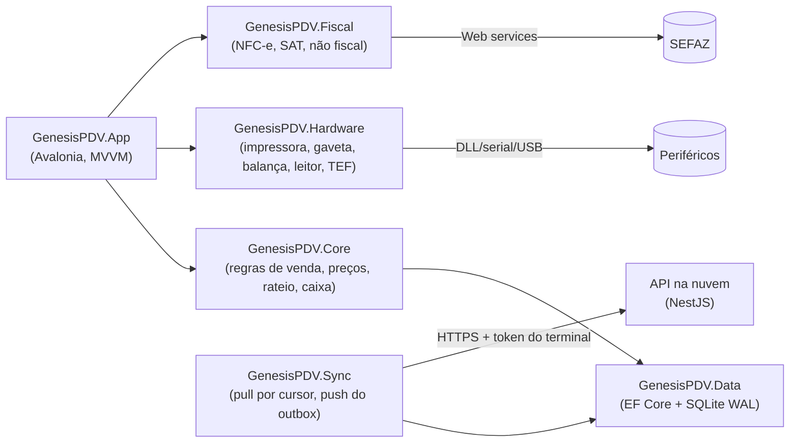

- `GenesisPDV.Core` não conhece UI nem banco concreto (interfaces de repositório). Toda regra deste documento
  (preço, desconto, rateio, troco, limites, estados) mora no Core e tem teste unitário em `GenesisPDV.Core.Tests`.
- O serviço de sincronização roda em segundo plano (`BackgroundService`) dentro do próprio processo do PDV.

### 4.2 Banco local (SQLite)

- Arquivo: `%ProgramData%\GenesisPDV\dados\pdv.db` (Windows) / `/var/lib/genesispdv/pdv.db` (Linux).
- `PRAGMA journal_mode=WAL`, `PRAGMA synchronous=FULL` (durabilidade em queda de energia; o custo é aceitável no volume
  de um caixa), `PRAGMA foreign_keys=ON`.
- Migrações via EF Core Migrations, aplicadas na inicialização **após backup automático** (seção 32.5).

Os nomes e as colunas das tabelas locais são os do modelo de dados (`docs/arquitetura/modelo-de-dados.md`, seções
4.2–4.4), que é a fonte oficial; o modelo EF Core é gerado a partir do schema da nuvem. Decimais ficam em `INTEGER`
escalado no SQLite (modelo 4.1) e são `decimal` no C#.

**Tabelas espelho (descem da nuvem, somente leitura no PDV)** — mesmo nome e colunas das tabelas da nuvem, com as
colunas padrão `id`, `criado_em`, `atualizado_em`, `excluido_em`, `versao`. Inserção local só nas linhas criadas por
este terminal que também sobem por evento (`vales` emitidos no caixa, `comandas`/`itens_comanda`,
`orcamentos`/`itens_orcamento` criados no caixa, `cobrancas_pix` estático), com `versao = 0` e
`criado_localmente = 1` (modelo 4.2).

| Tabela local | Conteúdo filtrado para o terminal |
|---|---|
| `empresa`, `configuracoes` | Dados da empresa e todas as flags (seção 33), inclusive os padrões fiscais da aba Tributação (chaves `tributacao.*`) |
| `lojas`, `lojas_banners`, `caixas`, `estoques`, `tipos_estoque` | Só a loja do terminal (dados gerais, tributação, NFC-e, TEF), seus caixas (número, `nfce_serie`) e o estoque vinculado |
| `certificados_digitais` | Certificado A1 da loja com NFC-e, cifrado (seção 6.7) |
| `numeracoes_faixas` | Faixas de numeração reservadas a este terminal (comandas automáticas) |
| `impressoras_destino` | Destinos lógicos de impressão de produção da loja (ex.: `COZINHA`, `BAR`); a impressora física de cada um é configuração local (6.2.1). FUT (módulo opcional) |
| `taxas_entrega` | Taxa de entrega por bairro (delivery; FUT, módulo opcional) |
| `templates_documentos`, `atalhos_pdv` | Templates de impressão; tabela de atalhos (Atalho / Habilitado / Ordem) |
| `usuarios`, `usuarios_lojas`, `perfis`, `permissoes`, `perfis_permissoes`, `usuarios_permissoes` | **Todos** os usuários da empresa (projeção sem dados pessoais e **sem `senha_hash`**: a senha do ERP nunca desce, sincronizacao.md 4.1), com o PIN `senha_pdv_hash` (argon2id) só de quem tem acesso à loja do terminal (lojas permitidas ou Usuário Master); `senha_pdv_hash` desce `null` para os demais, que assim não logam neste caixa |
| `produtos`, `produtos_codigos_barras`, `produtos_categorias`, `produtos_lojas`, `produtos_tributacao_uf`, `produtos_precos_quantidade`, `grupos_preco_quantidade`, `grupos_preco_quantidade_faixas`, `produtos_componentes`, `produtos_componentes_alternativas`, `produtos_variacoes`, `produtos_variacoes_valores`, `atributos_variacao`, `atributos_variacao_valores`, `produtos_grupos_complementos`, `produtos_complementos`, `produtos_relacionados`, `produtos_lotes` | Produtos (ativos e inativos, para histórico), códigos de barras e embalagens (fator/preço), preços e estoque mínimo da loja, faixas de preço por quantidade, composição do combo (posições e alternativas) e ficha técnica, variações, complementos, lotes/validades |
| `promocoes`, `promocoes_itens` | Promoções vigentes da loja (seção 11.4) |
| `restricoes_horario_venda` | Horários proibidos de venda por categoria/idade mínima (seção 10.11) |
| `categorias`, `marcas`, `unidades_medida` | Para busca, exibição e fracionamento |
| `pessoas`, `pessoas_categorias`, `pessoas_telefones`, `pessoas_enderecos`, `pessoas_aliases`, `pessoas_relevancia_loja` | Clientes, consumidores e funcionários relevantes na loja (busca offline, crediário, crédito funcionário); aliases de pessoas mescladas |
| `saldos_estoque`, `saldos_lote` | Saldo do **estoque vinculado** à loja (ADR-03) e por lote, com a `versao` |
| `saldos_credito_pessoas`, `parcelas_credito_pessoas` | Saldo em aberto de crediário/crédito funcionário por pessoa e as parcelas abertas (recebimento no caixa, 16.13) |
| `saldos_vasilhame_pessoas` | Cascos em comodato por pessoa (seção 10.12) |
| `vales` | Vales-compra/vale-troca ativos da empresa (código, saldo, validade) |
| `formas_pagamento` | Formas ativas com uso PDV, da loja ou sem loja |
| `orcamentos`, `itens_orcamento` | Orçamentos/pré-vendas ativos da loja |
| `comandas`, `itens_comanda` | Comandas abertas da loja (FUT, módulo opcional; vazias na Ice Beer) |
| `cobrancas_pix`, `vendas_status_pdv` | Cobranças PIX dinâmicas deste terminal; estado das vendas deste terminal alterado pela nuvem |
| `ncms`, `ncms_ibpt`, `cfops`, `cfops_grupos`, `meios_pagamento_fiscais`, `ufs`, `municipios`, `paises`, `cst_ibs_cbs`, `classificacoes_tributarias_ibs_cbs`, `aliquotas_ibs_cbs`, `parametros_fiscais_uf` | Referências fiscais (validação do item em 10.2, tributos aproximados, tPag, IBS/CBS; prazos, limites e URLs da UF da loja, 18) |

**Tabelas de movimento (nascem no PDV, sobem como eventos):**

| Tabela local | Conteúdo |
|---|---|
| `sessoes_caixa` | Turnos: abertura, fechamento, valores |
| `movimentos_caixa` | Abertura, reforço, sangria, `sangria_fechamento`, `devolucao_troca`, `estorno_venda`, cancelamentos de movimento |
| `fechamentos_caixa`, `fechamentos_caixa_formas` | Fechamento ou troca de turno (`tipo` = `fechamento`/`troca_turno`) e os valores por forma |
| `vendas`, `itens_venda`, `itens_venda_complementos`, `pagamentos_venda`, `parcelas_venda` | Vendas completas (inclusive as em andamento) |
| `documentos_fiscais`, `documentos_fiscais_eventos` | **Somente NFC-e/SAT** (venda não fiscal não gera documento): número, série, chave, status, XML, protocolo; eventos 110111/110112 |
| `inutilizacoes_fiscais` | Fila local de inutilização (`status = 'pendente'`, seção 18.6) |
| `transacoes_tef` | Transações TEF e seu estado de confirmação |
| `cobrancas_pix` | Cobranças PIX estáticas criadas no caixa (txid, valor, status, pagador) |
| `trocas`, `itens_troca` | Trocas/devoluções |
| `movimentos_vale` | Emissão, utilização, cancelamento de vales neste terminal (o vale emitido no caixa é inserido localmente em `vales`) |
| `recebimentos_crediario`, `pagamentos_recebimento_crediario` | Recebimentos de parcelas de crediário no caixa e suas formas de pagamento (16.13) |
| `movimentos_vasilhame` | Devoluções avulsas de cascos (10.12), sobem no `vasilhame.movimentado` |
| `pedidos`, `pedidos_historico_status` | Pedidos/delivery (seção 26) |

**Tabelas exclusivamente locais (não sobem como dados de negócio):**

| Tabela | Conteúdo |
|---|---|
| `identidade_terminal` | Linha única: `terminal_id`, empresa, loja, caixa, número do caixa, URL da API, token protegido, status (`ativo`/`desativando`/`revogado`), `restaurado_em` (32.5) |
| `configuracao_terminal` | Chave/valor: **somente** hardware e tela deste computador (seção 6) |
| `estado_sincronizacao` | Um registro por fluxo (`configuracao`, `acesso`, `catalogo`, `estoque`, `pessoas`, `operacao`, `referencia`): cursor, carga inicial, último pull |
| `estado_conexao` | Linha única: último heartbeat/push, `agora_servidor_ultimo`, `desvio_relogio_ms`, `offline_desde`, `liberacao_offline_ate`, `maior_hora_vista`, `segundos_offline_acumulados` (30.5–30.6) |
| `estado_operacao` | Ponto de retomada após queda: operador, sessão, venda atual, modo da tela (32.3) |
| `eventos_saida` | Outbox (seção 30.4) |
| `sequencias_locais` | Último número de venda, de evento, de NFC-e por série/ambiente (`nfce:<serie>:<ambiente>`), de vale, de comanda |
| `fila_impressao` | Trabalhos de impressão pendentes/falhos (impressora principal ou destino de produção) |
| `pessoas_locais` | Clientes do cadastro rápido ainda não incorporados pela nuvem (14.3) |
| `log_auditoria_local` | Auditoria de ações do operador (sobe em lotes pelo evento `auditoria.registros`, 32.1) |
| `log_local` | Diagnóstico técnico (não sobe) |
| `bloqueios_senha_local` | Contador de senhas erradas de usuário/cliente neste terminal |
| `alteracoes_adiadas` | Linhas do pull adiadas porque o agregado tem evento local pendente |
| `comandos_recebidos` | Deduplicação e ack dos comandos do heartbeat (`comando_id`, `tipo`, `recebido_em`, `status` `recebido`/`executado`/`falhou`, `resultado`); comando já recebido não é executado de novo (modelo 4.4.13; sincronizacao.md 21.1) |

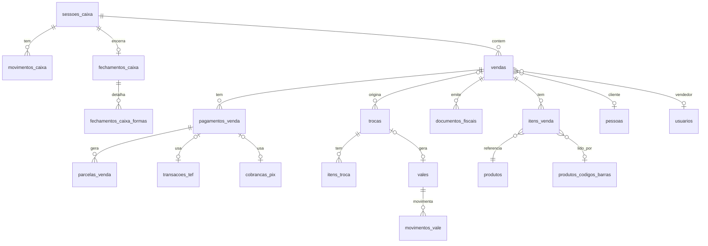

### 4.3 Campos principais das tabelas de venda (local = nuvem)

Lista completa e tipos no modelo de dados 3.11.2–3.11.4; abaixo, as colunas que o PDV preenche e as regras do caixa.
Colunas marcadas **(novo)** são acréscimos desta especificação e também entram no modelo.

**`vendas`**

| Coluna | Tipo (nuvem) | Regra |
|---|---|---|
| `id` | `uuid` | UUID v7 gerado no PDV no primeiro item |
| `terminal_id`, `loja_id`, `caixa_id`, `numero_caixa`, `sessao_caixa_id` | | Do terminal e da sessão aberta |
| `numero` | `bigint` | Sequencial **por caixa** (`sequencias_locais['venda']`), reservado no primeiro item; nunca reutilizado |
| `numero_exibicao` | `varchar(20)` | `L{lojas.codigo:00}-C{numero_caixa:00}-{numero:000000}` (ex.: `L01-C02-000123`). `lojas.codigo` é o **Id Registro** do Nuvem3 (1–99, estável); `lojas.ordem` só ordena seletores e nunca entra no número |
| `tipo` | | `pdv` (o ERP também tem `venda`) |
| `modo` | | `balcao`, `comanda`, `pedido`, `delivery` |
| `status` | | Ver máquina de estados (seção 34.1) |
| `status_fiscal` | | `nao_aplicavel`, `pendente`, `transmitindo`, `autorizada`, `contingencia`, `rejeitada`, `denegada`, `cancelamento_pendente`, `cancelada`, `inutilizada`, `nfe_solicitada` **(novo valor, 14.4)** — espelho do documento fiscal vigente (seção 34.3) |
| `operador_id` | | Usuário logado que iniciou |
| `vendedor_id` | null | Seção 15 |
| `cliente_id` | null | Pessoa identificada |
| `cpf_cnpj_nota`, `nome_nota` | null | Identificação só para a nota (sem cadastro) |
| `tipo_preco` | | `varejo`, `atacado`, `parcelado` |
| `orcamento_id`, `comanda_id`, `pedido_id` | null | Origem |
| `qtd_itens` | | Itens não cancelados |
| `subtotal_bruto` | `numeric(15,2)` | Σ `valor_bruto` dos itens não cancelados |
| `desconto_itens` | `numeric(15,2)` | Σ (`desconto_item` + `desconto_promocao`) dos itens |
| `desconto_total`, `desconto_total_pct` | `numeric(15,2)`, `numeric(7,4)` | Desconto no total (antes do rateio); % quando dado em % |
| `acrescimo_total` | `numeric(15,2)` | Acréscimo no total |
| `taxa_servico` | `numeric(15,2)` | Comandas (seção 25.3) |
| `taxa_entrega` | `numeric(15,2)` | Delivery (seção 26) |
| `valor_frete` | `numeric(15,2)` | Frete de venda do ERP/NF-e; no PDV é sempre 0 (a entrega usa `taxa_entrega`) |
| `total` | `numeric(15,2)` | **Total a pagar** = `subtotal_bruto − desconto_itens − desconto_total + acrescimo_total + taxa_servico + taxa_entrega + valor_frete`. Total fiscal (vNF) = `total − taxa_servico` quando `pdv.taxa_servico_no_documento_fiscal = false` (25.3) |
| `troco` | `numeric(15,2)` | Seção 16.4 |
| `iniciada_em`, `finalizada_em`, `cancelada_em` | `timestamptz` | ISO-8601 UTC |
| `cancelada_por_id`, `cancelamento_autorizado_por_id`, `motivo_cancelamento`, `cancelamento_origem` | | `cancelamento_autorizado_por_id` = supervisor que liberou o cancelamento |
| `idade_confirmada_por_id`, `idade_confirmada_em` **(novo)** | `uuid`, `timestamptz` | Quem confirmou a idade do cliente e quando (seção 10.11) |
| `observacao` | `varchar(500)` | Livre |

**`itens_venda`**

| Coluna | Tipo (nuvem) | Regra |
|---|---|---|
| `id`, `venda_id`, `sequencia` | | `sequencia` 1..n na ordem de inclusão (nunca reaproveitada; item cancelado mantém a sua) |
| `produto_id`, `variacao_id` | | |
| `codigo_lido` | `varchar(30)` | Exatamente o que foi bipado/digitado (auditoria) |
| `codigo_barras_id` | `uuid` null | Linha de `produtos_codigos_barras` lida (embalagem/fardo, 10.2) |
| `origem_entrada` **(novo)** | `varchar(8)` | `leitor`, `teclado`, `balanca`, `etiqueta`, `busca`, `cardapio` (6.4, 10.7) |
| `peso_digitado` **(novo)** | `boolean` default `false` | Peso informado manualmente (10.7) |
| `descricao` | `varchar(120)` | Snapshot do nome (ou descrição digitada em serviço avulso/genérico) |
| `unidade` | `varchar(6)` | Snapshot da unidade **base** (UN, KG, L...) |
| `quantidade` | `numeric(15,3)` | > 0, sempre na unidade base (fardo de 12 = 12) |
| `preco_tabela` | `numeric(15,4)` | Preço que a regra de preço calculou antes de alteração manual |
| `preco_unitario` | `numeric(15,4)` | Preço aplicado, por unidade base |
| `origem_preco` | `varchar(12)` | `varejo`, `loja`, `promocional`, `atacado`, `quantidade`, `grupo_mix`, `parcelado`, `manual`, `balanca`, `orcamento`, `kit_rateio`, `embalagem` |
| `valor_bruto` | `numeric(15,2)` | `arred2(quantidade × preco_unitario)` (seção 12.1); na embalagem com preço e na etiqueta de balança tipo valor, o valor é autoritativo (10.2, 10.6) |
| `desconto_item` | `numeric(15,2)` | Digitado no item |
| `desconto_promocao`, `promocao_id` **(novo)** | `numeric(15,2)`, `uuid` null | Desconto de promoção (11.4); não consome o limite do operador |
| `desconto_rateado` | `numeric(15,2)` | Parte do desconto do total (seção 12.4) |
| `acrescimo_rateado` | `numeric(15,2)` | Parte do acréscimo (+ taxa de serviço só quando ela entra no documento fiscal, 25.3) (vOutro) |
| `frete_rateado` | `numeric(15,2)` | Parte da taxa de entrega (vFrete, conforme `fiscal.taxa_entrega_como`, 18.2) |
| `valor_liquido` | `numeric(15,2)` | `valor_bruto − desconto_item − desconto_promocao − desconto_rateado + acrescimo_rateado + frete_rateado` |
| `lote_id`, `lote`, `validade_lote` | `uuid`, `varchar(30)`, `date` | → `produtos_lotes` + snapshot (seção 10.8) |
| `kit_grupo_id`, `kit_produto_id` | `uuid` null | As linhas dos componentes de um combo vendido compartilham o id do grupo; `kit_produto_id` = o combo (kit) de origem (10.9.1) |
| `kit_descricao`, `kit_quantidade`, `kit_preco_unitario` **(novo)** | `varchar(120)`, `numeric(15,3)`, `numeric(15,4)` null | Snapshot do combo, igual em todo o grupo: nome, quantidade de combos e preço de 1 combo com os acréscimos |
| `kit_componente_id`, `kit_alternativa_id` **(novo)** | `uuid` null | Posição do combo (`produtos_componentes`) e alternativa escolhida (`produtos_componentes_alternativas`; nulo = padrão) |
| `kit_acrescimo` **(novo)** | `numeric(15,4)` default `0` | Acréscimo da alternativa escolhida, por combo (snapshot) |
| `vasilhame_item_origem_id` **(novo)** | `uuid` null | Item do produto cheio que originou a cobrança do casco (10.12) |
| `item_comanda_id`, `item_orcamento_id` | `uuid` null | Origem |
| `vendedor_id` | null | Futuro: vendedor por item |
| `cfop`, `ncm`, `fiscal_snapshot` | | Snapshot fiscal versionado (`schema_fiscal`): NCM, CEST, CFOP, CSOSN/CST, origem, alíquotas, `vTotTrib` no momento da venda |
| `cancelado`, `cancelado_em`, `cancelado_por_id`, `autorizado_por_id`, `motivo_cancelamento` | | Item cancelado continua na tabela |
| `incluido_em` | `timestamptz` | Hora da inclusão no PDV |

**`pagamentos_venda`**

| Coluna | Tipo (nuvem) | Regra |
|---|---|---|
| `id`, `venda_id`, `sequencia` | | |
| `forma_pagamento_id` | `uuid` | |
| `descricao_forma`, `meio_pagamento_fiscal`, `tipo_forma` | `varchar(40)`, `varchar(2)`, `varchar(20)` | Snapshots da forma: descrição (xPag), tPag (16.3) e `formas_pagamento.tipo_forma` (16.8) |
| `valor` | `numeric(15,2)` | Valor aplicado à venda (para dinheiro: já descontado o troco — ver 16.4) |
| `valor_recebido` | `numeric(15,2)` | Valor entregue pelo cliente (dinheiro) |
| `troco` | `numeric(15,2)` | |
| `valor_taxa_servico` **(novo)** | `numeric(15,2)` default 0 | Parte deste pagamento que paga a taxa de serviço fora do documento fiscal (25.3); abatida no `detPag` |
| `parcelas` | `smallint` | 1 se à vista |
| `status` | | `pendente`, `aprovado`, `cancelado`, `estornado` |
| `lanca_quitada` | `boolean` | Snapshot da flag da forma |
| `taxa_pct` | `numeric(7,4)` | Snapshot da taxa da forma |
| `pessoa_id` | null | Pessoa exigida (Exige Pessoa, crediário, crédito funcionário, boleto) |
| `indicador_pagamento`, `data_pagamento` | | indPag (0 à vista, 1 a prazo), dPag |
| `tef_transacao_id`, `pix_cobranca_id`, `vale_id` | | Vínculos |
| `transferido_de_id` **(novo)** | `uuid` null | Pagamento da venda cancelada de onde este foi transferido (reemissão como nova venda, 18.3) |
| `tipo_integracao`, `bandeira`, `bandeira_nome`, `adquirente`, `cnpj_credenciadora`, `nsu`, `autorizacao`, `cartao_mascarado`, `id_terminal_pagamento` | | Cartão (tpIntegra 1 = TEF, 2 = POS) |
| `autorizado_por_id` | | Senha de liberação |

---

## 5. Instalação e ativação do terminal

### 5.1 Instalação — Fase PDV-1

- Instalador único por sistema: Windows `GenesisPDV-Setup-x.y.z.exe` (self-contained .NET 10, sem pré-requisitos);
  Linux pacote `.deb` e `AppImage` (o Linux saiu da distribuição em 05/11/2026: ver o item "Decidido em 05/11/2026"
  abaixo). Instalação por usuário administrador da máquina.
- Pastas:

| Item | Windows | Linux |
|---|---|---|
| Aplicativo | `%ProgramFiles%\GenesisPDV\` | `/opt/genesispdv/` |
| Banco local | `%ProgramData%\GenesisPDV\dados\pdv.db` | `/var/lib/genesispdv/pdv.db` |
| Backups | `%ProgramData%\GenesisPDV\backup\` | `/var/lib/genesispdv/backup/` |
| XML fiscais | `%ProgramData%\GenesisPDV\fiscal\xml\AAAA-MM\` | `/var/lib/genesispdv/fiscal/xml/AAAA-MM/` |
| Logs técnicos | `%ProgramData%\GenesisPDV\logs\` (rolagem diária e por tamanho, 20 MB, 30 arquivos) | `/var/log/genesispdv/` |
| Certificado A1 | Recebido da nuvem pela sincronização (`certificados_digitais`, seção 6.7), arquivo e senha **cifrados para a `chave_publica_terminal`** (sincronizacao.md 20.2), e guardado no banco local cifrado (SQLCipher), com a senha re-protegida por **chave CNG não exportável** da conta de serviço do PDV (`Microsoft Platform Crypto Provider`/TPM 2.0 quando houver, senão `Microsoft Software Key Storage Provider` sem exportação; **não** DPAPI `LocalMachine`, sincronizacao.md 3.6); carregado só em memória na hora de assinar, nunca gravado como `.pfx` em disco | Idem, com a senha re-protegida por libsecret / arquivo de chave `0600` (dono `genesispdv`) |

- O instalador cria atalho na área de trabalho, opção "Iniciar com o Windows" (marcada por padrão) e regras de
  firewall de saída apenas se necessário.
- Na primeira execução sem ativação, o PDV abre direto o **Assistente de ativação**.
- Antes de instalar e no dia da implantação, o dono confere a **Prontidão da loja** no ERP (ERP 10.4; implantação I5): o
  que falta para o caixa abrir e vender (formas, PIX, usuários com PIN e quem libera, catálogo, PDV ativo e na versão
  mínima), seguindo `docs/implantacao/roteiro-piloto.md`.
- **Decidido na implantação I3 (README do PDV › decisão 62 e "Instalar na loja"):** instalador Windows em Inno Setup
  6 (por máquina, x64, Windows 10 22H2+), com o executável único self-contained em `%ProgramFiles%\GenesisPDV\`; as
  pastas de `%ProgramData%\GenesisPDV\` (dados, backup, logs, impressão) com permissão de **modificar para o grupo
  Usuários** (o PDV roda com a conta comum da loja; a ativação fica na DPAPI dessa conta); atalhos no menu Iniciar e
  na área de trabalho; "Iniciar com o Windows" em `HKLM\...\Run`. Atualizar = instalar a versão nova por cima (AppId
  fixo), mantendo banco, backups e ativação; com o PDV aberto, o instalador pede para fechá-lo pelo próprio programa
  (mutex nomeado `Global\GenesisPDV.Instancia`, o mesmo da instância única) e nunca o fecha sozinho. Desinstalar
  **não apaga** `%ProgramData%\GenesisPDV` e avisa onde os dados ficaram. Não há regra de firewall (o PDV só faz
  saída HTTPS). A URL padrão da API do assistente é gravada no build (a do piloto nos instaladores do piloto) e
  continua editável. Linux: pacote `.deb` com `/opt/genesispdv/`, grupo de sistema `genesispdv` dono de
  `/var/lib/genesispdv` e `/var/log/genesispdv` (`2770`, com o banco, os backups e o log criados com escrita do grupo),
  a chave local por usuário (D21) e os dados mantidos na remoção; o AppImage fica para depois do piloto. Versão única
  SemVer (`0.9.0` na abertura do piloto; `0.9.1` com a barra de funções clicável, a pesquisa só por números e a janela do item, README do PDV › decisão 65) no nome do instalador, no rodapé e no `versao_app`. O caixa usa sempre a mesma conta do
  sistema: aberto por outra conta (o banco é da máquina, a ativação é da conta), o PDV mostra "Caixa ativado com outra
  conta" com a conta certa, sem reativar por cima. Versão mais antiga por cima da instalada: o instalador pede
  confirmação (em silêncio, desiste) e o PDV antigo não abre um banco com migrações que ele não conhece.
- **Decidido em 05/11/2026 (dono; README do PDV › decisão 80; roadmap §16, D58):** o PDV é distribuído **só para
  Windows** (o sistema dos caixas das lojas, D21). O `.deb` sai do CI e do release (que publica só o `.exe` e o
  `.exe.sha256`), e a CI do PDV roda só no Windows (a formatação do C#, num job leve no Linux). O código continua
  multiplataforma — compila e os testes rodam no Linux do desenvolvimento, com as pastas Linux da tabela acima —, mas
  o Linux não é plataforma suportada de distribuição; os scripts de `apps/pdv/instalador/linux` ficam sem uso e o
  AppImage não está previsto.

### 5.2 Código de ativação (gerado no ERP) — Fase PDV-1

No ERP (Cadastros › **PDVs / Terminais** › "Gerar código de ativação", permissão `terminais.ativar`, ERP 12.3) o
administrador:

1. Escolhe a loja (ponto de venda, ativa, com Usa PDV) e o **caixa** (`caixas.numero` 1–99, um terminal ativo por
   caixa) e a **validade** escolhida (1 h, 24 h ou 72 h; padrão 24 h).
2. A API grava em `genesis_control.ativacoes_pdv`: empresa, loja, caixa, `codigo_hash`, `codigo_final`,
   `validade_horas`, `expira_em`, `substitui_terminal_id` (se substituição), criado por, `usado_em` (null).
3. O ERP exibe o código uma única vez: **código da empresa** + **código de ativação** de 8 caracteres do alfabeto
   `23456789ABCDEFGHJKMNPQRSTUVWXYZ` (sem `0 O 1 I L`), agrupado `XXXX-XXXX`, e um QR code com os dois.

Regras:
- Uso único: após a ativação, `usado_em` é preenchido e qualquer nova tentativa retorna "código já utilizado".
- Expirado → "código expirado, gere outro no ERP".
- 5 tentativas erradas do mesmo IP em 10 minutos → bloqueio do IP por 30 minutos (`tentativas_ativacao`, modelo 2.6;
  resposta genérica que não revela se a empresa existe).
- Limite do plano = `coalesce(empresas.limite_terminais, planos.limite_terminais)` (terminais ativos + desativando +
  códigos pendentes), validado ao **gerar** o código e de novo ao **ativar**.
- Gerar código para um caixa que já tem terminal ativo exige "Substituir terminal" (permissões `terminais.ativar` e
  `terminais.revogar`): o terminal antigo passa a `desativando` quando o novo ativar (troca de máquina; numeração em
  5.4). Revogar um terminal no ERP exige `terminais.revogar`.
- Flag **Usa PDV** — casa única: coluna `lojas.usa_pdv` da loja (a coluna da loja prevalece; o "Usa PDV" da aba PDV
  das Configurações é só o padrão das lojas novas). Desligada → o ERP não gera código; a API recusa **novas ativações,
  o pull e o heartbeat** (`403 PDV_DESABILITADO`) e o PDV não abre **novas sessões de caixa** nem novas vendas
  ("PDV desabilitado para esta loja"), permitindo terminar a venda atual e fechar o caixa. O **push nunca é recusado**:
  eventos pendentes do outbox continuam subindo (sincronizacao.md 20.6), para nenhuma venda se perder.

### 5.3 Fluxo de ativação — Fase PDV-1

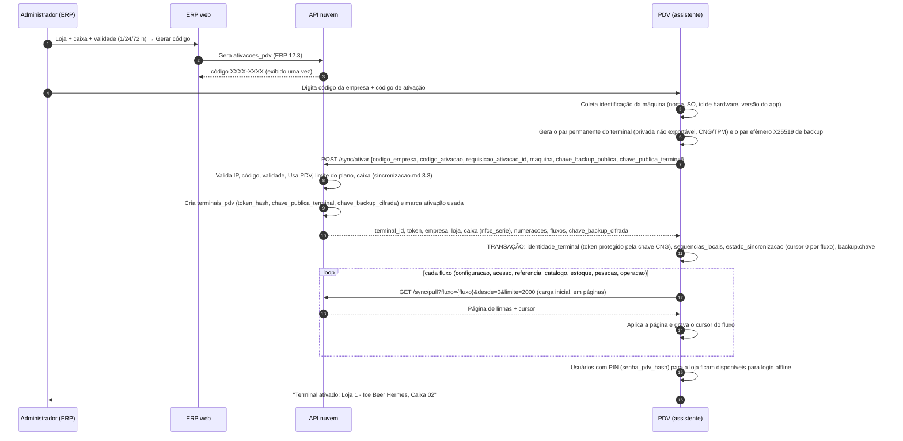

Telas do assistente (todas operáveis por teclado; `Enter` avança, `Esc` volta):

1. **Boas-vindas** – idioma fixo pt-BR; mostra versão e requisitos detectados (RAM, disco, resolução) com aviso se
   abaixo do mínimo (seção 32.7).
2. **Conexão** – testa `https://api.<dominio>/saude`. Sem internet: "A ativação exige internet. Depois de ativado, o
   PDV funciona offline." (botão Tentar novamente; configuração de proxy HTTP opcional).
3. **Código** – campos *Código da empresa* (6 dígitos) e *Código de ativação* (`XXXX-XXXX`, maiúsculas automáticas).
4. **Confirmação** – exibe empresa (razão social), loja, CNPJ da loja e número do caixa. A tela aparece **depois** de
   gravar a ativação (sincronizacao.md 3.5): o terminal já está ativado e o `Enter` só segue para o próximo passo.
   Loja ou caixa errados se resolvem no ERP (revogar o terminal e gerar outro código), não desistindo aqui.
5. **Carga inicial** – barra de progresso por fluxo (configurações, usuários, tabelas fiscais, produtos, estoque,
   clientes, operação). Pode ser interrompida e retomada (o cursor é salvo a cada lote; o app reaberto volta a esta
   tela e continua de onde parou). O PDV libera o login quando os fluxos que bloqueiam as vendas terminam
   (sincronizacao.md 6.1: configuração, acesso, referência, catálogo e estoque); clientes e operação seguem em
   segundo plano.
6. **Hardware** – atalho opcional para a configuração local (seção 6); pode ser feito depois.

Token do terminal (sincronizacao.md 3.6–3.8):
- Formato `<terminal_id>.<segredo>` (segredo de 32 bytes aleatórios), guardado na nuvem apenas como hash
  (`terminais_pdv.token_hash`).
- Guardado em `identidade_terminal.token_protegido`: no Windows, pela **DPAPI do usuário** (`CurrentUser`) da conta
  que roda o PDV (decisão D21 do roadmap; a chave CNG não exportável/TPM fica como endurecimento depois do piloto) —
  **não** DPAPI `LocalMachine`, que qualquer processo local decifra (sincronizacao.md 3.6); no Linux, AES-256-GCM com
  chave local (`0600`, derivada por HKDF com o `machine-id`). A mesma proteção vale para `token.pendente` (rotação), a
  chave do SQLCipher, a senha do certificado e a chave de backup (`backup.chave`, 32.5).
- Na ativação o PDV envia a `chave_publica_terminal` e a `chave_backup_publica` efêmera. Na Fase 1B (D21) o par do
  terminal é X25519 gerado pelo próprio PDV, com a privada gravada em `configuracao_terminal['terminal.chave_privada']`
  protegida como o token (DPAPI do usuário no Windows, arquivo `0600` + HKDF no Linux); o par no provedor de chaves do
  SO, com a privada não exportável, entra com o endurecimento da sincronizacao.md 3.6; todo segredo que desce (certificado, CSC, token TEF) vem cifrado para a chave do
  terminal (sincronizacao.md 20.2), e a chave de backup volta cifrada (`chave_backup_cifrada`) e fica também sob
  custódia da nuvem (sincronizacao.md 22.3).
- Enviado em toda chamada (`Authorization: Bearer <token>`); a API resolve empresa + terminal pelo token (ADR-02).
- Não expira por tempo (é rotacionado online a cada 30 dias). A revogação pelo ERP tem dois modos:
  - **Revogar – aceitar pendências** (e substituição de terminal): o terminal passa a `desativando`. O PDV termina a
    venda em andamento, impede novas vendas e aberturas de caixa, permite fechar o caixa, **sobe todo o outbox** (o push
    continua aceito), transmite NFC-e em contingência e inutilizações pendentes e mostra "Terminal em desativação —
    enviando pendências (N)". Ao entrar em `desativando` o PDV grava `identidade_terminal.status = 'desativando'` e, a
    partir desse commit, **nunca mais** reserva número de venda, NFC-e ou vale. Quando não restam eventos pendentes,
    NFC-e em contingência nem inutilizações pendentes, o heartbeat envia `estado_local = 'desativando_confirmado'` com
    os números finais (`ultima_sequencia_gerada`, `venda_ultimo_numero`, `nfce_ultimo_numero`, `vale_ultimo_numero`);
    a nuvem confere que recebeu tudo até esses números, grava a confirmação e passa o terminal para `revogado`
    (sincronizacao.md 3.8). **Enquanto esse heartbeat está na rede (D22)**, o caixa trava logout, Ctrl+Alt+C e
    qualquer gravação que subiria ("Terminal confirmando a desativação: aguarde alguns segundos"); sem resposta,
    destrava e tenta de novo no heartbeat seguinte, contando o que tiver sido gravado. Sem essa confirmação, o terminal só passa a `revogado` quando vence `carencia_ate`
    (7 dias), e o próximo terminal do caixa recebe série NFC-e nova e salto de numeração (5.4).
  - **Revogar imediatamente**: `revogado` direto, **sem** confirmação de desativação. Toda chamada responde
    `401 TERMINAL_REVOGADO`; o PDV mostra "Terminal desativado pelo ERP", bloqueia tudo exceto status/diagnóstico e
    exportação de pendências para o suporte e **nunca apaga** o banco local. Um terminal novo ativado depois nesse
    caixa (mesmo com código comum, sem "Substituir terminal") recebe série NFC-e nova e salto (5.4).
  - O relógio do PDV nunca decide o que é aceito (não existe "push aceito para eventos anteriores à revogação").
- **Hardware alterado** (sincronizacao.md 20.5): se o `X-Genesis-Id-Hardware` enviado difere do registrado (troca de
  placa-mãe ou token usado de outra máquina — a API não distingue), a nuvem **não** atualiza o hardware e responde
  `409 HARDWARE_ALTERADO` a push, endpoints online e renovação de token. O PDV então:
  - termina a venda em andamento e **bloqueia novas vendas** e aberturas de caixa; permite fechar o caixa;
  - **mantém o outbox** intacto (nada é descartado; sobe depois da aprovação);
  - continua só com heartbeat (que volta com `status_terminal: "hardware_alterado"`), `GET /sync/estado`
    (`id_hardware_confere = false`) e pull — este **sem segredos** (certificado, CSC e token TEF descem `null`; os já
    guardados localmente continuam cifrados para a chave do terminal);
  - mostra em tela cheia "Hardware alterado — aguardando aprovação no ERP" (estado do indicador 30.2), com o nome da
    máquina e o `terminal_id` para o gerente localizar o terminal.
  - A liberação é a ação **"Confirmar troca de hardware"** no ERP (permissão `terminais.gerenciar`); o próximo
    heartbeat volta sem `hardware_alterado`, o PDV desbloqueia as vendas e retoma o push. "Não reconheço" no ERP revoga
    o terminal (`401 TERMINAL_REVOGADO`, acima). Se a troca de máquina trocou também a chave do terminal
    (reinstalação), o caminho é reativar (5.4).

### 5.4 Reativação, troca de máquina e reinstalação — Fase PDV-1

| Situação | Comportamento |
|---|---|
| Reinstalar na mesma máquina mantendo `pdv.db` | O PDV encontra `identidade_terminal` e o token; não pede ativação. |
| Máquina nova para o mesmo caixa | Novo código "Substituir terminal" (ou código comum, se o antigo já foi revogado). O terminal antigo vai para `desativando`; o outbox dele, se a máquina ainda ligar, continua subindo. **Numeração** (sincronizacao.md 3.8 e 13.3, devolvida em `numeracoes` na ativação), decidida contra o **último terminal que ocupou o caixa** (`caixas.terminal_anterior_id`, qualquer status), **com ou sem** substituição — inclusive "Revogar imediatamente" seguido de código comum: (a) o anterior **confirmou a desativação** (heartbeat `estado_local = 'desativando_confirmado'` com os números finais, e a nuvem recebeu todos os eventos até eles) → a NFC-e continua na **mesma série**, e venda, vale e NFC-e continuam em `greatest(numeracoes, números finais confirmados) + 1`; (b) **sem essa confirmação** → **série NFC-e nova** obrigatória (escolhida no ERP ao gerar o código; sugestão: menor série livre a partir de `100 + nº do caixa`) e **salto de segurança** de +1000 no número de venda e de vale. Um heartbeat que só parece "em dia" (0 eventos pendentes, 0 NFC-e em contingência, contato recente) **não basta**: o PC antigo pode ficar offline logo depois e continuar vendendo. |
| Banco local corrompido | Restaurar backup (seção 32.5) ou reativar; vendas não sincronizadas só existem no backup. |
| Máquina perdida ou morta, com backup do banco antigo | Ativar a máquina nova como substituta e, nela, `Ctrl+Alt+C` › **Recuperar dados de terminal antigo** com o código de recuperação gerado no ERP (32.5, sincronizacao.md 22.3): os eventos pendentes do terminal antigo sobem com a identidade dele. |
| Troca de placa-mãe / outro id de hardware com o mesmo banco | `409 HARDWARE_ALTERADO`: vendas bloqueadas até "Confirmar troca de hardware" no ERP (5.3). |
| Mudar o terminal de loja | Não permitido: desativar e ativar de novo na outra loja (o banco local é recriado). |

### 5.5 Critérios de aceite – ativação

- [ ] Código válido ativa o terminal e a tela de login aparece após a carga inicial, com os usuários da loja.
- [ ] Código usado, expirado ou de outra empresa é recusado com mensagem específica e nada é gravado localmente.
- [ ] Ultrapassar o limite de terminais do plano recusa a ativação.
- [ ] Interromper a carga inicial (fechar o app, cair a rede) e reabrir retoma do último lote.
- [ ] Terminal revogado com "aceitar pendências" para de vender na próxima comunicação, sobe todo o outbox, envia `estado_local = 'desativando_confirmado'` com os números finais e só então fica `revogado` (ou ao vencer `carencia_ate`, sem confirmação).
- [ ] Com Usa PDV desligado na loja, o caixa não abre nova sessão, mas os eventos pendentes sobem normalmente.
- [ ] Novo terminal num caixa cujo último terminal (`caixas.terminal_anterior_id`) **não** confirmou a desativação —
  inclusive com heartbeat recente e 0 pendências, ou depois de "Revogar imediatamente" seguido de código comum — ativa
  com série NFC-e nova e salto de +1000 no número de venda e de vale.
- [ ] Com `desativando_confirmado` aceito pela nuvem, o novo terminal continua a mesma série NFC-e e a numeração a
  partir dos números finais confirmados.
- [ ] O token nunca aparece em log, tela ou arquivo em texto puro.

---

## 6. Configuração local do terminal (hardware e fiscal)

Acesso: menu de funções (`F11` › `8 Configurações do terminal`) ou na tela de login (`Ctrl+Alt+C`). Exige a permissão
`pdv.config.terminal` (supervisor pode liberar). Toda alteração é auditada (antes/depois). A configuração fica em
`configuracao_terminal` (local) e uma cópia sem segredos sobe como evento `terminal.configuracao_alterada` para o
suporte enxergar no ERP.

> **Central do PDV (bloco G3; README do PDV › decisão 68):** esta tela virou a aba **3 Impressora e gaveta** da Central
> do PDV (a engrenagem ⚙): `Ctrl+Alt+C` ou o botão ⚙ no login (usuário e PIN, sem sessão de operador) e `F11` › `8` ou o
> ⚙ no fim da barra na venda (caixa livre). Menu lateral com as abas 0 a 9 e P (dígito com o foco no menu, ou clique),
> cadeado nas que a pessoa não pode ver e Esc volta. A aba 3 abre direto com `pdv.config.terminal` (pelo login, também
> com `pdv.supervisor`, como antes); sem isso, pede ela mesma o usuário e o PIN de quem tem a permissão, e essa
> liberação vale só enquanto a aba fica aberta. O **F9 Restaurar backup** pede sempre o PIN na hora (plano 3.3); o resto
> abaixo continua igual.
>
> **PDV-1 (implantação I4; README do PDV › decisão 63):** a tela traz a impressora, a gaveta, a fila de impressão e,
> só pelo login, o "Restaurar backup" (32.5). No login a liberação é usuário + PIN de quem tem `pdv.config.terminal`; no
> `F11` › `8` (caixa livre), o operador com ela ou o supervisor. A mudança grava as chaves e a auditoria `editar` de
> `configuracao_terminal` (antes/depois) num commit; a auditoria sobe no lote `auditoria.registros`, que é o que o ERP vê
> por ora — o evento `terminal.configuracao_alterada` fica para quando o ERP tiver a tela do suporte.

### 6.1 Identidade (somente leitura)

Lida de `identidade_terminal`, `estado_sincronizacao` e `eventos_saida`: empresa (código + razão social), loja,
número do caixa, `terminal_id`, status do terminal, versão do app, data da ativação, cursores por fluxo, quantidade de
eventos pendentes.

> **Central do PDV (bloco G4; README do PDV › decisão 69):** a identidade fica na aba **9 Sobre o terminal** (qualquer
> usuário do caixa, sem PIN): empresa, loja, caixa, o código curto do terminal para o suporte e o `terminal_id`, o
> servidor, a situação, a ativação, as versões do app e do banco, o sistema e o tamanho do banco, dos logs e dos backups,
> com "Copiar o código". Os cursores e os pendentes ficam no F11 › S (e no F9 "Situação completa" da aba 4 Sincronização, G7). A aba **0 Painel de
> saúde** mostra as 12 verificações locais (sync, recusados, lacuna, relógio, impressora, gaveta, disco, backup, banco,
> caixa aberto, versão, erros recentes) com bolinha, o que fazer e o código do terminal; o ícone ⚠ na barra da venda
> avisa o vermelho.

### 6.2 Impressora — Fase PDV-1

| Campo | Tipo / opções | Padrão | Regra |
|---|---|---|---|
| `impressora.modelo` | Genérica ESC/POS, Epson TM-T20/T88, Elgin i7/i8/i9, Bematech MP-4200 TH, Daruma DR800, Tanca, Control iD, Spooler do sistema (driver) | Genérica ESC/POS | Define a tabela de comandos (corte, gaveta, QR code nativo) |
| `impressora.conexao` | USB (porta virtual), Serial (COMx / `/dev/ttyUSBx`), Rede (IP:9100), Spooler (nome da impressora do SO) | Spooler | |
| `impressora.porta` / `ip` / `nome_spooler` | texto | — | Validado ao salvar com "Imprimir teste" |
| `impressora.baud` | 9600–115200 | 115200 | Só serial |
| `impressora.colunas` | 32 (58 mm), 42, 48 (80 mm), 56 | 48 | Layouts do cupom se adaptam |
| `impressora.guilhotina` | Sem corte, parcial, total | Parcial | |
| `impressora.linhas_avanco` | 0–10 | 4 | Linhas antes do corte |
| `impressora.imprime_logotipo` | sim/não | sim | Usa o logotipo da loja (aba Anexos), convertido para monocromático e cacheado |
| `impressora.qrcode_nativo` | sim/não | sim | Se não, QR é rasterizado como imagem |
| `impressora.codepage` | CP850, CP860, UTF-8 | CP860 | Acentos corretos |
| `impressora.vias_comprovante_tef` | 1 ou 2 | 2 | Seção 19 |

Botões: **Imprimir teste** (cabeçalho da loja, acentos `ÁÉÍÓÚÇÃÕ`, QR, código de barras, corte) e **Testar gaveta**.

> **Decidido na implantação I4 (dono, 03/11/2026; README do PDV › decisão 63).** As lojas terão **Epson ou Bematech**:
> o PDV-1 traz os perfis **Epson TM-T20 (II/III/X)**, **Epson TM-T88 (V/VI)**, **Bematech MP-4200 TH (modo ESC/POS)** e
> **Genérica ESC/POS** (Elgin, Daruma, Tanca e Control iD usam a Genérica até ganharem perfil). Conexões: **spooler do
> Windows com envio RAW** (a impressora instalada pelo driver do fabricante, USB — padrão da loja), **rede TCP 9100**,
> **serial/COM** (inclusive a COM virtual do driver USB) e, no Linux, o dispositivo `/dev/usb/lp0`; sem nenhuma chave
> gravada, `impressora.conexao` = **nenhuma** (o caixa vende e a barra avisa "Sem impressora"). Papel **80 mm** (padrão)
> ou **58 mm**; as colunas são **do modelo no papel**, na fonte A (12 × 24) que o `ESC @` deixa: **48/32** na TM-T20, na
> MP-4200 TH e na Genérica (576 pontos no 80 mm; no 58 mm cabem 35 na TM-T20 e 32 nas bobinas de 384 pontos) e **42/30**
> na TM-T88 V/VI (180 dpi: 512 pontos no 80 mm, 360 no 58 mm; ficha da Epson "42/48/56" e "30/36/40", os maiores em
> outras fontes). `impressora.colunas` grava as do modelo (32, 30, 42 ou 48; até 35 = 58 mm); 56 colunas (fonte B) ficam
> para depois. A régua do teste de impressão tem as colunas do modelo e cabe numa linha só. Corte: `ESC d
> <linhas_avanco>` + `GS V 1` (parcial) ou `GS V 0` (total), iguais na Epson e na Bematech em modo ESC/POS. Página de
> código pelo `ESC t n` do modelo: CP860 (`n = 3`, padrão), CP850 (`n = 2`) e, só na Epson, WPC1252 (`n = 16`); UTF-8 não
> é oferecido (nenhum dos três o tem em modo ESC/POS). QR: nativo (`GS ( k`, modelo 2, correção M) na Epson; imagem
> (`GS v 0`) na Bematech (o `GS ( k` dela em modo ESC/POS só tem PDF417) e na Genérica. O documento da
> `fila_impressao` fica num formato único (CP860) e é adaptado ao modelo **na hora de imprimir**. `imprime_logotipo`,
> código de barras no teste e `vias_comprovante_tef` ficam para depois (sem logotipo nem TEF no piloto). As chaves
> novas são `impressora.nome_spooler`, `impressora.ip` + `impressora.porta_rede` (9100) e `impressora.porta` (COM,
> `/dev/ttyUSBx` ou o dispositivo). O dispositivo só vale no Linux e só dentro de `/dev` (`usb/lpN`, `lpN`, `ttyUSBN`,
> `ttyACMN`, o link pelo destino): um arquivo comum (o `pdv.db`, um backup) é recusado ao salvar e de novo antes de abrir.
> Texto com caractere de controle (nome de produto ou cliente vindo do ERP) vira espaço no documento: só o PDV emite
> comandos (um `DLE DC4` numa descrição abriria a gaveta).

#### 6.2.1 Impressoras de produção — Fase FUT (módulo opcional; não usado pela Ice Beer, D4)

Os **destinos** de produção (o "Impressoras de cozinha" de Parâmetros e a **Impressora destino** do produto) são
cadastrados na nuvem na tabela `impressoras_destino` (nome, descrição, loja, ordem, ativo). A impressora **física**
de cada destino é configurada **neste terminal**, porque cada caixa pode estar ligado a uma impressora diferente.

A tela lista todas as linhas ativas de `impressoras_destino` da loja do terminal (`loja_id` = loja ou nulo), em
`ordem`. Para cada destino:

| Campo | Tipo / opções | Padrão | Regra |
|---|---|---|---|
| Usar impressora principal | sim/não | não | Sim = imprime na impressora de 6.2 (sem mapeamento próprio) |
| `conexao` | USB (porta virtual), Serial (COMx / `/dev/ttyUSBx`), Rede (IP:9100), Spooler | Rede | |
| `porta` / `ip` (com porta, padrão 9100) / `nome_spooler` | texto | — | Obrigatório conforme a conexão; validado com "Imprimir teste" |
| `modelo` | mesma lista de 6.2 | Genérica ESC/POS | Tabela de comandos |
| `colunas` | 32, 42, 48 | 48 | Layout do pedido de produção |
| `vias` | 1–3 | 1 | Cópias de cada pedido |

Botão **Imprimir teste** por destino (imprime "TESTE – <nome do destino>" com data/hora e corte). Gravado em
`configuracao_terminal` na chave `impressao.destino.<impressoras_destino.id>` (modelo 4.4.2) com o JSON
`{conexao, porta, ip, nome_spooler, modelo, colunas, vias}`. Regras:

- Destino **sem mapeamento** neste terminal (ou mapeamento com falha de conexão): o pedido sai na **impressora
  principal**, com o cabeçalho "DESTINO: <nome>" em destaque, e o PDV mostra o aviso "Impressora do destino <nome> não
  configurada neste caixa — impresso na principal" (auditoria `impressao_destino_fallback`).
- Destino excluído/inativado na nuvem: a chave local é ignorada (fica até a próxima edição).
- Os trabalhos vão para `fila_impressao` com `impressora = <impressoras_destino.id>`.

#### 6.2.2 Outros parâmetros locais de operação — Fase PDV-1

| Chave | Opções | Padrão | Seção |
|---|---|---|---|
| `tela.bloqueio_inatividade_min` | 0–120 (0 = nunca) | 0 (desligado; dono, PC-13) | 7.4 |
| `venda.qtd_alerta_multiplicador` | 1–9.999 | 100 | 10.1 |
| `pagamento.finaliza_ao_quitar` | sim/não | sim | 16.1 |
| `backup.pasta_secundaria` | caminho completo (pendrive, pasta local ou de rede `\\servidor\…`) ou vazio | vazio | 32.5 |

> **Central do PDV (bloco G11; README do PDV › decisão 75):** o tema, o bloqueio da tela por inatividade e a pasta
> secundária do backup se editam na aba **7 Parâmetros** (ver com `pdv.diagnostico.ver`; gravar com
> `pdv.config.parametros_locais`, a própria ou o supervisor na hora com o motivo). Grava só o que mudou, num commit com a
> auditoria `editar` de `configuracao_terminal` (antes/depois, com a pasta mascarada) e a ocorrência
> `PARAMETRO_ALTERADO`. O bloqueio é de 0 a 120 min e começa **desligado** (decisão do dono PC-13: o padrão desta tabela
> era 10 e passou a 0). A pasta secundária pede o caminho completo, fora das pastas do GenesisPDV (pendrive, outra pasta
> da máquina ou de rede), e passa pelo teste de escrita (grava, lê e apaga um arquivo) antes de gravar; a tela avisa
> que o backup é o banco inteiro, sem cifra, com CPFs, e pede um pendrive guardado ou uma pasta que só a loja acessa.
> Sem a permissão, o que se confere sem gravar (a faixa, o "nada mudou", a regra da pasta) vem antes do PIN do
> supervisor, e o "Testar pasta" (que grava na pasta) pede a própria permissão. A mesma aba mostra, só para consulta, cada
> regra da loja que o caixa lê com o valor que está valendo, a origem (a loja, a empresa ou o padrão), o selo "definido
> no ERP", onde mudar no ERP e quando as regras desceram; as regras da loja não se editam no PDV (PC-2). `venda.qtd_alerta_multiplicador`
> e `pagamento.finaliza_ao_quitar` continuam sem tela.

> Todas as chaves de 6.2–6.8 são as de `configuracao_terminal` (modelo 4.4.2), que lista o conjunto completo, inclusive
> `impressora.baud`, `impressora.linhas_avanco`, `impressora.qrcode_nativo`, `impressora.codepage`, `gaveta.pino`,
> `gaveta.tempo_pulso_ms`, `gaveta.sensor`, `gaveta.exige_fechada_para_nova_venda`, `balanca.paridade`, `balanca.bits`,
> `balanca.timeout_ms`, `balanca.peso_minimo_kg`, `tef.timeout_s` e `fiscal.timeout_sefaz_s`.

### 6.3 Gaveta — Fase PDV-1

| Campo | Opções | Padrão |
|---|---|---|
| `gaveta.modo` | `impressora` (pulso ESC/POS), `serial` (porta própria), `nenhuma` | `impressora` |
| `gaveta.porta` | COMx / `/dev/ttyUSBx` (só `serial`) | — |
| `gaveta.pino` | 2 ou 5 | 2 |
| `gaveta.tempo_pulso_ms` | 50–500 | 120 |
| `gaveta.sensor` | Não tem / Tem sensor de abertura | Não tem |
| `gaveta.exige_fechada_para_nova_venda` | sim/não (só com sensor) | não |
| `gaveta.abre_nos_movimentos` | sim/não | não |

> **Decidido na implantação I4 (dono, 03/11/2026; README do PDV › decisão 63).** A gaveta é **desligada por padrão**
> (`gaveta.modo = nenhuma`: as lojas da Ice Beer não têm gaveta na impressora) e, desligada, **nenhum comando de gaveta
> é enviado**. Ligada (`impressora`, pulso `ESC p m t1 t2` pelo transporte da impressora; pino 2 → `m = 0`, pino 5 →
> `m = 1`; `t1` = pulso/2 ms, `t2` = 500 ms), abre na finalização com forma **Abrir Gaveta** e no comando manual (19.4).
> `gaveta.abre_nos_movimentos` (nova; padrão não, até o dono pedir) faz a gaveta ligada abrir também na abertura,
> sangria, reforço, fechamento e devolução em dinheiro. `gaveta.modo = serial`, o sensor e a
> `exige_fechada_para_nova_venda` ficam para quando houver gaveta com porta própria/sensor.

### 6.4 Leitor de código de barras — Fase PDV-1

- Padrão: leitor USB modo teclado (HID) com sufixo `Enter`. O PDV detecta leitura por **velocidade de digitação**
  (≥ 8 caracteres com intervalo < 30 ms entre teclas) para diferenciar leitura de digitação humana (usado para não
  disparar atalhos e para gravar `itens_venda.origem_entrada` = `leitor` ou `teclado`).
- `leitor.modo`: `teclado` (HID, padrão) ou `serial` (`leitor.porta`, `leitor.baud`); `leitor.sufixo`: tecla/caractere
  que encerra a leitura (padrão `Enter`).
- O foco nunca precisa estar no campo para ler: leituras recebidas com qualquer foco na tela de venda são
  redirecionadas ao campo de código (exceto quando um diálogo modal de texto estiver aberto).

### 6.5 Balança — Fase PDV-2

| Campo | Opções | Padrão |
|---|---|---|
| `balanca.modelo` | Nenhuma, Toledo (Prix 3/4), Filizola, Urano, Elgin DP, Genérica | Nenhuma |
| `balanca.protocolo` | `toledo_p03`, `filizola`, `urano`, `elgin`, `enq` (comando ENQ genérico) | conforme o modelo |
| `balanca.porta`, `balanca.baud`, `balanca.paridade`, `balanca.bits` | serial | 9600 / nenhuma / 8 |
| `balanca.timeout_ms` | 200–5000 | 2000 |
| `balanca.peso_minimo_kg` | 0,001–1 | 0,010 |

Botão **Ler peso** para teste. A configuração do **código de barras de balança** (etiquetas impressas por balança
etiquetadora) fica na nuvem, por empresa (seção 10.6), porque vale para todas as lojas.

### 6.6 Pinpad / TEF — Fase PDV-3

| Campo | Origem | Regra |
|---|---|---|
| `tef.provedor` | local | Nenhum, SiTef (CliSiTef), PayGo (PGWebLib), outro via plugin |
| Código loja, Servidor, Token | **nuvem** (Loja › aba TEF) | Lidos da loja; não editáveis no PDV |
| `tef.terminal` | local | Identificador do terminal TEF (ex.: `SE000002`), único por caixa |
| `tef.pinpad_porta` | local | AUTO/COMx; só pinpad físico |
| `tef.pinpad_tipo` | padrão da flag **Usa pinpad virtual** (Parâmetros, `pdv.usa_pinpad_virtual`); o terminal pode sobrescrever | Físico = pinpad conectado ao PC; Virtual = transação enviada a um terminal de pagamento integrado (POS smart/"pinpad virtual" do provedor) e o PDV aguarda o resultado |
| `tef.timeout_s` | local | 120 |

Botões: **Teste de comunicação**, **Abrir administrativo TEF** (funções do provedor: reimpressão, cancelamento,
pendências, carga de tabelas).

### 6.7 Fiscal — Fase FISCAL (NFC-e) / FUT (SAT/MFE)

| Campo | Origem | Regra |
|---|---|---|
| Tipo de emissão (Não Fiscal / SAT / MFE / NFC-e — `lojas.tipo_emissao`) | nuvem (Loja › Tributação) | Define o documento de toda venda deste caixa |
| Ambiente NFC-e (Produção/Homologação), Identificador CSC, CSC | nuvem (Loja › NFC-e) | |
| Regime | nuvem (Loja › Tributação; se vazio, Configurações › Fiscal) | CRT na NFC-e |
| Certificado A1 | **nuvem** (Lojas › Tributação, ERP 10.3.2; tabela `certificados_digitais`, desce para a loja com NFC-e) | Enviado **uma vez** no ERP e baixado pela sincronização autenticada para todos os caixas da loja; **somente leitura** no PDV, guardado cifrado localmente (5.1). A tela mostra titular, CNPJ, validade e a origem; o PDV confere CNPJ do certificado = CNPJ da loja. Alerta 30 dias antes do vencimento (tela de login e topo da venda). A renovação é feita só no ERP e chega a todos os caixas no próximo pull |
| Certificado A3 / importação local | local (`fiscal.certificado_origem = 'a3_local'`, `fiscal.a3_impressao_digital`) | Só para **A3** (token/cartão no próprio PC) ou como **contingência** quando o A1 da nuvem não chegou: importar `.pfx` + senha exige `pdv.config.fiscal`, é auditado (`certificado_importado_localmente`, sem a senha) e gera alerta no ERP. O A1 da nuvem, quando chegar, substitui o local |
| Série NFC-e | nuvem: `caixas.nfce_serie` | **Uma série por caixa** (padrão: série = número do caixa) para não haver disputa de numeração entre caixas offline. Somente leitura no PDV |
| Número NFC-e | `sequencias_locais['nfce:<serie>:<ambiente>']`, conferido com `numeracoes` da nuvem no handshake | Somente leitura. Um **salto manual** de numeração (ex.: banco restaurado sem internet) exige `pdv.config.fiscal`, é auditado e segue a regra da sincronizacao.md 13.2 (números pulados vão para a fila de inutilização só depois de confirmados como não usados) |
| UF e município da loja (`lojas.uf`, `lojas.municipio_ibge`) | nuvem (Lojas › Dados Gerais), somente leitura | A UF escolhe a linha de `parametros_fiscais_uf` (prazos, limites, URLs, QR; seção 18) |
| `fiscal.timeout_sefaz_s` | local | 15 (após isso entra em contingência — seção 18.4) |
| `fiscal.prazo_transmissao_contingencia_h` | nuvem (`configuracoes`, aceita sobreposição por loja) | Padrão = valor da UF (`parametros_fiscais_uf`; PR 24 h) |
| `fiscal.inutilizacao_prazo_dia` | nuvem | Padrão = valor da UF (PR: dia 10 do mês seguinte, seção 18.6) |
| `fiscal.intervalo_status_sefaz_s` | nuvem | 300 (nunca abaixo do piso da UF, seção 18.2) |
| SAT/MFE: modelo, código de ativação, assinatura AC | local | FUT |

### 6.8 Tela e aparência — Fase PDV-1

| Campo | Origem | Padrão |
|---|---|---|
| Tamanho de fonte (lista de itens, total, campo de código) | nuvem: **tamanhos de fonte** (Parâmetros); o terminal pode sobrescrever localmente | Médio |
| Exibe foto do produto | nuvem: **Exibe foto do produto no PDV** | — |
| Exibe cardápio interno (grade de botões de produto) | nuvem: **Exibe cardápio interno** | — |
| Tema | local: Claro / Escuro / Alto contraste | Claro |
| Monitor | local: tela principal; segunda tela para display do cliente (FUT) | — |
| Som | local: bipe de erro e de confirmação (liga/desliga, volume) | ligado |
| Barra de funções (versão 0.9.1) | local: `tela.barra_funcoes` = `botoes` (botões clicáveis, seção 9.1) ou `texto` (só a legenda das teclas) | Botões |
| Pesquisa só por números (versão 0.9.1) | local: `pesquisa.somente_numeros` (seção 10.3) | Desligada |

> **Versão 0.9.1 (README do PDV › decisão 65):** a configuração do terminal (`Ctrl+Alt+C` no login ou `F11` › `8`) ganhou
> o bloco **Tela do caixa** com essas duas opções, gravadas em `configuracao_terminal` com a impressora e a gaveta, no
> mesmo commit e na mesma auditoria `editar` (antes/depois). O caixa as lê ao abrir a tela de venda.

### 6.9 Critérios de aceite – configuração local

- [ ] Sem permissão, a tela de configuração pede senha de supervisor; com permissão, abre direto.
- [ ] "Imprimir teste" imprime acentos corretos em CP860 numa Epson TM-T20 e numa Bematech MP-4200 TH (I4: a Elgin i9
  usa a Genérica ESC/POS).
- [ ] Gaveta abre pelo pulso da impressora.
- [ ] Campos que vêm da nuvem aparecem bloqueados com o texto "definido no ERP".
- [ ] Certificado com CNPJ diferente do da loja é recusado.
- [ ] Certificado A1 enviado no ERP aparece em todos os caixas da loja após o pull, sem importação local.
- [ ] Destino `COZINHA` sem impressora mapeada no terminal imprime na principal com aviso.
- [ ] Toda alteração gera registro de auditoria com valores antes/depois (sem senha do certificado).

---

## 7. Login do operador

### 7.1 Tela de login — Fase PDV-1

```
┌──────────────────────────────────────────────────────────────────────────────┐
│  GenesisPDV                         Loja 1 - Ice Beer Hermes  ·  Caixa 02     │
│                                                                              │
│                    ┌──────────────────────────────────────┐                  │
│                    │  Usuário (login ou código): [______] │                  │
│                    │  PIN (senha do PDV):        [______] │                  │
│                    │                                      │                  │
│                    │  [Enter] Entrar      [Esc] Limpar    │                  │
│                    └──────────────────────────────────────┘                  │
│                                                                              │
│  ● Online · sincronizado 14:32      Pendentes: 0      v1.4.2   29/10/2026 14:33│
│  Ctrl+Alt+C Central do PDV        Ctrl+Alt+S Sincronizar agora   Alt+F4 Sair │
└──────────────────────────────────────────────────────────────────────────────┘
```

- O **código da empresa não é digitado**: o terminal já está vinculado à empresa (ADR-02/ADR-08). O cabeçalho mostra
  loja e caixa para o operador conferir.
- Campo *Usuário* aceita o `login` ou o `codigo` numérico do usuário (cadastro Usuários › Dados Gerais: Login,
  Código).
- Campo *PIN* aceita a senha numérica do PDV (`senha_pdv_hash`, **6 a 8 dígitos**; 4–5 só com `pdv.permite_pin_curto`;
  definida no ERP; facilita digitação no teclado numérico). É a **única** credencial validada offline.
- **Senha do ERP no caixa (opcional, só online)**: com `pdv.login_aceita_senha_erp = true` (padrão `false`) e com
  conexão, o mesmo campo aceita também a senha do ERP, que o PDV envia a `POST /operadores/autenticar`
  (`{usuario_id, senha}`, tempo limite 3 s) para a API validar contra `usuarios.senha_hash` com o bloqueio por
  tentativas do ERP (sincronizacao.md 4.1). Sem conexão, ou com a chave desligada, só o PIN funciona. A senha do ERP
  nunca desce ao PDV e a senha digitada nunca é gravada nem registrada localmente.

### 7.2 Validação — Fase PDV-1

O PIN é validado **sempre localmente**, contra o `senha_pdv_hash` (argon2id) baixado no fluxo `acesso` (ADR-08,
sincronizacao.md 4), online ou offline — comportamento idêntico nas duas situações. A única validação remota é a da
senha do ERP, opcional e só online (7.1); mesmo nela as regras 1 e 3–6 são conferidas localmente (o bloqueio por tentativas da senha do ERP é o da API). Regras, na ordem:

| # | Regra | Mensagem |
|---|---|---|
| 1 | Usuário existe localmente (`excluido_em` nulo) | "Usuário ou senha inválidos" (mensagem genérica também para a regra 2) |
| 2 | PIN confere com `senha_pdv_hash` (não nulo); ou, online e com `pdv.login_aceita_senha_erp = true`, a API aceita a senha do ERP (`POST /operadores/autenticar` → `200`) | idem |
| 3 | `ativo = true` e (`demissao` nula ou futura) — a data de demissão não desce (D19): `ativo` chega da nuvem já calculado com ela | "Usuário inativo" |
| 4 | Loja do terminal está em **Lojas permitidas** (ou usuário é **Usuário Master**) | "Usuário sem permissão nesta loja" |
| 5 | Permissão `pdv.acesso.entrar` (ou Usuário Master) | "Usuário sem acesso ao PDV" |
| 6 | Não é **É Totem** | "Usuário de totem não opera o PDV" |
| 7 | 5 PINs errados seguidos para o mesmo usuário neste terminal → bloqueio local de 5 minutos | "Muitas tentativas. Aguarde 5 min ou peça ao supervisor." (supervisor com `pdv.usuario.desbloquear` libera) |

Depois do login:
- Se o usuário tem **Usa PDV como utilitário** e não tem `pdv.venda.vender`: entra em **modo utilitário** — acessa
  consulta de preço, tabela de preços, produtos vencidos, gestão de vendas (consulta), reimpressão, comandas (incluir
  itens) e pedidos/orçamentos (criar), mas **não** abre caixa, não recebe e não finaliza venda.
- Senão, verifica a sessão de caixa (seção 8).

### 7.3 Defasagem offline

- O hash local do PIN é o da última sincronização. Se o PIN foi trocado ou o usuário desativado no ERP enquanto o terminal
  estava offline, a mudança só vale após o próximo pull. Risco aceito; mitigação: `pdv.dias_max_offline` (seção 30.6).
- Troca de senha **não** é feita no PDV (só no ERP).

### 7.4 Bloqueio de tela, troca de operador e saída — Fase PDV-1

| Ação | Atalho | Comportamento |
|---|---|---|
| Bloquear terminal | `F11` › `7` ou `Ctrl+Alt+B`; automático após **N minutos** sem uso (`tela.bloqueio_inatividade_min`, local, padrão 0 = nunca, PC-13) | Mostra tela de bloqueio; só o mesmo operador (PIN) ou supervisor desbloqueia; venda em andamento é preservada |
| Trocar operador | `F11` › `0` › Trocar operador | Só sem venda em andamento. Se o caixa está aberto pelo operador A, o operador B entra no caixa de A apenas com permissão `pdv.caixa.operar_de_outro` (registrado em auditoria) — o padrão é fazer **troca de turno** (seção 21) |
| Sair do aplicativo | `Alt+F4` / `F11` › `0` › Sair | Bloqueado com venda em andamento; com caixa aberto pergunta "Fechar o caixa antes?"; permissão `pdv.aplicativo.sair` |

> **Central do PDV (bloco G11; README do PDV › decisão 75):** o bloqueio existe e começa desligado (PC-13); liga-se por
> caixa na Central › 7 Parâmetros. Conta o tempo sem tecla nem mouse na janela pelo relógio monotônico (acertar a hora do
> Windows não muda nada) e vale na tela de venda e na Central aberta pela venda (a Central acaba ao bloquear), **nunca no
> meio do pagamento** (o QR do PIX à espera do cliente não some; o `Ctrl+Alt+B` bloqueia mesmo assim). A tela
> bloqueada fica no lugar da venda, que continua como estava (itens, diálogo aberto); só o **PIN do operador logado**
> (as regras e o bloqueio por tentativas do login; o que não tem cara de PIN, como um código de barras bipado no campo,
> não conta tentativa) ou, com F2, um **supervisor** (`pdv.supervisor`, outra pessoa) desbloqueia. Auditoria, com a
> entidade `tela_pdv`: `bloqueio` (no catálogo; sobe) com `como` (`inatividade` ou `manual`) e os minutos; a ação local
> `desbloqueio` (fica no caixa) pelo PIN do operador; a `liberacao` (sobe; o supervisor no `autorizado_por_id`) pelo
> supervisor; e o `login_negado` do PIN recusado (sobe e vira `historico_logins`). Na D22 a auditoria é recusada e a
> tela bloqueia e desbloqueia do mesmo jeito.

### 7.5 Critérios de aceite – login

- [ ] Com o cabo de rede desconectado, um usuário ativo da loja loga com o PIN (senha numérica do PDV); a senha do ERP é
  recusada offline.
- [ ] Online, com `pdv.login_aceita_senha_erp = true`, a senha do ERP é aceita depois de validada pela API
  (`POST /operadores/autenticar`); com a chave desligada (padrão), só o PIN é aceito.
- [ ] O banco local não contém `usuarios.senha_hash` de nenhum usuário; usuário sem acesso à loja tem `senha_pdv_hash`
  nulo e não loga.
- [ ] Usuário sem a loja nas lojas permitidas não loga; Usuário Master loga em qualquer loja.
- [ ] Cinco PINs errados bloqueiam o usuário por 5 minutos neste terminal; o supervisor desbloqueia.
- [ ] Usuário "Usa PDV como utilitário" sem permissão de venda não vê "Concluir venda" nem "Abertura de caixa".
- [ ] Bloqueio automático por inatividade preserva a venda em andamento.

---

## 8. Abertura de caixa

### 8.1 Regras — Fase PDV-1

- Só pode existir **uma sessão de caixa aberta por terminal**. A sessão pertence ao operador que abriu.
- Flag **SolicitaAberturaCaixaPDV** (Parâmetros):
  - **Ligada:** após o login, se não há sessão aberta, a tela de abertura é obrigatória; não é possível vender sem
    abrir.
  - **Desligada:** a sessão é aberta automaticamente no login com fundo de troco = valor herdado da troca de turno
    anterior (se o último fechamento não zerou o caixa) ou R$ 0,00, com `sessoes_caixa.abertura_automatica = true`.
    Fundo > 0,00 grava também o movimento `abertura` (para manter o fluxo de caixa consistente); fundo = 0,00 cria
    **só a sessão**, sem `movimentos_caixa` (o modelo exige `valor > 0`, `ck_movimentos_caixa_valor`). O evento
    `caixa.aberto` sobe nos dois casos.
- Configurações › Geral › **Ativa** desligada (`geral.ativa = false`, modo implantação): o PDV não abre caixa e mostra
  "Empresa em implantação" (o push continua aceito). Usa PDV desligado na loja (`lojas.usa_pdv = false`): o PDV não abre
  nova sessão (5.2).
- Login com sessão aberta **do mesmo operador** → volta direto para a venda (inclusive recuperando a venda em
  andamento, seção 32.3).
- Login com sessão aberta **de outro operador** → diálogo: "O caixa está aberto por FULANO desde 08:02.
  [1] Fazer troca de turno  [2] Operar no caixa de FULANO (exige permissão)  [Esc] Sair".
- Sessão aberta há mais de `pdv.horas_alerta_sessao` (nuvem, padrão 24 h) ou de dia operacional anterior → alerta
  amarelo no topo "Caixa aberto desde 28/10 08:02 — faça o fechamento"; não bloqueia, salvo com
  `pdv.bloqueia_sessao_dia_anterior` (nuvem, padrão `false`) ligado: sessão de dia operacional anterior não aceita nova
  venda até fechar e abrir de novo.

### 8.2 Tela de abertura — Fase PDV-1

```
┌─ Abertura de caixa ─────────────────────────────────────────┐
│ Loja 1 - Ice Beer Hermes · Caixa 02 · Operador: MARIA         │
│ Data/hora: 29/10/2026 08:01                                   │
│                                                               │
│ Fundo de troco (R$): [      150,00 ]  (herdado do turno ant.) │
│ Observação:          [__________________________________]     │
│                                                               │
│ [Enter] Abrir caixa   [F2] Contar cédulas   [Esc] Cancelar    │
└───────────────────────────────────────────────────────────────┘
```

- **Fundo de troco**: ≥ 0,00; máximo R$ 99.999,99; obrigatório (o campo começa vazio, salvo o valor herdado: O4,
  padrão até a confirmação do dono, roadmap D31). Pré-preenchido com o valor herdado da troca de turno (se o caixa
  anterior não foi zerado); alterar o valor herdado exige confirmar "o valor contado difere do deixado pelo turno
  anterior" e grava a diferença em `sessoes_caixa.diferenca_recebimento` (`fundo_troco − valor_recebido_anterior`).
- **F2 Contar cédulas**: ajudante opcional com quantidades por cédula/moeda (200, 100, 50, 20, 10, 5, 2, 1, 0,50,
  0,25, 0,10, 0,05) que soma e preenche o campo; o detalhamento (quantidade por cédula/moeda) fica no registro de
  auditoria `caixa_contagem_cedulas` (`log_auditoria_local.depois`), não no movimento.
- Ao confirmar, numa única transação local: cria `sessoes_caixa` (status `aberta`, `fundo_troco`), cria
  `movimentos_caixa` (tipo `abertura`, só se o fundo for > 0,00), grava evento `caixa.aberto` no outbox, imprime comprovante de abertura se **Imprime sangria
  automaticamente** estiver ligada (a mesma flag rege todos os comprovantes de movimento de caixa) e abre a gaveta.

### 8.3 Critérios de aceite – abertura

- [ ] Com SolicitaAberturaCaixaPDV ligada, não é possível incluir item antes de abrir o caixa.
- [ ] Com a flag desligada, a primeira venda já pertence a uma sessão aberta automaticamente.
- [ ] A abertura aparece no ERP em Vendas › Reforço/Abertura de caixa com data, valor, operador e nº do caixa após o push.
- [ ] Um segundo terminal da mesma loja abre sua própria sessão independente.

---

## 9. Tela principal de venda

### 9.1 Wireframe — Fase PDV-1

```
┌────────────────────────────────────────────────────────────────────────────────────────────┐
│ GenesisPDV │ Loja 1 - Ice Beer Hermes │ Caixa 02 │ Op.: MARIA │ Vend.: JOÃO │ ● Online ⇅ 3 │ 14:35 │
├────────────────────────────────────────────────────────────────────────────────────────────┤
│ VENDA L01-C02-000123  ·  Balcão  ·  Preço: VAREJO  ·  Cliente: 123.456.789-09 (CPF na nota)   │
├───────────────────────────────────────────────────────────────┬────────────────────────────┤
│ #  Código         Descrição                 Qtd   Unit.  Total │  ┌──────────────────────┐  │
│ 1  7891149103102  CERV BRAHMA LT 350ML  12,000UN   3,49  41,88 │  │      [foto]          │  │
│ 2  7896045506873  ÁGUA CRYSTAL 500ML     2,000UN   2,50   5,00 │  │ GELO ESCAMA 5KG      │  │
│    └ desconto item                                       -0,50 │  │ 1,000 UN x 12,90     │  │
│ 3  ~~7891000100103  REFRI COCA 2L        1,000UN   9,99   9,99~~│  │ Estoque est.: 37     │  │
│    └ CANCELADO (MARIA 14:31)                                   │  └──────────────────────┘  │
│ 4  20012300159    QUEIJO COALHO KG       0,795KG  19,99  15,90 │                            │
│ 5  0044           GELO ESCAMA 5KG        1,000UN  12,90  12,90 │  Itens: 4 (17,795 vol.)    │
│                                                                │  Subtotal:        75,68    │
│                                                                │  Descontos:       -0,50    │
│                                                                │  Acréscimos:       0,00    │
│                                                                │ ┌────────────────────────┐ │
│                                                                │ │ TOTAL  R$     75,18    │ │
│                                                                │ └────────────────────────┘ │
├───────────────────────────────────────────────────────────────┴────────────────────────────┤
│ Código / Qtd*Código:  [ 3*7891149103102_____________________ ]   Qtd: 1   Último: GELO 12,90 │
├────────────────────────────────────────────────────────────────────────────────────────────┤
│F1 Ajuda F2 Pesquisar F3 Qtd F4 Remover F5 Cliente F6 Desconto F7 Vendedor F8 Tipo preço     │
│F9 Pedidos/Orç. F10 CONCLUIR F11 Funções F12 Gestão vendas  Ctrl+N Nova  Ctrl+T Troca  Esc   │
└────────────────────────────────────────────────────────────────────────────────────────────┘
```

Áreas:

| Área | Conteúdo | Regras |
|---|---|---|
| Barra de status (topo) | Sistema, loja, caixa, operador, vendedor da venda, indicador de conexão + contador de pendentes (seção 30.2), relógio | Alertas (certificado vencendo, sessão antiga, sangria necessária, contingência fiscal) aparecem como faixa colorida abaixo do topo |
| Cabeçalho da venda | Número da venda, modo (Balcão/Comanda nº/Pedido nº/Delivery), tipo de preço, cliente/CPF | Vazio = "CAIXA LIVRE" em letras grandes |
| Lista de itens | Sequência, código lido, descrição, quantidade com unidade, unitário, total; linhas de desconto/acréscimo do item; item cancelado riscado com quem/quando | Último item incluído fica selecionado e visível; setas ↑/↓ navegam; PgUp/PgDn paginam; `Home`/`End` |
| Painel do item | Foto (se **Exibe foto do produto no PDV**), descrição, qtd × preço, origem do preço (ex.: "ATACADO a partir de 12"), estoque estimado (se **Exibe estoque na busca**), lote, alerta de vencimento | |
| Totais | Itens (qtd de linhas não canceladas e soma das quantidades), subtotal, descontos, acréscimos, taxa de serviço/entrega, **TOTAL** em fonte grande | |
| Campo de código | Entrada única de itens (seção 10.1); mostra o multiplicador pendente | Sempre com foco na tela de venda |
| Rodapé de atalhos | Atalhos habilitados na ordem da tabela de atalhos (seção 28) | `F1` lista todos. Versão 0.9.1: **botões clicáveis** (padrão; `tela.barra_funcoes`, 6.8) |
| Cardápio interno (opcional) | Se **Exibe cardápio interno**: painel lateral recolhível (`Ctrl+M`) com botões por categoria e produtos **Mais vendido**; navegável por teclado (setas + Enter) e toque | FUT (módulo opcional, D4) |

> **Barra de funções clicável e janela do item (versão 0.9.1; dono, 04/11/2026; README do PDV › decisão 65).** Para o
> caixa que só tem teclado numérico (sem as teclas F), o rodapé vira **botões** — duas linhas de 8, com a tecla e a
> função (`F1 Ajuda` … `F12 Gestão de vendas`, `Ctrl+N`, `Ctrl+T`, `Shift+F4 Cancelar venda`; `F10 CONCLUIR` em
> destaque; as funções das próximas fases esmaecidas e com o mesmo aviso "disponível nas próximas fases"). Cada botão
> dispara **o mesmo comando da tecla**, com as mesmas permissões e liberações; o botão nunca recebe o foco, e sem
> diálogo aberto o foco volta ao campo de código (o leitor digita no campo focado). Clicar numa linha da lista
> seleciona sem tirar o foco do campo. Os diálogos do dia a dia (pagamento — as formas são clicáveis —, maquininha,
> PIX, `F11` — os itens do menu são clicáveis —, `F12`, desconto, quantidade, remover, cliente, liberação do
> supervisor, cascos, motivo do cancelamento, sangria/reforço) têm botões com a tecla no rótulo; nas listas (pesquisa,
> gestão de vendas, clientes, usuários) o clique escolhe e o duplo clique confirma. Toda tela que o clique abre tem
> saída pelo clique: a do fechamento (`F11` › `3`) tem os botões das teclas da legenda (Conferir/Confirmar, Contar
> cédulas, Zera caixa, Recontar, Voltar, Seguir) e o contador de cédulas tem "Usar o total" e "Voltar". Na
> configuração do terminal, "Texto" volta à legenda só com as teclas.
>
> **Janela do item:** o **duplo clique** num item lançado abre a janela "Item" com a quantidade (as regras do `F3`:
> inteiro fora das unidades fracionáveis, até 3 casas no KG/L/M; combo e casco não mudam a quantidade, como hoje), o
> desconto no item em R$ ou % (as do `F6`: a permissão e o limite do operador e, acima dele, a liberação do supervisor
> com o limite dele; "Tirar desconto" remove) e **Remover item** (o fluxo do `F4`, seção 13.1). O teclado numérico
> não tem a tecla `%`: a janela e o valor do `F6` têm os botões **"Aplicar em R$"** e **"Aplicar em %"** (digita
> `10` e clica no do % = 10%); o `Enter` no campo lê `2,50` ou `10%`. **Diminuir a quantidade** (na janela, no `F3`
> ou no `-`) é cancelar parte do item: sem `pdv.venda.cancelar_item` (ou com `pdv.cancelar_item_exige_supervisor`)
> pede o supervisor e, liberado, vira o cancelamento parcial da seção 13.1 (linha cancelada com o autorizador,
> auditorias `item_cancelado` e `liberacao`); com a permissão, diminui como sempre. A janela fica aberta depois de mudar a
> quantidade ou o desconto, com os valores novos (o item cheio retornável pergunta os cascos de novo, como no `F3`);
> `Esc` fecha. Item cancelado não abre. Tudo é auditado como pela tecla (o `F3` não gera auditoria própria; o desconto
> grava `desconto_item` e, liberado, `liberacao`). Pelo teclado continua o caminho de sempre: as setas escolhem o item
> e `F3`/`F4`/`F6` agem nele — a lista não recebe o foco (o campo de código fica sempre com ele), então não há "Enter
> na lista".

### 9.2 Estados visuais

| Estado | Indicação |
|---|---|
| Caixa livre | "CAIXA LIVRE" + nome do operador; campo de código ativo (bipar inicia venda) |
| Venda em andamento | Lista de itens |
| Em pagamento | Tela de pagamento sobreposta (seção 16) |
| Caixa bloqueado para sangria | Faixa vermelha "LIMITE DE DINHEIRO ATINGIDO — FAÇA SANGRIA (F11 › 1)"; novos itens recusados (seção 20.4) |
| Offline | Indicador vermelho/âmbar (seção 30.2), sem bloquear |
| Venda recuperada | Faixa azul "Venda recuperada após interrupção" (seção 32.3) |

### 9.3 Critérios de aceite – tela principal

- [ ] Em 1366×768 todos os elementos aparecem sem rolagem horizontal; em 1024×768 o painel do item é ocultado.
- [ ] O total é sempre visível e atualizado em < 100 ms após cada inclusão.
- [ ] Nenhuma ação da tela exige mouse.
- [ ] (0.9.1) Toda ação da barra de funções também funciona pelo mouse, com o mesmo resultado da tecla, e o próximo bipe
  depois do clique entra no campo de código; em 1366×768 e 1920×1080 a barra não rola nem corta botões.

---

## 10. Entrada de itens

### 10.1 Gramática do campo de código — Fase PDV-1 (balança PDV-2)

O campo aceita, ao pressionar `Enter` (ou ao receber leitura do leitor):

| Entrada | Exemplo | Interpretação |
|---|---|---|
| `<código>` | `7891149103102` | Quantidade 1 (ou o multiplicador pendente) |
| `<qtd>*<código>` | `12*7891149103102` | Quantidade 12. Também aceita `x`/`X` como separador (`12x789...`) |
| `<qtd>*` + Enter, depois bipar | `3*` ⏎ e bipa | Fixa multiplicador 3 para a **próxima** leitura; aparece "Qtd: 3" ao lado do campo |
| `F3` | — | Abre diálogo "Quantidade" para o próximo item (ou altera a do item selecionado se a lista tiver foco) |
| `<qtd decimal>*<código>` | `0,750*0044` | Quantidade fracionária, só para unidades fracionáveis (KG, L, M, M2, M3) |
| Código de balança | `2001230015905` | Seção 10.6 |
| Texto não numérico | `brahma lata` | Abre a pesquisa de produto (`F2`) já filtrada por esse texto |
| `+` / `-` sozinho | — | Incrementa/decrementa 1 na quantidade do último item (só itens não pesados; `-` não abaixo de 1) |
| Código de vale / comanda / orçamento | `VC010200000080`, `CMD0042`, `ORC00321` | Prefixos reservados: vale (só na tela de pagamento), comanda (seção 25, FUT: sem o módulo, "Comandas não habilitadas nesta loja"), orçamento (seção 24) |

Validações do multiplicador: `0 < qtd ≤ 9.999,999`; unidade não fracionável com quantidade decimal → "Produto vendido
por unidade, informe quantidade inteira"; quantidade acima de `venda.qtd_alerta_multiplicador` (local, padrão 100) pede
confirmação "Confirmar 250 unidades?" (evita bipar código de barras no campo de quantidade).

### 10.2 Resolução do código — Fase PDV-1

Ordem de busca (índices no SQLite):

1. **Código de barras** exato em `produtos_codigos_barras.codigo` (com `usa_venda = true`; inclui EAN principal,
   embalagens/fardos com fator, DUN-14, códigos internos e variações com EAN próprio). Não existe coluna
   `produtos.ean`: o EAN principal é a linha com `principal = true`.
2. **Código interno** exato (`produtos.codigo_interno`) e código numérico do produto (`produtos.codigo`).
3. **Código de balança** (se começar com `geral.balanca_prefixo` e tiver 13 dígitos — seção 10.6).
4. Nenhum → bipe de erro, mensagem "Produto não encontrado: 7891234567890" por 3 s, o campo é limpo e selecionado.
   Atalho `F2` abre a pesquisa com o código digitado.

Mais de um produto com o mesmo código de barras (o Nuvem3 permite duplicados; o ERP novo valida, mas cadastros
importados podem ter): abre lista de seleção com descrição, preço e estoque; `Enter` escolhe.

**Embalagem / fardo / caixa / pack (fator ≠ 1)** — Fase PDV-1. Quando o código lido é uma linha de
`produtos_codigos_barras` com `fator ≠ 1` (ex.: DUN-14 ou EAN da caixa com 12 latas):

| Regra | Detalhe |
|---|---|
| Quantidade | `quantidade` do item = `fator × multiplicador`, na **unidade base** do produto (UN). `3*<DUN do fardo de 12>` = 36 UN |
| Preço com `preco` da embalagem preenchido | `valor_bruto = arred2(preco × multiplicador)` é **autoritativo**; `preco_unitario = valor_bruto ÷ quantidade` com 4 casas; `origem_preco = 'embalagem'`. O preço da embalagem também entra como candidato na regra 11.3 (vale o menor) |
| Preço vazio | Preço unitário da regra 11.3 com a quantidade total (o fardo pode ativar atacado/faixa) |
| Gravação | `codigo_barras_id` = a linha lida; `codigo_lido` = o código |
| Tela e cupom | "FD 12 × 38,28" (sigla da `unidade_id` da embalagem ou "EMB", fator × preço da embalagem); a unidade do item é a base |
| Agrupa produtos | Fardo e unidades avulsas do mesmo produto **não** se agrupam (linhas com `codigo_barras_id` diferente ficam separadas); dois fardos iguais se agrupam |
| Cancelamento parcial | Em múltiplos de `fator` (cancela fardos inteiros) |
| Estoque | Baixa `quantidade` (unidades base); o saldo estimado (29.1) compara em unidades base |
| NFC-e | O item sai na unidade base: `uCom = uTrib = <unidade base>`, `qCom = qTrib = quantidade`, `cEAN = cEANTrib` = GTIN da **unidade** (regra 18.2; nunca o DUN-14 da embalagem), `vProd = valor_bruto`, `vUnCom = vProd ÷ qCom` com até 10 casas (mesma técnica do 10.6) |

**Validação fiscal do produto em loja NFC-e** — Fase FISCAL (prevenção de rejeição). Ao resolver o código, se a loja
tem `tipo_emissao = 'nfce'`, o PDV valida localmente, antes de incluir:

| Validação | Fonte local |
|---|---|
| NCM existente e vigente na data da venda | `ncms` (fluxo `referencia`) |
| CFOP de saída interna (5xxx) válido | `cfops` / `cfops_grupos` (produto ou padrão da aba Tributação/CFOP's) |
| CST (regime normal) ou CSOSN (Simples) compatível com o CRT da loja (`lojas.regime`) | regras embutidas no módulo fiscal |
| CEST presente quando o CST/CSOSN é de substituição tributária (CST `10`, `30`, `60`, `70`; CSOSN `201`, `202`, `203`, `500`) | `produtos.cest` não vazio, com 7 dígitos, conferido contra o CST/CSOSN efetivo do item; a compatibilidade CEST × NCM (`cests.ncms`, que não desce ao PDV) é validada pelo ERP ao salvar o produto (modelo 3.6.3) |
| GTIN com DV válido quando o código for `tipo = 'gtin'` | cálculo local |

Falhou → o item **não é vendável**: "Produto X com cadastro fiscal incompleto (NCM 22030000 inexistente) — procure o
gerente", bipe de erro, e o PDV grava `alerta.cadastro` (seções 10.6/18.3) para o ERP corrigir. Assim a rejeição 778
(NCM inexistente) e similares não aparecem depois que o cliente pagou.

Validações do produto encontrado:

| Situação | Comportamento |
|---|---|
| Produto inativo ou excluído | "Produto inativo — não pode ser vendido" |
| Tipo **Matéria-prima** ou flag **Insumo** | "Produto não é vendável no PDV" |
| Tipo **Serviço** (`produtos.tipo = 'servico'`) em loja NFC-e | Não vai para a NFC-e (só ampara mercadoria/ICMS). Padrão: bloqueado ("Serviço não pode ser vendido no caixa desta loja"). Com `fiscal.servico_no_pdv = 'documento_separado'` (nova chave, padrão `bloquear`): incluído fora do documento fiscal e registrado para emissão de NFS-e pela nuvem (FUT). Taxa de entrega não é serviço: segue 18.2 |
| Produto com `idade_minima` | Seção 10.11 |
| Produto com vasilhame retornável | Seção 10.12 (PDV-1) |
| Tipo **Com variações** lido pelo código do produto pai | Abre seleção de variação (PDV-2) |
| Tipo **Com complementos** | Abre seleção de complementos (FUT; na PDV-1 vende sem complementos) |
| Tipo **Kit** (combo) | Seção 10.9.1 (PDV-1): diálogo Montar combo quando há posições com alternativas; uma linha por componente |
| Tipo **Produzido** (ficha técnica) | Seção 10.9.2 (PDV-1) |
| Produto membro de **grupo de preço por quantidade** (`grupo_preco_quantidade_id`) | Preço pela soma do grupo (11.3.1, PDV-1) |
| Preço de venda = 0 e não é genérico/solicita preço | Trata como **Solicita preço PDV** (pede o preço) se o operador tem `pdv.venda.alterar_preco`; senão "Produto sem preço — procure o supervisor" |
| **Qtd. mín. venda** > quantidade | "Quantidade mínima para este produto: 6" (supervisor pode liberar com `pdv.venda.abaixo_qtd_minima`) |
| Estoque | Seção 29.1 |
| Lote/validade | Seções 10.8 e 27.3 |
| **Agrupa produtos** ligado e já existe linha não cancelada do mesmo produto/variação/lote/`codigo_barras_id`/preço manual igual | Soma a quantidade na linha existente (que vai para o topo da seleção) em vez de criar linha nova. Não agrupa itens pesados, itens com preço manual diferente, itens de kit, itens com desconto de item nem embalagens diferentes (fardo × unidade) |

Produto encontrado e válido → linha incluída e **persistida** (transação local) antes de atualizar a tela. Bipe curto
de confirmação (opcional).

### 10.3 Pesquisa de produto (F2) — Fase PDV-1

```
┌─ Pesquisar produto ───────────────────────────────────────────────────────────────┐
│ Buscar: [brahma lata______________]   Filtro: (Tab) Todos | Com estoque | Promoção │
├───────────────────────────────────────────────────────────────────────────────────┤
│ Código   Descrição                      Marca    Local.   Estoque   Varejo  Atac.  │
│ 0123     CERV BRAHMA LT 350ML           BRAHMA   A3-02      240     3,49   3,19   │
│ 0124     CERV BRAHMA DUPLO MALTE LT350  BRAHMA   A3-03       35     3,99     —    │
│ ...                                                                               │
├───────────────────────────────────────────────────────────────────────────────────┤
│ ↑↓ Navegar  Enter Incluir  Ctrl+Enter Incluir com qtd  F4 Outras lojas  Esc Voltar │
└───────────────────────────────────────────────────────────────────────────────────┘
```

- Busca incremental (debounce 150 ms) em descrição (todas as palavras, sem acento, em qualquer ordem), código interno,
  código de barras, marca e categoria; índice FTS5 local. Resultado em < 300 ms com 50.000 produtos.
- Colunas: código, descrição, marca, **Localização** (do cadastro), estoque estimado (só se **Exibe estoque na
  busca**), preço varejo da loja, atacado (se houver), promocional destacado.
- `F4 Outras lojas`: consulta **online** `GET /estoque/saldos?produto=...` com o saldo em todas as lojas e no CD
  (desabilitado offline com aviso "requer conexão").
- Mostra produtos inativos? Não.

> **Pesquisa só por números (versão 0.9.1; dono; README do PDV › decisão 65).** Opção por terminal na configuração
> (`pesquisa.somente_numeros`, padrão desligada; 6.8). Ligada, a pesquisa (`F2` e o texto digitado no campo de código
> que não é código) aceita **só dígitos** — letras são recusadas com "Pesquisa só por números neste caixa: digite o código
> interno, o EAN ou o código adicional (sem letras)" — e procura nos códigos do produto ativo: código interno, código
> numérico do produto e os códigos de barras de venda (o EAN principal e os **adicionais das embalagens**, como o DUN do
> fardo; os só de compra ficam de fora). Ordem: primeiro os que **batem exato**, depois os que **começam** com os
> dígitos e por fim os que os **contêm** (por nome dentro de cada grupo), até 50. Tudo é operável com dígitos, setas,
> `Enter` e `Esc` — e o mouse (clique escolhe, duplo clique inclui, botões Incluir/Voltar). Cada **embalagem** que
> bateu é uma linha própria: o DUN do fardo dá a linha do fardo, com o código e a embalagem ("FD 12", o preço do
> fardo), e incluí-la traz **o fardo** (como o bipe do mesmo código); os códigos da unidade dão a linha da unidade. **No
> campo de código** os dígitos são sempre código (o leitor); com a opção ligada, os que não acham produto (parte do
> código, como `7891149`, ou `2*7891149` com o multiplicador) **abrem esta pesquisa com eles**, em vez de "Produto não
> encontrado" — quem só tem o teclado numérico chega à pesquisa sem o `F2`; sem resultado, ela diz "Nenhum produto com os
> números …" e `Esc` volta. Desligada, nada muda: nome (todas as palavras, sem acento) e números, e o dígito sem produto
> continua "Produto não encontrado".

### 10.4 Produto genérico, Solicita preço PDV e serviço avulso — Fase PDV-1

- Flag do produto **Produto genérico**: ao incluir, abre diálogo com **Descrição** (pré-preenchida com o nome do
  produto, editável até 120 caracteres) e **Preço** (obrigatório > 0). O item usa NCM/tributação do produto genérico.
- Flag **Solicita preço PDV**: abre só o diálogo de **Preço** (pré-preenchido com o preço de tabela, se houver).
  O preço digitado tem `origem_preco = manual` e não conta como desconto (é a natureza do produto).
- **Utiliza Serviço Avulso** (Configurações › Geral) ligado: atalho `Ctrl+S` "Serviço avulso" inclui um item de
  serviço (produto de sistema "SERVIÇO AVULSO", `tipo = 'servico'`, sem controle de estoque) pedindo descrição e preço.
  Em loja **Não Fiscal** entra no comprovante normalmente. Em loja **NFC-e** segue a regra de serviço de 10.2: não entra
  na NFC-e — bloqueado por padrão, ou registrado fora do documento fiscal com `fiscal.servico_no_pdv =
  'documento_separado'` (recibo próprio e NFS-e pela nuvem, FUT). O NCM `00` de produto de serviço nunca é usado em
  NFC-e.
- Limites do preço digitado: > 0 e ≤ `pdv.limite_preco_digitado` (nuvem, padrão R$ 9.999,99); acima pede confirmação.

### 10.5 Alteração de preço no PDV — Fase PDV-2

- Flag **Altera Preço no PDV** (aba PDV) ligada + permissão `pdv.venda.alterar_preco`: com o item selecionado,
  `Ctrl+F6` altera o preço unitário.
- `preco_tabela` é mantido; se o novo preço for **menor**, a diferença `(preco_tabela − preco_unitario) × qtd` entra no
  cálculo do limite de desconto (seção 12.3), para que a alteração de preço não burle o limite. Para a NFC-e,
  o item vai com o preço alterado (sem vDesc).
- Flag desligada → a ação não aparece.

### 10.6 Código de barras de balança (EAN-13 prefixo 2) — Fase PDV-2

Configuração por empresa, com sobreposição por loja (nuvem, Configurações › Geral, junto de **Tipo de Balança (Peso,
Valor)**; catálogo do modelo 3.1.2):

| Chave | Padrão | Faixa |
|---|---|---|
| `geral.tipo_balanca` | `valor` | `peso` (valor em kg com 3 decimais) ou `valor` (R$ com 2 decimais) |
| `geral.balanca_prefixo` | `'2'` | 1 dígito (padrão 2) |
| `geral.balanca_tamanho_codigo` | 5 | 4–6 |
| `geral.balanca_tamanho_valor` | 6 | 5–6 |

Layout: `prefixo` + `código do produto` + (dígitos de enchimento, ignorados) + `valor` + `DV`, totalizando 13 dígitos.
O código é comparado com `produtos.balanca_plu` (inteiro 1–999999, único; índice local `produtos(balanca_plu)`).

Exemplos com prefixo `2`, código 5, valor 6:

| Etiqueta | Código | Valor | Tipo = Valor | Tipo = Peso |
|---|---|---|---|---|
| `2 00123 001590 5` | 00123 | 001590 | Total **R$ 15,90**; quantidade = 15,90 ÷ preço/kg | Peso **1,590 kg**; total = 1,590 × preço/kg |
| `2 00456 012345 x` | 00456 | 012345 | R$ 123,45 | 12,345 kg |

Regras:
- Valida o DV do EAN-13; DV inválido → "Etiqueta de balança ilegível, bipe de novo".
- Só tenta interpretar como balança **depois** de não achar o código exato (seção 10.2), pois EAN com prefixo 2 é de
  circulação restrita, mas um produto pode ter sido cadastrado com ele (o ERP gera códigos internos fora da faixa de
  balança, ERP 8.2.1).
- Na NFC-e, item lido por etiqueta de balança sai sempre com `cEAN = cEANTrib = 'SEM GTIN'` (18.2) e
  `origem_entrada = 'etiqueta'`.
- Tipo **Valor**: `valor_bruto = valor da etiqueta` (autoritativo, é o que o cliente vê); `quantidade =
  arred(valor ÷ preco_unitario, 3)`; `origem_preco = balanca`. Como `arred(qtd × preço, 2)` pode diferir do valor da
  etiqueta, a NFC-e usa `vUnCom = vProd ÷ qCom` com até 10 casas (permitido no leiaute) para fechar a conta.
- Tipo **Peso**: `quantidade = peso`, `valor_bruto = arred(peso × preco_unitario, 2)`.
- Multiplicador com etiqueta de balança → recusado ("etiqueta já contém a quantidade").
- Produto encontrado pela etiqueta mas sem unidade fracionável → aceita (unidade "KG" é forçada no item) e registra
  alerta de cadastro para o ERP (evento `alerta.cadastro`).

### 10.7 Itens pesados na balança do caixa — Fase PDV-2

- Produto com `balanca_tipo = 'peso'` (cadastro **Balança: Tipo**) e unidade KG: ao incluir **sem** quantidade, o PDV
  lê a balança configurada (seção 6.5): mostra "Coloque o produto na balança…" e aguarda peso **estável** (2 leituras
  iguais) até o timeout; o item grava `origem_entrada = 'balanca'`.
- Peso ≤ `balanca.peso_minimo_kg`, instável ou negativo → mensagem e nova tentativa (`Enter`) ou `Esc`.
- Sem balança configurada, ou falha de comunicação: permite **digitar o peso** somente com a permissão
  `pdv.venda.peso_manual` (supervisor pode liberar); o item grava `itens_venda.peso_digitado = true` e
  `origem_entrada = 'teclado'`, e é gerada auditoria `peso_digitado` (com quem liberou). O ERP mostra o relatório
  "Vendas com peso digitado por operador" (auditoria de cancelamentos/fraude).
- `<qtd>*<código>` com produto pesável: usa a quantidade digitada (mesma permissão e mesma marcação de peso manual).

### 10.8 Lote (Solicita Lote PDV) — Fase PDV-2

- Produto com **Solicita Lote PDV**: ao incluir, abre a lista de lotes da loja (`produtos_lotes` com `estoque_id` nulo
  ou = estoque vinculado da loja, + saldo de `saldos_lote`) ordenada por validade crescente (FEFO), com destaque:
  vencido (vermelho), vence em até **Aviso de vencimento + dias** (âmbar).
- Operador escolhe um lote (Enter) ou digita um lote não listado (permitido, com aviso "lote não cadastrado";
  `lote_id` nulo).
- Lote **vencido**: bloqueado; liberação com `pdv.venda.vender_vencido` (supervisor) e motivo.
- Quantidade maior que o saldo do lote (`saldos_lote`) → aviso, não bloqueia.
- O lote vai no item (`lote_id` + snapshot `lote`, `validade_lote`) e na NFC-e (grupo `rastro`, quando aplicável ao
  produto).

### 10.9 Combo (kit) e ficha técnica — Fase PDV-1

Decisões do dono (roadmap D3/D16/D17, out/2026): a Ice Beer vende combos e itens com ficha técnica no Nuvem3, e o PDV
precisa deles para substituir o Nuvem3 no caixa. O **"grupo de itens" do Nuvem3 é o combo** (D16, decidida em
30/10/2026) — não é o mix de preço por quantidade, que é outra funcionalidade (11.3.1). Os dois usam
`produtos_componentes` (modelo 3.6.7; o combo também `produtos_componentes_alternativas`), que descem no fluxo
`catalogo`. Não confundir com **fardo/caixa** do mesmo produto, que é embalagem com fator (10.2): o combo junta
produtos **diferentes** (ex.: "COMBO DE WHISKY 1L" = Whisky 1L + Energético 2L + 2 Gelos de sabor, "KIT CHURRASCO
12 LATAS + GELO").

#### 10.9.1 Combo / kit (com troca de componente)

Produto tipo **Kit** tem composição em **posições** (`produtos_componentes` `tipo = 'kit'`): cada posição tem um
produto padrão e uma quantidade por combo e, com `permite_substituicao`, alternativas que o cliente pode escolher
(`produtos_componentes_alternativas`), cada uma com acréscimo opcional (padrão R$ 0,00) — ex.: posição "Energético
2L" com padrão Red Bull 2L e alternativas Monster 2L (+R$ 2,00) e Fusion 2L; posição "Gelo de sabor" (2) com padrão
Gelo Coco e alternativas Gelo Melancia e Gelo Maracujá. O combo **não tem estoque próprio**: a venda baixa os
componentes escolhidos.

**Inclusão.** Lido o combo (código, busca, multiplicador), o PDV monta as posições do espelho local (`ordem`). Se
alguma posição tem `permite_substituicao` e ao menos uma alternativa ativa e vendável na loja, abre o diálogo
**Montar combo**; senão, inclui direto com os padrões. Em ambos os casos grava **uma linha de `itens_venda` por
posição**, com o produto escolhido (padrão ou alternativa), `quantidade = kit_quantidade × quantidade da posição`,
`origem_preco = 'kit_rateio'` e as colunas do combo iguais em todo o grupo (`kit_grupo_id`, `kit_produto_id`,
`kit_descricao`, `kit_quantidade`, `kit_preco_unitario`) mais as da posição (`kit_componente_id`,
`kit_alternativa_id` — nulo = padrão —, `kit_acrescimo`), modelo 3.11.3. O kit nunca é uma linha própria, com
qualquer valor de **Desmembra Produto Kit**.

**Diálogo Montar combo** (operado só pelo teclado; o mouse/toque também funciona, mas nunca é necessário):

```
┌ Montar combo ─ COMBO DE WHISKY 1L ──────────── R$ 129,90 ┐
│ Whisky 1L       1 ×      WHISKY 1L        (fixo)         │
│ Energético 2L   1 ×  ( ) 1 RED BULL 2L    (padrão)       │
│                      (•) 2 MONSTER 2L     +R$ 2,00       │
│                      ( ) 3 FUSION 2L                     │
│ Gelo de sabor   2 ×  (•) 1 GELO COCO      (padrão)       │
│                      ( ) 2 GELO MELANCIA                 │
│                      ( ) 3 GELO MARACUJÁ                 │
│                                                          │
│                               Combo: R$ 131,90           │
│ [↑↓/1-9] Opção   [Enter] Confirmar   [Esc] Voltar        │
└──────────────────────────────────────────────────────────┘
```

| Tecla | Ação |
|---|---|
| (abertura) | Foco na primeira posição com alternativas, com o padrão já marcado; posições fixas aparecem só como texto (sem foco) |
| `↑` / `↓`, `1`–`9` | Muda a opção da posição em foco (o número escolhe direto) |
| `Enter` | Confirma a posição e passa para a próxima com alternativas; na última, inclui o combo. Como o padrão vem marcado, **`Enter` em sequência aceita todos os padrões** |
| `Tab` / `Shift+Tab` | Vai para a próxima/anterior posição sem confirmar |
| `Esc` | Volta para a posição anterior; na primeira, fecha o diálogo sem incluir nada |

- Cada opção mostra o acréscimo quando > 0 ("+R$ 2,00"); o rodapé mostra o preço do combo já com os acréscimos.
- Alternativa inativa na loja (`produtos.ativo`, `produtos_lojas.ativo_na_loja`) não aparece; sem saldo estimado com
  **Bloqueia venda sem estoque** ligado (29.1) aparece desabilitada, "(sem estoque)". Se o próprio padrão estiver
  indisponível, a primeira alternativa disponível vem marcada; posição sem nenhuma opção disponível segue a regra de
  estoque de 29.1 (aviso ou bloqueio, com liberação).
- Multiplicador: `3*<combo>` monta uma vez e a escolha vale para os 3 combos (`kit_quantidade = 3`); para escolhas
  diferentes, o operador inclui os combos separadamente. **Agrupa produtos** não se aplica a combos: cada inclusão é
  um grupo novo.
- Alterar a escolha depois de incluído: cancelar o combo (o grupo todo) e incluí-lo de novo.

**Preço e rateio.** Preço de 1 combo (`kit_preco_unitario`) = regra 11.3 sobre o próprio kit (varejo, loja ou
promocional; o kit não participa de atacado, faixas nem mix, `ck_produtos_grupo_preco_tipo`) **+ Σ `acrescimo` das
alternativas escolhidas**. Valor do grupo = `arred2(kit_quantidade × kit_preco_unitario)`, rateado entre as linhas
**proporcionalmente ao preço de venda de cada componente escolhido**: peso da linha = preço de varejo do produto
escolhido (11.3 passo 3, `produtos_lojas.preco_venda ?? produtos.preco_venda`) × quantidade da linha; `valor_bruto`
da linha = `arred2(valor do grupo × peso ÷ Σ pesos)`, **autoritativo** (como na embalagem com preço, 10.2), e
`preco_unitario = valor_bruto ÷ quantidade` com 4 casas; a diferença de centavos vai para a linha de maior peso (mesmo
algoritmo da 12.4). Se todos os componentes tiverem preço 0, o rateio é por quantidade. Σ `valor_bruto` do grupo é
sempre igual ao preço do combo. Exemplo: combo R$ 129,90 com Monster (+R$ 2,00) = R$ 131,90; pesos Whisky 99,90,
Monster 24,90 e 2 × Gelo Coco 4,50 = 9,00 → 98,48 + 24,55 + 8,87 = 131,90.

| Tema | Regra |
|---|---|
| Tela de venda | Linha de título do combo (nome, quantidade, preço do combo e total) e as linhas dos componentes indentadas abaixo, com a marca "troca" na alternativa escolhida. `pdv.desmembra_produto_kit` só decide se as linhas dos componentes ficam visíveis (ligado) ou recolhidas sob o título (desligado; `→` expande) |
| Comprovante (19.2) | A **linha do combo** (nome + quantidade × preço do combo + total) e, **embaixo, o desmembramento**: cada componente escolhido com a quantidade, indentado, e a troca com o acréscimo ("MONSTER 2L (troca +2,00)") |
| NFC-e (18.2) | **Sempre um `det` por componente escolhido**, com NCM, CEST, CFOP, CST/CSOSN e GTIN do próprio componente (qualquer que seja a flag e mesmo que todos tenham a mesma tributação); `vUnCom`/`vProd` = preço rateado da linha, `infAdProd` = nome do combo (`kit_descricao`); Σ `vProd` do grupo = preço do combo. Desconto/acréscimo no total segue o rateio normal (12.4). NCM e tributação do próprio kit não são usados |
| Estoque | O combo não tem saldo próprio. A nuvem gera `VENDA_PDV` de cada linha (o componente escolhido) e nunca do combo; `componentes_estoque` fica vazio nesses itens (sincronizacao.md, regras do payload) |
| Custo | Custo do combo na venda = Σ custo dos componentes efetivamente escolhidos (`itens_venda.custo_unitario` de cada linha, gravado pela nuvem); o cadastro mostra o custo com os padrões (ERP 8.2.17) |
| Saldo estimado e bloqueio | "Bloqueia venda sem estoque" (29.1) avalia cada componente escolhido (saldo estimado ÷ quantidade por combo); o saldo estimado local desconta as linhas |
| Atacado, faixas e mix | As linhas do combo **não** contam para atacado, faixas ou mix dos componentes (11.3.1) e não são recalculadas por eles nem pelo tipo de preço (11.2) |
| Cancelamento de item | Cancelar qualquer linha do grupo cancela o grupo inteiro (confirmação) |
| Desconto de item | Aplicado ao grupo (valor do combo) e rateado entre as linhas pelo `valor_bruto` (12.4) |
| Composição alterada no ERP | Vale o espelho local no momento da inclusão; as linhas gravadas são o snapshot, vendas já feitas não mudam |
| Componente com preço 0 | Permitido em componente e alternativa ("GELO BRINDE"): exige ativo, vendável e preço ≥ 0; o preço > 0 vale só para o kit. A linha recebe no mínimo R$ 0,01 do rateio (um `det` não tem `vProd` zero); todos com preço 0 = rateio pela quantidade |
| Retornável e produzido (Fase 1) | **Não** podem ser componente nem alternativa de combo: a linha do combo não pergunta nem cobra cascos (10.12) e o produzido não tem estoque próprio (o `componentes_estoque` da ficha técnica, 10.9.2, ainda não é preenchido no combo). O ERP recusa no cadastro ("Produto retornável não pode ser componente de combo"); no PDV a opção aparece indisponível e a inclusão é recusada |
| Cancelamento da venda | `CANC_VENDA_PDV` de cada componente escolhido, ao custo da saída original |
| Troca/devolução (PDV-2) | Do grupo inteiro ou, com `pdv.troca_kit_parcial`, de componentes individuais (23.2) |

#### 10.9.2 Produto com ficha técnica (produzido)

Produto `tipo = 'produzido'` com `usa_ficha_tecnica = true` e composição `produtos_componentes` `tipo = 'ficha_tecnica'`
(ERP 8.2.4) — ex.: "COPÃO GIN + ENERGÉTICO" ou "BALDE 6 LONG NECK + GELO" montados na loja, "CAIPIRINHA":

| Tema | Regra |
|---|---|
| Tela, comprovante e NFC-e | Uma linha e um `det` com o **próprio produto** (nome, NCM e tributação do produzido); nunca desmembra |
| Preço | Regra 11.3 do produzido (não é rateado entre insumos) |
| Estoque | O produzido não tem saldo próprio. O `venda.finalizada` leva `componentes_estoque` com `origem = "ficha_tecnica"` (quantidade vendida × quantidade do insumo × (1 + `perda_pct` ÷ 100)) e a nuvem gera `BAIXA_INSUMO` por insumo no estoque da loja (modelo 7.3); o cancelamento gera `ESTORNO_BAIXA_INSUMO` |
| Saldo estimado e bloqueio | "Bloqueia venda sem estoque" (29.1) avalia os insumos com `controla_estoque`; o saldo estimado local desconta os insumos |
| Ficha só informativa | Produto `simples` com `usa_ficha_tecnica = true`: a ficha serve só para o custo no ERP; a venda baixa o **próprio** produto (`VENDA_PDV`). Qual dos dois comportamentos o Nuvem3 usa é a decisão D17 (padrão da migração: `produzido`, baixa dos insumos) |
| Troca/devolução (PDV-2) | Produzido devolvido não retorna os insumos ao estoque: o destino padrão é `avaria` (23) |

- [ ] `12*7891149103102` inclui 12 unidades numa única linha.
- [ ] `0,5*<código de produto UN>` é recusado; `0,5*<código de produto KG>` é aceito.
- [ ] Etiqueta `2001230015905` com tipo Valor inclui o produto 00123 com total R$ 15,90 e a NFC-e de homologação é autorizada sem rejeição de valor.
- [ ] Produto com Solicita preço PDV não é incluído sem preço > 0.
- [ ] Com Agrupa produtos ligado, bipar o mesmo EAN duas vezes resulta numa linha com quantidade 2.
- [ ] Combo sem alternativas (Whisky 1L + Energético 2L + 2 Gelos) bipado inclui uma linha por posição no mesmo `kit_grupo_id`, sem abrir diálogo, e a soma das linhas é igual ao preço do combo, com Desmembra Produto Kit ligado ou desligado.
- [ ] Lote vencido não é vendido sem senha de supervisor.
- [ ] Pesquisa de "brahma lata" encontra "CERV BRAHMA LT 350ML" em < 300 ms com 50 mil produtos.
- [ ] Desligar o computador logo após bipar um item e religar mostra a venda com o item.
- [ ] Bipar o DUN do fardo de 12 baixa 12 UN e cobra o preço do fardo; a NFC-e sai com 12 UN e o GTIN da unidade.
- [ ] Em loja NFC-e, produto com NCM inexistente em `ncms` não é incluído e gera `alerta.cadastro`.
- [ ] Combo com posições com alternativas abre o diálogo Montar combo com os padrões marcados; `Enter` em cada posição inclui o combo com os padrões e sem acréscimo, sem usar o mouse.
- [ ] Trocar o Red Bull 2L pelo Monster 2L (+R$ 2,00) num combo de R$ 129,90 dá R$ 131,90; a linha do Monster grava `kit_alternativa_id` e `kit_acrescimo = 2.0000`; a nuvem baixa o Monster e não o Red Bull.
- [ ] Rateio do exemplo (Whisky 99,90; Monster 24,90; 2 × Gelo Coco 4,50) dá 98,48 + 24,55 + 8,87 = 131,90, e a NFC-e (simulador) sai com três `det`, cada um com a tributação do componente, `infAdProd` = nome do combo e Σ `vProd` = 131,90.
- [ ] `Esc` na primeira posição do diálogo não inclui nenhum item; alternativa sem estoque com "Bloqueia venda sem estoque" ligado aparece desabilitada.
- [ ] O comprovante mostra a linha do combo (nome e preço) e, abaixo, os componentes escolhidos com a troca marcada.
- [ ] Cancelar uma linha do combo cancela todas as linhas do grupo.
- [ ] Combo vendido como `2*<combo>`: a nuvem gera `VENDA_PDV` de 2 × a quantidade de cada componente escolhido e nenhum movimento do combo; o custo da venda do combo é a soma dos custos dos componentes escolhidos.
- [ ] As linhas de um combo com latas não ativam o atacado nem o mix das latas avulsas da mesma venda.
- [ ] Produto produzido com ficha técnica (1 dose de gin + 1 energético + 1 gelo) vendido 3 vezes gera `BAIXA_INSUMO` de 3 unidades de cada insumo (com a perda cadastrada) e nenhum movimento do produzido.

### 10.11 Produtos com restrição de idade — Fase PDV-1

Venda de bebida alcoólica a menor de 18 anos é crime (ECA, art. 243, na redação da Lei 13.106/2015). O PDV obriga a
conferência e deixa rastro.

> **Decisão do dono (Fase 1C, O20 e O21; roadmap D36):** a Ice Beer **não usa** a confirmação de maioridade (nem na 1C
> nem como padrão: `pdv.confirmacao_idade` passou a `desligado` no catálogo e `vendas.idade_confirmada_por_id` fica
> nulo) nem horário restrito (nenhuma loja tem horário proibido; o espelho `restricoes_horario_venda` desce sem uso). O
> que segue vale para quem ligar a chave, quando a função existir no caixa.

| Regra | Detalhe |
|---|---|
| Gatilho | Inclusão de item cujo produto tem `produtos.idade_minima` não nulo (ex.: 18) |
| Frequência | `pdv.confirmacao_idade` (nova chave, nuvem, Loja S, PDV S): `por_venda` (padrão: uma única vez por venda, no primeiro item com restrição), `por_item` (a cada item com restrição) ou `desligado` |
| Modal | "**Venda proibida para menores de 18 anos — confirme a idade do cliente**" (usa a maior `idade_minima` da venda). `[S] Confirmo (documento conferido)` / `[N] Remover itens`. `Enter` sozinho não confirma; **leituras do leitor dentro do modal são ignoradas** com bipe (32.8) |
| Confirmado | Grava `vendas.idade_confirmada_por_id` (operador) e `vendas.idade_confirmada_em`, e auditoria `idade_confirmada` (`registro_id` = venda, `depois` = `{idade_minima, produto_id}`) |
| Recusado (`N`) | Remove (cancela) os itens com restrição incluídos desde a última confirmação; auditoria `idade_recusada` |
| Cliente identificado com nascimento | Se a venda tem `cliente_id` com `pessoas.nascimento` preenchido, o PDV calcula a idade na data da venda: **menor** que `idade_minima` → o item é **bloqueado** ("Cliente menor de idade — venda proibida"), sem opção de confirmar nem liberação de supervisor; maior → confirma automaticamente (grava `idade_confirmada_*` com o operador e auditoria `idade_confirmada_por_cadastro`) |
| Identificar o cliente depois | Se um cliente menor for identificado (F5) numa venda que já tem itens com restrição, o PDV recusa a identificação ou exige remover os itens |
| Delivery | A confirmação vale para quem recebe: a via de entrega imprime "Conferir documento — produto +18" |

**Horário de venda restrito** (leis municipais de bebida, dia de eleição quando houver lei seca): nova tabela
`restricoes_horario_venda` (C, ↓ loja; modelo 3.6.12):

| Coluna | Tipo | Regra |
|---|---|---|
| CP, AU | | |
| `loja_id` | `uuid` null | Nulo = todas as lojas |
| `categoria_id` | `uuid` null | Restringe os produtos da categoria (ou subcategorias) |
| `idade_minima_produto` | `smallint` null | Restringe todo produto com `idade_minima ≥` este valor (ex.: 18 = bebidas alcoólicas) |
| `dias_semana` | `smallint[]` null | 0 = domingo … 6 = sábado; nulo = todos |
| `hora_inicio`, `hora_fim` | `time` | Faixa proibida no fuso da loja (pode atravessar a meia-noite: 22:00–06:00) |
| `data_especifica` | `date` null | Restrição de um dia só (eleição); ignora `dias_semana` |
| `descricao` | `varchar(100)` | Texto mostrado ao operador ("Lei municipal 1.234/2020") |
| `ativo` | `boolean` | |

- `ck_… (categoria_id is not null or idade_minima_produto is not null)`.
- Inclusão de item que case com uma restrição ativa no horário corrigido (30.5) → "Venda de <categoria> proibida
  agora (<descricao>)". Liberação somente com a permissão `pdv.venda.horario_restrito` (supervisor), com motivo e
  auditoria `horario_restrito_liberado`.

Critérios de aceite:
- [ ] Bipar uma cerveja abre o modal de idade uma vez por venda; bipar o leitor dentro do modal não confirma.
- [ ] Cliente identificado com 17 anos não consegue comprar cerveja, nem com supervisor.
- [ ] Recusar a confirmação remove as cervejas e grava a auditoria `idade_recusada`.
- [ ] Restrição 22:00–06:00 para bebidas bloqueia a inclusão às 23:10 e só libera com `pdv.venda.horario_restrito`.

### 10.12 Vasilhames / cascos retornáveis — Fase PDV-1 (comodato e crédito do casco em vale: PDV-2)

Cerveja 600 ml / 1 L retornável, garrafão de água 20 L e botijão são vendidos "com troca de casco": o cliente traz o
vazio e paga só o conteúdo; sem o vazio, paga o casco (ou o leva em comodato). **Decisão do dono (D3, out/2026)**: a
Ice Beer vende vasilhame/casco no Nuvem3, por isso o controle de cascos entra na **PDV-1** — cadastro (tipo
`vasilhame`, vínculo no produto cheio, tipo de estoque `vasilhame_vazio`), cascos trazidos, cobrança do casco
faltante e devolução avulsa. O empréstimo em comodato (`pdv.vasilhame_comodato`) e o crédito do casco devolvido em
vale ficam na PDV-2.

**Cadastro (modelo 3.6.3, 7.3, 7.4):**

| Item | Regra |
|---|---|
| `produtos.tipo` | Novo valor `vasilhame`: o casco vazio (ex.: "GARRAFA 600ML RETORNÁVEL"), com preço do casco, NCM do casco (vidro/plástico/aço) e controle de estoque |
| `produtos.vasilhame_produto_id`, `produtos.vasilhame_quantidade` | No produto **cheio** (ex.: "CERV ORIGINAL 600ML RET"): aponta para o casco e quantos cascos por unidade vendida (1; engradado de 24 = 24) |
| `tipos_estoque` | Novo tipo seed `vasilhame_vazio` (chave_sistema): saldo dos cascos vazios na loja/CD |
| `tipos_movimento_estoque` | `VASILHAME_DEVOLVIDO` (+1 vazio no tipo `vasilhame_vazio`), `VASILHAME_VENDIDO` (−1 casco vendido ao cliente), `VASILHAME_EMPRESTADO` (−1 vazio, cliente em comodato) |
| `saldos_vasilhame_pessoas` (P, ↓ pela pessoa, fluxo `pessoas`, modelo 3.5.6) | `pessoa_id`, `produto_vasilhame_id`, `quantidade` em comodato (cascos com o cliente) |

**Na venda:**

1. Ao incluir um produto cheio com `vasilhame_produto_id`, o PDV pergunta **"Cascos trazidos: [n]"** (padrão =
   quantidade × `vasilhame_quantidade`; `Enter` aceita). Leitura do leitor no diálogo é ignorada.
2. `faltantes = cascos devidos − cascos trazidos`:
   - `faltantes = 0` → nada mais (sobe a devolução dos vazios).
   - `faltantes > 0`, sem comodato → inclui automaticamente um **item do produto vasilhame** com `quantidade =
     faltantes`, ao preço do casco, `vasilhame_item_origem_id` = item cheio. É venda de mercadoria: entra na NFC-e com
     o NCM do casco e CFOP 5102 (validar com o contador).
   - [PDV-2] `faltantes > 0`, cliente identificado e `pdv.vasilhame_comodato = true` (nova chave, padrão `false`) → o operador
     pode escolher "Emprestar cascos": nenhum item fiscal; imprime o comprovante não fiscal **"Termo de empréstimo de
     vasilhame"** em 2 vias (cliente, quantidade, casco, valor de referência, assinatura); o saldo vai para
     `saldos_vasilhame_pessoas`.
   - `faltantes < 0` (trouxe mais cascos) → os excedentes são tratados como devolução avulsa (abaixo).
3. Cancelar o item cheio cancela o item de casco vinculado; alterar a quantidade do item cheio pergunta de novo os
   cascos trazidos.

| Tema | Regra |
|---|---|
| Fardo/engradado de retornáveis | Lido por embalagem com fator (10.2): cascos devidos = `quantidade` em unidades base × `vasilhame_quantidade` (engradado de 24 × 600 ml com `vasilhame_quantidade = 1` → 24 cascos) |
| Tela | Abaixo do item cheio: "Cascos: 6 devidos · 4 trazidos · 2 cobrados"; o item do casco aparece como linha própria ("GARRAFA 600ML RET (casco)") ligada ao cheio |
| Comprovante / DANFE | O casco cobrado é um item com preço, NCM e tributação do produto vasilhame; a linha informativa "Cascos devolvidos: 4" sai no comprovante (não é item fiscal) |
| Fiscal | Só o casco **cobrado** entra na NFC-e (venda de mercadoria). Cascos trazidos não são operação de venda e não vão à nota. CFOP, CST/CSOSN e NCM vêm do cadastro do produto vasilhame e das regras da **UF da loja** (nunca fixos; PR em `docs/fiscal/nfce-parana.md`) |
| Preço e atacado | O item do casco tem `origem_preco` da regra 11.3 do vasilhame e **não** entra na soma de atacado/mix (11.3.1); desconto no total é rateado também sobre ele (12.4) |
| Agrupa produtos | O casco cobrado não agrupa com outro casco de outro item cheio (cada um tem o seu `vasilhame_item_origem_id`) |

**Devolução avulsa de cascos** (`F11` › `V` "Vasilhames", PDV-1): cliente devolve vazios sem comprar. Opções:
registrar só a entrada dos vazios (PDV-1), desconto na venda atual pelo valor do casco (PDV-1), baixa do comodato
(cliente identificado com saldo, PDV-2) ou crédito pelo valor do casco como **vale** (16.11, PDV-2). Devolução de casco que o cliente comprou é uma devolução de mercadoria (seção 23).
Fase 1C, C10b (O14 do dono): `F11` › `V` registra a entrada dos vazios — escolhe o casco (produto do tipo
`vasilhame`, genérico por tamanho) e a quantidade inteira, com o caixa livre; grava `movimentos_vasilhame` destino
`entrada` e o `vasilhame.movimentado`; não abre a gaveta nem imprime.
Fase 1C, C11c (O14 do dono; README do PDV › decisão 56): com a venda em andamento (antes do pagamento), `F11` › `V`
oferece **descontar na venda** (padrão) ou só a entrada dos vazios (`F3` alterna). Descontar vale para os cascos **além**
dos devidos pelos itens: quantidade inteira × preço do casco (o da 11.3, sem atacado, fixado na primeira vez), um por
casco; informar de novo substitui e 0 tira. O crédito entra no `desconto_total` da venda com `origem = cliente` (fora do
limite do operador, 12.3; somado ao desconto no total do operador quando ele também deu um, e aí a origem é `operador`
e o `desconto_total_pct` vai nulo) e é rateado nos itens (12.4); os vazios vão nos `devolvidos` do bloco `vasilhames`,
junto com os trazidos. Recusas: sem item, com pagamento lançado, casco sem preço, o mesmo casco ainda cobrado num item
cheio (os trazidos vêm antes) e crédito que, somado ao desconto no total do operador, passa do total (cada item fica
com ao menos R$ 0,01): a mensagem diz quanto ainda cabe e manda reduzir o desconto no total (`F6` › `4`) ou registrar o
resto só como entrada — o desconto do operador nunca é tirado em silêncio. Aumentar o crédito exige
`pdv.venda.desconto_total` e, acima de `pdv.desconto_cascos_max_sem_supervisor` (R$ 50,00 por venda no padrão; 0 = sem
teto; roadmap D38, decidida pelo dono), a liberação do supervisor (31.3), registrada como `desconto_cascos`
em `liberacoes`; reduzir ou tirar não pede nada. Um item cheio do mesmo casco incluído (ou aumentado) depois do desconto
usa primeiro os vazios descontados: os devidos novos passam a trazidos e o desconto diminui, com aviso (os mesmos vazios
não contam duas vezes). Se a venda encolher e o crédito passar do total, ele sai com aviso. O comprovante mostra
"Desconto casco: <casco>" e "N x preço -valor".

**Eventos e estoque**: os cascos trazidos, vendidos e emprestados sobem dentro do `venda.finalizada` (bloco
`vasilhames: [{produto_vasilhame_id, devolvidos, vendidos, emprestados, pessoa_id}]`); a devolução avulsa sobe em
`vasilhame.movimentado` (novo evento). A nuvem gera `VASILHAME_DEVOLVIDO`/`VASILHAME_VENDIDO`/`VASILHAME_EMPRESTADO` e
atualiza `saldos_vasilhame_pessoas`. A devolução de cascos à distribuidora fica no ERP (NF-e de remessa/retorno de
vasilhame, CFOP 5920/1921 — validar com o contador).

Critérios de aceite:
- [ ] Vender 6 cervejas 600 ml retornáveis com 6 cascos trazidos não gera item de casco; com 4 trazidos, gera 2 cascos cobrados na NFC-e.
- [ ] Casco cobrado quando não devolvido: comprar 1 cerveja 600 ml retornável informando 0 cascos trazidos inclui 1 item de casco ao preço do casco, que sai no comprovante/NFC-e e gera `VASILHAME_VENDIDO`; cancelar a cerveja cancela o casco.
- [ ] Engradado de 24 retornáveis lido pelo código da embalagem pergunta 24 cascos trazidos.
- [ ] Devolução avulsa de 3 cascos sem compra gera `VASILHAME_DEVOLVIDO` de 3 no tipo `vasilhame_vazio` da loja.
- [ ] [PDV-2] Cliente identificado com comodato ligado leva 2 cascos emprestados; o termo sai em 2 vias e o saldo do cliente vira 2.
- [ ] [PDV-2] Devolução avulsa de 2 cascos baixa o comodato do cliente.

---
## 11. Preços

### 11.1 Fontes de preço

| Fonte | Origem no cadastro (Nuvem3 4.2) | Campo local | Fase |
|---|---|---|---|
| Varejo do produto | Preço de Venda | `produtos.preco_venda` | PDV-1 |
| Varejo da loja | Lojas › Preço de venda por loja | `produtos_lojas.preco_venda` (se preenchido, substitui o do produto) | PDV-1 |
| Promocional | Preços complementares › Promocional | `produtos.preco_promocional` + vigência opcional `promocao_inicio`/`promocao_fim` (novos campos; vazios = sempre vigente enquanto preenchido) | PDV-1 |
| Atacado | Preços complementares › Atacado | `produtos.preco_atacado` + `qtd_minima_atacado` (vazio = só pelo tipo de preço) | PDV-1 (por quantidade) / PDV-2 (pelo tipo de preço F8) |
| Preço por quantidade | Preço por quantidade (Loja, Qtd inicial, Qtd final, Preço) | `produtos_precos_quantidade` | PDV-1 (vale só com **Usa Produto Preço Volume** ligado) |
| Grupo de preço por quantidade (mix) | Novo (pedido do dono; não é o "grupo de itens" do Nuvem3, que é o combo, 10.9.1) | `produtos.grupo_preco_quantidade_id` → `grupos_preco_quantidade` (+ `grupos_preco_quantidade_faixas` no modo `grupo`) | PDV-1 (11.3.1; faixas do grupo só com **Usa Produto Preço Volume**) |
| Combo (kit) | "Grupo de itens" (D16) | `kit_preco_unitario` = regra 11.3 do próprio kit + acréscimos das alternativas, rateado entre os componentes (`origem_preco = 'kit_rateio'`) | PDV-1 (10.9.1) |
| Embalagem (fardo/caixa) | Código de barras da embalagem com fator | `produtos_codigos_barras.preco` (com `fator`) | PDV-1 (10.2) |
| Promoções | Novo (ERP › Promoções) | `promocoes` + `promocoes_itens` | PDV-2 (11.4) |
| Gelada | Novo | `produtos_lojas.acrescimo_gelada` (novo campo: acréscimo em R$ por unidade do produto gelado na loja) | PDV-2 (11.4) |
| Parcelado | Preços complementares › Parcelado | `produtos.preco_parcelado` | PDV-2 (dependente da forma de pagamento, 11.2) |
| Menu Digital / iFood | Preços complementares | — | Não usados no PDV |
| Orçamento | Preço gravado no orçamento | `itens_orcamento.preco_unitario` | PDV-2 |
| Manual | Solicita preço / genérico / alteração | digitado | PDV-1/PDV-2 |

### 11.2 Tipo de preço da venda — Fase PDV-2

Atalho **Tipo de preço** (`F8`): Varejo (padrão) · Atacado. Mudar o tipo recalcula todos os itens não cancelados cujo
`origem_preco` não seja `manual`, `balanca` tipo Valor, `orcamento`, `embalagem` nem `kit_rateio`. Tipo Atacado exige
permissão `pdv.venda.tipo_preco_atacado`; produtos sem preço atacado ficam com o varejo.

**Parcelado depende da forma de pagamento** (mesma regra do ERP): o preço parcelado não é escolhido no `F8`. Ele é
aplicado quando a venda recebe um pagamento numa forma com **Permite Parcelar** e `parcelas > 1`: ao escolher as
parcelas na tela de pagamento, o PDV mostra "Preço parcelado: total passa de R$ 75,18 para R$ 79,90 — [Enter]
Confirmar / [Esc] Voltar", recalcula os itens com `preco_parcelado > 0` (`origem_preco = 'parcelado'`,
`vendas.tipo_preco = 'parcelado'`) e o "Falta". Remover esse pagamento (ou mudar para 1 parcela) volta os preços.
Com pagamento eletrônico já aprovado, a troca para parcelado é recusada.

### 11.3 Algoritmo de resolução do preço unitário — Fase PDV-1 (com PDV-2 onde indicado)

Esta é a **regra oficial de preço** do sistema (o ERP 8.2.2 a referencia): vale o **menor candidato**, não uma ordem
de prioridade.

Executado ao incluir o item e **sempre que a quantidade de referência mudar** (inclusão, cancelamento ou alteração
de quantidade de qualquer linha que conte para ela). Quantidades de referência (detalhes em 11.3.1):

- `qtd_total` = soma, em unidade base, das linhas que contam do mesmo produto/variação na venda;
- `qtd_grupo` = soma das linhas que contam de **todos** os membros do grupo de preço por quantidade do produto
  (`produtos.grupo_preco_quantidade_id`, grupo `ativo`); sem grupo, `qtd_grupo` não existe;
- `Q` = `qtd_grupo` se o grupo tem `modo_preco = 'produto'`; senão `qtd_total`.

```
1. Se o item tem preço manual (solicita preço, genérico, alterado) → usa-o. FIM.
2. Se veio de orçamento válido (seção 24) → usa o preço do orçamento. FIM.
3. base = preco_venda da loja ?? preco_venda do produto           (varejo)
4. Candidatos = { base (origem "loja" ou "varejo") }
5. Se promoção vigente e preco_promocional > 0        → candidato (promocional)
6. Se Usa Produto Preço Volume e existe faixa do produto (produtos_precos_quantidade, da loja
        ou geral — a da loja prevalece) com qtd_inicial ≤ Q ≤ qtd_final → candidato (quantidade)
6a. Se Usa Produto Preço Volume e o grupo do produto tem modo_preco = 'grupo' e existe faixa
        (grupos_preco_quantidade_faixas, da loja ou geral — a da loja prevalece) com
        qtd_inicial ≤ qtd_grupo ≤ qtd_final          → candidato (grupo_mix)
7. Se preco_atacado > 0 e ([PDV-2] tipo_preco = atacado
        ou (qtd_minima_atacado preenchida e Q ≥ qtd_minima_atacado)) → candidato (atacado)
8. Se o item foi lido por embalagem com preço (10.2) → candidato (embalagem) = preco ÷ fator
9. [PDV-2] Se tipo_preco = parcelado (pagamento parcelado, 11.2) e preco_parcelado > 0
        → o preço é o parcelado (substitui todos os candidatos). FIM.
10. Preço = MENOR candidato; origem_preco = a do menor
        (empate: embalagem > promocional > grupo_mix > quantidade > atacado > loja > varejo).
        Grava também quantidade_referencia_preco (Q ou qtd_grupo usado) e grupo_preco_quantidade_id
        quando a soma do grupo definiu o preço.
11. [PDV-2] Depois do preço unitário: promoções (11.4) e acréscimo "gelada" (11.4).
```

- Regra de cliente: nunca se cobra mais que o varejo por causa de uma regra automática.
- **Mix e atacado do produto ao mesmo tempo**: quando o produto é membro de um grupo (mix) e também tem atacado
  (`qtd_minima_atacado`) ou faixas próprias, todos entram como candidatos e vale o **menor preço para o cliente** —
  nunca um cadastro "vence" o outro por prioridade (11.3.1).
- Recalcular por mudança de faixa atualiza **todas** as linhas do produto — e, com grupo, de todos os membros do
  grupo (a 12ª lata faz as 12 passarem a preço de atacado; cancelar uma volta todas para o varejo). A tela mostra
  "Preço de atacado aplicado (12+)" (11.3.1).
- Preço unitário com até 4 casas; exibe 2 casas, ou 4 se **4 casas decimais** (aba Vendas) estiver ligada.
- Diferença entre varejo e preço aplicado **não** é desconto (não conta no limite do operador e não vai como vDesc).
- O preço base usado para recalcular faixas é o capturado na **primeira inclusão** do produto na venda; um pull de
  preço no meio da venda não altera itens já incluídos (30.3).

### 11.3.1 Atacarejo: atacado, faixas por loja, fardo e mix — Fase PDV-1

Atacarejo = preço de varejo para quem leva pouco e preço de atacado/oferta a partir de uma quantidade ("a partir de
12 un entra em oferta"). Decisão do dono (out/2026): o Nuvem3 é completo nessa parte e a Ice Beer precisa dela para
trocar de sistema, por isso tudo abaixo é PDV-1. Três cadastros alimentam a regra 11.3 (todos viram **candidatos** e
vale o menor; não há prioridade entre eles):

| Cadastro | Onde (ERP) | Exemplo | Por loja? |
|---|---|---|---|
| Atacado com quantidade mínima | `produtos.preco_atacado` + `qtd_minima_atacado` (8.2.2) | 12+ a R$ 3,19 | Não (preço da empresa). Preço de atacado diferente por loja = faixa da loja (linha abaixo) |
| Faixas de preço por quantidade | `produtos_precos_quantidade` (8.2.9), com `pdv.usa_preco_volume` | Loja 2: 6–11 a R$ 3,39; 12+ a R$ 3,19 | Sim (`loja_id`; nulo = todas; a da loja prevalece sobre a geral na mesma quantidade) |
| Grupo de preço por quantidade (mix) | `grupos_preco_quantidade` (ERP 8.10; modelo 3.6.13) | Qualquer combinação de 12 latas do "MIX LATAS 350ML" | Faixas do grupo por loja (modo `grupo`) |

Modos do grupo (`grupos_preco_quantidade.modo_preco`):

- **`produto`** (padrão): a soma do grupo (`qtd_grupo`) substitui a quantidade do produto no atacado
  (`qtd_minima_atacado`) e nas faixas **do próprio produto**. Cada membro mantém o seu preço: 6 Brahma + 6 Skol =
  12 → a Brahma cai para o atacado dela (3,19) e a Skol para o dela (2,99).
- **`grupo`**: o preço vem das faixas do grupo (`grupos_preco_quantidade_faixas`), igual para todos os membros:
  12+ latas do grupo a R$ 2,99 cada (`origem_preco = 'grupo_mix'`). Os candidatos do próprio produto (atacado e
  faixas, avaliados com `qtd_total`) continuam valendo — vence o menor.

Regras:

| Tema | Regra |
|---|---|
| Linhas que contam na soma | Linhas não canceladas do produto/membros, em **unidade base**, de todas as variações e embalagens. **Não** contam: componentes de kit (`kit_grupo_id`, preço fechado do kit), itens de casco (`vasilhame_item_origem_id`) e itens de orçamento. Linhas com preço manual ou de balança tipo Valor contam (o cliente levou a quantidade), mas o preço delas não é recalculado |
| Fardo (embalagem com fator, 10.2) | O fardo conta `fator × multiplicador` unidades no produto e no grupo: **um fardo de 12 sozinho já ativa o "12+"** e baixa 12 UN do estoque. O preço da embalagem é mais um candidato (`preco ÷ fator`): se o atacado/mix for menor, a linha do fardo cai para ele; se o fardo for menor, a linha do fardo fica com o preço do fardo e as unidades avulsas usam o atacado/mix ativado pela soma. Fardo e avulsas ficam em linhas separadas (10.2) |
| Recalcular | Toda inclusão, cancelamento ou alteração de quantidade recalcula, numa única transação local, todas as linhas afetadas (do produto e do grupo) e o rateio; cancelar a 12ª lata volta todas ao varejo |
| Venda em pagamento | Itens só mudam na tela de venda; voltar da tela de pagamento (`Esc`) para incluir/cancelar itens recalcula tudo e o "Falta". Com pagamento eletrônico aprovado os itens ficam bloqueados (16.1), portanto o preço não muda mais |
| Desconto no item | Calculado sobre o valor com o preço aplicado. Se o preço mudar depois, desconto em % é reaplicado; desconto em R$ é mantido e limitado ao novo `valor_bruto − 0,01` (aviso ao operador) |
| Desconto no total e rateio (12.2, 12.4) | O rateio usa o `valor_bruto` já com atacado/mix; desconto no total em % é recalculado e em R$ é mantido (12.2) |
| Limite de desconto | A diferença varejo − atacado/mix **não** é desconto: não consome o limite do operador (12.3) e não vai em `vDesc` |
| Tela | Coluna de preço do item com etiqueta **"ATAC 12+"** (atacado/faixa) ou **"MIX 12+"** (grupo) e o varejo riscado ao lado; rodapé dos totais com "Economia atacado: R$ 3,60". Barra de status com a dica "Faltam 3 para o preço de atacado de CERV BRAHMA LT (R$ 3,19)" / "Faltam 3 latas do MIX LATAS 350ML para R$ 2,99" quando a próxima faixa estiver a até 50% da quantidade (informativa, não bloqueia) |
| Comprovante não fiscal (19.2) | Linha do item com o preço aplicado e, abaixo, "ATACADO 12+ (varejo 3,49)" ou "MIX LATAS 350ML 12+ (varejo 3,49)"; depois do total, "Economia no atacado: R$ 3,60" (informativo) |
| NFC-e / DANFE | O preço de atacado/mix é o preço da operação: `vUnCom` = preço aplicado, `vProd = valor_bruto`, sem `vDesc` pela diferença; o DANFE não mostra o varejo. Desconto/acréscimo no total segue o rateio normal (12.4). Nenhuma regra fiscal depende de PR: o mesmo cálculo vale em qualquer UF |
| Gravação | `itens_venda.origem_preco` (`atacado`, `quantidade`, `grupo_mix`, `embalagem`…), `quantidade_referencia_preco` e `grupo_preco_quantidade_id` (modelo 3.11.3), para relatório e auditoria de preço |
| Mix e atacado do produto juntos | Vale o **menor preço para o cliente** (11.3 passo 10). Ex.: Brahma com atacado próprio 12+ a R$ 3,19 e membro do "MIX LATAS 350ML" (modo `grupo`, 12+ a R$ 2,99): 12 Brahma → R$ 2,99 (`grupo_mix`); se a faixa do mix fosse R$ 3,29, ficaria o atacado da Brahma (R$ 3,19). No modo `produto` a soma do grupo só ativa o atacado/faixa do próprio membro, então não há dois preços a comparar além dos candidatos normais. Empate: ordem do passo 10 |
| Tipo de preço F8 (PDV-2) | Tipo Atacado força o candidato atacado independentemente da quantidade (11.2); não altera o mix |
| Promoções (PDV-2) | Aplicadas depois (11.4), sobre o preço de atacado/mix |
| Pull de preço no meio da venda | Não muda itens já incluídos (11.3); faixas e grupos usados são os do espelho no momento da primeira inclusão do produto na venda |

### 11.4 Promoções e preço "gelada" — Fase PDV-2

Promoções típicas de adega/supermercado, cadastradas no ERP e baixadas para o PDV:

`promocoes` (C, ↓ todas — o PDV filtra `lojas`, vigência e `ativo`, modelo 3.6.11): CP, AU, `nome varchar(60)`, `tipo varchar(18)` (`leve_pague`, `combo`,
`desconto_pct_item`, `preco_fixo`, `forma_pagamento`), `parametros jsonb` (ex.: `{leve: 3, pague: 2}`,
`{pct: "10.0000"}`, `{preco: "29.90"}`, `{forma_pagamento_id, pct}`), `inicio`/`fim timestamptz`, `dias_semana
smallint[]` null, `hora_inicio`/`hora_fim time` null (happy hour), `lojas uuid[]` null (nulo = todas), `prioridade
smallint`, `acumulativa boolean` (pode somar com outras), `ativo boolean`.
`promocoes_itens`: CP, `promocao_id`, `produto_id` ou `categoria_id`, `quantidade numeric(15,3)`, `papel`
(`gatilho`, `brinde`).

| Tipo | Exemplo | Cálculo |
|---|---|---|
| `leve_pague` | Leve 3 pague 2 (latas) | A cada `leve` unidades dos itens gatilho, desconto = (`leve − pague`) × menor preço unitário entre elas |
| `combo` | 12 cervejas + 1 gelo por R$ 49,90 | Quando todos os gatilhos estão na venda nas quantidades, desconto = Σ preços dos itens do combo − preço do combo |
| `desconto_pct_item` | 10% em vinhos na sexta | Desconto = arred2(valor_bruto × pct ÷ 100) por item gatilho; com faixas = desconto progressivo (`parametros.faixas: [{qtd, pct}]`) |
| `preco_fixo` | Happy hour: chope R$ 9,90 das 17h às 19h | Desconto = valor_bruto − arred2(qtd × preço fixo) |
| `forma_pagamento` | 5% à vista no PIX/dinheiro (Lei 13.455/2017) | Desconto sobre os itens elegíveis, aplicado **ao lançar o pagamento** na forma; removido se o pagamento for removido |

Regras:
- Aplicadas **depois** do preço unitário (11.3), como desconto do item em `itens_venda.desconto_promocao` +
  `promocao_id` (na NFC-e entra em `vDesc`), sem consumir o limite de desconto do operador (12.3).
- Avaliadas a cada inclusão/cancelamento de item e ao lançar/remover pagamento; vigência pela hora corrigida (30.5).
  Sem `acumulativa`, vale a de maior desconto por item (empate: maior `prioridade`).
- O desconto por forma de pagamento é recalculado ao lançar o pagamento e o cupom/DANFE imprime "Desconto PIX à vista:
  −R$ 3,76" (a lei exige informar a diferença de preço por forma de pagamento).
- O cupom lista cada promoção aplicada ("LEVE 3 PAGUE 2 – CERV BRAHMA −3,49").
- **Gelada × natural**: o mesmo SKU tem preço adicional quando vendido gelado (`produtos_lojas.acrescimo_gelada`). Com o
  item selecionado, `Alt+G` "Gelada" (configurável, 28.2) soma o acréscimo ao `preco_unitario`
  (`origem_preco` mantém a origem e `preco_tabela` inclui o acréscimo). Não é acréscimo da venda (não vai a `vOutro`).

### 11.5 Critérios de aceite – preços

- [ ] Produto com preço da loja diferente do produto usa o da loja.
- [ ] Promoção com `promocao_fim` ontem não é aplicada.
- [ ] Faixa 12–9999 a R$ 3,19: bipar 11 latas = 3,49 cada; a 12ª muda todas para 3,19; cancelar uma volta para 3,49.
- [ ] Trocar o tipo de preço para Atacado recalcula os itens e mantém os de preço manual.
- [ ] Fardo com preço de embalagem menor que 12 × atacado cobra o preço do fardo; se o atacado for menor, cobra o atacado.
- [ ] Fardo de 12 bipado pelo DUN baixa 12 UN e, sozinho, ativa o atacado "12+" do produto.
- [ ] Mix de 12 latas do mesmo grupo (5 Brahma + 4 Skol + 3 Antarctica, grupo "MIX LATAS 350ML" modo `grupo`, faixa 12+ a R$ 2,99) ativa o preço de oferta nas 12; cancelar uma volta as 11 ao varejo.
- [ ] Grupo em modo `produto`: 6 Brahma + 6 Skol aplicam o `preco_atacado` de cada uma (`qtd_minima_atacado` = 12) e gravam `grupo_preco_quantidade_id`.
- [ ] Brahma com atacado próprio 12+ a R$ 3,19 e membro de mix modo `grupo` 12+ a R$ 2,99: 12 Brahma cobram R$ 2,99; com a faixa do mix a R$ 3,29, cobram R$ 3,19 (vale sempre o menor para o cliente).
- [ ] Faixa da Loja 2 (12+ a R$ 3,09) prevalece sobre a faixa geral (12+ a R$ 3,19) no PDV da Loja 2; no PDV da Loja 1 vale a geral.
- [ ] Item com atacado/mix mostra "ATAC 12+"/"MIX 12+" na tela e no comprovante; a NFC-e sai com `vUnCom` = preço aplicado e sem `vDesc` pela diferença.
- [ ] "Leve 3 pague 2" em 6 latas gera desconto de 2 latas em `desconto_promocao` e não pede senha de supervisor.
- [ ] Lançar crédito em 3 parcelas aplica o preço parcelado; remover o pagamento volta ao varejo.

---

## 12. Descontos, acréscimos, arredondamento e rateio

### 12.1 Arredondamento

- Todas as contas em `decimal` (C#), sem arredondamento intermediário.
- `valor_bruto = arred2(quantidade × preco_unitario)`.
- `arred2` = 2 casas, **meio para cima** (`MidpointRounding.AwayFromZero`), que respeita a tolerância de R$ 0,01
  da SEFAZ entre `vProd` e `qCom × vUnCom`.
- Percentuais: desconto/acréscimo em % é convertido em valor com `arred2(base × pct ÷ 100)` no momento da aplicação e
  gravado em R$ (o % fica só como informação: `desconto_total_pct`).
- Totais da venda são **somas de valores já arredondados** dos itens, nunca recalculados a partir de percentuais.

### 12.2 Desconto no item e no total — Fase PDV-1

| Ação | Atalho | Entrada | Regras |
|---|---|---|---|
| Desconto no item | `F6` com item selecionado (ou `F6` › `1`) | `%` ou `R$` (alterna com `Tab`); ex.: `10%` ou `2,50`; pelo mouse, o número e os botões "Aplicar em R$"/"Aplicar em %" (0.9.1) | 0 < desconto < `valor_bruto` do item; não permitido em item cancelado; permissão `pdv.venda.desconto_item` (0.9.1: sem ela, todo desconto pede o supervisor, como se o limite fosse 0%) |
| Desconto no total | `F6` › `2` (ou `F6` na tela de pagamento) | `%` ou `R$` (os mesmos botões) | 0 < desconto < Σ(valor_bruto − desconto_item); permissão `pdv.venda.desconto_total` (0.9.1: sem ela, o supervisor libera); substitui o desconto anterior do total |
| Acréscimo no total | `F6` › `3` | `%` ou `R$` | > 0; permissão `pdv.venda.acrescimo`; PDV-2 |
| Remover desconto/acréscimo | `F6` › `4` | — | Sem permissão especial |
| Desconto padrão do cliente | Automático ao identificar cliente com **Desconto** (cadastro de Pessoa) > 0 | % sobre o total | Aplicado como desconto no total com `origem = cliente`; **não** consome o limite do operador; o operador pode removê-lo |
| Desconto pelo valor do casco (10.12; Fase 1C, C11c) | `F11` › `V` com a venda em andamento | R$ (cascos × preço do casco) | Crédito dos vazios além dos devidos, no desconto no total com `origem = cliente` (não consome o limite de % do operador, mas exige `pdv.venda.desconto_total` e, acima de `pdv.desconto_cascos_max_sem_supervisor`, o supervisor; D38); soma com o desconto no total do operador (origem `operador`, `desconto_total_pct` nulo) e os dois juntos não passam do máximo da 12.4; `F6` › `4` remove só o do operador; sai pelo `F11` › `V` com 0 |

Incluir ou cancelar itens depois de um desconto no total em **%** recalcula o valor; desconto no total em **R$** é
mantido fixo e, se ficar ≥ subtotal, é zerado com aviso.

### 12.3 Limite de desconto e senha de liberação — Fase PDV-1

- Limite do operador = **Limite de Desconto %** do usuário (Usuários › Dados Gerais). Usuário Master = 100%.
- Percentual a validar (após cada desconto), excluindo descontos de origem `cliente`:

```
pct_item  = (desconto_item_i + reducao_preco_manual_i) ÷ valor_tabela_i × 100        (para o item alterado)
pct_venda = (Σ desconto_item + Σ reducao_preco_manual + desconto_total) ÷ Σ valor_tabela × 100
onde valor_tabela_i = arred2(qtd_i × preco_tabela_i) e reducao_preco_manual_i = max(0, valor_tabela_i − valor_bruto_i)
```

- Se `pct_item` ou `pct_venda` > limite → diálogo **Senha de liberação**:

```
┌─ Liberação de supervisor ─────────────────────────────┐
│ Desconto de 15,00% excede seu limite (10,00%).         │
│ Supervisor (login/código): [________]                  │
│ PIN:                       [________]                  │
│ Motivo:                    [Cliente fidelidade_____]   │
│ [Enter] Liberar   [Esc] Cancelar desconto              │
└────────────────────────────────────────────────────────┘
```

- O supervisor precisa: estar ativo, ter a loja nas lojas permitidas, ter `pdv.supervisor` e a permissão da ação e
  **limite ≥ pct** pedido. Validado localmente pelo **PIN** (`senha_pdv_hash`), online e offline; a senha do ERP não é
  aceita na liberação (sincronizacao.md 4). Motivo obrigatório (lista configurável no ERP + texto livre).
- Grava `autorizado_por_id` e motivo no item/venda e um registro de auditoria `desconto.liberado`.
- O mesmo componente de liberação é usado por todas as ações que exigem supervisor (seção 31.3).

### 12.4 Rateio de desconto e acréscimo entre itens — Fase PDV-1 (obrigatório para a NFC-e)

Executado na finalização (e sempre que a tela precisar mostrar o líquido por item). Entradas: itens não cancelados
com `base_i = valor_bruto_i − desconto_item_i − desconto_promocao_i`; valor `V` a ratear (desconto do total;
separadamente: acréscimo — mais a taxa de serviço **só** se `pdv.taxa_servico_no_documento_fiscal = true` (25.3) —
→ `acrescimo_rateado`; taxa de entrega → `frete_rateado` ou `acrescimo_rateado`, conforme `fiscal.taxa_entrega_como`
(18.2)).

```
B = Σ base_i
se V = 0 → todos 0.
ordenar itens por base_i desc, sequencia asc; o primeiro é o "item âncora".
para cada item i ≠ âncora:  parte_i = arred2(V × base_i ÷ B)
parte_âncora = V − Σ parte_i               (absorve a diferença de centavos)
para desconto: se parte_âncora > base_âncora − 0,01 (item ficaria ≤ 0),
  limita a parte do âncora e redistribui o excedente, centavo a centavo, aos próximos itens na ordem,
  sem nenhum item ficar com líquido < 0,01.
```

Exemplo: itens 10,00 · 20,00 · 30,01 (B = 60,01) e desconto de R$ 5,00.

| Item | Base | Cálculo | Parte |
|---|---|---|---|
| 3 (âncora) | 30,01 | 5,00 − 0,83 − 1,67 | 2,50 |
| 2 | 20,00 | arred2(5 × 20 ÷ 60,01) = arred2(1,6664) | 1,67 |
| 1 | 10,00 | arred2(5 × 10 ÷ 60,01) = arred2(0,8332) | 0,83 |
| **Total** | 60,01 | | **5,00** |

Garantias (testes de propriedade em `GenesisPDV.Core.Tests`): Σ partes = V exatamente; nenhuma parte negativa;
nenhum líquido ≤ 0; resultado determinístico (mesma entrada → mesma saída); NFC-e: `vDesc` do item =
`desconto_item + desconto_promocao + desconto_rateado`, `vOutro` = `acrescimo_rateado`, `vFrete` = `frete_rateado`, e
os totais `ICMSTot` batem com a soma dos itens.

### 12.5 Critérios de aceite – descontos

- [ ] Operador com limite 10% aplica 10% sem senha; 10,01% pede senha de supervisor.
- [ ] Supervisor com limite 12% não libera 15%; com limite 20% libera.
- [ ] Alterar o preço de 10,00 para 8,00 com operador de limite 10% pede senha (20%).
- [ ] Desconto de cliente (Pessoa.Desconto) não consome o limite.
- [ ] Rateio do exemplo da 12.4 produz 0,83 / 1,67 / 2,50.
- [ ] 10.000 vendas aleatórias geradas em teste: soma do rateio sempre igual ao desconto e nenhum item com líquido ≤ 0.

---

## 13. Cancelamentos (item e venda)

### 13.1 Cancelar item (Remover Item) — Fase PDV-1

- Atalho `F4` (ação **Remover Item**). Abre "Cancelar item nº: [__]" com o item selecionado pré-preenchido; aceita
  digitar a sequência. `Enter` confirma.
- Permissão `pdv.venda.cancelar_item`; se a configuração `pdv.cancelar_item_exige_supervisor` (nuvem, padrão `false`)
  estiver ligada, sempre pede liberação.

> **Versão 0.9.1 (README do PDV › decisão 65):** até a 0.9.0 o caixa não conferia `pdv.venda.cancelar_item` nem a
> chave. Agora o `F4`, o botão `F4 Remover item` e o "Remover item" da janela do item conferem os dois: sem a
> permissão (ou com a chave ligada) abrem a **liberação do supervisor** (seção 31.3: login/PIN de outra pessoa com
> `pdv.supervisor` e `pdv.venda.cancelar_item`, nunca o próprio operador, e o motivo); liberado, o diálogo do
> cancelamento mostra quem liberou, a linha cancelada grava `autorizado_por_id` e o motivo, e o mesmo commit grava a
> auditoria `item_cancelado` (com o autorizador) e a `liberacao` (`itens_venda`, `PDV › Venda`, o motivo em
> `depois.motivo` no lote). O serviço da venda confere de novo, sem confiar só na tela. O perfil padrão "Operador de
> caixa" tem a permissão (por padrão nada muda); o dono a tira do perfil no ERP (Perfis de acesso › PDV – Venda ›
> "Cancelar item") para exigir o PIN do gerente. O pedido de liberação diz qual item ("Cancelar item 2 — CERV BRAHMA
> LT 350ML (1,000 UN, R$ 3,49)"); liberado, a sequência fica travada no diálogo (só a quantidade a cancelar muda). A
> mesma regra vale para **diminuir a quantidade** (`F3`, janela do item, `-`): é um cancelamento parcial e, sem a
> permissão, o supervisor libera; liberado, entra como o cancelamento parcial abaixo (linha original cancelada com o
> autorizador e o motivo, nova linha com o restante, as mesmas auditorias).
- O item **não é apagado**: `cancelado = true`, quem, quando, autorizado por; aparece riscado; sai dos totais, do
  rateio e da NFC-e; fica no evento da venda (auditoria e relatório de cancelamentos).
- Cancelar parcialmente a quantidade (ex.: tirar 2 de 12): diálogo "Quantidade a cancelar" → a linha original é
  cancelada e uma nova linha com a quantidade restante é criada (mantém a rastreabilidade).
- Item com pagamento TEF/PIX já aprovado na venda → bloqueado: é preciso estornar o pagamento antes (seção 16).

### 13.2 Cancelar venda em andamento — Fase PDV-1

- Atalho `Shift+F4` (ou `Esc` duas vezes no caixa com itens → pergunta). Confirmação "Cancelar a venda inteira?
  [S]im / [N]ão". Permissão `pdv.venda.cancelar_venda_aberta`; motivo em texto livre de 15 a 255 caracteres (dono,
  O6: sem lista; o mesmo de 13.3).
- Pagamentos já aprovados (TEF, PIX dinâmico) precisam ser estornados primeiro — o PDV conduz: "Há 1 pagamento
  aprovado de R$ 50,00 em CRÉDITO. Cancelar a transação agora? [S/N]".
- A venda fica `cancelada` (não `excluída`); número não é reutilizado; evento `venda.cancelada` sobe com os itens
  (relatório de vendas canceladas do ERP — Tipo "Canceladas" do Relatório Geral de Vendas).
- Fase 1C (C11b; O6 do dono, roadmap D23): o `Shift+F4` abre o diálogo do motivo (texto livre de 15 a 255, sem lista;
  o motivo fixo da 1B saiu). `pdv.venda.cancelar_venda_aberta` fica fora do perfil do operador: o supervisor libera
  **antes** do motivo e vira o `cancelamento_autorizado_por_id` (e a auditoria `liberacao`).
- NFC-e: venda em andamento nunca tem NFC-e autorizada; se um número foi reservado e o XML transmitido sem retorno,
  ver seção 18.6.

### 13.3 Cancelar venda finalizada — Fase PDV-1 (não fiscal) / FISCAL (NFC-e)

Acesso: **Gestão de vendas** (`F12`) › selecionar venda › `Ctrl+Del` "Cancelar venda", ou `F11` › `5` "Cancelar
última venda". Permissão `pdv.venda.cancelar_venda_finalizada` (padrão: gerente e encarregado; operador e supervisor
pedem liberação). Motivo obrigatório, texto livre de 15 a 255 caracteres em toda venda, fiscal ou não (dono, O6; na
NFC-e é também a exigência da SEFAZ para `xJust`); vale igual no cancelamento da venda em andamento (13.2) e vai em
`vendas.motivo_cancelamento`.

| Documento | Regra de prazo | Efeito fiscal |
|---|---|---|
| Não fiscal | Somente vendas da **sessão de caixa aberta** deste terminal; depois disso, só pelo ERP | Nenhum |
| NFC-e autorizada, **online** e com prazo restante ≥ 5 min | Dentro do prazo de cancelamento da UF (`lojas.nfce_prazo_cancelamento_min`, copiado de `parametros_fiscais_uf` da UF da loja — PR: 30 min, `docs/fiscal/nfce-parana.md` 5) | Evento de cancelamento 110111 transmitido pelo PDV. **A devolução do dinheiro / estorno TEF / devolução PIX só acontece depois do cStat 135/155** do evento; até lá o diálogo mostra "Aguardando SEFAZ…" e nada sai da gaveta. Evento rejeitado → nada é estornado e a venda continua finalizada |
| NFC-e autorizada, **offline** ou com prazo restante < 5 min | — | O cancelamento **não é oferecido**: o PDV informa "Sem conexão com a SEFAZ (ou prazo esgotando): faça a devolução" e conduz a **Devolução** (seção 23) com a resolução escolhida (vale-troca, troca imediata ou dinheiro). A nuvem emite a NF-e de entrada de devolução se `pdv.devolucao_emite_nfe_entrada` estiver ligado |
| NFC-e em contingência não transmitida | Sem prazo próprio enquanto pendente | Exige online: o PDV transmite a nota primeiro e, autorizada, envia o cancelamento em seguida (não se cancela nota que a SEFAZ ainda não conhece); offline → Devolução (seção 23) |
| NFC-e rejeitada/não autorizada | — | A venda é cancelada e o número é **inutilizado** (seção 18.6) |
| SAT | Até 30 min, último cupom (FUT) | Cancelamento SAT |

`cancelamento_pendente` fica reservado ao **cancelamento técnico sem devolução de valores** (ex.: nota emitida em
duplicidade, operador marcou "valor não devolvido"): a nota é cancelada assim que houver conexão, se ainda no prazo;
fora do prazo volta a `autorizada` e gera alerta para regularização com o contador.

Efeitos do cancelamento de venda finalizada (uma transação local, depois da homologação do 110111 quando houver
NFC-e; evento `venda.cancelada` forma A, sincronizacao.md 9.9). O pagamento cancelado fica com
`pagamentos_venda.status = 'estornado'` e o detalhe vai no campo de payload `pagamentos_venda[].estorno`:

| Pagamento | Efeito | `estorno` (payload) |
|---|---|---|
| Dinheiro | Movimento de caixa de saída `estorno_venda` (devolução ao cliente, na sessão aberta). Se o dinheiro não for devolvido (cancelamento técnico), o operador marca "valor não devolvido" e nada sai da gaveta | `dinheiro_devolvido` / `dinheiro_nao_devolvido` |
| Cartão TEF | Cancelamento da transação pelo TEF (exige o cartão ou dados conforme provedor); se não for possível, o ERP mostra pendência financeira | `tef_cancelado` / `tef_estorno_pendente` |
| Cartão POS | Instrui "Cancele a transação na maquininha" e pede confirmação; conta a receber da forma cancelada na nuvem | `pos_cancelado_na_maquininha` |
| Cartão ou PIX devolvido em dinheiro (O22) | O operador devolve em dinheiro em vez de estornar no meio original: `estorno_venda` na forma Dinheiro (sai da gaveta). A transação do cartão/PIX **não** é desfeita, então a conta a receber da forma original e a conciliação ficam na nuvem (a credenciadora/PSP ainda paga) | `devolvido_em_dinheiro` |
| PIX | Devolução PIX via API (PDV-2, online) ou "devolução manual" registrada | `pix_devolvido_api` / `pix_devolucao_manual` / `pix_devolucao_pendente` |
| Crediário / crédito funcionário / boleto | Nuvem cancela as contas a receber geradas | `credito_cancelado` |
| Vale | Saldo do vale é restituído | `vale_restituido` |

Cartão e PIX (dono, O22): o operador **escolhe na hora** entre o estorno no meio original (linhas acima: só registra,
nada sai da gaveta, e a conta a receber da forma é cancelada) e a **devolução em dinheiro** (`devolvido_em_dinheiro`,
com o `estorno_venda` na forma Dinheiro: sai da gaveta e entra no esperado do fechamento; a conta a receber e a
conciliação do cartão/PIX ficam, porque a transação continua valendo). `dinheiro_devolvido` é só do pagamento feito em
dinheiro. O contrato do payload está em sincronizacao.md 9.9 e o efeito na nuvem em 10.4.

Todo estorno efetivado (de qualquer forma: `dinheiro_devolvido`, `devolvido_em_dinheiro`, `tef_cancelado`,
`pos_cancelado_na_maquininha`, `pix_devolvido_api`, `pix_devolucao_manual`) é registrado **na sessão em que ocorreu** (`sessao_caixa_cancelamento_id`)
como uma linha `movimentos_caixa` tipo `estorno_venda` **por forma**, com `forma_pagamento_id` (coluna nova no modelo
3.12.2), para o fechamento por forma (21.2). Só as linhas de forma `tipo_forma = 'dinheiro'` saem da gaveta (20.4).
Estornos pendentes (`tef_estorno_pendente`, `pix_devolucao_pendente`), `dinheiro_nao_devolvido`, crediário e vale não
geram movimento. O valor `estorno_venda` já consta do `ck_movimentos_caixa_tipo` do modelo.

Estoque: a nuvem gera movimento **"Cancelamento de venda PDV"** (tipo existente no Nuvem3) revertendo a "Venda pelo
PDV". Comissão: estornada na nuvem.

Cascos (10.12): o casco cobrado volta com a venda. Os **vazios trazidos** pelo cliente (`vasilhames[].devolvidos`)
seguem `pdv.cancelamento_devolve_vazios` da loja — **ligado por padrão (decisão do dono, D29)**, a tela de
cancelamento (C11b) mostra "Devolva ao cliente N cascos de <casco>" e a nuvem estorna a entrada dos vazios
(`ESTORNO_VASILHAME_DEVOLVIDO`, sincronizacao.md 10.4); desligado, os vazios ficam na loja e nada é dito ao operador. Os
cascos descontados na venda pelo valor do casco (C11c) estão nos mesmos `devolvidos`: voltam ao cliente junto com o que
ele pagou (o total já sem o crédito); com a chave desligada, ficam na loja e o cliente perde o crédito.

**Fase 1C (bloco C11b; dono, O6/D23, O22/D24 e O25/D29).** Não fiscal, pela gestão de vendas (`F12` › `Ctrl+Del`) ou
`F11` › `5`, com o caixa livre, só a venda paga **da sessão aberta**; `pdv.venda.cancelar_venda_finalizada` só o
gerente e o encarregado têm no seed (o encarregado desde a resposta do dono de 05/11/2026; README do PDV › decisão 78),
e o operador e o supervisor pedem a liberação de um deles (que vai em `cancelamento_autorizado_por_id` e no
`autorizado_por_id` dos estornos). O diálogo lista cada pagamento com a devolução — a primeira opção é o padrão,
`F2` passa ao próximo pagamento e `F3` alterna: dinheiro → "devolver o dinheiro" ou "valor não devolvido"; cartão e
VA/VR → "cancelar na maquininha" ou "devolver em dinheiro"; PIX → "devolver o PIX pelo banco" (a cobrança fica
`devolvida`) ou "devolver em dinheiro"; outras formas → "cancelar o lançamento" (`credito_cancelado`) ou "devolver em
dinheiro" —, mostra "Sai da gaveta: R$ …" e os cascos a devolver, e pede o motivo. Uma transação local grava as colunas
de cancelamento, os pagamentos `estornado`, as linhas `estorno_venda` (uma por forma; a devolução em dinheiro de cartão
ou PIX na forma Dinheiro) e o `venda.cancelada` forma A (dependente da venda e da sessão, SYNC 8.5); depois a gaveta
abre se saiu dinheiro e a tela lista o que fazer no balcão. O pagamento estornado continua no calculado da sessão em que
foi pago e a linha `estorno_venda` subtrai uma vez (20.4, 21.2) — menos o lançamento a prazo cancelado
(`credito_cancelado` em forma sem quitação no caixa), que não gera linha nem deixa nada a contar e sai do calculado da
forma (21.2). A cobrança PIX devolvida fica com `valor_devolvido` e `devolvida_em` (a hora do cancelamento), como a nuvem
grava. Sem o `venda.cancelada` anunciado pela nuvem (T13), ou com o `venda.finalizada` da venda descartado no ERP
(`resultado.descartado`: a nuvem não tem a venda e recusaria o cancelamento para sempre), o cancelamento não é
oferecido. `tef_*`, `pix_devolvido_api`, `pix_devolucao_pendente` e `vale_restituido` não são
oferecidos na 1C (TEF na Fase 6, PIX pela API na PDV-2, vale na Fase 3).

### 13.4 Critérios de aceite – cancelamentos

- [ ] Item cancelado continua visível riscado e não entra no total nem na NFC-e.
- [ ] Venda em andamento cancelada aparece no ERP como cancelada, com itens e motivo.
- [ ] Venda não fiscal de sessão já fechada não pode ser cancelada no PDV.
- [ ] NFC-e autorizada há 10 min é cancelada; há 40 min (prazo 30) é recusada com orientação de troca.
- [ ] Offline, o cancelamento de venda com NFC-e autorizada não é oferecido e o PDV conduz a devolução.
- [ ] Online, o dinheiro só sai da gaveta depois do cStat 135/155 do evento 110111; com o evento rejeitado nada é estornado.
- [ ] Cancelar venda com dinheiro gera `estorno_venda` na sessão atual e o fechamento de caixa considera o estorno.

---

## 14. Identificação do cliente

### 14.1 CPF/CNPJ na nota — Fase PDV-1

- Atalho `F5` a qualquer momento antes da finalização (e oferecido na tela de pagamento se configurado
  `pdv.pergunta_cpf_na_finalizacao`, nuvem: "CPF na nota? [Enter] pular"). **Padrão desligado** (O8 do dono, roadmap
  D26; Fase 1C, C11a): o fluxo padrão não pergunta nada; CPF e cliente só pelo `F5`, quando o cliente pede (`Ctrl+Del`
  no diálogo tira a identificação). O documento de um cliente ativo do espelho vincula também o `cliente_id`.
- Campo único aceita CPF (11 dígitos) ou CNPJ (14), com ou sem máscara; **dígitos verificadores validados**;
  CPF/CNPJ com todos os dígitos iguais é inválido. Nome opcional (até 60 caracteres).
- Se o documento existir em `pessoas`, o cliente é vinculado (`cliente_id`) e o nome exibido; senão grava só
  `cpf_cnpj_nota`/`nome_nota` (sem criar cadastro).
- NFC-e: vai no grupo `dest` (CPF ou CNPJ, `indIEDest=9`). Identificação obrigatória quando o total for ≥
  `lojas.nfce_valor_exige_identificacao` (copiado de `parametros_fiscais_uf` da UF da loja; PR: R$ 10.000,00) ou em
  venda não presencial/entrega a domicílio quando a UF exige (`identificacao_obrigatoria_nao_presencial`; exige
  endereço, 18.2); o PDV impede finalizar sem ela. Com `parametros_fiscais_uf.programa_cidadania`, a pergunta do CPF
  cita o programa da UF (ex.: "CPF na nota para o Nota Paraná?").

### 14.2 Buscar cliente cadastrado — Fase PDV-1 (busca) / PDV-2 (vínculos financeiros)

`F5` › `Tab` para "Buscar cliente": busca local por nome, apelido, CPF/CNPJ, **Cód. pessoa** e telefone; mostra
nome, documento, cidade, limite de compras e saldo disponível (crediário), desconto padrão. Categorias aceitas:
Cliente, Consumidor, Funcionário (todas as pessoas ativas podem ser selecionadas; inativas aparecem com aviso e não
são selecionáveis).

### 14.3 Cadastro rápido — Fase PDV-2

`F5` › `Ins` "Novo cliente" (permissão `pdv.cliente.cadastro_rapido`):

| Campo | Obrigatório | Validação |
|---|---|---|
| Tipo | sim | PF / PJ |
| Nome | sim | 3–60 caracteres |
| CPF/CNPJ | sim para PF com crediário/boleto/NFC-e identificada; opcional nos demais | DV válido; único localmente |
| Telefone (DDD + número) | não | 10–11 dígitos |
| E-mail | não | formato |
| CEP, endereço, número, bairro, cidade, UF | sim só para delivery e boleto | CEP 8 dígitos; busca de CEP online quando houver conexão |
| Nascimento | não | data passada |

- Gravado em `pessoas_locais` com UUID v7 e categoria **Cliente**; evento `pessoa.criada_no_caixa` (ADR-08). A nuvem
  incorpora: se já existir pessoa com o mesmo CPF/CNPJ, **funde** (mantém a da nuvem, preenche campos vazios, e
  devolve o id definitivo); as vendas que referenciam o id local são resolvidas na nuvem pela tabela
  `pessoas_aliases` (`alias_id` = id local) e o próximo pull traz o alias; localmente `pessoas_locais` grava
  `pessoa_id_final` e passa a `incorporada`.
- Limite de crediário de cliente criado no caixa: enquanto a pessoa está em `pessoas_locais` (ainda não incorporada),
  o limite é `pdv.limite_padrao_cliente_pdv` (modelo 3.1.2, padrão `0.00` = sem crediário). Ao incorporar, vale o
  `pessoas.limite_compras` gravado pela nuvem, que nasce com o valor de `pdv.limite_padrao_cliente_pdv` da loja
  (padrão 0: crediário só depois de aprovado no ERP; sincronizacao.md 9.18). Pessoa já existente na nuvem com
  `limite_compras` nulo usa o fallback geral `financeiro.limite_credito_padrao`.

### 14.4 NF-e (modelo 55) para cliente PJ contribuinte — Fase 6 (NF-e na nuvem, ADR-11)

Bar/restaurante comprando na adega para revenda precisa de NF-e (a NFC-e com CNPJ no `dest` não serve para revenda nem
crédito de ICMS).

- Com cliente PJ identificado com `pessoas.indicador_ie = 'contribuinte'` (cadastro completo, com IE e endereço), a
  tela de pagamento oferece, antes da finalização, **`[N] Emitir NF-e (modelo 55)`**.
- Exige **online** (a NF-e é emitida pela nuvem). Offline, a opção mostra "NF-e exige conexão: finalize com NFC-e
  identificada ou registre a venda e emita a NF-e pelo ERP depois" — nesse caso a venda finaliza com NFC-e normal e
  ganha a marcação `nfe_pendente_erp` no evento (auditoria), para o ERP orientar a emissão (com o cancelamento da NFC-e
  dentro do prazo, se for o caso).
- Escolhida a NF-e: a venda finaliza com `status_fiscal = 'nfe_solicitada'` (novo valor), **sem NFC-e** (nenhum número
  NFC-e reservado). O `venda.finalizada` sobe com `nfe_solicitada = true`; a nuvem emite a NF-e (ERP) com CFOP de venda
  a contribuinte — 5102/5405 na UF, 6xxx se o cliente for de outra UF (com DIFAL quando aplicável) — e devolve o estado
  por `vendas_status_pdv` (`autorizada` + chave). Quando a autorização chega, o PDV imprime o DANFE (modelo 55
  simplificado/etiqueta) se o cliente ainda estiver no balcão, ou o ERP envia por e-mail.
- Rejeição da NF-e na nuvem: alerta no ERP; a venda continua finalizada e o ERP corrige e reemite.
- **Venda acima do limite da NFC-e na UF** (total ≥ `parametros_fiscais_uf.nfce_valor_maximo`, 18.2): a mesma
  `[N] Emitir NF-e` é oferecida para **qualquer** destinatário identificado (contribuinte ou não, com endereço), já que
  a NFC-e não pode ser emitida; para não contribuinte, `indIEDest = 9`, `indFinal = 1` e CFOP de venda a consumidor
  final.

### 14.5 Critérios de aceite – cliente

- [ ] CPF com DV errado é recusado; CPF válido não cadastrado sai na NFC-e sem criar pessoa.
- [ ] Venda ≥ `lojas.nfce_valor_exige_identificacao` (loja do PR: R$ 10.000,00) em loja NFC-e não finaliza sem identificação.
- [ ] Cliente criado offline aparece no ERP após o push; se o CPF já existia, não duplica.
- [ ] (Fase 6) Cliente PJ contribuinte online: a venda com `[N]` finaliza com `nfe_solicitada`, sem NFC-e, e o DANFE NF-e sai quando a nuvem autoriza.

---

## 15. Vendedor / atendente

Fase **PDV-2** (na PDV-1 o vendedor é sempre o operador, se ele for **É Vendedor**, ou vazio).

| Flag (aba PDV) | Comportamento |
|---|---|
| **Força Escolha do Vendedor** | A venda não aceita o **primeiro item** sem vendedor: ao bipar o primeiro item, abre "Vendedor:" (código ou busca); o item lido fica guardado e é incluído logo após a escolha |
| **Solicita Vendedor na Finalização** | Ao abrir a tela de pagamento (`F10`), se a venda não tem vendedor, pede o vendedor (obrigatório se Força Escolha também estiver ligada; senão, `Esc` segue sem vendedor) |
| **Solicita Vendedor na Comanda** | Ao abrir comanda/incluir itens na comanda, pede o vendedor/atendente daquela inclusão (seção 25) |
| **Atendente ao invés de Vendedor** | Todos os rótulos do PDV e dos cupons trocam "Vendedor" por "Atendente" (só texto; mesma regra e mesmo campo `vendedor_id`) |
| Nenhuma ligada | `F7` define/troca o vendedor opcionalmente; padrão = operador se ele for **É Vendedor** |

- Lista de vendedores = usuários ativos com **É Vendedor** e a loja nas lojas permitidas; busca por código ou nome.
- Trocar o vendedor de uma venda em andamento: `F7` (sem permissão especial). Depois de finalizada: só no ERP.
- Comissão: o PDV só envia `vendedor_id`; a nuvem calcula com **Comissão %** do usuário/produto (relatório de
  Comissão do ERP).

Critérios de aceite:
- [ ] Com Força Escolha ligada, o primeiro item bipado abre a escolha e é incluído após escolher.
- [ ] Com Atendente ao invés de Vendedor, o cupom mostra "Atendente: JOÃO".
- [ ] Usuário sem "É Vendedor" não aparece na lista.

---
## 16. Pagamento

### 16.1 Tela de pagamento — Fase PDV-1

Aberta com `F10` (**Concluir venda**) quando há ao menos um item não cancelado.

```
┌─ Pagamento · Venda L01-C02-000123 ───────────────────────────────────────────────┐
│  Total da venda .............................................. R$  75,18          │
│  Desconto no total (F6) ......................................  -  0,00          │
│  ─────────────────────────────────────────────────────────────────────────       │
│  A PAGAR ..................................................... R$  75,18          │
│                                                                                  │
│  Formas de pagamento                         │  Pagamentos lançados               │
│   1 Dinheiro                                 │  1 PIX               30,00  ✔ conf. │
│   2 Cartão de débito (POS)                   │  2 Dinheiro          50,00 (rec.)   │
│   3 Cartão de crédito (POS)                  │                                    │
│   4 PIX                                      │  Pago:     80,00                   │
│   5 Crediário (caderneta)   (senha)          │  Falta:     0,00                   │
│   6 Vale-compra                              │  TROCO:     4,82                   │
│   7 Crédito funcionário     (senha)          │                                    │
│                                              │                                    │
│  Forma: [2]  Valor: [     45,18 ]  Parcelas: [1]                                 │
├──────────────────────────────────────────────────────────────────────────────────┤
│ 1-9 Forma  Enter Lançar  Del Remover pagamento  F5 CPF  F6 Desconto  F7 Vendedor  │
│ F10 Finalizar  Esc Voltar para os itens                                          │
└──────────────────────────────────────────────────────────────────────────────────┘
```

Regras gerais:
- **Fase 1C (C11a):** a tela lista só as formas que o caixa lança nesta fase (dinheiro, cartões na maquininha, PIX
  estático/manual, VA/VR e "outros"); TEF, crediário, crédito funcionário, vale, boleto, cheque e consumo interno
  aparecem com as fases deles. As setas **↑/↓** (no campo do valor) ou **Alt+1..9** escolhem a forma — os números
  sozinhos vão para o valor; **F5** identifica o cliente.
- Lista = `formas_pagamento` ativas, de uso **PDV**, com vínculo vivo em `formas_pagamento_lojas` de "todas" (`loja_id`
  nula) ou da loja do terminal (MD 3.10.1; `CatalogoLocal.FormasPagamentoAsync`), ordenadas por **Ordem**; as 9 primeiras recebem os atalhos `1`–`9`, as demais ficam em "0 Mais formas…". "(senha)" indica forma com
  **Senha de liberação**.
- Fluxo: escolhe forma (número ou setas) → valor pré-preenchido com o **saldo a pagar** (exceto **Sempre Zerado no
  PDV**, que pré-preenche 0,00) → `Enter` lança. O operador pode lançar valor menor (pagamento misto) ou maior
  (troco, se permitido).
- Quando `pago ≥ a pagar`, a venda é finalizada automaticamente se `pagamento.finaliza_ao_quitar` (local, padrão ligado);
  senão aguarda `F10`.
- `Esc` volta aos itens mantendo os pagamentos **não eletrônicos** lançados; com pagamento eletrônico aprovado (TEF,
  PIX dinâmico) a venda fica travada para inclusão/cancelamento de itens até o estorno do pagamento
  ("itens bloqueados: há pagamento aprovado").
- `Del` remove um pagamento lançado: livre para dinheiro/POS/PIX manual; TEF/PIX dinâmico exigem estorno (seção 16.6).
- Número máximo de pagamentos por venda: 10 (limite do grupo `detPag` é 100, o limite é de usabilidade).
- Descontos/vendedor/CPF podem ser ajustados nesta tela; qualquer mudança no total recalcula "Falta".

### 16.2 Flags da forma de pagamento → comportamento

| Flag/campo (Nuvem3 5.3) | Comportamento no PDV | Fase |
|---|---|---|
| **Descrição**, **Ordem** | Nome e posição na lista | PDV-1 |
| **Ativa** | Inativa não aparece | PDV-1 |
| **Lojas** | Só as formas que valem na loja do terminal descem e aparecem (vínculos de `formas_pagamento_lojas`, modelo 3.10.1: "todas" ou a loja do terminal); a loja tirada da forma no ERP tira a forma do caixa no próximo pull (Fase 1C, C8b) | PDV-1 |
| **Meio de Pagamento CFe** | Código `tPag` da NFC-e/SAT (tabela 16.3) e agrupamento no fechamento | PDV-1 (gravado) / FISCAL (usado) |
| **Sempre Zerado no PDV** | Valor começa em 0,00, obrigando digitar (ex.: dinheiro recebido) | PDV-1 |
| **Permite Troco** ("Dá troco") | Só formas com a flag podem gerar troco (seção 16.4); a flag só existe em forma sem integração e fora de cartão e PIX (O23 do dono: cartão e PIX não passam do total) | PDV-1 |
| **Exige supervisor** (novo, Fase 1C/C8b) | Lançar a forma pede a liberação de um supervisor (seção 12.3/31.3), além da regra do PIX manual (`pdv.pix_manual_exige_supervisor`) | PDV-1 (C11a) |
| **Abrir Gaveta** | Se algum pagamento da venda tem a flag (ou há troco), a gaveta abre ao finalizar | PDV-1 |
| **Lança Quitada** | Conta a receber gerada na nuvem já quitada (dinheiro, PIX); desligada → conta em aberto para conciliar (cartão) ou cobrar (crediário) | PDV-1 (enviado no evento) |
| **Taxa %** | Taxa administrativa da operadora; vai no evento para a nuvem calcular o valor líquido da conta a receber; **não** é cobrada do cliente | PDV-1 |
| **Senha de liberação** | Usar a forma exige liberação de supervisor (seção 12.3) com a permissão `pdv.pagamento.forma_com_senha`; se a forma tem senha própria cadastrada, aceita digitar essa senha no lugar do supervisor (registrado como "senha da forma") | PDV-1 |
| **Exige Pessoa** | Antes de lançar, exige cliente identificado com cadastro (não basta CPF na nota); abre a busca/cadastro rápido | PDV-2 (PDV-1: só bloqueia e orienta usar F5) |
| **Permite Parcelar** | Habilita o campo Parcelas (1–`formas_pagamento.parcelas_maximo`, 1–48); `parcelas > 1` aplica o preço parcelado (11.2) | PDV-2 (crédito POS na PDV-1 com parcelas informativas) |
| **É Boleto** | Forma gera conta a receber com boleto na nuvem (seção 16.10) | PDV-2 |
| **Crédito Funcionário** | Seção 16.9 | PDV-2 |
| **Gera QR Code Pix** | Seção 16.7 | PDV-1 (estático) / PDV-2 (dinâmico) |
| **Tipo de Pin Pad (Virtual/Físico)** | Forma integrada ao TEF; define se a transação vai ao pinpad físico ou ao "pinpad virtual" (seção 6.6). Vazio = forma não integrada (POS externo ou manual) | PDV-3 |
| **Usa no Totem**, **Usa no Menu Digital** | Ignoradas no PDV | — |

### 16.3 Meio de pagamento fiscal (tPag)

Tabela de referência para o campo **Meio de Pagamento CFe** (conferir a Nota Técnica vigente ao implementar a Fase
FISCAL):

| Código | Meio | Uso típico no PDV |
|---|---|---|
| 01 | Dinheiro | Dinheiro |
| 02 | Cheque | (não previsto) |
| 03 | Cartão de Crédito | Crédito TEF/POS |
| 04 | Cartão de Débito | Débito TEF/POS |
| 05 | Crédito Loja | Crediário/caderneta, crédito funcionário |
| 10 / 11 / 12 / 13 | Vale Alimentação / Refeição / Presente / Combustível | Vale-presente → 12 |
| 15 | Boleto Bancário | Boleto |
| 16 | Depósito Bancário | — |
| 17 | PIX dinâmico | PIX com QR dinâmico |
| 18 | Transferência bancária / carteira digital | — |
| 19 | Programa de fidelidade / cashback / crédito virtual | — |
| 20 | PIX estático | PIX com QR estático / confirmação manual |
| 90 | Sem pagamento | — |
| 99 | Outros | Vale-troca (se não houver código específico — validar com o contador) |

### 16.4 Dinheiro e troco — Fase PDV-1

- `troco = Σ valor_recebido − a pagar` quando positivo.
- Regra: `troco ≤ Σ valor lançado em formas com Permite Troco`. Se violada: "O valor excede o total e a forma X não
  permite troco" e o lançamento é recusado.
- Armazenamento: o pagamento em dinheiro grava `valor_recebido` (ex.: 50,00), `troco` (4,82) e `valor = recebido −
  troco` (45,18), de modo que **Σ valor = total da venda** sempre. Na NFC-e: `vPag` = recebido e `vTroco` = troco.
- Troco acima de `pdv.troco_maximo` (nuvem, padrão R$ 500,00) pede confirmação "Troco de R$ 650,00. Confirma?"
  (prevenção de valor digitado errado).
- A tela de troco final mostra **TROCO R$ 4,82** em fonte gigante até a próxima tecla/leitura (não bloqueia a próxima
  venda: bipar inicia a próxima).

### 16.5 Cartão em POS externo (maquininha) — Fase PDV-1

- Forma sem Tipo de Pin Pad. Fluxo: operador lança valor → diálogo "Passe o cartão na maquininha. Aprovado? [Enter]
  Sim / [Esc] Não".
- Campos opcionais configuráveis por forma (`exige_dados_pos`, nuvem): bandeira (lista), **NSU/CV** (até 12
  dígitos), **código de autorização** (6), parcelas (se Permite Parcelar). Na Fase FISCAL, o grupo `card` vai com
  `tpIntegra=2`; CNPJ da credenciadora e bandeira quando informados.
- **Fase 1C (C11a; O9c, padrão até a confirmação do dono, roadmap D37):** a **bandeira é sempre obrigatória** (o
  código `tBand` da lista, digitado pelo número), NSU e autorização opcionais, qualquer que seja `exige_dados_pos`;
  `tipo_integracao = 2` já vai no pagamento; o cupom mostra a bandeira (e as parcelas informativas) ao lado da forma.
  Cartão sem integração cadastrada também passa por este diálogo; a forma TEF não aparece no caixa até a Fase 6.
- Em loja NFC-e com `fiscal.exige_vinculacao_pagamento = true` (padrão da UF, `parametros_fiscais_uf`), bandeira, NSU,
  código de autorização e identificador do terminal de pagamento (`id_terminal_pagamento`, idTermPag; padrão
  `caixas.pos_id_terminal`) passam a obrigatórios para cartão/PIX por POS, seja qual for `exige_dados_pos` (MD 3.11.4,
  `pagamentos_venda`). Sem eles a forma não é lançada.
- Lança Quitada normalmente desligada (a conta a receber fica aguardando conciliação no ERP).

### 16.6 Cartão via TEF (pinpad) — Fase PDV-3

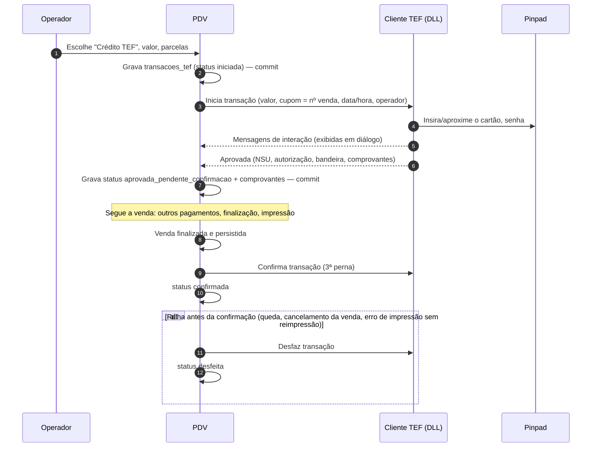

Regras:
- Interação do TEF (mensagens "INSIRA O CARTÃO", menus de seleção de parcelamento, coleta de dados) é exibida num
  diálogo modal operável por teclado; `Esc` envia "cancelar" ao TEF.
- **Pendência na inicialização**: ao abrir o PDV, toda transação `aprovada_pendente_confirmacao` é resolvida: se a
  venda dela está finalizada no SQLite → confirma; senão → desfaz. Toda transação `iniciada` sem resposta → consulta
  pendências do provedor (função administrativa) e desfaz. Nunca se inicia nova venda com pendência não resolvida.
- Comprovantes: via do cliente e via do estabelecimento (`impressora.vias_comprovante_tef`), impressas logo após o
  cupom; o comprovante fica gravado para reimpressão (seção 22).
- Transação negada: mensagem do TEF exibida; o pagamento não é lançado; o operador escolhe outra forma.
- Cancelamento de transação TEF de venda finalizada: `F11` › `T` Administrativo TEF › Cancelamento (exige permissão
  `pdv.tef.cancelar`), com NSU e data da transação original.
- Na NFC-e: `tpIntegra=1`, `CNPJ` da credenciadora, `tBand`, `cAut` vindos do TEF.
- Offline: TEF depende da rede do provedor; sem conexão, o TEF recusa e o operador usa POS externo (se houver forma
  cadastrada).

### 16.7 PIX — Fase PDV-1 (estático/manual) / PDV-2 (dinâmico)

| Modo | Quando | Como funciona |
|---|---|---|
| **Confirmação manual** | Forma PIX sem **Gera QR Code Pix**, ou fallback | O cliente paga na chave/QR da loja; o operador confere **no app/extrato do banco da loja** (nunca no celular do cliente) e confirma informando **nome do pagador** e **horário que aparece no app do banco** (gravados em `cobrancas_pix.pagador_nome` e `cobrancas_pix.paga_em`; o horário à frente do relógio do caixa é da véspera só perto da meia-noite — a véspera fica até 2 h antes do relógio, como o PIX das 23:58 confirmado às 00:03 —; fora disso, mais de 5 min à frente é recusado, e também o horário mais de 30 min anterior ao início da venda). Exige `pdv.pagamento.confirmar_pix_manual`; com `pdv.pix_manual_exige_supervisor` (nova chave, padrão `true`; O9b, padrão até a confirmação do dono, roadmap D37) a confirmação **sempre** pede liberação de supervisor (31.3), que vira o `autorizado_por_id` do pagamento e a linha `pix_manual` de `liberacoes` (SYNC 9.7). Auditoria `pix_confirmado_manual`. A cobrança (`cobrancas_pix`, tipo `estatico`, `paga`) é gravada no mesmo commit da venda e sobe no `venda.finalizada`; o pagamento removido deixa-a `cancelada`. `tPag=20` |
| **QR estático com valor** (PDV-1) | Forma com **Gera QR Code Pix** e loja com chave PIX cadastrada (campos da Loja: `lojas.chave_pix`, `lojas.pix_nome_recebedor`, `lojas.pix_cidade_recebedor`; editados no ERP › Lojas › Dados, ERP 10.3.1, com a chave conferida pelo formato do DICT e o nome obrigatório com a chave — implantação I5), **offline ou online** | O PDV gera localmente o BR Code estático (padrão EMV do Bacen) com chave, valor e identificador `txid` = número da venda (a venda paga com dois PIX repete o `txid`: a nuvem só exige `txid` único no dinâmico, MD 3.11.6); mostra o QR em tela grande (e imprime se `pdv.imprime_qr_pix`); confirmação manual como acima (cria `cobrancas_pix` tipo `estatico`). `tPag=20` |
| **QR dinâmico** (PDV-2) | Forma com **Gera QR Code Pix**, integração PSP configurada no ERP e **online** | PDV chama `POST /pix/cobrancas` (a API cria a cobrança no PSP com `txid` derivado do id do pagamento e validade de `pdv.pix_validade_s`, padrão 300 s) → exibe QR → acompanha por SSE/consulta a cada 2 s → "PAGO" confirma automaticamente. `tPag=17` |

Regras do QR dinâmico:
- Tempo esgotado → opções: [1] gerar novo QR, [2] confirmar manualmente (permissão), [3] escolher outra forma
  (a cobrança é cancelada no PSP).
- Conexão cai durante a espera → a tela continua; confirmação manual liberada; a nuvem concilia pelo `txid` depois.
- PIX pago depois de a venda ter sido cancelada/paga por outra forma → a nuvem registra "PIX recebido sem venda" e
  alerta no ERP para devolução (não é tratado no PDV).
- Estorno de PIX dinâmico (venda cancelada): `POST /pix/cobrancas/{txid}/devolucao` online; offline vira pendência.

Conciliação do PIX estático/manual (fraude do "comprovante falso/agendado" mostrado no celular):
- O ERP concilia os PIX confirmados manualmente contra o **extrato** da conta da loja (importação OFX/CSV ou API do PSP):
  casa por valor + janela de horário (`paga_em` ± 10 min) + `txid` quando o banco o preserva.
- PIX manual sem crédito correspondente no extrato após D+1 gera o alerta **"PIX manual sem crédito no extrato"** no
  ERP, com operador, venda e quem liberou.
- Recomendação: assim que houver PSP contratado, a forma PIX padrão da loja passa a ser o **PIX dinâmico** (PDV-2),
  que confirma sozinho e dispensa a confirmação manual.

### 16.8 Crediário / caderneta (venda a prazo) — Fase PDV-2

Forma com `tPag=05` e Lança Quitada desligada, com `formas_pagamento.tipo_forma = 'crediario'` (valores do modelo
3.10.1: `dinheiro`, `cartao_credito`, `cartao_debito`, `pix`, `crediario`, `credito_funcionario`, `vale`,
`vale_alimentacao`, `vale_refeicao`, `boleto`, `cheque`, `consumo_interno`, `outros`).

1. Exige cliente com cadastro (CPF/CNPJ) e **ativo**.
2. **Limite disponível** = `Limite de Compras` da pessoa − saldo em aberto (`saldos_credito_pessoas`, baixado) −
   crediário de vendas locais ainda não confirmadas. Limite 0 = não compra a prazo.
3. Valor > disponível → "Limite insuficiente (disponível R$ 120,00)". Liberação com `pdv.pagamento.exceder_limite_credito`.
4. Cliente com parcela vencida há mais de `financeiro.dias_bloqueio_atraso` (nuvem, padrão 30; informação baixada em
   `saldos_credito_pessoas.maior_atraso_dias`) → bloqueado; mesma liberação.
5. Se `pdv.crediario_exige_senha_cliente` (nuvem): o cliente digita a **Senha** do seu cadastro de Pessoa para
   confirmar (5 erros seguidos → bloqueio de 30 min, `bloqueios_senha_local`).
6. Parcelas (se **Permite Parcelar**): quantidade 1–`formas_pagamento.parcelas_maximo`; com **Gera datas de
   parcelamento** (aba Vendas) ligado, as datas são geradas automaticamente (`pdv.primeiro_vencimento_dias`, padrão 30;
   intervalo 30 dias; valores
   iguais com a diferença de centavos na **primeira** parcela); desligado, o operador digita cada vencimento.
7. Offline: permitido (o limite usa o último saldo baixado); se `pdv.crediario_exige_online` (nuvem) estiver ligado,
   recusa offline.
8. Impressão: **comprovante de crediário** em 2 vias (cliente e loja) com parcelas, vencimentos e linha de assinatura.
9. Nuvem: gera contas a receber (uma por parcela) em aberto, forma "Caderneta".

### 16.9 Crédito funcionário — Fase PDV-2

- Forma com **Crédito Funcionário**: exige pessoa com categoria **Funcionário**; limite = Limite de Compras da pessoa
  (mesmas regras de 16.8, itens 2–4).
- O operador não pode lançar crédito funcionário para si mesmo (pessoa vinculada ao seu usuário pelo CPF) sem
  liberação de supervisor.
- Nuvem: conta a receber em nome do funcionário (para desconto em folha no ERP).

### 16.10 Boleto — Fase PDV-2

- Forma com **É Boleto**: exige pessoa com CPF/CNPJ e endereço completo (cadastro rápido pede o endereço).
- Parcelas como 16.8. A nuvem gera as contas a receber e, se **Gera Boleto Automaticamente** (aba Financeiro), emite
  os boletos e envia por e-mail/WhatsApp. O PDV imprime um comprovante "Boletos serão enviados para <e-mail>"; não
  imprime boleto (os dados do boleto só existem após o registro bancário, online).

### 16.11 Vale-compra / vale-troca como pagamento — Fase PDV-2

- Forma tipo `vale`. O operador bipa ou digita o código do vale (`VC` + 12 dígitos).
- Validação local em `vales` (inclusive os inseridos localmente) com o saldo estimado `vales.saldo + Σ movimentos_vale
  não refletidos` (modelo 4.5): existe, `status` ativo, não expirado (**Data de Expiração do Vale Compra**), saldo > 0.
  Online, o PDV confirma o saldo em `GET /vales/{codigo}` e **reserva** o valor (`reservas_vale`, evita uso duplo em
  outro caixa). Offline: aceita vales conhecidos localmente e com saldo estimado; se `pdv.vale_exige_online` (nuvem),
  recusa offline.
- Valor do pagamento ≤ saldo e ≤ falta. Uso parcial deixa saldo remanescente; o cupom imprime "Saldo restante do
  vale: R$ X — válido até dd/mm/aaaa".
- Vale não gera troco em dinheiro (flag Permite Troco desligada).
- Conflito (mesmo vale usado offline em dois caixas): a nuvem aceita ambos, deixa o saldo negativo e gera alerta no
  ERP (o prejuízo é visível e auditável).

### 16.12 Critérios de aceite – pagamento

- [ ] Venda de 75,18 paga com PIX 30,00 + dinheiro 50,00 mostra troco 4,82 e a soma dos `valor` gravados é 75,18.
- [ ] Cartão (sem Permite Troco) com valor acima do total é recusado.
- [ ] Forma com Sempre Zerado no PDV abre com 0,00.
- [ ] Forma com Senha de liberação não é lançada sem supervisor ou senha da forma.
- [ ] Forma de outra loja não aparece.
- [ ] Gaveta abre na finalização com dinheiro e não abre numa venda só com PIX (forma sem Abrir Gaveta).
- [ ] QR estático gerado offline é lido por app de banco com valor e chave corretos.
- [ ] Crediário acima do limite exige liberação; o ERP mostra as parcelas em contas a receber após o push.
- [ ] Queda de energia após aprovação TEF e antes da finalização: ao religar, a transação é desfeita e a venda volta em andamento.

### 16.13 Recebimento de crediário / caderneta no caixa — Fase PDV-2

Junto com o crediário (16.8): o cliente paga parcelas no balcão, sem ir ao escritório. Atalho `F11` › `R`
"Recebimento de crediário", com caixa aberto e sem venda em andamento. Permissão `pdv.crediario.receber` (Operador ✔).

1. **Buscar o cliente** (nome, CPF, Cód. pessoa, telefone — 14.2).
2. **Parcelas abertas**: lista de `parcelas_credito_pessoas` (nova projeção P, ↓ loja/pessoa relevante: `pessoa_id`,
   `parcela_financeira_id`, `documento` (venda/contrato), `numero`, `vencimento`, `valor`, `saldo`, `dias_atraso`),
   com o total de `saldos_credito_pessoas`. Mostra juros e multa calculados conforme `financeiro.juros_mes_pct`
   (pro rata die) e `financeiro.multa_pct` (máx. 2 % para PF, CDC).
3. **Selecionar** parcelas (barra de espaço) **ou informar um valor**: o valor é baixado em **FIFO** (vencimento mais
   antigo primeiro; juros/multa de cada parcela antes do principal). Valor maior que o total devido → recusado
   ("Valor acima do saldo devedor R$ X"). Desconto de juros exige `pdv.crediario.desconto_juros` (L).
4. **Formas de recebimento**: dinheiro, PIX, cartão (POS/TEF), mesma tela de pagamento (16.1), sem crediário/vale.
5. **Comprovante** em 2 vias (cliente e loja): cliente, parcelas baixadas (valor, juros, multa), saldo restante,
   operador, data/hora. Não fiscal (recebimento não é venda).
6. **Gravação** (uma transação): `recebimentos_crediario` (nova tabela de movimento D, ↑: CP, `sessao_caixa_id`,
   `loja_id`, `caixa_id`, `terminal_id`, `operador_id`, `pessoa_id`, `valor_total`, `valor_juros`, `valor_multa`,
   `valor_desconto`, `parcelas jsonb` [{`parcela_financeira_id`, `valor_principal`, `juros`, `multa`}], `ocorrido_em`,
   `cancelado`…) + seus pagamentos (mesma estrutura de `pagamentos_venda`, com `recebimento_crediario_id`) + evento
   **`crediario.recebido`** (novo; agregado `recebimento_crediario`; depende da sessão e, se for o caso, da pessoa
   local).
7. **Nuvem**: aplica como `baixas_financeiras` nas parcelas (FIFO pela lista do evento) e atualiza
   `saldos_credito_pessoas` e `parcelas_credito_pessoas`.
8. **Caixa**: o dinheiro recebido entra em `dinheiro_gaveta` (20.4, `recebimento_crediario_dinheiro`) e o recebimento
   aparece no fechamento por forma (21.2) e no resumo diário.
9. **Offline**: aceito. O PDV baixa localmente a estimativa (modelo 4.5: `credito_em_aberto` − recebimentos não
   refletidos) e a nuvem reconcilia: parcela já paga por outro canal ou valor a maior → crédito do cliente e alerta
   "Recebimento de crediário a maior" no ERP; nada é recusado.
10. **Cancelamento**: só na sessão aberta, com `pdv.caixa.cancelar_movimento` e motivo; sobe
    `crediario.recebimento_cancelado` e a nuvem estorna as baixas.

Critérios de aceite:
- [ ] Receber R$ 150,00 de um cliente com 3 parcelas de R$ 100,00 baixa a 1ª inteira e R$ 50,00 da 2ª.
- [ ] O dinheiro recebido aparece no calculado do fechamento e no dinheiro da gaveta.
- [ ] Recebimento offline sobe ao reconectar e o ERP mostra as baixas nas contas a receber.

### 16.14 Baixa interna (avarias / uso e consumo) — Fase PDV-2

Registro no caixa de mercadoria da própria loja que sai por **avaria/perda** ou **uso e consumo interno**, com forma
`formas_pagamento.tipo_forma = 'consumo_interno'` (modelo 3.10.1, ERP 10.2; seed "Avarias" e "Baixas de utilização em
loja", inativas por padrão). Não é venda a consumidor: não gera receita, conta a receber nem documento fiscal. Quem não
quiser registrar no caixa usa o Acerto de saída no ERP (ERP 13.5).

1. **Seleção da forma**: na tela de pagamento (16.1), a forma aparece na lista como as demais (ativa, uso PDV, da loja
   ou sem loja). O valor é sempre o **total da venda** (não editável): a baixa é integral.
2. **Sem mistura**: só é aceita se não houver outro pagamento lançado ("Baixa interna não pode ser combinada com outra
   forma: remova os pagamentos lançados"); lançada a baixa, nenhuma outra forma é aceita na venda. Pagamento eletrônico
   aprovado (TEF, PIX dinâmico) precisa ser estornado antes (16.1).
3. **Liberação**: exige `pdv.pagamento.consumo_interno` (liberação de supervisor, 31.3), registrada em auditoria (32.1).
4. **Motivo obrigatório** (3–255 caracteres, ex.: "Garrafa quebrada na reposição", "Consumo da equipe"), gravado em
   `vendas.observacao` e na auditoria da liberação.
5. **Sem troco, sem gaveta, sem pessoa**: a forma tem `permite_troco`, `abrir_gaveta` e `exige_pessoa` desligados
   (`ck_formas_pagamento_consumo_interno`); o PDV não pergunta CPF na nota e não abre a gaveta. Nada entra no dinheiro
   da gaveta (20.4).
6. **Finalização**: `status_fiscal = 'nao_aplicavel'` **também em loja NFC-e** (exceção (c) do modelo 3.6.3; 17.2), sem
   número de NFC-e reservado; `meio_pagamento_fiscal` 90 só porque a coluna é obrigatória. Funciona offline.
7. **Comprovante não fiscal** (1 via): "BAIXA INTERNA — NÃO É DOCUMENTO FISCAL", itens, quantidades, motivo, operador,
   supervisor que liberou, data/hora.
8. **Sincronização**: sobe no `venda.finalizada` como qualquer venda. A nuvem identifica a forma `consumo_interno` e,
   no lugar de `VENDA_PDV` e da conta a receber, grava a saída de estoque com o tipo de movimento **`BAIXA_INTERNA`**
   no estoque vinculado e uma **despesa já quitada** pelo **custo** dos itens no plano de contas da forma
   (`plano_contas_id`); sem comissão (`valor_comissao = 0`). O registro fica fora dos relatórios de vendas, lucro e
   Dashboard (ERP 10.2).
9. **Cancelamento**: segue o caminho da venda não fiscal (13.3) mesmo em loja NFC-e; a nuvem estorna a saída de estoque
   e a despesa.

Critérios de aceite:
- [ ] Em loja NFC-e, uma venda paga só com a forma "Avarias" finaliza sem NFC-e (`status_fiscal = 'nao_aplicavel'`),
  com motivo e liberação de supervisor, e o comprovante sai como não fiscal.
- [ ] Tentar lançar "Avarias" numa venda com dinheiro já lançado (ou o contrário) é recusado.
- [ ] Após o push, o ERP mostra a saída como `BAIXA_INTERNA` na Movimentação e a despesa quitada pelo custo; nada
  aparece em contas a receber nem no relatório de vendas.

---

## 17. Finalização da venda

### 17.1 Sequência — Fase PDV-1 (TEF PDV-3, NFC-e FISCAL)

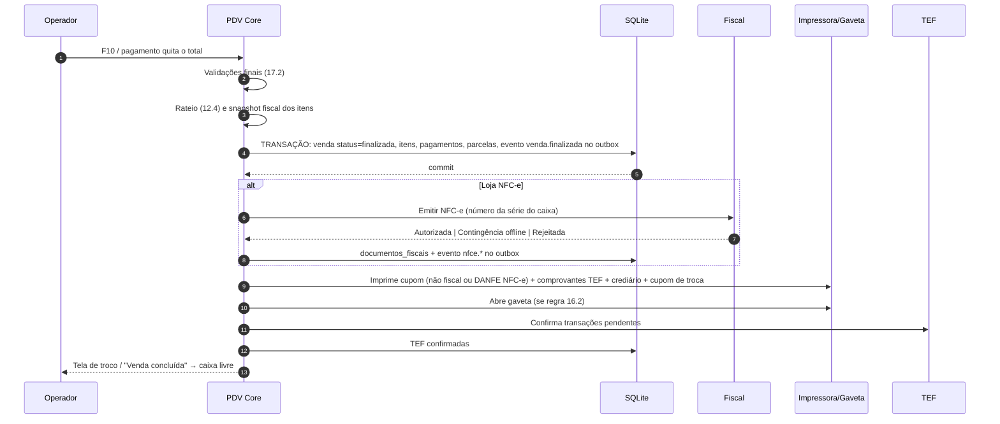

- A venda é **finalizada no banco antes** do fiscal e da impressão: se a impressora falhar ou a SEFAZ demorar, a
  venda já existe e o estoque/financeiro vão subir.
- A finalização **não grava movimento de caixa**: o dinheiro da gaveta é calculado a partir dos pagamentos da sessão
  (20.4). `movimentos_caixa` só tem abertura, reforço, sangria, `sangria_fechamento`, `devolucao_troca` e
  `estorno_venda`.
- Falha de impressão → aviso "Cupom não impresso — [R] Reimprimir / [Enter] Continuar"; o trabalho fica em
  `fila_impressao`. Em loja NFC-e, a reimpressão do DANFE é obrigatória antes da próxima venda se
  `pdv.exige_impressao_danfe` (nuvem, padrão `true`), pois o consumidor tem direito ao documento — salvo se o cliente
  aceitar o **DANFE eletrônico** (18.5, `fiscal.danfe_modo`), registrado em auditoria.
- A confirmação TEF acontece **depois** da impressão dos comprovantes. Se a impressão falhar e não houver como
  reimprimir, a venda **não volta para pagamento** (já é um documento imutável e o `venda.finalizada` já está no
  outbox): o operador tenta reimprimir pela fila; se escolher desfazer o TEF, o PDV desfaz a transação, grava
  `tef.resolvida` com `status = 'desfeita'` e, em seguida, o cancelamento da venda (`venda.cancelada`, forma A; em loja
  NFC-e, depois do cancelamento da nota, 13.3) — sincronizacao.md 9.8. Para cobrar o cliente, abre-se uma **nova
  venda** com os mesmos itens.

### 17.2 Validações finais

| Validação | Falha |
|---|---|
| Pago (Σ valor) = total, falta = 0 | "Falta R$ X" |
| Pelo menos um item não cancelado | — |
| Vendedor obrigatório (seção 15) | Abre escolha |
| Identificação obrigatória (valor, entrega, formas que exigem pessoa) | Abre F5 |
| **Limite de Valor de Vendas PDV** (seção 29.3) | Liberação de supervisor |
| Caixa não bloqueado por limite de sangria (vale para **iniciar** venda; a venda em andamento sempre pode finalizar) | — |
| Loja NFC-e: certificado válido, CSC presente, itens com cadastro fiscal válido (já validado na inclusão, 10.2; revalidado aqui porque um pull pode ter mudado o cadastro) | "Produto X sem NCM válido — não é possível emitir NFC-e": o operador cancela o item (em loja NFC-e toda mercadoria entra na nota; não existe finalizar como não fiscal — modelo 3.6.3 —, exceto baixa interna: todos os pagamentos em forma `tipo_forma = 'consumo_interno'` (modelo 3.6.3 (c), ERP 10.2, PDV 16.14) → finaliza com `status_fiscal = 'nao_aplicavel'`, sem NFC-e) |
| Loja NFC-e: prazo de contingência (18.4) | Depois do prazo efetivo, a venda continua, mas o fechamento exige ciência do supervisor |
| Relógio: desvio > 5 min em relação à última hora do servidor (loja NFC-e) | Aviso; a NFC-e usa a hora local corrigida pelo desvio medido |

### 17.3 Critérios de aceite – finalização

- [ ] Desligar a impressora e finalizar: a venda aparece na Gestão de vendas como finalizada e o cupom sai ao reimprimir.
- [ ] Matar o processo entre o commit e a impressão: ao reabrir, a venda está finalizada, o cupom está na fila e a TEF é confirmada.
- [ ] Após a finalização, o caixa fica livre em < 1 s (sem NFC-e) para a próxima leitura.

---

## 18. Documento fiscal (Não fiscal / NFC-e / SAT / MFE)

O tipo é definido por loja em **Tipo de emissão (Não Fiscal / SAT / MFE / NFC-e)** (Lojas › Tributação; `lojas.tipo_emissao`).

**Parâmetros por UF (D1).** Nada desta seção é fixo para um estado: as lojas da Ice Beer ficam no PR, mas o PDV deve
atender empresas de qualquer UF. Todo valor que muda por UF vem de `parametros_fiscais_uf` vigente da `lojas.uf`
(MD 3.4.3), com sobreposição pela loja só quando o modelo prevê (e só para mais restritivo, MD 3.2.2). Valores do PR,
fontes e o que ainda falta confirmar: [`docs/fiscal/nfce-parana.md`](../fiscal/nfce-parana.md) (seção 12 lista os
parâmetros; seção 13, as perguntas ao contador e à SEFA-PR).

| Parâmetro | Onde mora (MD) | Usado em |
|---|---|---|
| Tipos de emissão aceitos na UF | `parametros_fiscais_uf.tipos_emissao_permitidos` → valida `lojas.tipo_emissao` | 18, 18.7 |
| Autorizador, versão do leiaute, URLs dos web services | `parametros_fiscais_uf.autorizador`, `.versao_leiaute`, `.webservices` | 18.2 |
| URL do QR Code e `urlChave`, versão do QR | `parametros_fiscais_uf.url_qrcode_*`, `.url_consulta_*`, `.qrcode_versoes_aceitas`; `lojas.nfce_qrcode_versao` | 18.2, 18.5 |
| CSC e identificador | `lojas.nfce_csc_*` (cifrado); `parametros_fiscais_uf.csc_por_cnpj_base`, `.csc_max_ativos_por_ambiente` | 18.2 |
| Prazo do cancelamento comum (110111) | `lojas.nfce_prazo_cancelamento_min` (copiado da UF) | 13.3 |
| Prazo do cancelamento por substituição (110112) e cancelamento extemporâneo | `parametros_fiscais_uf.prazo_cancelamento_substituicao_h`, `.aceita_cancelamento_extemporaneo` | 18.4 |
| Prazo de transmissão da contingência e modalidades aceitas | `fiscal.prazo_transmissao_contingencia_h` (padrão da UF); `parametros_fiscais_uf.modalidades_contingencia_nfce` | 18.4 |
| Vias do DANFE em contingência, modos de DANFE permitidos e concordância para o resumido | `parametros_fiscais_uf.contingencia_vias_danfe`, `.danfe_modos_permitidos` → limita `fiscal.danfe_modo`; `.danfe_resumido_exige_concordancia` | 18.5 |
| Prazo de inutilização | `fiscal.inutilizacao_prazo_dia` (padrão da UF) | 18.6 |
| Identificação do consumidor (valor, venda não presencial) e valor máximo da NFC-e | `lojas.nfce_valor_exige_identificacao` (copiado da UF); `parametros_fiscais_uf.identificacao_obrigatoria_nao_presencial`, `.nfce_valor_maximo` | 14.1, 18.2 |
| Programa de cidadania fiscal (CPF na nota) | `parametros_fiscais_uf.programa_cidadania`, `.programa_cidadania_substitui_danfe` | 14.1, 18.5 |
| Intervalo da consulta de status | `fiscal.intervalo_status_sefaz_s` (piso `parametros_fiscais_uf.intervalo_minimo_status_s`) | 18.2 |
| Atraso máximo entre `dhEmi` e autorização | `parametros_fiscais_uf.atraso_max_emissao_min` | 18.2, 18.4 |
| ICMS-ST retido e vinculação do pagamento exigidos | `fiscal.exige_st_retido_nfce`, `fiscal.exige_vinculacao_pagamento` (padrão da UF) | 16.5, 18.2 |
| cBenef, CEST de bem listado, `infRespTec`/CSRT | `parametros_fiscais_uf.exige_cbenef`, `.exige_cest_bem_listado`, `.exige_resp_tec`, `.exige_csrt_nfce`; tabela `beneficios_fiscais_uf` | 18.2, 18.3 |
| Alíquota interna, FCP, ST/MVA/pauta por NCM | Cadastro: `produtos` + `produtos_tributacao_uf` (vale na nota); referência da UF para sugerir/validar no ERP: `regras_icms_uf`, `pautas_st_uf` | 18.2 |
| Tributos aproximados | `ncms_ibpt` (por NCM e UF) | 18.2 |

### 18.1 Não fiscal — Fase PDV-1

- Imprime o **Comprovante de venda** (seção 19.2) com a frase obrigatória "**NÃO É DOCUMENTO FISCAL**" no topo e no
  rodapé, título configurável (**Título do recibo**, aba Vendas, quando **Usa Recibo** ligado; padrão "COMPROVANTE DE
  VENDA").
- `status_fiscal = nao_aplicavel`.

### 18.2 NFC-e – emissão normal — Fase FISCAL

- Biblioteca: `GenesisPDV.Fiscal` sobre biblioteca .NET de DF-e (ACBrLib, Unimake.DFe ou DFe.NET — decisão na
  preparação da Fase 3F, roadmap); interface `IEmissorFiscal` com implementação simulada para testes.
- Numeração: **série por caixa** (`caixas.nfce_serie`) e número sequencial local
  (`sequencias_locais['nfce:<serie>:<ambiente>']`), reservado imediatamente antes da montagem do XML, em transação
  que cria `documentos_fiscais` (`status = 'pendente'`). Um número **rejeitado** é reutilizado na reemissão corrigida da
  mesma venda (18.3); só números **abandonados** são inutilizados (18.6).
- Dados: emitente (CNPJ, IE, endereço da **loja**, CRT pelo **Regime**), `dest` (seção 14), itens com
  `fiscal_snapshot` (NCM, CEST, CFOP de venda no estado — produto ou padrão da aba Tributação/CFOP's; CSOSN/CST,
  origem, alíquotas; PIS/COFINS situação + alíquota), `vDesc`/`vOutro`/`vFrete` do rateio, pagamentos (`detPag`,
  `vTroco`), `infAdic` (**Inf. Adic. Contribuinte** e **Inf. Adic. Fisco**), tributos aproximados (`vTotTrib`, regra
  abaixo), QR code na versão `lojas.nfce_qrcode_versao` ?? `parametros_fiscais_uf.qrcode_versao_padrao` (v2 com **CSC**
  e **Identificador**; v3 sem CSC na emissão normal e com assinatura dos campos em contingência) e base/`urlChave` da
  UF, grupo `infRespTec` com os dados da software house (hash do CSRT só onde `exige_csrt_nfce`), `dhEmi` no fuso da
  loja. Web services: `parametros_fiscais_uf.webservices` quando preenchido; senão, a tabela embutida da biblioteca
  DF-e para o `autorizador` da UF.
- **Combo (kit, 10.9.1)**: nunca sai como um `det` do kit. Cada componente escolhido (padrão ou alternativa) é um
  `det` com o seu `fiscal_snapshot` (NCM, CEST, CFOP, CST/CSOSN, GTIN do componente), `vUnCom`/`vProd` = preço
  rateado da linha (rateio do preço do combo, com os acréscimos, proporcional ao preço de venda dos componentes
  escolhidos) e `infAdProd` com o nome do combo; Σ `vProd` das linhas do grupo = preço do combo. As validações de
  emissão (NCM, CFOP × CST, CEST, cBenef, modelo 3.6.3) valem para cada componente e alternativa, não para o kit.
- **Ambiente** (Produção/Homologação) da loja. Em homologação, a descrição do primeiro item é substituída pelo texto
  exigido "NOTA FISCAL EMITIDA EM AMBIENTE DE HOMOLOGACAO - SEM VALOR FISCAL" e o DANFE mostra a tarja.
- Transmissão síncrona com timeout `fiscal.timeout_sefaz_s` (padrão 15 s). Status do serviço da SEFAZ consultado a
  cada `fiscal.intervalo_status_sefaz_s` (padrão 300 s, nunca abaixo do piso da UF: consulta em excesso pode bloquear
  o acesso ao autorizador) em segundo plano (indicador "SEFAZ ok / indisponível").
- **Limites da UF** (validados ao finalizar, antes de reservar o número): total ≥
  `lojas.nfce_valor_exige_identificacao` ou venda não presencial com `identificacao_obrigatoria_nao_presencial` exige
  CPF/CNPJ (e endereço, no não presencial) (14.1); total ≥ `parametros_fiscais_uf.nfce_valor_maximo` não pode ser
  NFC-e: o PDV bloqueia a finalização com a mensagem "Valor acima do limite da NFC-e na UF: emitir NF-e". A partir da
  Fase 6, oferece a NF-e pela nuvem (14.4, que passa a aceitar também destinatário não contribuinte nesse caso); antes
  disso, a venda fica suspensa e a NF-e é emitida fora do PDV.
- **Tempo do XML**: a SEFAZ recusa `dhEmi` distante da hora de recebimento. Um XML tpEmis=1 montado e **não enviado há
  mais de 2 min** (fila, retry, queda) é **regerado** antes de transmitir: `dhEmi` novo (hora corrigida, 30.5), mesmo
  número e série, nova assinatura. Nunca se reenvia um XML tpEmis=1 antigo; se não houver como transmitir, vai para
  contingência (18.4). Os 2 min ficam abaixo de `parametros_fiscais_uf.atraso_max_emissao_min` (PR: 5 min, NT 2025.001,
  seção 02.4; a confirmar) e a autorização da NFC-e é sempre síncrona (lote de 1 nota).
- Autorizada → grava protocolo, XML autorizado (`procNFe`) local e evento `nfce.autorizada` (o XML sobe para a
  nuvem para o **Download de XML** do ERP).

**Presença, consumidor final e frete** (conferir a NT de NFC-e da UF da loja):

| Situação da venda | `indPres` | `modFrete` | Frete / `dest` |
|---|---|---|---|
| Balcão, comanda, pedido retirado na loja | `1` (presencial) | `9` (sem frete) | Sem `vFrete`; `dest` só se houver CPF/CNPJ |
| Delivery (entrega a domicílio) | `4` (entrega a domicílio) | conforme `fiscal.taxa_entrega_como` | `dest` obrigatório com CPF/CNPJ + `enderDest` completo (validação em 26.1). Taxa de entrega conforme a chave `fiscal.taxa_entrega_como` (nova, Loja S): `vfrete` (padrão: rateada em `vFrete`, com `modFrete` compatível — `0` por conta do emitente) ou `outro` (rateada em `vOutro`, `modFrete = 9`) |

- Sempre `indFinal = 1` (consumidor final) e `indIEDest = 9` na NFC-e (cliente contribuinte que precisa de crédito usa
  NF-e, 14.4).
- `documentos_fiscais` grava `ind_pres smallint` e `mod_frete char(1)` (colunas novas no modelo 3.14.1).

**GTIN (`cEAN`/`cEANTrib`)** — a SEFAZ valida o GTIN no Cadastro Centralizado de GTIN (GTIN × NCM):

| Código do item | `cEAN` / `cEANTrib` |
|---|---|
| Linha de `produtos_codigos_barras` com `tipo = 'gtin'`, `fator = 1` (unidade comercial/tributável), prefixo diferente de `2` | O próprio GTIN |
| Código de embalagem (`fator ≠ 1`, DUN-14 ou EAN da caixa) | GTIN da **unidade** (`principal = true`, `tipo = 'gtin'`, `fator = 1`); se a unidade não tiver GTIN, `SEM GTIN` |
| Código `interno`, prefixo `2` (circulação restrita) ou etiqueta de balança (10.6) | `SEM GTIN` |
| Produto sem nenhum código `gtin` | `SEM GTIN` |

O ERP alerta "GTIN × NCM divergente" quando a consulta GTIN da SEFAZ indicar incompatibilidade (ERP 8.2.1).
Como a quantidade do item é sempre gravada na unidade base (10.2: fardo de 12 = 12 UN), `uCom = uTrib` e
`qCom = qTrib`, e o GTIN da unidade vale para os dois campos. Se um dia o item sair na unidade da embalagem (`FD`),
`cEAN` passa a ser o GTIN da embalagem, `cEANTrib` o da unidade e `qTrib = qCom × fator`, mantendo
`qCom × vUnCom = qTrib × vUnTrib` (`docs/fiscal/nfce-parana.md`, seção 10).

**ICMS, FCP e ST de bebidas** — com a tributação efetiva do item (`produtos_tributacao_uf` da UF da loja ?? `produtos`
?? `tributacao.*`, MD 3.6.3):

| Situação do item | Grupos no XML (`fiscal_snapshot.icms`) |
|---|---|
| Tributado na saída (CST 00/20, CSOSN com destaque) | `vBC`, `pICMS` (sem o FCP), `vICMS`; com `fcp_aliquota` > 0, `vBCFCP`/`pFCP`/`vFCP` nos campos próprios, nunca só em `infAdic`. A forma como a UF soma o FCP no destaque é ponto a confirmar com o contador (`docs/fiscal/nfce-parana.md`, seção 13); se variar por UF, vira coluna de `parametros_fiscais_uf` (MD 3.4.3) |
| Recebido com ST (CST 60 / CSOSN 500: cerveja, refrigerante, energético, destilados) | CFOP 5405 (MD 3.6.3); com `fiscal.exige_st_retido_nfce`, grupo de ST retido (`vBCSTRet`, `pST`, `vICMSSubstituto`, `vICMSSTRet`) e FCP-ST retido (`vBCFCPSTRet`, `pFCPSTRet`, `vFCPSTRet`) de `produtos_lojas` × quantidade; sem os valores, o item não é vendável (MD 3.6.9) |
| ST calculada pelo emitente (CST 10/70, CSOSN 201–203) | Não esperado no varejo (MD 3.6.3): exige CFOP explícito; usa `icms_mva_pct`, `icms_aliquota_st`, `fcp_st_aliquota` |

Totais em `documentos_fiscais`: `v_fcp`, `v_bc_st`/`v_st`, `v_fcp_st`, `v_fcp_st_ret` (MD 3.14.1); por item,
`itens_venda.v_fcp`, `v_icms_st_ret`, `v_fcp_st_ret`. **cBenef** só quando a UF exige e o CST tem benefício
(`beneficios_fiscais_uf`); **CEST** também para NCM listado sem ST quando `exige_cest_bem_listado` (MD 3.6.3).

**Atacarejo na nota** (11.3.1): `fiscal.atacado_como` = `preco_unitario` (padrão: `vUnCom` = preço aplicado, atacado,
faixa ou mix) ou `desconto_item` (`vUnCom` = preço de varejo e a diferença em `vDesc` do item). A escolha muda o
relatório de descontos e a base do ICMS dos itens tributados: confirmar com o contador antes da Fase 3F. O "grupo de
itens" (mix) não muda NCM/CEST/GTIN dos itens: só o preço de cada um.

**Taxa de serviço** (25.3): com `pdv.taxa_servico_no_documento_fiscal = false` (padrão) não entra em `vOutro` nem no
`vNF`; a parte dos pagamentos que a cobre (`pagamentos_venda.valor_taxa_servico`) é abatida do `detPag`, de modo que
`Σ vPag − vTroco = vNF`.

**Serviço**: item de produto `tipo = 'servico'` nunca entra na NFC-e (10.2, 10.4).

**Tributos aproximados (Lei 12.741/2012)**: calculados por item com `ncms_ibpt` (federal nacional ou importado,
estadual, municipal; `aliquota_importada` quando `icms_origem in ('1','2','3','8')`) e, na falta do NCM na tabela,
com `tributacao.lei_transparencia_pct`. O texto vai em `infCpl`, no DANFE e no comprovante não fiscal (19.2):
"Trib aprox R$ 8,12 Federal, R$ 11,03 Estadual, R$ 0,00 Municipal – Fonte: IBPT/empresometro <chave>". `ncms_ibpt`
ganha as colunas `chave varchar(10)` e `fonte varchar(40)` (modelo). Tabela com vigência vencida → alerta âmbar no
PDV ("Tabela IBPT vencida") e alerta no ERP; o cálculo continua com a última tabela. A transição para IBS/CBS segue o
`fiscal_snapshot` (`schema_fiscal: 2`).

### 18.3 Rejeição — Fase FISCAL

Princípio: a venda já está `finalizada` e o `venda.finalizada` já está no outbox ou na nuvem (17.1). **A venda nunca
volta para `em_pagamento`** e nunca tem itens removidos depois de finalizada (ADR-06). A NFC-e rejeitada não consome o
número na SEFAZ: a correção reemite a **mesma venda** com o **mesmo número e série** (XML novo, `cNF` novo e chave nova;
a chave antiga nunca foi autorizada).

**Nota de contingência (tpEmis=9) rejeitada**: o DANFE já foi entregue, então só se regera com o **mesmo número e
série**, sem alterar imposto, destinatário nem `dhEmi`/`dhCont` (`docs/fiscal/nfce-parana.md`, seção 5; regra semeada
por UF). Para ela, a opção [2] e a regeração de `dhEmi` da linha 703 não se aplicam. Correção de cadastro que mude o
tributo exige orientação do contador antes de retransmitir (alerta crítico no ERP).

| Categoria | Exemplo | Comportamento |
|---|---|---|
| Duplicidade | 204/539 (número já usado) | Consulta a chave na SEFAZ; se a nota é desta venda (mesmo conteúdo), adota o protocolo; senão, reserva um número novo, reemite e grava `substituido_por_id` no documento antigo |
| Erro de cadastro (NCM, CFOP, CST, CEST, cBenef, FCP/ST retido, GTIN) | 778 (NCM inexistente), GTIN inválido, cBenef em CST sem benefício | A venda fica com `status_fiscal = 'rejeitada'` e a mensagem; evento `nfce.rejeitada` + `alerta.cadastro`. Opções (diálogo para o supervisor, `pdv.fiscal.retransmitir`): **[1] Aguardar a correção** do cadastro no ERP → ao receber o pull, reemitir a NFC-e da MESMA venda com o mesmo número (o `fiscal_snapshot` dos itens é recalculado para o documento; `decisao_pdv = 'reemitida'`). **[2] Cancelar e refazer**: cancela a venda (`venda.cancelada` forma A, sem evento fiscal porque não há NFC-e autorizada; o número rejeitado vai para inutilização, `decisao_pdv = 'reemitida_nova_venda'`) e cria uma **nova venda** (novo `id` e `numero`) com os itens restantes, transferindo os pagamentos (abaixo). **[3] Deixar pendente** para o supervisor (`decisao_pdv = 'pendente_supervisor'`); a venda aparece em "NFC-e pendentes" (F11 › F) e no ERP |
| Erro de schema/assinatura/certificado | 225, 280+ | Corrige (atualização do app/certificado) e reemite com o mesmo número; alerta técnico |
| Data/hora | 703 etc. | Regera o XML com `dhEmi` pela hora do servidor (18.2) e reemite com o mesmo número (só tpEmis=1; em contingência, ver acima) |
| Denegação | 301/302 | Status `denegada` (número consumido, não inutilizar); venda cancelada |
| Timeout / sem resposta / SEFAZ fora | — | Contingência (18.4) |

**Transferência dos pagamentos na opção [2]** (sincronizacao.md 24): na mesma transação local, os pagamentos da venda
original ficam `status = 'estornado'` com `estorno = 'transferido'` (sem saída de gaveta, sem estorno no cartão) e a
nova venda recebe pagamentos com `transferido_de_id` = pagamento original, mesma forma e mesmos vínculos
(`tef_transacao_id`, `pix_cobranca_id`, NSU, autorização). Se o total da nova venda for **menor** que o transferido, a
diferença é devolvida como em 13.3 (dinheiro → `estorno_venda`; TEF/PIX → cancelamento/devolução parcial quando o
provedor permite, senão vale-troca com o aceite do cliente). Total maior → o "Falta" é pago normalmente. A nuvem liga
as contas a receber/conciliação à nova venda.

### 18.4 Contingência offline (tpEmis=9) — Fase FISCAL

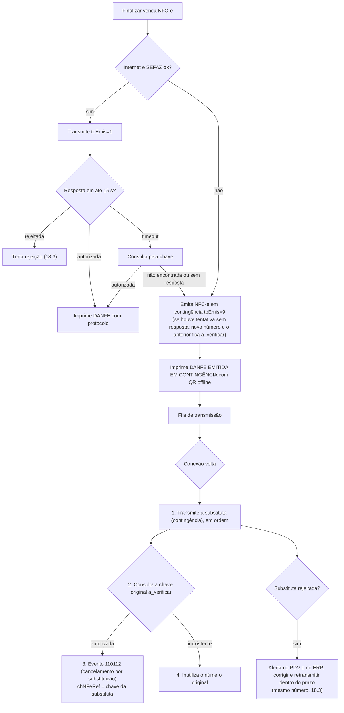

Regras:
- Entrada em contingência: automática por falta de conexão, SEFAZ indisponível ou timeout; banner âmbar
  "NFC-e EM CONTINGÊNCIA — N notas aguardando transmissão".
- `dhCont` e `xJust` ("SEM CONEXAO COM A SEFAZ" / "TIMEOUT NA AUTORIZACAO") preenchidos.
- **Nota tpEmis=1 sem resposta** (timeout) **não** pode ser reemitida com o mesmo número em contingência: o PDV
  primeiro tenta consultar pela chave; não conseguindo, emite em contingência com **novo número** (a substituta) e
  marca o documento original com `status = 'a_verificar'` (novo valor em `ck_documentos_fiscais_status`) e
  `chave_substituta` = chave da substituta (nova coluna `documentos_fiscais.chave_substituta varchar(44)`), além de
  `substituido_por_id`. Ao reconectar, nesta ordem:
  1. transmite **primeiro** a NFC-e substituta (contingência) e aguarda a autorização;
  2. consulta a chave original;
  3. se a original **foi autorizada**: envia o evento **110112 – Cancelamento por Substituição** com `chNFeRef` = chave
     da substituta (que precisa estar autorizada) e `xJust` "NFC-E SUBSTITUIDA POR EMISSAO EM CONTINGENCIA" (≥ 15
     caracteres). O 110112 não depende do prazo de cancelamento comum (110111), que costuma já ter passado, mas tem
     prazo próprio contado da autorização da original (`parametros_fiscais_uf.prazo_cancelamento_substituicao_h`):
     a 75 % dele com o par ainda sem resolver, alerta vermelho no PDV e crítico no ERP. Resultado: uma única nota
     válida para a venda;
  4. se a original **não existe** na SEFAZ: o número vai para a inutilização (18.6).
- Transmissão em segundo plano a cada 60 s enquanto houver fila e conexão; ordem por número.
- **Modalidade**: só os tpEmis de `parametros_fiscais_uf.modalidades_contingencia_nfce` (em geral só o 9, offline,
  sem autorização prévia do fisco). Contingência rejeitada na transmissão é regerada com o **mesmo número e série**,
  sem mudar imposto, partes ou data (18.3); número já transmitido como normal nunca é reusado em contingência.
- **Prazo de transmissão**: `fiscal.prazo_transmissao_contingencia_h` (padrão = valor da UF da loja em
  `parametros_fiscais_uf`; quando a norma da UF diverge, a plataforma semeia o mais restritivo). Em loja NFC-e o
  tempo offline efetivo é `mín(pdv.dias_max_offline, prazo de contingência)`: a 75 % do prazo com notas pendentes,
  alerta **vermelho** no PDV ("Conecte o caixa: use 4G/hotspot — N notas vencem às 14:00") e no ERP; depois do prazo,
  a venda **continua** (não se para a loja), mas cada fechamento de caixa exige a ciência do supervisor (auditoria
  `contingencia_fora_do_prazo`) e gera alerta **crítico** no ERP.
- A contingência não interfere na PDV-1: lojas Não Fiscal nunca entram nesse fluxo.

### 18.5 DANFE NFC-e — Fase FISCAL

Layout 80 mm (48 colunas) ou 58 mm (32): cabeçalho com logo e dados da loja; "DANFE NFC-e – Documento Auxiliar da
Nota Fiscal de Consumidor Eletrônica"; itens (código, descrição, qtd, un, unitário, total); totais, descontos (com as
promoções e o desconto por forma de pagamento discriminados), acréscimos; formas de pagamento e troco; consulta pela
chave (URL da UF) e chave em blocos de 4; consumidor (CPF/CNPJ ou "CONSUMIDOR NÃO IDENTIFICADO"); número, série,
data/hora, protocolo (ou "EMITIDA EM CONTINGÊNCIA" / "EMITIDA EM AMBIENTE DE HOMOLOGAÇÃO – SEM VALOR FISCAL"); QR code;
tributos aproximados discriminados (federal, estadual, municipal, fonte e chave IBPT — 18.2); taxa de serviço fora da
nota, quando houver ("Gorjeta/taxa de serviço R$ X – Lei 13.419/2017, não integra o valor da nota", também em
`infCpl`); **Frase rodapé cupom** da loja.

Combo (10.9.1): os componentes saem como itens do DANFE (são os `det` da nota), em sequência, com o nome do combo do
`infAdProd` abaixo de cada um. A linha de título do combo com nome e preço, como no comprovante não fiscal (19.2), só
entra no DANFE como linha informativa sem código/quantidade se o leiaute da UF permitir — conferir na homologação da
Fase 3F (`docs/fiscal/nfce-parana.md`, seção 13).

**Modo de entrega do DANFE** — `fiscal.danfe_modo` (nova chave, Loja S, PDV S; conferir a regra da UF):

| Valor | Comportamento |
|---|---|
| `completo` (padrão) | DANFE NFC-e completo impresso |
| `resumido` | DANFE NFC-e resumido (sem a lista de itens), economiza bobina |
| `eletronico_se_solicitado` | Impresso por padrão; com a concordância do consumidor, enviado por meio eletrônico em vez de impresso |

- Só valores de `parametros_fiscais_uf.danfe_modos_permitidos` da UF são aceitos (a API recusa os demais).
- Com `danfe_modo = resumido` e `parametros_fiscais_uf.danfe_resumido_exige_concordancia`, a finalização pergunta
  "Imprimir DANFE resumido (sem itens)? [Enter] Sim / [Esc] Completo". Sem o aceite, sai o completo, e o aceite é
  auditado (`danfe_resumido_aceito`). No modo eletrônico, o aceite continua em `danfe_eletronico_aceito`.
- **Em contingência** o DANFE é sempre **completo**, com "EMITIDA EM CONTINGÊNCIA", qualquer que seja
  `fiscal.danfe_modo`, e sai em `parametros_fiscais_uf.contingencia_vias_danfe` vias: a via extra ("VIA DO
  ESTABELECIMENTO") fica na loja até a autorização. Consulta por programa de cidadania fiscal no lugar do DANFE
  (`programa_cidadania_substitui_danfe`) nunca vale para nota de contingência.
- Consulta pela chave e QR Code usam as URLs da UF e do ambiente (`parametros_fiscais_uf.url_consulta_*`,
  `.url_qrcode_*`).

- Na finalização, `[E] Enviar por WhatsApp/e-mail` (online; usa a integração do ERP 33.7 ou entra numa fila de envio):
  pede o telefone/e-mail (pré-preenchido do cliente) e envia o link de consulta + PDF do DANFE.
- Impressora falhando em loja NFC-e: o PDV pode seguir sem a reimpressão obrigatória (17.1) **se o cliente aceitar o
  envio eletrônico**; o aceite é registrado (auditoria `danfe_eletronico_aceito`, com o destino mascarado).

### 18.6 Inutilização — Fase FISCAL

- Números **abandonados** (venda cancelada antes da autorização, opção [2] da 18.3, documento `a_verificar` inexistente
  na SEFAZ, saltos de numeração confirmados) entram na fila local `inutilizacoes_fiscais` com `status = 'pendente'`
  (faixas contíguas agrupadas). Número rejeitado que vai ser reemitido **não** é inutilizado (18.3).
- O PDV (que tem o certificado) envia a inutilização quando online, agrupando faixas contíguas; justificativa padrão
  "NUMERACAO NAO UTILIZADA POR FALHA NO SISTEMA EMISSOR" (≥ 15 caracteres).
- **Prazo**: `fiscal.inutilizacao_prazo_dia` (padrão = valor da UF em `parametros_fiscais_uf`; no PR, 10º dia do mês
  seguinte, e o salto não inutilizado depois disso pode ser presumido nota emitida e não transmitida). A
  partir do dia 1 do mês seguinte, números pendentes do mês anterior geram alerta âmbar no PDV e no ERP; no dia do
  prazo, alerta crítico.
- **Plano B (terminal morto)**: como o certificado A1 está na nuvem (`certificados_digitais`), a API pode inutilizar
  pela nuvem (ERP 10.3.3) os números `pendente`/`a_verificar` de um terminal `revogado` ou sem contato há mais de
  3 dias, **depois** de consultar a SEFAZ e confirmar que os números não foram autorizados; números maiores que o
  último conhecido nunca são inutilizados pela nuvem (o terminal ainda pode tê-los usado em contingência).
- Evento `nfce.inutilizada` alimenta a **tabela de inutilização** da loja (Nº inicial, Nº final, Série, Data,
  Justificativa) no ERP.

### 18.7 SAT-CF-e (SP) / MFE (CE) — Fase FUT

Apenas se alguma loja estiver em UF cujo `parametros_fiscais_uf.tipos_emissao_permitidos` inclua `sat`/`mfe`. A
pesquisa fiscal indica que SP já encerrou o SAT e o CE está descontinuando o MFE (`docs/fiscal/nfce-parana.md`,
seção 12, fontes secundárias): provavelmente só a interface será necessária. Mesma interface `IEmissorFiscal`; sem contingência própria
(SAT e MFE funcionam offline por natureza). O MFE (Módulo Fiscal Eletrônico do Ceará) emite o CF-e pelo integrador da
SEFAZ-CE, pela mesma `IEmissorFiscal`; como o SAT, é implementado só sob demanda (ADR-11).

### 18.8 Critérios de aceite – fiscal

- [ ] Em homologação, uma venda com 3 itens, desconto no total e 2 formas de pagamento é autorizada.
- [ ] Sem internet, a venda emite em contingência, imprime DANFE com a marca de contingência e é autorizada automaticamente ao reconectar.
- [ ] Timeout com nota que na verdade foi autorizada → ao reconectar, a substituta é autorizada e o evento 110112 é homologado: uma única nota válida para a venda.
- [ ] Rejeição 778 corrigida no ERP: após o pull, a mesma venda é reemitida com o mesmo número e série, sem inutilização.
- [ ] Opção "Cancelar e refazer" cria nova venda com os pagamentos transferidos (`transferido_de_id`) e o número rejeitado vai para a inutilização.
- [ ] XML tpEmis=1 parado há 3 min na fila é regerado com `dhEmi` novo antes de transmitir.
- [ ] Delivery sai com `indPres = 4` e `enderDest`; balcão com `indPres = 1` e `modFrete = 9`.
- [ ] Item com código interno de prefixo 2 sai com `cEAN = SEM GTIN`; fardo sai com o GTIN da unidade.
- [ ] Venda cancelada antes da autorização tem o número inutilizado e aparece na tabela de inutilização da loja.
- [ ] O XML autorizado de toda NFC-e está disponível no Download de XML do ERP.
- [ ] Nenhum valor fiscal fixo em código: trocar a linha de `parametros_fiscais_uf` da UF (ou a UF de uma loja de teste) muda prazos, limites, URLs e versão do QR sem nova versão do PDV.
- [ ] Item tributado com `fcp_aliquota` sai com `pFCP`/`vFCP` e o total `vFCP`; cerveja CST 60/CSOSN 500 com `fiscal.exige_st_retido_nfce` sai com o ST retido e o FCP-ST retido de `produtos_lojas`.
- [ ] Produto com `produtos_tributacao_uf` da UF da loja usa a tributação dessa UF; sem a linha, a do produto.
- [ ] Total ≥ `nfce_valor_maximo` da UF não finaliza como NFC-e (bloqueio com mensagem; a oferta de NF-e é da Fase 6); venda não presencial sem CPF/CNPJ e endereço não finaliza onde a UF exige.
- [ ] Em contingência com `danfe_modo = resumido`, o DANFE sai completo e com o número de vias da UF.
- [ ] Com `danfe_modo = resumido` e `danfe_resumido_exige_concordancia` da UF, o PDV pergunta ao consumidor; [Esc] imprime o completo e o [Enter] grava a auditoria `danfe_resumido_aceito`.
- [ ] NFC-e de contingência rejeitada é retransmitida com o mesmo número, série, `dhEmi`/`dhCont`, destinatário e imposto; a opção [2] da 18.3 não aparece para ela.
- [ ] Com `fiscal.exige_vinculacao_pagamento`, cartão por POS sem bandeira, NSU, autorização ou `id_terminal_pagamento` não é lançado (16.5).
- [ ] Par `a_verificar` sem resolver a 75 % de `prazo_cancelamento_substituicao_h` gera alerta vermelho no PDV.
- [ ] Combo "COMBO DE WHISKY 1L" (whisky, energético e gelo com tributações diferentes) é autorizado em homologação com três `det`, cada um com a tributação do componente escolhido, `infAdProd` com o nome do combo e Σ `vProd` = preço do combo (com o acréscimo da troca).

---
## 19. Impressão e gaveta

### 19.1 Princípios — Fase PDV-1

- Toda impressão passa pela `fila_impressao` (tipo, referência, conteúdo renderizado, status `pendente/impresso/falhou`,
  tentativas). Impressão nunca bloqueia a gravação da venda.
- Layouts são templates de texto com marcação simples (negrito, duplo, centralizado, QR, código de barras, corte),
  renderizados para ESC/POS conforme `impressora.colunas`. Templates padrão embutidos; templates de impressão/recibo da
  aba Vendas do ERP podem substituir cabeçalho/rodapé (PDV-2).
- Impressora sem papel/offline: status lido quando o modelo suporta (DLE EOT); aviso "Impressora sem papel".
- **Implantação I4 (README do PDV › decisão 63):** o conteúdo gravado na fila é o documento canônico (CP860) e é
  adaptado ao modelo na hora de imprimir (página de código, corte, QR nativo ou imagem; nenhum `ESC p`). A falha de envio
  marca o trabalho `falhou` com o erro e avisa o operador; a venda já está gravada e nada é desfeito. A nova tentativa é
  manual, na configuração do terminal (6; "Imprimir pendentes", do mais antigo ao mais novo, para no primeiro que falhar;
  "Descartar pendentes" marca `cancelado`), e o cupom também sai pela reimpressão (22.2); sem impressora configurada,
  o trabalho fica registrado como `cancelado` ("sem impressora configurada") e não há aviso por venda — salvo no que o
  operador pede de propósito (a cobrança PIX do `F4`, a reimpressão), que diz "Sem impressora configurada". A cobrança
  PIX que falha fica `cancelado` (o QR só serve na frente do cliente; nunca sai depois pela nova tentativa). Todo envio
  tem tempo limite (rede 4 s; serial pelo tamanho e pela velocidade; o envio inteiro, por cima de cada transporte, vira
  falha se travar), então nada prende a venda nem a tela. O DLE EOT não é lido no PDV-1. **Pelo spooler do Windows** (a
  conexão padrão) o `WritePrinter` só grava na fila dele: o PDV lê a situação da impressora antes de enviar (sem papel,
  tampa aberta, offline, "Usar impressora offline", pausada, erro = falha na hora, nada entra na fila do Windows) e
  acompanha o trabalho até sair; com erro ou parado mais de 10 s ele é **excluído da fila do Windows** e fica `falhou` —
  o Windows nunca imprime sozinho, mais tarde, o que acumulou. Fica de fora o driver que não informa a situação
  (sem comunicação bidirecional) e aceita o documento num buffer próprio. A falha no meio da escrita descarta o trabalho
  (`AbortPrinter`). Texto maior que a bobina quebra na palavra, e o valor encostado à direita nunca é partido; no
  relatório de fechamento com o calculado, se os três valores não cabem lado a lado com espaço (58 mm), cada um vai numa
  linha.

### 19.2 Comprovante de venda (não fiscal, 48 colunas) — Fase PDV-1

```
              [LOGO]
      ICE BEER HERMES - LOJA 1
  ICE BEER COMERCIO DE BEBIDAS LTDA
  CNPJ 00.000.000/0001-00  IE 000000000
  Rua Exemplo, 123 - Centro - Cidade/UF
  Tel (00) 0000-0000
------------------------------------------------
        *** NÃO É DOCUMENTO FISCAL ***
           COMPROVANTE DE VENDA
Venda: L01-C02-000123        29/10/2026 14:36
Caixa: 02  Operador: MARIA  Vendedor: JOÃO
Cliente: CPF 123.456.789-09
------------------------------------------------
#  Descrição
   Qtd x Unit.                          Total
------------------------------------------------
1  CERV BRAHMA LT 350ML
   12,000 UN x 3,49                     41,88
2  ÁGUA CRYSTAL 500ML
   2,000 UN x 2,50                       5,00
   Desconto item                        -0,50
4  QUEIJO COALHO KG
   0,795 KG x 19,99                     15,90
5  GELO ESCAMA 5KG
   1,000 UN x 12,90                     12,90
------------------------------------------------
Itens: 4                    Subtotal    75,68
                            Descontos   -0,50
                            TOTAL R$    75,18
------------------------------------------------
PIX                                     30,00
Dinheiro                                50,00
Troco                                    4,82
------------------------------------------------
Trib aprox R$ 8,12 Federal, R$ 11,03 Estadual,
R$ 0,00 Municipal - Fonte: IBPT/empresometro 26.1.A
<Frase rodapé cupom da loja>
        *** NÃO É DOCUMENTO FISCAL ***
           GenesisPDV v1.4.2
```

Itens cancelados não aparecem (configurável `pdv.imprime_itens_cancelados`, padrão `false`). Preço de atacado, faixa
ou mix aparece abaixo do item ("ATACADO 12+ (varejo 3,49)", "MIX LATAS 350ML 12+") e a economia depois do total (11.3.1);
casco cobrado é uma linha própria e os cascos devolvidos saem como linha informativa (10.12); o combo (kit) sai como
uma linha com o nome e o preço do combo e, embaixo, o desmembramento dos componentes escolhidos, sem preço próprio
(10.9.1):

```
6  COMBO DE WHISKY 1L
   1,000 UN x 131,90                   131,90
     1 WHISKY 1L
     1 ENERGETICO MONSTER 2L (troca +2,00)
     2 GELO DE COCO
```

Promoções aplicadas
aparecem abaixo do item ("LEVE 3 PAGUE 2 -3,49"); taxa de serviço fora do documento fiscal aparece depois do total
("Gorjeta/taxa de serviço 10% R$ X – Lei 13.419/2017"). Os tributos aproximados seguem a regra de 18.2 (federal,
estadual, municipal, fonte e chave).

### 19.3 Outros documentos impressos

| Documento | Quando | Fase |
|---|---|---|
| DANFE NFC-e | Toda venda em loja NFC-e (seção 18.5) | FISCAL |
| Comprovantes TEF (via cliente / estabelecimento) | Após o cupom, por transação | PDV-3 |
| **Cupom de troca** | Se **Imprime cupom de troca** ligado: após o cupom, automático; senão sob demanda (`Ctrl+Shift+T` logo após a venda ou pela Gestão de vendas). Sem preços; itens e quantidades; código de barras `CT` + id curto da venda; "Válido para troca até dd/mm/aaaa" = data da venda + **Dias de validade do cupom de troca** | PDV-2 |
| Comprovante de crediário / crédito funcionário | 2 vias com parcelas e assinatura | PDV-2 |
| Vale-compra / vale-troca | Na emissão: código em barras, valor, saldo, validade, **frases de bloqueio e rodapé do vale compra** (aba Vendas) | PDV-2 |
| Comprovantes de abertura, sangria, reforço | Se **Imprime sangria automaticamente** (2 vias com assinatura de operador e de quem retira); senão sob demanda | PDV-1 |
| Fechamento / troca de turno | Sempre (seção 21) | PDV-1 |
| Resumo diário | Sob demanda (seção 21.6) | PDV-1 |
| Pedido / produção (cozinha, bar) | Itens com **Impressora destino** (`produtos.impressora_destino_id` → `impressoras_destino`), ao incluir na comanda/pedido; sai na impressora física mapeada no terminal (6.2.1) ou, sem mapeamento, na principal com aviso | FUT (módulo opcional, D4) |
| Termo de empréstimo de vasilhame | Cascos em comodato (10.12), 2 vias | PDV-2 |
| Comprovante de recebimento de crediário | 2 vias (16.13) | PDV-2 |
| Orçamento | Ao salvar orçamento no PDV | PDV-2 |

### 19.4 Gaveta — Fase PDV-1

Abre automaticamente: finalização com forma **Abrir Gaveta** ou com troco; abertura de caixa; sangria; reforço;
fechamento; estorno em dinheiro. Abertura avulsa: `F11` › `9` com permissão `pdv.gaveta.abrir_avulsa` e motivo
(auditada). Com sensor e `gaveta.exige_fechada_para_nova_venda`, a próxima venda só começa com a gaveta fechada.

> **Decidido pelo dono (I4, 03/11/2026; README do PDV › decisão 63), no lugar da lista acima:** a gaveta só abre
> **ligada** (6.3; desligada por padrão) e só (a) na finalização com algum pagamento de forma **Abrir Gaveta** (o troco
> sozinho não abre: ele só existe na forma "dá troco", que no seed é o dinheiro, com "Abrir Gaveta") e (b) pela abertura
> avulsa `F11` › `9` (`pdv.gaveta.abrir_avulsa`, fora do perfil do operador — o supervisor libera —, motivo obrigatório,
> auditoria `gaveta_aberta` com quem liberou, gravada **antes** do pulso: nenhuma abertura física fica sem registro). O
> "Abrir gaveta (teste)" da configuração do terminal (6.3) manda o pulso de verdade e grava a mesma auditoria (motivo
> "teste na configuração do terminal", quem está na tela e quem liberou, a sessão do caixa). Abertura de caixa, sangria,
> reforço, fechamento e devolução em dinheiro só abrem com `gaveta.abre_nos_movimentos` ligada (padrão: não).

---

## 20. Sangria e reforço

### 20.1 Sangria — Fase PDV-1

`F11` › `1`. Permissão `pdv.caixa.sangria`.

```
┌─ Sangria ──────────────────────────────────────────────┐
│ Dinheiro estimado na gaveta: R$ 1.284,50                │
│ Valor (R$):           [   1.000,00 ]                    │
│ Quem retira:          [GERENTE CARLOS________] (F2 busca)│
│ Observação:           [Depósito banco________]          │
│ Inf. adicionais:      [Malote 4471___________]          │
│ [Enter] Confirmar   [F3] Contar cédulas   [Esc] Cancelar │
└─────────────────────────────────────────────────────────┘
```

| Campo | Regra |
|---|---|
| Valor | > 0 e ≤ dinheiro estimado na gaveta (se `pdv.sangria_limitada_ao_saldo`, padrão ligado; senão aviso) |
| **Quem Retira** | Obrigatório. `F2` busca usuário (o ideal: quem retira confirma com a própria senha se `pdv.sangria_exige_senha_quem_retira`, nuvem, padrão desligado); ou texto livre (até 60) |
| **Observação** | Opcional, até 255 |
| **Inf. Adicionais** | Opcional, até 255 (nº do malote, envelope) |
| Data/hora, Operador, Loja, **Número do Caixa** | Automáticos |

Gravação: `movimentos_caixa` tipo `sangria` + evento `caixa.sangria`; abre a gaveta; imprime 2 vias se **Imprime
sangria automaticamente**. No ERP aparece em Vendas › Sangria e no relatório Sangria/Reforço (9.8) com todas as
colunas.

**Decisão do dono (O5, 31/10/2026; roadmap D32) e implementação (Fase 1C, C10b):** sem limite de sangria no piloto
(`pdv.valor_limite_sangria` nulo: o caixa nunca obriga sangria); o operador faz sozinho (`pdv.caixa.sangria` e
`pdv.caixa.reforco` estão no perfil; sem a permissão, a liberação do supervisor vira o `autorizado_por_id`); quem
retira é **só informado** — o usuário pelo `F2` ou o nome — e `pdv.sangria_exige_senha_quem_retira` não é usada; o
valor não passa do dinheiro estimado (`pdv.sangria_limitada_ao_saldo` ligada); 2 vias ("1ª VIA - CAIXA" e "2ª VIA -
QUEM RETIRA", com as assinaturas); sangria e reforço só no PDV (não pelo ERP). `F3` conta as cédulas (o detalhamento
vai no `contagem_cedulas` do evento) e `F12` abre os movimentos da sessão (20.3). Sangria, reforço e a devolução de
cascos exigem o caixa livre. **No fechamento cego da O3 (padrão do dono), a linha "Dinheiro estimado na gaveta" não
aparece**, nem o valor na recusa acima do saldo: o estimado é o esperado da linha Dinheiro do fechamento, que ninguém
vê no PDV; ela só aparece quando a regra do fechamento deixaria ver o calculado (fechamento não cego, ou a
conferência ligada e `pdv.caixa.ver_calculado_fechamento`). Como a própria recusa conta ao operador que o valor passou
do estimado (tentativas sucessivas o localizariam), **toda sangria recusada acima do saldo grava a auditoria
`sangria_recusada`** (valor tentado e estimado em `depois`; sobe no lote `auditoria.registros` e o gerente a vê no
ERP) — a tentativa fica à vista de quem confere o caixa. O nome do usuário escolhido pelo `F2` (até 100 no cadastro) é
cortado nos 60 do `quem_retira_nome` (o `quem_retira_usuario_id` identifica); os 60 valem para o texto livre.

### 20.2 Reforço — Fase PDV-1

`F11` › `2`. Permissão `pdv.caixa.reforco`. Campos: Valor (> 0), Quem entrega (opcional, mesma busca), Observação,
Inf. adicionais. Movimento tipo `reforco`, evento `caixa.reforco`, gaveta, impressão conforme a mesma flag.

### 20.3 Cancelamento de sangria/reforço — Fase PDV-1

Pela lista de movimentos da sessão (`F11` › `1`/`2` › `F12 Movimentos`): selecionar e `Ctrl+Del`. Somente da sessão
aberta; permissão `pdv.caixa.cancelar_movimento` (O5 do dono: **cancelar pede o supervisor** — a permissão não está no
perfil do operador, e o supervisor que libera é o `autorizado_cancelamento_por_id`); motivo obrigatório (até 255). Não apaga: grava `cancelado = true`,
`cancelado_em` (a "Data Cancelamento" do relatório), `cancelado_por_id`, `autorizado_cancelamento_por_id` e
`motivo_cancelamento` (evento `caixa.movimento_cancelado`), e o relatório 9.8 mostra em "Somente Cancelados".
Só sangria e reforço: abertura, `sangria_fechamento`, estorno e devolução não se cancelam pela lista (o estorno da
venda sai com o cancelamento dela). O repositório e a nuvem recusam os outros tipos (`MOVIMENTOS_CAIXA_CANCELAVEIS` no
contrato; 1C/C9).

### 20.4 Limite de dinheiro na gaveta ("Valor limite para bloquear PDV e fazer sangria") — Fase PDV-1

Calculado só com fatos **registrados na própria sessão** (`sessao_caixa_id` = sessão aberta), movimentos não
cancelados:

```
dinheiro_gaveta = sessoes_caixa.fundo_troco
  + Σ pagamentos_venda.valor  com tipo_forma = 'dinheiro', das vendas finalizadas NA sessão
                               (mesmo que canceladas depois — o estorno entra abaixo)
  − Σ troco dado em dinheiro por formas ≠ dinheiro com Permite Troco
  + Σ movimentos_caixa 'reforco'
  − Σ movimentos_caixa 'sangria' − Σ 'sangria_fechamento'
  − Σ movimentos_caixa 'estorno_venda' de forma dinheiro (registrados nesta sessão, de qualquer venda)
  − Σ movimentos_caixa 'devolucao_troca' (troca em dinheiro e resgate de vale, 23 / sincronizacao.md 9.16–9.17)
  + Σ recebimentos de crediário em dinheiro na sessão (16.13)
```

O troco de dinheiro (`pagamentos_venda.troco` da forma dinheiro) já está descontado do `valor` (16.4). O troco que
sai da gaveta por uma forma **não dinheiro** com Permite Troco (ex.: vale-alimentação de R$ 50 numa compra de R$ 45)
é subtraído explicitamente.

- Limite `L` = **Valor limite para bloquear PDV e fazer sangria** (Parâmetros); 0/vazio = sem limite.
- `dinheiro_gaveta ≥ 80% de L` → faixa âmbar "Dinheiro na gaveta: R$ X — sangria recomendada".
- `dinheiro_gaveta ≥ L` → **bloqueio**: a venda em andamento pode ser concluída, mas **nova venda não começa**; faixa
  vermelha com atalho direto para a sangria. Desbloqueia quando uma sangria leva o valor abaixo de `L`.
- Liberação temporária (uma venda) com `pdv.caixa.ignorar_limite_sangria` (supervisor), auditada.
- Fase 1C, C10b: a faixa é reapurada depois da abertura, de cada venda paga, de cada movimento e antes de cada venda
  nova (relendo as chaves); a venda nova recusada oferece a liberação na hora (auditoria `liberacao` da sessão, vale a
  próxima venda **do mesmo operador enquanto a gaveta continuar no limite**: a sangria que tira o vermelho, a troca de
  operador e o login seguinte a descartam, e a volta ao limite pede outra); quem tem `pdv.caixa.ignorar_limite_sangria`
  não é bloqueado. O bloqueio é **calculado**, não gravado: `sessoes_caixa.status` continua `aberta` (o estado
  `bloqueada_sangria` da 34.2 e da MD 3.12.1 é conceitual, como o `em_fechamento`; quem quiser saber se o caixa está
  travado reapura o `dinheiro_gaveta` contra o limite, como o PDV faz a cada venda nova). **No fechamento cego da O3 a faixa não
  traz o valor** ("Dinheiro na gaveta perto do limite — sangria recomendada"), pela mesma razão da 20.1. O heartbeat
  leva o `dinheiro_estimado_gaveta` (o mesmo cálculo) e a sessão aberta para o ERP. Padrão do dono (O5): sem limite.

### 20.5 Critérios de aceite – sangria/reforço

- [ ] Sangria sem "Quem retira" não é gravada.
- [ ] Com Imprime sangria automaticamente ligada, saem 2 vias com linhas de assinatura.
- [ ] Limite 1.000,00: ao atingir, nova venda é recusada até a sangria; a venda em andamento finaliza.
- [ ] Sangria cancelada aparece no relatório com Cancelado = sim e data de cancelamento, e não conta no fechamento.

---

## 21. Fechamento de caixa / troca de turno

### 21.1 Conceitos

- **Fechamento**: encerra a sessão do operador. Grava um registro `fechamentos_caixa` por sessão (`tipo` =
  `fechamento` ou `troca_turno`) e as linhas por forma em `fechamentos_caixa_formas`. No ERP aparece em Financeiro ›
  Fechamento de caixa ("Troca de Turno" do levantamento 7.6: Usuário Anterior, Usuário Subsequente, Loja, Data, Valor
  de Caixa) e no relatório 9.7 (Valor Calculado, Valor Digitado, |Diferença|, Zera caixa).
- **Zera caixa = sim**: todo o dinheiro sai da gaveta (sangria final automática `sangria_fechamento`); o próximo turno
  abre com fundo novo.
- **Zera caixa = não (troca de turno)**: o dinheiro contado fica na gaveta como fundo do próximo turno (usuário
  subsequente).

### 21.2 Fluxo — Fase PDV-1

`F11` › `3`. Permissão `pdv.caixa.fechar`. Pré-condições:

| Pendência | Tratamento |
|---|---|
| Venda em andamento | Bloqueia: "Finalize ou cancele a venda atual" |
| Vendas suspensas | Bloqueia: listar e retomar/cancelar |
| Transação TEF pendente | Bloqueia até resolver |
| Comandas abertas | Avisa (comandas pertencem à loja, não ao turno) |
| NFC-e em contingência não transmitida | Avisa com a quantidade e o prazo |
| Eventos não sincronizados | Avisa ("o fechamento será enviado quando houver conexão") — **não bloqueia** |

Passo 1 – **Contagem cega** (se `pdv.fechamento_cego`, nuvem, padrão ligado; o operador não vê o calculado):

```
┌─ Fechamento de caixa · Caixa 02 · MARIA · aberto 08:01 ───────────────────┐
│ Informe os valores CONTADOS por forma de pagamento                         │
│                                                                            │
│  Forma                         Valor contado                               │
│  Dinheiro                      [   1.734,50 ]   (F3 contar cédulas)        │
│  Cartão de débito (POS)        [   2.310,00 ]   (soma dos comprovantes)    │
│  Cartão de crédito (POS)       [   3.920,40 ]                              │
│  PIX                           [   1.105,00 ]                              │
│  Crediário                     [     350,00 ]                              │
│  Vale-compra                   [      80,00 ]                              │
│                                                                            │
│  Zera caixa? [S]im / [N]ão (troca de turno)                                │
│  [Enter] Conferir   [Esc] Cancelar                                         │
└────────────────────────────────────────────────────────────────────────────┘
```

- Lista as formas que tiveram movimento na sessão + Dinheiro sempre. Formas TEF (PDV-3) e PIX dinâmico podem vir
  pré-preenchidas e somente leitura se `pdv.fechamento_eletronico_automatico` (nuvem, padrão ligado), pois o valor é
  conhecido com certeza.
- Passo 2 – **Conferência** (só com `pdv.fechamento_mostra_conferencia` ligada ou com o fechamento não cego): o sistema
  mostra, por forma, **Calculado × Digitado × Diferença** (ver o calculado durante a contagem exige
  `pdv.caixa.ver_calculado_fechamento`). Diferença ≠ 0 em dinheiro acima de `pdv.tolerancia_diferenca_caixa` (nuvem,
  padrão R$ 0,00) pede justificativa obrigatória; o operador pode voltar e recontar **uma vez**
  (`pdv.permite_recontagem`); a recontagem fica registrada (`fechamentos_caixa.recontagem`,
  `fechamentos_caixa_formas.valor_primeira_contagem`).
- **Padrão do dono (O3, 31/10/2026; roadmap D12), mais rígido**: `pdv.fechamento_mostra_conferencia = false` e
  `pdv.permite_recontagem = false` — **ninguém vê o esperado no PDV** (nem o supervisor ou o gerente com a permissão),
  não há passo 2 nem recontagem, e só o gerente vê Calculado × Contado × Diferença no ERP (14.9 do ERP). A
  justificativa fica **opcional e sempre oferecida** na própria contagem: pedi-la só quando há diferença contaria ao
  operador que a contagem não bateu. A diferença não bloqueia o fechamento.
- Lista de formas (Fase 1C, C10a): **Dinheiro sempre primeiro** (uma linha para toda a gaveta, mesmo com mais de uma
  forma do tipo dinheiro), depois as formas oferecidas na loja (espelho `formas_pagamento`/`formas_pagamento_lojas`) e
  as que tiveram movimento na sessão; vazio = 0,00. `F3` conta as cédulas do dinheiro; `F5` alterna o "Zera caixa?".
- Passo 3 – Confirmação, numa transação: grava `sessoes_caixa.status = fechada` e `fechada_em`; cria
  `fechamentos_caixa` (`tipo` = `fechamento` se zera caixa, `troca_turno` se não; `zera_caixa`,
  `usuario_anterior_id` = operador, `valor_caixa`, `total_calculado`, `total_digitado`, `justificativa`,
  `recontagem`, `fechamento_cego`, `resumo`) e uma linha `fechamentos_caixa_formas` por forma (`forma_pagamento_id`,
  `descricao_forma`, `tipo_forma`, `valor_calculado`, `valor_digitado`, `quantidade_pagamentos`,
  `preenchido_automatico`); movimento `sangria_fechamento` se zera caixa (e houver dinheiro); evento `caixa.fechado`;
  imprime o **relatório de fechamento**; abre a gaveta; volta para a tela de login.

Cálculo do valor calculado por forma (só fatos registrados **nesta sessão**, `sessao_caixa_id` = sessão):

```
calculado(dinheiro) = dinheiro_gaveta (seção 20.4) no momento do fechamento, antes da sangria_fechamento
calculado(forma f)  = Σ pagamentos_venda.valor aprovados da forma f nas vendas FINALIZADAS NA SESSÃO
                        (mesmo que a venda tenha sido cancelada depois; fora o lançamento a prazo cancelado
                        com credito_cancelado, que não gera estorno_venda — 13.3)
                      + Σ recebimentos de crediário na forma f na sessão (16.13)
                      − Σ movimentos_caixa 'estorno_venda' da forma f registrados NA SESSÃO
                        (qualquer que seja a sessão da venda original)
Valor de Caixa (troca de turno) = digitado(dinheiro) se zera caixa = não; 0 se sim
```

Por que assim: uma venda cancelada continua somando na sessão em que foi **paga** e o estorno subtrai na sessão em
que foi **devolvido**. Assim o cancelamento nunca é subtraído duas vezes e o cancelamento no turno B de uma venda do
turno A (possível dentro do prazo da NFC-e logo após a troca de turno) aparece no turno B, onde o dinheiro saiu.
O lançamento a prazo cancelado (`credito_cancelado` em forma com `lanca_quitada = false`: crediário, fiado, "outros" a
prazo) é a exceção: a conta a receber é cancelada, nada fica no caixa para contar e nenhuma linha o compensaria — sem
tirá-lo do calculado, o fechamento cego mostraria uma falta igual ao valor (Fase 1C, C11b). O `dinheiro_nao_devolvido`
e o `credito_cancelado` de forma quitada continuam somando: o valor (ou o documento) fica na gaveta.

### 21.3 Troca de turno — Fase PDV-1

- Fechamento com **Zera caixa = não** → ao final, o PDV pergunta "Próximo operador:" (login + PIN) ou "Mais tarde".
- O próximo operador abre o caixa com fundo pré-preenchido com o **Valor de Caixa** deixado; a nova sessão grava
  `sessao_anterior_id` e `valor_recebido_anterior`; se ele contar valor diferente, a diferença vai para
  `sessoes_caixa.diferenca_recebimento` (`fundo_troco − valor_recebido_anterior`).
- O registro da troca de turno é o próprio `fechamentos_caixa` com `tipo = 'troca_turno'` (não existe tabela
  `trocas_turno`): `usuario_anterior_id`, `usuario_subsequente_id` (preenchido quando o próximo abrir; sobe no
  `caixa.aberto` da nova sessão), loja, data (`ocorrido_em`), `valor_caixa`, `zera_caixa = false`.

### 21.4 Relatório de fechamento impresso

Cabeçalho (loja, caixa, operador, abertura, fechamento); fundo de troco; por forma: calculado / digitado / diferença
(ou só digitado, se quem fecha não viu o calculado na tela e `pdv.imprime_calculado_no_fechamento` estiver desligado —
com a O3 do dono, o relatório do operador nunca traz o esperado); quantidade de vendas, ticket médio, vendas canceladas (qtd/valor), itens cancelados (qtd/valor), descontos
concedidos (valor, quantos liberados por supervisor); sangrias e reforços (lista); trocas e vales emitidos; NFC-e
emitidas/contingência/pendentes; assinatura do operador e do conferente.

> **Central do PDV › 2 Caixas (bloco G6; README do PDV › decisão 71; decisões do dono de 04/11/2026: PC-9 opção A):**
> os fechamentos ficam na aba **2 Caixas** da Central (o ⚙), offline: o **caixa aberto** primeiro e os **fechados**
> deste terminal nos **últimos 30 dias** pelo dia operacional (mais antigos, no ERP: Fechamentos de caixa), com
> `pdv.caixa.consultar_fechamentos` (o supervisor empresta pelo `Ctrl+L`). Cada caixa aparece **como foi impresso**:
> abertura, fechamento, operador, tipo (fechamento ou troca de turno), vendas, o **contado** e o envio do fechamento ao
> ERP; `Enter` mostra o retrato (o contado por forma, o resumo do turno guardado, as sangrias e os reforços e as vendas
> canceladas depois do fechamento, se houver). **O calculado e a diferença de um caixa fechado nunca são recalculados
> no PDV** (só no ERP) e não aparecem na lista nem no detalhe. `Ctrl+R` reimprime o relatório como saiu (22.2): o que
> saiu com o calculado (a loja fora do padrão O3) só sai de novo para quem o veria no próprio fechamento pelas regras de
> agora (os outros: "consulte no ERP"). `F7` abre as vendas do caixa na aba 1 e `F6` o resumo diário (21.6) do dia do
> caixa.

### 21.5 Fechamento offline

Funciona integralmente offline; o evento sobe depois. Se o ERP já registrou outra coisa para aquela sessão (não deve
acontecer: sessões só existem no PDV), a nuvem rejeita o evento e gera alerta.

### 21.6 Resumo diário (Leitura do caixa) — Fase PDV-1

`F11` › `6`. Flag **Resumo Diário por intervalo de dias ou horário** define o filtro oferecido: por intervalo de
**datas** (dd/mm a dd/mm) ou por intervalo de **horário** dentro do dia (hh:mm a hh:mm). Mostra e imprime, para este
caixa: vendas por forma de pagamento, cancelamentos, descontos, sangrias/reforços, totais. Permissão
`pdv.relatorio.resumo_diario`. Dados locais (só deste terminal).

Fase 1C, C10b: o intervalo de datas é de **dias operacionais** (cada um começa na hora de corte da loja, D7; até 31
dias) e o de horário fica dentro de um dia operacional (o horário antes do corte é a madrugada seguinte). Vendas = as
finalizadas no período que continuam finalizadas, por forma; canceladas = as canceladas no período; sangrias e
reforços não cancelados (os cancelados só contados). Enter mostra, `Ctrl+P` imprime. **No fechamento cego da O3 a
resumo sai sem os valores que compõem o esperado** — o total e o ticket das vendas, o valor por forma e os totais de
sangria e reforço; ficam as quantidades, os cancelamentos, os itens cancelados e os descontos, e uma linha avisa — **em
todas as sessões do período, a aberta e as já fechadas**: as vendas por forma de uma sessão, com o fundo e as sangrias,
dão o esperado e a diferença que a O3 reserva ao gerente, no ERP (a contagem impressa no fechamento está com o
operador). Sem o fechamento cego (ou com a conferência e `pdv.caixa.ver_calculado_fechamento`), tudo aparece. Esta
regra estende a O3 à leitura do caixa e foi **confirmada pelo dono em 01/11/2026** (O26, opção (a): só quantidades;
roadmap D33): o texto original da 21.6 mostrava os valores. Sem `pdv.relatorio.resumo_diario`, a liberação do supervisor vale para o diálogo aberto
(consultas e impressões até o `Esc`) e grava a auditoria `liberacao` uma vez.

### 21.7 Critérios de aceite – fechamento

- [ ] Com fechamento cego, o operador sem permissão não vê o valor calculado antes de confirmar a contagem.
- [ ] Diferença de dinheiro exige justificativa e aparece no relatório 9.7 do ERP como |Diferença| com Zera caixa correto.
- [ ] Troca de turno sem zerar: o próximo operador abre com o valor deixado e a tela do ERP mostra Usuário Anterior e Subsequente.
- [ ] Fechamento sem internet é aceito e sobe ao reconectar.
- [ ] Não é possível fechar com venda em andamento ou TEF pendente.
- [ ] Venda do turno A paga em dinheiro (R$ 50) e cancelada no turno B: o calculado do turno A mantém os R$ 50 e o do turno B tem −R$ 50 (`estorno_venda`); nenhum dos dois subtrai em dobro.
- [ ] Troca em dinheiro e resgate de vale (`devolucao_troca`) reduzem o dinheiro calculado da sessão.

---

## 22. Gestão de vendas e reimpressão

### 22.1 Gestão de vendas (F12) — Fase PDV-1

Lista as vendas **deste terminal** (filtro padrão: sessão atual; opções: hoje, data, número, cliente/CPF, status,
valor). Online, `Tab` alterna para "Todas as lojas/caixas" (consulta à API) para trocas e consultas.

Colunas: número, data/hora, cliente, total, formas, status, status fiscal, operador. Ações (atalhos na barra):

| Ação | Atalho | Permissão |
|---|---|---|
| Detalhes (itens, pagamentos, descontos, liberações, documento fiscal) | `Enter` | `pdv.venda.consultar` |
| Reimprimir cupom/DANFE | `Ctrl+R` | `pdv.documento.reimprimir` |
| Reimprimir comprovante TEF | `Ctrl+Shift+R` | `pdv.documento.reimprimir` |
| Imprimir cupom de troca | `Ctrl+Shift+T` | `pdv.documento.reimprimir` |
| Cancelar venda | `Ctrl+Del` | `pdv.venda.cancelar_venda_finalizada` |
| Retransmitir NFC-e pendente/rejeitada | `Ctrl+E` | `pdv.fiscal.retransmitir` |
| Troca/devolução desta venda | `Ctrl+T` | `pdv.troca.realizar` |
| Recuperar venda suspensa | `Enter` (status suspensa) | `pdv.venda.vender` |

Fase 1C (C11b): a lista é a da **sessão aberta** (mais nova primeiro), com o filtro pelo número ou CPF/CNPJ; as
canceladas aparecem com o motivo e a venda renumerada pela nuvem ("Aplicar com novo número", ERP 12.5) mostra o número
novo ao lado do do caixa. O filtro casa o número inteiro — o número de exibição completo ou só os dígitos do número,
com ou sem os zeros (nunca os dígitos da loja e do caixa do prefixo) —, tanto o do caixa quanto o novo da nuvem. Ações da 1C: `Enter` detalhes, `Ctrl+R` reimprimir e `Ctrl+Del` cancelar (13.3); os outros
filtros ("hoje", data, status, valor), o `Tab` "Todas as lojas/caixas" e as ações de TEF, troca, NFC-e e suspensas
chegam com as fases delas.

> **Central do PDV › 1 Vendas (bloco G5; README do PDV › decisão 70; decisões do dono de 04/11/2026):** as vendas
> anteriores ficam na aba **1 Vendas** da Central (o ⚙; do F12, `F3` "Caixas anteriores"), offline: o **caixa aberto**
> primeiro e, no filtro "Caixa" (`F3`), um caixa **fechado** deste terminal ou todos, só os fechados nos **últimos 30
> dias** pelo dia operacional (mais antigos, no ERP: Vendas / Fechamentos de caixa; o banco local não apaga nada).
> Os fechados pedem `pdv.venda.consultar_historico` (o supervisor empresta pelo `Ctrl+L` da Central); sem ela, só o
> caixa aberto. Filtros no banco: número (inteiro, o do caixa ou o novo da nuvem) ou CPF/CNPJ, situação (`F4`: todas,
> pagas, canceladas), operador, forma e valor de/até; 50 por página (`PgDn`/`PgUp`, ou `+`/`−` no teclado numérico;
> `*` abre o detalhe); na última página (ou sem nada achado), "mais de 30 dias: consulte no ERP". A lista mostra o CPF
> mascarado (`***.456.789-**`), o operador, o caixa e o selo CANCELADA (ou CANCELADA DEPOIS, se a venda tiver sido
> cancelada depois do fechamento do caixa dela por outro caminho; o PDV não faz isso); o rodapé, a quantidade e, só
> para quem vê o calculado do caixa (O3), a soma das pagas. `Enter` detalhe (itens, pagamentos, CPF inteiro e o caixa da venda),
> `Ctrl+R` 2ª via (sem `pdv.documento.reimprimir`, o supervisor libera na hora). **Venda de caixa fechado não se
> cancela no PDV** (D23); a paga do caixa aberto, pelo `Ctrl+Del`, vai ao F12 da venda (o cancelamento de sempre).

### 22.2 Reimpressão — Fase PDV-1

- Reimprime o mesmo conteúdo do original com a marca "**2ª VIA – REIMPRESSÃO** dd/mm hh:mm" (o DANFE NFC-e pode ser
  reimpresso sem marca adicional, conforme legislação; marca configurável).
- Auditoria `reimpressao` (quem, quando, qual documento). `F11` › `4` reimprime direto o último documento.
- Fase 1C (C11b): o conteúdo é o do comprovante da finalização (`fila_impressao`; gerado de novo só se ele não chegou a
  sair), precedido da marca com hífen no lugar do travessão (a página de código 860 da impressora não o tem); a venda
  cancelada não se reimprime. A auditoria `reimpressao` sobe no lote `auditoria.registros` com o número da venda.
- Central do PDV (bloco G5): a aba 1 Vendas reimprime também a venda de um caixa fechado dos últimos 30 dias, mesmo
  com a Central aberta pelo login (sem operador no caixa), com a `localizacao` "PDV › Central do PDV › Vendas" na
  auditoria; a liberação da Central (`Ctrl+L`) não empresta a reimpressão (a venda achada só pelo histórico emprestado
  leva quem liberou no `autorizado_por_id`). O comprovante gerado de novo leva o operador da venda, nunca quem reimprime.
- Central do PDV (bloco G6): a aba 2 Caixas reimprime o **relatório do fechamento** (21.4) de um caixa dos últimos 30
  dias com os **bytes originais** da `fila_impressao` e a mesma marca (o papel daquele dia, como saiu). O que saiu com
  o calculado e a diferença só sai de novo para quem está na Central e os veria no próprio fechamento pelas regras de
  agora (`pdv.caixa.ver_calculado_fechamento` própria com a conferência, fechamento não cego ou
  `pdv.imprime_calculado_no_fechamento`); os outros: "este relatório saiu com o calculado; consulte no ERP", antes do
  PIN do supervisor e sem gravar nada. Sem o original (por exemplo depois de recuperar o banco pela nuvem): "comprovante
  indisponível; consulte no ERP", sem montar o relatório de novo e sem gravar nada. Auditoria `reimpressao` com a
  entidade `fechamentos_caixa` e a `localizacao` "PDV › Central do PDV › Caixas"; sem `pdv.documento.reimprimir`, o
  supervisor libera na hora.

### 22.3 Suspender / recuperar venda — Fase PDV-2

- `Ctrl+Espaço` "Suspender venda" (sem pagamentos eletrônicos aprovados): a venda vai para `suspensa` e o caixa fica
  livre para outro cliente. Recuperar pela Gestão de vendas ou `Ctrl+Shift+Espaço` (lista das suspensas).
- Máximo de vendas suspensas simultâneas no terminal = **Limite Venda em Aberto** (seção 29.3).
- Suspensas há mais de 24 h aparecem destacadas; não podem passar para outra sessão de caixa sem confirmação
  (a venda é transferida para a sessão atual ao ser recuperada).

### 22.4 Critérios de aceite – gestão de vendas e reimpressão

- [ ] A gestão de vendas lista as vendas da sessão atual offline, com filtros por número, cliente e status.
- [ ] A reimpressão sai com a marca "2ª VIA – REIMPRESSÃO" e gera registro de auditoria.
- [ ] Ao atingir o Limite Venda em Aberto, uma nova suspensão é recusada.
- [ ] Venda suspensa sobrevive a reinício do aplicativo.

---

## 23. Troca / devolução e vale-compra

Fase **PDV-2**. Atalho **Troca de produtos** (`Ctrl+T`). Permissão `pdv.troca.realizar`.

### 23.1 Fluxo

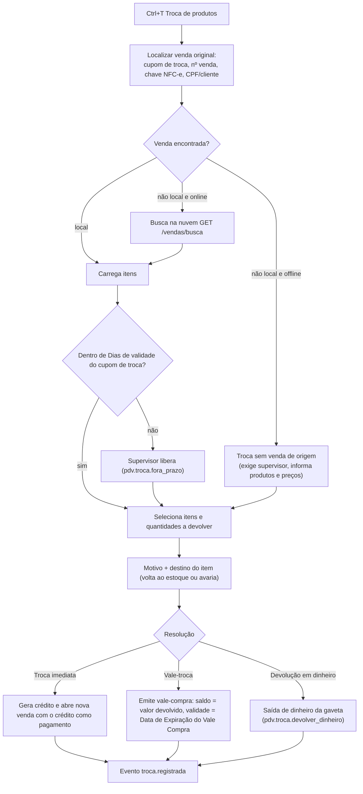

### 23.2 Regras

- Valor devolvido de cada item = **valor líquido unitário pago** (`valor_liquido ÷ quantidade`, com rateio) ×
  quantidade devolvida; nunca o preço atual.
- Quantidade devolvível = vendida − já devolvida em trocas anteriores (consulta local + nuvem se online).
- Itens de combo (kit, 10.9.1): devolve-se o grupo inteiro ou componentes individualmente (configurável
  `pdv.troca_kit_parcial`, padrão não), sempre pelo valor rateado de cada linha.
- Destino (`itens_troca.destino`): `estoque` ("Retorna ao estoque") → a nuvem gera o movimento de entrada
  **`TROCA_PDV`** ("Devolução de venda PDV" no seed) no tipo de estoque vendável; `avaria` → o mesmo movimento
  `TROCA_PDV` lançado **direto** no tipo de estoque de `chave_sistema = 'avaria'` (`tipo_estoque_id` do tipo avaria),
  sem entrada seguida de saída. O cancelamento de uma troca gera `ESTORNO_TROCA_PDV`.
- Fiscal: a troca não altera a NFC-e original. Se `pdv.devolucao_emite_nfe_entrada` (nuvem) estiver ligado, a nuvem emite
  NF-e de entrada de devolução (modelo 55, CFOP 1202 ou 1411 conforme o caso) pelo ERP; o PDV só envia os dados.
- **Troca imediata**: o crédito vira um pagamento tipo `vale` (vale interno, `tPag` conforme 16.3) na nova venda; se a
  nova venda for menor que o crédito, o restante vira vale-troca impresso (ou dinheiro, com permissão).
- **Vale-troca**: código = `VC` + `lojas.codigo` (2 dígitos) + `numero_caixa` (2) + `sequencias_locais['vale']`
  (7) + DV **Luhn** (1) sobre os 11 dígitos anteriores (sincronizacao.md 13.4; ex.: loja 1, caixa 2, sequencial 8 →
  `VC010200000080`), único sem consultar a nuvem. Gravado na tabela `vales` (inserção local, `tipo = 'vale_troca'`,
  `origem_tipo = 'troca'`) + `movimentos_vale` (`emissao`). O vale de troca sobe **dentro do `troca.registrada`**
  (sem `vale.emitido`, que é só para emissão avulsa — senão a nuvem contaria a emissão duas vezes). Impresso com as
  **frases de bloqueio e rodapé do vale compra**. Validade = data de emissão + **Data de Expiração do Vale Compra**
  (`pdv.vale_compra_validade_dias`).
- **Devolução em dinheiro**: movimento `movimentos_caixa.tipo = 'devolucao_troca'` (com `troca_id`), que sai do
  dinheiro da gaveta (20.4).
- Exige cliente identificado para vale acima de `pdv.vale_exige_cliente_acima` (nuvem, padrão R$ 0 = nunca exige).

### 23.3 Critérios de aceite – troca

- [ ] Troca dentro do prazo pelo código do cupom de troca devolve o valor líquido pago (com o desconto rateado).
- [ ] Item já totalmente devolvido não pode ser devolvido de novo.
- [ ] Vale-troca emitido no caixa 1 é aceito no caixa 2 online; o saldo parcial é atualizado.
- [ ] O ERP mostra a troca no Relatório Geral de Vendas (Tipo "Trocas") e o movimento de estoque de devolução.

---

## 24. Orçamentos e pré-vendas

Fase **PDV-2**. Flags: **Orçamento PDV** (importar/criar orçamentos no PDV), **Pedido PDV** (seção 26), **Solicita Id do
Orçamento** (aba Vendas).

### 24.1 Importar orçamento/pré-venda do ERP

- Atalho **Pedidos/orçamentos** (`F9`) › "Importar orçamento" ou bipar/digitar `ORC` + código.
- Fonte: `orcamentos` ativos da loja baixados pela sincronização; online, consulta também `GET /orcamentos/{codigo}`
  (garante que não foi convertido em outro caixa).
- Com **Solicita Id do Orçamento** (`vendas.solicita_id_orcamento`) ligado, o PDV pergunta o número do orçamento
  **ao iniciar a venda, antes do primeiro item**: "Nº do orçamento (Enter para pular)". Informado → importa o orçamento
  (fluxo abaixo); `Enter` → venda normal. Perguntar no `F10` descartaria itens já incluídos, por isso o momento é o
  início.
- Validações: orçamento ativo, não convertido, dentro dos **Dias de validade** (padrão 15) — vencido: importa com
  preços **atuais** (recalcula) e avisa; válido: mantém os preços e o **Desconto (R$ ou %)** do orçamento (o desconto
  do orçamento não consome o limite do operador, pois foi aprovado no ERP).
- Carrega cliente (Nome/pessoa), itens, quantidades, desconto, observações; a venda fica com `orcamento_id`.
- Conversão: ao finalizar, evento `orcamento.convertido`; a nuvem marca o orçamento como convertido. Online, a
  importação **reserva** o orçamento (`POST /orcamentos/{id}/reservar`, expira em 2 h) para não ser usado em dois
  caixas; offline, aceita com aviso (risco de dupla conversão → alerta no ERP).
- Reserva — canal único e repetição idempotente (sincronizacao.md 9.20, 20.4): com `orcamento.criado_no_caixa` ou
  `orcamento.convertido` daquele orçamento ainda não confirmado em `eventos_saida`, o PDV **não** chama
  `POST /orcamentos/{id}/reservar` (esvazia o outbox primeiro ou segue pelo caminho offline). Toda chamada de reserva
  leva `X-Requisicao-Id`; depois de um timeout, repete com o **mesmo** id e, se continuar sem resposta, consulta
  `GET /orcamentos/{codigo}` antes de cair para o caminho offline.
- Itens do orçamento inativos ou sem estoque seguem as regras normais (seções 10.2 e 29.1).

### 24.2 Criar orçamento / pré-venda no PDV

- Com **Orçamento PDV** ligado: na venda em andamento, `F9` › "Salvar como orçamento" (permissão
  `pdv.orcamento.criar`): pede cliente (nome/telefone/e-mail), validade (padrão 15 dias), observação; imprime o
  orçamento; evento `orcamento.criado_no_caixa`; a venda em andamento é encerrada sem venda (não é cancelamento).
- Pré-venda de balcão (vendedor monta no PDV utilitário, caixa recebe): o usuário em modo utilitário salva como
  pré-venda; o caixa importa pelo código (mesmo fluxo de 24.1). Entre terminais, depende de sincronização (online).

### 24.3 Critérios de aceite

- [ ] Orçamento válido importado mantém preços e desconto; vencido recalcula e avisa.
- [ ] O mesmo orçamento não é convertido em dois caixas online.
- [ ] Orçamento criado no PDV aparece em Vendas › Orçamentos do ERP.

---

## 25. Comandas

Fase **FUT — módulo opcional** (comanda eletrônica/mobile: FUT). Decisão do dono (D4, out/2026): a Ice Beer nunca usou
comandas no Nuvem3; o fluxo das lojas é balcão (o cliente pega o produto na conveniência/mercado, passa no caixa e
paga). A especificação abaixo fica mantida para clientes de bar/restaurante e só é implementada quando um deles
precisar; até lá as ações de comanda ficam desabilitadas na tabela de atalhos (28.1) e as tabelas `comandas`/
`itens_comanda` existem vazias (modelo 3.11.7). A taxa de serviço (25.3) e as impressoras de produção (6.2.1) vão
junto.

### 25.1 Conceitos

- Comanda = conta aberta por número (cartão físico ou numeração automática) à qual se incluem itens ao longo do
  tempo, fechada no caixa. Pertence à **loja** (não ao turno).
- **Comandas com numeração automática** (Parâmetros): ligada → o PDV atribui o próximo número livre (sequência da
  loja na nuvem; offline, faixa reservada por terminal: o terminal recebe blocos de 100 números); desligada → o
  operador digita o número do cartão físico (1–9999), que precisa estar livre.

### 25.2 Ações

| Ação (atalho Nuvem3) | Atalho padrão | Comportamento |
|---|---|---|
| **Incluir na comanda** | `Ctrl+I` | Pede o número (ou cria nova); com **Solicita Vendedor na Comanda**, pede o vendedor/atendente; abre a lista de itens da comanda; itens são incluídos como numa venda (mesmas regras de 10.x); `F10` grava e volta. Itens com impressora destino imprimem pedido de produção |
| **Fechar comanda** | `Ctrl+F` | Pede o número; carrega a comanda numa venda (`modo = comanda`, `comanda_id`); aplica **Taxa de Serviço (%)**; segue para pagamento normal; ao finalizar, a comanda fica `fechada` |
| **Gestão de comandas** | `Ctrl+G` | Lista comandas abertas (número, abertura, vendedor, total, tempo aberto); ações: ver, transferir itens entre comandas, juntar comandas, cancelar item (permissão), cancelar comanda (permissão), reimprimir conferência ("pré-conta") |

### 25.3 Taxa de serviço

- `taxa_servico = arred2(Σ líquido dos itens × pdv.taxa_servico_pct ÷ 100)` (sobre itens após descontos).
- Aplicada só em vendas `modo = comanda` (e balcão se `pdv.taxa_servico_no_balcao`, padrão não).
- Remover a taxa: `F6` › `5` com permissão `pdv.taxa_servico.remover` (é opcional para o cliente).
- **Fiscal** — chave `pdv.taxa_servico_no_documento_fiscal` (nova, Loja S, PDV S, padrão `false`). Pela Lei
  13.419/2017 a gorjeta não é receita própria do estabelecimento (é repassada aos empregados); somá-la à nota gera
  tributo indevido.
  - `false` (padrão): a taxa **não** entra no rateio/`vOutro` nem no `vNF`. Fica em `vendas.taxa_servico`; a parte dos
    pagamentos que a cobre é marcada em `pagamentos_venda.valor_taxa_servico` (abatida do `detPag` para que
    `Σ vPag − vTroco = vNF`); é impressa no comprovante e no DANFE/`infCpl` ("Gorjeta/taxa de serviço R$ X – Lei
    13.419/2017, não integra o valor da nota"). A nuvem lança o valor como passivo **"Gorjetas a repassar"** (nova
    conta seed `gorjetas_a_repassar` no plano de contas), não como receita de venda.
  - `true`: comportamento opcional para quem o contador orientar — rateada em `acrescimo_rateado` (`vOutro`) e incluída
    no `vNF`.
  - Total a pagar = total fiscal + taxa de serviço (fórmula de `vendas.total`, 4.3).

### 25.4 Multi-caixa e offline

- Online: comandas vivem na nuvem; incluir/fechar usa a API com bloqueio otimista (`versao`) e `X-Requisicao-Id`
  (`409 CONFLITO_VERSAO` → recarrega e repete); a resposta traz as linhas novas, gravadas no espelho local; dois caixas
  veem a mesma comanda.
- **Canal único por comanda** (sincronizacao.md 9.20): enquanto houver evento em `eventos_saida` daquela comanda
  (`agregado_tipo = 'comanda'`) com status diferente de `confirmado`, o PDV **não** usa o caminho online para ela:
  dispara o push imediato e espera no máximo 5 s ("Sincronizando comanda…"); se o outbox não esvaziar, segue pelo
  outbox (offline). Sem isso, um `POST /comandas/{id}/fechar` online poderia fechar a comanda antes de a nuvem aplicar
  um `comanda.itens_incluidos` pendente, e os itens ficariam sem cobrança.
- **Timeout durante a chamada online** (sincronizacao.md 9.20, 20.4): o PDV repete a mesma chamada com o **mesmo**
  `X-Requisicao-Id` (a API devolve a mesma resposta); persistindo a falha, consulta `GET /comandas/{id}` assim que
  puder: as linhas já estão na nuvem → grava no espelho e nada vai ao outbox; não estão (ou continua offline) → evento
  no outbox com os **mesmos** `id` das linhas.
- Offline: o terminal só opera comandas **abertas nele** (ou já baixadas); inclusões ficam no outbox
  (`comanda.itens_incluidos`); outra estação não vê esses itens até sincronizar. A tela avisa "Offline: comandas de
  outros caixas podem estar desatualizadas". Fechar offline uma comanda aberta em outro caixa exige confirmação.

### 25.5 Critérios de aceite

- [ ] Numeração automática não repete número entre dois caixas, mesmo offline.
- [ ] Fechar comanda aplica a taxa de serviço; remover a taxa exige permissão.
- [ ] Item incluído na comanda com impressora destino "COZINHA" imprime na impressora mapeada.
- [ ] Com `comanda.itens_incluidos` ainda pendente no outbox, fechar a mesma comanda não usa `POST /comandas/{id}/fechar` online antes de o evento ser confirmado (canal único, 25.4).
- [ ] Timeout na inclusão online seguido de reconexão: a repetição com o mesmo `X-Requisicao-Id` (ou a consulta `GET /comandas/{id}`) não duplica itens na comanda.

---

## 26. Pedidos, delivery e balcão

Fase **FUT — módulo opcional** (decisão do dono D4, out/2026: a Ice Beer não usa pedidos/delivery no caixa). Flag
**Pedido PDV** habilita. A especificação fica mantida para outros clientes; até o módulo existir, `pdv.pedido_pdv`
fica desligada e o PDV opera sempre no modo balcão (venda padrão), sem a ação `Ctrl+B`.

### 26.1 Pedido / delivery

- **Delivery** (`Ctrl+D`): nova venda `modo = delivery`; exige cliente com endereço (busca por telefone; cadastro rápido
  com endereço completo — CPF/CNPJ, logradouro, número, bairro, município, UF, CEP —, exigido pela NFC-e de entrega,
  18.2); **taxa de entrega** (valor fixo por bairro em `taxas_entrega` da loja; ou digitada); previsão de
  entrega; **entregador** (usuários **É Entregador**); "troco para" (valor que o cliente vai pagar em dinheiro);
  pagamento: **na hora** (como venda normal) ou **na entrega** (forma escolhida e pendente).
- Pedido pago na entrega: a venda fica `pedido_pendente` (não finalizada, não fiscal ainda); itens podem ser alterados
  até "Saiu para entrega"; ao retornar o entregador, `Acompanhamento de Pedidos` › "Receber" finaliza a venda com os
  pagamentos (e emite a NFC-e nesse momento, com endereço de entrega — ou antes, se a legislação/loja exigir que a nota
  acompanhe a mercadoria: `pdv.delivery_emite_nota_na_saida`, padrão ligado). A NFC-e de delivery sai com
  `indPres = 4` e a taxa de entrega conforme `fiscal.taxa_entrega_como` (18.2).
- Status do pedido: `recebido → em_preparo → saiu_para_entrega → entregue (finalizado) | cancelado`.

### 26.2 Acompanhamento de Pedidos (`Ctrl+A`)

Lista por status (colunas), com tempo decorrido, cliente, bairro, entregador, total; ações: avançar status
(`Enter`), atribuir entregador, imprimir via de entrega (endereço + itens + troco para), receber, cancelar (permissão).

### 26.3 Balcão (`Ctrl+B`)

Volta o PDV para o **modo balcão** (venda padrão) a partir de comanda/delivery/pedido, sem perder a venda do outro modo
(ela é suspensa automaticamente se tiver itens).

### 26.4 Fora do escopo agora

**Ordem de serviço** (`Ctrl+O`) e **Agenda** (`Alt+A`): atalhos existem na tabela, mas ficam **desabilitados** por
padrão (FUT; dependem do módulo de OS do ERP — aba Ordem de Serviço). iFood/99Food: FUT.

Critérios de aceite:
- [ ] Delivery sem endereço não é salvo.
- [ ] Pedido pago na entrega só gera estoque/financeiro quando recebido.
- [ ] A via de entrega mostra "Troco para R$ 100,00" quando informado.

---

## 27. Consultas: preço, tabela de preços, produtos vencidos

### 27.1 Consulta de preço — Fase PDV-1

`Ctrl+L` (também disponível no modo utilitário e sem caixa aberto). Bipa/digita o código: mostra descrição, foto,
preço varejo, promocional (com vigência), atacado (e a partir de quantos), faixas de preço por quantidade da loja,
estoque estimado (se **Exibe estoque na busca**), localização. Não inclui na venda; `Enter` sai; `Ins` inclui na venda
atual.

### 27.2 Tabela de preços — Fase PDV-2

`Ctrl+P` (ação **Tabela de preços**). Lista filtrável (categoria, marca, texto) com todas as colunas de preço da loja;
imprime a lista filtrada (para o balcão). Somente leitura.

### 27.3 Produtos vencidos — Fase PDV-2

`Alt+V` (ação **Produtos vencidos**). Lista de `produtos_lotes` do estoque da loja (com saldo de `saldos_lote`): lote,
produto, validade, saldo, dias para vencer;
filtros "Vencidos" e "Vencem em até **Aviso de vencimento + dias**". Na venda, item de lote/produto vencendo mostra
aviso âmbar; vencido segue a seção 10.8. (O e-mail de produtos vencendo — aba Parâmetros › ERP — é do ERP.)

### 27.4 Critérios de aceite – consultas

- [ ] A consulta de preço funciona sem caixa aberto e no modo utilitário, e não altera a venda em andamento.
- [ ] A consulta mostra o preço de atacado com a quantidade mínima e as faixas de preço por quantidade da loja.
- [ ] Produtos vencidos lista os lotes vencidos e os que vencem dentro do prazo de Aviso de vencimento.

---
## 28. Atalhos de teclado

### 28.1 Tabela configurável (Nuvem3: aba PDV › Atalho / Habilitado / Ordem) — Fase PDV-1

A tabela `atalhos_pdv` desce da nuvem por empresa (opcionalmente sobrescrita por loja). Cada linha: `acao` (código
fixo), `tecla` (texto, ex.: `F4`, `Ctrl+I`), `habilitado`, `ordem` (posição no rodapé de atalhos e na ajuda `F1`).
Ações do Nuvem3 com a tecla padrão proposta:

| Ação (Nuvem3) | Código da ação | Tecla padrão | Habilitado por padrão | Fase | Seção |
|---|---|---|---|---|---|
| Pesquisar Produto | `pesquisar_produto` | `F2` | sim | PDV-1 | 10.3 |
| Remover Item | `remover_item` | `F4` | sim | PDV-1 | 13.1 |
| Tipo de preço | `tipo_preco` | `F8` | sim | PDV-2 | 11.2 |
| Pedidos/orçamentos | `pedidos_orcamentos` | `F9` | se Orçamento PDV ou Pedido PDV | PDV-2 (pedidos: FUT) | 24 |
| Concluir venda | `concluir_venda` | `F10` | sim | PDV-1 | 16 |
| Gestão de vendas | `gestao_vendas` | `F12` | sim | PDV-1 | 22 |
| Nova venda | `nova_venda` | `Ctrl+N` | sim | PDV-1 | 28.3 |
| Troca de produtos | `troca_produtos` | `Ctrl+T` | sim | PDV-2 | 23 |
| Incluir na comanda | `incluir_comanda` | `Ctrl+I` | se comandas em uso | FUT | 25 |
| Fechar comanda | `fechar_comanda` | `Ctrl+F` | se comandas em uso | FUT | 25 |
| Gestão de comandas | `gestao_comandas` | `Ctrl+G` | se comandas em uso | FUT | 25 |
| Delivery | `delivery` | `Ctrl+D` | se Pedido PDV | FUT | 26 |
| Acompanhamento de Pedidos | `acompanhamento_pedidos` | `Ctrl+A` | se Pedido PDV | FUT | 26 |
| Balcão | `balcao` | `Ctrl+B` | se comandas ou Pedido PDV | FUT | 26.3 |
| Tabela de preços | `tabela_precos` | `Ctrl+P` | sim | PDV-2 | 27.2 |
| Produtos vencidos | `produtos_vencidos` | `Alt+V` | sim | PDV-2 | 27.3 |
| Ordem de serviço | `ordem_servico` | `Ctrl+O` | não | FUT | 26.4 |
| Agenda | `agenda` | `Alt+A` | não | FUT | 26.4 |

### 28.2 Atalhos do GenesisPDV (além da tabela do Nuvem3; também configuráveis)

| Ação | Tecla padrão | Fase |
|---|---|---|
| Ajuda / lista de atalhos | `F1` | PDV-1 |
| Quantidade (multiplicador) | `F3` (ou `qtd*` no campo) | PDV-1 |
| Cancelar venda | `Shift+F4` | PDV-1 |
| Cliente / CPF na nota | `F5` | PDV-1 |
| Desconto / acréscimo (menu: 1 item, 2 total, 3 acréscimo, 4 remover, 5 remover taxa de serviço — FUT) | `F6` | PDV-1 |
| Alterar preço do item | `Ctrl+F6` | PDV-2 |
| Vendedor / atendente | `F7` | PDV-2 |
| Menu de funções do caixa | `F11` | PDV-1 |
| Consulta de preço | `Ctrl+L` | PDV-1 |
| Serviço avulso | `Ctrl+S` | PDV-2 |
| Cardápio interno (mostrar/ocultar) | `Ctrl+M` | FUT |
| Gelada (acréscimo do produto gelado no item selecionado, 11.4) | `Alt+G` | PDV-2 |
| Suspender venda / recuperar suspensa | `Ctrl+Espaço` / `Ctrl+Shift+Espaço` | PDV-2 |
| Cupom de troca da última venda | `Ctrl+Shift+T` | PDV-2 |
| Bloquear terminal | `Ctrl+Alt+B` | PDV-1 |
| Sincronizar agora | `Ctrl+Alt+S` | PDV-1 |
| Central do PDV (configuração do terminal, diagnóstico; README do PDV › decisão 68) | `Ctrl+Alt+C` no login; `F11` › `8` ou ⚙ na venda | PDV-1 |

**Menu de funções (`F11`)** — cada opção com dígito/letra:

| Tecla | Função | Fase |
|---|---|---|
| `1` | Sangria | PDV-1 |
| `2` | Reforço | PDV-1 |
| `3` | Fechamento de caixa / troca de turno | PDV-1 |
| `4` | Reimprimir último documento | PDV-1 |
| `5` | Cancelar última venda | PDV-1 |
| `6` | Resumo diário | PDV-1 |
| `7` | Bloquear terminal | PDV-1 |
| `8` | Central do PDV (a engrenagem: impressora e gaveta, diagnóstico) | PDV-1 |
| `9` | Abrir gaveta | PDV-1 |
| `0` | Trocar operador / Sair | PDV-1 |
| `T` | Administrativo TEF | PDV-3 |
| `F` | Fiscal: status SEFAZ, notas em contingência, inutilizações pendentes | FISCAL |
| `S` | Status da sincronização (seção 30.3) | PDV-1 |
| `R` | Recebimento de crediário / caderneta (pagamento de parcelas no caixa, 16.13) | PDV-2 |
| `V` | Vasilhames: devolução avulsa de cascos (10.12) | PDV-1 (baixa de comodato e crédito em vale: PDV-2) |

Fase 1C (C10a e C10b): o menu já tem `1`, `2`, `3`, `6`, `S` e `V`; as demais teclas chegam com as telas delas (o `9`
e o `8` chegaram na implantação I4; o `8` abre a Central do PDV desde o bloco G3, também pelo botão ⚙ no fim da barra).

### 28.3 Regras

- **Teclas fixas (não configuráveis):** `Enter` confirmar/avançar, `Esc` voltar/cancelar diálogo, `Tab`/`Shift+Tab`
  próximo/anterior campo, setas e `PgUp`/`PgDn`/`Home`/`End` navegação, `Del` remover na lista atual, dígitos `0–9`
  nos menus, `+`/`-` no campo de código.
- Validação no ERP ao salvar a tabela: tecla única por ação habilitada; teclas fixas e `Alt+F4`/`Ctrl+Alt+Del`
  proibidas; combinações aceitas: `F1–F12`, `Shift/Ctrl/Alt + F1–F12`, `Ctrl/Alt + letra/dígito`.
- Atalhos só valem na tela de venda e nas listas do PDV; em campos de texto valem as teclas de edição normais
  (`Ctrl+A`, `Ctrl+C`, `Ctrl+V`).
- Ação desabilitada ou sem permissão: a tecla emite bipe e a mensagem "Ação indisponível" (não abre nada).
- **Nova venda** (`Ctrl+N`): sem itens → limpa cliente/vendedor/tipo de preço; com itens → "Suspender (S) / Cancelar
  (C) / Voltar (Esc)".
- O rodapé mostra os atalhos habilitados por `ordem` até caber; `F1` lista todos, com a tecla configurada.

### 28.4 Critérios de aceite – atalhos

- [ ] Alterar no ERP a tecla de Remover Item para `Ctrl+R` passa a valer no PDV após o pull, e `F4` deixa de fazer a ação.
- [ ] Ação desabilitada na tabela não aparece no rodapé e a tecla só emite bipe.
- [ ] O ERP recusa salvar duas ações habilitadas com a mesma tecla.
- [ ] Um roteiro completo (abrir caixa, vender com 2 formas, sangria, fechar) é executado em teste de UI sem nenhum evento de mouse.

---

## 29. Regras de estoque e limites

### 29.1 Estoque na venda — Fase PDV-1 (bloqueio) / PDV-2 (exibição avançada)

- O PDV vende do **estoque vinculado à loja** (ADR-03). Movimentos são gerados na nuvem a partir do evento da venda
  ("Venda pelo PDV"), nunca no PDV.
- **Saldo estimado** por produto/variação:

```
saldo_estimado = saldos_estoque.quantidade (baixado, com versao V)
               − Σ quantidades de itens de vendas locais finalizadas cujo evento ainda não foi refletido em V
               − Σ quantidades na venda em andamento (inclusive a linha que está sendo incluída)
               + Σ quantidades de itens de vendas canceladas depois de enviadas, não refletidas
               + Σ devoluções locais com destino 'estoque' ainda não refletidas
```

  Regra de reflexão (modelo 4.5, sincronizacao.md 15.2): **refletido ⇔ evento `confirmado` ∧
  (`linha.versao > eventos_saida.versao_nuvem` ∨ `estado_sincronizacao.cursor` do fluxo da linha ≥
  `eventos_saida.versao_nuvem_fim`)** (`versao_nuvem` e `versao_nuvem_fim` são os marcadores de início e de fim
  devolvidos pela nuvem ao aplicar o evento). A segunda condição cobre a linha que o evento confirmado não tocou
  (produto que deixou de controlar estoque, kit alterado, item sem baixa) e garante que, com o cursor além do marcador
  de fim, todos os efeitos do evento naquele fluxo já desceram. Evento `rejeitado` continua contando
  localmente (a nuvem tem o evento guardado), exceto o descartado no ERP (`resultado.descartado = true`). Embalagens
  contam em unidades base (`quantidade` do item já é `fator × multiplicador`).
- Combo (kit): "combos montáveis" = mínimo de ⌊saldo do componente ÷ qtd do componente⌋ sobre as posições com
  controle de estoque, com os componentes padrão (com uma troca, vale o saldo da alternativa escolhida).
- **Bloqueia venda sem estoque** (Parâmetros) — e/ou **Valida Estoque** (aba Vendas, que o PDV também respeita):
  - Ligada: `saldo_estimado < 0` após a inclusão → "Estoque insuficiente (disponível: 3)". Liberação com
    `pdv.venda.vender_sem_estoque` (supervisor), auditada.
  - Desligada: permite, e mostra aviso âmbar se ficar negativo (**o padrão do dono**, O15, roadmap D27; Fase 1C, C11a:
    faixa âmbar "Estoque insuficiente: … (disponível: N) — confira a prateleira" na tela de venda). Ligada, a recusa vem
    antes de o número da venda ser reservado e a liberação vale para o produto naquela venda.
  - Serviço avulso e produtos sem controle de estoque nunca bloqueiam.
  - Offline: o saldo pode estar defasado; com `pdv.bloqueio_estoque_offline` (nuvem, padrão **desligado**) o bloqueio vale
    também offline; desligado, offline vira só aviso (evita parar a loja por saldo velho).
- **Exibe estoque na busca**: coluna de estoque estimado na pesquisa (F2), na consulta de preço e no painel do item.

### 29.2 Estoque mínimo

Item que ficar abaixo do **Estoque mínimo** da loja após a venda não gera mensagem ao operador; a nuvem usa para os
relatórios/alertas de reposição.

### 29.3 Limites

| Limite | Origem | Regra no PDV | Fase |
|---|---|---|---|
| **Limite de Valor de Vendas PDV** | Parâmetros | Valor máximo do **total de uma venda**. Acima → ao concluir, exige liberação `pdv.venda.exceder_limite_valor`. 0/vazio = sem limite | PDV-2 |
| **Limite Venda em Aberto** | Parâmetros | Quantidade máxima de vendas **suspensas/em aberto** simultâneas neste terminal (seção 22.3). Ao atingir: "Limite de vendas em aberto (3) atingido — recupere ou cancele uma" | PDV-2 |
| **Valor limite para bloquear PDV e fazer sangria** | Parâmetros | Seção 20.4 | PDV-1 |
| **Limite de Desconto %** | Usuário | Seção 12.3 | PDV-1 |
| **Limite de Compras** | Pessoa | Crediário / crédito funcionário (seções 16.8, 16.9) | PDV-2 |
| Qtd. mín. venda | Produto | Seção 10.2 | PDV-1 |
| Troco máximo, limite de preço digitado, alerta de multiplicador | Nuvem/local | Seções 16.4, 10.4, 10.1 | PDV-1 |
| `pdv.dias_max_offline` | Nuvem | Seção 30.6 | PDV-1 |

> A interpretação exata de "Limite de Valor de Vendas PDV" e "Limite Venda em Aberto" não está no levantamento do
> Nuvem3; as regras acima são as do GenesisPDV (ver questões em aberto).

### 29.4 Critérios de aceite – estoque e limites

- [ ] Com Bloqueia venda sem estoque ligada, saldo 2 e venda de 3 exige supervisor (online).
- [ ] Duas vendas offline de 1 unidade baixam o saldo estimado local de 5 para 3 antes de sincronizar.
- [ ] Após o push e o pull, o saldo estimado coincide com o saldo da nuvem.
- [ ] Venda acima do Limite de Valor de Vendas PDV exige liberação ao concluir.

---

## 30. Modo offline e sincronização (visão do PDV)

### 30.1 O que funciona offline

| Funciona offline | Exige internet |
|---|---|
| Login, bloqueio, troca de operador | Ativação do terminal |
| Abertura, sangria, reforço, fechamento, troca de turno | PIX **dinâmico** (PDV-2) e devolução PIX |
| Venda completa: itens, preços, descontos, liberação de supervisor, cancelamentos | TEF (depende da rede do provedor) |
| Dinheiro, POS externo, PIX estático/manual | Consulta de estoque de outras lojas |
| Crediário e crédito funcionário com limite do último sync (se permitido) | Troca de venda de **outro caixa** que não esteja local |
| Vale-compra conhecido localmente (se permitido) | Reserva de orçamento/vale (sem reserva: aceito com aviso) |
| Cupom não fiscal, reimpressão, cupom de troca | Comandas de outros caixas atualizadas |
| NFC-e em **contingência offline** | Autorização/cancelamento/inutilização de NFC-e |
| Cadastro rápido de cliente | Busca de CEP |
| Orçamentos e comandas já baixados | Atualização do aplicativo |
| Resumo diário, gestão de vendas deste caixa | |

### 30.2 Indicador de status (topo da tela) — Fase PDV-1

| Estado | Visual | Condição |
|---|---|---|
| **Online** | ● verde "Online" | Último pull e push com sucesso há < 2 min |
| **Sincronizando** | ⇅ azul animado + contador | Push/pull em andamento |
| **Pendentes** | ⇅ número (ex.: `⇅ 3`) ao lado do estado | Eventos no outbox não confirmados |
| **Offline** | ● vermelho "Offline há 12 min" | Sem resposta da API; o PDV continua vendendo |
| **Erro de sincronização** | ▲ âmbar "Erro de sync" | Evento rejeitado (quarentena) ou erro de schema — exige suporte/supervisor |
| **Desatualizado** | ▲ âmbar "Cadastros de 3 dias atrás" | Último pull com sucesso > 24 h |
| **Hardware alterado** | ■ vermelho "Hardware alterado — aguardando aprovação no ERP" | Resposta `409 HARDWARE_ALTERADO` (5.3, sincronizacao.md 20.5): vendas bloqueadas, outbox mantido, só heartbeat, `GET /sync/estado` e pull sem segredos |
| **Lacuna de eventos** | ■ vermelho "Lacuna de eventos 1048–1049 — chame o supervisor (F11 › S)" | A nuvem espera sequências que o caixa não tem mais (sincronizacao.md 8.6; Fase 1C, C15): vendas **novas** bloqueadas (a atual termina) até a declaração; o push segue em backoff |
| **Lacuna recuperável** | ▲ âmbar "Eventos da lacuna 1048–1049 — liberação do supervisor (F11 › S)" | O caixa tem eventos de uma lacuna já declarada (`lacuna_recuperavel`): não bloqueia vendas; o reenvio espera a liberação |

`F11` › `S` abre o **status detalhado**: último pull/push, cursor, pendentes por tipo, eventos em quarentena (com o
erro), botão "Sincronizar agora", fila de NFC-e em contingência, desvio de relógio. Fase 1C, C10b: lido do banco
local (o último push é a última confirmação de evento; os 20 primeiros eventos em quarentena, com o total), mais o
último heartbeat e a fila de impressão; Enter sincroniza agora; a fila de NFC-e em contingência chega com a NFC-e.
Fase 1C, C15 (sincronizacao.md 8.6): com lacuna de eventos, o status mostra a faixa e o **F4** declara a lacuna (ou
libera o reenvio dos eventos de uma lacuna já declarada) com `pdv.config.fiscal`: o próprio operador que a tem, ou o
PIN de um supervisor que a tem (31.3; a permissão não é "emprestada" por liberação). A declaração só sai online e a
nuvem confere a permissão de novo; aceita, as vendas voltam e os eventos seguintes sobem. Antes de declarar, o caixa
já devolveu à fila o que ainda tinha (inclusive confirmado, a nuvem restaurada de backup); a re-hidratação pelo
`GET /sync/recuperar` entra no C17.

> **Central do PDV › 4 Sincronização (bloco G7; README do PDV › decisão 72; pedido do dono de 04/11/2026, como as
> "vendas a copiar" do Nuvem3):** o `⇅ N` da barra é **clicável** e abre a aba **4 Sincronização** da Central (o ⚙, com o
> caixa livre; `pdv.diagnostico.ver`, que o supervisor empresta pelo `Ctrl+L`). Ela começa pelas **vendas não confirmadas
> pela nuvem**, uma linha por **venda** (não por evento): **amarela** enquanto pendente ou enviando, **vermelha** quando
> recusada, com o motivo da nuvem (atualizado pelo `eventos-status`; a falha interna da nuvem aparece só como "Falha ao
> aplicar o evento", nunca o detalhe técnico); a confirmada sai da lista (a que estava na tela fica **verde** até a
> próxima leitura manual; a que o ERP **descartou** fica sem cor, "descartada no ERP", nunca verde). O topo traz o resumo
> (o vermelho só com os recusados que esperam o ERP), o último erro da conexão e o **F9 "Situação completa"** (o mesmo
> do `F11 › S`). `Enter` mostra os itens e os pagamentos (da venda ainda não confirmada; da que já está na nuvem, só com
> `pdv.venda.consultar_historico` e dos últimos 30 dias, como na aba 1), cada envio (tentativas, quando, a próxima, o
> último erro, as dependências; **nunca o conteúdo do evento**) e as ocorrências do log ligadas à venda, tudo mascarado.
> **F6 Reenviar agora** só força o ciclo de envio de sempre (o "Sincronizar agora": idempotente, nada se duplica). A
> recusada **não se descarta nem se reprocessa no PDV**: a tela explica que a decisão é no ERP (Cadastros › PDVs /
> Terminais › Eventos com erro, 12.5) e a venda fica verde sozinha quando o ERP resolve. `F3` troca a lista: o **caixa
> não confirmado** (aberturas, sangrias, reforços e fechamentos, a segunda seção), **todos os registros** (por situação
> e tipo, 50 por página) e os **comandos do ERP**. `F4` declara a lacuna como no `F11 › S`, que continua (funciona com a
> venda em andamento) e ganha o `F3` "Lista completa" para a aba 4.

### 30.3 Descida (pull)

- Um cursor **por fluxo** (`estado_sincronizacao`): `GET /sync/pull?fluxo=<fluxo>&desde=<cursor>&limite=500`
  (2000 só na carga inicial, sincronizacao.md 6.2). Ciclo
  a cada 30 s online sem SSE (5 min de segurança com SSE + imediato no aviso, sincronizacao.md 18.2); repete enquanto
  houver mais.
- Cada página é aplicada numa transação local (upsert por `id` só se a `versao` recebida for maior, respeitando
  `excluido_em`; linhas de agregado com evento local pendente vão para `alteracoes_adiadas`) e o cursor do fluxo só
  avança após o commit.
- Aplicação de mudanças **não interfere na venda em andamento**: os itens já incluídos mantêm o preço/snapshot da
  inclusão; o próximo item usa o cadastro novo. Mudança de configuração (flags) é aplicada na próxima venda.
- Usuário desativado/sem a loja durante a sessão: termina a venda atual e força logout ao final (exceto se estiver no
  meio de fechamento).

### 30.4 Subida (push) e outbox — Fase PDV-1

Estrutura de `eventos_saida` (modelo 4.4.5):

| Coluna | Tipo | Descrição |
|---|---|---|
| `id` | TEXT (UUID v7) | Id do evento = `evento_id` na nuvem (idempotência) |
| `sequencia_terminal` | INTEGER | Único, monotônico por terminal (`sequencias_locais['evento']`); a nuvem aplica em ordem |
| `tipo` | TEXT | Ver tabela abaixo (sincronizacao.md 9.2) |
| `versao_schema` | INTEGER | Versão do payload |
| `agregado_tipo` | TEXT | `venda`, `sessao_caixa`, `movimento_caixa`, `troca`, `vale`, `comanda`, `pedido`, `orcamento`, `pessoa`, `documento_fiscal`, `inutilizacao`, `transacao_tef`, `auditoria`, `terminal` (e `recebimento_crediario`, 16.13) |
| `agregado_id` | TEXT | Venda, sessão, movimento… |
| `ocorrido_em` | TEXT UTC | Hora local corrigida pelo desvio do servidor (monotônica com limite de 2 min, 30.5) |
| `criado_em` | TEXT UTC | |
| `payload` | TEXT JSON | Documento completo (não diffs) |
| `payload_sha256` | TEXT | Hash do payload |
| `status` | TEXT | `pendente`, `enviando`, `confirmado`, `erro_temporario`, `rejeitado` (34.5) |
| `tentativas`, `proxima_tentativa_em`, `ultimo_erro` | | Backoff exponencial 5 s → 10 min |
| `lote_envio_id`, `enviado_em` | | Lote em que foi enviado |
| `confirmado_em`, `resultado`, `versao_nuvem`, `versao_nuvem_fim` | | Retorno da nuvem (`resultado` JSON, ex.: `pessoa_id_final`, `descartado`); `versao_nuvem` e `versao_nuvem_fim` = marcadores de início e de fim da aplicação na nuvem, gravados ao confirmar (push ou `eventos_resolvidos`) e usados na regra de "refletido" (29.1) |

Gravado **na mesma transação** que o fato (venda finalizada + itens + pagamentos + evento = um commit).

Tipos de evento do PDV (lista oficial: sincronizacao.md 9.2):

| Evento | Gatilho | Efeito na nuvem |
|---|---|---|
| `caixa.aberto` | Abertura | Cria sessão e movimento de abertura (Reforço/Abertura de caixa) |
| `caixa.reforco`, `caixa.sangria`, `caixa.movimento_cancelado` | Seção 20 | Movimentos de caixa, relatório 9.8 |
| `caixa.fechado` | Seção 21 | `fechamentos_caixa` (fechamento/troca de turno) + `fechamentos_caixa_formas`, relatório 9.7 |
| `venda.finalizada` | Seção 17 | Venda (tipo PDV), itens, pagamentos, movimentos de estoque "Venda pelo PDV", contas a receber (quitadas ou não), comissões, vasilhames (10.12) |
| `tef.resolvida` | Confirmação/desfazimento TEF (16.6, 17.1) | Estado final da transação TEF |
| `venda.cancelada` | Seção 13 | Cancelamento, estoque "Cancelamento de venda PDV", estorno financeiro |
| `nfce.autorizada`, `nfce.contingencia`, `nfce.rejeitada`, `nfce.cancelada`, `nfce.inutilizada` | Seção 18 | Documento fiscal + XML |
| `troca.registrada` | Seção 23 | Devolução, estoque `TROCA_PDV`, vale-troca gerado (sem `vale.emitido`) |
| `vale.emitido`, `vale.utilizado`, `vale.cancelado` | Operações de vale **fora** de venda/troca (emissão avulsa, resgate em dinheiro, cancelamento) | Vales |
| `pessoa.criada_no_caixa` | Seção 14.3 | Pessoa |
| `orcamento.criado_no_caixa`, `orcamento.convertido` | Seção 24 | Orçamento |
| `comanda.aberta`, `comanda.itens_incluidos`, `comanda.itens_cancelados`, `comanda.transferida`, `comanda.fechada`, `comanda.cancelada` | Seção 25 | Comanda |
| `pedido.criado`, `pedido.atualizado`, `pedido.status_alterado` | Seção 26 | Pedido (o `pedido.criado` leva o documento da venda `pedido_pendente`) |
| `crediario.recebido`, `crediario.recebimento_cancelado` (novos) | Seção 16.13 | Baixas financeiras |
| `vasilhame.movimentado` (novo) | Seção 10.12 (devolução avulsa) | Estoque de vasilhames e comodato |
| `auditoria.registros` | Lote a cada 5 min ou 200 registros | Auditoria (seção 32.1) |
| `terminal.configuracao_alterada` | Seção 6 | Painel de terminais no ERP |
| `alerta.cadastro` | Seções 10.2, 10.6, 18.3 | Alerta para corrigir produto |

O **heartbeat não é evento** do outbox: é `POST /sync/heartbeat` (a cada 30 s online, 60 s com SSE;
sincronizacao.md 18.2 e 21.1), que informa versão do app, pendências, últimos números e recebe comandos e
`eventos_resolvidos`.

Regras:
- Envio em lotes de até 50 eventos, **sempre em ordem de `sequencia_terminal`** e com a sequência inteira (o PDV nunca
  retém eventos localmente por causa de um rejeitado).
- A nuvem responde por evento: `aplicado` ou `duplicado` (já aplicado → também confirmado) → `confirmado`; `rejeitado`,
  `retido` (dependência de um evento com erro, sincronizacao.md 8.5) ou `descartado` → `rejeitado` no PDV.
- **Quarentena** = eventos com `status = 'rejeitado'`: a nuvem **tem** o evento guardado (com erro ou retido) e o
  resolve na fila de decisão do ERP (12.5). O PDV não reenvia, não apaga e mantém o efeito local (saldo estimado,
  29.1). A resolução chega pelo heartbeat (`eventos_resolvidos`): `aplicado` → `confirmado` com `versao_nuvem` e `versao_nuvem_fim`;
  `descartado` → continua `rejeitado` com `resultado.descartado = true` e deixa de contar no saldo estimado.
- **Rede de segurança** (Fase 1C, C14; sincronizacao.md 7.2 e 21.1; README do PDV, decisão 58): se a entrega do
  heartbeat se perdeu, a cada 1 h, havendo `rejeitado`, o PDV consulta `GET /sync/eventos-status?ids=` (em fatias de
  200, na ordem da sequência) e aplica o `aplicado`/`descartado` do mesmo jeito. A consulta é só leitura (sem ack: quem
  confirma a entrega é o heartbeat); `erro`/`retido` não mudam a situação, só o `ultimo_erro`, que passa a ser o motivo
  atual da nuvem (Central do PDV, bloco G7: o vermelho da aba 4 diz por que a nuvem recusa agora); o id que a nuvem não
  devolve não muda nada; ficam de fora os já
  descartados (decisão final) e os rejeitados por `EVENTO_DIVERGENTE`, que só o suporte resolve (a linha da nuvem é a
  do envio original, sincronizacao.md 11.2). Com falha, a próxima consulta espera o backoff (18.3).
- Eventos confirmados ficam 90 dias com o `payload` e depois só a linha (o dado de negócio permanece nas tabelas).
  Nunca se apaga evento não confirmado.

### 30.5 Relógio

A cada resposta da API (pull, push, heartbeat), o PDV mede o desvio (sincronizacao.md 12.2: estilo NTP, descarta
amostra com ida e volta > 3 s, mediana das 5 últimas amostras válidas) e guarda `estado_conexao.desvio_relogio_ms`
(`agora_servidor − agora_local`) e `agora_servidor_ultimo`; usa `agora_local + desvio` (hora corrigida) para
`ocorrido_em` e `dhEmi`. Desvio > 2 min → aviso âmbar; > 5 min → alerta "Relógio do computador errado" (não bloqueia;
em loja NFC-e o alerta é vermelho).

- **Par da amostra**: o desvio é persistido junto com `desvio_amostra_utc_local` e `desvio_amostra_boot_id`
  (`estado_conexao`). No mesmo boot, se o UTC local "pular" mais de 2 s em relação ao relógio monotônico, o desvio é
  ajustado pelo salto na hora, com auditoria `relogio_alterado`.
- **Depois de um reboot sem amostra nova** (boot id diferente): o desvio persistido não é reaplicado às cegas. Com o
  relógio do SO sincronizado por NTP (Windows `w32tm /query /status` com sincronização posterior ao boot; Linux
  `timedatectl` `NTPSynchronized=yes`) → desvio **0** e `relogio_confiavel = true`; senão usa o desvio persistido e
  marca `relogio_confiavel = false` nos envelopes.
- **Outras fontes de amostra** quando a API está fora: `dhRecbto` das respostas da SEFAZ (autorização e status do
  serviço) e NTP direto (`a.ntp.br`, `b.ntp.br`, no máximo 1 consulta a cada 15 min); a amostra da API tem
  precedência quando as fontes divergem mais de 2 s.
- **Monotonicidade com limite** (sincronizacao.md 12.3): se o último `ocorrido_em` ≤ hora corrigida + 2 min,
  `ocorrido_em = max(hora corrigida, último ocorrido_em + 1 ms)`; se o último `ocorrido_em` estiver **mais de 2 min à
  frente** (evento gravado com relógio adiantado, ou relógio corrigido para trás), o PDV **não** aplica o `max`: usa a
  hora corrigida, marca `relogio_regrediu = true` no envelope e grava auditoria local `relogio_regrediu` (uma vez por
  regressão, no mesmo commit do fato, com as horas e o recuo em `depois`; sobe no `auditoria.registros` e, na nuvem, o
  evento marcado abre o `RELOGIO_SUSPEITO` informativo, sincronizacao.md 12.4; Fase 1C, C16). A ordem real dos eventos é a de `sequencia_terminal`, não a de `ocorrido_em`.
- Em loja NFC-e, com `relogio_confiavel = false` **e** (relógio local anterior ao último `ocorrido_em` **ou**
  `relogio_regrediu`), a emissão pede confirmação do supervisor da data/hora; sem confirmação, fica bloqueada até o
  relógio do SO ser corrigido ou chegar uma amostra confiável. O PDV nunca altera o relógio do SO.

**Relógio de alta-água** (o relógio local nunca autoriza nada): `estado_conexao.maior_hora_vista` = maior valor já
observado entre a hora corrigida e `agora_servidor_ultimo`; é persistido a cada minuto e **nunca diminui**. Relógio
local corrigido abaixo de `maior_hora_vista − 5 min` (alguém atrasou a hora do Windows) → aviso vermelho "Relógio do
computador foi atrasado" e auditoria `relogio_retrocedido`; `ocorrido_em` segue a monotonicidade com limite acima
(não fica congelado no futuro por um evento adiantado).

### 30.6 Tempo máximo offline

`pdv.dias_max_offline` (nuvem). **O18 do dono (roadmap D35): sem limite** — o padrão do catálogo passou de 7 para
nulo e o caixa nunca trava por falta de internet (o ERP alerta o terminal sem contato); o que segue vale para a loja que
preencher a chave (Fase 1C, C11a: a recusa da venda nova; os segundos acumulados pelo ciclo e a extensão de 24 h chegam
quando alguma loja usar o limite). O tempo offline é medido **sem confiar no relógio local**:

```
offline = max( maior_hora_vista − ultimo_pull_sucesso_em,
               segundos_offline_acumulados )
```

- `estado_conexao.segundos_offline_acumulados`: uptime **monotônico** acumulado desde o último pull com sucesso
  (incrementado a cada minuto com o relógio monotônico do processo, persistido; zera no pull com sucesso dos fluxos
  `acesso` e `configuracao`). Atrasar a hora do Windows não reduz nenhum dos dois termos.
- `ultimo_pull_sucesso_em` = o mais antigo entre os fluxos `acesso` e `configuracao` (`estado_sincronizacao`).
- Em loja NFC-e o limite efetivo é `mín(pdv.dias_max_offline, fiscal.prazo_transmissao_contingencia_h)` quando há NFC-e
  em contingência pendente (18.4).
- `offline > limite` → o PDV **bloqueia novas vendas** com a mensagem "Terminal sem sincronizar há 7 dias. Conecte à
  internet." (protege contra preços, usuários e permissões muito desatualizados). Alerta diário a partir de 50% do
  prazo. Supervisor pode liberar por 24 h (`pdv.offline.estender`), uma vez; `estado_conexao.liberacao_offline_ate` é
  calculada sobre `maior_hora_vista` e conferida também pelo uptime acumulado.
- O mesmo critério (hora corrigida limitada por baixo por `maior_hora_vista`) vale para os prazos que o PDV decide
  sozinho: prazo de cancelamento de NFC-e (13.3), validade de vale/orçamento e promoções.

### 30.7 Critérios de aceite – offline

- [ ] Desconectar a rede por 4 horas, vender 200 vendas, sangria e fechamento; reconectar: tudo chega à nuvem, sem
      duplicar (reenvio do mesmo lote não duplica). — Fase 1C, C13: automatizado em `Aceite307Tests` (e2e com o PDV de
      verdade e a API; a resposta do primeiro lote se perde na volta e o PDV reenvia o mesmo lote; o ERP confere 200
      vendas, o total, a sangria, a sessão fechada e o estoque) e verde no CI em tempo comprimido (as vendas saem em
      seguida e o handshake da volta, que depende de mais de 1 h offline, é forçado com o limite em 1 s). Falta a
      rodada de 4 h no workflow "Aceite PDV" (`GENESIS_E2E_30_7_MINUTOS=240`): só fica `[x]` com o `pdv-30-7.json`
      dela anexado ao PR (condição de merge, como no roadmap).
- [x] O contador de pendentes cai a 0 após a sincronização. — Fase 1C, C13: no mesmo teste e no e2e do caixa; o
      backoff de transporte do outbox zera na volta da rede (SYNC 18.3).
- [ ] Preço alterado no ERP chega ao PDV em até 1 min online e não altera itens já incluídos na venda em andamento.
- [ ] Evento rejeitado aparece em quarentena no status detalhado, os eventos seguintes continuam sendo enviados e, quando o ERP reprocessa, o heartbeat o marca como confirmado. — Fase 1C: coberto isolado (C14: o PDV na `ApiFalsa`, com a consulta de `eventos-status`, e a API em `fila-decisao.test.ts`); contra a API de verdade entra no e2e do C17, junto do backup de 2 h (README do PDV, decisão 58).
- [ ] Atrasar a hora do Windows em 5 dias com o terminal offline não prolonga o prazo de `pdv.dias_max_offline` e gera a auditoria `relogio_retrocedido`.
- [ ] Com `409 HARDWARE_ALTERADO`, o PDV bloqueia novas vendas, mantém o outbox, mostra "Hardware alterado — aguardando aprovação no ERP" e, depois de "Confirmar troca de hardware" no ERP, volta a vender e sobe os eventos retidos sem perda.

---

## 31. Permissões

### 31.1 Modelo

- RBAC da ADR-09: **perfis** com permissões + permissões avulsas por usuário; **Usuário Master** tem todas.
  As permissões do PDV começam com `pdv.` e são editadas no ERP (aba "Permissões Gerais" do usuário / perfis).
- Avaliação local, offline. Quando o operador não tem a permissão, o PDV oferece **liberação por supervisor** (31.3)
  — exceto nas ações marcadas "sem liberação".

### 31.2 Matriz (perfis padrão criados no seed)

Legenda: ✔ tem; L = pede liberação de supervisor; — não tem.

| Permissão | Ação | Operador | Supervisor (fiscal de caixa) | Gerente | Fase |
|---|---|---|---|---|---|
| `pdv.acesso.entrar` | Logar no PDV | ✔ | ✔ | ✔ | PDV-1 |
| `pdv.supervisor` | Papel de liberador: digitar login/PIN para liberar ações de outro operador (31.3; exige também a permissão da ação e limite suficiente) | — (sem liberação) | ✔ | ✔ | PDV-1 |
| `pdv.caixa.abrir` / `pdv.caixa.fechar` | Abrir / fechar caixa | ✔ | ✔ | ✔ | PDV-1 |
| `pdv.caixa.ver_calculado_fechamento` | Ver valor calculado no fechamento | — (sem liberação) | ✔ | ✔ | PDV-1 |
| `pdv.caixa.sangria` / `pdv.caixa.reforco` | Sangria / reforço | ✔ | ✔ | ✔ | PDV-1 |
| `pdv.caixa.cancelar_movimento` | Cancelar sangria/reforço | L | ✔ | ✔ | PDV-1 |
| `pdv.caixa.ignorar_limite_sangria` | Vender acima do limite de gaveta | L | ✔ | ✔ | PDV-1 |
| `pdv.caixa.operar_de_outro` | Operar caixa aberto por outro | L | ✔ | ✔ | PDV-1 |
| `pdv.venda.vender` | Registrar e concluir vendas | ✔ | ✔ | ✔ | PDV-1 |
| `pdv.venda.cancelar_item` | Cancelar item | ✔ | ✔ | ✔ | PDV-1 |
| `pdv.venda.cancelar_venda_aberta` | Cancelar venda em andamento | L | ✔ | ✔ | PDV-1 |
| `pdv.venda.cancelar_venda_finalizada` | Cancelar venda finalizada / NFC-e | L | L | ✔ | PDV-1 |
| `pdv.venda.desconto_item` / `pdv.venda.desconto_total` | Dar desconto (até o limite %) | ✔ | ✔ | ✔ | PDV-1 |
| `pdv.venda.acrescimo` | Acréscimo | ✔ | ✔ | ✔ | PDV-2 |
| `pdv.venda.alterar_preco` | Alterar preço / preço de produto sem preço | L | ✔ | ✔ | PDV-2 |
| `pdv.venda.tipo_preco_atacado` | Tipo de preço atacado | L | ✔ | ✔ | PDV-2 |
| `pdv.venda.vender_sem_estoque` | Vender sem estoque | L | ✔ | ✔ | PDV-1 |
| `pdv.venda.peso_manual` | Digitar peso | L | ✔ | ✔ | PDV-2 |
| `pdv.venda.vender_vencido` | Vender lote vencido | L | L | ✔ | PDV-2 |
| `pdv.venda.abaixo_qtd_minima` | Vender abaixo da qtd. mínima | L | ✔ | ✔ | PDV-1 |
| `pdv.venda.horario_restrito` | Vender produto em horário restrito (10.11) | L | L | ✔ | PDV-1 |
| `pdv.venda.exceder_limite_valor` | Venda acima do Limite de Valor de Vendas PDV | L | ✔ | ✔ | PDV-2 |
| `pdv.venda.consultar` | Gestão de vendas (consulta) | ✔ | ✔ | ✔ | PDV-1 |
| `pdv.pagamento.forma_com_senha` | Usar forma com senha de liberação | L | ✔ | ✔ | PDV-1 |
| `pdv.pagamento.confirmar_pix_manual` | Confirmar PIX manualmente (com `pdv.pix_manual_exige_supervisor = true`, padrão, sempre pede liberação — 16.7) | L | ✔ | ✔ | PDV-1 |
| `pdv.pagamento.exceder_limite_credito` | Crediário acima do limite / cliente em atraso | L | L | ✔ | PDV-2 |
| `pdv.pagamento.consumo_interno` | Usar forma `tipo_forma = 'consumo_interno'` (avarias / uso interno; motivo obrigatório; ERP 10.2) | L | ✔ | ✔ | PDV-2 |
| `pdv.crediario.receber` | Recebimento de crediário no caixa (16.13) | ✔ | ✔ | ✔ | PDV-2 |
| `pdv.crediario.desconto_juros` | Dispensar juros/multa no recebimento | L | ✔ | ✔ | PDV-2 |
| `pdv.troca.realizar` | Troca/devolução | L | ✔ | ✔ | PDV-2 |
| `pdv.troca.fora_prazo` | Troca fora do prazo / sem venda de origem | L | L | ✔ | PDV-2 |
| `pdv.troca.devolver_dinheiro` | Devolver em dinheiro | L | L | ✔ | PDV-2 |
| `pdv.vale.emitir` | Emissão avulsa de vale (`vale.emitido`, sincronizacao.md 9.17) | L | ✔ | ✔ | PDV-2 |
| `pdv.documento.reimprimir` | Reimprimir documentos | ✔ | ✔ | ✔ | PDV-1 |
| `pdv.gaveta.abrir_avulsa` | Abrir gaveta sem venda | L | ✔ | ✔ | PDV-1 |
| `pdv.cliente.cadastro_rapido` | Cadastro rápido de cliente | ✔ | ✔ | ✔ | PDV-2 |
| `pdv.orcamento.importar` / `pdv.orcamento.criar` | Orçamentos | ✔ | ✔ | ✔ | PDV-2 |
| `pdv.comanda.operar` | Incluir/fechar comanda | ✔ | ✔ | ✔ | FUT |
| `pdv.comanda.cancelar` | Cancelar item/comanda | L | ✔ | ✔ | FUT |
| `pdv.taxa_servico.remover` | Remover taxa de serviço | L | ✔ | ✔ | FUT |
| `pdv.pedido.operar` / `pdv.pedido.cancelar` | Delivery/pedidos | ✔ / L | ✔ | ✔ | FUT |
| `pdv.tef.cancelar` | Cancelar transação TEF (administrativo) | L | ✔ | ✔ | PDV-3 |
| `pdv.fiscal.retransmitir` | Retransmitir NFC-e | ✔ | ✔ | ✔ | FISCAL |
| `pdv.relatorio.resumo_diario` | Resumo diário | ✔ | ✔ | ✔ | PDV-1 |
| `pdv.usuario.desbloquear` | Desbloquear usuário após tentativas | — | ✔ | ✔ | PDV-1 |
| `pdv.offline.estender` | Estender prazo offline | — | — | ✔ | PDV-1 |
| `pdv.config.terminal` | Configuração local do terminal | L | L | ✔ | PDV-1 |
| `pdv.config.fiscal` | Salto manual de numeração NFC-e (13.2 do sync) e importação local de certificado (A3/contingência, 6.7) | — (sem liberação) | — | — (só Master/suporte) | FISCAL |
| `pdv.aplicativo.sair` | Fechar o aplicativo | L | ✔ | ✔ | PDV-1 |
| `pdv.venda.consultar_historico` | Central do PDV: vendas dos caixas fechados do terminal (últimos 30 dias; sem ela, só o caixa aberto) | L | ✔ | ✔ | PDV-1 |
| `pdv.caixa.consultar_fechamentos` | Central do PDV: ver os fechamentos (últimos 30 dias), só como foram impressos; reimprimir segue `pdv.documento.reimprimir` | L | ✔ | ✔ | PDV-1 |
| `pdv.diagnostico.ver` | Central do PDV: sincronização, logs, ocorrências e backups do terminal | L | ✔ | ✔ | PDV-1 |
| `pdv.diagnostico.pacote_suporte` | Central do PDV: gerar o pacote para o suporte | L | ✔ | ✔ | PDV-1 |
| `pdv.auditoria.ver_local` | Central do PDV: histórico de uso do caixa (quem fez o quê) | L | L | ✔ | PDV-1 |
| `pdv.config.parametros_locais` | Central do PDV: parâmetros do caixa (bloqueio de tela, pasta do backup) e "Fazer backup agora" | L | L | ✔ | PDV-1 |

**Perfil Encarregado** (`encarregado`; PC-8 do dono, 04/11/2026; README do PDV › decisões 66 e 78): para a loja sem
gerente. Tem a coluna **Supervisor** (as "L" dela continuam "L" para ele) **mais o cancelamento da venda paga**
(`pdv.venda.cancelar_venda_finalizada`; resposta do dono de 05/11/2026, diferente do Supervisor de caixa): cancela
sozinho, ou libera com o PIN, a venda paga **da sessão de caixa aberta** — a de caixa fechado continua sem cancelamento
no PDV (D23, abaixo). Nada de `pdv.config.*` nem `pdv.auditoria.ver_local`.
O Painel de saúde e o Sobre da Central valem para quem tem `pdv.acesso.entrar` (PC-7). Não há permissão para cancelar
venda de caixa já fechado (D23: só pelo ERP, na Fase 3).

### 31.3 Fluxo de liberação por supervisor

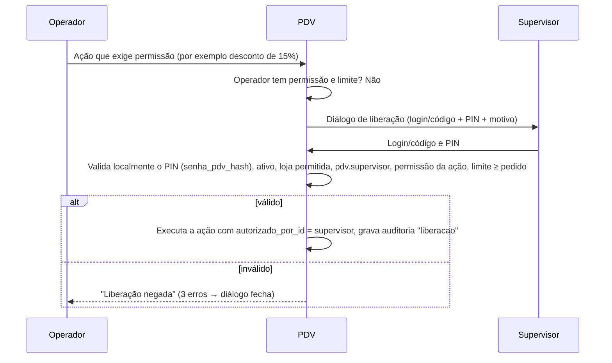

- A liberação é validada **só pelo PIN** do supervisor (`senha_pdv_hash`), igual online e offline; a senha do ERP não
  é aceita neste diálogo (sincronizacao.md 4). O liberador precisa de `pdv.supervisor`, da permissão da ação e, quando
  houver, de limite suficiente.
- A liberação vale **só para aquela ação** (não "eleva" a sessão). Exceção única: a **Central do PDV** (a engrenagem;
  README do PDV › decisão 67). Lá o "Liberar" (Ctrl+L; o F2 é o "Salvar" das abas) abre, só dentro da Central, as abas
  de **consulta** que o supervisor tem e o usuário não, até sair da Central ou 5 min sem uso (só o uso renova); grava a
  `liberacao` com as abas no `depois` e não pede motivo. Não empresta as permissões de ação (`pdv.config.terminal`,
  `pdv.config.parametros_locais`, `pdv.documento.reimprimir`): configurar a impressora, abrir a gaveta, editar os
  parâmetros e reimprimir pedem a própria liberação, como fora da Central; nem as sem liberação (`pdv.config.fiscal`,
  `pdv.caixa.ver_calculado_fechamento`). Entrar na Central pelo login confere o PIN pelas regras do login (7.2, com o
  mesmo bloqueio) **sem abrir sessão de operador**; o PIN recusado grava o `login_negado`, como no login. Abrir as abas
  Sincronização, Logs e Histórico de uso grava a ação local `central_acessada`, que não sobe para a nuvem. Na tela
  (decisão 68), o clique numa aba de consulta com cadeado abre esse "Liberar", e a aba abre sozinha depois do PIN; a
  aba Impressora e gaveta com cadeado pede ela mesma a liberação de `pdv.config.terminal` (usuário e PIN, sem motivo).
- PIN errado no diálogo conta no mesmo bloqueio local do login (7.2, regra 7): a liberação não é um caminho para tentar
  PINs à vontade. O motivo (1 a 255 caracteres) é obrigatório (exceto no "Liberar" da Central, acima); a liberação
  fica na auditoria `liberacao` com o `autorizado_por_id` (no desconto, também em `liberacoes` da venda,
  sincronizacao.md 9.7).
- O supervisor não pode ser o próprio operador (se o operador tivesse a permissão, não pediria).
- Cartão de supervisor (crachá com código de barras do usuário + PIN) é aceito no campo login (PDV-2).

---
## 32. Auditoria, erros, recuperação, backup, atualização, hardware, UX e acessibilidade

### 32.1 Auditoria — Fase PDV-1

Tabela `log_auditoria_local` (modelo 4.4.10; sobe em lotes no evento `auditoria.registros` e vai para a auditoria
da ADR-09). O terminal não é coluna: vem do envelope do evento.

| Coluna | Conteúdo |
|---|---|
| `id` (UUID v7), `ocorrido_em` | |
| `usuario_id`, `autorizado_por_id` | Quem fez e quem liberou |
| `sessao_caixa_id` | Sessão de caixa aberta no momento (nulo fora de sessão) |
| `acao` | Código (lista abaixo) |
| `entidade`, `registro_id` | Tabela/agregado (venda, item, movimento…) e o `id` do registro |
| `localizacao` | Tela/função onde ocorreu (ex.: `pdv.venda`, `pdv.fechamento`) |
| `descricao` | Texto legível ("Desconto de 15% liberado por CARLOS") |
| `motivo` | Texto do motivo, quando exigido (na nuvem vai para `auditoria.descricao`/`depois`) |
| `antes`, `depois` | JSON (valores relevantes; ex.: contagem de cédulas em `depois`) |
| `evento_id` | Lote `auditoria.registros` que o enviou (nulo = não enviado) |

Ações auditadas (mínimo): login, login falho, bloqueio por tentativas, logout, bloqueio/desbloqueio de tela,
abertura/fechamento de caixa, recontagem no fechamento, sangria/reforço e cancelamento, item incluído com preço manual,
alteração de preço, desconto/acréscimo (valor e %), toda **liberação de supervisor** (ação, valor, motivo),
cancelamento de item/venda, venda sem estoque, peso digitado (`peso_digitado`), lote vencido, confirmação/recusa de
idade (`idade_confirmada`, `idade_recusada`), venda em horário restrito, sangria recusada acima do saldo
(`sangria_recusada`, 20.1), reimpressão, abertura avulsa de gaveta,
contagem de cédulas, troca/devolução, emissão/uso de vale, confirmação manual de PIX, recebimento de crediário,
alteração de configuração do terminal, importação local de certificado, salto de numeração fiscal, entrada/saída de
contingência, contingência fora do prazo, DANFE eletrônico aceito, relógio retrocedido, impressão de produção na
principal, restauração de backup, atualização do aplicativo, recuperação de venda após interrupção.

> **Central do PDV › 6 Histórico de uso (bloco G10; README do PDV › decisão 74):** com `pdv.auditoria.ver_local` (o
> gerente e o dono; o `Ctrl+L` de quem a tem empresta a aba; o Encarregado não vê, PC-8), o caixa mostra o
> `log_auditoria_local` **em frases**, sem internet: "14:32 · MARIA cancelou um item · liberado por CARLOS", o grupo
> (acessos, vendas, caixa, configuração, sistema), a descrição gravada (mascarada) e a marca **"só local / a enviar / ✓
> enviado / recusado / descartado no ERP"** (a ação fora do catálogo da nuvem fica só no caixa; a do catálogo, pelo lote
> `auditoria.registros` em que subiu; "enviado" é guardado na nuvem). Filtros por período (`F3`, pelo dia operacional da
> loja; no máximo os últimos 30 dias, como as vendas e os caixas: o mais antigo de vendas e caixas, só no ERP), grupo
> (`F4`), quem (`F7`: o que a pessoa fez **e o que ela liberou com o PIN** para outra — essas linhas trazem o selo
> **LIBEROU** antes da frase, o rodapé e o detalhe dizem que a ação foi de outra pessoa; resposta do dono de 05/11/2026,
> README do PDV › decisão 78) — com `Shift`, voltam um — e texto (sem diferença de acento nem de maiúscula; também pelo
> verbo da ação, não pelos nomes da frase); 50 por página. O detalhe mostra o motivo mascarado e, do antes/depois, **só
> os campos exibíveis** (as chaves exibíveis do terminal e os valores e referências que o caixa grava): nunca o login
> digitado (nem na descrição: "Login negado"), o pagador do PIX (nem na descrição) nem o dinheiro estimado da sangria
> recusada (O3). O cancelamento aparece como "cancelou uma venda paga" ou "cancelou uma venda em andamento" pela venda
> (as duas gravam `venda_cancelada`). `F6` abre o **resumo por operador** do período: logins, a primeira e a última
> atividade, vendas pagas, itens cancelados, vendas pagas canceladas e em andamento canceladas, descontos (quantas
> vezes, em quantas vendas pagas e quanto: o do item, sem a promoção, e o no total, sem os cascos), gavetas abertas sem
> venda e liberações (pedidas a outra pessoa e dadas como supervisor; a dada a si mesmo não conta); `Enter` numa pessoa
> volta à lista só com ela (o que ela fez e o que liberou). A aba só lê; abrir grava o `central_acessada` (só local). Toda ação gravada pelo caixa tem
> frase (um teste varre o código).

Logs técnicos (Serilog, arquivo diário, 30 arquivos guardados, sem dados sensíveis: nunca senha, token, CSC, número
completo de cartão): erros, tempos de sincronização, comunicação com periféricos e SEFAZ. Desde a Central do PDV (bloco
G2; README do PDV › decisão 67): `Microsoft.*` e o `HttpClient` só a partir de `Warning` (sem as linhas de cada
heartbeat), até 20 MB por arquivo (passou, abre outro no mesmo dia; os 30 guardados são arquivos, cerca de 30 dias num
caixa normal e menos num dia de erro em laço), e cada linha leva o código curto do terminal (`cx2-9f3a01bc`: caixa e os
8 últimos dígitos do `terminal_id`), nunca o nome de pessoa. Tudo o que sai para os olhos de alguém (visor de logs,
pacote de suporte, antes/depois da auditoria) passa pelo mascarador único (token, PIN, chaves, CPF/CNPJ pontuados,
documento, e-mail e telefone em campo, BR Code, hash do PIN, pasta e conta do usuário do Windows) e só mostra as chaves
de `configuracao_terminal` da lista de exibíveis. Pacote de diagnóstico: ver o bloco G9 abaixo (fica na Central do
PDV, não no `F11` › `S`).

> **Central do PDV › P Pacote de suporte (bloco G9; README do PDV › decisão 76; PC-12: pendrive agora, envio pelo ERP
> depois):** com `pdv.diagnostico.pacote_suporte` (ou o `Ctrl+L` do supervisor), o caixa gera um zip
> `suporte-loja<código>-cx<nn>-AAAAMMDD-HHMM.zip` no pendrive (ou, sem pendrive, em `Documentos\GenesisPDV-suporte`) em
> três cliques (⚙, P, "Gerar e salvar"; `Enter`/`F2`, `F5` procura o pendrive, `Esc` volta), também pelo botão do
> rodapé do Painel de saúde. O zip é montado por **lista de permitidos**, tudo mascarado: o manifesto (versão, código do
> terminal, loja e caixa, quem gerou e quem liberou, o SHA-256 de cada arquivo), o Painel de saúde, a situação da
> sincronização e o outbox **sem o conteúdo** (os não confirmados e os 2.000 confirmados mais novos), os comandos do ERP,
> as ocorrências de 30 dias, o arquivo técnico de 7 dias, a configuração exibível do terminal, as regras da loja, a lista
> dos backups, a fila de impressão **sem os bytes**, o disco e a contagem da auditoria por ação e dia. **Nunca** entram o
> banco (`pdv.db`, `-wal`, `-shm`), os backups, a chave do terminal, as chaves internas, o token, os hashes de PIN, os
> payloads nem os impressos; a conta do Windows que ativou o caixa sai como `%CONTA_ATIVACAO%`. O corte por tamanho (o
> outbox além de 20.000 não confirmados por situação, a auditoria além de 100.000 registros, o arquivo técnico além de
> 200 MB) é dito no manifesto. Grava a auditoria `exportar` (entidade `pacote_suporte`, com o SHA-256 do zip e quem
> liberou, conferido de novo depois de esperar o pacote da frente) e a ocorrência `PACOTE_GERADO`; durante a restauração
> do backup, nada do pacote lê nem grava no banco (sai só com os logs, e o aviso diz). As telas de **erro fatal** e de
> **terminal bloqueado** têm o `F2` "Gerar pacote para o suporte" sem login e sem abrir o banco: só o manifesto, os logs
> mascarados e o texto da tela, com o aviso de entregar só ao suporte; o pacote delas não depende dos serviços do caixa
> (a falha que impediu o caixa de abrir não impede o pacote). No Linux, o pendrive é a unidade montada em `/media`,
> `/run/media` ou `/mnt` com FAT, exFAT ou NTFS. O envio remoto (comando `enviar_logs`) continua "não suportado".

> **Central do PDV › 5 Logs e ocorrências (bloco G8; README do PDV › decisão 73):** com `pdv.diagnostico.ver` (ou o
> `Ctrl+L` do supervisor), o caixa mostra, sem internet e sem abrir o Windows Explorer, duas fontes (`F3` alterna): as
> **ocorrências** do `log_local` — cada uma com um **código** curto e a origem padronizada (impressora, gaveta,
> sincronização, backup, login, sistema) e a **dica do que fazer** (o documento que não saiu na impressora, a gaveta que
> não abriu, o registro recusado pela nuvem, o comando do ERP não feito, o backup que falhou) — e o **arquivo técnico** do
> dia escolhido, lido pelo final (o arquivo de 20 MB não é carregado inteiro), com a exceção inteira no detalhe. Filtros
> por nível (`F4`), período ou dia (`F6`), origem (`F7`) — com `Shift`, voltam um — e texto (sem diferença de acento nem
> de maiúscula, nas duas fontes; nas ocorrências, também pelo nome da dica); 50 por página; tudo mascarado, também o texto
> técnico guardado no detalhe (a busca por um CPF ou token não acha a linha onde ele foi escondido). O item "Erros
> recentes" do Painel de saúde abre a aba já nos erros das últimas 24 h. A aba só lê: não apaga nem grava nada.

### 32.2 Tratamento de erros — Fase PDV-1

| Falha | Comportamento |
|---|---|
| Impressora offline/sem papel | Venda conclui; trabalho fica na fila; faixa "Impressora com problema"; reimpressão ao resolver |
| Gaveta não abre | Aviso; segue |
| Leitor com leitura ruim | Código não encontrado (10.2); bipe de erro |
| Balança sem comunicação | Mensagem; peso manual com permissão (10.7) |
| TEF sem comunicação | Mensagem do TEF; usar outra forma |
| API inacessível | Modo offline transparente (seção 30) |
| SEFAZ inacessível | Contingência (18.4) |
| Disco com < 1 GB livre | Alerta no Painel de saúde (amarelo); < 200 MB, vermelho com o ícone ⚠ na barra da venda e **abrir caixa novo** fica bloqueado (risco de corromper o banco) até o supervisor liberar por 1 h (auditado); a venda em curso e as vendas do caixa já aberto nunca são bloqueadas (Central do PDV, bloco G4; README do PDV › decisão 69). O ERP mostra o mesmo disco, com as mesmas cores, no detalhe do terminal (bloco "Saúde do computador", ERP 12.4; G15, decisão 77) |
| Erro inesperado de UI | Capturado globalmente: mensagem "Ocorreu um erro. A venda foi preservada." + log; a tela de venda é recarregada do SQLite |
| Banco local corrompido (`PRAGMA integrity_check` ≠ ok na inicialização) | Bloqueia; oferece restaurar o backup mais recente íntegro (32.5) ou chamar o suporte; sem backup, a tela de erro fatal tem o `F2` (ou o botão) "Gerar pacote para o suporte", sem login e sem abrir o banco (32.1) |

Mensagens de erro: em português, dizem **o que aconteceu e o que fazer** ("Produto sem preço — procure o
supervisor"), nunca código técnico sozinho (o código fica no log).

### 32.3 Recuperação após queda de energia / travamento — Fase PDV-1

- Cada ação da venda (item incluído, quantidade, cancelamento, desconto, cliente, vendedor, pagamento lançado,
  transação TEF/PIX) é **uma transação SQLite comitada antes de atualizar a tela** (`synchronous=FULL`).
- Na inicialização, após o login do operador da sessão:
  1. Resolve transações TEF pendentes (16.6).
  2. Verifica cobranças PIX dinâmicas pendentes (consulta online; sem conexão, mantém pendente e mostra).
  3. Venda com `status = finalizada` sem impressão concluída → reimprime (fila).
  4. Venda com `status = finalizada` e documento fiscal `pendente`/`transmitindo` → consulta pela chave e conclui.
  5. Venda `em_andamento`/`em_pagamento` → reabre na tela com faixa azul "Venda recuperada após interrupção",
     exatamente como estava (itens, descontos, pagamentos não eletrônicos lançados). O operador continua ou cancela.
- Se outro operador logar, a venda recuperada fica **suspensa** (não se perde) e aparece na gestão de vendas.

### 32.4 Desempenho (metas)

| Operação | Meta |
|---|---|
| Inclusão de item por código de barras (leitura → linha na tela) | < 150 ms (p95) com 50 mil produtos |
| Pesquisa F2 | < 300 ms |
| Finalização sem NFC-e (até caixa livre) | < 1 s |
| Finalização com NFC-e online | < 3 s típico (depende da SEFAZ) |
| Abertura do aplicativo até tela de login | < 5 s |
| Banco local após 1 ano de vendas de um caixa movimentado | < 2 GB (compactação de eventos confirmados) |

Medido no ensaio do piloto com o catálogo real da Ice Beer (implantação I5, 04/11/2026; 1.664 produtos, 1.658 códigos de
barras; PDV headless em Linux, API e PostgreSQL na mesma máquina; `apps/api/test/e2e-pdv/ensaio-piloto.sh`): ativação +
carga inicial em 3,8 s com o banco local em 10,6 MB; busca por código p95 7,1 ms (300 códigos) e F2 por texto p95
23 ms (50 palavras); venda de 1 a 4 itens, do primeiro bipe ao caixa livre pelo teclado simulado (inclui o pagamento e,
no PIX, a liberação do gerente), p50 0,59 s e p95 1,6 s; outbox vazio 0,5 s depois do fechamento. A meta de 150 ms com
50 mil produtos continua sem medição (o catálogo da loja tem 1,7 mil).

### 32.5 Backup local — Fase PDV-1

- Backup do SQLite pela **API de backup online** do SQLite (consistente com o banco em uso), compactado:
  a cada **fechamento de caixa**, a cada **2 horas** com caixa aberto, antes de toda **migração/atualização** e
  ao fechar o aplicativo.
- Retenção: últimos 7 dias + 1 por semana nas últimas 4 semanas; pasta `backup/`. Opcional: segunda pasta
  (`backup.pasta_secundaria`, ex.: pendrive/rede) configurada localmente.
- Backups cifrados (AES-256) porque contêm hashes de PIN e dados de clientes. A **chave de backup** é gerada pela
  nuvem na ativação e devolvida cifrada para a `chave_backup_publica` efêmera (5.3); no PDV fica em
  `configuracao_terminal` `backup.chave`, protegida pela **chave CNG não exportável** do terminal (TPM quando houver;
  Linux: libsecret/arquivo `0600`), e a nuvem guarda uma cópia em **custódia** (`terminais_pdv.chave_backup_cifrada`,
  cifrada com a chave mestra). Assim o backup de uma máquina morta pode ser lido noutra pela recuperação assistida
  (código de recuperação do ERP, sincronizacao.md 22.3).
- **Backup de saída**: ao encerrar o app normalmente, depois do último backup, o PDV grava fora do banco o marcador
  `%ProgramData%\GenesisPDV\dados\encerramento.json` com o sha256 desse backup; o marcador é apagado a cada
  inicialização logo depois do `integrity_check` bem-sucedido e antes de qualquer venda.
- **A nuvem é o backup principal**: tudo que foi confirmado no push está seguro; o backup local cobre o que ainda não
  subiu.
- Restauração (sincronizacao.md 22.1): **ação explícita** — `Ctrl+Alt+C` › "Restaurar backup" (permissão
  `pdv.config.terminal` + confirmação dupla) ou automática depois de `integrity_check` falho → escolhe o arquivo → o
  PDV valida integridade, substitui o banco, grava `identidade_terminal.restaurado_em = now()` e reinicia. A
  idempotência do push evita duplicar **eventos**, mas **não** cobre a reutilização de **números** (NFC-e em
  contingência e vendas entre o backup e a perda que nunca subiram). Por isso, depois de **qualquer** restauração:
  - **NFC-e**: série nova para o caixa **ou** salto de +500 na série atual; os números pulados vão para a fila de
    inutilização e só são inutilizados **depois** de consulta à SEFAZ confirmar que nenhum foi autorizado;
  - **venda** e **vale**: salto de +1000 sobre `greatest(local, numeracoes, informado por heartbeat)`;
  - **dispensa do salto** só com a prova de que nada se perdeu, verificada no handshake online: nenhum heartbeat
    depois do `ultimo_backup_em` do arquivo, números do backup ≥ `numeracoes` e ≥ os informados por heartbeat, e o
    arquivo é o backup de saída com `encerramento.json` presente e conferindo;
  - o PDV exige ficar online (handshake) antes de vender com a numeração normal; sem internet, opera em "modo
    restaurado" com o salto padrão (o +500 da NFC-e offline exige supervisor com `pdv.config.fiscal`, auditado);
  - em seguida reenvia o outbox (os eventos que a nuvem já tem respondem `duplicado`).
- **Central do PDV (bloco G11; README do PDV › decisão 75)**: a aba **8 Backup** lista os backups deste caixa (da
  pasta do PDV e da secundária, com onde está cada cópia), o último que deu certo e a última falha, e tem o **F5 Fazer
  backup agora** (motivo `manual`, a mesma cópia e a mesma retenção do periódico), com `pdv.config.parametros_locais`
  (a própria ou o supervisor na hora), fora da thread da tela; recusa com uma venda em andamento e espera (avisando) o
  backup em curso. Grava a ocorrência `BACKUP_MANUAL` e a auditoria `criar` de `backup_local` (melhor esforço: o
  registro recusado não desfaz o backup feito). O F9 "Restaurar backup" também aparece nela, só na Central
  aberta pelo login (o PIN na hora, como na aba 3).
- **Na Fase 1C (bloco C17; O12 do dono, D41; README do PDV › decisão 61)**: backup automático a cada 2 h com o caixa
  aberto (o laço confere o `ultimo_backup_em`, que sobrevive ao app fechado), no fechamento de caixa (em segundo plano)
  e ao fechar o aplicativo (o backup de saída e o `encerramento.json`, só se o banco passou pela inicialização neste
  processo: o banco corrompido da restauração automática nunca vira backup nem troca o marcador); antes de migração
  continua o do `InicializadorBanco` (sem compactar: o schema é o antigo). Arquivo `pdv-AAAAMMDD-HHMMSS-fff-<motivo>.db.gz` (gzip da
  cópia pela API de backup online, num arquivo só, com o `ultimo_backup_em` dela gravado na própria cópia), escrito
  com nome temporário e renomeado; cópia na pasta secundária quando `configuracao_terminal['backup.pasta_secundaria']`
  existe (falha só no log), numa subpasta com o `terminal_id` (a pasta de rede comum a vários caixas não mistura a
  lista nem a retenção). Retenção: tudo dos últimos 7 dias e o mais novo de cada semana até 4 semanas, nas duas
  pastas, menos o `antes-restauracao` (pode ser a única cópia do que o banco substituído não enviou), que nunca é
  apagado automaticamente. **Sem cifra até a 1D** (a chave em custódia chega com o SQLCipher). "Restaurar backup": Ctrl+Alt+C no login
  (a configuração do terminal da Fase 1 começa por aqui) com a liberação de `pdv.config.terminal` e a confirmação
  dupla (digitar `RESTAURAR`; com eventos ainda não enviados no banco em uso, a tela mostra quantos e exige
  `RESTAURAR <quantidade>`); ou sozinha, na tela do banco que falhou no `integrity_check` (sem liberação: não há banco
  para conferir o PIN). O arquivo é conferido (integridade, terminal) ao ser escolhido, com o caixa funcionando: o
  recusado não para o sincronismo nem o backup; a falha depois de parar termina no reinício, nunca no login. O banco em
  uso vai para `backup/` (`antes-restauracao`) ou, ilegível, fica ao lado como `pdv.db.corrompido-…`; o token atual é
  mantido (do banco corrompido, pela leitura direta da linha de `identidade_terminal`; se nem ela sai, fica o do
  backup: rotacionado depois dele, vale como anterior por 7 dias, com o alerta `TOKEN_ANTERIOR_REUTILIZADO`, e depois
  pede nova ativação); `restaurado_em`, a restauração pendente e a auditoria `restaurar`
  ficam no arquivo restaurado; o app reabre e o handshake aplica a 22.1 (reidratação, salto) antes de liberar as
  vendas. Offline, a primeira venda salta +1000 (modo restaurado).
- **Recuperar dados de terminal antigo** (sincronizacao.md 22.3; máquina perdida ou morta, reinstalação sem o banco):
  ação explícita no PDV **novo**, já ativado como substituto — `Ctrl+Alt+C` › "Recuperar dados de terminal antigo"
  (permissão `pdv.config.terminal`, auditada; exige online):
  1. no ERP, o gerente gera o **código de recuperação** do terminal antigo (permissão `terminais.gerenciar`, uso único,
     24 h, vinculado ao `terminal_id` antigo);
  2. no PDV, o operador escolhe o arquivo de backup do terminal antigo (pasta secundária/pendrive) e digita o código;
  3. `POST /sync/recuperacao/chave {terminal_antigo_id, codigo_recuperacao}` devolve a chave de backup em custódia; o
     PDV decifra o backup em memória/arquivo temporário (nunca substitui o próprio banco) e lê os `eventos_saida` não
     confirmados, as NFC-e em contingência não transmitidas e as inutilizações pendentes do terminal antigo;
  4. `POST /sync/recuperacao/importar {terminal_antigo_id, codigo_recuperacao, eventos[]}`: a nuvem aplica os eventos
     **com a identidade e a sequência do terminal antigo**, mesmo `revogado`; as NFC-e em contingência são transmitidas
     pelo PDV novo (mesmo certificado da loja) e os `nfce.autorizada` vão pela mesma importação;
  5. vendas e caixa do terminal antigo **não** entram no banco local do novo (ficam só na nuvem); o PDV mostra o
     resumo (quantidade de eventos, faixa de sequência, NFC-e transmitidas) e apaga o temporário.

### 32.6 Atualização automática do aplicativo — Fase PDV-2 (PDV-1: instalador manual + versão mínima)

- Distribuição com ferramenta de atualização para .NET (ex.: Velopack), canais **`estavel`** e **`beta`**, escolhidos
  **por empresa** no ERP (`empresas.canal_pdv`, padrão `estavel`; ERP 19.3/19.5).
- O heartbeat informa a versão; a API responde `versao_disponivel` e `versao_minima`.
- Download em segundo plano, pacote **assinado** (verificação de assinatura antes de aplicar).
- Aplicação **somente** com caixa livre: na tela de login, ou ao fechar o caixa ("Atualização 1.5.0 disponível —
  instalar agora? (≈ 1 min)"). Nunca no meio de venda.
- Antes de aplicar: backup (32.5) + outbox persistido; depois: migrações locais; falha → rollback para a versão
  anterior e o banco do backup.
- A API **sempre aceita** eventos de versões antigas do PDV (compatibilidade retroativa dos payloads por
  `versao_schema`), para que nenhum caixa perca vendas por estar desatualizado.
- Versão abaixo de `versao_minima`: aviso por 3 dias de carência; depois, a atualização é obrigatória no próximo login
  (sem bloquear a subida dos eventos pendentes).
- **PDV-1 (implantação I3, README do PDV › decisão 62):** sem o atualizador, a versão nova é o instalador manual
  (`GenesisPDV-Setup-x.y.z.exe` por cima da instalada, que mantém banco, backups e ativação). Com o `versao_minima`
  acima da versão do app, o login mostra o aviso com a versão e o instalador a usar, e a recusa da ativação (426) e o
  bloqueio de protocolo do handshake dizem o mesmo; só avisa — a carência de 3 dias e a atualização obrigatória no
  login chegam com a atualização automática (PDV-2).

Critérios de aceite – atualização, backup e recuperação:
- [ ] A atualização nunca é aplicada com venda em andamento ou caixa aberto sem confirmação.
- [ ] Atualização com falha de migração volta para a versão anterior com o banco intacto.
- [ ] Restaurar um backup de 2 horas atrás e reenviar o outbox não duplica nenhuma venda na nuvem, grava
  `restaurado_em` e aplica o salto obrigatório (série NFC-e nova ou +500; +1000 em venda e vale), salvo a prova de
  encerramento limpo (`encerramento.json`).
- [ ] O backup de uma máquina perdida é lido noutra máquina pela recuperação assistida (chave de backup em custódia).
- [ ] `PRAGMA integrity_check` com falha na inicialização bloqueia o uso e oferece a restauração.
- [ ] Puxar o cabo de energia com um pagamento em dinheiro lançado: ao religar, a venda volta com o pagamento.

### 32.7 Requisitos mínimos de hardware e software

| Item | Mínimo | Recomendado |
|---|---|---|
| Sistema | Windows 10 64-bit 22H2 (fora de suporte da Microsoft; aceito). Desde 05/11/2026 só Windows (§5.1, D58): o Linux 64-bit fica só para o desenvolvimento, sem instalador nem CI | Windows 11 64-bit |
| Processador | 2 núcleos, 1,5 GHz (ex.: Celeron J4125) | 4 núcleos (Core i3 10ª geração ou superior) |
| Memória | 4 GB | 8 GB |
| Disco | SSD com 20 GB livres | SSD 128 GB+ |
| Tela | 1024×768 (layout compacto) | 1366×768 ou Full HD; touch opcional |
| Rede | Qualquer (o PDV tolera quedas) | Cabo + 4G de contingência |
| Impressora | Térmica ESC/POS 58 mm | Térmica ESC/POS 80 mm com guilhotina (Epson TM-T20, Elgin i9, Bematech MP-4200 TH) |
| Leitor | USB HID com sufixo Enter | Leitor de mesa (omnidirecional) + manual |
| Gaveta | RJ-11 na impressora | — |
| Balança (PDV-2) | Serial ou USB-serial, protocolo Toledo/Filizola | Balança de checkout integrada |
| Pinpad (PDV-3) | Homologado pelo provedor TEF | — |
| Energia | — | **Nobreak** (recomendação forte: protege o banco e a impressora) |

### 32.8 UX teclado primeiro

- Toda tela tem foco inicial definido; `Enter` confirma, `Esc` volta, sempre. Nenhum diálogo sem tecla de saída.
- Ordem de tabulação lógica; campos numéricos aceitam vírgula **e** ponto como separador decimal (tecla `.` do teclado
  numérico vira vírgula).
- Listas: setas, `PgUp/PgDn`, `Home/End`, digitação inicia filtro.
- Menus numerados (1–9, 0) em todos os diálogos de escolha.
- Confirmações perigosas (cancelar venda, cancelar NFC-e, restaurar backup) exigem tecla explícita (`S`), nunca só
  `Enter`, para evitar confirmação acidental por leitura do leitor.
- Leituras do leitor durante um diálogo de confirmação são **ignoradas** (com bipe), para não confirmar sem querer.
- Mouse e toque funcionam em tudo (botões grandes ≥ 44 px no modo touch), mas nada depende deles.

### 32.9 Acessibilidade

- Contraste mínimo WCAG AA (4,5:1) em todos os temas; tema **Alto contraste**.
- Estados nunca comunicados só por cor (ícone + texto: "● Offline", "▲ Erro").
- Tamanhos de fonte configuráveis (Pequeno, Médio, Grande, Muito grande) sem quebrar layout em 1366×768.
- Propriedades de automação do Avalonia (`AutomationProperties.Name`/`HelpText`) em todos os controles, para leitores
  de tela (NVDA/Orca) e para os testes de UI headless.
- Sons distintos para sucesso e erro (desligáveis), úteis para quem olha o cliente e não a tela.
- Mensagens permanecem até ação do usuário quando exigem decisão; avisos temporários duram ≥ 3 s.

### 32.10 Segurança local

- Banco local cifrado (SQLCipher) desde a PDV-1 (modelo 4), além das permissões de pasta restritas ao usuário do PDV.
- Chave do SQLCipher (32 bytes aleatórios por terminal), token, senha do certificado e chave de backup protegidos por
  **chave CNG não exportável** da conta de serviço do PDV (TPM 2.0 quando houver), nunca DPAPI `LocalMachine`; no Linux,
  libsecret ou arquivo de chave `0600` (seções 5.1, 5.3, 6.7 e 32.5; sincronizacao.md 3.6).
- Hashes argon2id só do PIN (`senha_pdv_hash`), da senha da forma e, quando exigida, da senha de cliente de
  crediário; a senha do ERP (`usuarios.senha_hash`) nunca desce (7.1).
- O PDV não expõe portas de rede; só faz chamadas de saída HTTPS para a API, a SEFAZ, o PSP (via API) e o TEF.

---

## 33. Mapeamento flags do Nuvem3 → comportamento do PDV

Fonte das flags: levantamento do Nuvem3 (seções indicadas). "ERP" = a flag não tem efeito no PDV.

### 33.1 Configurações › Geral (5.1 aba 1)

| Flag | Comportamento no GenesisPDV | Seção | Fase |
|---|---|---|---|
| Logotipo e Banner | Logotipo no cupom quando a loja não tiver logotipo próprio; banner na tela de caixa livre (PDV-2) | 19 | PDV-1 |
| Ativa | `geral.ativa = false` = **modo implantação**: o ERP funciona, o PDV não abre caixa e mostra "Empresa em implantação"; o push continua aceito. A **suspensão da empresa** pela plataforma é outra coisa (ERP 19.4: pull/heartbeat recebem 403, o PDV termina a venda e bloqueia novas, o push continua aceito) | 8.1, 30 | PDV-1 |
| Altera Preço do Produto no ERP | ERP | — | — |
| Produto Usa Fornecedores | ERP | — | — |
| Utiliza Serviço Avulso | Habilita "Serviço avulso" (`Ctrl+S`) | 10.4 | PDV-2 |
| Margem de Lucro (%) | ERP | — | — |
| Tipo de Balança (Peso, Valor) | `geral.tipo_balanca` (padrão `valor`), com `geral.balanca_prefixo`, `geral.balanca_tamanho_codigo` e `geral.balanca_tamanho_valor`: interpretação da etiqueta de balança | 10.6 | PDV-2 |

### 33.2 Configurações › Parâmetros – PDV (5.1 aba 3)

| Flag | Comportamento | Seção | Fase |
|---|---|---|---|
| Exibe cardápio interno | Painel de botões de produtos por categoria / Mais vendido | 9.1 | FUT |
| Exibe estoque na busca | Coluna de estoque estimado na pesquisa, consulta e painel do item | 10.3, 29.1 | PDV-1 |
| Dias de validade do cupom de troca | Prazo de troca a partir da data da venda; impresso no cupom de troca | 19.3, 23 | PDV-2 |
| Tamanhos de fonte | Fonte da lista, do total e do campo de código | 6.8, 32.9 | PDV-1 |
| Usa pinpad virtual | Tipo de pinpad padrão do TEF no terminal | 6.6 | PDV-3 |
| Desmembra Produto Kit | Só a tela de venda: linhas dos componentes do combo visíveis (ligado) ou recolhidas sob a linha do combo (desligado); comprovante, NFC-e e `itens_venda` sempre têm os componentes | 10.9.1 | PDV-1 |
| SolicitaAberturaCaixaPDV | Abertura obrigatória antes de vender (ligado) ou automática (desligado) | 8.1 | PDV-1 |
| Resumo Diário por intervalo de dias ou horário | Filtro do resumo diário do caixa | 21.6 | PDV-1 |
| Comandas com numeração automática | Número de comanda atribuído pelo sistema (faixas por terminal offline) | 25.1 | FUT |
| Usa Produto Preço Volume | Ativa as faixas de **Preço por quantidade** da loja e as faixas dos grupos de preço (mix) | 11.3, 11.3.1 | PDV-1 |
| Data de Expiração do Vale Compra | Dias de validade do vale-compra/vale-troca emitido | 16.11, 23 | PDV-2 |
| Imprime cupom de troca | Cupom de troca automático após cada venda | 19.3 | PDV-2 |
| Bloqueia venda sem estoque | Bloqueio por saldo estimado, com liberação | 29.1 | PDV-1 |
| Limite de Valor de Vendas PDV | Valor máximo de uma venda sem liberação | 29.3 | PDV-2 |
| Aviso de vencimento + dias | Antecedência do aviso de vencimento de lote/produto | 10.8, 27.3 | PDV-2 |
| Limite Venda em Aberto | Máximo de vendas suspensas simultâneas no terminal | 22.3, 29.3 | PDV-2 |
| Imprime sangria automaticamente | Comprovante automático (2 vias) de sangria, reforço e abertura | 20, 8.2 | PDV-1 |
| Valor limite para bloquear PDV e fazer sangria | Bloqueio de novas vendas até a sangria | 20.4 | PDV-1 |
| Impressoras de cozinha | Tabela `impressoras_destino` (destinos lógicos); a impressora física de cada destino é configurada por terminal | 6.2.1, 19.3, 25 | FUT |
| Exibe foto do produto no PDV | Foto no painel do item e na consulta (imagens baixadas sob demanda e cacheadas) | 9.1 | PDV-2 |
| PDV Mobile: Usa Comanda, Usa Pedido, Imprime pelo Mobile, Abertura, Reforço, Sangria | PDV mobile | — | FUT |
| Pesquisa de satisfação: URL da imagem | Proposta: QR/imagem no fim do cupom levando à pesquisa (a confirmar) | 19 | FUT |
| iFood Mercado, WooCommerce, 99Food, NuvemShop, e-mail de produtos vencendo | ERP / integrações | — | FUT |

### 33.3 Configurações › Fiscal, Tributação e CFOP's (5.1 abas 4, 5, 8)

| Flag | Comportamento | Seção | Fase |
|---|---|---|---|
| Regime | CRT da NFC-e (quando a loja não define o seu) | 18.2 | FISCAL |
| Numeração da Próxima, Série | NF-e do ERP; a NFC-e usa série/número **por caixa** | 6.7 | — |
| Inf. Adic. Contribuinte / Inf. Adic. Fisco | `infAdic` da NFC-e e rodapé do DANFE | 18.2 | FISCAL |
| Ambiente (Produção, Homologação) | Padrão quando a loja não define o Ambiente NFC-e | 18.2 | FISCAL |
| Produto Emite NFe | ERP | — | — |
| NCM padrão | ERP: só pré-preenche o NCM de produto novo (`tributacao.ncm_padrao`); nunca é aplicado na emissão — produto sem NCM válido não é vendável em loja NFC-e (10.2, `alerta.cadastro`) | 10.2 | — |
| % Lei da Transparência | Tributos aproximados no cupom e `vTotTrib` | 18.2, 19.2 | PDV-1 (impressão) / FISCAL |
| ICMS / PIS / COFINS (situação, origem, modalidades, alíquota, crédito) | Padrão da tributação do item quando o produto não define | 18.2 | FISCAL |
| CFOP's: Venda no Estado | CFOP padrão dos itens da NFC-e (5102/5405 conforme ST) | 18.2 | FISCAL |
| CFOP's: fora do estado, remessa, conversão no recebimento | ERP | — | — |

### 33.4 Configurações › PDV (5.1 aba 9)

| Flag | Comportamento | Seção | Fase |
|---|---|---|---|
| Usa PDV | Coluna `lojas.usa_pdv` (prevalece; a flag da aba PDV é o padrão das lojas novas): desligada bloqueia novas ativações e novas sessões; o push nunca é recusado | 5.2 | PDV-1 |
| Orçamento PDV | Importar e criar orçamentos no PDV | 24 | PDV-2 |
| Altera Preço no PDV | Permite alterar preço unitário (com permissão e limite) | 10.5 | PDV-2 |
| Pedido PDV | Pedidos/delivery no PDV | 26 | FUT |
| Agrupa produtos | Soma quantidade na linha existente do mesmo produto | 10.2 | PDV-1 |
| Solicita Vendedor na Comanda | Pede vendedor/atendente na inclusão em comanda | 25.2 | FUT |
| Força Escolha do Vendedor | Vendedor obrigatório antes do primeiro item | 15 | PDV-2 |
| Solicita Vendedor na Finalização | Pede vendedor ao concluir | 15 | PDV-2 |
| Atendente ao invés de Vendedor | Troca o rótulo em tela e cupom | 15 | PDV-2 |
| Taxa de Serviço (%) | Taxa sobre comandas, removível com permissão; fora do documento fiscal por padrão (`pdv.taxa_servico_no_documento_fiscal = false`) | 25.3 | FUT |
| Tabela de atalhos (Atalho / Habilitado / Ordem) | Tabela `atalhos_pdv` | 28 | PDV-1 |

### 33.5 Configurações › Vendas (5.1 aba 10) e outras abas

| Flag | Comportamento | Seção | Fase |
|---|---|---|---|
| Gera datas de parcelamento | Datas automáticas das parcelas do crediário/boleto | 16.8 | PDV-2 |
| Usa Remessa | ERP | — | — |
| Usa Recibo / Título do recibo | Título do comprovante não fiscal | 18.1 | PDV-1 |
| 4 casas decimais | Exibe preço unitário com 4 casas | 11.3 | PDV-1 |
| Exige Tipo de Frete, Valida volumes NFe, Bloqueia PF fora do estado | ERP (NF-e) | — | — |
| Valida Estoque | Também ativa o bloqueio por estoque no PDV (equivale a Bloqueia venda sem estoque) | 29.1 | PDV-1 |
| Solicita Id do Orçamento | Pergunta o nº do orçamento ao iniciar a venda, antes do primeiro item (`Enter` pula) | 24.1 | PDV-2 |
| Numeração Própria / Nº da próxima venda | ERP (vendas do ERP); o PDV numera por caixa (ADR-04) | 4.3 | — |
| Permite produtos iguais | ERP (no PDV vale Agrupa produtos) | — | — |
| Templates de impressão/recibo | Cabeçalho/rodapé do comprovante | 19.1 | PDV-2 |
| Frases de bloqueio e rodapé do vale compra | Impressas no vale | 19.3 | PDV-2 |
| Aba Orçamentos (templates) | Layout do orçamento impresso no PDV | 24.2 | PDV-2 |
| Aba Financeiro: Gera Boleto Automaticamente | Boleto gerado pela nuvem na venda com forma É Boleto | 16.10 | PDV-2 |
| Aba Ordem de Serviço | OS | 26.4 | FUT |

### 33.6 Formas de pagamento (5.3)

Ver tabela completa na seção **16.2** (Descrição, Ordem, Meio de Pagamento CFe, Tipo de Pin Pad, Loja, Taxa %, Senha de
liberação, Sempre Zerado no PDV, Lança Quitada, Permite Troco, É Boleto, Exige Pessoa, Ativa, Abrir Gaveta, Usa no
Totem, Crédito Funcionário, Permite Parcelar, Usa no Menu Digital, Gera QR Code Pix). Filtro **Tipo** de uso: o PDV
carrega só as formas de uso PDV.

### 33.7 Lojas (5.4)

| Campo/aba | Comportamento | Seção | Fase |
|---|---|---|---|
| Dados Gerais: Nome, Razão Social, Fantasia, CNPJ, IE, Telefone, endereço | Cabeçalho do cupom e emitente da NFC-e | 19.2, 18.2 | PDV-1 |
| Estoque vinculado | Estoque de onde o PDV vende e cujo saldo baixa | 29.1 | PDV-1 |
| Frase rodapé cupom | Rodapé de cupom e DANFE | 19.2 | PDV-1 |
| Id Registro (`lojas.codigo`) | Prefixo `Lnn` do número de exibição da venda e do código do vale | 4.3, 23.2 | PDV-1 |
| Ordem | Só ordena seletores; **não** compõe o número da venda | — | — |
| Ativa | Loja inativa: terminais param de vender | 30 | PDV-1 |
| Usa menu digital, Chave | Não usados no PDV | — | — |
| Tributação: Regime, Ambiente NFC-e, Tipo de emissão | Documento emitido e parâmetros fiscais | 18 | PDV-1 (tipo) / FISCAL |
| Tributação: Certificado (A1/A3) | A1 enviado uma vez no ERP e baixado para os caixas da loja (`certificados_digitais`), somente leitura no PDV; A3 só local | 6.7 | FISCAL |
| Tributação: Próx. NFe | NF-e do ERP | — | — |
| NFC-e: Ambiente, Identificador, CSC, tabela de inutilização | QR code e inutilização | 18.2, 18.6 | FISCAL |
| Anexos: Logotipo, Foto | Logotipo no cupom | 19.2 | PDV-1 |
| Aparência: Banners | Tela de caixa livre (e display do cliente, FUT) | 9 | PDV-2 |
| TEF: Código loja, Servidor, Token | Parâmetros do provedor TEF | 6.6 | PDV-3 |
| WhatsApp: Evolution API, número | Proposta futura: enviar cupom/DANFE por WhatsApp | — | FUT |

### 33.8 Usuários (5.5)

| Campo/flag | Comportamento | Seção | Fase |
|---|---|---|---|
| Login, Senha, Código | Login no PDV (login ou código + PIN do PDV, `senha_pdv_hash`, validado localmente; a senha do ERP nunca desce e só é aceita online, validada pela API, com `pdv.login_aceita_senha_erp = true`) | 7 | PDV-1 |
| Ativo, Demissão | Usuário inativo ou demitido não loga | 7.2 | PDV-1 |
| Limite de Desconto % | Limite sem liberação; limite do supervisor para liberar | 12.3 | PDV-1 |
| Comissão % | Calculada na nuvem pelo vendedor da venda | 15 | — |
| Usuário Master | Todas as permissões e lojas; libera qualquer ação | 31 | PDV-1 |
| É Vendedor | Aparece na lista de vendedores | 15 | PDV-2 |
| É Entregador | Aparece na lista de entregadores do delivery | 26 | FUT |
| É Técnico | OS | — | FUT |
| Usa PDV como utilitário | Modo utilitário (consultas, comandas, pré-vendas, sem receber) | 7.2 | PDV-2 |
| Comanda Eletrônica | PDV mobile / comanda eletrônica | — | FUT |
| É Totem | Não loga no PDV | 7.2 | PDV-1 |
| Lojas permitidas | Só loga nas lojas permitidas; vale também para o supervisor que libera | 7.2, 31.3 | PDV-1 |
| Abas Menus do sistema / Permissões Gerais | Não levantadas no Nuvem3; no GenesisPDV: perfis + permissões `pdv.*` | 31 | PDV-1 |

### 33.9 Produtos (4.2) e Pessoas (3.2)

| Campo/flag | Comportamento | Seção | Fase |
|---|---|---|---|
| Tipo: Simples / Kit / Com variações / Com complementos / Matéria-prima (+ Produzido, Vasilhame) | Ver regras por tipo | 10.2, 10.9, 10.12 | PDV-1 (simples, kit, produzido, vasilhame, matéria-prima não vendável) / PDV-2 (variações) / FUT (complementos) |
| Ativo | Inativo não vende | 10.2 | PDV-1 |
| Código Interno, Cód Barras (EAN-13) | Resolução do código; duplicados abrem seleção | 10.2 | PDV-1 |
| Unid. tributável venda | Unidade do item; fracionável ou não | 10.1 | PDV-1 |
| NCM, Tributação (CFOP, ICMS, PIS, COFINS, IPI) | Snapshot fiscal do item | 18.2 | FISCAL |
| Preço de Venda; Lojas › Preço de venda por loja | Preço varejo | 11 | PDV-1 |
| Atacado, Promocional, Parcelado | Regras de preço (menor candidato, 11.3; parcelado pela forma de pagamento, 11.2) | 11 | PDV-1 (promocional, atacado por quantidade) / PDV-2 (parcelado, F8) |
| Menu Digital, iFood | Não usados no PDV | — | — |
| Preço por quantidade (Loja, Qtd inicial, Qtd final, Preço) | Faixas com Usa Produto Preço Volume (`produtos_precos_quantidade`) | 11.3 | PDV-1 |
| Grupo de itens (Nuvem3; D16, decidida) | Combo (produto tipo Kit): posições com produto padrão e alternativas com acréscimo, sem estoque próprio, venda baixa os componentes escolhidos, NFC-e com um `det` por componente | 10.9.1 | PDV-1 |
| — (novo, pedido do dono) | Grupo de preço por quantidade (mix): soma das quantidades dos membros ativa atacado/faixa (`grupos_preco_quantidade`); com o atacado do produto, vale o menor | 11.3.1 | PDV-1 |
| Vasilhame (casco) / Cascos por unidade | Cascos trazidos e cobrança do casco faltante | 10.12 | PDV-1 |
| Localização | Coluna na pesquisa e na consulta de preço | 10.3 | PDV-1 |
| Impressora destino | Impressão de produção | 19.3 | FUT |
| Qtd. mín. venda | Bloqueio abaixo do mínimo | 10.2 | PDV-1 |
| Venda +18 (`produtos.idade_minima`) | Confirmação de idade e restrição de horário | 10.11 | PDV-1 |
| Códigos de barras / embalagens (fator, preço) | Fardo/caixa com fator e preço de embalagem | 10.2 | PDV-1 |
| Comissão % | Nuvem | — | — |
| Solicita preço PDV | Pede preço na inclusão | 10.4 | PDV-1 |
| Solicita Lote PDV | Pede lote na inclusão | 10.8 | PDV-2 |
| Produto genérico | Pede descrição e preço | 10.4 | PDV-1 |
| Insumo | Não vendável no PDV | 10.2 | PDV-1 |
| Mais vendido | Aparece no cardápio interno | 9.1 | FUT |
| Ficha técnica | Produto `produzido`: a venda baixa os insumos (`BAIXA_INSUMO`); em produto `simples` a ficha é só informativa (D17) | 10.9.2 | PDV-1 |
| Menu digital, Usa no totem, Reposição rodízio, Dimensões | Não usados no PDV | — | — |
| Validade (Loja, Data, Lote) | `produtos_lotes` + `saldos_lote`: lotes, avisos e produtos vencidos | 10.8, 27.3 | PDV-2 |
| Balança: Tipo | `produtos.balanca_tipo` (`nao_usa`/`peso`/`unidade`) e `produtos.balanca_plu`: produto pesável lido na balança / etiqueta | 10.6, 10.7 | PDV-2 |
| Estoque (saldo por loja), Estoque mínimo | Saldo estimado; mínimo só na nuvem | 29 | PDV-1 |
| Pessoa: Limite de Compras | Limite de crediário/crédito funcionário | 16.8 | PDV-2 |
| Pessoa: Desconto | Desconto padrão do cliente | 12.2 | PDV-2 |
| Pessoa: Senha | Confirmação do crediário pelo cliente (opcional) | 16.8 | PDV-2 |
| Pessoa: Cód. pessoa, CPF/CNPJ, Nome, Apelido, telefones | Busca do cliente | 14.2 | PDV-1 |
| Pessoa: Categorias | Funcionário habilita crédito funcionário | 16.9 | PDV-2 |

### 33.10 Caixa e relatórios (7.6, 8.2, 9.5, 9.7, 9.8)

| Item do Nuvem3 | Como o PDV alimenta | Seção |
|---|---|---|
| Reforço/Abertura de caixa (8.2) | Movimentos `abertura` e `reforco` | 8, 20.2 |
| Sangria (8.2) e relatório 9.8 (Operador, Quem Retira, Loja, Observação, Inf. Adicionais, Nº Caixa, Data Hora, Cancelado, Data Cancelamento, Valor) | Movimento `sangria` com todos esses campos | 20 |
| Fechamento de caixa / Troca de Turno (7.6: Usuário Anterior, Usuário Subsequente, Loja, Data, Valor de Caixa) | `caixa.fechado` → `fechamentos_caixa` com `tipo = 'troca_turno'` (`usuario_anterior_id`, `usuario_subsequente_id`, `valor_caixa`) e `sessoes_caixa.diferenca_recebimento` | 21 |
| Relatório 9.7 (Valor Calculado, Valor Digitado, Diferença, Zera caixa) | `fechamentos_caixa_formas` + `fechamentos_caixa.zera_caixa` | 21.2 |
| Movimentação de estoque 9.5: "Venda pelo PDV", "Cancelamento de venda PDV" | Gerados pela nuvem a partir de `venda.finalizada`/`venda.cancelada`; trocas geram `TROCA_PDV` ("Devolução de venda PDV", no tipo de estoque vendável ou `avaria`) e `ESTORNO_TROCA_PDV`; vasilhames geram `VASILHAME_*` | 13.3, 23.2, 10.12 |
| Vendas geral 9.15 (Tipo Vendas / Canceladas / Trocas; Usuário PDV; Caixa) | Vendas com operador, nº do caixa, status e trocas | 13, 23 |
| Produtos vendidos 9.13 ("Usuário logado no PDV") | `operador_id` da venda | 4.3 |

---

## 34. Máquinas de estado

### 34.1 Venda

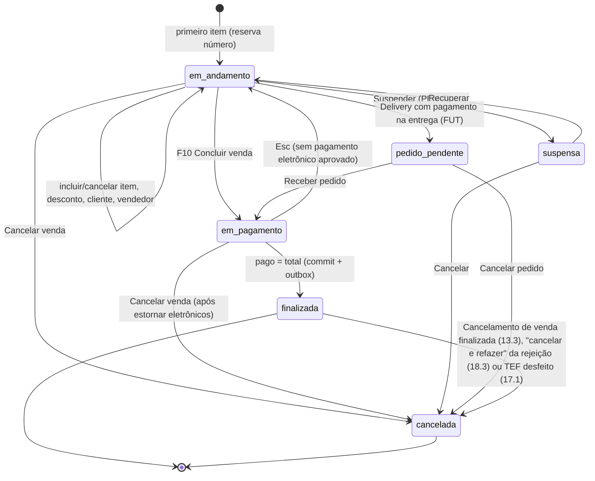

Além do `status`, a venda finalizada tem `devolucao` = `nenhuma`, `parcial` ou `total` (trocas, seção 23) — a
devolução não muda o status da venda. Não existe transição `finalizada → em_pagamento` nem remoção de item depois de
`finalizada`: qualquer correção é cancelamento + **nova venda** (novo `id` e `numero`), com os pagamentos transferidos
por `pagamentos_venda.transferido_de_id` (18.3).

### 34.2 Sessão de caixa

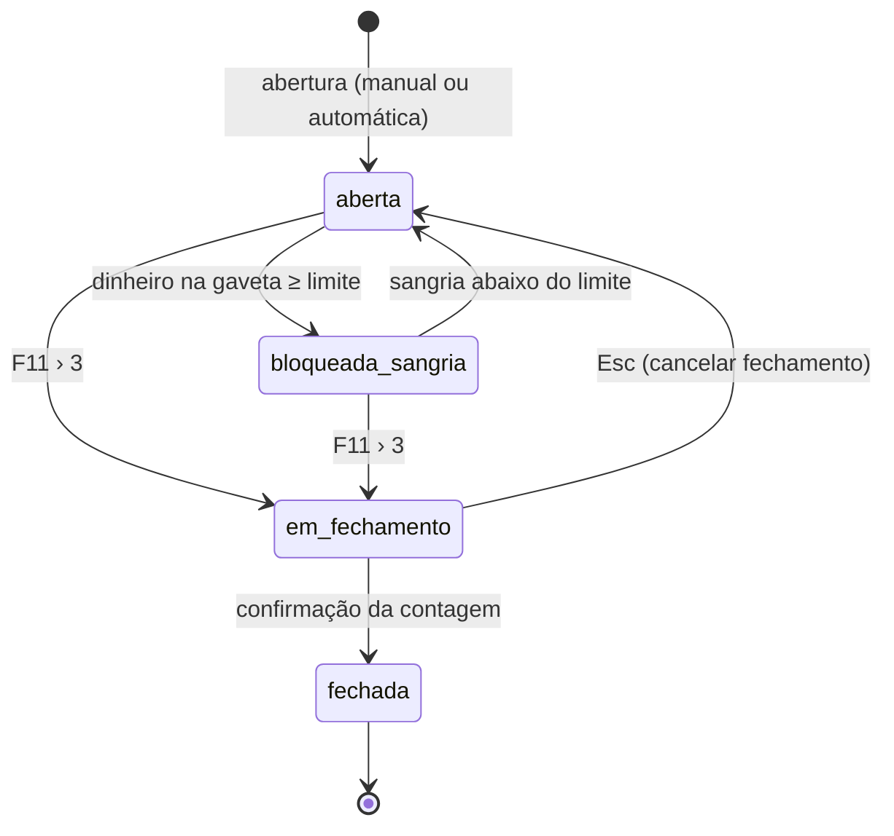

Fase 1C (C10a/C10b): no PDV só `aberta` e `fechada` são gravados em `sessoes_caixa.status`. `bloqueada_sangria` é
**calculado** a cada venda nova (o `dinheiro_gaveta` da 20.4 contra o limite; a faixa vermelha da tela) e `em_fechamento`
é o diálogo do fechamento aberto: nenhum dos dois vai ao banco, e a nuvem só conhece `aberta`/`fechada`.

### 34.3 Documento fiscal (NFC-e)

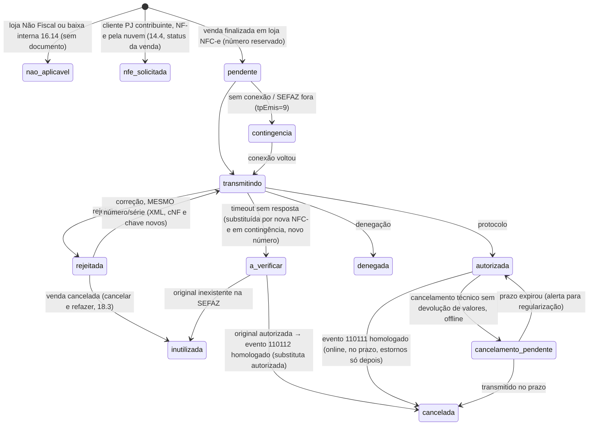

- `a_verificar` é valor novo de `ck_documentos_fiscais_status` (substitui o antigo "verificar") e exige
  `chave_substituta` (nova coluna `varchar(44)`) e `substituido_por_id`.
- O cancelamento de venda com devolução de valores **nunca** passa por `cancelamento_pendente`: offline ele não é
  oferecido (13.3).
- `substituido_por_id` só é preenchido quando houve troca de número (duplicidade 204/539 ou `a_verificar`).

### 34.4 Transação TEF

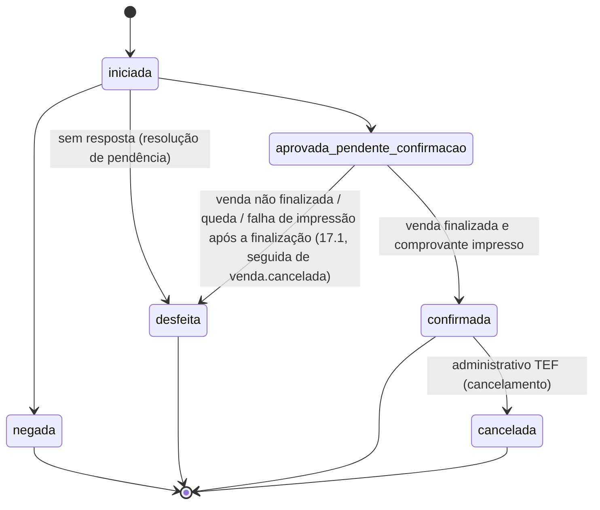

### 34.5 Evento do outbox

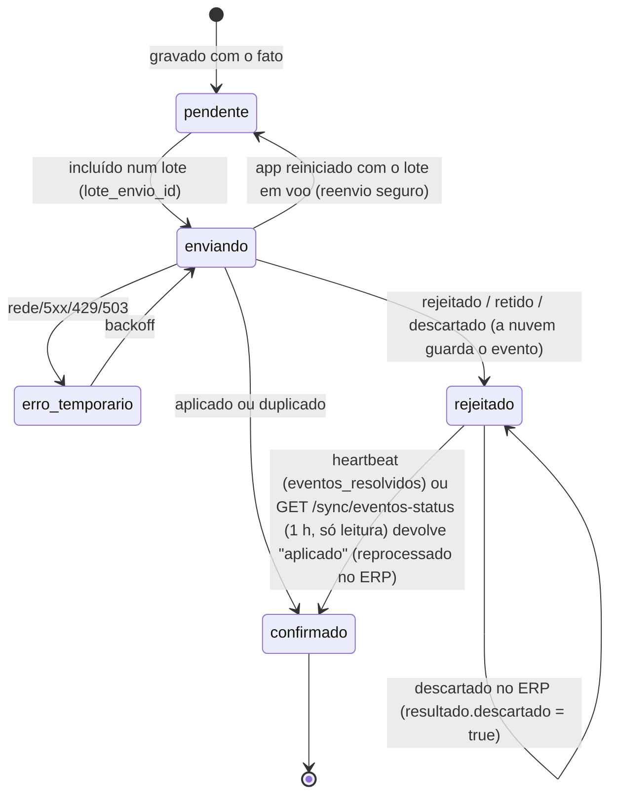

Não existe `rejeitado → pendente`: o reprocessamento acontece na nuvem, sem reenvio (sincronizacao.md 7.2). A consulta
`GET /sync/eventos-status` (30.4) é a rede de segurança do heartbeat: `erro`/`retido` não mudam nada, e os já
descartados e os `EVENTO_DIVERGENTE` ficam fora dela (README do PDV, decisão 58).

---

## 35. Questões em aberto para o dono do produto

1. **Limite de Valor de Vendas PDV** e **Limite Venda em Aberto**: o levantamento não diz o que fazem no Nuvem3.
   Adotamos "valor máximo de uma venda" e "máximo de vendas suspensas por caixa". É assim que vocês usam hoje?
2. **Usa PDV como utilitário** e **Usa pinpad virtual / Tipo de Pin Pad Virtual**: confirmar o significado no Nuvem3
   (adotamos "modo utilitário sem receber" e "pinpad virtual = terminal de pagamento integrado").
3. **Preço atacado**: no Nuvem3 ele vale a partir de uma quantidade, por escolha do operador ("Tipo de preço") ou os
   dois? (O atacado por quantidade, as faixas por loja, o grupo de preço (mix) e o fardo com fator já estão na PDV-1,
   11.3.1; o tipo de preço F8 fica na PDV-2.)
4. **Vasilhames** (10.12) — *uso decidido (D3)*: a Ice Beer vende vasilhame/casco, que entrou na PDV-1. Ainda em
   aberto: a Ice Beer empresta cascos (comodato) a clientes identificados (PDV-2)? Validar com o contador o
   tratamento fiscal no PR (venda do casco com CFOP 5102; remessa/retorno à distribuidora com CFOP 5920/1921).
5. **Certificado A3** (token/cartão) em algum caixa? O PDV fiscal foi desenhado para o A1 da nuvem (6.7).
6. **UFs das lojas e prazos fiscais** — *UF decidida (D1)*: lojas no **Paraná**, NFC-e obrigatória, sem SAT; o PDV
   continua parametrizado por UF para clientes de outros estados. Em aberto, com o contador (detalhes em
   `docs/fiscal/nfce-parana.md`): prazo de cancelamento de NFC-e, prazo de transmissão em contingência, prazo de
   inutilização, valor que exige identificação do consumidor, DANFE resumido/eletrônico e tratamento do
   **vale-troca** (tPag). Taxa de serviço e taxa de entrega deixaram de ser urgentes (módulos FUT, D4).
7. **Fechamento cego** deve ser o padrão para todos os operadores? A tolerância de diferença é zero?
8. **PSP do PIX dinâmico** (banco da Ice Beer) e **provedor TEF** (SiTef, PayGo, Stone, outro): definem as
   integrações das fases PDV-2/PDV-3. Sem PSP, o PIX manual exige supervisor por padrão (16.7).
9. **Comandas e delivery** — *decidida (D4)*: a Ice Beer nunca usou comandas no Nuvem3 (fluxo de balcão). Comandas,
   taxa de serviço, impressoras de produção, pedidos/delivery e cardápio interno desceram para **FUT** (módulos
   opcionais, especificação mantida nas seções 6.2.1, 25 e 26).
10. Crediário/caderneta **offline**: aceitar com o limite do último sync (risco de estourar limite em dois caixas) ou
    exigir internet?
11. "Pesquisa de satisfação: URL da imagem" (Parâmetros): onde aparece no Nuvem3 (cupom, tela)?
12. Tempo máximo offline (`pdv.dias_max_offline` = 7) e bloqueio de estoque offline desligado por padrão — de acordo?
13. **Restrições de horário de venda** de bebida (10.11): há lei municipal nas cidades das lojas?
14. **"Grupo de itens"** do Nuvem3 (D16) — *decidida (30/10/2026)*: é o **combo/kit** com composição ("COMBO DE
    WHISKY 1L" = Whisky 1L + Energético 2L + 2 Gelos de sabor), com troca de componente, custo calculado, preço
    manual, sem estoque próprio e NFC-e com os componentes (10.9.1). O **mix** (`grupos_preco_quantidade`, 11.3.1)
    fica na PDV-1 como funcionalidade própria, também pedida pelo dono; segue a confirmar no uso só qual modo do mix
    (`grupo` ou `produto`) a Ice Beer prefere como padrão.
15. **Ficha técnica** (D17): no Nuvem3, vender um item com ficha técnica **baixa os componentes** do estoque (adotado:
    produto `produzido`, `BAIXA_INSUMO`, 10.9.2) ou a ficha é só para cálculo de custo (produto `simples` com ficha
    informativa)? Quais produtos da Ice Beer têm ficha técnica?
16. **Atacarejo por loja**: o preço de atacado/oferta é o mesmo em todas as lojas (`preco_atacado` +
    `qtd_minima_atacado`) ou muda por loja (faixas `produtos_precos_quantidade` da loja)? O preço do fardo no Nuvem3 é
    um preço próprio da embalagem ou sai do atacado 12+?

Decididas pelo dono em out/2026 (roadmap 16): lojas no PR com NFC-e e fiscal parametrizado por UF (D1); vasilhame/
casco na PDV-1 (D3, 10.12); comandas, taxa de serviço, impressoras de produção, pedidos/delivery e cardápio interno em
FUT (D4); combo/kit (= "grupo de itens", D16, com troca de componente), ficha técnica, grupo de preço por
quantidade (mix) e atacarejo completo na PDV-1 (10.9, 11.3.1); a baixa da ficha técnica de produto produzido segue a
confirmar (15).

Decididas em revisões anteriores: fardo/embalagem com fator e atacado por quantidade na PDV-1
(10.2, 11.3); vasilhames especificados (10.12); recebimento de crediário no caixa na PDV-2 (16.13); em loja NFC-e não
existe venda não fiscal (17.2); confirmação de idade obrigatória (10.11).
