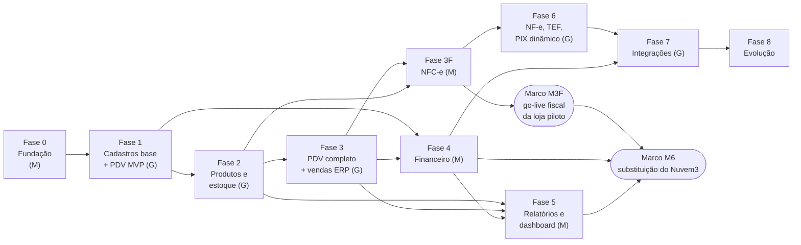

# Roadmap – GenesisPDV & ERP

> Do zero até um sistema **completo como o Nuvem3**, com o **PDV (frente de caixa) cedo**, porque é o maior
> interesse do dono do produto. Segue `docs/arquitetura/decisoes.md` (ADRs) — em especial a ADR-11, que fixa a
> implementação da **NFC-e na Fase 3F** (logo depois da Fase 3) e a de **NF-e, TEF e PIX dinâmico na Fase 6** — e a
> ordem de prioridades da seção 12 do levantamento do Nuvem3 (o relatório fica com o dono, fora do repositório),
> adiantando o MVP do PDV para a Fase 1 e a nota fiscal do caixa para antes do financeiro e dos relatórios.
>
> Documentos de referência citados nas tabelas: **MD** = `docs/arquitetura/modelo-de-dados.md`,
> **SYNC** = `docs/arquitetura/sincronizacao.md` (protocolo de sincronização offline),
> **ERP** = `docs/erp/especificacao-erp.md`, **PDV** = `docs/pdv/especificacao-pdv.md`,
> **VG** = `docs/arquitetura/visao-geral.md`. Os números depois da sigla são seções (ex.: ERP 13.7, SYNC 14.1).

## Sumário

- [1. Como ler este roadmap](#1-como-ler-este-roadmap)
- [2. Visão geral das fases](#2-visão-geral-das-fases)
- [3. Correspondência com as etiquetas das especificações](#3-correspondência-com-as-etiquetas-das-especificações)
- [4. Marcos](#4-marcos)
- [Fase 0 – Fundação](#fase-0--fundação)
- [Fase 1 – Cadastros base + PDV MVP (vender offline)](#fase-1--cadastros-base--pdv-mvp-vender-offline)
- [Fase 2 – Produtos e estoque completos](#fase-2--produtos-e-estoque-completos)
- [Fase 3 – PDV operação completa + vendas no ERP](#fase-3--pdv-operação-completa--vendas-no-erp)
- [Fase 3F – NFC-e (nota fiscal do caixa)](#fase-3f--nfc-e-nota-fiscal-do-caixa)
- [Fase 4 – Financeiro](#fase-4--financeiro)
- [Fase 5 – Relatórios e dashboard](#fase-5--relatórios-e-dashboard)
- [Fase 6 – NF-e, TEF e PIX dinâmico](#fase-6--nf-e-tef-e-pix-dinâmico)
- [Fase 7 – Integrações e canais](#fase-7--integrações-e-canais)
- [Fase 8 – Evolução contínua (backlog)](#fase-8--evolução-contínua-backlog)
- [14. Trilhas transversais (todas as fases)](#14-trilhas-transversais-todas-as-fases)
- [15. Substituição do Nuvem3 na Ice Beer](#15-substituição-do-nuvem3-na-ice-beer)
- [16. Decisões em aberto que afetam o roadmap](#16-decisões-em-aberto-que-afetam-o-roadmap)

---

## 1. Como ler este roadmap

> **Em poucas palavras.** O trabalho foi dividido em fases. Cada fase entrega algo que dá para usar e testar. O PDV
> começa a vender (sem internet, com cupom não fiscal e um simulador de nota fiscal) já na Fase 1 — já com o que a
> Ice Beer usa no caixa do Nuvem3: fardo, atacarejo e mix, "grupo de itens" (combo/kit com troca de componente), ficha técnica e casco retornável; o estoque
> completo vem na Fase 2; o balcão completo (balança, trocas, promoções, orçamentos…) na Fase 3; a nota fiscal do caixa (NFC-e)
> na **Fase 3F**, logo em seguida e junto com o financeiro (Fase 4) — é ela que permite usar o PDV de verdade nas
> lojas; os relatórios na 5; a NF-e da nuvem, o cartão integrado (TEF) e o PIX automático na 6; e as integrações
> (iFood, loja virtual, WhatsApp…) na 7.

Cada fase traz:

| Bloco | O que é |
|---|---|
| **Objetivo** | O que muda para o usuário ao final da fase |
| **Entregas** | Lista de verificação (`- [ ]`), marcada nos pull requests à medida que cada item fica pronto |
| **Entidades e telas** | Onde está a especificação de cada entrega (MD/ERP/PDV) |
| **Definição de pronto** | Condições objetivas para encerrar a fase |
| **Riscos** | O que pode dar errado e como reduzir |
| **Tamanho** | Ordem de grandeza (tabela abaixo) |

Escala de tamanho (equipe de referência de 2–3 desenvolvedores, com apoio do Claude Code; reestimar ao fim de cada
fase com a velocidade real):

| Tamanho | Duração aproximada |
|---|---|
| **P** | até ~1 mês |
| **M** | ~1 a 2 meses |
| **G** | ~2 a 4 meses |

Ritual de encerramento de fase: demonstração em homologação, conferência da definição de pronto, retrospectiva,
atualização dos ADRs/especificações se algo mudou (o ADR primeiro) e revisão das decisões em aberto da seção 16.

---

## 2. Visão geral das fases

| Fase | Nome | Tamanho | Depende de | Resultado |
|---|---|---|---|---|
| **0** | Fundação | M | — | Empresa criada por código, login, permissões, auditoria, esqueleto de API, ERP, PDV e sincronização |
| **1** | Cadastros base + PDV MVP | G | 0 | PDV vende um dia inteiro offline com cupom não fiscal e o ERP mostra vendas, caixa e estoque, com o que o caixa da Ice Beer precisa para trocar o Nuvem3 (fardo, atacarejo e mix, combo/kit — o "grupo de itens" — com troca de componente, ficha técnica, vasilhame/casco); o fluxo de finalização já nasce com a base fiscal definitiva (`IEmissorFiscal` + simulador de NFC-e) |
| **2** | Produtos e estoque completos | G | 1 | Estoque oficial no Genesis: produto completo, entradas (manual e NF-e), transferências CD → lojas, acertos, custo |
| **3** | PDV operação completa + vendas no ERP | G | 2 | Balcão completo: balança, lote, variações, promoções, vendedor, troca/vale, orçamentos, comodato de cascos; vendas e orçamentos no ERP (comandas e pedidos: Fase 8, D4) |
| **3F** | NFC-e (nota fiscal do caixa) | M | 2 (tributação) e 3; em paralelo com a 4 | NFC-e emitida pelo PDV com contingência offline, cancelamento, inutilização, DANFE, IBS/CBS, XML na nuvem, homologação na SEFAZ da UF das lojas — **go-live fiscal da loja piloto** |
| **4** | Financeiro | M | 1 (crediário do PDV depende também da 3) | Contas a pagar/receber, baixas, contas correntes, plano de contas, integração financeira das vendas e do caixa, crediário |
| **5** | Relatórios e dashboard | M | 2, 3, 4 | Dashboard do mês e os relatórios do Nuvem3, com custo e lucro |
| **6** | NF-e, TEF e PIX dinâmico | G | 3F | NF-e modelo 55 na nuvem, cartão por TEF, PIX com confirmação automática |
| **7** | Integrações e canais | G | 6 (parcial) e 4 | WhatsApp, boleto, iFood, 99Food, WooCommerce, NuvemShop, API para terceiros (totem, menu digital e PDV mobile foram para a Fase 8, D4) |
| **8** | Evolução contínua | — | — | Itens futuros (SAT/MFE para outras UFs, ordem de serviço, agenda, DRE, curva ABC…) e **módulos opcionais** de bar/restaurante/delivery não usados pela Ice Beer (comandas, taxa de serviço, impressoras de produção, pedidos/delivery, cardápio interno, totem, menu digital, PDV mobile — D4), feitos quando um cliente precisar |

**Paralelismo** (a numeração das fases não muda, só a execução): a **Fase 3F** (quase toda no PDV + API) roda em
paralelo com a **Fase 4** (financeiro, quase toda no ERP); com 3 ou mais desenvolvedores, a Fase 4 pode começar
ainda durante a Fase 3. A preparação da 3F (escolha da biblioteca fiscal, credenciamento NFC-e e CSC na SEFAZ,
certificados) começa durante a Fase 3, para a homologação não esperar. **Decisão D1 (out/2026):** as lojas da Ice
Beer ficam no **Paraná** e a **NFC-e é obrigatória** — a 3F é o caminho do go-live. Como o PDV pode atender empresas de
todo o Brasil, o fiscal é **parametrizado pela UF da loja** desde a Fase 1 (nada fixo em PR; particularidades do PR em
`docs/fiscal/nfce-parana.md`).

---

## 3. Correspondência com as etiquetas das especificações

A especificação do ERP usa as etiquetas **[P1]…[P6]** (iguais às prioridades da seção 12 do levantamento) e a do PDV
usa **PDV-1, PDV-2, PDV-3, FISCAL, FUT** (PDV 2). Este roadmap as reorganiza assim:

| Fase | Levantamento seção 12 | Etiquetas do ERP | Etiquetas do PDV |
|---|---|---|---|
| 0 | Prioridade 1 (base técnica) | [P1] infraestrutura, autenticação, permissões, auditoria, listagem genérica, painel da plataforma | — (esqueleto da solução) |
| 1 | Prioridade 1 + partes das 2 e 3 | [P1] telas; partes de [P2] (produto essencial, tipos Combo (kit)/Produzido/Vasilhame, bloco Combo com posições e alternativas, ficha técnica, atacarejo completo, grupos de preço por quantidade, acerto simples, importação) e [P3] (formas de pagamento, terminais, caixa, consulta de vendas) | **PDV-1** (inclui vasilhame, combo/kit com troca de componente, ficha técnica e mix) + base fiscal (`IEmissorFiscal`, simulador de NFC-e, `documentos_fiscais` local, máquina de estados PDV 34.3) |
| 2 | Prioridade 2 | [P2] completo + relatórios de estoque (Estoque Atual, Movimentação), que o levantamento põe na Prioridade 2 | Recepção do catálogo completo; consulta online "outras lojas" |
| 3 | Prioridade 3 | [P3] restante (vendas, orçamentos, conferência de caixa, parâmetros) | **PDV-2**, exceto crediário (com o recebimento no caixa)/crédito funcionário/boleto (Fase 4) e PIX dinâmico (Fase 6) |
| 3F | Prioridade 6 (fiscal NFC-e, **antecipada**) | [P6] fiscal da NFC-e: Configurações › Fiscal e Tributação, CFOP's, Lojas › Tributação e NFC-e, IBPT, Download de XML, monitoramento fiscal (ERP 18, ordem 6a, parte NFC-e/SAT) | **FISCAL** (= Fase 3F, ADR-11) |
| 4 | Prioridade 4 | [P4] | PDV-2: crediário (inclusive recebimento no caixa), crédito funcionário, boleto |
| 5 | Prioridade 5 | [P5] | — |
| 6 | Prioridade 6 (NF-e, TEF) | [P6] NF-e modelo 55, TEF, PIX dinâmico (ERP 18, ordem 6a restante e 6b) | **PDV-3** (TEF), PDV-2: PIX dinâmico |
| 7 | Prioridade 6 (integrações) | [P6] integrações (ERP 18, ordens 6c a 6e e a pesquisa de satisfação da 6f) | — |
| 8 | — | Ordem de Serviço, futuros e **[FUT]** (módulos opcionais: comandas, taxa de serviço, impressoras de produção, taxas de entrega, totem/menu digital, PDV mobile — ERP 0.1, 18 ordem 6f) | **FUT** (inclui comandas, taxa de serviço, impressoras de produção, pedidos/delivery, cardápio interno, totem, menu digital, PDV mobile — D4) |

> Divergências resolvidas aqui: (1) o PDV (16.7) põe o PIX dinâmico na P2 e o ERP (18.11) na P6. O roadmap o coloca
> na **Fase 6**, junto com o TEF (os dois dependem de contrato com terceiros — decisão D5). Se o PSP for definido
> cedo, ele pode ser antecipado para a Fase 3 sem impacto no resto. (2) A prioridade 6 do levantamento junta fiscal,
> TEF e integrações; o roadmap separa a **NFC-e** (Fase 3F, logo depois da Fase 3), porque uma rede de bebidas é
> obrigada a emitir o documento fiscal no caixa e o cupom não fiscal não o substitui — sem ela o PDV não entra em uso
> real.

---

## 4. Marcos

| Marco | Ao final de | O que significa para a Ice Beer |
|---|---|---|
| **M0 – Primeira empresa** | Fase 0 | A empresa de teste `100001` existe em homologação; login no ERP com código + usuário + senha |
| **M1 – Primeira venda sincronizada** | Fase 1 | Um caixa de teste com o catálogo real da Ice Beer vende offline e a venda aparece no ERP. Piloto assistido (ver seção 15) |
| **M2 – Estoque oficial** | Fase 2 | Compras, transferências do CD e acertos feitos no Genesis; saldo confere com a contagem física |
| **M3 – Balcão completo** | Fase 3 | O caixa faz tudo que o balcão precisa (exceto nota fiscal, cartão integrado e PIX automático) |
| **M3F – Go-live fiscal** | Fase 3F | A loja piloto vende e emite NFC-e só pelo Genesis em produção, inclusive em contingência offline; as demais lojas entram uma a uma (seção 15) |
| **M4 – Financeiro** | Fase 4 | Contas a pagar/receber e o caixa das lojas fecham no financeiro do Genesis |
| **M5 – Gestão** | Fase 5 | Dashboard e relatórios que o escritório usa no Nuvem3 estão disponíveis |
| **M6 – Substituição do Nuvem3** | Fases 3F, 4 e 5 | Todas as lojas e o CD no Genesis (caixa, estoque, financeiro e relatórios); Nuvem3 desligado após o período de convivência. Se a Ice Beer já usar TEF integrado ou NF-e de transferência no Nuvem3 (D5, D6), o desligamento espera também a Fase 6 |
| **M7 – Canais** | Fase 7 | Pedidos de delivery e loja virtual entram direto no Genesis |

---

## Fase 0 – Fundação

**Tamanho: M** · **Depende de:** — · **Etiquetas:** ERP [P1] (base técnica)

### Objetivo

Deixar pronta a base sobre a qual tudo roda: monorepo, CI, bancos (controle + um por empresa), provisionamento de
empresa por código, login, permissões, auditoria, contratos de sincronização e o esqueleto dos três aplicativos.
Ao final, a equipe Genesis cria a empresa `100001` em homologação e o administrador entra no ERP.

### Entregas

**Repositório, qualidade e ambientes**
- [ ] Monorepo conforme ADR-01: `pnpm-workspace.yaml`, `apps/api`, `apps/erp-web`, `packages/shared`, `apps/pdv/GenesisPDV.slnx` com `GenesisPDV.Core`, `.Data`, `.Sync`, `.Hardware`, `.Fiscal`, `.App` e `GenesisPDV.*.Tests`
- [ ] Lint e formatação (ESLint, Prettier, `dotnet format`), `.editorconfig`, convenções de commit em pt-BR (ADR-12)
- [ ] CI (GitHub Actions): lint, Vitest, testes de integração com PostgreSQL 16 como serviço, build do ERP, `dotnet build/test` do PDV em Windows e Linux; CI verde obrigatório para merge (I1: a integração da API roda também no PostgreSQL 18 do Cloud SQL, e as imagens Docker de produção buildam em todo PR; I1b: também a imagem do backup e o shellcheck dos scripts de produção; D58, 05/11/2026: o PDV na CI roda só no Windows, com o `dotnet format` num job Linux leve; D59, decidida pelo dono em 05/11/2026: a integração da API só no PostgreSQL 18)
- [ ] Ambiente local: `infra/docker-compose.yml` (PostgreSQL 16, já existe) + captura de e-mail (ex.: Mailpit) + armazenamento de objetos local S3-compatível
- [ ] Ambiente de **homologação** na nuvem com deploy automático a cada merge, TLS e domínios (VG 10, 12). **Implantação do piloto (I1, nov/2026):** a produção do piloto saiu antes da homologação separada — VPS da Hostinger com o Traefik existente (TLS do Let's Encrypt, domínios `erp`/`api`/`download.grupoicebeer.com.br`), deploy pelo GitHub Actions (`.github/workflows/implantacao.yml`: manual ou a cada CI verde na `main`), migrações no container de tarefa e volta atrás (`infra/producao/README.md`). O DNS dos três domínios foi criado em 03/11/2026 (registros A para a VPS). **I1b:** backup lógico diário do banco (container `genesis-backup`: `pg_dump` do controle e de cada empresa para o bucket, 14 dias no bucket com as versões apagadas na retenção, até ~21 com o *soft delete* do GCS, restauração ensaiada no teste local; a instância de teste grátis do Cloud SQL recusou backups automáticos e PITR) e o painel `/api/saude/detalhada` com token de monitoramento. Falta o ambiente de homologação próprio (um segundo projeto Compose na mesma VPS ou outra instância)
- [x] Escolha do provedor de hospedagem (decisão D13): **VPS da Hostinger + Google Cloud SQL PostgreSQL 18** (seção 16)

**API e bancos**
- [ ] NestJS: configuração por ambiente, logs estruturados com `requisicao_id`, `/saude`, formato de erro padrão e códigos (ERP 1.8), validação `zod` compartilhada
- [ ] Drizzle com dois schemas (controle e empresa) e migrações versionadas; comandos `db:migrate:controle`, `db:migrate:empresas` (canário, lotes, `migracoes_empresas`, modo manutenção 503 por empresa), `db:referencias`, seed idempotente (MD 2.12, 7; ERP 19.7)
- [ ] Funções e triggers do modelo: `fn_uuid_v7`, `seq_versao`, `fn_versao` com trava de ordenação, `fn_versao_local`, `fn_protege_imutavel`, `fn_unaccent`; extensões `pg_trgm`, `unaccent`, `btree_gist` (MD 1.5–1.9)
- [ ] Multiempresa: resolução do banco por código/token, cache de pools com limite e fechamento de inativos (ADR-02; VG 4.3)
- [ ] Banco de controle completo: `planos`, `servidores_banco`, `empresas`, `terminais_pdv`, `ativacoes_pdv`, `tentativas_ativacao`, `versoes_app_pdv`, `admins_plataforma`, `sessoes_admin`, `acessos_suporte`, `auditoria_plataforma`, `migracoes_empresas`, `backups_empresas` (MD 2, 2.14)
- [ ] Provisionamento de empresa: `CREATE DATABASE`, migrações, referências nacionais, seed (perfis, formas de pagamento, plano de contas, tipos de movimento/estoque, unidades, CFOPs, atalhos, administrador com senha provisória), "tentar novamente"/"descartar" (MD 7.1–7.12; ERP 19.4)
- [ ] Autenticação do ERP: código da empresa + login + senha, argon2id, JWT de 15 min + refresh rotativo em cookie `httpOnly`, bloqueio por tentativas, rate limit, troca e recuperação de senha, e-mail transacional (ERP 4, 18.14)
- [ ] Permissões: catálogo `packages/shared/permissoes.ts`, perfis padrão, decorator `@Permissao`, filtro por lojas permitidas, `permissoes_versao` (ERP 2, 11.4; MD 3.3)
- [ ] Auditoria transversal na mesma transação, tabela particionada por mês com tarefa de criação de partições (ERP 17; MD 3.1.7)
- [ ] Cifra de segredos AES-256-GCM com chave mestra fora do banco (MD 1.10); arquivos no armazenamento de objetos com URL assinada (MD 3.1.6); tarefas em segundo plano + tabela `tarefas` (ERP 3.6; MD 3.1.8)
- [ ] Esqueleto da sincronização com testes de contrato, conforme SYNC: convenções, cabeçalhos e envelope de erro (SYNC 2), `POST /sync/ativar` e estados do terminal `provisionando`/`ativo`/`desativando`/`revogado` (SYNC 3, 3.8), `GET /sync/estado` (SYNC 5), `GET /sync/pull?fluxo=&desde=&limite=` com um cursor por fluxo, registro de fluxos e filtros por tabela (SYNC 6), `POST /sync/push` (moldura idempotente com `eventos_recebidos`, ordem estrita por terminal, marcador `versao_nuvem`, respostas `aplicado`/`duplicado`/`rejeitado`/`retido`, SYNC 7, 8), `POST /sync/heartbeat` (SYNC 21.1) (MD 3.15, 6)

**ERP web**
- [ ] React + Vite + Mantine + React Router + TanStack Query/Table; layout, menu e loja de contexto (ERP 5)
- [ ] Login, trocar senha, esqueci a senha (ERP 4)
- [ ] Componentes `<Listagem>` (filtros na URL, ordenação, paginação 20/25/35/50/Todos, clique na 1ª coluna, exportar), `<FormularioEntidade>` (abas/acordeão, botão Histórico, conflito 409), `<GradeItens>`, seletores, casca de `<Relatorio>` (ERP 3, 1.4)
- [ ] Painel da plataforma mínimo: login com 2FA (TOTP), empresas (listar, criar, suspender, reativar), planos, migrações (ERP 19.1–19.4, 19.7, 19.8)

**PDV**
- [ ] Shell Avalonia (MVVM, `CommunityToolkit.Mvvm`), tema e navegação por teclado
- [ ] EF Core SQLite com `journal_mode=WAL`, `synchronous=FULL`, `foreign_keys=ON`; migrações na inicialização após backup; conversor de decimal em inteiro escalado `EscalaDecimal` (MD 4.1; PDV 4.2)
- [ ] Gerador `pnpm --filter api gerar:esquema-pdv` → `GenesisPDV.Data/Esquema.g.cs` (MD 4.1)
- [ ] Interfaces de hardware e fiscal com simuladores (impressora em arquivo/tela, gaveta, leitor como teclado, emissor "não fiscal") (PDV 1.3, 4.1)
- [ ] Logs Serilog e tratamento global de erros (PDV 32.1, 32.2)

**Documentação e alinhamento** (divergências encontradas entre os documentos; corrigir antes de implementar a parte afetada)
- [ ] **Aplicar `sincronizacao.md` §24 em MD, PDV, ERP e ADR antes do código**: SYNC 24 completo (M1–M31, P1–P27, E1–E6, D1–D2, V1, R1–R2): M1–M31 no MD (SYNC 24.1), P1–P27 no PDV (SYNC 24.2), E1–E6 no ERP (SYNC 24.3), D1–D2 na ADR-08 (SYNC 24.4), V1 na VG (SYNC 24.5) e R1–R2 neste roadmap (SYNC 24.6). É pré-requisito do esqueleto de sincronização desta fase
- [x] Intervalo do heartbeat: ERP 12.6 diz 30 s; PDV 30.4 diz 5 min → adotar o da SYNC 18.2: **30 s online sem SSE, 60 s online com SSE**, reconexão com backoff quando offline (PDV 30.4 corrigido pelo P5) — concluído (ajustes P5/R1 da SYNC 24)
- [x] Rota de ativação: ERP 12.3 `POST /sync/ativar` × PDV 5.3 `POST /terminais/ativar` → adotar `/sync/ativar` (SYNC 3.2; ajuste P1) — concluído (ajuste P1 da SYNC 24)
- [x] Bloqueio por tentativas de ativação: PDV 5.2 (5 em 15 min, bloqueio de 15 min) × ERP 12.3 e MD 2.6 (5 em 10 min, bloqueio de 30 min) → adotar o do MD (ajuste P3) — concluído (ajuste P3 da SYNC 24)
- [x] Push com token revogado: a regra do PDV 5.3 (aceitar eventos com `ocorrido_em` anterior à revogação) é substituída pelo estado `desativando` (SYNC 3.8; ajuste P2) — concluído (ajuste P2 da SYNC 24)
- [x] Incluir em MD a tabela de registro de backups por empresa (`backups_empresas`, citada em ERP 21.1 e VG 11) — concluído (MD 2.14)
- [x] Alinhar ERP 21 e PDV 4.2 aos nomes oficiais do MD 8 (`vales_compra`→`vales`, `devolucoes`→`trocas`, `eventos_fiscais`→`documentos_fiscais_eventos`, `versoes_pdv`→`versoes_app_pdv`, número de exibição da venda com `lojas.codigo`…) — concluído
- [x] Registrar em ADR a fase do PIX dinâmico (Fase 6, seção 3 deste roadmap) — concluído (ADR-11)
- [x] Atualizar a ADR-11 e o PDV 18 para a nova fase fiscal: implementação da **NFC-e na Fase 3F** (antes "Fase 6"); NF-e, TEF e PIX dinâmico continuam na Fase 6 — concluído (ADR-11; PDV 2, 18)

### Entidades e telas

MD 1, 2, 3.1 (configurações, numerações, arquivos, auditoria, tarefas), 3.3, 3.4, 3.15, 7 · SYNC 1–3, 5–8, 21.1, 24 ·
ERP 1–5, 11.4, 17, 19 · PDV 4.1–4.2 · VG 3, 10, 12.

### Definição de pronto

- [ ] Admin Genesis cria a empresa `100001` pelo painel em homologação; banco, migrações e seed aplicados; a senha provisória aparece uma única vez; tudo registrado em `auditoria_plataforma`.
- [ ] Login no ERP com `100001` + `admin`; troca de senha obrigatória; tentativa errada não revela o que está errado; auditoria grava login e login negado.
- [ ] Uma migração nova é aplicada em 3 empresas de teste pelo comando em massa (canário primeiro); uma falha forçada deixa só aquela empresa em manutenção (503).
- [ ] Teste de integração com transações concorrentes prova que o pull por `versao` nunca pula linhas (trava de ordenação, MD 1.5).
- [ ] Teste de integração com 2 lojas: a carga inicial de `estoque`, `catalogo` e `operacao` de um terminal da Loja 1 termina mesmo com as últimas versões sendo da Loja 2/CD, e o cursor avança até `cursor_teto` quando só a outra loja muda (SYNC 6.3–6.4).
- [ ] O mesmo evento enviado duas vezes ao `/sync/push` é aplicado uma vez e a segunda resposta é `duplicado` (SYNC 8.4).
- [ ] Os ajustes da SYNC 24 estão aplicados nos documentos (MD, PDV, ERP, ADR-08) antes do primeiro código de sincronização.
- [ ] O PDV abre em Windows e Linux, cria o `pdv.db`, aplica migrações locais e exibe o assistente de ativação. (D58, 05/11/2026: na CI, só no Windows, pelo teste do instalador; o Linux fica para a rodada local.)
- [ ] Usuário sem permissão recebe 403 na API e não vê o menu no ERP; usuário restrito à Loja 1 não enxerga dados da Loja 2.

### Riscos

| Risco | Mitigação |
|---|---|
| Ferramenta de migração não prevê "um schema, N bancos" | Executor próprio sobre o journal do drizzle-kit, com hash por migração (MD 2.12); provar na Fase 0 com 3 empresas |
| Contenção pela trava de ordenação de `versao` | Transações curtas e lotes de 500 linhas (MD 1.5); medir com carga sintética; evolução já prevista (trigger adiado) — 1C/C13: medido com 4 terminais reconectando juntos e o ERP gravando (p95 de 28 ms por venda de 10 itens na rodada local, meta 50 ms; `carga-terminais.test.ts`) e espera do ERP pela trava limitada a 5 s com `503 SISTEMA_OCUPADO`; as rotas do PDV (push, ativação, heartbeat) esperam sem limite (README da API › decisão 138) |
| Fundação crescer demais e atrasar o PDV | Painel da plataforma mínimo; o resto do painel entra nas fases seguintes conforme a necessidade |
| Equipe com pouca experiência em C#/Avalonia | Regras no `GenesisPDV.Core` com testes; telas simples primeiro; revisão de código cruzada |
| Avalonia 12 recente | Fixar versões; testes de UI headless desde o início; acompanhar notas de versão |

---

## Fase 1 – Cadastros base + PDV MVP (vender offline)

**Tamanho: G** · **Depende de:** Fase 0 · **Etiquetas:** ERP [P1] + partes de [P2]/[P3] · **PDV-1**

### Objetivo

Cadastrar no ERP o mínimo que o caixa precisa (empresa, lojas, estoques, caixas, usuários e permissões, pessoas,
produtos essenciais, formas de pagamento, configurações do PDV) e entregar o **PDV MVP** do PDV 2: ativação, login
offline, abertura, venda por código e busca, **o que o caixa da Ice Beer usa no Nuvem3** (fardo/embalagem com fator,
atacarejo com atacado por quantidade, faixas por loja e grupo de preço por quantidade — mix —, combo/kit — o "grupo de
itens" — com troca de componente e ficha técnica com baixa dos componentes, vasilhame/casco retornável), descontos com liberação, cancelamentos, CPF na nota, dinheiro / cartão em
maquininha (POS) / PIX estático, cupom não fiscal, gaveta, sangria, reforço, fechamento cego, reimpressão,
sincronização, recuperação após queda de energia e backup local. O ERP mostra as vendas, o caixa e o estoque que
chegaram dos PDVs.

O fluxo de finalização já nasce **definitivo para o fiscal**: a venda passa pela interface `IEmissorFiscal`, com o
emissor "não fiscal" e um **simulador de NFC-e**, grava `documentos_fiscais` local e segue a máquina de estados do
PDV 34.3. Na Fase 3F só se troca o simulador pelo emissor real, sem mexer no `GenesisPDV.Core` nem no protocolo.

Decisões do dono que moldam a fase (seção 16, out/2026): **D1** lojas no PR com NFC-e obrigatória (fiscal sempre
parametrizado pela UF da loja); **D3** vasilhame/casco é usado → Fase 1; **D4** fluxo de balcão, sem comandas nem
delivery → módulos FUT (Fase 8); **D16** (30/10/2026) "grupo de itens" = **combo/kit com ficha técnica** (custo
calculado, preço manual, sem estoque próprio, troca de componente com acréscimo, NFC-e com os componentes), e o
**mix** de preço por quantidade fica na fase como funcionalidade própria, também pedida pelo dono; **D17** (baixa da
ficha técnica de produto produzido) entra com a interpretação documentada, a confirmar antes dessa entrega. Para a
sincronização real (1B), em 30/10/2026: **D18** o PDV com identidade real só monta a venda e consulta preço (finaliza na
1C; a demonstração continua vendendo); **D19** o fluxo `pessoas` desce só funcionário, crediário e marcação manual, sem
telefone, admissão e demissão de funcionário; **D20** desativar ou substituir terminal com eventos em erro libera a
numeração na hora e gera alerta no ERP; **D21** caixas Windows, com o token protegido por DPAPI (Linux por arquivo).

### Entregas

**Decisões do início da fase**
- [x] D1 (lojas no PR, NFC-e obrigatória, fiscal parametrizado por UF), D3 (vasilhame usado) e D4 (sem comandas/delivery) decididas pelo dono e registradas (seção 16)
- [ ] D6 e D15 decididas e registradas (seção 16)
- [x] D16 decidida pelo dono (30/10/2026): "grupo de itens" = combo/ficha técnica (kit com troca de componente); o mix continua na fase como funcionalidade própria (seção 16)
- [ ] D17 (ficha técnica de produto produzido baixa os insumos?) confirmada com o dono antes de implementar a entrega de ficha técnica (ajuste só de cadastro/regra, sem mudar o protocolo) — **atenção**: o cadastro da ficha técnica já foi entregue com a interpretação adotada (produzido sem saldo próprio: acerto e importação recusam; API README decisão 91); se o dono responder diferente, revisar essa regra antes da baixa dos insumos na venda
- [x] D18–D21 decididas pelo dono (30/10/2026) e registradas (seção 16): na 1B o PDV com identidade real não finaliza venda (D18); fluxo `pessoas` só com funcionário/crediário/manual e sem telefone/admissão/demissão de funcionário (D19); desativação com eventos em erro libera a numeração e gera alerta no ERP (D20); caixas Windows, token por DPAPI (D21)

**ERP – cadastros base**
- [x] Empresa (ERP 10.1)
- [x] Lojas › Dados Gerais e Anexos, com o assistente que cria estoque, caixa 0, conta "Caixa – loja" e numerações (ERP 10.3.1, 10.3.4; MD 7.13) (parcial: a aba **Anexos** — logotipo/foto — espera o envio de arquivos `<UploadArquivo>` e vai para a Fase 2, junto com as imagens do produto)
- [x] Locais de estoque, incluindo **CD - Estoque Ice Beer** como `deposito` (ERP 13.2; MD 3.2.5); tipos de estoque do seed somente leitura (`/estoque/tipos`: Nome, Uso, Vendável, Padrão, Ativo; a edição da tela Tipo de Estoque fica na Fase 2, ERP 13.6)
- [x] Lojas › Caixas (número, descrição) (ERP 10.3.10)
- [x] Usuários (dados gerais, lojas permitidas, limite de desconto, senha numérica do PDV, flags) e Perfis de acesso (ERP 11.1–11.3)
- [x] Pessoas: listagem e aba Dados gerais com endereços, telefones e e-mails (ERP 7.1, 7.2)
- [x] Produtos – **essencial**: cabeçalho (nome, tipo simples, ativo, código interno, unidade, NCM, custo, markup, preço de venda), códigos de barras (principal + adicionais), marca, categoria principal, preço e estoque mínimo por loja, flags usadas pelo MVP (Solicita preço PDV, Produto genérico, Qtd. mín. venda, Controla estoque, Idade mínima), campos de tributação gravados (ERP 8.1, 8.2.1, 8.2.6, 8.2.10; MD 3.6.3–3.6.5)
- [x] Códigos de barras de embalagem/fardo/caixa com fator e preço (ERP 8.2.3; MD 3.6.5), preço de atacado com quantidade mínima (ERP 8.2.2) e preço por quantidade **por loja** com "Usa Produto Preço Volume" (`pdv.usa_preco_volume`) (ERP 8.2.9; MD 3.6.9)
- [x] **Grupos de preço por quantidade (mix)**: cadastro com modo `produto`/`grupo`, faixas por loja e produtos do grupo, botão Simular (ERP 8.10, 8.2.9; MD 3.6.13 `grupos_preco_quantidade`, `grupos_preco_quantidade_faixas`, `produtos.grupo_preco_quantidade_id`) — funcionalidade própria pedida pelo dono, não é o "grupo de itens" (D16)
- [x] **Vasilhame/casco**: produto tipo `vasilhame`, vínculo `vasilhame_produto_id`/`vasilhame_quantidade` no produto cheio, tipo de estoque seed `vasilhame_vazio` (ERP 8.2.1, 8.2.6, 13.6; MD 3.6.3, 7.4)
- [x] **Combo (kit) = "grupo de itens"** (D16): tipo Combo / kit, bloco Combo com posições (produto padrão, quantidade, rótulo), alternativas por posição com acréscimo, custo calculado Σ (custo do componente × qtd) e recalculado quando o custo de um componente muda, preço manual com margem/markup, combos montáveis por estoque, validação de ciclo e da tributação de cada componente/alternativa, flag "Desmembra Produto Kit" só para a tela do PDV (ERP 8.2.1, 8.2.11, 8.2.17, 9.3.1; MD 3.6.3, 3.6.7 `produtos_componentes` com `rotulo_posicao`/`permite_substituicao`, `produtos_componentes_alternativas`)
- [x] **Ficha técnica**: tipo `produzido`, bloco Ficha técnica com custo calculado e perda (ERP 8.2.4; MD 3.6.7 `produtos_componentes` `tipo = 'ficha_tecnica'`) (parcial: só o cadastro; a baixa dos insumos na venda — `BAIXA_INSUMO` na aplicação e `componentes_estoque` no PDV — espera a confirmação da **D17** e entra com a aplicação da venda nesta fase)
- [x] Cadastro de restrições de horário de venda (`restricoes_horario_venda`, MD 3.6.12; PDV 10.11)
- [x] Marcas e Categorias (cadastro simples; a árvore completa vem na Fase 2) (ERP 8.4, 8.7)
- [x] Importação básica de produtos e clientes por planilha, aceitando as colunas da Exportação do Nuvem3 (ERP 8.6, 23.14) (parcial: combo/kit e produto com variações não são criados pela planilha — posições e grade ficam no formulário; a importação completa é da Fase 2)
- [x] Acerto de estoque simples (Entrada / Saída / Definir, rascunho → efetivado) para lançar os saldos iniciais (ERP 13.5; MD 3.7.5)
- [x] Formas de pagamento com as flags usadas pelo MVP: dinheiro, PIX estático, débito/crédito em POS, troco, gaveta, senha de liberação, sempre zerado (ERP 10.2; MD 3.10.1, 7.7) — 1C/C8b: formas personalizadas por loja (`formas_pagamento_lojas`, linha de loja nula = todas; descem só ao caixa das lojas em que valem e a loja tirada some do caixa), "exige supervisor", troco só sem integração e fora de cartão/PIX (O23), descrição única na empresa e VA/VR inativas no seed (D25; README da API › decisão 136, ERP › 40, PDV › 50); o uso na tela de pagamento é do C11a
- [x] Configurações › Geral e as chaves `pdv.*` usadas pelo MVP; tabela de atalhos (ERP 9.1, 9.3.1, 9.9; MD 3.1.2, 3.10.2)
- [ ] PDVs / Terminais: gerar código de ativação, listagem com conexão e pendências, detalhe, revogar (2 modos), substituir, ressincronizar, solicitar logs, eventos com erro (reprocessar/descartar) (ERP 12) — 1B/B2: prontos gerar/cancelar código, listagem com conexão e pendências, detalhe, revogar (2 modos + perdido/roubado), substituir, ressincronizar, mensagem, troca de hardware, liberar ativações e a aba de eventos com erro **somente leitura**; 1C/C8: a aba virou a fila de decisão (reprocessar, aplicar com novo número, descartar, reprocessar todos com o código, paginada, com o resumo do agregado; README da API › decisão 135); falta solicitar logs (`/sync/arquivos`)
- [x] Consulta de vendas do PDV (listagem e detalhe somente leitura), Reforço, Sangria e Fechamento de caixa (listagens) (ERP 15.2–15.4, 14.9) — 1C/C12: `GET /api/vendas`, `/api/movimentos-caixa/{reforcos,sangrias}`, `/api/sessoes-caixa` e os detalhes, pelo dia operacional (D7), com a loja de treino fora por padrão (D39) e o calculado × informado × diferença por forma só no ERP (D12); telas em `apps/erp-web/src/paginas/vendas` (README da API › decisão 137; README do ERP › decisão 41). Conferência do fechamento na Fase 3 (quebra/sobra no financeiro na Fase 4), comprovante com os templates (3.7)
- [x] Saldo por estoque no produto (somente leitura) e consulta simples de saldos (ERP 8.2.11)
- [x] Dashboard (casca) com vendas do dia/mês por loja (ERP 6) — 1C/C12: vendas reais do PDV (finalizadas, a cancelada abatendo) pelo dia operacional, o "hoje" de cada loja pelo fuso e pela hora de corte dela, a série por dia com o mês anterior e a loja de treino fora por padrão (D39); o mês padrão é o do dia operacional da empresa e as lojas inativas contam no mês em que venderam (revisão do C12); C14: o painel mínimo de alertas críticos e os caixas abertos há mais de `pdv.horas_alerta_sessao` (D40, README da API › decisão 139); os gráficos e o painel completo de alertas continuam na Fase 5

**API – sincronização real** (contratos da SYNC)
- [x] Ativação completa: valida código (hash, uso único, validade, limite do plano, "Usa PDV"), cria `terminais_pdv` e `terminais`, entrega token e últimos números; rotação do token; estados `provisionando`/`ativo`/`desativando`/`revogado` (SYNC 3; MD 2.4, 2.5, 3.1.4) — concluído na 1B (B3: `POST /sync/token/renovar` com idempotência e o alerta `token_anterior_reutilizado`; a ação "Renovar token" do ERP fica para depois)
- [ ] Autenticação de operadores offline com os hashes que descem no fluxo `acesso` e bloqueio urgente de usuário (SYNC 4) — 1B/B4: PIN argon2id verificado pelo libsodium no PDV (vetores da API), regras 1–7 e bloqueio local persistido; faltam o aviso SSE do bloqueio urgente e a senha do ERP online
- [x] Handshake de inicialização `GET /sync/estado`, obrigatório antes de vender (SYNC 5) — concluído na 1B (B5): o PDV chama antes da carga/login; regressão, hardware divergente, token recusado e protocolo antigo bloqueiam, `desativando`/`revogado` trocam a tela, sem conexão abre com os dados locais; a perda provável só avisa até a recuperação 22.1 (1C)
- [ ] Pull dos fluxos `configuracao`, `acesso`, `referencia`, `catalogo` (tabelas desta fase), `estoque`, `pessoas`, com filtros por loja/terminal, saída de filtro, tombstones, carga inicial/snapshot, colunas que não descem e regra de "toque no pai" (SYNC 6; MD 6.1, 6.2, 6.4) — 1B/B4: relevância de pessoas (`funcionario`, `crediario`, `manual`) com toque, projeções da D19 e `ressincronizar_fluxo` estrutural da loja; 1C: `compra` (C6b) e a expiração diária da relevância (C14); falta o snapshot NDJSON
- [ ] Push: `caixa.aberto`, `caixa.reforco`, `caixa.sangria`, `caixa.movimento_cancelado`, `caixa.fechado`, `venda.finalizada` (itens do combo com `kit_*` — posição e alternativa escolhida —, `componentes_estoque` da ficha técnica e bloco `vasilhames`), `venda.cancelada`, `vasilhame.movimentado` (SYNC 9.26), `auditoria.registros`, `alerta.cadastro`, `terminal.configuracao_alterada` (SYNC 9.23), com dependências, retenção e lacunas de sequência (SYNC 7, 8, 9.3–9.7, 9.9, 9.22, 9.24; MD 6.3) — 1B/B5: o PDV envia `auditoria.registros` (lote de 5 min/200 com as ações do catálogo da nuvem e os logins) com o envelope completo, lote de 50 com reenvio do mesmo `lote_id` e a máquina de status da 7.2; os tipos de caixa e venda chegam na 1C — 1C/C5: a nuvem aplica os cinco `caixa.*` e os anuncia em `versoes_schema` (dependências recalculadas do payload, abertura retida atrás de fechamento com erro em vez de `SESSAO_DUPLICADA`, `terminais.sessao_caixa_id` com condição, abertura tardia de terminal substituído/revogado já fechada à força; README da API › decisão 131); 1C/C6a: o motor de estoque do documento do PDV (colunas de origem no movimento, documento lançado antes do `INSERT` com as linhas de saldo travadas uma vez em ordem, `BAIXA_INSUMO` somado e id derivado nos vasilhames, estorno ao custo da saída original, cadastros lidos antes da trava 7300001; README da API › decisão 132); 1C/C6b: a nuvem aplica e anuncia o `venda.finalizada` (README da API › decisão 133); 1C/C7: a nuvem aplica e anuncia o `venda.cancelada` (formas A e B), o `vasilhame.movimentado` e o `alerta.cadastro` (README da API › decisão 134); 1C/C9: no PDV, as tabelas de caixa e de devolução avulsa (migração EF `TabelasCaixa`), as fábricas dos cinco `caixa.*` e do `vasilhame.movimentado` (geram exatamente as fixtures do contrato), o `GravadorOutbox` único (venda, caixa, vasilhame e o lote de auditoria: hora corrigida e monotônica com `relogio_regrediu`, operador, contexto com sessão e estoque, dependências da SYNC 8.5) e a conferência do `versoes_schema` antes de gravar cada tipo (T13, sem handshake nenhum desde a atualização todo tipo vale; README do PDV › decisão 51); faltam as telas e o fim da D18 (C10a em diante)
- [ ] Contratos dos eventos `nfce.*` (SYNC 9.10–9.15) com testes de contrato e aplicação em `documentos_fiscais` na nuvem, alimentados pelo simulador de NFC-e em homologação, para que a Fase 3F não mude o protocolo
- [ ] Aplicação da venda: `vendas`, itens, pagamentos, `movimentos_estoque` `VENDA_PDV`/`CANC_VENDA_PDV` com custo, baixa dos **componentes escolhidos do combo** (uma linha por componente), `BAIXA_INSUMO`/`ESTORNO_BAIXA_INSUMO` (ficha técnica), `VASILHAME_DEVOLVIDO`/`VASILHAME_VENDIDO` e `movimentos_vasilhame` (devolução avulsa), `saldos_estoque`, `numeracoes`, `custo_total` (SYNC 10.1, 10.2, 10.4; MD 3.7, 3.11, 3.12.6, 7.3). O lançamento financeiro das vendas fica para a Fase 4 (reprocessamento retroativo) — 1C/C6b: `venda.finalizada` aplicado na nuvem (itens, pagamentos, TEF/PIX, `VENDA_PDV` com o fator da embalagem, componentes do combo, `BAIXA_INSUMO` somado, `VASILHAME_VENDIDO`/`VASILHAME_DEVOLVIDO`, `ESTOQUE_NEGATIVO` deduplicado, `ACERTO_COMPENSACAO` do "Definir" com `compensa_movimento_id` no índice de idempotência — migração 0013 —, custo do item e da venda, `numeracoes` com `greatest`, cliente por `pessoas_aliases` e relevância `compra`; README da API › decisão 133); 1C/C7: `venda.cancelada` A com `CANC_VENDA_PDV`/`ESTORNO_BAIXA_INSUMO` ao custo da saída original (o casco cobrado volta; os vazios trazidos voltam ao cliente como `ESTORNO_VASILHAME_DEVOLVIDO` com `pdv.cancelamento_devolve_vazios` ligada por padrão, decisão do dono D29), pagamentos estornados conferidos com o pagamento gravado (D24), `estorno_venda`, `CANCELAMENTO_DUPLO` (segundo cancelamento do caixa conferido) e `ESTORNO_PENDENTE`; B gravada sem estoque com `numeracoes`; `movimentos_vasilhame` com `VASILHAME_DEVOLVIDO` (destino `entrada`); `alerta.cadastro` em `alertas` (README da API › decisão 134); o lado do PDV vem do C9 em diante
- [ ] Fila de decisão de eventos com erro e garantias de "nenhuma venda perdida" (SYNC 11); relógio e desvio (SYNC 12); numeração offline sem colisão (SYNC 13.1–13.3) — 1B/B5: relógio mínimo no PDV (desvio pela mediana de 5 amostras do `X-Agora-Servidor`, `ocorrido_em` corrigido com monotonicidade, `relogio_confiavel` por boot); a numeração da ativação continua sem salto depois da desativação confirmada (e2e); 1C/C8: fila de decisão mínima no PR 1C-1 — `EVENTO_COM_ERRO` (crítico para `venda.*`/`caixa.*`/`nfce.*`), reprocessar com os retidos dependentes em ordem de sequência, descartar com `DEPENDENCIA_DESCARTADA` e `EVENTO_DESCARTADO`, aplicar com novo número na faixa de renumeração do caixa (T27), lote por código em tarefa, terminal revogado (D20), ação de auditoria `evento_reprocessado` (README da API › decisão 135); 1C/C14: `GET /sync/eventos-status` (só leitura, só o próprio terminal, os mesmos estados do `recuperar`, T6) e a consulta de 1 h do PDV para os `rejeitado` (README da API › decisão 139; README do PDV › decisão 58) e o painel mínimo de alertas críticos no Dashboard (D40); 1C/C15: lacunas de sequência (SYNC 8.6) — no `fora_de_ordem` o PDV devolve à fila o que ainda tem (inclusive confirmado, a nuvem restaurada) e o que não existe mais bloqueia as vendas novas até o supervisor com `pdv.config.fiscal` declarar a lacuna (F11 › S, F4); a nuvem confere a liberação, grava os placeholders `terminal.lacuna` já entregues e sem entidades, o `LACUNA_DECLARADA`, substitui o placeholder pelo evento real antes da regressão (`recuperar_lacuna`, auditoria `lacuna_substituida`, `LACUNA_RECUPERADA`) e reprocessa em ordem, numa tarefa, os eventos com erro posteriores (README da API › decisão 140; README do PDV › decisão 59); 1C/C16: relógio na nuvem (SYNC 12.4) — `RELOGIO_SUSPEITO` por evento (futuro > 5 min, antes da ativação ou > 400 dias, regressão sem a marca: aviso, um por terminal e motivo; a regressão marcada pelo caixa: `info`, uma por regressão, somadas por terminal na tela; "Ciente" no terminal), `RELOGIO_DESVIO` pelo desvio do heartbeat (aviso > 2 min, crítico > 5 min, fecha sozinho e nunca reabre para o terminal já revogado; T40), a coluna "Relógio" na listagem de terminais e a auditoria local `relogio_regrediu` no PDV (README da API › decisão 141; README do PDV › decisão 60; README do ERP web › decisão 44); a re-hidratação antes de declarar não se aplica (C17, T45: a nuvem que espera a sequência não tem nada da faixa); falta o `dia_operacional` recalculado pelo relógio (1D)
- [ ] Heartbeat (SYNC 21.1) a cada **30 s online sem SSE e 60 s com SSE** (SYNC 18.2) e `comandos_terminal` com os comandos da SYNC 21.1 (`revogar`, `ressincronizar`, `ressincronizar_fluxo`, `enviar_logs`, `atualizar_app`, `mensagem`, `reservar_faixa`); versão mínima do app (SYNC 17.3; MD 2.7, 3.15.3; ERP 12.6) — 1B/B5: o PDV manda o heartbeat no intervalo da nuvem com a telemetria, os números e os acks, e trata `revogar`, `ressincronizar`, `ressincronizar_fluxo` e `mensagem` com dedupe; `enviar_logs`, `atualizar_app` e `reservar_faixa` respondem "não suportado"; a versão mínima é só gravada (o prazo da 17.3 vem com a atualização do app); implantação I3: o login avisa a versão abaixo da mínima com o instalador a usar, e a recusa da ativação e o bloqueio de protocolo dizem o mesmo (README do PDV › decisão 62)
- [x] Revogação nos dois modos: "Revogar – aceitar pendências" (`desativando`, push aceito até `desativando_confirmado`) e "Revogar imediatamente" (`revogado`, 401 em todos os endpoints) (SYNC 3.8) — concluído na 1B (B2, lado da API: ações do ERP, carência vencida pela manutenção periódica, modo perdido/roubado; o comportamento do PDV é o item "Estados `desativando` e `revogado` no PDV")
- [ ] Recuperação: `GET /sync/recuperar` para banco local restaurado/antigo, custódia da chave de backup, máquina perdida/reinstalação (SYNC 22.1–22.3) — 1C/C17: o `GET /sync/recuperar` (só leitura, o envelope original, o placeholder de lacuna marcado, T7; hardware exigido e empresa suspensa aceita, T41) e, no PDV, a reidratação idempotente (uma transação por página, os eventos do modo restaurado renumerados depois dos da nuvem, T42) e o salto de venda e vale (+1000, a prova de que nada se perdeu, o modo restaurado offline, T43) (README da API › decisão 142; README do PDV › decisão 61); faltam a custódia da chave e a recuperação de terminal antigo (22.3) e o `PERDA_PROVAVEL` (22.4), da 1D
- [ ] Aviso de novidades por SSE `GET /sync/eventos` (opcional; sem ele, pull a cada 30 s) (SYNC 18.1; ADR-08)

**PDV MVP** (cada item conforme a seção indicada do PDV)
- [ ] Instalador Windows self-contained e pacote Linux (5.1) — implantação I3: instalador Inno Setup 6 (`apps/pdv/instalador/windows`, por máquina, ProgramData com modificar para Usuários, atalhos, "Iniciar com o Windows" marcada, atualização por cima sem perder banco/ativação e com o PDV fechado pelo próprio programa — mutex de instância única —, desinstalação que mantém os dados), `.deb` (`/opt/genesispdv`, grupo `genesispdv`, dados mantidos), URL padrão da API no build (a do piloto), versão única `0.9.0`, build publicado sem demonstração (nem o F8) conferido pelo `--info-build`, teste de fumaça real no CI Windows (instala, abre com o banco em ProgramData, recusa com o PDV aberto e a versão mais antiga, reinstala, desinstala) e no Linux (apt, abre com duas contas do grupo, remove/purge), a tela "Caixa ativado com outra conta" (o token é da conta que ativou) e o workflow `pdv-release` (tag `pdv-v*` da main → GitHub Release com `.exe`, `.deb` e `.sha256`, sem trocar os binários de uma tag; assinatura opcional pelo ambiente protegido `release-pdv`) (README do PDV › decisão 62 e "Instalar na loja"); falta o AppImage e a hospedagem em `download.` (infra). D58 (05/11/2026): o `.deb` saiu do CI e do release e o AppImage não está mais previsto — o PDV é distribuído só para Windows (README do PDV › decisão 80)
- [ ] Assistente de ativação e carga inicial retomável (5.2–5.5) — 1B/B3: assistente com ativação real (boas-vindas com requisitos, conexão, código com a mensagem de cada recusa, confirmação), identidade, sequências e segredos numa transação, token protegido (DPAPI/arquivo, D21) e rotação no PDV; 1B/B4: carga inicial dos 7 fluxos retomável com tela de progresso (espelhos de todas as tabelas, aplicador em lote); faltam o proxy HTTP e o passo de hardware
- [ ] Configuração local: impressora ESC/POS, gaveta, leitor, tela (6.1–6.4, 6.8) — implantação I4: Ctrl+Alt+C no login e `F11` › `8` (`pdv.config.terminal`, auditado com antes/depois) com impressora e gaveta: perfis Epson TM-T20/TM-T88, Bematech MP-4200 TH (modo ESC/POS) e Genérica, conexão pelo spooler do Windows com envio RAW (padrão), rede TCP 9100, serial/COM virtual e `/dev/usb/lp0`, papel 80/58 mm (48/32 colunas; 42/30 na TM-T88), guilhotina, página de código (CP860/CP850/WPC1252), QR nativo ou em imagem, "Imprimir teste" e "Abrir gaveta (teste)", a fila de impressão (nova tentativa, descartar) e o "Restaurar backup" do C17; gaveta **desligada por padrão** (dono) e, ligada, só nas formas "Abrir gaveta" e no `F11` › `9` com `pdv.gaveta.abrir_avulsa` (README do PDV › decisão 63 e "Configurar a impressora"); faltam o leitor serial, a tela/aparência local, a gaveta em porta serial própria e o sensor, o logotipo e a leitura da situação (DLE EOT)
- [ ] Login online/offline, bloqueio de tela, troca de operador (7) — 1B/B4: login offline pelo PIN contra o espelho; faltam a senha do ERP online, o desbloqueio pelo supervisor, o bloqueio de tela e a troca de operador
- [ ] Abertura de caixa (8) e tela principal de venda (9) — 1C/C10a: depois do login, abertura obrigatória com o fundo (F2 conta cédulas), fundo herdado da troca de turno com a diferença de recebimento, abertura automática com a chave desligada, diálogo da sessão de outro operador (troca de turno ou operar no caixa dele com `pdv.caixa.operar_de_outro`) e a faixa da sessão antiga com o bloqueio opcional do dia anterior (D31; README do PDV › decisão 52); empresa em implantação (`geral.ativa = false`) e loja sem PDV (`lojas.usa_pdv = false`) não abrem sessão nova (8.1); 1C/C11a: a venda só começa com a sessão aberta e o encerramento confere a sessão (README do PDV › decisão 54)
- [ ] Entrada de itens: código, multiplicador, pesquisa F2 com FTS5, produto genérico, solicita preço, serviço avulso (10.1–10.4)
- [ ] Preço / **atacarejo**: varejo, loja, promocional, atacado por quantidade, faixas de preço por quantidade por loja com Usa Produto Preço Volume, **grupo de preço por quantidade (mix)** e embalagem/fardo com fator e preço; recálculo de todas as linhas do produto/grupo, etiqueta "ATAC 12+"/"MIX 12+" na tela, linha de atacado e economia no comprovante, `vUnCom` com o preço aplicado na NFC-e (10.2, 11.3, 11.3.1)
- [ ] **Combo (kit)**: diálogo Montar combo só por teclado (Enter aceita os padrões), troca de componente com acréscimo, uma linha por componente escolhido com rateio proporcional ao preço de venda, comprovante com a linha do combo e o desmembramento, NFC-e simulada com um `det` por componente (10.9.1, 18.2, 19.2); **produto com ficha técnica** (baixa dos insumos) (10.9.2)
- [x] **Vasilhames/cascos**: cascos trazidos, cobrança automática do casco faltante, fardo/engradado de retornáveis, devolução avulsa (`F11` › `V`); comodato e crédito em vale ficam na Fase 3 (10.12) — 1C/C10b: `F11` › `V` registra a entrada dos vazios (`movimentos_vasilhame` destino `entrada` + `vasilhame.movimentado`, O14); 1C/C11c: com a venda em andamento, `F11` › `V` desconta na venda os vazios além dos devidos pelo valor do casco (crédito no `desconto_total` de origem `cliente`, fora do limite do operador e somado ao desconto dele; vazios nos `devolvidos` do bloco `vasilhames`; sem mudar o contrato, T29), com a linha no cupom e os vazios devolvidos no cancelamento (D29; README do PDV › decisão 56)
- [ ] Confirmação de idade (+18) e horário restrito de venda (10.11; `restricoes_horario_venda`) — fora da 1C pelo dono (O20 e O21, D36): `pdv.confirmacao_idade` passou a `desligado` e o espelho de restrições desce sem uso
- [ ] Descontos no item e no total, limite do usuário, liberação por supervisor, arredondamento e rateio (12) — 1C/C10a: desconto acima do limite do operador pede a liberação do supervisor (PIN, motivo e o limite dele) e entra em `liberacoes` da venda
- [ ] Cancelamento de item, de venda em andamento e de venda finalizada não fiscal (13) — 1B/B5: no terminal real a venda em andamento cancela sem `venda.cancelada` no outbox (D18; sobe a auditoria `cancelar`); 1C/C11a: fim da D18, o cancelamento em andamento gera o `venda.cancelada` forma B; 1C/C11b: a venda paga da sessão aberta cancela pela gestão de vendas (`F12` › `Ctrl+Del` ou `F11` › `5`) com o gerente (D23), a devolução escolhida por pagamento (D24), os cascos que voltam ao cliente (D29), `estorno_venda` por forma e o `venda.cancelada` forma A no mesmo commit (o lançamento a prazo cancelado sai do calculado do fechamento; a venda descartada no ERP não cancela no caixa); o `Shift+F4` pede o motivo livre e o supervisor, e o serviço confere a permissão (README do PDV › decisão 55)
- [x] CPF/CNPJ na nota e busca de cliente cadastrado (14.1, 14.2) — 1C/C11a: F5 opcional (O8/D26: o fluxo padrão não pergunta nada), dígitos conferidos, cliente ativo do espelho vinculado pelo documento ou pela busca (nome, apelido, CPF/CNPJ, código); cadastro no caixa na 1D (README do PDV › decisão 54)
- [x] Pagamento: dinheiro com troco, cartão em POS externo, PIX estático/confirmação manual, várias formas na mesma venda (16.1–16.5, 16.7) — 1C/C11a: formas da loja do espelho (C8b), troco só no dinheiro (O23/D30), maquininha com a bandeira obrigatória e NSU/autorização opcionais (O9c, D37), PIX com o QR estático gerado offline e a confirmação manual com o supervisor (O9b, D37), cobrança em `cobrancas_pix`, liberação da forma em `liberacoes` (README do PDV › decisão 54)
- [ ] Finalização (17), comprovante não fiscal (18.1, 19.2), gaveta (19.4), fila de impressão — 1C/C11a: o terminal real finaliza (fim da D18), cabeçalho do comprovante a partir dos espelhos `lojas`/`empresa`, gaveta só com dinheiro ou troco; 1C/C11b: reimpressão (`F12` › `Ctrl+R`, `F11` › `4`) com o conteúdo original e a marca da 2ª via, auditoria `reimpressao`; implantação I4: impressora real com o documento da fila adaptado ao modelo na hora de imprimir (a reimpressão sai certa depois de trocar a impressora), falha que fica na fila sem travar a venda (tempo limite em todo envio; pelo spooler, a situação da impressora e o trabalho acompanhado e excluído da fila do Windows se não sair), sem impressora o caixa vende e avisa na barra, layouts nas colunas do modelo (48/32; 42/30 na TM-T88) com quebra na palavra, QR do PIX impresso (`F4` na tela do PIX; a cobrança que falha não volta pela fila) e a gaveta pela decisão do dono (só formas "Abrir gaveta" e o `F11` › `9`; nos movimentos, só com a chave ligada) (README do PDV › decisão 63)
- [ ] **Base fiscal definitiva**: interface `IEmissorFiscal` no `GenesisPDV.Fiscal` com o emissor "não fiscal" e o **simulador de NFC-e** (autoriza, rejeita, denega, não responde/timeout, sem conexão → contingência); tabelas locais `documentos_fiscais`, `documentos_fiscais_eventos` e `inutilizacoes_fiscais`; máquina de estados do documento fiscal (34.3) espelhada em `vendas.status_fiscal`; série e número de NFC-e por caixa reservados na finalização (SYNC 13.2); a finalização grava a venda e o documento `pendente` na mesma transação e o fiscal roda depois, sem nunca desfazer a venda (17, 18; MD 3.14, 4.4)
- [x] Sangria, reforço, cancelamento de movimento, limite de dinheiro na gaveta (20) — 1C/C10b: `F11` › `1`/`2` com quem retira obrigatório na sangria (usuário pelo F2 ou nome), limitada ao estimado, 2 vias e o `dinheiro_estimado_antes`; `F12` Movimentos com Ctrl+Del, motivo e o supervisor como autorizador; faixas âmbar/vermelha com a venda nova recusada e a liberação de uma venda; o estimado não aparece no PDV no fechamento cego (O3); O5 do dono (D32): sem limite no piloto, operador sozinho, cancelar pede supervisor, só no PDV (README do PDV › decisão 53)
- [ ] Fechamento cego, troca de turno, resumo diário (21) — 1C/C10a: fechamento cego por forma pela O3 do dono (D12), `sangria_fechamento` ao zerar, relatório sem o esperado, volta ao login, troca de turno com o próximo operador abrindo pelo valor deixado (o `caixa.fechado` leva quem contou no `usuario_id` do envelope); venda pendente da sessão e D22 recusam antes da contagem, e a gravação recusada deixa repetir o Enter sem recontar; o calculado segue a 20.4/21.2 (inclui o `estorno_venda` da forma, D24); 1C/C10b: resumo diário (`F11` › `6`) por dias operacionais ou por horário (`pdv.resumo_diario_modo`), sem os valores que compõem o esperado no fechamento cego, em todas as sessões (O3; confirmado pelo dono, D33)
- [x] Gestão de vendas (F12) e reimpressão (22.1, 22.2) — 1C/C11b: vendas da sessão aberta com o filtro por número ou CPF/CNPJ, detalhes, reimpressão com a marca "2ª VIA - REIMPRESSÃO" e a auditoria `reimpressao`, cancelamento da venda paga e o número novo da venda renumerada pela nuvem; os demais filtros, "Todas as lojas/caixas", TEF, troca e NFC-e chegam com as fases deles (README do PDV › decisão 55)
- [ ] Atalhos configuráveis (28); bloqueio opcional de venda sem estoque (29.1) — 1C/C11a: saldo estimado local (SYNC 15.2) com o aviso âmbar (O15/D27) e o bloqueio opcional online/offline com a liberação `pdv.venda.vender_sem_estoque`; faltam os atalhos configuráveis (1D)
- [ ] Modo offline: indicador de status, outbox com backoff e quarentena, relógio, tempo máximo offline (30; SYNC 7, 12, 18.3) — 1B/B5: ciclo online (pull de 30 s, push com debounce, heartbeat, backoff de 5 s a 5/10 min, detecção de offline), indicador da PDV 30.2 no login e na venda, Ctrl+Alt+S, quarentena dos rejeitados e o relógio mínimo; 1C/C13: o backoff de transporte do outbox zera na volta da rede, sem encurtar o `Retry-After` nem o backoff que a nuvem devolveu por evento (SYNC 18.3, achado pelo 30.7; README do PDV › decisão 57); 1C/C10b: status detalhado (`F11` › `S`: pull, push, heartbeat, cursores, pendentes por tipo, quarentena com o erro, desvio do relógio) e o heartbeat com a sessão e o `dinheiro_estimado_gaveta`; 1C/C11a: tempo máximo offline configurável, **sem limite pelo dono** (O18, D35: `pdv.dias_max_offline` nula); 1C/C14: a consulta de 1 h do `GET /sync/eventos-status` confirma o `rejeitado` reprocessado no ERP quando a entrega do heartbeat se perdeu, fora os descartados e os `EVENTO_DIVERGENTE`, que ficam em quarentena até o suporte (README do PDV › decisão 58); faltam os segundos offline acumulados pelo ciclo e a extensão de 24 h pelo supervisor, que só atuam com a chave preenchida, e o critério do PDV 30.7 "evento rejeitado em quarentena no status detalhado; o ERP reprocessa e o caixa o marca como confirmado" contra a API de verdade, que não entrou no e2e do C17 (pelo teclado o caixa não gera um evento que a API de verdade recuse sem mexer no banco dela; segue coberto isolado na `ApiFalsa` e em `fila-decisao.test.ts`, e fica para o aceite do piloto)
- [ ] Estados `desativando` e `revogado` no PDV: termina a venda em andamento, impede novas vendas, envia as pendências e confirma `desativando_confirmado`; revogado bloqueia tudo exceto status/diagnóstico e exportação de pendências, sem apagar o banco (SYNC 3.8) — 1B/B5: pronto, menos a exportação de pendências na tela de desativado. Cobertura: os testes de tela (`TelasTests`) seguram a confirmação e conferem a tela "Terminal em desativação — enviando pendências (1)", a troca adiada com venda aberta (a confirmação só sai depois que ela fecha) e a saída do bloqueio de hardware para a desativação; o e2e passa pela venda aberta, pela tela de desativação e pela confirmação contra a API real, e a revogação imediata até a tela de desativado
- [ ] Recuperação de banco restaurado: detecção de regressão no handshake e re-hidratação pelo `GET /sync/recuperar` antes de liberar vendas (SYNC 22.1, 22.2) — 1B/B5: a regressão (no handshake ou no 409 do push) já bloqueia as vendas e o envio; a re-hidratação é da 1C
- [ ] Permissões do MVP com liberação por supervisor (31) — 1C/C10a: o login carrega as permissões `pdv.*` efetivas (perfil ∪ concedidas − negadas; Master tem todas) e a liberação por supervisor só pelo PIN, offline (`pdv.supervisor` + a permissão da ação, nunca o próprio operador, três recusas fecham), usada na abertura, no fechamento, em operar no caixa de outro e no desconto, sempre com a auditoria `liberacao` no mesmo commit e o motivo em `depois.motivo` no lote (SYNC 9.22); o PIN errado no diálogo conta no bloqueio local do login; as demais ações entram com as telas de cada uma
- [ ] Banco local cifrado com SQLCipher desde o MVP (LGPD; PDV 32.10; MD 4)
- [ ] Auditoria local, tratamento de erros, recuperação após queda de energia, backup local cifrado com a chave custodiada pela nuvem (32.1–32.3, 32.5; SYNC 22.3) — 1C/C17 (O12 do dono, D41): backup local automático a cada 2 h com o caixa aberto, no fechamento e na saída (com o `encerramento.json`), compactado, com a pasta secundária e a retenção de 7 dias + 1 por semana; "Restaurar backup" no Ctrl+Alt+C (liberação de `pdv.config.terminal` e confirmação dupla) e sozinho no banco corrompido (README do PDV › decisão 61); **sem cifra até a 1D** (a chave em custódia chega com o SQLCipher)

**Dados**
- [ ] Carga do catálogo, marcas, categorias e clientes da Ice Beer em homologação a partir das planilhas exportadas do Nuvem3, com relatório de inconsistências (EAN duplicado, NCM inválido, produtos sem preço)
- [ ] Inventário dos equipamentos das lojas (modelos de impressora, leitor, gaveta, balança, versão do Windows) para testar com os periféricos reais — dono (03/11/2026): impressoras Epson ou Bematech (perfis da implantação I4), sem gaveta ligada à impressora; falta o teste com o equipamento comprado

### Entidades e telas

MD 3.2, 3.3, 3.5, 3.6.1–3.6.5, 3.6.7, 3.6.9, 3.6.12, 3.6.13, 3.7.1–3.7.3, 3.7.5, 3.10, 3.11.2–3.11.4, 3.12.1–3.12.3, 3.12.6, 3.14 (local), 3.15, 4, 6, 7.3, 7.4 ·
SYNC 3–13, 15–23 (partes desta fase), 9.26 · ERP 6, 7, 8.1, 8.2 (essencial, 8.2.2, 8.2.3, 8.2.4, 8.2.9, 8.2.11, 8.2.16, 8.2.17), 8.6, 8.10, 9.1, 9.3.1, 9.9, 10.1–10.3, 11, 12, 13.2,
13.5, 13.6, 14.9, 15.2–15.4 · PDV 5–14 (inclui 10.9, 10.12), 11.3.1, 16–22, 28–32 (itens MVP), 34.3 (com simulador) · `docs/fiscal/nfce-parana.md`.

### Definição de pronto

- [ ] Critério do PDV 2: **uma loja vende um dia inteiro sem internet e, ao reconectar, o ERP mostra vendas, caixa e estoque corretos.**
- [x] Teste do PDV 30.7: 4 horas sem rede, 200 vendas, sangria e fechamento; ao reconectar tudo chega sem duplicar (inclusive reenviando o mesmo lote). — 1C/C13: automatizado e verde no CI (`Aceite307Tests` no job `e2e-sync`, com as 200 vendas em seguida, o handshake da volta forçado com o limite de 1 h em 1 s, a resposta do primeiro lote perdida e o ERP conferindo vendas, total, sangria, sessão e estoque com um login novo depois da reconexão; `pdv-30-7.json` no artefato), junto do e2e do caixa (`CaixaPontaAPontaTests`) e da carga de 4 terminais com o ERP gravando (README do PDV › decisão 57; README da API › decisão 138). Rodada longa feita em 03/11/2026 no workflow "Aceite PDV" (`.github/workflows/aceite-pdv.yml`, run 41683090373), resultados no PR 1C-1: 240 min reais offline, 200 vendas, 7 lotes (1 reenviado sem duplicar), online em 15,6 s e outbox vazio em 25,2 s, R$ 2.893,00 iguais no caixa e na nuvem, diferença 0,00, 0 eventos com erro, 400 latas vendidas e baixadas; carga de 4 terminais × 200 vendas com o ERP gravando: 812 eventos em 22,4 s, trava p95 33,7 ms (meta 50), ERP p95 136/174 ms, zero recusas (crítica da 1C, item 24, cumprida)
- [ ] Preço alterado no ERP chega ao PDV em até 1 minuto online e não altera itens já incluídos na venda em andamento.
- [ ] Puxar o cabo de energia com pagamento lançado: ao religar, a venda volta exatamente como estava.
- [ ] Usuário sem a loja nas lojas permitidas não consegue logar naquele PDV, nem offline (após o próximo pull).
- [ ] Metas de desempenho do PDV 32.4 atingidas com 50 mil produtos em máquina do requisito mínimo (PDV 32.7).
- [ ] Terminal revogado com **"aceitar pendências"** (`desativando`) para de vender no próximo contato e sobe as pendências até `desativando_confirmado`; terminal **revogado imediatamente** recebe 401 em todos os endpoints de sync (SYNC 3.8).
- [ ] Com o simulador de NFC-e numa loja de teste com `tipo_emissao = 'nfce'`, as vendas percorrem `pendente → transmitindo → autorizada`, `contingencia → transmitindo → autorizada`, `rejeitada` e `a_verificar` (PDV 34.3) sem alterar a venda, e os eventos `nfce.*` chegam à nuvem.
- [x] Banco local restaurado de um backup de 2 h atrás: o PDV detecta a regressão, recupera pelo `GET /sync/recuperar` e só então libera vendas, sem duplicar nada (SYNC 22.1). — 1C/C17: e2e `RecuperacaoBackupTests` contra a API de verdade (backup periódico, duas vendas e uma sangria depois dele, restauração, reidratação no handshake antes do login, a sessão que continua, a venda nova com o número saltado e o ERP com as quatro vendas, sem repetir nenhuma; README do PDV › decisão 61)
- [ ] **Casco cobrado quando não devolvido**: vender cerveja retornável com menos cascos trazidos do que os devidos inclui o casco faltante como item cobrado (comprovante e simulador de NFC-e) e a nuvem registra `VASILHAME_VENDIDO`; os cascos trazidos entram no tipo de estoque `vasilhame_vazio` (PDV 10.12).
- [ ] **Fardo de 12 baixa 12 UN**: bipar o DUN/EAN do fardo inclui 12 UN numa linha com o preço do fardo (ou o atacado, se menor), a nuvem baixa 12 UN do estoque e a NFC-e simulada sai com 12 UN e o GTIN da unidade (PDV 10.2).
- [ ] **Mix de 12 latas do mesmo grupo ativa o preço de oferta**: 12 latas de produtos diferentes do mesmo grupo de preço por quantidade passam todas ao preço de oferta; cancelar uma volta as 11 ao varejo (PDV 11.3.1).
- [ ] **Combo baixa os componentes escolhidos**: o "COMBO DE WHISKY 1L" vendido com a troca do Red Bull 2L pelo Monster 2L (+R$ 2,00) cobra o preço do combo mais o acréscimo, imprime a linha do combo com o desmembramento, sai no simulador de NFC-e com um `det` por componente (rateio proporcional ao preço de venda, Σ = preço do combo) e a nuvem baixa Whisky, Monster e Gelo — nunca o combo nem o Red Bull —, com o custo da venda = soma dos custos dos componentes escolhidos (PDV 10.9.1).
- [ ] **Custo e combos montáveis no ERP**: mudar o custo de um componente recalcula o custo e a margem do combo sem mudar o preço; o produto mostra os combos montáveis por estoque = mínimo de ⌊saldo ÷ qtd⌋ dos componentes (ERP 8.2.17).
- [ ] **Mix e atacado juntos cobram o menor**: produto com atacado próprio e membro de um mix cobra o menor dos dois preços aplicáveis (PDV 11.3.1).
- [ ] **Ficha técnica baixa os insumos**: vender um produto `produzido` gera `BAIXA_INSUMO` dos insumos da ficha técnica com a perda cadastrada (PDV 10.9.2).
- [ ] Nenhuma regra fiscal do PDV está fixa em PR: uma loja de teste com outra UF usa os parâmetros da sua UF (MD 3.2.2; `docs/fiscal/nfce-parana.md`).
- [ ] Os critérios de aceite das seções MVP do PDV estão todos marcados.
- [ ] Khauan valida o fluxo de caixa em homologação com o catálogo real da Ice Beer (incluindo fardos, atacarejo, mix, combos com troca de componente, itens com ficha técnica e retornáveis). — implantação I5: ensaio automatizado com a planilha real do Nuvem3 (`apps/api/test/e2e-pdv/ensaio-piloto.sh`, fora do CI): 1.664 produtos importados sem erro, PDV ativado e carregado em 3,8 s, 30 vendas sorteadas do catálogo em dinheiro, PIX, débito e crédito, sangria e fechamento cego conferidos no ERP (vendas, sessão, estoque) e a Prontidão da loja sem falta (README da API › decisão 143, do PDV › decisão 64); o catálogo real não tem combos, fracionados nem retornáveis ligados ao casco, então esses continuam cobertos pelos e2e do C13 e pela validação do Khauan, que segue em aberto

### Riscos

| Risco | Mitigação |
|---|---|
| Ficha técnica do Nuvem3 com comportamento diferente do adotado (baixa dos insumos do produzido) | D17 confirmada com o dono antes de implementar; extensão de cadastro e de regra de estoque, sem mudar o protocolo. O "grupo de itens" já foi decidido (D16: combo) |
| Combo com troca de componente (diálogo no PDV, rateio, NFC-e por componente) | Regras no `GenesisPDV.Core` com testes unitários do rateio e da escolha; rateio igual ao da 12.4; leiaute do DANFE com o título do combo conferido na homologação da Fase 3F |
| Escopo da Fase 1 maior com vasilhame, combo/kit com troca de componente, ficha técnica e mix | São regras do `GenesisPDV.Core` com testes unitários e as mesmas tabelas que já desciam; comodato e crédito do casco em vale ficam na Fase 3 |
| Cupom não fiscal não pode substituir a nota em loja obrigada a emitir NFC-e | MVP vai para **piloto assistido** (caixa de treino ou homologação), não para a venda real; D1 decidida (lojas no PR, NFC-e obrigatória); produção fiscal na Fase 3F (seção 15) |
| Fiscal acoplado tarde ao núcleo da venda (numeração, rejeição, contingência) gera retrabalho | Base fiscal definitiva já nesta fase: `IEmissorFiscal` + simulador, `documentos_fiscais` local, máquina de estados PDV 34.3 e contratos `nfce.*` testados |
| Variedade de impressoras, leitores e gavetas | Inventário dos equipamentos reais; ESC/POS genérico + perfis por modelo; teste em cada modelo |
| Qualidade dos dados exportados do Nuvem3 | Importação com pré-visualização, relatório de erros e correção antes de carregar |
| Casos de borda da sincronização (ordem, quarentena, revogação, relógio errado) | Testes de contrato API↔PDV com os mesmos payloads JSON; simulador de rede instável no CI; cada modo de falha da SYNC 23 vira um teste |
| PCs antigos (Windows 10, pouca RAM) | Medir nas máquinas reais; layout compacto 1024×768 (PDV 32.7) |

---

## Fase 2 – Produtos e estoque completos

**Tamanho: G** · **Depende de:** Fase 1 · **Etiquetas:** ERP [P2] · levantamento, Prioridade 2

### Objetivo

Tornar o Genesis o **controle oficial de estoque** da Ice Beer: produto completo como o do Nuvem3 (com as melhorias
de EAN validado e custo gravado), entrada de mercadoria manual e por NF-e (XML e SEFAZ), transferências em duas etapas
entre CD e lojas, acertos com compensação de vendas offline e os relatórios de estoque com custo.

### Entregas

**Produtos**
- [ ] Formulário completo em acordeão: preços complementares (atacado com quantidade mínima, promocional com vigência, parcelado, menu digital, iFood), embalagens e códigos adicionais com fator, ficha técnica, dimensões e peso, outras informações, categorias múltiplas, produtos relacionados, lojas (mínimo/máximo), estoque, validade/lotes, balança (PLU), fornecedores, tributação completa (gravada; usada na NFC-e da Fase 3F), modais de NCM, variações e complementos (ERP 8.2.1–8.2.16); atacado, embalagens com fator, preço por quantidade, grupos de preço (mix), kit, ficha técnica e vasilhame já entram na Fase 1 e aqui o formulário fica completo — F2-B12 (feito): o "Ajustar" do bloco Estoque (um "Definir" de um item, origem `cadastro_produto`/AJUSTE_CADASTRO, na hora da contagem, com os estoques permitidos, a regra do saldo negativo e o produzido recusado), as categorias em árvore com a estrela da principal e "Nova categoria" em modal, e os produtos relacionados com "Criar relação inversa" (README da API › decisão 157; README do ERP › decisão 54); na revisão, a hora da contagem do "Ajustar" passou a ser a da gravação quando o usuário não a altera, o estoque padrão do modal ficou entre os ativos, e a inversa passou a exigir `produtos.editar` e a respeitar o teto de 50 relacionados do outro produto; F2-B13 (feito): o bloco Fornecedores (README da API › decisão 158); F2-B17 (feito): o bloco Validade com os lotes do produto (a loja do lote imutável depois de gravado, o lote com saldo ou movimento sem exclusão, o fornecedor do lote, o "Solicita lote no PDV" no bloco) e o saldo de cada lote somente leitura, vindo de `saldos_lote`, igual ao do PDV (D57; README da API › decisão 162; README do ERP › decisão 57)
- [ ] Variações (atributos e geração) e complementos (cadastro) (MD 3.6.6, 3.6.8); kit e ficha técnica (`produtos_componentes`, MD 3.6.7) já vêm da Fase 1 — F2-B1 (feito): os dois tipos ficam travados na criação (chaves `produtos.variacoes_habilitadas` e `produtos.complementos_habilitados`), com o legado editável e o filtro "Tipo sem suporte" (README da API › decisão 145). D43 decidida pelo dono: **complementos sim, variações não** — os complementos entram (a chave é ligada pelo bloco que entregar o cadastro e o modal), as variações ficam fora
- [ ] Validação de GTIN (dígito GS1) e unicidade configurável `geral.ean_duplicado` + relatório de EAN duplicado (MD 3.6.5; ERP 20 item 2)
- [ ] Histórico de preços por produto/loja (MD 3.6.10)
- [ ] Cadastro em massa por estoque com Pesquisar EAN (ERP 8.3), Categorias em árvore com menu de contexto (ERP 8.4), Marcas completo (ERP 8.7)
- [ ] Exportação e Importação completas em tarefas de segundo plano, com "Atualizar estoque" e "Atualizar estoque mínimo" (ERP 8.5, 8.6)
- [ ] Utilitários: base de GTIN (opcional, por empresa), atualização das tabelas NCM/CEST pela plataforma (ERP 18.13)

**Estoque e entradas**
- [ ] Razão com todos os tipos de movimento do seed, custo médio por estoque, comando `db:recalcular-saldos`, `saldos_lote` (MD 3.7, 7.3; ERP 13.1) — F2-B2 (feito): ordem de lançamento gravada (`movimentos_estoque.seq_lancamento`, migrações 0016/0017 em etapas com o preenchimento dos antigos pela cadeia de saldo entre elas) e a conta do saldo numa função pura do shared comum ao motor online e ao replay (README da API › decisão 146); F2-B3 (feito): `db:recalcular-saldos` com o replay por `seq_lancamento` em memória constante, relatório por linha divergente (CSV), `--corrigir` seguro com o PDV sincronizando (só a projeção, sob a trava, auditoria `recalcular_saldos`, o saldo certo desce ao PDV) e a verificação periódica opcional, desligada por padrão (README da API › decisão 147); F2-B6 (feito): o motor mantém `saldos_lote` na mesma transação (as linhas de lote travadas depois das de saldo, na mesma ordem estável), a saída sem lote de produto com saldo de lote é dividida por lote em FEFO com a sobra sem lote (D48), o estorno e a compensação voltam ao lote do movimento, o acerto aceita o lote na Entrada e na Saída, a entrada de compra (RECEB_*) grava a última compra e o `db:recalcular-saldos` refaz e corrige as duas projeções (migração 0020; README da API › decisão 151); F2-B8 (feito): o acerto "Mudar tipo" gera o par `MUDANCA_TIPO_ESTOQUE` (−origem ao custo médio dela, +destino com o mesmo custo e o mesmo lote; o custo médio do destino recalculado, o estorno pelo par invertido com as duas pernas ao mesmo custo, sem mudar o valor do estoque a custo, a regra do saldo negativo na perna de saída; migração 0021; README da API › decisão 153). Dos tipos do seed, ainda sem gerador: nesta fase (`RECEB_MANUAL` e `ESTORNO_RECEB_MANUAL` já gerados pelo recebimento, F2-B15, e `RECEB_NFE` e `ESTORNO_RECEB_NFE` pela NF-e, F2-B21), `TRANSF_SAIDA`, `TRANSF_ENTRADA` e `TRANSF_RETORNO` (F2-B23, F2-B24); da Fase 3, `TROCA_PDV`, `ESTORNO_TROCA_PDV`, `BAIXA_INTERNA`, `VASILHAME_EMPRESTADO`, `VENDA_ERP`, `CANC_VENDA_ERP`, `DEVOLUCAO_ERP` e `ESTORNO_DEVOLUCAO_ERP`; da Fase 7, `VENDA_INTEGRACAO` e `CANC_VENDA_INTEGRACAO` (conferir e anotar no fechamento da Fase 2, F2-B53)
- [x] Estoques permitidos de verdade (ERP 2.1; MD 3.3.5) — F2-B5 (feito): quem não é Master nem tem a permissão nova `estoques.todos` (só do Master no seed) vê e movimenta só os estoques de `usuarios_estoques`, inclusive o CD, em locais de estoque, acertos, saldos, saldo do produto, dashboard e importação com "Atualizar estoque"; a virada (migração 0019) copiou o acesso que cada usuário tinha e encerrou os "estoques adicionais" da Fase 1 que dariam mais que isso, então ninguém perdeu nem ganhou acesso no deploy (D45, padrão do plano até a confirmação do dono; README da API › decisão 149)
- [x] Tipo de Estoque (ERP 13.6) — F2-B7 (feito): cadastro com `POST/PUT/DELETE /tipos-estoque` e a tela `/estoque/tipos` editável; nome único, exatamente um padrão (sempre vendável e ativo; marcar outro tira a marca do anterior), os tipos do sistema não se excluem, o Disponível e o Vasilhame vazio têm o "Vendável" travado (o Vasilhame vazio também não se inativa), inativar exige saldo zero em todos os estoques e nenhum acerto em rascunho (a efetivação e o estorno do acerto recusam o tipo inativo), tirar o "Vendável" também exige saldo zero (o PDV instalado não apaga a linha que sai do filtro: sem a sombra da SYNC 6.11, ela fica no espelho; o PDV novo ignora no saldo estimado a linha de tipo não vendável); mudar o "Vendável" ou o padrão manda `ressincronizar_fluxo 'estoque'` aos terminais ativos de todas as lojas (o desenho do tipo continua o nosso até a D55; README da API › decisão 152)
- [ ] Acerto completo, incluindo a **compensação de eventos tardios** do PDV após um "Definir" (ERP 13.5, 13.1.5) — F2-B4 (feito): a compensação saiu do handler da venda para o motor do estoque (a venda, o cancelamento, os cascos e o acerto usam a mesma), o "Definir" de contagem anterior a outro já efetivado é anulado pelo mais novo (e o estorno de qualquer um estorna as compensações em que ele aparece; o fato que os dois contaram é compensado de novo contra o anterior, migração 0018, e o negativo do estorno é conferido pelo líquido de cada linha), e a regra de data dos documentos do ERP: lançam em `now()`, a data do documento fica no cabeçalho, e só o "Definir" e a compensação lançam no passado, pela flag `retroativoPermitido` (padrão do plano até a confirmação do dono; README da API › decisão 148); F2-B10 (feito): o detalhe do acerto traz as compensações ligadas a ele (as que lançou e a que o anulou), com o movimento compensado, o terminal, a hora do fato, a chegada do evento, o estorno e o relógio do caixa reavaliado no evento pelas regras do `RELOGIO_SUSPEITO`, e a tela tem a aba "Compensações", que destaca a linha (e a aba) com o relógio suspeito (README da API › decisão 155; README do ERP › decisão 52)
- [ ] Recebimento manual com markup/preço de venda, lote e validade; a opção "Gerar financeiro" fica oculta até a Fase 4 (ERP 13.3; MD 3.8.1) — F2-B14 (feito): as tabelas `recebimentos` e `itens_recebimento` (migração 0023, com o tipo de estoque de destino, imutáveis fora do rascunho e as colunas do financeiro gravadas e sem uso), o contrato no shared e o rascunho pela API (`/api/recebimentos`: listagem com os filtros da ERP 13.3, detalhe, criar, alterar com a versão do documento e excluir), com a loja e o estoque permitidos (403 no campo; o CD com a nota em nome da loja, D6), o aviso de Cód. remessa repetido e a auditoria (README da API › decisão 159). F2-B15 (feito): movimentar e estornar pela API (`POST /api/recebimentos/:id/movimentar`, idempotente, e `/estornar` com motivo) pelo núcleo de entrada comum com a NF-e (`apps/api/src/entradas/entrada.ts`): rateio de frete/desconto/outras pelo valor do item com o resíduo no maior, quantidade × fator, custo final a 4 casas, lote criado sem estoque, `RECEB_MANUAL` em `now()` com o custo médio, `saldos_lote` e a última compra, preço de custo conforme `estoque.compra_atualiza_preco_custo` (D49), vínculo com o fornecedor, preço de venda geral ou da loja com o histórico de origem `recebimento` (a loja sem preço próprio segue o geral: o "só da loja" igual a ele não fixa preço; a importação passa a gravar `importacao`), e o estorno `ESTORNO_RECEB_MANUAL` bloqueado com saldo negativo salvo Master (D56), sem migração nova (README da API › decisão 160); com a D56 decidida (05/11/2026), o Master ou a loja com "Permite saldo negativo no ERP" estorna só confirmando a lista dos saldos que ficarão negativos (`confirmarNegativo`, com a confirmação na auditoria), e quem não pode mudar o preço não recebe a pergunta "geral / só desta loja" (README da API › decisão 165; README do ERP › decisão 60). F2-B16 (feito): as telas (`/estoque/recebimentos`, menu pronto): o formulário com a grade (o código do fardo lido no campo Produto preenche a embalagem e o fator; rateio e custo final como a movimentação grava; markup ⇄ preço sobre a base da chave nova `produtos.custo_base_margem`, D49, com a pergunta geral/loja/não ao salvar; lote e validade quando o produto pede ou tem lote), o cadastro rápido de produto em modal reutilizável (um Simples com a tributação vazia, nada fiscal), "Salvar e movimentar" com a pergunta do preço de custo, Estornar com motivo, o aviso de remessa repetida, o espelho pela impressão do navegador e "Gerar financeiro" escondido; a API ganhou só a leitura dos dados de compra (`GET /api/recebimentos/dados-produtos`, sem migração; README da API › decisão 161; README do ERP › decisão 56). Falta marcar o item no fechamento da fase (F2-B53), com o bloco Validade/lotes do produto (F2-B17)
- [ ] Recebimento de NF-e por XML e pela SEFAZ (Distribuição DF-e, controle de NSU, manifestação), vinculação de itens com fator e fornecedor aprendido, conversão de CFOP, certificado A1 da loja para a consulta (ERP 13.4, 9.8, 10.3.2 parcial; MD 3.8.2–3.8.4) — Fase 2 sem a parte fiscal (restrição do dono): só o XML, sem SEFAZ, manifestação, conversão de CFOP nem certificado. F2-B18 (feito): as tabelas `notas_entrada`, `itens_nota_entrada` e `notas_entrada_duplicatas` (migração 0024: origem só `upload`, `dfe_documento_id` sem FK, `cfop_entrada` nulo e reservado para a 3F/4, o CFOP do XML só gravado, vUnCom com 10 casas, os impostos só gravados, o `rastro` inteiro, os dados do XML imutáveis, a nota imutável depois de movimentada e a estornada como fim, regra que a 0024 estende ao recebimento estornado), o parser seguro com a biblioteca de 8 XMLs de teste (`apps/api/test/fixtures/nfe/`) e as validações sem SEFAZ, com a assinatura conforme D50 (README da API › decisão 163). F2-B19 (feito): o upload por arquivo (`POST /api/notas-entrada/importar`: `.xml`/`.zip` até 20 MB, resultado por arquivo — importada, já importada com o link ou recusada com o motivo —, o XML no armazenamento endereçado pelo conteúdo, a loja do CNPJ do destinatário entre as permitidas e o estoque de destino entre os permitidos, D6, e o lote acima de 20 XMLs na tarefa `importar_xml_nfe`), o fornecedor achado ou criado pelo emitente sem duplicar (D49/F2-B13), a listagem com os filtros da ERP 13.4, "Ignorar nota"/"Reabrir", a troca do destino e as telas (`/estoque/notas-entrada` com o upload por arrastar e as abas Dados, Duplicatas e XML), sempre com o aviso fixo de que a SEFAZ não foi consultada, sem migração (README da API › decisão 164; README do ERP › decisão 59); na revisão do bloco: os limites de zip-bomba também somados para o envio inteiro, um envio por vez de cada usuário e o semáforo do processo antes do multer, a nota que não grava recusando só aquele arquivo (`ERRO_AO_GRAVAR`), a tarefa esperando a trava sem limite, a duplicada com o link só para quem vê a nota (D45) e o lote em tarefa acompanhado na própria tela até o ícone Tarefas (F2-B30). F2-B20 (feito): a vinculação dos itens — a sugestão pelo vínculo aprendido com o fornecedor (fornecedor + cProd) ou pelo EAN do XML (o EAN do fardo sugere o fator da embalagem; o da unidade, qTrib/qCom, também quando o cEAN repete o cEANTrib; o de variação e o EAN em dois produtos não sugerem, D43), com a origem visível e nunca gravada sozinha, o fator sempre editável e confirmado pelo usuário com o destaque do fator que diverge do vínculo anterior, o lote do rastro, o preço proposto com o markup ⇄ preço, "Ignorar item" com motivo, "Cadastrar novo produto" pré-preenchido (com o CEST) e a nota "pronta" com todos os itens vinculados com o fator confirmado ou ignorados, sem o CFOP na regra (`PUT /api/notas-entrada/:id/itens`, aba "Itens e vinculação"; sem migração; README da API › decisão 167; README do ERP › decisão 61); na revisão do bloco: o fator vazio não vira 1 confirmado ("Informe o fator"), o destaque também do fator que diverge das quantidades da nota, o "Desfazer" do ignorar que devolve a linha de antes, a chave `estoque.custo_inclui_frete` levando junto o seguro e as outras despesas e os testes das permissões separadas, da loja gravada, da fabricação futura e do EAN só de variação. F2-B21 (feito): movimentar a nota "pronta" (`RECEB_NFE` por item vinculado, pelo núcleo do recebimento: o custo por unidade composto pelo XML com as chaves `estoque.custo_inclui_*` da loja, D49, gravado no item; a uCom e o fator no movimento; o lote do rastro, com o item em mais de um lote dividido na proporção do qLote, D48; a pergunta do preço de custo, o preço proposto e o histórico na origem `nota_entrada`), o vínculo fornecedor + cProd aprendido (a próxima nota do fornecedor chega 100% sugerida pelo "vínculo anterior") e estornar com motivo (`ESTORNO_RECEB_NFE`, a regra do saldo negativo D56 com a confirmação da lista), idempotente, sem migração (README da API › decisão 169; README do ERP › decisão 62). Falta conferir com as notas reais do dono (`apps/api/test/fixtures/nfe/reais/`, F2-B53)
- [ ] Transferência em duas etapas (rascunho → em trânsito → recebida/divergência) com sugestão de reposição; sem NF-e de transferência até a Fase 6, salvo antecipação por D6 (ERP 13.7; MD 3.7.6)

**Relatórios operacionais de estoque** (Prioridade 2 do levantamento)
- [ ] Estoque Atual com modal de ajuste e exportação (ERP 16.4)
- [ ] Movimentação de Estoque com custo, última compra e visão sintética, paginada no servidor (ERP 16.5)
- [ ] Produtos geral, Histórico de produtos (pela auditoria), NCMs inválidos (ERP 16.1–16.3)

**PDV**
- [ ] Recebe no espelho as novas tabelas do catálogo (variações, complementos, lotes), ainda sem usá-las na venda (MD 6.1); componentes e grupos de preço já descem e são usados desde a Fase 1
- [ ] Pesquisa F2 › "Outras lojas": saldo online em todas as lojas e no CD (PDV 10.3)

**Dados**
- [ ] Contagem/inventário inicial por loja e CD carregado com acertos "Definir" — F2-B9 (feito): `POST /acertos/:id/importar-contagem` carrega o arquivo do coletor ou da planilha (`código;quantidade`) num "Definir" em rascunho, com o fator do código de barras de embalagem, as leituras repetidas somadas, a prévia dos códigos que não entram (o EAN ambíguo não grava), "Zerar os não contados" (desligada) e a divisão acima de 5.000 itens em rascunhos com a mesma hora da contagem; a folha de contagem cega ou com saldo, por localização ou nome, filtrável por marca e categoria, impressa pelo navegador; a coluna "Lote" na grade do acerto (D46; README da API › decisão 154; README do ERP › decisão 51); F2-B11 (feito): o "Atualizar estoque" da planilha exige a hora da contagem e lança o AJUSTE_IMPORTACAO nela (o vendido depois é descontado; o saldo comparado na prévia é o da hora da contagem), aceita o estoque sem loja (o CD) do usuário que o tem permitido, leva todos os produtos contados ao "Definir" (os iguais com diferença zero; o legado com variações fica fora) e divide acima de 5.000 produtos, um acerto por parte, cada um na sua transação (a trava de versão é solta entre as partes); o relatório de conferência do "Definir" (aba "Conferência") com contado × saldo do sistema na hora da contagem × diferença a custo e o veredito pela tolerância (D47); o roteiro do inventário em `docs/implantacao/roteiro-inventario.md` (README da API › decisão 156; README do ERP › decisão 53). Falta a carga real com o dono (F2-B53)
- [ ] Fornecedores e vínculos produto × fornecedor a partir das primeiras NF-e importadas — F2-B13 (feito): o bloco Fornecedores do produto (com `geral.produto_usa_fornecedores`; escondido, os vínculos gravados ficam), o vínculo com o código no fornecedor, o fator, o principal e o custo do fornecedor editável na unidade do produto, levado ao preço de custo por um botão (D49), o 409 do código já ligado a outro produto com "mover o vínculo" e o mesmo código no mesmo produto reaproveitado, o `<SeletorPessoa>` e o cadastro rápido de fornecedor (`POST /pessoas/fornecedor-rapido`, `acharOuCriarFornecedorPorDocumento` pelo CNPJ normalizado, sem duplicar a pessoa nem com duas chamadas ao mesmo tempo, que o recebimento e a NF-e reaproveitam; migração 0022; README da API › decisão 158; README do ERP › decisão 55); na revisão, a pessoa excluída deixou de travar o produto (os vínculos dela ficam e a linha gravada continua gravável, como na categoria perdida; o detalhe a marca "excluído" e não leva mais o CPF/CNPJ, que só sai com `pessoas.ver`), a auditoria do produto passou a registrar os fornecedores lidos do banco (sem o custo "apagado" de quem não tem `produtos.ver_custo`) e, no outro produto do "mover vínculo", os vínculos que ficaram, o `detalhes` do 409 ganhou o tipo `DetalhesConflitoFornecedor` com a lista de todos os conflitos e a ordem dos vínculos ficou estável. F2-B20 (feito): a vinculação da NF-e já sugere pelo vínculo aprendido (fornecedor + cProd, com o fator dele) e destaca o fator que diverge dele (README da API › decisão 167). F2-B21 (feito): o vínculo é gravado ao movimentar a NF-e — o código aponta para o produto, o fator e a uCom da última nota confirmada; o vínculo sem código do mesmo produto (o do recebimento manual) ganha o código; o código ligado agora a outro produto passa para ele como o "mover vínculo" do cadastro — exige `produtos.editar`, a linha antiga é excluída e o produto antigo ganha a auditoria —, e dois códigos para o mesmo produto deixam um principal só (README da API › decisão 169). Falta conferi-lo nas primeiras NF-e reais (F2-B53)

### Entidades e telas

MD 3.6, 3.7, 3.8 · ERP 8 (completo), 9.8 (conversão), 10.3.2 (certificado), 13, 16.1–16.5, 18.13 · PDV 10.3.

### Definição de pronto

- [ ] Uma NF-e real de fornecedor de bebidas importada pelo XML e outra pela SEFAZ entram no estoque certo, com fator de embalagem e custo corretos, e o vínculo do fornecedor é reaproveitado na nota seguinte.
- [ ] Transferência CD → Loja 2 com divergência no recebimento termina com saldos e movimentos corretos nos dois estoques.
- [ ] Inventário ("Definir") feito enquanto o PDV da loja vendia offline: ao sincronizar, a compensação deixa o saldo igual à contagem menos as vendas posteriores à contagem. — F2-B4: `definir-offline.test.ts` com o caixa 1 vendendo 3 antes da contagem e o caixa 2 vendendo 2 depois, nas três ordens de chegada (todas antes de efetivar, as anteriores depois, as posteriores depois): saldo = contagem − 2 em todas, o estorno do "Definir" desfaz as compensações e o `db:recalcular-saldos` dá idêntico depois de cada caso (README da API › decisão 148). A marcação fica para a execução com o dono (F2-B53).
- [ ] `db:recalcular-saldos` reconstrói `saldos_estoque` idêntico ao mantido online. — F2-B3: idêntico no fim das suítes de venda, cancelamento e vasilhame, estoque, documento e importações, e na demonstração local com a planilha real importada (1.664 linhas); a corrupção proposital é apontada e corrigida e o valor certo desce no pull do fluxo `estoque` (README da API › decisão 147). A marcação fica para a execução com o dono (F2-B53).
- [ ] Movimentação de 12 meses de uma loja abre em menos de 5 s (paginada) e exporta em tarefa de segundo plano.
- [ ] Saldo do Genesis confere com a contagem física da loja piloto dentro da tolerância combinada. — F2-B11: a tolerância é a D47 (decidida pelo dono em 05/11/2026, ajustável por loja: 1% do valor contado a custo no total, 5% do saldo por item) e o veredito sai na aba "Conferência" do "Definir"; `definir-offline.test.ts` com o "Definir" do CD pela planilha com a hora de ontem (o vendido depois descontado, o veredito pelos limites) e o da loja com a venda tardia compensada somada ao saldo do sistema (README da API › decisão 156). A marcação fica para a execução com o dono (F2-B53).

### Riscos

| Risco | Mitigação |
|---|---|
| Modelo de produto grande (variações, complementos; kit, ficha técnica e vasilhame já na Fase 1) | Entregar por blocos do acordeão; variações e complementos por último |
| Variedade de XML de NF-e e regras da SEFAZ (consumo indevido do DF-e) | Biblioteca de XMLs reais de teste; respeitar `proxima_consulta_em` (MD 3.8.4) |
| Custo médio incorreto contamina lucro e relatórios | Testes de propriedade sobre o razão; custo gravado em cada movimento permite auditoria |
| Volume do razão (milhões de linhas por ano) | Índices do MD 3.7.2, relatórios paginados no servidor, particionamento planejado |

---

## Fase 3 – PDV operação completa + vendas no ERP

**Tamanho: G** · **Depende de:** Fase 2 · **Etiquetas:** ERP [P3] restante · **PDV-2** (sem crediário/crédito
funcionário/boleto e sem PIX dinâmico)

### Objetivo

Critério do PDV 2 para a PDV-2: **a loja opera sem precisar do ERP para nada do balcão** — balança, lote, variações,
promoções, tipo de preço, vendedor, cadastro rápido de cliente, troca/devolução com vale, comodato de cascos,
orçamentos e pré-vendas, atualização automática do PDV. Comandas e pedidos/delivery **não** fazem parte (decisão D4:
fluxo de balcão; módulos FUT na Fase 8); kit, ficha técnica, vasilhame e atacarejo já vieram da Fase 1. No ERP: vendas completas (inclusive venda feita no ERP, não
fiscal), orçamentos, conferência do fechamento de caixa e todos os parâmetros do PDV.

### Entregas

**PDV**
- [ ] Balança: etiqueta EAN-13 prefixo 2 (peso ou valor) e balança serial do caixa (PDV 6.5, 10.6, 10.7)
- [ ] Lote/validade, aviso de vencimento e consulta de produtos vencidos (PDV 10.8, 27.3)
- [ ] Variações na venda (PDV 10.2); kit e ficha técnica já vêm da Fase 1 (PDV 10.9)
- [ ] Preços: tipo de preço (F8), parcelado, alteração de preço, acréscimo (PDV 10.5, 11.2, 11.3, 12)
- [ ] Promoções e preço gelada (PDV 11.4; MD 3.6.11)
- [ ] Vasilhames – complemento PDV-2: comodato de cascos a cliente identificado com termo de empréstimo e `saldos_vasilhame_pessoas`, crédito do casco devolvido em vale (PDV 10.12, 16.11); o restante do vasilhame entrou na Fase 1 (D3)
- [ ] Vendedor/atendente (PDV 15); comissão calculada na nuvem (MD 3.11.3)
- [ ] Cadastro rápido de cliente e incorporação/mescla na nuvem por CPF (PDV 14.3; MD 3.5.2 `pessoas_aliases`, 4.4.9)
- [ ] Troca/devolução, vale-troca/vale-compra (emissão e uso como pagamento) e cupom de troca (PDV 16.11, 23)
- [ ] Orçamentos e pré-vendas: importar do ERP e criar no caixa (PDV 24)
- ~~Comandas com taxa de serviço e numeração automática por faixas (PDV 25)~~ e ~~pedidos/delivery, acompanhamento e taxas de entrega (PDV 26)~~ → **Fase 8, módulos FUT** (decisão D4: a Ice Beer não usa)
- [ ] Suspender/recuperar venda, limites (valor da venda, vendas em aberto), exibição avançada de estoque (PDV 22.3, 29)
- [ ] Tabela de preços e foto do produto (PDV 9.1, 27.2); cardápio interno → FUT (D4)
- [ ] Atualização automática (Velopack) com os canais `estavel`/`beta` escolhidos por empresa em `empresas.canal_pdv`, instalador assinado (PDV 32.6; ERP 19.3, 19.5)
- [ ] Cartão/crachá de supervisor (PDV 31.3)
- [ ] Baixa interna (avarias / uso e consumo) com forma `consumo_interno`, motivo e liberação, movimento `BAIXA_INTERNA` (PDV 16.14; ERP 10.2; MD 7.3, 7.7); o lançamento da despesa no financeiro entra na Fase 4

**ERP**
- [ ] Vendas: listagem e formulário completos (Dados Gerais, Complementos, Financeiro), venda no ERP pelo caixa 0 (não fiscal), cancelamento pelo ERP, devolução (ERP 15.4)
- [ ] Cadastro de Promoções (`promocoes`, `promocoes_itens`; PDV 11.4; MD 3.6.11)
- [ ] Orçamentos com conversão em venda e templates (ERP 15.1, 9.6)
- [ ] Vales compra/créditos de cliente (consulta) (ERP 15.4.4)
- [ ] Fechamento de caixa: conferência gerencial (o lançamento de quebra/sobra no financeiro entra na Fase 4) (ERP 14.9; MD 3.12.4)
- [ ] Configurações: Parâmetros-PDV completo, aba PDV, aba Vendas; Lojas › Parâmetros (ERP 9.3.1, 9.9, 9.10, 10.3.9); impressoras de produção e taxas de entrega → FUT (D4)

**API**
- [ ] Eventos `troca.registrada`, `vale.*`, `pessoa.criada_no_caixa`, `orcamento.*` (SYNC 9.16–9.19, 10.1) — `comanda.*` e `pedido.*` (SYNC 9.20–9.21) ficam com o módulo FUT, e `vasilhame.movimentado` já veio da Fase 1; fluxo de pull `operacao` (SYNC 6.1) com a projeção de vendas alteradas fora do terminal (SYNC 16.3); reservas online de orçamento e vale (`POST /vales/{id}/reservar`, SYNC 14.4); código do vale e faixas de numeração de comanda (SYNC 13.4, 13.5); alertas de corrida (vale com saldo negativo, comanda alterada em dois caixas) (MD 6.3, 6.4, 3.13)
- [ ] Ressincronização (reset) sem parar o caixa, catálogos grandes e imagens de produto (SYNC 6.11–6.13); recuperação de longo período offline (SYNC 19.3); upcasters de payload e compatibilidade de versões do app (SYNC 17)
- [ ] Movimentos `TROCA_PDV` (destino avaria no tipo de estoque Avaria) e `VASILHAME_EMPRESTADO` (comodato) (MD 7.3); `BAIXA_INSUMO` e componentes do combo (kit) já vêm da Fase 1

### Entidades e telas

MD 3.5.2, 3.5.6, 3.6.6, 3.6.8, 3.6.11, 3.11 (sem comandas/pedidos), 3.12.4, 3.13 · SYNC 6.11–6.13, 9.16–9.19, 13.4, 14.4, 16, 17,
19.3 · ERP 9.3.1, 9.6, 9.9, 9.10, 10.3.9, 14.9, 15 · PDV 6.5, 10.5–10.8, 10.12 (comodato), 11.2, 11.4, 14.3, 15, 22.3, 23, 24, 27, 29, 31.3, 32.6.

### Definição de pronto

- [ ] Critério do PDV 2 (PDV-2): um dia de operação da loja piloto sem abrir o ERP para nada do balcão (fora crediário, cartão integrado e PIX automático).
- [ ] Vale usado em dois caixas offline ao mesmo tempo: a nuvem aplica os dois, o saldo fica negativo e o alerta aparece no Dashboard.
- [ ] Etiqueta de balança por peso e por valor e produto com lote vencido seguem as regras do PDV (critérios 10.10).
- [ ] Cliente identificado leva 2 cascos em comodato; o termo sai em 2 vias e a devolução posterior baixa o saldo do cliente (PDV 10.12).
- [ ] Troca com vale-troca e uso do vale em outra loja; estoque e caixa corretos na nuvem.
- [ ] Atualização publicada no canal `beta` chega a um caixa da empresa com `empresas.canal_pdv = 'beta'`, nunca é aplicada com venda em andamento, e uma falha de migração volta para a versão anterior com o banco intacto.
- [ ] Venda feita no ERP (caixa 0) baixa o estoque da loja e aparece nos relatórios junto com as do PDV.

### Riscos

| Risco | Mitigação |
|---|---|
| ~~Escopo grande (comandas, delivery)~~ | Resolvido pela D4: comandas e delivery foram para a Fase 8 (módulos FUT) |
| Conflitos multi-caixa (vale, orçamento) | Reservas online, alertas de corrida e regras do MD 6.4; testes com dois PDVs simulados |
| Protocolos de balança variados | Começar pelos modelos existentes nas lojas (inventário da Fase 1) |
| Certificado de assinatura de código (Authenticode) demora a ser emitido | Iniciar a compra durante a Fase 2 |
| Homologação da NFC-e (Fase 3F) esperar o fim desta fase | Preparação da 3F (biblioteca fiscal, credenciamento NFC-e, CSC, certificados A1) iniciada durante esta fase |

---

## Fase 3F – NFC-e (nota fiscal do caixa)

**Tamanho: M** · **Depende de:** Fase 2 (tributação dos produtos) e Fase 3 · **Executa em paralelo com:** Fase 4 ·
**Etiquetas:** ERP [P6] fiscal (parte NFC-e) · PDV **FISCAL** (= Fase 3F, ADR-11)

### Objetivo

Colocar a **loja piloto em produção fiscal pelo Genesis** (marco M3F): NFC-e modelo 65 emitida pelo próprio PDV
direto na SEFAZ, com contingência offline (tpEmis = 9), cancelamento, inutilização, DANFE NFC-e, campos IBS/CBS e XML
guardado na nuvem, homologada na SEFAZ da UF das lojas. Como a base fiscal (`IEmissorFiscal`, `documentos_fiscais`
local, máquina de estados PDV 34.3, contratos `nfce.*`) existe desde a Fase 1, esta fase **troca o simulador pelo
emissor real** e não muda o fluxo de finalização do `GenesisPDV.Core` nem o protocolo de sincronização. É ela que
permite usar o PDV de verdade nas lojas. NF-e modelo 55, TEF e PIX dinâmico ficam na Fase 6.

### Entregas

**Preparação** (iniciar durante a Fase 3)
- [ ] Prova técnica e escolha da biblioteca fiscal .NET (ACBrLib, Unimake.DFe ou DFe.NET), registrada em ADR (PDV 18.2)
- [ ] Confirmação com o contador dos parâmetros do **PR** (D1 decidida: lojas no PR, NFC-e obrigatória): regime, prazos de cancelamento/contingência/inutilização, identificação do consumidor, tratamento do casco e do vale-troca (PDV 35.4, 35.6; VG 12.2; `docs/fiscal/nfce-parana.md`); taxa de serviço e comanda fora do escopo (D4)
- [ ] Credenciamento NFC-e na SEFAZ-PR (e na SEFAZ da UF de cada loja de outros clientes); CSC e identificador de homologação e de produção; certificado A1 por CNPJ (decisão D11)
- [ ] SAT-CF-e / MFE não se aplicam à Ice Beer (PR emite NFC-e); ficam na Fase 8 para clientes de UF que exija, pela mesma `IEmissorFiscal` (ADR-11; PDV 18.7)

**Configuração e cadastros fiscais**
- [ ] Configurações › Fiscal e Tributação, CFOP's para emissão (ERP 9.4, 9.5, 9.8)
- [ ] Lojas › Tributação (regime, ambiente, tipo de emissão, certificado A1) e NFC-e (CSC, identificador, inutilização) (ERP 10.3.2, 10.3.3; MD 3.2.2, 3.2.4)
- [ ] Tabela IBPT por UF e tributos aproximados (ERP 18.13; MD 3.4)
- [ ] Campos da reforma tributária (IBS/CBS) no XML conforme as notas técnicas vigentes; snapshot por item na venda (MD 3.6.3, 3.11.3)
- [ ] Certificado sincronizado para o PDV com segurança (MD 1.10; PDV 6.7)
- [ ] Tabelas fiscais por UF semeadas para o **PR** (`parametros_fiscais_uf`, `regras_icms_uf`, `pautas_st_uf`, `beneficios_fiscais_uf`; `db:referencias`, `referencias/uf/PR/`), com os valores de `docs/fiscal/nfce-parana.md` seção 12 conferidos pelo contador; tributação por UF do produto e 'Sugerir pela regra da UF' (ERP 8.2.15; MD 3.4, 3.4.3, 3.6.9)

**NFC-e no PDV** (implementação real da `IEmissorFiscal`)
- [ ] Emissão normal com série por caixa e numeração local sem lacunas (PDV 18.2; SYNC 13.2; MD 3.1.4, 4.4.6)
- [ ] Tratamento de rejeições, denegação e duplicidade, com correção no mesmo número/série (PDV 18.3, 34.3)
- [ ] Contingência offline (tpEmis = 9) com fila de transmissão a cada 60 s, documento `a_verificar` após timeout com substituição por nova NFC-e, alertas de prazo (PDV 18.4, 34.3; SYNC 18.2)
- [ ] Cancelamento por evento **110111** dentro do prazo (PDV 13.3) e cancelamento por substituição **110112** da original autorizada que ficou `a_verificar` (PDV 34.3); `cancelamento_pendente` só para cancelamento técnico sem devolução de valores
- [ ] Inutilização de números (PDV 18.6) e DANFE NFC-e 80/58 mm com QR code (PDV 18.5)
- [ ] Validações finais fiscais, indicador de status da SEFAZ (a cada `fiscal.intervalo_status_sefaz_s`, padrão 300 s, nunca abaixo do piso da UF), configuração fiscal local (PDV 6.7, 17.2)
- [ ] Eventos `nfce.autorizada`, `nfce.contingencia`, `nfce.rejeitada`, `nfce.cancelada`, `nfce.inutilizada` com XML para a nuvem; `documentos_fiscais`, eventos, inutilizações e `vendas.status_fiscal` (SYNC 9.10–9.15, 10.5; MD 3.14, 6.3)
- [ ] Estado `desativando` transmite NFC-e em contingência e inutilizações pendentes antes de confirmar (SYNC 3.8)

**Nuvem (ERP)**
- [ ] Notas e Cupons Fiscais › Download de XML por loja/mês (ZIP) e envio ao contador (ERP 14.6)
- [ ] Monitoramento: NFC-e em contingência a 75 % do prazo da UF (`fiscal.prazo_transmissao_contingencia_h`; PR 24 h), rejeições, certificados vencendo (ERP 19.9; SYNC 21.3)

**Homologação**
- [ ] Roteiro de homologação na SEFAZ da UF das lojas em `nfce_ambiente = 2`: emissão, contingência, cancelamento 110111 e 110112, inutilização, rejeições e denegação
- [ ] Teste na própria loja piloto com os periféricos reais (impressora do DANFE, leitor de QR do fiscal)

### Entidades e telas

MD 1.10, 3.1.2, 3.1.4, 3.2.2, 3.2.4, 3.4, 3.4.3, 3.6.3, 3.6.9, 3.11.3, 3.14, 4.4.6 · SYNC 3.8, 9.10–9.15, 10.5, 13.2, 21.3 · ERP 9.4, 9.5,
9.8, 10.3.2, 10.3.3, 14.6, 18.13, 19.9 · PDV 6.7, 13.3, 17.2, 18, 34.3 · VG 12.2.

### Definição de pronto

- [ ] Homologação na SEFAZ da UF concluída: emissão, contingência, cancelamento (110111 e 110112), inutilização e rejeições testados em `nfce_ambiente = 2`.
- [ ] Loja piloto em produção: um dia inteiro com NFC-e, incluindo queda de internet com emissão em contingência e transmissão posterior dentro do prazo.
- [ ] Os critérios de aceite fiscais do PDV (18.8) estão todos marcados.
- [ ] XML de todas as NFC-e do dia disponível no Download de XML; o contador valida uma amostra, incluindo os campos IBS/CBS.
- [ ] A troca do simulador pelo emissor real não alterou o fluxo de finalização do `GenesisPDV.Core` nem os payloads `nfce.*` (testes de contrato da Fase 1 passam sem mudança).

### Riscos

| Risco | Mitigação |
|---|---|
| Regras diferentes por UF (prazos, identificação, SAT/MFE) | D1 decidida (PR); regras fiscais parametrizadas pela UF da loja, nunca fixas em PR, para clientes de outros estados; confirmar o PR com o contador antes da fase; parâmetros por loja (MD 3.2.2) |
| Prazo de credenciamento NFC-e e CSC na SEFAZ | Iniciar na Fase 3; homologação em `nfce_ambiente = 2` desde a primeira entrega |
| Rejeições por cadastro fiscal ruim (NCM, CEST, CST) | Relatório de NCM inválido e validações desde a Fase 2; alerta `alerta.cadastro` |
| Instabilidade da SEFAZ | Contingência offline automática e transmissão em segundo plano (PDV 18.4) |
| Mudanças de layout pela reforma tributária | Campos IBS/CBS já gravados; biblioteca fiscal atualizada; janela de manutenção prevista |
| Gestão de certificados (vencimento, um por CNPJ) | Alerta 30 dias antes; decisão D11 sobre certificado por loja |
| Responsabilidade fiscal | Validação do contador em cada etapa; ambiente de homologação obrigatório antes da produção |
| Equipe dividida entre a 3F e a Fase 4 | 3F concentrada no PDV/API e 4 no ERP; a 3F tem prioridade quando disputarem a mesma pessoa |

---

## Fase 4 – Financeiro

**Tamanho: M** · **Depende de:** Fase 1 (crediário do PDV depende também da Fase 3) · **Etiquetas:** ERP [P4] ·
**PDV-2** (crediário e seu recebimento no caixa, crédito funcionário, boleto)

### Objetivo

Contas a pagar e a receber com parcelas e baixas, contas correntes, plano de contas, cobranças mensais e a
**integração financeira automática** das vendas, do caixa e das entradas de mercadoria. No PDV: crediário/caderneta,
crédito funcionário e boleto com limite de crédito.

### Entregas

**ERP**
- [ ] Plano de contas em árvore, com restrição por loja (ERP 14.8; MD 3.9.1)
- [ ] Contas correntes, movimentos e transferências entre contas (ERP 14.7; MD 3.9.2, 3.9.3)
- [ ] Contas a pagar e a receber: conta → parcelas (múltiplas), situação "Atrasada" derivada, código de barras/PIX, observações (ERP 14.1–14.3, 14.5; MD 3.9.4, 3.9.5)
- [ ] Baixa parcial/total, em lote, juros/multa/desconto, estorno (ERP 14.4; MD 3.9.6)
- [ ] Cobranças mensais / repetir mensalmente (ERP 14.3.1; MD 3.9.7)
- [ ] Configurações › Financeiro e templates de recibo (ERP 9.7)
- [ ] Pessoas › abas Vendas e Financeiro e Total (ERP 7.2)
- [ ] Recebimento manual e NF-e com "Gerar financeiro" (ERP 13.3, 13.4)
- [ ] Lançamento de quebra/sobra na conferência de caixa (ERP 14.9)

**API**
- [ ] Integração financeira das vendas e do caixa: consolidação `por_sessao`/`por_venda`, formas não quitadas por venda com taxa da adquirente, cancelamentos com estorno, sangria/reforço para conta de destino (ERP 14.10; decisão D8)
- [ ] **Reprocessamento retroativo**: tarefa idempotente que gera o financeiro de todas as vendas e sessões de caixa recebidas desde a Fase 1
- [ ] Projeção `saldos_credito_pessoas` e tarefa diária de atraso (MD 3.5.3)
- [ ] Consulta online `GET /pessoas/{id}/credito` e **reserva atômica de crédito** `POST /pessoas/{id}/credito/reservar {valor, venda_id, pagamento_venda_id, requisicao_id}` com a tabela `reservas_credito` (mesmo desenho da reserva de vale): `select … for update` em `saldos_credito_pessoas`, reserva consumida pela aplicação do `venda.finalizada`, TTL longo, liberação quando o pagamento é removido (SYNC 14.1, 14.2)
- [ ] Reconciliação na nuvem com alerta `LIMITE_CREDITO_EXCEDIDO` (SYNC 14.3)

**PDV**
- [ ] Crediário/caderneta com parcelas, limite de crédito, bloqueio por atraso e senha do cliente; comprovante de crediário (PDV 16.8)
- [ ] Crédito funcionário (PDV 16.9) e boleto (registro da venda; emissão bancária na Fase 7) (PDV 16.10)
- [ ] Verificação local de crédito (SYNC 14.1) e, online, reserva antes de lançar o pagamento a prazo, com a fórmula `disponível = limite − (saldo_aberto_nuvem + reservas ativas de outros) − Σ pagamentos a prazo locais não refletidos − valor`; sem resposta em 2 s, vale a regra local
- [ ] Regra de crediário offline conforme decisão D9 (`pdv.crediario_exige_online`)
- [ ] Recebimento de crediário no caixa e seu cancelamento (PDV 16.13, eventos `crediario.recebido` e `crediario.recebimento_cancelado`)

### Entidades e telas

MD 3.5.3, 3.9, 3.12.4 · SYNC 14.1–14.3 · ERP 7.2, 9.7, 13.3, 13.4, 14 · PDV 16.8–16.10, 16.13.

### Definição de pronto

- [ ] Fechamento de um mês da loja piloto: total de vendas por forma de pagamento = contas a receber geradas; saldo do "Caixa – loja" = abertura + vendas em dinheiro + reforços − sangrias.
- [ ] O reprocessamento retroativo gera exatamente o mesmo financeiro que a integração online geraria (comparação automática).
- [ ] Venda cancelada estorna baixas e cancela parcelas em aberto.
- [ ] Crediário respeita o limite com dois caixas online **por meio da reserva** `POST /pessoas/{id}/credito/reservar`: dois caixas tentam vender a prazo ao mesmo cliente ao mesmo tempo e, quando o limite não cobre as duas vendas, só uma reserva é aceita; a reserva é consumida pelo `venda.finalizada` e a de venda abandonada expira. Sem resposta em 2 s vale a regra local (risco aceito, SYNC 14.2); o comportamento offline segue a decisão D9 e está documentado.
- [ ] NF-e de fornecedor com duplicatas gera contas a pagar com os vencimentos do XML.

### Riscos

| Risco | Mitigação |
|---|---|
| Expectativa contábil além do escopo (DRE, conciliação bancária) | Deixar explícito: DRE e conciliação vão para a Fase 8 |
| Consolidação errada das vendas à vista | Decisão D8 antes de começar; teste de fechamento mensal comparado ao Nuvem3 |
| Estouro de limite de crédito com caixas offline | Configuração D9; alerta `LIMITE_CREDITO_EXCEDIDO` na nuvem quando ocorrer (SYNC 14.3) |
| Corrida entre caixas online no mesmo cliente | Reserva atômica de crédito (`reservas_credito`), não só consulta; teste com dois PDVs simulados |
| Conciliação manual com a adquirente até o TEF | `taxa_valor` e `dias_recebimento` previstos; conciliação automática fica para a Fase 6/7 |

---

## Fase 5 – Relatórios e dashboard

**Tamanho: M** · **Depende de:** Fases 2, 3 e 4 · **Etiquetas:** ERP [P5] · levantamento, Prioridade 5

### Objetivo

Dashboard do mês e os relatórios do levantamento (seção 9) que ainda faltam, com custo e lucro corretos — começando
pelos que o levantamento recomenda: Vendas geral, Produtos vendidos e Fechamento de caixa (Estoque Atual e
Movimentação já vieram na Fase 2).

### Entregas

- [ ] Dashboard completo: cards (Pessoas, Produtos, Vendas no mês, Contas a receber e a pagar no mês) com link "Listagem", gráficos "Vendas no mês" e "Contas a pagar e receber", filtro de mês, alertas (ERP 6; MD 3.1.8)
- [ ] Componente `<Relatorio>` completo: filtros, totais, gráficos, exportação Excel/PDF, execução em segundo plano para relatórios pesados (ERP 3.5, 3.6)
- [ ] Na ordem: Vendas geral (16.15), Produtos vendidos considerando descontos (16.13), Fechamento de caixa (16.7), Sangria/Reforço (16.8), Vendas por forma de pagamento (16.16), Evolução de vendas (16.10), Comissão (16.9), Produtos x Clientes (16.11), Produtos x Vendedor (16.12), Recibos x Cupons (16.14), Financeiro geral (16.6) (ERP 16; ajustar a ordem pela decisão D10)
- [ ] Desempenho: índices e agregados diários por loja/produto/forma (tabelas de resumo ou visões materializadas atualizadas por tarefa), respeitando o **dia operacional** e o fuso da loja (ERP 1.5, 9.3.1)
- [ ] Alerta por e-mail de produtos vencendo (ERP 9.3.7)
- [ ] Comparação com o Nuvem3: mesmos filtros e período, diferenças explicadas (ex.: produtos vendidos com desconto)

### Entidades e telas

MD 3.1.8, 3.11, 3.12, 3.9 (leitura) · ERP 3.5, 6, 9.3.7, 16.

### Definição de pronto

- [ ] Cada relatório responde em menos de 5 s para 12 meses de dados das 3 lojas (ou vira tarefa com aviso de conclusão).
- [ ] Números de vendas, formas de pagamento e fechamento de caixa conferem com o Nuvem3 no período de convivência.
- [ ] Usuário só vê lojas permitidas em todos os relatórios; custo e lucro só com a permissão de custo.
- [ ] Khauan valida os relatórios usados no dia a dia.

### Riscos

| Risco | Mitigação |
|---|---|
| Não se sabe quais relatórios são realmente usados | Decisão D10 no início; priorizar e cortar |
| Consultas pesadas no banco de produção | Agregados por tarefa, paginação no servidor, limites de período; réplica de leitura quando necessário |
| Diferenças de fuso e virada do dia | Testes com vendas entre 23:00 e 05:00 e lojas com hora de corte (D7) |

---

## Fase 6 – NF-e, TEF e PIX dinâmico

**Tamanho: G** · **Depende de:** Fase 3F (biblioteca fiscal, certificados e configuração fiscal) · **Etiquetas:** ERP
[P6] NF-e, TEF, PIX · **PDV-3** (TEF) e PDV-2 (PIX dinâmico)

### Objetivo

Completar o fiscal e os pagamentos integrados depois do go-live da NFC-e (Fase 3F): NF-e modelo 55 emitida pela
nuvem (vendas do ERP, transferências entre CNPJs, devoluções), cartão integrado por TEF e PIX com QR dinâmico e
confirmação automática. Até aqui o cartão é registrado manualmente (maquininha POS) e o PIX com confirmação manual.

### Entregas

**Preparação**
- [ ] Contratação do provedor TEF e do PSP do PIX e início da homologação com eles, ainda durante a Fase 4 (decisão D5)

**NF-e na nuvem**
- [ ] NF-e modelo 55: venda do ERP ("Emitir NFe"), venda do PDV para cliente PJ contribuinte (`nfe_solicitada`), transferência entre CNPJs (CD → lojas, se D6 confirmar), devolução, cancelamento, carta de correção, inutilização, DANFE em PDF (ERP 15.4, 13.7; MD 3.14; PDV 34.3)
- [ ] XML das NF-e no Download de XML da Fase 3F (ERP 14.6)

**TEF e PIX dinâmico**
- [ ] TEF no PDV: pinpad físico/virtual, venda, parcelamento, comprovantes, cancelamento administrativo, resolução de pendências na inicialização e evento `tef.resolvida` (PDV 6.6, 16.6, 34.4; SYNC 9.8; MD 3.11.5)
- [ ] Lojas › TEF (código da loja, servidor, token) (ERP 10.3.6, 18.7)
- [ ] **Homologação da integração TEF** com o provedor escolhido
- [ ] PIX dinâmico pela API (cobrança, webhook do PSP, aviso `pix` no SSE, expiração, devolução, alerta "PIX pago sem venda") (PDV 16.7; ERP 18.11; SYNC 18.1; MD 3.11.6)

### Entidades e telas

MD 3.11.5, 3.11.6, 3.14 (NF-e) · SYNC 9.8, 18.1 · ERP 10.3.6, 13.7, 14.6, 15.4, 18.7, 18.11 · PDV 6.6, 16.6, 16.7,
34.3 (`nfe_solicitada`), 34.4.

### Definição de pronto

- [ ] NF-e de venda do ERP autorizada; NF-e de transferência emitida se D6 exigir; venda do PDV com `nfe_solicitada` vira NF-e na nuvem.
- [ ] Venda com cartão por TEF sem digitação manual e cancelamento TEF funcionando, com a integração homologada pelo provedor.
- [ ] Queda de energia durante uma transação TEF: na inicialização a pendência é resolvida (confirmada ou desfeita) e sobe `tef.resolvida`.
- [ ] PIX dinâmico confirmado automaticamente; queda de rede durante o PIX não perde a venda nem o pagamento.

### Riscos

| Risco | Mitigação |
|---|---|
| Prazo da homologação TEF com o provedor (semanas) | Iniciar o processo comercial e técnico durante a Fase 4 (D5) |
| PIX pago sem venda (caixa caiu depois do pagamento) | Alerta "PIX pago sem venda" e devolução pela API (MD 3.11.6) |
| NF-e de transferência exigida antes desta fase (CD com CNPJ próprio) | Decidir D6 no início da Fase 1; se exigida no go-live, antecipar só a NF-e de transferência para junto da 3F |
| Responsabilidade fiscal | Validação do contador; homologação obrigatória antes da produção |

---

## Fase 7 – Integrações e canais

**Tamanho: G** (soma de itens P/M) · **Depende de:** Fase 6 (parcial) e Fase 4 · **Etiquetas:** ERP [P6]
integrações

### Objetivo

Trazer para o Genesis os canais que o Nuvem3 já prevê nas configurações (iFood, 99Food, WooCommerce, NuvemShop,
WhatsApp), além de boleto bancário e API para terceiros, na ordem do ERP 18. Totem, menu digital e PDV mobile/comanda
eletrônica foram para a **Fase 8** como módulos opcionais (D4); iFood/99Food (delivery) só entram se a Ice Beer ou
outro cliente passar a usar delivery.

### Entregas

Na ordem de execução, com o tamanho de cada item:

- [ ] 1. Módulo `integracoes`: adaptadores, webhooks com assinatura, idempotência, mapeamentos, reprocessamento, tela Cadastros › Integrações — **M** (ERP 18.1)
- [ ] 2. WhatsApp (Evolution API ou API oficial, decisão D14): avisos de pedido, cobrança, envio de comprovante — **P** (ERP 18.6, 10.3.7)
- [ ] 3. Boleto registrado / integração bancária, baixa automática, envio por e-mail/WhatsApp — **M** (ERP 18.12; MD 3.9.8)
- [ ] 4. iFood e iFood Mercado: cardápio, estoque, pedidos para o PDV, status — **M** (ERP 18.2, 9.3.2, 10.3.8)
- [ ] 5. 99Food — **P** (ERP 18.3, 9.3.6)
- [ ] 6. WooCommerce e NuvemShop: catálogo, estoque, pedidos — **M** (ERP 18.4, 18.5, 9.3.3, 9.3.8)
- 7. ~~Totem de autoatendimento e menu digital~~ → Fase 8, módulo FUT (D4) (ERP 18.8)
- 8. ~~PDV mobile / comanda eletrônica~~ → Fase 8, módulo FUT (D4) (ERP 18.9, 9.3.5)
- [ ] 9. Pesquisa de satisfação — **P** (ERP 18.10, 9.3.4)
- [ ] 10. API para terceiros com tokens e escopos — **P** (ERP 18.15)

### Entidades e telas

ERP 9.3.2–9.3.8, 10.3.5, 10.3.7, 10.3.8, 18 · MD 3.1.2 (chaves `integracoes.*`), 3.9.8, 3.11.2 (`canal`,
`id_externo`), 3.11.8.

### Definição de pronto (por integração)

- [ ] Pedido recebido do canal vira venda/pedido no Genesis e aparece no PDV da loja certa; status volta ao canal.
- [ ] Webhook repetido não duplica pedido; falha é reprocessável pela tela de integrações.
- [ ] Estoque e catálogo sincronizados com o canal dentro do intervalo combinado.
- [ ] Credenciais guardadas como segredo; nenhuma chave no navegador.

### Riscos

| Risco | Mitigação |
|---|---|
| APIs de terceiros mudam ou exigem homologação do aplicativo (marketplaces) | Adaptador isolado por integração; iniciar homologações cedo |
| Evolution API não é oficial (risco de bloqueio do número) | Decisão D14; adaptador permite trocar pela API oficial |
| Volume de webhooks em horário de pico | Resposta 202 e processamento em fila (ERP 18.1) |

---

## Fase 8 – Evolução contínua (backlog)

Itens fora das fases 1–7, priorizados conforme o uso real:

- [ ] SAT-CF-e / MFE para clientes em UF que exija, se não entrou na Fase 3F (PDV 18.7)
- [ ] Ordem de Serviço (Configurações aba 2; ERP 9.2)
- [ ] Agenda, display do cliente, complementos de produto na venda (PDV 2 FUT, 10.2)
- [ ] DRE, curva ABC, inventário rotativo, conciliação bancária (ERP 23.12)
- [ ] Banco analítico consolidado da plataforma (VG 8.4)
- [ ] **Módulos opcionais (FUT, decisão D4)**, especificados e feitos sob demanda de um cliente de bar/restaurante/delivery: comandas com numeração automática e taxa de serviço (PDV 25), impressoras de produção (PDV 6.2.1; MD 3.2.8), pedidos/delivery, acompanhamento e taxas de entrega (PDV 26; ERP 10.3.11; MD 3.2.9, 3.11.8), cardápio interno (PDV 9.1), totem e menu digital (ERP 18.8), PDV mobile/comanda eletrônica (ERP 18.9), eventos `comanda.*`/`pedido.*` (SYNC 9.20–9.21, 13.5)
- [ ] Outros itens cortados das Fases 3 e 7 por decisão (canais não usados)

---

## 14. Trilhas transversais (todas as fases)

| Trilha | Regra contínua |
|---|---|
| **Testes** | Regras do PDV no `GenesisPDV.Core` com testes unitários (xUnit); API com Vitest e testes de integração contra PostgreSQL real; **testes de contrato** da sincronização (SYNC) com os mesmos payloads JSON usados pela API e pelo PDV; testes de UI headless do Avalonia; testes de ponta a ponta do ERP nos fluxos principais |
| **Critérios de aceite** | Cada seção das especificações traz critérios `- [ ]`; uma entrega só fecha com os critérios dela marcados |
| **Segurança e LGPD** | Revisão de permissões em cada tela nova; segredos sempre cifrados; minimização do que desce ao PDV; revisão de segurança antes de cada go-live (VG 9) |
| **Auditoria** | Toda entidade nova grava auditoria na mesma transação (ADR-09) |
| **Desempenho** | Metas do PDV 32.4 verificadas a cada fase com 50 mil produtos; relatórios com 12 meses de dados |
| **Compatibilidade do PDV** | Eventos de versões antigas sempre aceitos (`versao_schema`); migrações expandir/contrair |
| **Documentação** | ADR primeiro, depois MD/SYNC/ERP/PDV; o roadmap é atualizado ao fim de cada fase |
| **Operação** | Backups e teste de restauração mensal desde a Fase 0 em homologação e a partir do primeiro cliente em produção (VG 11) |
| **Treinamento e suporte** | Material curto por fase (operador de caixa, gerente, escritório); pacote de logs do PDV para o suporte |

---

## 15. Substituição do Nuvem3 na Ice Beer

> **Em poucas palavras.** O PDV fica pronto para testes reais cedo (Fase 1), mas só substitui o Nuvem3 nas lojas
> quando emitir a nota fiscal do caixa (Fase 3F, logo depois do balcão completo da Fase 3): as lojas ficam no Paraná e
> são obrigadas a emitir NFC-e (D1, decidida). Até lá, ele roda em piloto assistido. O Nuvem3 só é desligado quando o financeiro (Fase 4) e os relatórios (Fase 5) também estiverem no
> Genesis.

### 15.1 Caminho

| Etapa | Quando | O que acontece |
|---|---|---|
| Piloto assistido | Após a Fase 1 | Caixa do Genesis com o catálogo real; pela D42 (decidida pelo dono) o Genesis é o caixa principal da loja do piloto e a NFC-e é emitida no Nuvem3 (o Genesis não emite nada fiscal até a Fase 3F). Passo a passo para o dono em `docs/implantacao/roteiro-piloto.md` (implantação I5), com a **Prontidão da loja** do ERP (ERP 10.4) conferida no D-1 e no dia D; convivência com o Nuvem3 pela D42 |
| Estoque em paralelo | Após a Fase 2 | Entradas e transferências testadas no Genesis em paralelo para conferir saldos |
| Convivência | Fases 3 e 3F | Comparação do fechamento de caixa e das vendas com o Nuvem3 no mesmo período |
| Go-live fiscal da loja piloto | Após a Fase 3F | Uma loja passa a vender e emitir NFC-e só pelo Genesis (marco M3F); Nuvem3 continua disponível para consulta e para o financeiro |
| Demais lojas e CD | Após 2–4 semanas estáveis na piloto | Uma loja por vez; CD junto com a primeira transferência real |
| Financeiro no Genesis | Após a Fase 4 | Contas a pagar/receber em aberto migradas; o reprocessamento retroativo gera o financeiro de todas as vendas desde o go-live; até lá, contas a pagar/receber seguem no Nuvem3 |
| Relatórios no Genesis | Após a Fase 5 | Relatórios e dashboard comparados com o Nuvem3 (D10) |
| Desligamento do Nuvem3 | Após as Fases 3F, 4 e 5 e o fechamento de um mês completo sem pendências (e após a Fase 6, se D5/D6 exigirem TEF ou NF-e de transferência) | Exportação final do Nuvem3 guardada para consulta histórica |

Com D1 decidida (PR, NFC-e obrigatória), o go-live da Ice Beer depende da Fase 3F. O caminho alternativo — go-live
após a Fase 3 com cupom não fiscal — continua tecnicamente possível, sem retrabalho, para outros clientes em situação
fiscal que o permita, porque o fluxo de finalização e o protocolo já nasceram com a base fiscal na Fase 1.

### 15.2 Migração de dados (a partir das exportações do Nuvem3)

| Dado | Como | Fase |
|---|---|---|
| Produtos, marcas, categorias | Exportação de Produtos do Nuvem3 → Importação do Genesis com mapeamento de colunas (ERP 8.6, 23.14) | 1 (carga de teste), repetida no go-live |
| Clientes e fornecedores | Exportação de Clientes → Importação | 1 / go-live |
| Saldos de estoque | Contagem física no dia da virada + acerto "Definir" por estoque | Go-live |
| Contas a pagar/receber em aberto | Planilha → importação/lançamento das parcelas em aberto | Após a Fase 4 (financeiro no Genesis) |
| Plano de contas e contas correntes | Recriação manual (poucos registros) | Fase 4 |
| Usuários e permissões | Cadastro manual com perfis | Fase 1 |
| Histórico de vendas e XML antigos | Não migram; ficam no Nuvem3/exportações para consulta (XML guardado pelo prazo legal) | — |

Critérios de go/no-go da virada (go-live fiscal de cada loja): todos os itens da definição de pronto da Fase 3F marcados; operadores treinados;
equipamentos testados; contingência fiscal testada na própria loja; plano de volta ao Nuvem3 por até 7 dias.

---

## 16. Decisões em aberto que afetam o roadmap

| # | Decisão | Origem | Impacto | Decidir até |
|---|---|---|---|---|
| D1 | ~~As lojas são obrigadas a emitir NFC-e? Quais UFs?~~ **Decidida (dono, out/2026)**: as lojas da Ice Beer ficam no **Paraná (PR)**; **NFC-e obrigatória** (sem SAT/MFE). Como o PDV pode atender empresas de todo o Brasil, **todo o fiscal é parametrizado pela UF da loja** (`lojas.uf`), nunca fixo em PR. Particularidades do PR (obrigatoriedade, prazos, DANFE, ICMS/FCP/ST de bebidas, Reforma) e perguntas ao contador e à SEFA-PR: [`docs/fiscal/nfce-parana.md`](fiscal/nfce-parana.md) (seções 12 e 13). Os valores de cada UF moram em `parametros_fiscais_uf` e nas tabelas fiscais por UF (MD 3.4, 3.4.3), com sobreposição por loja só mais restritiva (MD 3.2.2); a tributação por produto e UF em `produtos_tributacao_uf` (MD 3.6.9); o PDV os aplica conforme PDV 18. Prazos e tratamentos ainda a validar com o contador (PDV 35.6) | PDV 2, 35.6; ERP 0.1 | Fase 3F é o caminho do go-live (seção 15) | Decidida |
| D2 | ~~Fardo/caixa com fator e preço de atacado são necessários já no MVP?~~ **Decidida**: fardo/embalagem com fator e atacado por quantidade entram na PDV-1 (Fase 1); confirmado pelo dono em out/2026, junto com faixas por loja e o mix (grupo de preço por quantidade, confirmado em 30/10/2026 como funcionalidade própria; não é o "grupo de itens", D16) — atacarejo completo em PDV 11.3.1 | PDV 35 ("Decididas…"), 10.2, 11.3, 11.3.1 | Escopo da Fase 1 (já incluído) | Decidida |
| D3 | ~~Controle de vasilhames/cascos retornáveis no caixa: confirmar uso~~ **Decidida (dono, out/2026): SIM** — a Ice Beer vende vasilhame/casco, fardo, kit, itens com ficha técnica, grupo de itens e atacarejo ("o Nuvem3 é bem completo nessa parte"). Cascos trazidos, cobrança do casco faltante e devolução avulsa entram na **Fase 1** (PDV-1); comodato e crédito do casco em vale na Fase 3. **Detalhado pelo dono (31/10/2026, O14 da 1C)**: casco genérico por tamanho (600 ml, 1 L, garrafão 20 L) serve para todas as marcas; o faltante é cobrado automaticamente ao preço do casco (sem dispensa); a devolução avulsa na 1C é **só a entrada dos vazios** (destino `entrada` em `movimentos_vasilhame`, MD 3.12.6, SYNC 9.26; migração `0012_vendas_caixa`; aplicada na nuvem no C7, com `baixa_comodato` e `vale` recusados, README da API › decisão 134) ou desconto na venda atual pelo valor do casco (C11c: `F11` › `V` com a venda em andamento, crédito no `desconto_total` de origem `cliente` e os vazios nos `devolvidos`; README do PDV › decisão 56); comodato na Fase 3 | PDV 2, 10.12, 35.4 | Escopo da Fase 1 (já incluído; C10b e C11c feitos) | Decidida |
| D4 | ~~Comandas e delivery são usados nas lojas?~~ **Decidida (dono, out/2026): NÃO** — fluxo de balcão (o cliente pega o produto, passa no caixa, a venda é registrada e paga); nunca usaram comandas no Nuvem3. Comandas, taxa de serviço, impressoras de produção, pedidos/delivery e taxas de entrega, cardápio interno, totem, menu digital e PDV mobile viram **módulos FUT/opcionais** (Fase 8), com a especificação mantida | PDV 2, 25, 26, 35.9; ERP 0.1 | Fase 3 menor; Fase 7 sem totem/menu digital/PDV mobile | Decidida |
| D5 | Provedor TEF e PSP do PIX | PDV 35.8, ERP 23.10 | Fase 6 (homologação demora) | Durante a Fase 4 |
| D6 | ~~O CD tem CNPJ próprio e emite NF-e de transferência?~~ **Decidida (dono, 04/11/2026; F2-Q3 (b))**: o CD tem CNPJ próprio e cada loja tem o seu; o CD é cadastrado como loja do tipo "depósito", a NF-e de compra pode vir com o CNPJ do CD ou de qualquer loja, e o estoque de destino é escolhido entre os permitidos. A transferência física entre CNPJs exige NF-e de transferência, que o Genesis só emite na fase fiscal (até lá sai por fora, e a transferência guarda a chave/número: F2-B22 (feito), `transferencias_estoque.nfe_externa_chave`/`nfe_externa_numero`, opcionais, anotáveis também depois do envio; README da API › decisão 170; F2-B23 (feito): a anotação depois do envio, `PUT /transferencias/:id/nfe-externa`, decisão 171). F2-B14 (feito): o recebimento leva a loja destinatária e o estoque de destino independentes (README da API › decisão 159). F2-B19 (feito): a NF-e de compra entra na loja do CNPJ do destinatário (qualquer loja, inclusive o CD como depósito), exigida entre as lojas permitidas de quem importa, e o estoque de destino é o escolhido no upload ou o da loja, entre os permitidos; a aba Dados da nota troca a loja e o estoque sem mudar o CNPJ do destinatário gravado (README da API › decisão 164) | ERP 23.1, 13.3, 13.4 | Cadastro do CD (Fase 1) e NF-e de transferência (Fase 6, ou antecipada para junto da 3F) | Decidida |
| D7 | ~~Lojas fecham depois da meia-noite? Hora de corte do dia operacional~~ **Decidida (dono, 31/10/2026, O1 da 1C): corte às 05:00**, padrão da empresa, ajustável por loja (`geral.dia_operacional_hora_corte`, padrão do catálogo passou de `00:00` para `05:00`; MD 1.2, 3.1.2). C9: o PDV lê a chave da loja (sobreposição da empresa) e o fuso do espelho `lojas` para o `dia_operacional` de venda, sessão e fechamento (`SessaoTerminal.Contexto()`; README do PDV › decisão 51); C12 (feito): Dashboard e consultas por `dia_operacional` — o "hoje" do Dashboard é calculado por loja com a chave efetiva e o fuso dela; o padrão "hoje" dos filtros de data das consultas usa o corte da empresa (05:00) e a consulta filtra pelo `dia_operacional` que o caixa gravou (README da API › decisão 137) | ERP 23.5 | Caixa e relatórios | Decidida |
| D8 | Vendas à vista: conta a receber por venda ou por sessão de caixa | ERP 23.3 | Integração financeira | Início da Fase 4 |
| D9 | Crediário offline: aceitar com o limite do último sync ou exigir internet | PDV 35.10 | PDV na Fase 4 | Início da Fase 4 |
| D10 | Quais relatórios do Nuvem3 são usados de verdade? Falta algum? | ERP 23.12 | Ordem da Fase 5 | Fim da Fase 4 |
| D11 | Certificado A1 por loja ou único; existe A3? | ERP 23.8, PDV 35.5 | Fase 3F (e a consulta DF-e da Fase 2) | Início da Fase 2 |
| D12 | ~~Fechamento cego como padrão e tolerância de diferença~~ **Decidida (dono, 31/10/2026, O3 da 1C), mais rígida que a PDV 21.2**: o operador conta **por forma de pagamento** sem ver o esperado, **ninguém vê Calculado × Contado × Diferença no PDV** (nem o supervisor) e **não reconta** (`pdv.permite_recontagem = false`); o relatório impresso não traz o esperado; só o gerente vê o esperado e a diferença, no ERP (consulta de fechamentos, C12, feito: `/financeiro/fechamentos-caixa` com `fechamentos_caixa.ver`, calculado × informado × diferença por forma e o cálculo do dinheiro refeito na nuvem; README da API › decisão 137). A diferença **não bloqueia** o fechamento; tolerância R$ 0,00; na troca de turno o operador escolhe se zera a gaveta. C10a: `RegrasFechamento`/`FechamentoCego` no Core do PDV; chave nova `pdv.fechamento_mostra_conferencia` (padrão `false` = a O3; `true` = o fluxo da especificação, com conferência, justificativa acima da tolerância e recontagem uma vez); sem a conferência a justificativa é opcional e sempre oferecida (pedi-la só quando há diferença contaria ao operador que a contagem não bateu) | PDV 21.2–21.4, 35.7; MD 3.1.2 | Fase 1C (C10a no PDV, README do PDV › decisão 52; C12 no ERP) | Decidida |
| D13 | ~~Provedor de hospedagem (VPS / banco gerenciado)~~ **Decidida (dono, nov/2026)**: a API e o ERP rodam na **VPS KVM 2 da Hostinger** (Campinas), num projeto Docker Compose próprio atrás do Traefik que já existe lá, com **2,5 GB de RAM no total**, limite somado dos containers (API 2 GB, ERP 128 MB, proxy do banco 192 MB, backup 64 MB e o container de tarefa das migrações e comandos, 128 MB, que roda com a API no ar; no I1 o proxy tinha 256 MB e cedeu 64 MB ao backup do I1b); o banco é o **Google Cloud SQL PostgreSQL 18** em São Paulo, alcançado só pelo Cloud SQL Auth Proxy (a instância de teste grátis **recusou** backups automáticos e PITR, conferido em 03/11/2026: o backup do banco é o dump lógico diário do I1b, `genesis-backup`; ligá-los quando a instância virar paga); arquivos num bucket do Cloud Storage em São Paulo (S3 por HMAC). Opção C da VG 10.2; implantação no I1 (`infra/producao/README.md`) | VG 10 | Fase 0 | Início da Fase 0 |
| D14 | WhatsApp: Evolution API ou API oficial | ERP 23.9 | Fase 7 | Início da Fase 7 |
| D15 | Semântica de "Limite de Valor de Vendas PDV" e "Limite Venda em Aberto" | PDV 35.1, MD 8 | Configuração do PDV | Fase 1 |
| D16 | ~~Significado do **"grupo de itens"** do Nuvem3~~ **Decidida (dono, 30/10/2026): grupo de itens = combo/ficha técnica** — produto tipo `kit` com composição (ex.: "COMBO DE WHISKY 1L" = Whisky 1L + Energético 2L + 2 Gelos de sabor): custo calculado Σ (custo do componente × qtd), recalculado quando o custo de um componente muda; preço de venda manual com margem/markup; sem estoque próprio (ERP mostra os combos montáveis = mínimo de ⌊saldo ÷ qtd⌋); a venda baixa os componentes escolhidos; **troca de componente**: cada posição tem produto padrão e alternativas com acréscimo opcional (`produtos_componentes.rotulo_posicao`/`permite_substituicao`, `produtos_componentes_alternativas`), escolhidas no PDV num diálogo só por teclado; comprovante com a linha do combo e o desmembramento; NFC-e com um `det` por componente e o preço do combo rateado proporcionalmente ao preço de venda de cada componente. O **mix** (`grupos_preco_quantidade`) **não** é o grupo de itens, mas o dono o quer na Fase 1 (ex.: 6 Brahma + 6 Skol = 12 latas no preço de oferta); com o atacado do produto, vale o menor preço | PDV 10.9.1, 11.3.1, 18.2, 19.2, 35.14; ERP 8.2.17, 8.10, 23.2 #23; MD 3.6.3, 3.6.7, 3.6.13, 3.11.3; SYNC 9.7 | Entregas "combo (kit)" e "grupos de preço" da Fase 1 | Decidida |
| D17 | ~~Ficha técnica: baixa os componentes na venda?~~ **Decidida (dono, 31/10/2026, O2 da 1C): sim** — produto `produzido` com ficha técnica baixa os insumos na venda (`BAIXA_INSUMO`, com a perda cadastrada) e não tem saldo próprio (o acerto e a importação já recusam saldo de produzido); ficha técnica em produto `simples` é só informativa (custo). O combo ("grupo de itens", D16) já baixa os componentes. `componentes_estoque` no PDV **entra na 1C**. C6a: o motor soma o mesmo insumo do mesmo item num `BAIXA_INSUMO` só (o índice de idempotência não aceita dois, T4; README da API › decisão 132); C6b: o handler da venda aplica a lista (aceitando o legado `origem = 'kit'`); C11a (feito): o PDV gera `componentes_estoque` da ficha do espelho (insumos × quantidade × (1 + perda), README do PDV › decisão 54) | PDV 10.9.2, 35.15; ERP 8.2.4, 23.2 #24; MD 3.6.3, 3.6.7; SYNC 9.7, 10.2 | Fase 1C (C6a motor, C6b handler, C11a PDV) | Decidida |
| D18 | ~~Na Fase 1B, um PDV ativado de verdade pode finalizar venda, mesmo que a venda só suba na 1C?~~ **Decidida (dono, 30/10/2026): não** — na 1B um PDV com identidade real monta a venda (preço real do catálogo que desceu) e consulta preço, mas **não finaliza nem cancela venda finalizada**; a finalização real chega na **1C**, junto com os handlers de caixa e venda. Motivo: hoje `venda.finalizada` volta `erro_temporario` `SCHEMA_DESCONHECIDO` com parada do lote, o que travaria o outbox e impediria o `desativando_confirmado`. O **modo demonstração (F8)** continua vendendo (não sobe nada) | PDV 2, 30.4; SYNC 7.2, 3.8, 9.7 | Fase 1B (bloqueio em `ServicoVenda` na identidade real: feito no B3, junto com a ativação real; no B5 a venda em andamento voltou a cancelar, sem `venda.cancelada` no outbox, para o caixa não ficar preso nela — README do PDV › decisão 35); Fase 1C retira o bloqueio (C11a, feito: o terminal real finaliza e o cancelamento em andamento gera o `venda.cancelada` forma B; README do PDV › decisão 54) | Decidida |
| D19 | ~~Quem desce para o PDV no fluxo `pessoas` (LGPD) e quais dados pessoais de funcionários descem ao caixa?~~ **Decidida (dono, 30/10/2026)**: descem só as pessoas **relevantes à loja** do terminal (`pessoas_relevancia_loja`, MD 3.5.4) pelos motivos **`funcionario`** (categoria Funcionário ou vínculo `usuarios.pessoa_id`), **`crediario`** e **`manual`**; o motivo **`compra`** fica para a **1C**. Funcionários **não descem telefone, data de admissão nem de demissão** — só o necessário ao login/identificação. Hoje descem (`usuarios.telefone`/`admissao`/`demissao` no fluxo `acesso`, `apps/api/src/sync/fluxos.ts`): a projeção muda no bloco B4, que também resolve a regra 3 do PDV 7.2 ("demissão nula ou futura") sem a data no caixa | MD 3.5.4, 6.2; SYNC 4.1, 6.1; PDV 7.2; VG (LGPD) | Fase 1B (B4: manutenção da relevância e projeções de `pessoas`/`acesso`, feito — o contato da pessoa também só desce por motivo além de `funcionario`); Fase 1C (motivo `compra` no C6b; C14: a tarefa diária que expira `compra`/`delivery` pelo `pdv.pessoas_meses_relevancia` e o `crediario` sem limite nem saldo, README da API › decisão 139) | Decidida |
| D20 | ~~A desativação de um terminal com eventos em `erro` ou `retido` libera a série e a numeração para o substituto, ou exige resolver os eventos antes?~~ **Decidida (dono, 30/10/2026): libera na hora** — desativação ou substituição de terminal com eventos em `erro`/`retido` **não bloqueia**: a série e a numeração passam ao substituto imediatamente (com o salto de segurança da SYNC 13.3 quando não houve confirmação), e a nuvem gera um **alerta visível no ERP** (`alertas`) apontando o terminal e os eventos, para alguém resolvê-los (aba "Eventos com erro"; reprocessar/descartar na 1C) | SYNC 3.8, 8.3, 13.3; ERP 12 | Fase 1B (alerta na revogação/substituição e na desativação confirmada: feito no B2); Fase 1C (resolução dos eventos: C8 feito — a fila de decisão reprocessa e descarta o evento do terminal revogado ou substituído, com o terminal lido de `terminais` em qualquer status, e o alerta fecha assim que o último evento pendente se resolve; README da API › decisão 135) | Decidida |
| D21 | ~~As máquinas do piloto são todas Windows? (define se a proteção do token no Linux precisa estar pronta já na 1B)~~ **Decidida (dono, 30/10/2026): sim** — as máquinas dos caixas da Ice Beer são **todas Windows**: a proteção do token por **DPAPI no Windows** é a prioridade da 1B; o **Linux continua funcionando** com proteção por arquivo (`0600` + HKDF), sem precisar de paridade fina. A SYNC 3.6 descrevia chave CNG não exportável (TPM quando houver): o B3 implementou a DPAPI `CurrentUser` e alinhou a SYNC 3.6 e a PDV 5.3, com a chave CNG/TPM como endurecimento depois do piloto | SYNC 3.6, 20.2; PDV 5.3, 32.10; seção 14 (inventário de equipamentos) | Fase 1B (B3: `ProtetorSegredos`, feito) | Decidida |
| D22 | ~~Lacuna aceita da 1B (README do PDV, decisão 44): o que o caixa grava entre enviar `desativando_confirmado` e receber `revogado` fica só no banco local~~ **Decidida (dono, 31/10/2026): fechar na 1C** — nessa janela o caixa trava logout, Ctrl+Alt+C e qualquer gravação local; sem resposta, destrava e tenta de novo. C9: a trava é do banco (`estado_conexao.confirmando_desativacao_em` e gatilhos `BEFORE INSERT` em `eventos_saida` e `log_auditoria_local`, migração EF `TravaDesativacao`), marcada na mesma transação `IMMEDIATE` que conta as pendências do heartbeat; sem resposta (ou com status diferente de `revogado`) o ciclo limpa e o próximo heartbeat reconta; com `revogado` ela fica; a sobra de um processo que caiu é limpa no handshake e no início do laço. A recusa vira a mensagem "Terminal confirmando a desativação…" (`TravaDesativacao`) e o ciclo publica `ConfirmandoDesativacao` para a tela (logout e Ctrl+Alt+C chegam com o C10a; o banco já os recusa) | SYNC 3.8; PDV 5.3 | Fase 1C (C9, README do PDV › decisão 51) | Decidida |
| D23 | ~~Cancelamento de venda: quem pode, até quando e o motivo (O6 da 1C)~~ **Decidida (dono, 31/10/2026)**: cancelar venda **paga** só o **gerente** (operador e supervisor pedem a liberação dele) e só vendas da sessão de caixa ainda aberta (**mantida pelo dono em 04/11/2026**: a Central do PDV não cancela venda de caixa fechado); **ajustada pelo dono em 05/11/2026**: o perfil de sistema **Encarregado** também cancela a venda paga do caixa aberto (o Supervisor de caixa continua sem; seed + pós-migração nas empresas já criadas, sem migração SQL; README do PDV › decisão 78); cancelar item, o operador sozinho (registrado); cancelar a venda em andamento, com liberação do supervisor; cancelamento pelo ERP de venda de caixa fechado na Fase 3. **Motivo em texto livre de 15 a 255 caracteres**, sem lista, nas duas formas do `venda.cancelada` (C4: contrato `MOTIVO_CANCELAMENTO_VENDA_*` em `packages/shared/src/sync/eventos.ts` e `Venda.Cancelar` no PDV; C7: a nuvem grava o motivo aparado e não confere quem cancelou nem a sessão, regras do caixa; as permissões e a tela chegaram no C11b: a gestão de vendas cancela a venda paga só da sessão aberta e com o gerente, e o Shift+F4 pede o supervisor e o motivo livre; README do PDV › decisão 55) | PDV 13.2, 13.3; SYNC 9.9 | Fase 1C (C4 contrato; C7 handler, README da API › decisão 134; C11b tela e permissões) | Decidida |
| D24 | ~~Venda paga com cartão ou PIX cancelada: como o cliente recebe de volta? (O22 da 1C)~~ **Decidida (dono, 31/10/2026): o operador escolhe na hora** — estorno no meio original (`pos_cancelado_na_maquininha`/`pix_devolucao_manual`: só registra, nada sai da gaveta) ou devolução em dinheiro (`devolvido_em_dinheiro`, com o `estorno_venda` na forma Dinheiro: sai da gaveta e entra no esperado do fechamento; a transação do cartão/PIX não é desfeita, então a conta a receber da forma original e a conciliação ficam). `dinheiro_devolvido` fica só para o pagamento feito em dinheiro. C4: contrato da forma A (`ESTORNOS_PAGAMENTO`, `ESTORNOS_COM_MOVIMENTO_CAIXA`); handler no C7 (confere o `estorno` com o `tipo_forma` gravado, `PAYLOAD_INVALIDO` quando não combina; no estorno pelo meio original marca a transação TEF `cancelada` ou a cobrança PIX `devolvida`, no `devolvido_em_dinheiro` não mexe nelas; a conta a receber é da Fase 4; README da API › decisão 134), tela no C11b (o diálogo do cancelamento lista cada pagamento e o F3 alterna entre o meio original e o dinheiro; README do PDV › decisão 55), esperado no C10a | PDV 13.3, 20.4; SYNC 9.9, 10.4 | Fase 1C (C4, C7, C10a e C11b feitos) | Decidida |
| D25 | ~~Formas de pagamento no piloto e formas personalizadas por loja (O9a da 1C)~~ **Decidida (dono, 31/10/2026)**: no piloto, dinheiro, PIX (QR estático/confirmação manual), débito e crédito na maquininha POS; VA/VR desligado. **Pedido novo:** o ERP cadastra formas de pagamento personalizadas, habilitáveis por loja (nome, meio base — dinheiro, PIX, cartão débito/crédito, outros —, se dá troco, se exige supervisor, ativa por loja), que descem ao PDV e aparecem na tela de pagamento. Hoje `formas_pagamento` (MD 7.7) só tem `loja_id` único ou nulo e `permite_troco`; faltam a habilitação em várias lojas e a flag "exige supervisor". **Bloco próprio C8b** (decisão de sequenciamento de 31/10/2026, que substitui o "no C4/C5" da lista de pedidos: o C4 entregou só o contrato e o C5 é só dos handlers de caixa), depois do C8 e antes do C9/C10a: migração de `formas_pagamento` (vínculo com várias lojas, flags "dá troco" e "exige supervisor", tipo base), CRUD e tela no ERP, descida no fluxo, `Esquema.g.cs` e migração EF no PDV; uso na tela de pagamento no C11a; fechamento por forma no C10a. O contrato do C4 não muda: o pagamento leva `forma_pagamento_id` e os snapshots (`descricao_forma`, `tipo_forma`, `meio_pagamento_fiscal`) | MD 7.7; PDV 14; SYNC 9.7 | Fase 1C (C8b feito: migração 0014 com `formas_pagamento_lojas` — linha de loja nula = todas —, `exige_supervisor` e `ck_formas_pagamento_troco` (O23), CRUD com `lojaIds` e tela no ERP, descida só às lojas da forma, espelho e migração EF no PDV — que volta a 0 o cursor de `configuracao` e a versão local das formas, para o PDV anterior que descartou vínculo e coluna receber os dois (SYNC 17.4.2) —, VA/VR inativas no seed, exclusão da loja levando os vínculos dela; README da API › decisões 130, 131 e 136; C10a, C11a) | Decidida |
| D26 | ~~Cliente na venda (O8 da 1C): CPF só na nota, cliente já cadastrado, cadastro no caixa?~~ **Decidida (dono, 31/10/2026)**: na 1C, **CPF na nota** (`cpf_cnpj_nota`) e **escolher cliente já cadastrado** (`cliente_id`, que aciona a relevância `compra` da loja); o **cadastro de cliente pelo caixa** (`pessoa.criada_no_caixa`, SYNC 9.18) fica para a **1D**. O fluxo padrão do caixa **não pergunta nada**: o operador só finaliza; CPF e cliente são opcionais, por atalho, quando o cliente pede. C6b: a nuvem resolve o `cliente_id` (e os `pessoa_id` dos pagamentos e dos cascos) por `pessoas_aliases`, grava o cliente no movimento de estoque e cria a relevância `compra` com o toque da pessoa; a linha que já existe só avança uma vez por dia (T15, desvio da MD 3.5.4) | PDV 14; SYNC 9.7, 9.18; MD 3.5.4 | Fase 1C (C6b na nuvem, README da API › decisão 133; C11a no PDV, feito: F5 opcional, `pdv.pergunta_cpf_na_finalizacao` passou a `false`, README do PDV › decisão 54); 1D (cadastro no caixa) | Decidida |
| D27 | ~~Venda sem saldo (O15 da 1C)~~ **Decidida (dono, 31/10/2026): vende com aviso âmbar** — `pdv.bloqueia_venda_sem_estoque = false` e `pdv.bloqueio_estoque_offline = false`; a nuvem **nunca recusa** a venda por falta de estoque (SYNC 15.1) e gera o alerta `ESTOQUE_NEGATIVO`, um aberto por estoque, produto e variação (C6b) | PDV 29.1; SYNC 15.1 | Fase 1C (C6b na nuvem, README da API › decisão 133; C11a no PDV, feito: saldo estimado da SYNC 15.2 com o aviso âmbar e o bloqueio opcional, README do PDV › decisão 54) | Decidida |
| D28 | ~~Existe vendedor ou comissão no balcão? (O24 da 1C)~~ **Decidida (dono, 31/10/2026): não** — na 1C `vendas.vendedor_id` fica nulo e não há comissão: o handler do `venda.finalizada` deixa `itens_venda.comissao_pct`/`valor_comissao` nulos (C6b); a regra de comissão da SYNC 10.2 entra com o vendedor (Fase 3) | SYNC 10.2; MD 3.11.3 | Fase 1C (C6b, README da API › decisão 133; C11a); Fase 3 (vendedor) | Decidida |
| D29 | ~~No cancelamento da venda finalizada em que o cliente trouxe cascos vazios (bloco `vasilhames`, PDV 10.12), os vazios voltam ao cliente com o dinheiro ou ficam na loja? (pergunta nova do C7 da 1C, O25)~~ **Decidida (dono, 31/10/2026): voltam ao cliente** — `pdv.cancelamento_devolve_vazios = true` (empresa ou loja): a tela de cancelamento (C11b) orienta devolver os N cascos e a nuvem estorna a entrada dos vazios (`ESTORNO_VASILHAME_DEVOLVIDO`, saída do Vasilhame vazio com `estorno_de_id`); `false` = os vazios ficam na loja (a T24 original do C7, que deixava a nuvem com cascos que o cliente levou de volta e, no desconto pelo valor do casco da O14, o cliente sem o valor dele). README da API › decisão 134. C11c: os cascos descontados na venda estão nos mesmos `devolvidos` e voltam ao cliente junto com o que ele pagou (README do PDV › decisão 56). O padrão ligado do C7 passa a ser a regra confirmada; a chave continua para a loja que decidir diferente | PDV 10.12, 13.3; SYNC 10.4; MD 3.1.2, 7.3 | Fase 1C (C7, C11b e C11c feitos: o diálogo do cancelamento mostra "Devolva ao cliente N casco(s) de …", README do PDV › decisões 55 e 56) | Decidida |
| D30 | ~~Cartão ou PIX acima do total dá troco em dinheiro? (O23 da 1C)~~ **Decidida (dono, 31/10/2026): não** — troco só no dinheiro; cartão e PIX não passam do total; forma personalizada segue a flag "dá troco" (`permite_troco`), padrão desligada. C8b: `ck_formas_pagamento_troco` e a regra do zod (`TIPOS_SEM_TROCO`) só aceitam o troco em forma **sem integração** e fora de `cartao_credito`, `cartao_debito` e `pix` (o que passa pela maquininha, TEF ou PIX — VA/VR incluídos — também não dá troco); a migração 0014 desliga o que estivesse assim; a tela do ERP bloqueia a flag. O cálculo do troco no caixa é do C11a (PDV 16.4) | PDV 16.2, 16.4; ERP 10.2; MD 3.10.1 | Fase 1C (C8b, README da API › decisão 136; C11a, feito: `FormaPagamentoInfo.DaTroco`, README do PDV › decisão 54) | Decidida |
| D31 | Abertura de caixa e sessão antiga (O4 e O1b da 1C) | PDV 8.1, 8.2 | **Padrão aplicado (opção recomendada do plano), configurável por loja, até a confirmação do dono**: abertura obrigatória com o fundo contado (`pdv.solicita_abertura_caixa = true`; desligada, o login abre a sessão sozinho com o fundo herdado ou 0,00 e `abertura_automatica`); o caixa de ontem esquecido aberto continua vendendo, com a faixa amarela depois de `pdv.horas_alerta_sessao` (24 h) ou de dia operacional anterior; `pdv.bloqueia_sessao_dia_anterior` (padrão `false`) bloqueia a venda nova até fechar e abrir de novo. C10a: `RegrasSessaoCaixa` no Core e as telas de abertura (README do PDV › decisão 52) | Fase 1C (C10a) | Padrão |
| D32 | ~~Sangria: limite por loja, senha de quem retira, passar do saldo, operador sozinho, lançar pelo ERP (O5 da 1C)~~ **Decidida (dono, 31/10/2026)**: **sem limite** (`pdv.valor_limite_sangria` nulo: o caixa nunca obriga sangria; a chave continua para a loja que quiser as faixas da 20.4); o operador faz sozinho; quem retira é **informado** (usuário ou nome), sem senha (`pdv.sangria_exige_senha_quem_retira` desligada e não usada); 2 vias; **não pode retirar mais que o saldo estimado da gaveta** (`pdv.sangria_limitada_ao_saldo = true`); **cancelar sangria pede supervisor** (`pdv.caixa.cancelar_movimento` fora do perfil do operador; o supervisor é o `autorizado_cancelamento_por_id`); sangria e reforço **só no PDV** (não pelo ERP). C10b: telas F11 › 1/2, F12 Movimentos e o limite de gaveta; no fechamento cego da O3 o estimado não aparece no PDV (nem na sangria nem na faixa), a sangria recusada acima do saldo grava a auditoria `sangria_recusada` (a recusa revela que o valor passou do esperado) e o resumo diário sai sem os valores do esperado (D33); a liberação de uma venda acima do limite é do operador que a pediu e cai fora do vermelho; o bloqueio é calculado, não gravado em `sessoes_caixa.status` (README do PDV › decisão 53) | PDV 20.1–20.4, 21.6, 31.2; MD 3.1.2 | Fase 1C (C10b) | Decidida |
| D33 | ~~Resumo diário (leitura do caixa, PDV 21.6) no fechamento cego da O3: mostrar os valores de vendas por forma, sangrias e reforços das sessões já fechadas? (pergunta O26 da 1C, revisão do C10b)~~ **Decidida (dono, 01/11/2026): (a) só quantidades** — com o estimado oculto (`RegrasFechamento.VeCalculadoNaContagem` falso, o padrão da O3), o resumo sai só com as quantidades em todas as sessões do período, a aberta e as fechadas (total e ticket das vendas, valor por forma e totais de sangria e reforço ocultos; cancelamentos, itens cancelados e descontos aparecem); os valores ficam no ERP para o gerente. Configurável pelas chaves do fechamento: sem o fechamento cego, ou com `pdv.fechamento_mostra_conferencia` e `pdv.caixa.ver_calculado_fechamento`, os valores aparecem. README do PDV › decisão 53 | PDV 21.6, 21.2 | Fase 1C (C10b) | Decidida |
| D34 | ~~Faixa de preço por quantidade da loja × da empresa: quem leva 12 paga qual? (O7 da 1C)~~ **Decidida (dono, 31/10/2026): a faixa da loja prevalece** — a faixa (atacado por quantidade) da empresa vale para todas as lojas; a loja com faixa própria usa a dela, mesmo que mais cara; as demais seguem com a da empresa. É o comportamento do `MotorPreco.Faixa` desde a Fase 1A, agora confirmado; o "menor preço vence" continua só entre mix e atacado (D16) | PDV 11.3, 11.3.1 | Fase 1C (C11a: confirmada, sem mudança de código; README do PDV › decisão 54) | Decidida |
| D35 | ~~Dias máximos sem internet antes de o caixa travar (O18 da 1C)~~ **Decidida (dono, 31/10/2026): sem limite** — o caixa nunca trava por falta de internet; o ERP continua alertando o terminal sem contato. `pdv.dias_max_offline` passou de 7 para nula no catálogo do shared; o PDV a lê e, preenchida por uma loja, recusa a venda nova além do prazo com o cálculo da PDV 30.6 (`TempoOffline`, sem confiar no relógio local). Os segundos offline acumulados pelo ciclo e a extensão de 24 h (`pdv.offline.estender`) ficam para quando alguma loja preencher a chave | PDV 30.6, 29.3 | Fase 1C (C11a, README do PDV › decisão 54) | Decidida |
| D36 | ~~Confirmação de maioridade e horário restrito de venda de bebida (O20 e O21 da 1C)~~ **Decidida (dono, 31/10/2026): nenhum dos dois** — o caixa **não pede** confirmação de maioridade (nem na 1C nem como padrão: `pdv.confirmacao_idade` passou de `por_venda` para `desligado` no catálogo; `vendas.idade_confirmada_por_id` fica nulo), e **nenhuma loja tem horário proibido**: o espelho `restricoes_horario_venda` desce, mas o caixa não o lê (o cadastro existente fica sem uso) | PDV 10.11; MD 3.6.12 | Fase 1C (C11a, registrada; README do PDV › decisão 54) | Decidida |
| D37 | PIX manual e dados da maquininha (O9b e O9c da 1C) | PDV 16.5, 16.7 | **Padrão aplicado (opção recomendada do plano), configurável, até a confirmação do dono**: a confirmação manual do PIX **sempre pede o supervisor** no piloto (`pdv.pix_manual_exige_supervisor = true`; desligada, o operador com `pdv.pagamento.confirmar_pix_manual` confirma sozinho), com o nome de quem pagou e o horário do app do banco, a auditoria `pix_confirmado_manual` e a linha `pix_manual` em `liberacoes`; na maquininha só a **bandeira é obrigatória**, NSU e autorização opcionais (na Fase 3F a vinculação do pagamento na NFC-e pode torná-los obrigatórios). Pedir junto: a chave PIX de cada loja (`lojas.chave_pix`), para o QR estático — implantação I5: a chave, o nome e a cidade do recebedor são editáveis no ERP › Lojas › Dados (ERP 10.3.1) e a Prontidão da loja aponta a falta; **padrão até a confirmação do dono**: trocar o recebedor pede a permissão `lojas.editar_pix`, só do Administrador no seed (o Gerente edita o resto da loja), com a auditoria `pix_recebedor_alterado` (README da API › decisão 144). C11a (README do PDV › decisão 54) | Fase 1C (C11a) | Padrão |
| D38 | Desconto na venda pelo valor do casco (O14 da 1C, revisão do C11c): pede permissão ou supervisor? Há teto por venda? | PDV 10.12, 12.2, 31.3 | ~~Padrão até a confirmação do dono~~ **Decidida (dono, 03/11/2026): R$ 50,00 serve** (configurável por loja): o crédito dos cascos (F11 › V com a venda em andamento) exige `pdv.venda.desconto_total` (no perfil do operador; sem ela, o supervisor libera) e, acima de `pdv.desconto_cascos_max_sem_supervisor` (**R$ 50,00 por venda**; 0 = sem teto), a liberação do supervisor — sem isso o operador zerava a venda com vazios que não existem, e a nuvem só via um desconto de origem `cliente` e um `VASILHAME_DEVOLVIDO`. A liberação vira a linha `desconto_cascos` de `liberacoes` (texto livre no contrato, `ACOES_LIBERACAO_VENDA`) e a auditoria `liberacao`, que sobem com a venda; reduzir ou tirar o desconto não pede nada. O dono confirmou o teto de R$ 50,00 por venda ("esse valor serve sim"). README do PDV › decisão 56 | Fase 1C (C11c) | Decidida |
| D39 | ~~Onde o caixa roda antes da NFC-e? (O10 da 1C)~~ **Decidida (dono, 31/10/2026): loja "Treino" dentro da empresa real (Ice Beer)**, com estoque próprio e configurada como não fiscal; as vendas de treino aparecem nos dados reais, então o ERP precisa identificá-la e filtrá-la sem misturar com as lojas reais por padrão. C12: coluna `lojas.treino` (migração `0015_lojas_treino`, "Loja de treino" no cadastro da loja; não desce ao PDV); as consultas (Vendas, Reforço, Sangria, Fechamento de caixa) e o Dashboard a deixam de fora por padrão, com o filtro "Loja de treino" (sem / com / só ela) quando a empresa tem uma; a loja escolhida no filtro aparece mesmo sendo de treino; o handler grava normalmente; a loja de treino só pode ser não fiscal (zod e `ck_lojas_treino_nao_fiscal`, revisão do C12) (README da API › decisão 137; MD 3.2.2 `lojas`, ERP 6, 10.3.1, 14.9, 15.2–15.4) | ERP 6, 15; MD 3.2.2 | Fase 1C (C12 feito; C13: o e2e do PDV roda na loja de treino do servidor de teste e confere que as vendas dela ficam fora das consultas por padrão e aparecem com o filtro, README do PDV › decisão 57); piloto | Decidida |
| D40 | `EVENTO_DESCARTADO` e os outros alertas críticos já no Dashboard? (O11 da 1C) | ERP 6, 12.5; SYNC 11.4 | **Padrão aplicado (opção recomendada do plano) até a confirmação do dono**: painel mínimo de alertas críticos no Dashboard (C14, com `terminais.ver`): os alertas `critico` abertos das lojas filtradas e os da empresa, só dos tipos que têm onde decidir (`EVENTO_DESCARTADO`, `EVENTO_COM_ERRO`, `EVENTO_DIVERGENTE` — este com o "Ciente" no detalhe do terminal —, `TERMINAL_DESATIVADO_COM_EVENTOS`, `TOKEN_ANTERIOR_REUTILIZADO`, `ATIVACAO_FORCA_BRUTA`, desde o C15, `LACUNA_DECLARADA` e, desde o C16, `RELOGIO_DESVIO` — o relógio do computador mais de 5 min errado, que fecha sozinho quando o relógio é acertado), total por tipo e os 10 mais recentes com o link ao terminal, onde se decide; junto, os caixas abertos há mais de `pdv.horas_alerta_sessao` (ERP 14.9, com `fechamentos_caixa.ver`). Os dois só aparecem com algo a resolver; o painel completo (todos os tipos e severidades, "Ciente" no próprio painel) fica na Fase 5 (README da API › decisão 139; ERP 6) | Fase 1C (C14) | Padrão |
| D41 | ~~Backup automático e "Restaurar backup" já na 1C? (O12 da 1C)~~ **Decidida (dono, 31/10/2026): sim, já na 1C** — backup automático a cada 2 h com o caixa aberto, no fechamento e na saída do aplicativo, e "Restaurar backup", **sem cifra até a 1D**. C17: compactado (gzip), com o `ultimo_backup_em` gravado na própria cópia, a pasta secundária opcional (`backup.pasta_secundaria`, numa subpasta com o `terminal_id`) e a retenção da PDV 32.5 (7 dias + 1 por semana até 4 semanas; o `antes-restauracao` fica fora dela); a restauração pelo Ctrl+Alt+C (liberação de `pdv.config.terminal`, o arquivo conferido antes de parar o caixa e digitar `RESTAURAR`, com a quantidade de eventos não enviados quando há) ou sozinha no banco corrompido, guardando o banco em uso, mantendo o token atual e deixando a regra da SYNC 22.1 para o handshake (reidratação pelo `GET /sync/recuperar`, salto de +1000, a prova de que nada se perdeu com o `encerramento.json`) (README do PDV › decisão 61; README da API › decisão 142) | PDV 32.5; SYNC 22.1, 22.2 | Fase 1C (C17); a cifra e a chave em custódia na 1D | — |
| D42 | ~~Convivência com o Nuvem3 durante o piloto assistido: o que se lança em cada sistema? (implantação I5)~~ **Decidida (dono; registrada em 05/11/2026): o Genesis é o caixa principal e a NFC-e é emitida no Nuvem3 durante o piloto** — a venda da loja do piloto passa no caixa do Genesis (registro, pagamento, sangria e fechamento) e a NFC-e dela sai pelo Nuvem3: o Genesis não emite nada fiscal até a Fase 3F (D1). Substitui o padrão anterior (o Nuvem3 como sistema da loja e o Genesis como caixa de ensaio na loja "Treino", só para treinar). O roteiro do piloto (`docs/implantacao/roteiro-piloto.md`, seção 5) foi atualizado; ainda falta combinar com o dono, antes do dia D, como a NFC-e de cada venda do Genesis é lançada no Nuvem3 (quem lança, quando e como conferir os totais do dia), em qual loja do Genesis o caixa do piloto vende (a "Treino" é só para ensaio) e qual sistema fica com o estoque oficial no piloto | Seção 15.1; `docs/implantacao/roteiro-piloto.md` | Antes do dia D do piloto (o passo a passo da NFC-e no Nuvem3) | — |
| D43 | ~~A Ice Beer usa produtos **com variações** (tamanho, sabor ou cor com estoque separado) ou **com complementos** (adicionais escolhidos na venda)? A planilha real do Nuvem3 não trouxe nenhuma variação (F2-Q1 do plano da Fase 2)~~ **Decidida (dono; registrada em 05/11/2026): complementos sim, variações não** — a Ice Beer usa produtos **com complementos** (adicionais escolhidos na venda) e não usa variações. Os blocos de complementos do backlog (a parte de complementos do F2-B45 e o modal do F2-B51) entram no plano; os de variações (a grade, F2-B49) ficam fora. Até o bloco dos complementos ser entregue, `produtos.complementos_habilitados` continua desligada (o tipo segue travado na criação), e `produtos.variacoes_habilitadas` fica desligada | ERP 8.2.1, 8.2.16; MD 3.6.6, 3.6.8; PDV 10.2 | Enquanto os blocos não chegam, os dois tipos ficam **travados na criação** pelas chaves `produtos.variacoes_habilitadas` e `produtos.complementos_habilitados` (`false`). F2-B1 (feito): criar ou trocar para o tipo é recusado no ERP, na API e na planilha ("Tipo disponível em breve"); o legado gravado continua editável e importável, "Com variações" sem variação ativa troca para Simples mesmo com movimento, e o filtro "Situação de cadastro = Tipo sem suporte" lista o legado (README da API › decisão 145; README do ERP › decisão 46); o recebimento manual (F2-B14) recusa o produto "Com variações" e grava `variacao_id` nula (README da API › decisão 159) | — |
| D44 | Enquanto o caixa não escolhe a variação (Fase 3), o que ele faz com o EAN de uma variação ou o código de um produto pai que tem variações? (F2-Q2) | PDV 10.2; MD 3.6.6 | **Padrão até a confirmação do dono: recusa** com "Produto com variações: venda disponível na próxima versão", por `pdv.recusa_produto_com_variacoes = true` (F2-B34, release R1 do PDV); o pai **sem** variação ativa continua vendendo. Vender como produto comum (o comportamento do piloto) baixa o estoque errado sem aviso. Até a R1, o F2-B1 fecha a entrada de novos produtos com variações e o ERP orienta a converter o legado sem grade para Simples | Antes da release R1 do PDV (PR-8) |
| D45 | Quem pode **ver e movimentar o CD** e os outros estoques sem loja, quando o acesso por estoque passar a valer? (F2-Q4) | ERP 2.1, 11.2; MD 3.3.5 | **Padrão até a confirmação do dono: manter como hoje** — a virada (migração `0019_usuarios_estoques_virada`) copiou para `usuarios_estoques` o que cada usuário não Master via (os estoques das lojas permitidas e todos os sem loja), e o gerente restringe depois pela tela de usuários. Antes = depois também no outro sentido: as linhas de "Estoques adicionais" gravadas na Fase 1 (sem efeito até então) que dariam um estoque de loja fora das lojas do usuário são encerradas pela virada, e também as que apontam para estoque excluído (excluir um estoque passa a encerrar os vínculos dele); se o dono preferir manter esses adicionais como concessão intencional, basta o gerente concedê-los de novo na tela. A partir dela vale só a lista (inclusive para o CD); o Master e quem tem `estoques.todos` (só o Master no seed) veem todos; usuário criado depois começa sem estoque (a tela sugere o estoque das lojas marcadas). Alternativas: só o Master e `estoques.todos`, ou uma lista nominal (basta tirar o CD dos demais na tela). F2-B5 (README da API › decisão 149); o recebimento manual (F2-B14) segue a mesma lista: estoque fora dela é 403 ao gravar e o recebimento some da consulta (README da API › decisão 159) | Antes do PR-4 da Fase 2 (recebimento no CD) |
| D46 | ~~Como entra o saldo inicial no Genesis, e quando se conta? (F2-Q5; ERP 23.1 nº 14)~~ **Decidida (dono, 04/11/2026): (c)** — o saldo inicial entra pela **exportação de saldos do Nuvem3 na virada** (a importação de planilha com "Atualizar estoque", um "Definir" de origem `importacao`) e, nas semanas seguintes, as **contagens por setor** com a loja aberta ("vamos auditando"), cada uma num "Definir" com a hora da contagem; a compensação cobre as vendas offline (13.1.5). Os dois caminhos ficam prontos: F2-B9 (feito: importar a contagem do coletor no "Definir", a folha de contagem cega e a divisão acima de 5.000 itens; README da API › decisão 154) e F2-B11 (feito: a hora da contagem e o CD na planilha, a conferência com tolerância e o roteiro com a ordem produtos → carga do Nuvem3 → contagens por setor, `docs/implantacao/roteiro-inventario.md`; README da API › decisão 156) | ERP 13.1.5, 13.5, 8.6; ERP 23.1 nº 14 | Fase 2 (F2-B9, F2-B11; a ordem da virada no F2-B53) | — |
| D47 | ~~Qual diferença entre o saldo do Genesis e a contagem física aceitamos para dar a loja piloto como conferida? (F2-Q6)~~ **Decidida (dono, 05/11/2026): por valor, com o padrão de 1% no total a custo e 5% por item, ajustável** — os limites são as chaves `estoque.tolerancia_conferencia_total_pct` e `estoque.tolerancia_conferencia_item_pct`, editáveis em Configurações › Geral › bloco Estoque ("Conferência: tolerância total (%)" e "Conferência: tolerância por item (%)") e, por loja, em Lojas › Parâmetros (o CD usa os da empresa); a aba "Conferência" do acerto ainda os troca só para a consulta (README da API › decisão 165; README do ERP › decisão 60) | ERP 13.1.5, 13.5; roadmap Fase 2 › Definição de pronto | a soma dos módulos das diferenças a custo (a sobra de um item não paga a falta de outro) até **1%** do valor contado a custo (`estoque.tolerancia_conferencia_total_pct = 1`) e **nenhum item acima de 5%** do próprio saldo no sistema (`estoque.tolerancia_conferencia_item_pct = 5`; o item com saldo zero e contado diferente de zero fica fora). Os limites são comparados com o percentual exato (5,004% fica fora, ainda que a tela mostre 5,00%). Sempre em percentual e valor, nunca em unidades (venda a granel e por kg). O saldo comparado é o do sistema **na hora da contagem**, com a venda offline anterior a ela que chegou depois somada (a compensação). Os limites são por loja (o CD usa os da empresa) e a aba "Conferência" do acerto os troca só para a consulta. Alternativas: zero nos 100 itens de maior giro e até 1% no total, ou outro critério do dono (basta mudar as chaves; um critério de outra forma muda a `avaliarConferencia` do shared). F2-B11 (README da API › decisão 156; README do ERP › decisão 53) | Aceite da Definição de pronto da Fase 2 (F2-B53) |
| D48 | ~~Lote e validade: como a venda do caixa, que ainda não informa o lote (Fase 3), baixa o saldo por lote? (F2-Q7)~~ **Decidida (dono, 05/11/2026): mantém o padrão — dividir o movimento por lote na nuvem (FEFO)** | MD 3.6.9, 3.7.4; ERP 13.1.1; PDV 10.8 | (`estoque.lote_baixa_sem_informar = 'fefo'`) — a saída sem lote (a venda do PDV-1, a Saída do acerto sem lote, a diferença negativa do "Definir") de produto com lote de saldo positivo naquele estoque vira um movimento por lote em ordem FEFO (validade, depois o id do lote), com o `lote_id` gravado e ao custo médio da linha; a sobra sem saldo de lote fica sem lote. É a única opção em que o saldo por lote é refeito pelo razão e o estorno sabe para qual lote devolver; só são afetados os produtos com lote cadastrado e com saldo. Alternativa configurável: `'nao_baixar'` (o saldo por lote só muda com movimento que informa o lote e diverge do total). Quais produtos controlam lote é decisão de cadastro (o bloco Validade/lotes do produto, F2-B17, feito: os lotes por loja, o "Solicita lote no PDV" e o saldo de cada lote vindo do razão; D57). F2-B6 (README da API › decisão 151). Na NF-e (F2-B21), o item com mais de um lote no `rastro` entra em cada lote com a sua parte (na proporção do qLote), para o FEFO partir do saldo por lote da nota (README da API › decisão 169) | — |
| D49 | ~~No custo da mercadoria que vem pela NF-e entram ICMS-ST, FCP-ST, IPI, frete, seguro e outras despesas? Os créditos de impostos são descontados? (F2-Q8)~~ **Decidida (dono, 04/11/2026): (a) + preço de custo maleável** — entram todos e os créditos não são descontados (`estoque.custo_inclui_st/ipi/frete` continuam configuráveis; `estoque.custo_abate_creditos` desligada; confirmar com o contador conforme o regime). Além disso: o **preço de custo** do produto é cadastrável à mão (`produtos.preco_custo`, já existia) e o vínculo produto × fornecedor tem um **custo do fornecedor editável** além do último custo (somente leitura, vindo da compra), com a opção de levá-lo ao preço de custo — F2-B13 (feito): `produtos_fornecedores.custo_fornecedor` (migração 0022), na unidade do produto, com `produtos.ver_custo`, e o botão "Usar como preço de custo" do bloco Fornecedores (README da API › decisão 158; README do ERP › decisão 55). A compra (recebimento e NF-e) atualiza custo médio e último custo; **o preço de custo manual não é sobrescrito sem confirmação**: `estoque.compra_atualiza_preco_custo` = `'perguntar'` (opções `'sempre'`, `'perguntar'` ou `'nunca'`) — F2-B15 (feito): a chave existe e o movimentar do recebimento a segue (com `'perguntar'`, sem resposta e com algum preço de custo diferente, a API devolve a pergunta com os produtos; o custo levado é o do último item do produto; só quem tem `produtos.ver_custo` responde: sem ela não há pergunta e o preço de custo fica, como no cadastro do produto, para a confirmação não vir de quem não vê os valores; README da API › decisão 160); a NF-e (F2-B21, feito) usa o mesmo núcleo e a mesma pergunta (`resolverAtualizarPrecoCusto`, README da API › decisão 169). A margem e o preço sugerido podem usar o preço de custo, o custo médio ou o último custo: `produtos.custo_base_margem` = `'preco_custo'` (opções `'custo_medio'` e `'ultimo_custo'`) — F2-B16 (feito): a chave existe e é a base do markup ⇄ preço de venda dos itens do recebimento; com `'preco_custo'` a base é o preço de custo que o produto terá **depois** da compra (o custo final, que a movimentação leva ao preço de custo; com `estoque.compra_atualiza_preco_custo = 'nunca'`, o preço de custo atual), com `'custo_medio'` o custo médio do estoque depois da entrada e com `'ultimo_custo'` o custo desta compra; sem `produtos.ver_custo` a base é sempre o custo da compra, para o markup não revelar o custo do cadastro, e o markup gravado no item do documento volta nulo (com o preço de venda, revelaria a base de quem gravou) (README da API › decisão 161; README do ERP › decisão 56); a NF-e (F2-B21) usa a mesma conta. F2-B20 (feito): o custo de entrada da NF-e por unidade do produto (`custoEntradaItemNfeTexto` no shared: ST/FCP-ST, IPI e frete pelas chaves `estoque.custo_inclui_*`, com o seguro e as outras despesas na chave do frete, como diz o rótulo "inclui frete e despesas", `estoque.custo_abate_creditos` ignorada) já é a base do markup ⇄ preço da aba de itens da nota (README da API › decisão 167); F2-B21 (feito): é o custo gravado no item e lançado no `RECEB_NFE` ao movimentar, com as chaves da loja destinatária (README da API › decisão 169) | ERP 8.2.1, 8.2.14, 13.3, 13.4.2; MD 3.6.3, 3.6.9 | Fase 2 (F2-B13, F2-B15, F2-B16, F2-B20 e F2-B21 feitos) | — |
| D50 | Quando a assinatura digital do XML do fornecedor não confere, o Genesis recusa a nota ou só avisa? (F2-Q9) | ERP 13.4; MD 3.8.2 | **Decidida (dono, 05/11/2026): avisa** (`notas_entrada.assinatura_invalida = 'avisar'`; as opções são `'recusar'` e `'nao_conferir'`) — a nota com a assinatura que não confere (o XML mudou depois de assinado, a assinatura não cobre o `infNFe` lido, há duas na `NFe` — a `ds:Signature` opcional do `protNFe`, do protocolo, não conta —, o Id assinado aparece duas vezes, mesmo com espaços, ou o resumo é outro que não o `digVal` do protocolo) ou sem assinatura entra com o aviso, e quem importa (com `notas_entrada.importar`) confirma; a situação fica em `notas_entrada.assinatura`/`assinatura_detalhe`. A conferência é de integridade, com o certificado do próprio XML: sem SEFAZ e sem certificado na Fase 2, não confere a cadeia ICP-Brasil nem se o certificado é do emitente. **Sempre se recusa**, em qualquer valor da chave: XML malformado, com DTD (XXE, "bilhão de risadas"), grande ou profundo demais; modelo ≠ 55 (NFC-e); nota de homologação; sem `protNFe` autorizado (cStat 100/150); chave com DV errado, diferente da do protocolo ou que não confere com a nota; destinatário que não é o CNPJ de nenhuma loja da empresa (inclusive o depósito, D6); e chave já importada (a ignorada também conta). O XSD não é validado na Fase 2 — F2-B18 (feito): parser seguro (`fast-xml-parser` sem entidades, com tetos de tamanho e profundidade), as validações e a conferência da assinatura (`xml-crypto`), a chave no catálogo e na tela de Configurações, e as tabelas `notas_entrada`, `itens_nota_entrada` e `notas_entrada_duplicatas` (migração `0024_notas_entrada`; README da API › decisão 163); F2-B19 (feito): o upload usa tudo isso nota a nota, e a assinatura que não confere ou ausente aparece no resultado do arquivo e como aviso na nota (README da API › decisão 164) | Fase 2 (F2-B18 e F2-B19 feitos) |
| D51 | Transferência: a loja recebeu menos do que o CD mandou, e a diferença é perda (quebra, extravio). Onde a perda é lançada? (F2-Q10) | ERP 13.7; MD 3.7.6 | **Padrão até a confirmação do dono: (b)** — a diferença volta ao CD (`TRANSF_RETORNO`) e sai de lá na hora como perda (acerto de saída de origem `perda_transferencia`, motivo "Perda em transferência"): o saldo do CD não muda e a perda fica registrada a custo, com os tipos de movimento que já existem (não tira o produto duas vezes do CD, como a especificação ao pé da letra). Alternativas: só registrar a perda sem mexer em saldo (exige um tipo de movimento novo) ou lançar a perda no estoque da loja. F2-B22 (feito): o tratamento do item é `retorno_origem` ou `perda` (`itens_transferencia.tratamento_divergencia`, uma vez por item; README da API › decisão 170); o lançamento é do F2-B24 | Antes do F2-B24 (PR-6) |
| D55 | ~~Semântica real do "Tipo de Estoque" do Nuvem3 (ERP 23.1 nº 2; padrão aplicado sem pergunta no plano da Fase 2)~~ **Decidida (dono, 05/11/2026): mantém o desenho atual** — tipo novo nasce **não vendável** e só deixa de ser vendável (ou inativa) com saldo zero. O dono acrescentou: o ideal é que a loja **não trave as vendas mesmo que o estoque fique negativo** — é o comportamento padrão desde a D27, conferido de novo: `pdv.bloqueia_venda_sem_estoque` e `vendas.valida_estoque` nascem desligadas (o caixa só avisa em âmbar, "Estoque insuficiente … confira a prateleira", PDV 29.1) e a nuvem nunca recusa nem descarta a venda do PDV por saldo negativo (o motor lança e o `venda.finalizada` abre o alerta `ESTOQUE_NEGATIVO`, SYNC 15.1; README da API › decisão 165). Ligar a chave por loja continua possível (o caixa pede a liberação do supervisor) | ERP 13.6; MD 3.2.6, 7.4 | o tipo classifica o saldo **dentro** de um local (Disponível, Avaria, Vencido, Uso e consumo, Vasilhame vazio e os que a empresa criar), só o saldo de tipo vendável desce ao PDV e é baixado nas vendas, e há exatamente um padrão, sempre vendável, para onde vão as vendas e os documentos sem tipo (a venda segue o padrão, não o Disponível; o "Vendável" travado do Disponível é conservador, para ele poder voltar a ser o padrão). Tipo novo nasce **não vendável** (o gerente marca, se quiser que o caixa venda dele); tirar o "Vendável" ou inativar exige saldo zero. F2-B7 (README da API › decisão 152; README do ERP › decisão 49). A mudança de tipo do F2-B8 (acerto "Mudar tipo", par `MUDANCA_TIPO_ESTOQUE`) segue esse desenho: move o saldo entre tipos **dentro** do mesmo estoque, ao custo médio da origem (README da API › decisão 153; README do ERP › decisão 50) | — |
| D56 | ~~Estorno de recebimento ou de NF-e que deixa saldo negativo (a mercadoria já vendida; ERP 23.1 nº 4; padrão aplicado sem pergunta no plano da Fase 2)~~ **Decidida (dono, 05/11/2026): (A) bloqueado, salvo Master ou `estoque.permite_negativo_erp`, com aviso** — sem a permissão (não Master e a chave desligada na loja do estoque) continua 422 como antes; com a permissão, o estorno que deixaria saldo negativo **não passa em silêncio**: a API devolve 422 com os produtos e lotes que ficarão negativos (`detalhes.saldosNegativos`, com o saldo de agora e o final) e o campo `confirmarNegativo`; o ERP mostra "O saldo ficará negativo em: … Estornar mesmo assim?" e, confirmado, estorna e grava na auditoria o negativo confirmado. A confirmação é a própria lista mostrada (não um "sim" geral): se uma venda do caixa sincronizar enquanto a pergunta está aberta e mudar a conta, a API pergunta de novo com a lista nova. Ligar "Permite saldo negativo no ERP" na loja dá a quem estorna ali (com `recebimentos.estornar`) a mesma permissão do Master, sempre com o aviso e a confirmação. A regra é do núcleo de entrada (`conferirNegativosEstorno` em `entradas/entrada.ts`), e a NF-e (F2-B21, feito) usa a mesma, com `notas_entrada.estornar` (README da API › decisões 165 e 169; README do ERP › decisões 60 e 62) | ERP 13.3, 13.4, 13.1.1 | salvo Master ou `estoque.permite_negativo_erp` (da loja do estoque), como a Saída e o estorno do acerto: o estorno confere o efeito líquido em cada linha de saldo e em cada lote (o estorno da compensação de um "Definir" contra a entrada sai como `ESTORNO_ACERTO`, sinal 0, e não como `ESTORNO_RECEB_*`, que o catálogo define como saída) e devolve 422 com os produtos. O estorno não desfaz preço, preço de custo nem o vínculo com o fornecedor (são o registro da compra). F2-B15 (README da API › decisão 160); a NF-e (F2-B21, feito) segue a mesma regra (README da API › decisão 169). Confirmar no fechamento da Fase 2 (F2-B53) | Fase 2 (feito no recebimento e na NF-e) |
| D57 | ~~Lotes no cadastro do produto: o estoque do lote muda depois de gravado? Lote com saldo ou com movimento pode ser excluído? (padrão aplicado sem pergunta no plano da Fase 2)~~ **Decidida (dono, 05/11/2026): mantém o padrão — o estoque do lote é imutável e o lote com histórico só se inativa** | ERP 8.2.12; MD 3.6.9, 3.7.4 | no bloco Validade a **Loja** (o estoque vinculado da loja; vazio = todas as lojas, como os lotes que o recebimento cria) só se escolhe no lote novo: trocar exige excluir o lote e criar outro (a API devolve 422, e o trigger `tg_produtos_lotes_filtro_imutavel` repete a regra). Não se exclui lote com saldo em `saldos_lote`, com movimento no razão ou usado num acerto em rascunho (422): inativa-se — o saldo por lote é refeito pelo razão e o estorno volta ao lote do movimento (D48), então o lote com histórico fica. O saldo de cada lote aparece no cadastro somente leitura, vindo do razão (o mesmo que desce ao PDV). Como a lista de lotes do produto só cresce (o recebimento cria um lote por texto novo e o lote com histórico fica), o "Gravar" do produto leva só os lotes novos e os alterados e, à parte, os excluídos: o gravado que não vem fica como está, e o teto de 200 vale para o que muda numa gravação. Os tipos sem saldo próprio (combo, serviço, produzido e "Com variações", os mesmos sem o "Ajustar" e fora do recebimento) não têm o bloco nem lote. F2-B17 (README da API › decisão 162; README do ERP › decisão 57) | — |
| D58 | ~~O PDV continua com CI e pacote para Linux?~~ **Decidida (dono, 05/11/2026): não, só Windows** — as lojas usam só Windows (D21) e o PDV no Linux era só para testes; o job do PDV no Linux era o que mais gastava minutos do GitHub Actions (Pro, 3.000 min/mês; o Windows conta 2×). O job do PDV na CI roda só no `windows-latest` (build, testes, impressora de teste, instalador e o teste dele); o `dotnet format` fica num job leve no `ubuntu-latest`; saem o `.deb` (CI e release, que publica só o `.exe` e o `.exe.sha256`) e a abertura com Xvfb; o e2e PDV ↔ API continua no Linux. O código continua compilando e os testes rodam no Linux do desenvolvimento; os scripts de `apps/pdv/instalador/linux` ficam sem uso e o AppImage sai do plano. README do PDV › decisão 80; CONTRIBUTING.md › CI | PDV 5.1, 32.6, 32.7; CI | Distribuição e CI do PDV (só Windows) | — |
| D59 | ~~A integração da API na CI roda só no PostgreSQL 18 ou também no 16? (escolha técnica do bloco PDV-SO-WINDOWS, na mesma economia de minutos do D58)~~ | CI; CONTRIBUTING.md › CI | **Decidida (dono, 05/11/2026, seguindo a recomendação): só no 18** — o job TypeScript roda só os unitários (shared, API e ERP), sem serviço de PostgreSQL, e a suíte de integração roda só no job "Integração da API (PostgreSQL 18)", a versão da produção (Cloud SQL); antes a mesma suíte rodava duas vezes, no 16 e no 18. O 16 continua sendo o do ambiente local (`infra/docker-compose.yml`, onde o `pnpm test` roda tudo) e o do e2e PDV ↔ API, que não roda a suíte de integração: uma regressão só do 16 aparece na rodada local, não na CI. Para voltar ao 16 também, o job TypeScript retoma o serviço `postgres:16` e o `pnpm test` da raiz. README do PDV › decisão 80 | — |
| D60 | ~~Como tornar o código público para o GitHub Actions deixar de cobrar minutos?~~ **Decidida (dono, 06/11/2026): opção B — repositório público novo, com uma versão única limpa (sem histórico); o repositório atual fica privado como arquivo** — a auditoria de 06/11/2026 (todas as branches e versões) não achou credencial real; antes da cópia, a branch `infra/repositorio-publico` (PUB-1) tirou o relatório do Nuvem3 (fica com o dono, fora do repositório), os nomes reais dos atendentes, o IP da VPS e a versão exata do Traefik, o token de exemplo com formato real e a saída da VPS dos logs do Actions (o `implantar.sh` guarda o log da API na VPS; o resumo da Implantação mostra só a versão e a página de download); fixou as Actions de terceiros pelo SHA (com o Dependabot mensal para elas) e pôs o `CODEOWNERS` com o dono em tudo. Regra nova no `CLAUDE.md`: nada de dado real, log de produção, IP ou credencial no repositório; os XMLs reais de fornecedores ficam fora (`apps/api/test/fixtures/nfe/reais/`, no `.gitignore`, teste só local). Continuam a CI só no push da `main` (D58/D59) e o PDV só no Windows. Fica com o dono: criar o repositório novo, recadastrar segredos e environments (`producao` só da `main`, `release-pdv` da `main` e das tags `pdv-v*`, com o tag ruleset), as variáveis, a proteção da `main` (PR obrigatório com 0 aprovações: os PRs saem da conta do dono, que não pode aprovar o próprio PR; o `CODEOWNERS` só pede a revisão), apagar os logs antigos do Actions e endurecer o SSH da VPS (README de `infra/producao` › Proteger o SSH da VPS) | `CLAUDE.md`; CONTRIBUTING.md; `.github/`; `infra/producao` | Repositório e CI (público) | — |

Outras respostas do dono de 05/11/2026, fora da tabela (README da API › decisões 165 e 168; README do ERP › decisão 60):

- **O Estoquista cadastra fornecedor e pessoas** (cadastro rápido no recebimento e cadastro completo): o perfil de sistema Estoquista ganhou a permissão estreita `pessoas.criar_fornecedor`, que vale só no cadastro rápido de fornecedor (inclusive dar a categoria Fornecedor a quem já existe, sem mudar o resto do cadastro). Perguntado de novo, o dono respondeu que o Estoquista deve ter **as duas**: o cadastro rápido e o cadastro de pessoas completo — ganhou também `pessoas.criar` (a tela de Pessoas inteira para a pessoa nova: todas as categorias, inclusive funcionário, o desconto padrão, a senha de compra a prazo). O cadastro completo é **criar**: não ganhou `pessoas.editar` (corrigir a pessoa depois de gravada fica com o Gerente e o Administrador, ou com quem a empresa conceder), `pessoas.excluir`, `pessoas.importar` (a planilha de clientes, que é da implantação) nem `pessoas.editar_credito` (limite de compras e bloqueio). Nas empresas já criadas as duas entram pela atualização automática dos perfis; a empresa que tirar a permissão do perfil não a recebe de volta (README da API › decisões 165 e 168).
- **"Preço geral / só desta loja" no recebimento**: quem não pode mudar o preço de venda ("Altera Preço do Produto no ERP" = Não e sem "Produtos: Alterar preço") não vê a pergunta e os itens vão sempre com "Não atualizar", inclusive o rascunho que outra pessoa gravou com a mudança de preço (a tela avisa que ela não será aplicada).
